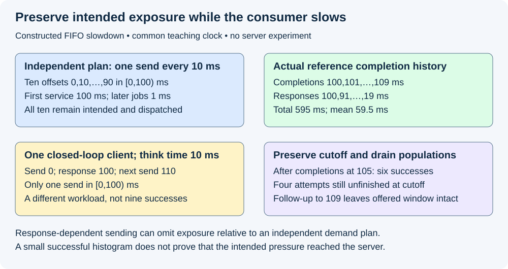
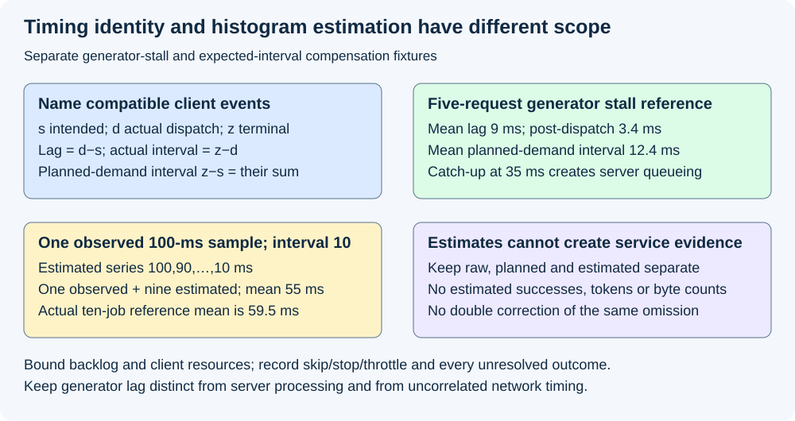

# M9-C09: Open-loop load generation and coordinated omission

> **Status: Complete — detailed chapter authored and documentation validated; experimental procedures are proposed unless explicitly labelled observed.**

**Module:** Make measurement and correctness part of the foundation

**Category:** [Measurement, experimentation, and economics](index.md)

[Module 9 reading order](../module-9.md) · [Previous: M9-C08](../measurement-experimentation-and-economics/m9-c08-designing-representative-serving-workloads.md) · [Next: M9-C10](../measurement-experimentation-and-economics/m9-c10-validating-the-load-generator-and-request-accounting.md)

## Target concepts

Scheduled arrivals independent of completions, open-loop versus closed-loop traffic, offered-load preservation, generator scheduling lag, intended versus actual send times, server slowdown, overload visibility.

[Execution plan and progress](../chapter-execution-plan.md)

## Concepts

### 1. Preserve demand independently of the measured response

An **open-loop workload** schedules intended arrivals independently of prior response completion. A **closed-loop workload** makes new arrivals depend on completion, often through a fixed client population and a **think time**, a delay after each response. Open-loop is not synonymous with perfectly periodic traffic: a frozen burst trace or a separately generated random schedule can also be independent of responses. Closed-loop is appropriate when actual users behave that way; the error is presenting its response-dependent traffic as evidence for a different independent-demand workload.

Use [M9-C08's workload manifest](m9-c08-designing-representative-serving-workloads.md) and [M5-C08's latency boundaries](../scheduling-and-queueing/m5-c08-queueing-delay-service-time-and-request-latency.md). Preserve each logical request/attempt, prompt/cap/configuration bundle, intended offset, stable tie order and generator/random-stream identity. Realized output length remains unknown to a live scheduler. This chapter specifies measurements and experiments, not generator implementation; text generation is the workload and other modalities remain outside scope.

For a periodic teaching schedule with anchor t₀ and spacing Δ>0, **intended time sᵢ=t₀+iΔ** for index i beginning at zero. This is a mathematical schedule, not an instruction to wait for the previous response. Δ=10 ms gives ten intended attempts at 0,10,…,90 in **[0,100) ms**, or **10/0.100=100 attempts/s**. A request at 100 belongs to the next half-open window. Do not re-anchor the schedule after a slow response and silently erase the missed offsets.

The [MLCommons scenario specification](https://github.com/mlcommons/inference/blob/master/loadgen/test_settings.h) distinguishes completion-dependent SingleStream issuance from Server traffic with random arrivals. Pin actual settings, revision and dispatch limits when using a tool; this chapter is not an MLPerf compliance procedure. A configured request rate is a workload intention until actual event records establish what the chosen boundary received.

### 2. Coordinated omission is response-dependent missing exposure

**Coordinated omission** occurs when measurement or load issuance coordinates with a slowdown so that intended observations/demand during that slowdown are absent or delayed without being represented appropriately. For example, a client waits for a slow response before issuing the next request; a latency histogram then contains only the requests that actually ran. It may be accurate for that closed-loop population while understating exposure for an independently arriving target population. Adding more histogram precision cannot restore observations that were never taken.

The [wrk2 maintainer engineering discussion](https://github.com/giltene/wrk2#readme) explains measuring from when a request should have been sent rather than only when transmission occurred. Its documented timing granularity and HTTP execution model do not establish suitability for an arbitrary low-latency streaming inference benchmark. Use it as a primary explanation of the omission mechanism, not as an installed tool or a promised accuracy bound here.

Consider a constructed FIFO single-server reference. All intended requests are dispatched at their scheduled times with zero transport delay. The first requires 100 ms of service, representing an isolated slowdown; each later request needs 1 ms. There is no rejection, cancellation, batch overlap or protocol tail. Completion is a stipulated successful client-terminal observation on the common teaching clock.

| Attempt | Intended and actual dispatch (ms) | Completion (ms) | Scheduled-to-completion (ms) |
|---|---:|---:|---:|
| A | 0 | 100 | 100 |
| B | 10 | 101 | 91 |
| C | 20 | 102 | 82 |
| D | 30 | 103 | 73 |
| E | 40 | 104 | 64 |
| F | 50 | 105 | 55 |
| G | 60 | 106 | 46 |
| H | 70 | 107 | 37 |
| I | 80 | 108 | 28 |
| J | 90 | 109 | 19 |

The ten residence observations sum to **595 ms**, mean **59.5 ms**. Waiting times are [0,90,81,72,63,54,45,36,27,18] ms; all ten attempts experience part of the slowdown or its backlog. The offered window remains 100 ms while follow-up drains at 109. These are constructed references, not measured requests or production quantiles.

A separate one-client closed-loop history sends A at 0 and waits for its completion at 100, then waits a 10-ms think time before sending again at 110. It issues **one attempt in [0,100)**, not ten. There are no actual B–J requests in that closed-loop history. The nine offsets of an independent 10-ms demand plan are absent relative to that plan, not nine secretly successful calls. Do not compare these as matched arrival traces or create request IDs for them after the fact. A slower server has reduced actual closed-loop issuance; that feedback must remain visible when interpreting response distributions and capacity.

At a cutoff immediately after processing completions at **105 ms**, the open-loop cohort has **six successes and four unfinished attempts**. Omitting the four unfinished requests yields a different population even though all were offered and received. Following them through 109 supplies their actual endpoints; it does not extend the original offered window or prove a stable long-run rate.

*The periodic and closed-loop histories answer different demand questions. All durations are stipulated; no server slowdown was executed.*

### 3. Separate generator lag from post-dispatch response time

For one attempt on one compatible client clock, let s be intended send, d actual dispatch at a named boundary, and z parsed terminal. Define:

**Dispatch lag ℓ=d−s; post-dispatch latency A=z−d; planned-demand latency P=z−s=ℓ+A.**

A dispatch boundary must say whether it is entering a networking queue, starting socket transmission, or another observable event. Time waiting after that boundary remains in A, not ℓ. These labels are local measurement contracts; P is not server processing time or one-way network delay. If endpoints come from different clocks, the arithmetic requires a qualified mapping and uncertainty. [M9-C02](m9-c02-request-events-clocks-and-measurement-boundaries.md) defines those limits; the [Rust Instant specification](https://doc.rust-lang.org/std/time/struct.Instant.html) describes host elapsed-time semantics, not a portable shared epoch.

For a separate generator-stall fixture, the server is initially idle and needs exactly 2 ms per request. Intended sends are [0,10,20,30,40] ms; the generator dispatches [0,35,35,35,40] in stable row order after a scheduling delay. Transport and output overhead are zero in this teaching model.

| Attempt | Intended s | Actual d | Completion z | Lag ℓ | Post-dispatch A | Planned P |
|---|---:|---:|---:|---:|---:|---:|
| K | 0 | 0 | 2 | 0 | 2 | 2 |
| L | 10 | 35 | 37 | 25 | 2 | 27 |
| M | 20 | 35 | 39 | 15 | 4 | 19 |
| N | 30 | 35 | 41 | 5 | 6 | 11 |
| O | 40 | 40 | 43 | 0 | 3 | 3 |

Means are **lag 9 ms**, **post-dispatch 3.4 ms**, and **planned-demand 12.4 ms=9+3.4**. The catch-up burst at 35 creates queueing even though the server did not slow down. Starting every timer at d hides generator lag; reporting only P hides whether delay arose before or after dispatch. Preserve both and inspect server receipt/eligibility/service events in their own domain to attribute the cause.

An actual dispatch before its intended offset is a pacing violation under this contract, not a negative latency to clamp to zero. Invalid event ordering, missing terminal and clock discontinuities remain diagnostics. Nanosecond representation does not establish nanosecond resolution, wakeup accuracy or low logging overhead.

### 4. Bound the generator without silently rewriting the workload

Open-loop scheduling does not authorize unbounded memory, connections or requests in flight. Preserve intended records while declaring what happens when dispatch cannot keep up. **Catch up** sends overdue requests later, potentially creating a burst. **Skip late** retains an unsent/expired record and sends no request for it. **Stop** ends the run with explicit unissued demand. A **throttle** waits for a client slot/connection; it makes actual dispatch depend on completion even if the intended schedule remains open-loop. These policies produce different actual workloads and need separate labels.

Bound unsent records/payloads, retry queues, outstanding streams and server waiting/admitted state. Reserve log space or a durable count/identity path so full diagnostic queues cannot erase the only record of an intended attempt. Immutable request input remains owned until dispatch or a recorded unsent outcome; submitted host/device users retain their own claims until completion. Use [M9-C22](../runtime-and-concurrency/m9-c22-verifying-ownership-and-memory-safety-under-concurrency.md) for final-user retirement. Cancellation or dropping a waiter does not stop every previously submitted operation.

Declare timeout/deadline anchoring. A deadline from s includes dispatch lag; one from d excludes it. They can expire different attempts and are not interchangeable workload policies. Retries create new attempt IDs with a parent request; they add demand and must not overwrite the failed attempt. Exact generator CPU/network/connection qualification is developed next in M9-C10, which remains an outline here; this chapter supplies the minimum population contract.

For a separate cutoff fixture of eight intended attempts, suppose one remains unsent, one was dispatched but failed before server receipt, and six were received. The six consist of one server rejection, one waiting/not admitted, one admitted nonterminal, two successes and one post-admission cancellation:

**8 intended = 1 unsent + 1 transport failure before receipt + 1 rejected + 1 waiting + 1 admitted nonterminal + 2 successful + 1 cancelled.**

Cumulative dispatched is seven, received six and admitted four. These are stage counts, not extra terms to add to the mutually exclusive outcome sum. A transport failure here has observed no receipt; uncertain delivery needs an explicit unknown category rather than this known-failure classification. Every attempt retains an outcome or unresolved state. Preserve duplicates/lost logs as failures of accounting, not invented successful latency samples.

### 5. Histogram correction is a scoped estimate

A **histogram** counts values in ranges; it does not retain all request identity or chronology. The [HdrHistogram API documentation](https://hdrhistogram.github.io/HdrHistogram/JavaDoc/org/HdrHistogram/AbstractHistogram.html) describes expected-interval compensation that adds decreasing synthetic values for missing sampling opportunities. It distinguishes at-recording and post-recording correction and warns against applying both to the same omission. The consulted page identifies 2.1.12-SNAPSHOT; pin the actual implementation/version and its units, range, precision and overflow policy when using a port. No API or histogram implementation is supplied here.

For a constructed illustration, one observed 100-ms value with expected interval 10 ms expands conceptually to **[100,90,80,70,60,50,40,30,20,10] ms** under this compensation rule: one observed plus nine estimated entries, mean **55 ms**. This is not the actual ten-request FIFO sample above, whose mean is 59.5 and whose individual values differ because queued requests each consume 1 ms of real service. The estimated entries are not new actual attempts, output tokens, byte transfers or successes.

Correction requires justified expected-sampling assumptions; a single fixed interval may not describe bursty, variable-rate or conversation-dependent traffic. It cannot recover missing request identities, class mix, cache interactions, rejection/cancellation, nonlinear batching or backlog costs for work that never ran. Do not add estimated entries to offered/admitted/completed counters. Do not apply the same compensation again to actual planned-demand intervals already accounting for those scheduled attempts. Keep raw observations, planned-demand observations and any corrected estimate in separately labelled distributions. A precise or corrected histogram is not evidence that the intended traffic reached the server.

*The endpoint decomposition is exact for compatible observed events. Histogram expansion remains a model-based estimate and does not create completed work.*

### 6. Define acceptance around fidelity and useful service

For a fixed offered window [a,b), report **intended rate=number of scheduled offsets in [a,b)/(b−a)**, with seconds in the denominator. Report actual dispatch and receipt counts/rates in their own named windows, plus lag and unsent outcomes. A shifted actual dispatch can move across the window edge; preserve its original intended cohort and its actual event time. A configured rate, histogram count and successful throughput are different quantities.

Validate the generator against a known isolated reference before claiming server capacity, then repeat fidelity checks during the real comparison: a model server's slow responses or large outputs can consume generator CPU, network and connection slots. Correctness includes request/attempt identity, frozen workload/configuration, valid outputs and complete accounting before speed. A nominally asynchronous client can still become response-coupled through its semaphore, connection pool or blocking parsing work.

Measure request first-selected/first-content/terminal endpoints separately and use the actual declared streaming protocol. A stream fragment is not necessarily one token; a final content event can precede application terminal. Preserve failed/rejected/cancelled and open attempts alongside successful TTFT and eligible token gaps. A small successful-only p99 can coexist with unsent demand or growing unresolved work. [M9-C07](m9-c07-latency-distributions-and-statistical-uncertainty.md) supplies quantile/uncertainty conventions; the small teaching fixtures establish no production tail or throughput threshold.

## Experiments

All four experiments are proposed. Authorship observes bounded arithmetic and documentation QA only. No network client, generator, server slowdown, histogram library, model or hardware benchmark is implemented or executed.

### E1 — Preserve scheduled exposure during a slowdown

- **Name:** Ten scheduled attempts remain ten intended attempts.
- **Description:** Reconcile the periodic open-loop slowdown reference against a separately labelled one-client feedback history.
- **Purpose/objective:** Hypothesis: response-dependent issuance reduces exposure during a slowdown relative to independent demand. HFT concern: a replay must not stop producing events while its consumer falls behind.
- **Target concepts:** Independent schedules, open/closed-loop traffic, slowdown and overload visibility.
- **Baseline:** Ten offsets 0–90 ms in [0,100), FIFO first service 100 ms then nine 1-ms jobs; zero generator/transport lag.
- **Workload:** Open-loop reference versus one closed-loop client with 10-ms post-completion think time. Independent variable: issuance feedback rule, explicitly changing the workload. Include cutoff after 105-ms completion processing.
- **Controlled variables:** Request semantics, service assumptions, chosen client terminal, no rejection/overhead and fixed clock. Do not describe the two realized traces as matched arrivals.
- **Hardware requirements:** CPU event reference; later isolated controllable responder or qualified backend with actual dispatch/receipt/terminal logging, not a production stall injection.
- **Exit criteria:** First reproduce ten intended sends and completions 100–109; then response list totaling 595 ms/mean 59.5; finally show one closed-loop send in the offered window and six-success/four-open cutoff. Missing planned exposures never become invented actual successes, and a slower server cannot silently redefine the independent demand plan.

### E2 — Reconcile intended and actual timing

- **Name:** A dispatch timer must not erase the generator's wait.
- **Description:** Audit the five-attempt generator-stall fixture and its catch-up queue.
- **Purpose/objective:** Hypothesis: intended-to-terminal equals dispatch lag plus post-dispatch latency, while either alone can hide the delay's cause. HFT concern: measured handler speed excludes upstream event backlog unless that backlog is recorded.
- **Target concepts:** Scheduling lag, intended/actual sends, offered-load preservation and clock boundaries.
- **Baseline:** Intended [0,10,20,30,40], actual [0,35,35,35,40], stable ties and initially idle serial 2-ms service.
- **Workload:** Exact endpoints and separate early-send, reversed-clock/missing-terminal cases. Independent variable: timestamp choice or one pacing/observation fault per case.
- **Controlled variables:** Request identity/order, service demand, dispatch boundary, common teaching clock and terminal semantics.
- **Hardware requirements:** CPU arithmetic; later qualified monotonic generator clocks, scheduler traces and separately recorded server clocks/correlation.
- **Exit criteria:** First reproduce completions [2,37,39,41,43]; then means 9/3.4/12.4 ms and every per-attempt identity P=ℓ+A; finally preserve early/invalid/missing observations as failures or censored data. An intended-demand delay is not relabelled server processing or network time.

### E3 — Expose finite limits and omitted outcomes

- **Name:** A full client slot is a workload event, not a disappearing request.
- **Description:** Compare declared catch-up/skip/stop/throttle policies and reconcile the eight-intended cutoff fixture.
- **Purpose/objective:** Hypothesis: finite dispatch resources can change actual traffic without changing intended demand; all unsent and uncertain work must remain visible. HFT concern: overload cannot be made to vanish at a buffer boundary.
- **Target concepts:** Offered-load preservation, overload visibility, response coupling and bounded ownership.
- **Baseline:** Immutable scheduled records, explicit payload/log/client limits and distinct generator/transport/server populations.
- **Workload:** One unsent, one known pre-receipt transport failure and six server receipts with declared outcomes. Independent variable: late-dispatch policy in separate cells; include unknown receipt, retry and cancellation after submission as extensions.
- **Controlled variables:** Intended schedule, deadline anchor, request/cap/configuration, output contract, queue/KV bounds and final-user cleanup policy.
- **Hardware requirements:** CPU population audit; later characterized client/server resources and lifecycle logs, with local fault controls and retained-claim evidence.
- **Exit criteria:** First reconcile eight outcomes, seven dispatches, six receipts and four admissions; then distinguish deadline-from-s from deadline-from-d; finally show no overwritten retry, discarded backlog or premature resource return. Throttled actual traffic is labelled as such, and unresolved receipt or completion cannot be forced into success.

### E4 — Bound correction claims and qualify real comparisons

- **Name:** Estimated histogram entries are not completed requests.
- **Description:** Compare one observed value's expected-interval expansion with the independent ten-request reference, then define clean matched-load acceptance.
- **Purpose/objective:** Hypothesis: correction illustrates omitted exposure under assumptions but cannot reconstruct the actual serving history. HFT concern: statistical summaries cannot replace a complete event ledger.
- **Target concepts:** Coordinated omission, latency populations, actual offered traffic and reproducible overload evidence.
- **Baseline:** Observed 100 ms, expected interval 10 ms, one compensation pass; exact FIFO sample retained separately.
- **Workload:** Ten estimated values totaling 550 ms versus ten actual reference values totaling 595; raw versus planned-demand versus estimated reporting. Independent variable: estimation/reporting convention, not actual request issuance. Include unjustified fixed spacing, double correction and unsupported histogram range as negative cases.
- **Controlled variables:** Units, expected-interval assumption, raw identity/count ledger, corrected-count labelling and immutable source observations.
- **Hardware requirements:** CPU arithmetic/reference review; later version-pinned supported histogram tool and qualified generator/server with raw traces. No Java or Rust implementation is provided.
- **Exit criteria:** First reproduce one observed/nine estimated entries and 55-ms estimated mean; then retain the unequal actual 59.5-ms reference; finally prohibit estimated records from service counters and reject double compensation of the same omission. Any real throughput/p99 claim also requires faithful traffic, qualified output and complete outcome evidence.

## Verification

| Experiment | Reference / invariants | Measurement and benchmarking | Acceptance boundary |
|---|---|---|---|
| E1 | Fixed intended offsets, separate feedback rule and complete cohort | Scheduled, dispatched and received counts; slowdown history and cutoff follow-up | Closed-loop results are not silently generalized to independent demand |
| E2 | Compatible clocks, named send boundary and per-attempt identity | Dispatch lag, post-dispatch and planned-demand intervals with chronological traces | Timing identity does not by itself attribute server/network delay |
| E3 | Named resource limits, late-send and deadline policy | Unsent, transport, receipt, admission, terminal and cleanup populations | Full client pools cannot erase demand or release unfinished users |
| E4 | Raw observed and estimated populations remain separate | Histogram units/range, expansion counts, actual versus estimated distributions | Correction is scoped estimation, not actual issued or successful work |

For real comparisons, preserve the [M9-C08 workload](m9-c08-designing-representative-serving-workloads.md) and intended open-loop schedule, model/tokenizer/adapter/precision, stopping and per-attempt random identity. Check output semantics and current lifetimes before timing. Use [M9-C11](m9-c11-controlled-comparisons-warmup-and-reproducibility.md) for a proposed descriptive starting budget of 20 paired reset sessions per predeclared cell, balanced arm order and one complete scratch-trace warmup per arm. Restore the measured cache/adapter state afterward. Retain all pairs, intended/actual event logs, seed algorithms and invalid/missing sessions; requests and adjacent windows need not be independent replication units.

Freeze clock domain, offered window and cohort follow-up rules. Report dispatch-lag distributions and missed sends alongside request latency, useful selected/delivered output, all outcomes and per-class evidence. Drain admitted work and final users or report unresolved/quarantined claims; throughput including drain needs its own denominator. Cutoff censoring and carried-in work stay explicit. Neither 20 sessions nor the ten-request fixture establishes production p99 uncertainty or sustainable capacity; confirmatory hypotheses, sample-size, fidelity tolerances and regression gates belong in a frozen [M9-C27 design](m9-c27-designing-regression-experiments-and-validation-gates.md).

Use separate short diagnostics for generator CPU runnable delay, timers, connection/concurrency waits, payload preparation, network enqueue/receipt, response parsing, server queues and device progress. Estimate log/clock/histogram overhead on matched fixtures and exclude instrumented profiles from clean acceptance timing. Do not subtract uncorrelated client/server timestamps. If dispatch fidelity fails, explain the boundary and actual reduced/shifted workload rather than assigning the server an unsupported capacity result. The next chapter expands generator hardware/resource validation; it is not claimed complete here.

## Engineering dimensions and principles

| Dimension | Application |
|---|---|
| Semantics and invariants | Intended records, actual attempts and estimated samples have distinct identities and meanings |
| Workload and variability | Periodic, bursty and response-dependent traffic preserve their own length/reuse/class correlations; text only |
| Resources and bottlenecks | Client CPU, connections, bounded backlog and logs can limit actual pressure independently of the server |
| Time and distributions | P=ℓ+A exposes dispatch lag; missing exposures and cutoff censoring affect distribution scope |
| Ownership and coordination | Immutable plans, append-only attributable events and supervised final users survive cancellation |
| Failure and adaptation | Skip/stop/throttle, transport uncertainty, retry, timeout and overload remain explicit outcomes |

| Engineering principle | Consequence |
|---|---|
| 1. Correctness defines the optimization boundary | More issued requests cannot justify wrong output, duplicate IDs or unsafe cleanup |
| 2. Performance depends on workload and operating point | Closed-loop feedback changes actual arrival pressure as the server slows |
| 3. Data movement is part of the algorithm | Payload preparation, transmission and response parsing affect dispatch and end-to-end paths |
| 4. State has ownership, lifetime and recovery cost | Unsent payloads and submitted users have separate bounded retention obligations |
| 5. Dependencies determine latency; bottlenecks determine capacity | A client slot waiting for completion can couple dispatch to the server |
| 6. Variability and synchronization shape the tail | Generator catch-up adds bursts; slow responses can suppress intended exposure |
| 7. Local improvements require end-to-end evaluation | Faster parsing or lower corrected latency matters only with faithful demand and useful service |
| 8. Claims require reproducible evidence | Preserve planned/actual times, outcomes, correction assumptions and raw distributions |

The HFT lens is event replay that must preserve event times even while its consumer is delayed. Measuring handler time alone can hide upstream backlog. Inference adds long-lived streams, variable stopping and KV retention; no trading result, exchange deadline or universal load-generator accuracy is established here.

## Specifications, articles, and hardware

Primary MLCommons scenario settings, wrk2's maintainer engineering explanation, HdrHistogram's expected-interval API specification and Rust Instant documentation are linked at their claims. Sources were reviewed on 2026-10-29; pin actual tool commits/ports and platform behavior before execution. No traffic or histogram library was installed. The local measurement contract defines intended/actual send, terminal, clock, late-send rule, immutable identity, outcome ledger and estimated-sample separation.

Reference arithmetic needs CPU review only. Real studies record generator/server CPU/core/SMT/NUMA/RAM, OS/kernel, Rust/runtime/compiler, affinity/quotas, workers, timer behavior, connections/outstanding limits, network/interface topology and backlog/log bounds; GPU architecture/count/VRAM, interconnect, driver/backend/runtime and completion scope; model/adapter/tokenizer/template/corpus hashes, precision/layout, caps/stopping/random streams and cache/queue/KV/workspace/output bounds. Record clock resolution/correlation, sampling/histogram units/range, warmup/reset/drain, deadline/retry and fault policy, and diagnostic overhead. No machine was benchmarked; all millisecond values and rates are constructed reference inputs.

## Key takeaways

Preserve independent intended demand, then prove what was actually dispatched and received. Report generator lag and post-dispatch latency separately, retain every omitted or unfinished attempt, and distinguish response-dependent workloads from independent arrivals. Histogram compensation can illustrate missing exposure; it cannot create evidence of work that never ran.

## Continue learning

Next in Module 9 reading order is completed [M9-C10: Validating the load generator and request accounting](m9-c10-validating-the-load-generator-and-request-accounting.md). The next authoring chapter is [M5-C18: Choosing chunk sizes and balancing prefill with decode](../scheduling-and-queueing/m5-c18-choosing-chunk-sizes-and-balancing-prefill-with-decode.md), position 125. Follow the [execution plan and progress tracker](../chapter-execution-plan.md); Module 9 supports Modules 1–7 and Module 8 is excluded.
