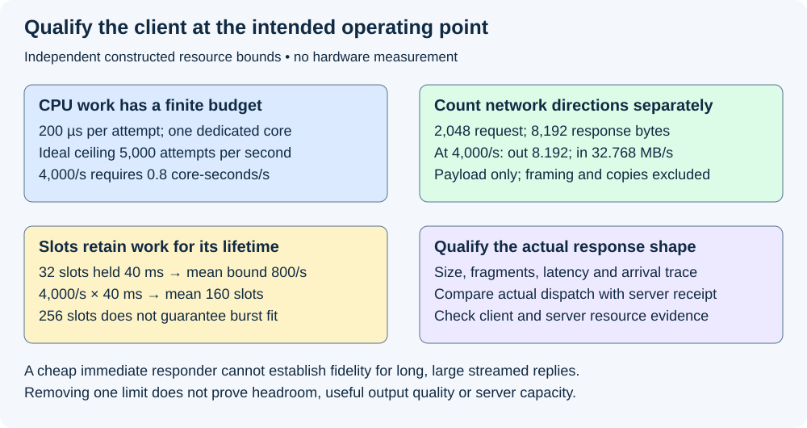
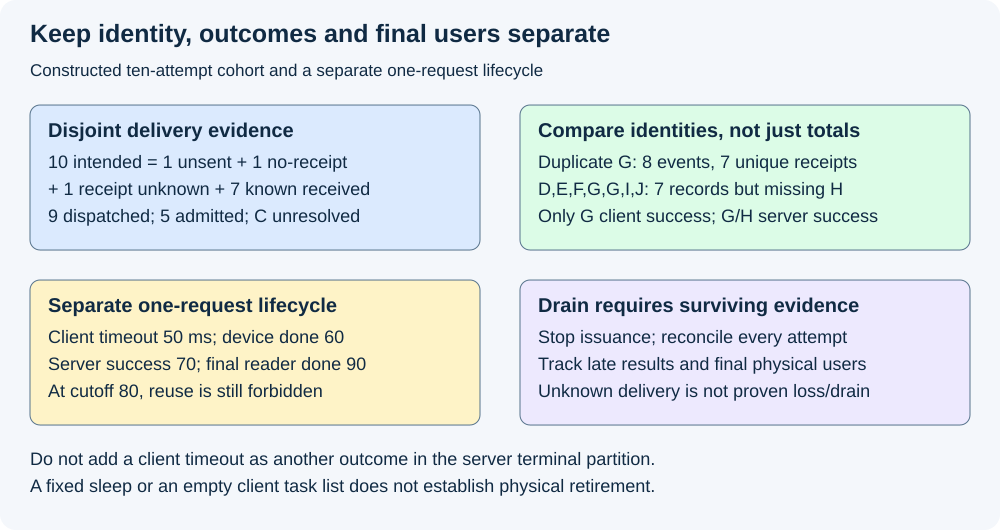

# M9-C10: Validating the load generator and request accounting

> **Status: Complete — detailed chapter authored and documentation validated; experimental procedures are proposed unless explicitly labelled observed.**

**Module:** Make measurement and correctness part of the foundation

**Category:** [Measurement, experimentation, and economics](index.md)

[Module 9 reading order](../module-9.md) · [Previous: M9-C09](../measurement-experimentation-and-economics/m9-c09-open-loop-load-generation-and-coordinated-omission.md) · [Next: M9-C11](../measurement-experimentation-and-economics/m9-c11-controlled-comparisons-warmup-and-reproducibility.md)

## Target concepts

Client CPU and network limits, connection and concurrency caps, actual offered rate, lost or duplicate requests, timeout and cancellation populations, incomplete work, drain periods, generator-induced bottlenecks.

[Execution plan and progress](../chapter-execution-plan.md)

## Concepts

### 1. The instrument can become the bottleneck

A **load generator** prepares requests, schedules sends, receives/parses responses and records evidence. It consumes CPU, memory, connection slots, network bandwidth and logging capacity. It is part of the measurement path, not an unlimited source. A server throughput plateau can be caused by the generator before the model executor is saturated.

Use [M9-C09](m9-c09-open-loop-load-generation-and-coordinated-omission.md) for immutable intended arrivals, actual dispatch, lag and response coupling; use [M5-C06](../runtime-and-concurrency/m5-c06-asynchronous-execution-and-completion-driven-progress.md) for asynchronous progress and surviving cleanup authority. A nominally asynchronous task can still block other work through long formatting, response parsing, a full connection pool or synchronous logging. A task or wakeup count is not a completed request count.

The [MLCommons LoadGen documentation](https://github.com/mlcommons/inference/blob/master/loadgen/README.md) separates traffic generation/logging from model/dataset interpretation and output accuracy. Qualification must therefore check both the traffic instrument and the actual inference reference. A cheap responder can validate dispatch and accounting but cannot establish model quality, GPU capacity or representative KV behavior. This chapter proposes tests; it supplies no generator or server implementation. The workload remains text generation.

First freeze the offered request/attempt trace and the **dispatch boundary**, such as handing a complete request to the network layer. Preserve intended send s, actual dispatch d, server receipt r, admission u, logical server terminal v, client terminal observation z and final-user resource release q with clock domains. These events are not interchangeable. Intended, dispatched, received, admitted and successful rates need their own counts and windows. Rate at a named boundary is **unique events in [a,b) ÷ (b−a)**, with seconds in the denominator. A late event can cross the window edge while still belonging to its original intended cohort.

### 2. Construct resource ceilings before measuring headroom

An idealized client CPU ceiling is **λ_CPU≤available CPU-seconds per second ÷ mean CPU-seconds per attempt** for compatible resources/work. If a single dedicated core supplies one CPU-second/s and a stipulated request preparation plus response-parse path consumes 200 µs/attempt, its optimistic ceiling is **5,000 attempts/s**. At 4,000/s it consumes **0.8 core-seconds/s**. This excludes interruptions, logging, allocation, encryption and other work unless explicitly included. More cores help only if the relevant work can run independently; an event-loop bottleneck is not removed by idle cores elsewhere.

A payload ledger helps expose network demand. At 4,000/s with 2,048 request bytes and 8,192 response bytes per attempt, application traffic is **8,192,000 outgoing bytes/s** and **32,768,000 incoming bytes/s**; aggregate application traffic is **40,960,000 bytes/s**. These decimal byte/s values exclude transport/framing/encryption, retransmissions and copies. Compare each direction with its own full-duplex capacity; do not combine them and silently compare with a one-direction link rating. Streaming fragment frequency and parse work can matter even when total bytes are unchanged.

The [Linux networking maintainer guide](https://docs.kernel.org/networking/scaling.html) explains queue/CPU steering in a multiprocessor network stack. It motivates recording interface queues, CPU placement and network processing, not assuming all packet work runs on the application's worker. No kernel or network settings are changed here. Record actual counters and their definitions before attributing a limit to CPU, bandwidth or the network interface.

**Connections** are transport associations; **concurrency** is simultaneous outstanding application work at a chosen boundary. One connection may carry one serial request or multiple streams. [RFC 9113's HTTP/2 stream-concurrency specification](https://www.rfc-editor.org/rfc/rfc9113.html#section-5.1.2) defines concurrent stream limits; multiplexing does not remove application semaphores, flow control or client/server limits. Record protocol version, negotiated limits, connection reuse and the exact point at which a client slot is released. Stream fragments are not new requests or model tokens.

For a separate fully occupied steady toy client, each outstanding slot is held for a fixed 40-ms response interval. A cap of K=32 slots yields a necessary mean-rate bound **λ≤K/W=32/0.040=800 attempts/s**. Independently offering 4,000/s at that residence would need mean occupancy **λW=160 slots**; throttling at 32 cannot faithfully deliver that rate. Raising the cap to 256 removes this particular mean-occupancy incompatibility but does not guarantee burst capacity, network/CPU headroom or safe retained state. This is a conditional application of [M5-C09](../scheduling-and-queueing/m5-c09-applying-little-s-law-with-consistent-boundaries.md), not a measured server ceiling.

Qualification uses the actual request sizes, response/fragment shape, lifetime and intended arrival pattern. A tiny echo response can understate client parsing and network cost. Qualification against a delay-controlled responder should exercise the declared occupancy and backpressure, not only immediate responses. Recheck during model runs because longer outputs and slow responses can change the generator's operating point.

*All resource demands are teaching inputs. Removing one calculated limit does not establish generator fidelity or model-serving capacity.*

### 3. Reconcile identities before trusting counts

Give each logical user request a stable ID and each retry a distinct **attempt ID** with its parent. Give each observation its source, event kind and sequence/identity. Repeated receipt of the same event is not another successful attempt; repeated network submission may be an actual duplicate operation requiring a separate execution record. A server must not be assumed to provide exactly-once generation merely because the client supplied an ID. Specify deduplication, retry and application semantics before interpretation.

[RFC 9110's idempotency discussion](https://www.rfc-editor.org/rfc/rfc9110.html#section-9.2.2) distinguishes operations that may be safely repeated under stated semantics. A connection failure after sending does not establish that an application operation never executed. Record uncertain delivery until authoritative evidence resolves it; do not silently retry and overwrite the original attempt. This chapter introduces no automatic retry policy.

For a fixed intended cohort I, use disjoint evidence states at a cutoff:

**|I| = unsent + known not received + receipt unknown + known received.**

Here dispatched attempts partition into the last three categories; the known-not-received category requires affirmative evidence, not absence from an incomplete server log. For known received attempts, reconcile current server state:

**Known received = rejected + waiting/not admitted + admitted nonterminal + successful + failed + cancelled.**

Failure/cancellation can occur before or after admission; record that stage explicitly rather than assuming every terminal attempt was admitted. Client outcomes are another ledger. A client timeout can coexist with a server success; it is not an extra term in the server partition. One source's missing terminal cannot be inferred from another source's response counter without identity and semantics.

The following ten-attempt cutoff fixture is constructed. Every attempt was scheduled in [0,100) ms; all listed decisions are observations at the cutoff, not a measured run. D–J have authoritative server receipt records. H's server success is observed through the server ledger, while the client stopped waiting and did not receive a valid terminal by its deadline.

| Attempt | Dispatch/receipt evidence | Current server evidence | Client observation |
|---|---|---|---|
| A | Unsent: client cap reached | No operation submitted | Unsent |
| B | Dispatched; authoritative no-receipt failure | No server receipt | Transport failure |
| C | Dispatched; delivery unresolved | Receipt unknown | No terminal; unresolved |
| D | Received | Rejected before admission | Rejection |
| E | Received | Waiting, not admitted | Pending |
| F | Received/admitted | Nonterminal | Pending |
| G | Received/admitted | Successful | Valid success |
| H | Received/admitted | Successful | Timed out; server result not received by deadline |
| I | Received/admitted | Cancelled | Cancellation acknowledged |
| J | Received/admitted | Failed | Failure |

Thus **10 intended = 1 unsent + 1 known not received + 1 receipt unknown + 7 known received**. Dispatched is nine. Among seven known receipts, **7=1 rejected+1 waiting+1 admitted nonterminal+2 successful+1 cancelled+1 failed**. Five were admitted: F/G/H/I/J. Actual receipt count could exceed the seven known receipts if C was received; keep that uncertainty, not an asserted loss. Only G has a validated client success at this cutoff, while G and H have server success. Both facts remain true in their different populations.

Suppose the server log reports G's receipt twice: eight receipt observations still represent seven unique known attempts. Preserve the duplicate evidence but do not count it as another receipt. A more deceptive corrupted list [D,E,F,G,G,I,J] has seven records but omits H and duplicates G. Total count seven matches the expected seven; identity-set comparison exposes the error. Compare event multiplicity and missing/unexpected ID sets independently. An actual duplicate execution, changed payload under one ID, counter overflow, trace loss or impossible transition is a failed qualification case, not a record to discard until totals agree.

### 4. Timeouts, cancellation and incomplete work need separate views

A **timeout** is a local decision that an expected observation did not arrive by its deadline. A **cancellation** requests or establishes stopping under a specified contract. Neither alone proves that the server never admitted the request, no output committed, or all external accesses completed. Use deadline anchoring from [M9-C09](m9-c09-open-loop-load-generation-and-coordinated-omission.md): intended-send and actual-dispatch deadlines can expire different attempts. Preserve server terminal, client deadline and cancellation acknowledgment separately.

Late results must not retroactively erase a timed-out client's experience. They may resolve delivery/execution uncertainty in the audit without turning the original client success predicate into true. A retry can produce another server operation while the original is still running; preserve parent/attempt identity and charge the additional work. Freeze output/retry policy, including what happens after partial streamed output, before comparing rates or quality.

An attempt open at cutoff has a **censored duration**, observed through the cutoff but lacking a full endpoint. No first token after rejection or no consecutive gap for a one-token output is a valid absence, not latency zero. Preserve offered, received and successful populations with their denominators rather than reporting only surviving successes. Validate selected IDs, parsed terminal/output semantics and class coverage under [M9-C08](m9-c08-designing-representative-serving-workloads.md).

A client parser can also be the bottleneck. Slow response consumption can occupy streams longer and create transport backpressure. Count actual payload bytes, parse CPU, fragment/event counts and eligible token events separately. Do not infer four generated IDs from four network fragments without a qualified mapping. A socket write or connection closure does not establish successful application terminal status.

### 5. Drain is an evidence procedure, not a magic wait duration

**Drain** means stopping new issuance and following the declared cohort and its final users to a documented endpoint. A sleep of fixed length does not prove drain. First close new intended scheduling according to the offered-window policy; retain all unissued records and admitted attempts. Continue collecting terminal, cancellation and cleanup observations. Preserve carried-in work and late dispatches under the original cohort. Reconcile client, server and physical resource ledgers before resetting state.

Consider a separate one-request constructed timeline on one teaching clock: resource assignment 0 ms, client timeout 50, final device access 60, server logical success 70, final host/output reader release 90. At cutoff 80, the client has timed out and the server is logically terminal, but the last reader still owns its claim. Reuse before 90 is invalid under the stipulated policy. If completion is unknown after worker loss, retain or quarantine state rather than forcing a zero outstanding count. [M9-C22](../runtime-and-concurrency/m9-c22-verifying-ownership-and-memory-safety-under-concurrency.md) defines the lifetime evidence; a dropped client task must not drop cleanup authority.

At a bounded drain deadline, report exactly which attempts, delivery states and physical users remain unresolved. The ten-attempt fixture's C cannot be called drained merely because other client tasks finished. An absence of outstanding client futures does not establish server or device drain. If a later audit resolves C, keep the original cutoff report and append the resolution. Reset isolation or worker-domain retirement needs a qualified recovery contract; deleting counters is not recovery.

Offered rate for a cohort and completion throughput use different denominators. For a separate all-success teaching cohort of 100 attempts scheduled in [0,1) s and followed through final client terminal at 1.25 s, offered rate is **100/s**, while full-cohort completion throughput from anchor 0 through drain is **100/1.25=80/s**. The successful completions occurring strictly within the original one-second window require their actual timestamps; that count cannot be inferred from the cohort total. Physical retirement can take longer and has its own endpoint.

*Client timeout, server terminal and final-user release are separate observations. All counts and timestamps are constructed reference inputs.*

### 6. Diagnose a generator-induced plateau with controlled contrasts

A **generator-induced bottleneck** means that the traffic/observation machinery limits the measured demand or useful completion path. Evidence includes rising dispatch lag, unsent backlog, client CPU saturation, connection/stream waits, response-read backpressure, log loss or a throughput change when a client resource limit changes under a controlled test. None of these alone proves the model server has spare sustainable capacity; record server-side evidence too.

Start with a known responder capable of the planned traffic and realistic payload/response/occupancy envelope. Freeze request identity, schedule and reference behavior. Compare one generator-resource factor at a time: CPU budget, worker placement, outstanding cap or connection count. Record actual dispatch and server receipt, not only configured rates. A headroom perturbation, such as increasing a qualified client cap, should not materially change traffic or result distributions within predeclared tolerances if that cap was truly irrelevant. A changed actual workload is reported, not silently treated as the same load.

Then qualify the real model comparison at every offered-load cell and configuration. Long outputs, cold adapters, prefix patterns and precision/backend settings can move the client bottleneck. Keep [M9-C09's independent schedule](m9-c09-open-loop-load-generation-and-coordinated-omission.md) and [M5-C06's completion ownership](../runtime-and-concurrency/m5-c06-asynchronous-execution-and-completion-driven-progress.md). Separate client preparation/parse time, generator ready-to-dispatch lag, transport/receipt, server ready waiting, device-required completion and host commit. Use [M9-C02](m9-c02-request-events-clocks-and-measurement-boundaries.md) for compatible clocks; [Rust Instant](https://doc.rust-lang.org/std/time/struct.Instant.html) is an elapsed-time abstraction with platform caveats, not cross-host time synchronization.

## Experiments

All four experiments are proposed. Authorship observes only reference arithmetic, identity-set review and documentation QA. No network, generator, responder, model, timeout/cancellation fault or hardware study is implemented or executed.

### E1 — Qualify client resource and concurrency limits

- **Name:** The source must be able to supply the declared traffic.
- **Description:** Reconcile CPU/byte/slot bounds, then specify a known-responder qualification and resource perturbation.
- **Purpose/objective:** Hypothesis: client limits can reduce actual traffic before server capacity is reached. HFT concern: the replay instrument must not throttle events while reporting a consumer limit.
- **Target concepts:** Client CPU/network, connection/concurrency caps, actual rate and generator bottlenecks.
- **Baseline:** Stipulated 200-µs client CPU path, 2,048/8,192 request/response bytes, 4,000/s target, separate 40-ms slot residence.
- **Workload:** Payload/fragment/latency envelope matching the intended server study. Independent variable: one client CPU/cap/connection resource at a time. Include immediate versus delayed responder as separate occupancy cases.
- **Controlled variables:** Intended schedule, identities, formats/response size, protocol/stream limits, parser behavior, logging scope and responder semantics.
- **Hardware requirements:** CPU arithmetic initially; later isolated qualified responder and recorded generator CPU/NUMA/network/connection counters, with no model-capacity claim from responder tests.
- **Exit criteria:** First reproduce 5,000/s CPU ceiling, 0.8 core demand, directional 8.192/32.768 MB/s payload rates and 800/s cap bound; then verify actual dispatch/receipt and lag under the real envelope; finally test headroom within predeclared fidelity tolerances. A cap increase to 256 is not a guarantee that burst or CPU/network requirements fit.

### E2 — Reconcile lost, duplicate and uncertain attempts

- **Name:** Matching totals cannot replace matching identities.
- **Description:** Compare independent client/server event sets for the ten-attempt cutoff and duplicate-log negative cases.
- **Purpose/objective:** Hypothesis: unique IDs, event multiplicity and evidence-state partitions detect errors that aggregate counters miss. HFT concern: old/duplicated events must not masquerade as new useful service.
- **Target concepts:** Lost/duplicate requests, actual rate, timeout/cancellation populations and incomplete work.
- **Baseline:** A–J immutable intended cohort; authoritative receipt/status evidence only for D–J; C remains delivery-unknown.
- **Workload:** Exact cutoff, duplicate G receipt, missing H replaced by duplicate G, conflicting payload/ID, retry with new attempt ID and lost-log coverage. Independent variable: one injected ledger discrepancy per audit case.
- **Controlled variables:** Evidence source/kind/sequence, parent request identity, cutoff, admission/terminal definitions and original input bundle.
- **Hardware requirements:** CPU set/population reference; later isolated protocol responder/server with independent attributable logs and explicit dropped-record accounting.
- **Exit criteria:** First reproduce ten intended, nine dispatched, seven known received and five admitted attempts and complete disjoint outcomes; then detect eight receipt observations versus seven unique receipts and the equal-count corrupted list; finally retain C uncertainty and distinguish G/H server successes from only G's client success. No automatic exactly-once or known-loss inference follows from a missing response.

### E3 — Preserve timeout, cancellation and physical drain

- **Name:** A timed-out waiter cannot release unfinished users.
- **Description:** Audit the separate 0–90-ms lifecycle and drain denominator, including late evidence and bounded unresolved endpoints.
- **Purpose/objective:** Hypothesis: client completion, server logical terminal and final physical access require different evidence. HFT concern: abandoned work cannot corrupt later events through recycled storage.
- **Target concepts:** Timeout/cancellation populations, incomplete work, drain periods and ownership.
- **Baseline:** Client timeout 50, device final access 60, server success 70, final reader 90; no cross-clock subtraction in this teaching fixture.
- **Workload:** Cutoff 80, late client/server records, unknown worker completion, retry after timeout and 100-attempt/1.25-s follow-up. Independent variable: endpoint/cutoff or one lifecycle fault in separate cases.
- **Controlled variables:** Attempt/generation identity, deadline anchor, committed output policy, final-user claim set and reset/recovery authority.
- **Hardware requirements:** CPU timeline review; later supported isolated host/device completion and cancellation diagnostics with declared coverage.
- **Exit criteria:** First show reuse at 80 rejects and final-user eligibility waits to 90 under all gates; then preserve timed-out client history despite server success; finally reproduce offered 100/s versus full-cohort 80/s and list unresolved drain identities. Fixed sleep, task disappearance or counter reset cannot stand in for terminal/cleanup evidence.

### E4 — Attribute plateaus without hiding reduced demand

- **Name:** Change the generator only to test a declared limiting hypothesis.
- **Description:** Define controlled client-resource comparisons against a qualified responder and repeat fidelity checks with the actual model workload.
- **Purpose/objective:** Hypothesis: a client-limited plateau shifts with a relevant generator resource while server and useful-work evidence explain the remaining limit. HFT concern: measurement machinery cannot silently change the arrival operating point.
- **Target concepts:** Actual offered rate, CPU/network/concurrency limits, drain and generator-induced bottlenecks.
- **Baseline:** Frozen M9-C08 workload/configuration and M9-C09 schedule, known output/identity behavior, bounded resources and complete logs.
- **Workload:** Predeclared target-rate, payload/fragment and response-duration cells; vary one CPU budget, worker placement, client cap or connection limit separately. Include no-change control and large-response parsing cases.
- **Controlled variables:** Server hardware/policy, model/tokenizer/adapter/precision, input/output semantics, cache state, retry/deadline and observation/drain boundaries.
- **Hardware requirements:** Qualified generator/server machines, supported host/network counters and short device/host traces; client perturbations and model tests have recorded independent resource budgets.
- **Exit criteria:** First qualify reference traffic/outputs and diagnostic loss; then compare actual dispatch/receipt, lag, backlog and per-class outcomes; finally attribute any plateau with both client and server evidence. Changed actual arrivals are labelled; neither stable CPU nor an insensitive single perturbation proves universal headroom or sustainable capacity.

## Verification

| Experiment | Reference / invariants | Measurement and benchmarking | Acceptance scope |
|---|---|---|---|
| E1 | Compatible CPU, byte, direction and slot boundaries | Actual rates, CPU/parse work, network bytes, cap waits and dispatch lag | Calculated ceilings are necessary bounds, not measured capacity |
| E2 | Unique attempt/parent IDs, event multiplicity and disjoint evidence states | Intended, dispatched, known/unknown receipt, admission and both terminal views | Matching totals alone cannot establish no loss or duplicate execution |
| E3 | Deadline, logical terminal and final-user claims remain distinct | Censored/late intervals, unresolved drain inventory and explicit rate denominators | No success rewrite, early reuse or drain claim from fixed waiting |
| E4 | Same declared workload/reference with one resource factor changed | Generator and server diagnostics, useful output and per-class response/outcomes | A shifted workload or unqualified generator cannot establish server capacity |

For real qualification, freeze identities and workload under [M9-C08](m9-c08-designing-representative-serving-workloads.md). Validate reference output and lifecycle invariants before timing. A proposed descriptive starting budget under [M9-C11](m9-c11-controlled-comparisons-warmup-and-reproducibility.md) is 20 paired reset sessions per named cell, balanced arm order and one full scratch-trace warmup per arm. Restore measured cache/adapter state. Preserve all pairs, missing/invalid observations, trace-loss counts and actual event order; session pairs are replication units and adjacent requests/windows may be dependent.

Record intended-to-dispatch lag and compatible client/server intervals, first selected/visible/parsed output, application terminal, cancellation acknowledgment and physical release. Keep no-output/one-output gap absence distinct from missing instrumentation. Report successful/failed/rejected/cancelled/open populations, unique logical requests versus attempts, useful selected/delivered output, generator/server backlog, payload/KV/workspace/output bytes and outstanding users. Synthetic histogram entries are not attempt records. If client and server conclusions differ, retain both with the actual observation scope instead of forcing one outcome.

Predeclare offered windows, drain deadline and whether throughput uses completion events in a window or full-cohort follow-up. Preserve carried-in work, late sends and unresolved delivery. Show headroom checks at each model/configuration/load cell; qualification with small immediate responses is insufficient for large slow streams. Neither the constructed fixtures nor 20 sessions establishes p99 uncertainty or a capacity threshold. Freeze sample-size reasoning, dispatch-fidelity tolerances, loss/duplicate gates and per-class quality/performance/resource regression criteria under [M9-C27](m9-c27-designing-regression-experiments-and-validation-gates.md).

Use separate short diagnostics for generator runnable delay, allocation/formatting, parsing, connection/stream pools, transport queues, server readiness and device progress. Record counter/clock definitions and sampling resolution; estimate diagnostic overhead on matched cases and keep profiling/sanitizer runs out of clean timing. Complete rate/identity accounting is required even when logging is expensive. A log overflow makes the affected claim incomplete; silently sampling away failures does not qualify the instrument.

## Engineering dimensions and principles

| Dimension | Application |
|---|---|
| Semantics and invariants | E2 reconciles attempt/event identity and separate client/server meanings before useful-service counts |
| Workload and variability | Large/fragmented outputs, long residence, bursts, length/reuse/adapter skew alter client limits; text only |
| Resources and bottlenecks | CPU, directional traffic, stream slots, logs and retained bytes have explicit boundaries |
| Time and distributions | Actual dispatch, local timeout, terminal and final-user intervals differ; unresolved durations stay censored |
| Ownership and coordination | Payload/log authority and supervised completion claims survive waiter loss |
| Failure and adaptation | Unsent, known failure, unknown delivery, duplicates, retry and bounded-drain leftovers remain explicit |

| Engineering principle | Consequence |
|---|---|
| 1. Correctness defines the optimization boundary | A high dispatch rate cannot excuse duplicate IDs, invalid output or lost failure records |
| 2. Performance depends on workload and operating point | A client qualifying immediate tiny replies may fail on large slow streams |
| 3. Data movement is part of the algorithm | Request/response bytes, copies and network processing consume different directions/resources |
| 4. State has ownership, lifetime and recovery cost | A client timeout at 50 does not release the final reader before 90 |
| 5. Dependencies determine latency; bottlenecks determine capacity | A 32-slot/40-ms client caps mean rate at 800/s under its stated model |
| 6. Variability and synchronization shape the tail | Bursts, parse stalls and connection-slot waits can change actual traffic and response tails |
| 7. Local improvements require end-to-end evaluation | More client resources matter through faithful demand, correct output and useful server behavior |
| 8. Claims require reproducible evidence | Keep independent logs, identity sets, unknowns, counter scope and reset/drain evidence |

The HFT lens is qualifying the replay/feed instrument before attributing missing events or delays to the consumer. Identity, bounded queues and independent observation transfer well. Inference adds long-lived output streams, model semantics and GPU/KV lifetimes; no trading result, exchange deadline or hardware capacity is established by these references.

## Specifications, articles, and hardware

Primary MLCommons responsibilities, Linux networking engineering documentation, RFC 9113 stream limits, RFC 9110 retry semantics and Rust Instant specifications are linked at their relevant claims. Sources were reviewed on 2026-10-29. The local measurement specification fixes unique attempt/event identity, evidence states, dispatch/receipt/terminal/final-user boundaries, directional bytes and recovery/drain criteria. No protocol client or kernel/network configuration is implemented or changed.

Reference arithmetic needs CPU review only. Actual studies record generator and server CPU/core/SMT/NUMA/RAM, OS/kernel, Rust/runtime/compiler, affinity/quotas, worker placement, parser/formatter, encryption, connections/streams and application caps; interface/link/queue topology, directional bytes, losses/retransmissions and network CPU work; GPU architecture/count/VRAM, interconnect, backend/driver/runtime and completion scope; model/adapter/tokenizer/template/corpus hashes, precision/layout, caps/stopping/random streams and cache/queue/KV/workspace/output/log bounds. Record clocks/correlation, payload/fragment distributions, warmup/reset/drain, retry/deadline/fault policy and diagnostic overhead. No machine was benchmarked; the resource values above are teaching inputs.

## Key takeaways

Qualify the generator at the actual payload, occupancy and traffic envelope. Match identities and evidence states across independent observations; never force unknown delivery into loss or client timeout into server cancellation. A completed client task, a terminal server request and physical drain require separate proof before claiming useful serving capacity.

## Continue learning

Next in Module 9 reading order is completed [M9-C11: Controlled comparisons, warmup, and reproducibility](m9-c11-controlled-comparisons-warmup-and-reproducibility.md). The next authoring chapter is [M5-C18: Choosing chunk sizes and balancing prefill with decode](../scheduling-and-queueing/m5-c18-choosing-chunk-sizes-and-balancing-prefill-with-decode.md), position 125. Follow the [execution plan and progress tracker](../chapter-execution-plan.md); Module 9 supports Modules 1–7 and Module 8 is excluded.
