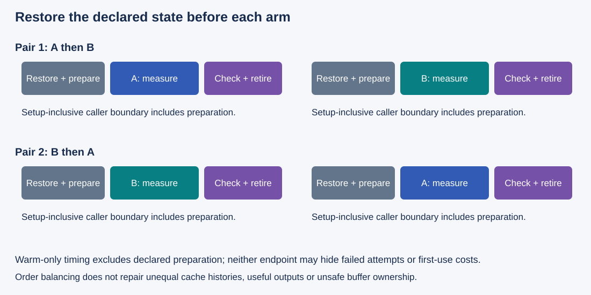
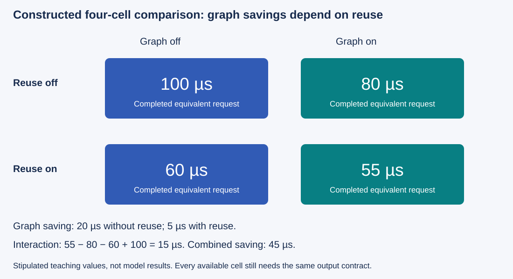

# M9-C11: Controlled comparisons, warmup, and reproducibility

> **Status: Complete — detailed chapter authored and documentation validated; experimental procedures are proposed unless explicitly labelled observed**

**Module:** Make measurement and correctness part of the foundation

**Category:** [Measurement, experimentation, and economics](index.md)

[Module 9 reading order](../module-9.md) · [Previous: M9-C10](../measurement-experimentation-and-economics/m9-c10-validating-the-load-generator-and-request-accounting.md) · [Next: M9-C12](../measurement-experimentation-and-economics/m9-c12-reading-cpu-gpu-timelines-and-scheduling-gaps.md)

[Execution plan and progress](../chapter-execution-plan.md)

## Target concepts

Fixed models and workloads, seeds, cold versus warm state, prefix-cache controls, compilation and graph setup, allocator state, paired comparisons, ablations, repeated trials, configuration records.

## Concepts

### 1. State the comparison before collecting numbers

A **controlled comparison** deliberately changes a named condition while holding relevant alternatives fixed or measuring their differences. The condition changed is a factor; its settings are levels. The measured outcome is the response. A **confounder** changes with the candidate and can also affect the response, making attribution ambiguous. For example, a candidate with faster launch submission may appear better because only its prefix cache was primed.

Write a question such as: “At the same model, token-ID workload, arrival schedule and starting state, does prepared graph submission improve completed-request latency without changing tokens, stopping, publication or ownership?” This identifies the baseline, candidate, population and correctness gate. A claim about warm replay differs from one about startup or variable-shape serving.

[NIST's experimental-design guide](https://www.itl.nist.gov/div898/handbook/pri/section3/pri33.htm) connects the design to the objective and factors. Here, a **treatment** is the candidate configuration, and a **block** is a group of comparable runs sharing a machine/session/workload condition. Blocking reduces variation from known nuisance conditions; it cannot repair a wrong reference or unequal useful work.

| Contract | Required decision before measurement |
|---|---|
| Useful result | Exact output, justified numerical equivalence, or a declared approximation/constraint; never silently change the contract |
| Model identity | Weight revision, tokenizer/template, adapters, precision, position/mask/stopping policy and actual loaded binary |
| Workload | Exact token IDs and order, logical lengths/caps, repeated prefixes, skew and offered arrivals |
| State | Process/compilation/graph, allocator, prefix/KV, CPU/GPU hardware cache and thermal conditions |
| Timing | Arrival, admission, submit, completed device work, token publication and terminal outcome boundaries |
| Comparison unit | Independent paired session or other declared unit; repeated invocations within it remain related |
| Decision | Practical improvement/regression budgets, uncertainty method and rules for failed/incomplete runs |

A fixed token-ID workload avoids differences introduced by retokenization. A model name alone cannot identify actual weights or adapters. Preserve the original artifacts or exact immutable identifiers and content checks. A checksum helps detect change; it is not proof of mathematical correctness or authorization to share cached state.

### 2. A seed fixes only part of an execution

A **seed** initializes a pseudo-random number generator (RNG). Repetition also depends on generator algorithm/version, initial state, draw order, mapping from draws to requests and deterministic numerical operations. [PyTorch 2.14 reproducibility guidance](https://docs.pytorch.org/docs/2.14/notes/randomness.html) explicitly limits cross-release/platform and CPU/GPU reproducibility even with the same seed. A Rust host calling another runtime may have several generators to identify.

Consider a constructed global draw sequence [0.1,0.2,0.9,0.8]. Two requests A and B each need two draws. If the schedule is A,A,B,B, A receives [0.1,0.2] and B [0.9,0.8]. If it is A,B,A,B, A receives [0.1,0.9] and B [0.2,0.8]. The global sequence is unchanged; per-request inputs differ. Record random-stream ownership and consumption, not just “seed=42.” Advanced sampling equivalence is developed later in M4-C19; this chapter does not assume that chapter has been authored.

For basic timing attribution, begin with deterministic fixed-input fixtures and an existing deterministic generator path. If sampling is essential, state whether the comparison requires token-by-token equality or a justified distributional contract. Different tokens can change output length, stopping, cache behavior and workload; a faster unequal run cannot establish an equivalent-computation speedup. A seed used to shuffle run order is separate from the seed used for model sampling. Archive the actual shuffled order and draw mapping so reproduction does not depend on regenerating them with a different library.

### 3. Cold and warm are vectors of state

“Cold” has no useful meaning without a reset contract. Restarting a process may leave disk compilation artifacts, driver state, hardware temperature and persistent cache services unchanged. Clearing a prefix index does not necessarily return allocator memory to the operating system. Reset only the state named in the study, document how reset is verified, and avoid claiming inaccessible hardware state is controlled.

*Figure 1. Each arm gets its own declared starting state. Preparation is excluded only from the warm-only endpoint; it remains visible in setup-inclusive evidence.*

| State dimension | Example cold condition | Example warm condition / verification |
|---|---|---|
| Compilation and binary loading | Required specialization unavailable | Exact binary/specialization prepared; retain compile/load logs |
| Graph | No matching executable | Matching slot-specific executable captured, instantiated, first launch completed and validated |
| Allocator | Declared new process/pool with no fixture reuse | Prepared buffers with recorded live/reserved bytes and generation ownership |
| Prefix/KV | Empty eligible-prefix state, verified by index and ownership ledger | Precisely seeded eligible prefixes under the same sharing/identity contract |
| Hardware data caches | Defined access history, or explicitly uncontrolled | Defined priming history; do not infer L2 state from prefix-cache hits |
| Clock/thermal/scheduler | Recorded starting state, not assumed identical | Stable observed operating conditions within a predeclared window; preserve deviations |

[PyTorch's benchmark timer documentation](https://docs.pytorch.org/docs/2.14/benchmark_utils.html) explains warmups, replicate measurements, thread control and accelerator synchronization. These are measurement responsibilities even when Rust owns the host loop. Warmup cannot be a fixed magic count: name the variants exercised, check outputs/completion, inspect the initial sequence, and report whether a predeclared stability criterion was met. If not, label the session unstable rather than deleting slow samples until it looks fast.

For this chapter's proposed warm studies, use 20 completed warm-ups, then 100 measured invocations per microbenchmark cell. Inspect five consecutive groups of four warm-up completions, setup logs and device conditions. Treat a greater-than-2% difference between the final two group medians as an investigation flag, not proof that statistical behavior stays stable over time or a universal rejection threshold. If flagged, retain the run and classify it; any revised warmup protocol applies to both arms in a new labelled study. Do not selectively extend only the slower arm and hide the extra preparation cost.

[CUDA Graph preparation](https://docs.nvidia.com/cuda/cuda-programming-guide/04-special-topics/cuda-graphs.html) separates description, instantiation and execution. Preserve compilation, capture, instantiation, optional upload, first launch, warm repeats and retirement separately. Warmup must use owned scratch state or restore request state afterwards; do not advance live KV, sampling state or stop counters while “preparing” the benchmark.

The [Nsight Compute profiling guide](https://docs.nvidia.com/nsight-compute/ProfilingGuide/index.html) describes replay, cache control and collection effects. A profiler may change cache history and scheduling. Keep untraced performance comparisons separate from diagnostic captures, and archive the profiler's replay/cache policy. A counter run with caches flushed between passes is not automatically representative of an application with preceding producers and reuse.

### 4. Prefix state and allocator history are part of the workload

[M2-C13](../state-memory-and-caching/m2-c13-prefix-reuse-and-cache-identity.md) defines exact-prefix identity and retention. A hit requires compatible computation and authorized state sharing, not similar text. Match exact token IDs, model/adapter, positions/masks, numerical contract and current storage identity before reusing state.

Choose one of three cache studies explicitly: empty-start workload replay, identically preseeded workload replay, or naturally evolving steady-state service. In each, record admitted lookups, reused positions/blocks, allocations, evictions and retained bytes. A request hit rate is not a reused-token fraction or a saved-compute fraction. Do not reset before every request and label the result naturally evolving service.

A constructed **whole-key LRU probe**, separate from actual KV block semantics, uses capacity two and key trace [P,Q,P,P,R,P]. LRU means evict the least recently used key on a miss when full. From empty state, the outcomes are miss, miss, hit, hit, miss, hit: **3/6 hits**. The ending state contains R and P, with P most recent. Run the same trace again without reset and it has **4/6 hits**. Comparing baseline's first pass to candidate's second pass confounds implementation with initial state. Key labels are teaching identities, not claimed model prefixes; actual cache studies need M2-C13's full identity/reference gates.

Allocator history matters too: identical live payload can coexist with different reserved pools and fragmentation. Reuse cannot bypass last-user lifetime rules from [M4-C16](../runtime-and-concurrency/m4-c16-replay-constraints-graph-variants-and-buffer-lifetimes.md). Record buffer identities, allocated/live/reserved peaks, preparation failures and release policy. An allocator reset that changes graph addresses also requires matching graph bindings before replay. No device-wide reset or cache flush is prescribed as a universal fairness procedure.

### 5. Pair runs, counterbalance order and retain repetitions

A **paired comparison** matches baseline and candidate under the same workload and declared starting state. A **counterbalanced order** varies which arm goes first so treatment is less tied to time drift. Each arm still requires restoration to its intended starting state; running candidate second without resetting its warmed prefix state is not a valid pair.

For a constructed four-position experiment, the underlying environment costs [100,110,120,130] µs across time. Candidate execution multiplies its current environment cost by 0.9; baseline multiplies by 1. If order is A,A,B,B, the observed A mean is 105 and B mean 112.5: candidate appears **7.143% slower**. With A,B,B,A, the A mean is 115 and B mean 103.5: **10% lower**, matching the stipulated effect at the shared mean environment. This balances the particular linear drift model, not arbitrary nonlinear drift, cache carryover or interference.

For matched run summaries a_j and b_j, define paired relative reduction **r_j = 1 − b_j/a_j**, where positive means lower candidate latency. State whether the reported result is a median of paired reductions, a ratio of means, or another declared quantity. They answer different questions. The chosen quantity to estimate is called the estimand.

| Constructed pair | Baseline a_j (µs) | Candidate b_j (µs) | Paired reduction |
|---|---|---|---|
| 1 | 100 | 90 | 10% |
| 2 | 120 | 102 | 15% |
| 3 | 80 | 76 | 5% |
| 4 | 200 | 170 | 15% |

The median paired reduction is **12.5%**, mean paired reduction **11.25%**, and reduction from the ratio of means **1 − 109.5/125 = 12.4%**. None is an uncertainty interval. Use [M9-C07](m9-c07-latency-distributions-and-statistical-uncertainty.md) for uncertainty and resample at the independent session/block level when appropriate. Thousands of launches within one session do not create thousands of independent machine conditions.

Retain raw observations and paired session summaries, not only a best run. Predeclare precision goals, practical budgets, stopping rules and treatment of interrupted runs. Report unstable or failed sessions with reasons. An objective instrumentation failure can invalidate timing, but its record and the decision must remain; a slow result is not by itself an exclusion reason.

### 6. Ablations expose interactions

An **ablation** removes or disables a named feature while preserving the required output contract. It helps explain which part of a combined change matters. A full two-factor design evaluates all four combinations. [NIST's factorial-design reference](https://www.itl.nist.gov/div898/handbook/pri/section3/pri333.htm) defines this combination structure.

For a constructed example, G is graph submission and C is exact-prefix reuse. Lower latency is better:

*Figure 2. Graph savings differ with cache state. These stipulated numbers demonstrate interaction and are not measured model results.*

| Graph G | Prefix reuse C | Latency T(G,C) |
|---|---|---|
| Off | Off | 100 µs |
| On | Off | 80 µs |
| Off | On | 60 µs |
| On | On | 55 µs |

Graph saves 20 µs without reuse and 5 µs with reuse. Combined saving is **100−55 = 45 µs**, rather than the sum of isolated savings 20+40=60. The difference-of-differences is **I = T(1,1) − T(1,0) − T(0,1) + T(0,0) = 15 µs**. In this latency convention the positive interaction means less combined saving than a simple additive model predicts. Its sign is not a universal quality label.

All four cells require equivalent useful outputs and supported implementations. Toggling reuse deliberately changes fresh computation and retained state; call it an optimization-policy comparison, not identical executed work. Graph effects should be compared within each reuse condition, with matching initial cache state and input policy. Missing cells limit attribution. Do not fake an unavailable feature combination or silently substitute another backend.

### 7. Reproduction requires an evidence bundle

A configuration record should let another reader identify what ran, reproduce the intended starting state and understand every outcome. Give each study, session, arm, attempt and trace a stable identity. Store actual workload/order logs as well as generation seeds. Record source revision plus local modifications, binary identities and the observed configuration after loading, not only intended settings.

Minimum bundle: comparison question and reference gate; model/tokenizer/adapter identities; exact input IDs and arrival log; seed/RNG mapping where relevant; preparation/reset and ownership ledgers; CPU/GPU/software manifest; all raw outcomes/timestamps; paired summaries and uncertainty method; profiling settings; exclusion/failure reasons; and the final claim's workload/state boundaries. Output tokens and stopping results belong alongside performance evidence. Retain privacy/authority constraints for any real workload; this chapter's studies use synthetic controlled inputs.

The HFT connection is disciplined attribution under stateful, variable load: replay the same event history, preserve decision correctness, separate startup from hot-path behavior, and retain overload/stale/cancel outcomes. GPU experiments do not reproduce exchange/network semantics or certify trading latency. Fast local timing matters only through useful end-to-end service.

## Experiments

All studies are proposed. Use existing reviewed kernels, cache and generator paths; unavailable cells remain pending. No implementation, profiler results or measured speedup is provided.

### Shared fixture and sampling policy

For a deterministic microbenchmark, use contiguous disjoint FP32 arrays with **X_i = ((17i + 5e) mod 257) − 128** and **Y_i = 3X_i + 7**, where i is a zero-based index, e is an integer epoch and modulo returns a nonnegative remainder. Inputs lie in [−128,128], outputs in [−377,391]; integer multiply/add results are exactly representable in FP32. Use N={1,31,32,33,4096,65537}, epochs 0–7, plus N=0 with empty output and no device launch. Largest two-array payload is **8 × 65,537 = 524,296 bytes**. Budget 64 MiB each for host/device fixture storage, separately reporting graph/allocator/profiler overhead.

Use five paired sessions per cell, 20 checked warm-up invocations and 100 measured invocations per arm unless the named study requires fresh cold observations. Precommit the five pair orders A/B, B/A, A/B, B/A, A/B; archive actual order and block start conditions. Balance across additional studies or randomize and archive an order prepared independently of results. The slight five-pair imbalance is disclosed, not assumed perfectly counterbalanced. One invocation per fixed-address slot is in flight; acquire current ownership and retain through device completion and CPU readback. Check exact outputs before timing and after each measured epoch. Warm performance endpoints exclude declared preparation; setup-inclusive caller endpoints retain it. Never mix host submission duration with completed operation latency.

### E1 — Validate the comparison and its records

- **Name:** A/A provenance and paired baseline check.
- **Description:** Compare the same reviewed binary/configuration under two labels before testing a real candidate.
- **Purpose / objective:** Detect asymmetric preparation, order effects, workload drift and missing records.
- **Target concepts:** Fixed models/workloads, paired comparisons, repeated trials, configuration records.
- **Baseline and hypothesis:** Label A is baseline; B is identical work. Hypothesis: systematic differences indicate protocol/state/instrumentation effects rather than an implementation benefit.
- **Workload and controls:** Shared exact fixture and five-pair protocol; same allocations, execution mode, inputs, validation and instrumentation. Restore the declared state independently for each arm.
- **Procedure:** Verify identities and exact output, archive input/order/reset logs, then measure completed host/device/caller boundaries. Compare paired summaries with uncertainty and inspect time/order trends. Inject a changed workload identifier or binary record in a metadata model and confirm the comparison is rejected before attribution. Add an existing real candidate only in a separately labelled, predeclared study.
- **Hardware and failure conditions:** Manifest below; retain preemption, clock/thermal shifts, trace loss, timeout and missing-reference outcomes. Do not exclude an arm merely because it is slower.
- **Exit criteria:** Matching useful work and configuration, reconciled samples, no unexplained systematic A/A effect at the predeclared precision. An inconclusive noisy result cannot validate a small candidate improvement.

### E2 — Separate state preparation from steady execution

- **Name:** Cold/warm and allocator-state audit.
- **Description:** Measure fresh graph preparation and prepared replay separately, with declared allocator and input-residency conditions.
- **Purpose / objective:** Establish what warmup removes and which cost remains exposed to callers.
- **Target concepts:** Cold versus warm state, compilation and graph setup, allocator state, repeated trials.
- **Baseline and hypothesis:** Prepared ordinary execution is baseline; graph path is tested only if equivalent. Hypothesis: warm replay may improve while setup-inclusive short sessions lose.
- **Workload and controls:** N={32,4096}, epochs 0–7, reuse counts {1,10,100}; five paired sessions/cell. Shared compilation/allocation preparation is equal unless explicitly under test. Fresh graph instances retain first-launch measurements; warm cells apply the shared 20-invocation preparation separately to every slot-specific executable.
- **Procedure:** Record process, disk artifact, compiler, graph, allocator and hardware state before each arm. Archive compile, load, capture, instantiate, upload, first/repeat and cleanup intervals and live/reserved bytes. Check warm-up group medians and required outputs without deleting early observations. Compare warm and setup-inclusive endpoints separately. Label unavailable cold-reset guarantees explicitly.
- **Hardware and failure conditions:** Fixed-address buffer contract and installed runtime/binding; include preparation/allocation failure, changed addresses and unstable warmup. Unknown completion retains resources; no replay through stale graph bindings.
- **Exit criteria:** Exact outputs, explicit reset/preparation scope, visible first-use and cleanup cost, and a reproducible state ledger. No “cold” or “warm” claim without evidence for its named dimensions.

### E3 — Control prefix state and test interaction

- **Name:** Graph-by-prefix policy ablation.
- **Description:** Compare four graph/reuse policy cells where supported, starting from empty or identically preseeded prefix state in separate studies.
- **Purpose / objective:** Distinguish submission effects, avoided computation and state carryover.
- **Target concepts:** Prefix-cache controls, ablations, fixed workloads, paired comparisons, configuration records.
- **Baseline and hypothesis:** Graph off/reuse off is baseline. Hypothesis: graph effects depend on reuse state, and unmatched priming creates misleading benefits.
- **Workload and controls:** For an available existing generator, fix model/tokenizer/precision and four synthetic token-ID prompts of length 64: two share an exact eligible prefix of 32 tokens, two share none beyond required template tokens. Store the actual IDs and full cache identities. Use 100 requests/log, 25 per prompt, output cap 8 and deterministic stopping; archive one fixed interleaved order. Five paired sessions per supported cell and initial-state regime; warm execution on separate scratch prefixes, then reset/seed the measured prefix state identically. Off-policy cells record that reuse is disabled rather than claiming a hit state.
- **Procedure:** Validate token/stopping equivalence first. Run the whole-key LRU probe as an independent protocol check, then measure actual model lookups/reused positions, allocations, preparation and latency. Keep request history fixed within each initial-state regime; archive priming cost separately and include it where exposed. Compare graph effects within reuse levels and calculate interaction from matched session summaries, retaining uncertainty.
- **Hardware and failure conditions:** Record prefix identity, authorization, retention/eviction policy and pool budget. Include stale prefix identity and allocation failure in isolated safety tests; no deliberately invalid state sharing. Missing graph/reuse combinations remain pending.
- **Exit criteria:** Exact required tokens/stopping, matching initial state and histories, reconciled reuse and outcomes, honest fresh-work/retained-state accounting and no unsupported four-cell attribution.

### E4 — Reproduce useful service and retain failures

- **Name:** Evidence-bundle replay and service gate.
- **Description:** Have an independent rerun use the archived workload/configuration/state protocol, then compare an equivalent candidate under fixed offered arrivals.
- **Purpose / objective:** Establish reproducibility of the claim and its end-to-end relevance.
- **Target concepts:** Seeds, fixed models/workloads, repeated trials, configuration records, paired comparisons.
- **Baseline and hypothesis:** Archived baseline protocol is the reference. Hypothesis: complete artifacts reproduce the intended conditions and direction within uncertainty; missing state or RNG mapping can invalidate attribution.
- **Workload and controls:** Existing deterministic generator, prompts of lengths {32,128}, output caps {8,32}, 20 scratch warm-ups/class then reset/seed prefix state as declared. Five paired sessions/pattern; offer 400 attempts/session, 100/class, either one every 100 ms or bursts of ten each second for 40 seconds. Drive offered arrivals independently of completions; drain 60 seconds after last arrival and classify remaining attempts. Same token IDs, model/tokenizer/adapter, precision, arrival/order/cache/stopping/publication and instrumentation policy within each pair.
- **Procedure:** Audit bundle identities and reproduce reset/reference gates before timing. Record queueing, first/inter-token and terminal latency, useful completion rate, CPU/device/retained-memory conditions and all outcomes. Compare session-level paired effects and class populations. Test missing workload/config/RNG record rejection in a metadata model. Run cancellation, overload and recovery separately; retain their logs without mixing them into successful-latency populations.
- **Hardware and failure conditions:** Archive actual manifest and differences from the original machine/run. A different environment is a portability study, not an identical-condition reproduction. Unavailable generator leaves service evidence pending.
- **Exit criteria:** Traceable reproduction attempt, correct required tokens/state, reconciled 400-attempt outcomes, explicit configuration differences and bounded safe recovery. No claim of universal latency or bitwise reproducibility across untested versions/devices.

## Verification

| Match | Reference and invariant | Measurement and benchmarking | Acceptance and limit |
|---|---|---|---|
| V1 ↔ E1 | Same binary, workload, state protocol, exact fixture outputs | Paired A/A summaries, order/time trends, raw samples and configuration audit | No unexplained asymmetry; small effects remain unresolved when noise dominates |
| V2 ↔ E2 | Matching useful work, valid graph bindings and ownership | Preparation, first/repeat, caller and cleanup ledger, warmup groups, live/reserved memory | Correctly labelled state dimensions and visible setup costs; reset is not inferred from a restart alone |
| V3 ↔ E3 | Token/cache identity, same starting histories and required output | Four-cell policy results, reuse positions, preparation and interaction with uncertainty | Separate graph and reuse effects; no claim for unavailable cells or confounded cache histories |
| V4 ↔ E4 | Evidence bundle, exact inputs, RNG mapping, attempt/state outcomes | Independent replay, paired service distributions, rates and resource/fault ledgers | Reproducible scoped claim with all failures/configuration differences disclosed |

Use [M9-C01](../numerics-and-correctness/m9-c01-defining-reference-behavior-and-evidence-before-optimizing.md), [M9-C02](m9-c02-request-events-clocks-and-measurement-boundaries.md) and [M9-C07](m9-c07-latency-distributions-and-statistical-uncertainty.md) for reference, timing and uncertainty. Run correctness gates before speed comparisons, then untraced measurement, then focused profiling. Apply [M9-C12](m9-c12-reading-cpu-gpu-timelines-and-scheduling-gaps.md) and [M9-C13](m9-c13-using-kernel-profilers-to-explain-hardware-bottlenecks.md) to explain dependencies/resources without treating an instrumented run as unperturbed timing.

Predeclare the practical service/memory budget and intended effect size. Five pairs are an initial study design, not a guarantee of enough statistical power to detect the intended effect. Inspect uncertainty and add independent sessions under a predeclared rule when justified; do not stop on the first favorable result. Report percentile estimator, sample count and eligible population. One hundred requests/class/session gives weak extreme-tail evidence; no production p99 guarantee follows. Preserve rejected, cancelled, failed and unfinished attempts and the offered arrival schedule. Do not report them as zero-latency successes or silently remove them from useful-rate accounting.

**Evidence status:** Numerical timing tables, draw assignments, LRU results and ablation examples are constructed/reference exercises. Documentation arithmetic checks do not establish runtime determinism, valid cache implementation, profiler correctness or faster service. All device and generator experiments remain proposed until actual artifacts and raw outcomes are archived.

## Engineering dimensions and principles

| Dimension | Application in this chapter |
|---|---|
| Semantics and invariants | Hold useful output, stopping, publication, cache authorization and numerical contract explicit. |
| Workload and variability | Preserve IDs, lengths, arrival/order logs, prefix skew and reuse; non-text modalities remain out of scope. |
| Resources and bottlenecks | Record preparation CPU work, GPU work/traffic, allocator retention and competing load. |
| Time and distributions | Separate cold/warm endpoints, pair session-level effects and retain setup misses and tails. |
| Ownership and coordination | Restore state only after users retire; warmup cannot mutate live request state or release in-flight buffers. |
| Failure and adaptation | Keep invalid configuration, interrupted trials, cancellation, overload and recovery outcomes traceable. |

| Practical principle | Required engineering action |
|---|---|
| 1. Correctness defines the optimization boundary. | Match references before measuring; unequal stochastic outputs need a different declared comparison. |
| 2. Performance depends on workload and operating point. | State model, load, reuse, state vector and observed machine conditions. |
| 3. Data movement is part of the algorithm. | Include staging, cache reuse, allocator history and required copies in their proper scope. |
| 4. State has ownership, lifetime and recovery cost. | Account for safe reset, priming, variant preparation, retention and drain. |
| 5. Dependencies determine latency; bottlenecks determine capacity. | Measure completed useful work rather than just fast submission or isolated kernels. |
| 6. Variability and synchronization shape the tail. | Counterbalance order, preserve run blocks and inspect misses, bursts and scheduling. |
| 7. Local improvements must be evaluated end to end. | Require request-level evidence with setup/fallback and unchanged publication. |
| 8. Claims require reproducible evidence. | Archive configuration, state transitions, actual workload/order, raw results and uncertainty. |

## Specifications, articles, and hardware

| Primary source | Purpose and scope |
|---|---|
| [NIST experimental-design guide](https://www.itl.nist.gov/div898/handbook/pri/section3/pri33.htm) | Select a design based on factors and the comparative objective. |
| [NIST full factorial designs](https://www.itl.nist.gov/div898/handbook/pri/section3/pri333.htm) | All factor combinations and interaction-oriented study structure. |
| [PyTorch 2.14 reproducibility](https://docs.pytorch.org/docs/2.14/notes/randomness.html) | Version/platform limits, randomness and deterministic-operation conditions. |
| [PyTorch 2.14 benchmark utilities](https://docs.pytorch.org/docs/2.14/benchmark_utils.html) | Warmup, replicates, thread controls and asynchronous-device timing responsibilities. |
| [CUDA Graph programming guide](https://docs.nvidia.com/cuda/cuda-programming-guide/04-special-topics/cuda-graphs.html) | Preparation and execution stages behind cold/warm graph conditions. |
| [Nsight Compute profiling guide](https://docs.nvidia.com/nsight-compute/ProfilingGuide/index.html) | Collection/replay/cache-control effects; record installed tool and settings. |

These are primary specifications and methodological guides/articles, not evidence that the proposed studies have run. No particular machine has been supplied. CPU-only arithmetic/state probes need no GPU; CUDA measurements require a supported NVIDIA GPU, compatible runtime/binding and the relevant graph/profiler capability.

| Manifest area | Specifications and records to archive |
|---|---|
| CPU / OS | CPU model/cores, affinity, NUMA placement, OS/kernel, thread count/scheduler, power state and co-load |
| GPU / topology | Model/architecture/UUID, available memory, partitions, clocks/power/thermal observations, interconnect and co-tenancy |
| Model / software | Actual weights, tokenizer, template and adapter revisions, precision, Rust, native/framework, compiler, runtime and driver versions and loaded binary identity |
| State / workload | Compilation artifacts, graph instances, allocator/live/reserved bytes, prefix/KV seed/reset history, exact token/arrival/order logs and RNG ownership |
| Measurement | Clock/endpoint units, profiler settings and loss, warmup/stability/exclusion rules, pair/block identities and raw outcomes |
| Claim / reproduction | Reference gate, practical budgets, paired estimand/uncertainty, reproduction differences, pending cells and failure/recovery evidence |

Use [M9-C15](../state-memory-and-caching/m9-c15-accounting-for-weights-kv-state-workspace-and-fragmentation.md) for storage scope and [M9-C16](../hardware-architecture-and-topology/m9-c16-recording-hardware-conditions-that-change-measurements.md) for machine conditions. Revalidate when any claimed fixed condition changes.

## Continue learning

Next in Module 9 reading order is the completed [M9-C12: Reading CPU-GPU timelines and scheduling gaps](m9-c12-reading-cpu-gpu-timelines-and-scheduling-gaps.md). The next authoring chapter is [M4-C17: Designing a fused normalization kernel](../kernels-compilers-and-execution/m4-c17-designing-a-fused-normalization-kernel.md). Follow the [execution plan and progress tracker](../chapter-execution-plan.md). Only M9-C11 is authored in this step.
