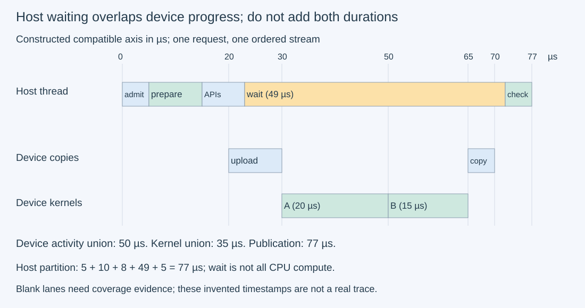
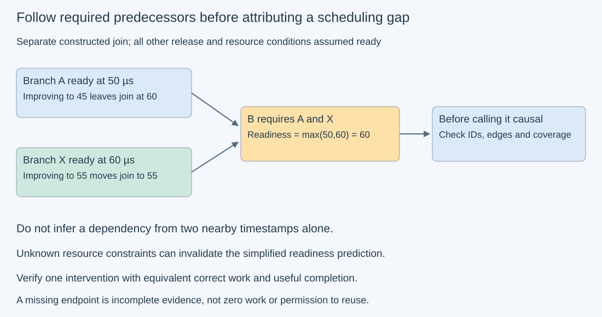

# M9-C12: Reading CPU-GPU timelines and scheduling gaps

> **Status: Complete — detailed chapter authored and documentation validated; experimental procedures are proposed unless explicitly labelled observed**

**Module:** Make measurement and correctness part of the foundation

**Category:** [Measurement, experimentation, and economics](index.md)

[Module 9 reading order](../module-9.md) · [Previous: M9-C11](m9-c11-controlled-comparisons-warmup-and-reproducibility.md) · [Next: M9-C13](m9-c13-using-kernel-profilers-to-explain-hardware-bottlenecks.md) · [Execution plan and progress](../chapter-execution-plan.md)

## Target concepts

Host threads and queues, executor iterations, launch submission, GPU idle periods, synchronization, device completion, critical-path attribution, NVTX-style ranges, tracing overhead.

## Concepts

### 1. A timeline shows observations on named lanes

A **trace** records events and intervals from a particular execution. A **timeline** lays them out against time. A **lane** identifies a producer or resource: a CPU thread, a device stream, a copy engine or an annotation domain. A CPU is the host processor; the GPU executes device work. A **host thread** is an independently scheduled CPU execution sequence. A **queue** holds work awaiting admission or execution. Neither a long host interval nor an empty device lane identifies its cause without more evidence.

An **executor iteration** is one pass that chooses ready work, prepares inputs/descriptors, submits device operations, and handles completions under a stated policy. It need not correspond to one request or one kernel. An inference request may cross many iterations; one iteration may include multiple requests. In Rust, asynchronous tasks can resume on different threads, so task/request identity must be retained independently of the thread label. This chapter describes annotations and experiments without implementation code.

Record request/attempt ID, iteration ID, operation sequence, slot generation, process/thread, device/context/stream, event kind, timestamp/unit and clock domain. **Correlation** links related observations, such as a host submission and its device work; matching timestamps is not a substitute for identity. A library call may generate several kernels or copies. Do not force a one-call/one-kernel relationship, and do not correlate an unrelated nearby event just to fill a gap.

[Completed M9-C02](m9-c02-request-events-clocks-and-measurement-boundaries.md) explains clock domains. Subtract timestamps only on a compatible clock or a documented correlation with uncertainty. Device elapsed events measure their specified stream interval; they do not directly timestamp external arrival. A trace viewer may align domains for display, but the alignment method, event semantics and uncertainty still matter for small differences. An observed gap comparable to clock/collection uncertainty is unresolved evidence.

### 2. Submission and execution are different intervals

A **launch submission** is the host/runtime action that requests device work. An API interval measures that call's host duration. Device work can start later, overlap the host call, or wait for earlier stream work or another dependency. The [CUDA synchronization specification](https://docs.nvidia.com/cuda/cuda-runtime-api/api-sync-behavior.html) explains why a returning function or an “Async” name is insufficient proof of device completion.

For host call entry h_start, return h_end and compatible device start d_start:

**T_API = h_end−h_start.**

**Δ_return_to_start = d_start−h_end.**

The second quantity is a signed observed separation. It may be negative when device execution starts before the host call returns. It is not universally “launch overhead,” nor a pure scheduler queue time: argument preparation, runtime/driver activity, stream dependencies, device availability and trace perturbation can contribute. Name the exact endpoints before interpreting it.

A **synchronization wait** prevents a consumer from proceeding until a defined completion condition. Its host wall interval can include device execution already shown on another lane, wakeup delay and runtime handling. A blocked host thread is not necessarily consuming CPU for that whole interval. Distinguish running, runnable-but-unscheduled and blocked states when supported thread-state evidence is available. Without those observations, label the state unknown rather than infer “CPU compute.”

### 3. Work one complete, constructed ledger

All times below are **invented teaching timestamps in microseconds on an assumed compatible axis**. They are not an actual capture. One request and one iteration use a single ordered device stream; upload feeds kernel A, which feeds kernel B, then download. Host validation begins after the final wait returns.

| Observation | Interval or event (µs) | Meaning |
| --- | --- | --- |
| Request arrival; admission | 0; 5 | Five microseconds before admission |
| Host preparation | 5–15 | Inputs/descriptors prepared |
| Four host API calls | 15–17, 17–19, 19–21, 21–23 | Upload, kernel A, kernel B, download submissions |
| Device upload | 20–30 | Copy activity on this stream |
| Device kernel A | 30–50 | Dependent arithmetic |
| Device kernel B | 50–65 | Dependent arithmetic |
| Device download | 65–70 | Result movement |
| Host final wait | 23–72 | Includes overlapping device progress and return delay |
| Host validation/publication | 72–77; published at 77 | Correct result becomes usable |

The request latency is **77−0=77 µs**. A nonoverlapping **host wall-time partition** is **5 admission + 10 preparation + 8 submission calls + 49 wait + 5 validation =77 µs**. This is a partition of observed wall time, not CPU active time and not five independently removable costs. GPU activity overlaps the host wait and part of submission.

The kernel intervals total 35 µs; copy intervals total 15 µs. Their nonoverlapping device union is 50 µs. Adding kernel 35, copy 15, host wait 49 and preparation 10 yields 109 µs and double-counts device progress inside host wall time. That sum is not request latency. An API projection or annotation nested around the same work must not be added again either.

If all relevant activity on the selected device is captured within window [0,77], the visible activity fraction is **50/77≈64.94%**. The kernel-only fraction is **35/77≈45.45%**. These are different metrics, not hardware occupancy or achieved arithmetic utilization. If only one process or stream is captured, absence of its events does not establish device-wide idleness. Other contexts, copy engines or uncollected activity may still be active.

*The host wait contains device work already displayed below. The diagram assumes a compatible clock axis and complete capture of the depicted activities; a real trace must establish both.*

### 4. Attribute gaps through readiness and dependencies

A **GPU idle period** requires a stated resource and coverage: for example, no captured compute activity on all observed streams in a window. A blank compute lane can coexist with copy progress. A blank application lane may mean no ready work, required synchronization, CPU preparation, queue policy, other work, or missing collection. Idle before a request arrives is not avoidable delay for that request.

For a consumer operation, examine its latest required predecessor completion, its host submission, queue/admission state and resource availability. The **critical path** is the longest chain of required dependencies to the chosen useful completion. A **dependency graph** has operations as nodes and “must precede” relationships as edges; independent nodes may overlap. Under a simplified fixed-duration model:

**Earliest start(v) = max over predecessors u of finish(u).**

**Finish(v) = earliest start(v) + duration(v).**

Include resource-ordering, data readiness and external arrival/release nodes when they constrain execution. Omitted edges produce an optimistic model, not proof of an achievable schedule. An observed trace alone cannot show every causal alternative; formulate a hypothesis and test one intervention while preserving correctness and workload.

For a separate constructed join, branch A becomes ready at 50 µs and branch X at 60 µs; consumer B needs both. Its earliest readiness is max(50,60)=60 µs. Reducing A's completion from 50 to 45 does not change B's readiness. A has 10 µs of margin at that join under these assumptions. Reducing X from 60 to 55 changes readiness to 55. The improvement is conditional on no new bottleneck/resource conflict and unchanged downstream work. Summing “all time saved” from both branches would overstate the path benefit.

*The readiness times are from a separate teaching graph, not the earlier 77 µs ledger. Following an edge needs identity and completion evidence; temporal proximity alone does not prove a dependency.*

For the first ledger, device completion at 70 and publication at 77 leave 7 µs after device work: 2 to final-wait return and 5 to validation/publication. Calling all 7 GPU launch overhead is incorrect. Similarly, the upload return at 17 and device start at 20 give 3 µs separation; kernel A's API return at 19 and start at 30 give 11 µs, but its upload dependency is part of the explanation. Eliminating an unnecessary wait may permit overlap; removing a required dependency can silently make results incorrect. Apply [M3-C18](../numerics-and-correctness/m3-c18-validating-gpu-computation-and-memory-movement.md) before accepting a faster timeline.

### 5. Use ranges to express meaning, not manufacture synchronization

**NVTX** is NVIDIA's annotation interface for developer tools. A **marker** labels an instant; a **range** labels an interval. Names such as prepare, submit, wait, validate and iteration can make a trace understandable. Annotate request/iteration/operation identity with bounded metadata; avoid raw prompts, unbounded labels or one giant “GPU work” range with unclear endpoints.

The [NVTX specification](https://nvidia.github.io/NVTX/) distinguishes nested thread-local push/pop ranges from handle-based start/end ranges that can span threads. A Rust async task's thread migration makes that distinction material: a thread-local range cannot simply be treated as a task range across an arbitrary suspension. Describe the binding's actual lifetime and cross-thread support before choosing an annotation policy. Resource names help identify threads and streams but do not establish ordering.

A host submission range ends when submission ends. A device-completion range must end only after its named completion event is observed. An annotation does not itself synchronize work, establish causality or guarantee a tool captures it. [Nsight Systems](https://docs.nvidia.com/nsight-systems/UserGuide/index.html) supplies system-timeline collection and annotation visualization. Its projected ranges are attribution views, not extra device execution. Keep physical events, host scopes and projected ranges distinct when counting durations.

### 6. Treat tracing as an intervention

**Tracing overhead** is a change caused by observing the program: event capture, buffering, stack collection, CPU sampling, flushing and export can affect time or memory. An apparently idle gap or short API can be distorted by collection. The amount depends on workload and enabled collectors, not one universal percentage. First use a focused window with only the evidence needed; avoid enabling every collector by default.

Compare three modes on the same workload: minimal application timing with no added ranges/tool; added ranges with no active external tracer; and ranges plus focused trace collection. The first still has measurement/validation overhead and is not an unobservable ideal. NVTX calls may be inactive without a tool; distinguish annotation-path cost from active collection cost. Report all configurations and outcome populations.

For corresponding summary latencies T_base and T_trace, **relative shift=(T_trace−T_base)/T_base**, T_base>0. Constructed 100 and 112 µs give 12%. This is a summary comparison, not a justified correction to subtract 12% from every traced interval. Overhead can alter scheduling and overlap nonuniformly. A small shift can be buried in uncertainty; a large shift can make fine-grained attribution unrepresentative. Predeclare an analysis threshold and withhold claims below the resolution/perturbation evidence.

Check capture boundaries, sequence gaps, collector errors, truncated windows, missing endpoints and correlation coverage before explaining empty lanes. A missing completion event is not proof the operation never completed, nor permission to reclaim its storage. Keep application outcome/ownership evidence independent of whether the trace succeeds. A profiler failure must not turn a cancelled or stale result into a useful completion.

The HFT lens emphasizes tracing useful events along actual critical paths while accounting for observer effects and freshness. A blank lane in an inference trace does not establish a trading latency cause, and timestamp precision does not establish hard real-time behavior. What transfers is the discipline of identity, dependency evidence, bounded instrumentation and honest uncertainty.

## Experiments

All four experiments are **proposed**. The worked timeline and numerical records are teaching constructions. No device trace, runtime benchmark, profiler capture or serving result has been supplied. Rust is the eventual engine context; no implementation code is included.

### E1 — Reconcile a host/device trace without double-counting

- **Description:** Rebuild the 77 µs ledger, identifying which intervals overlap.
- **Purpose/objective:** Separate submission, waiting, device completion and useful publication.
- **Target concepts:** Host threads/queues, launch submission, synchronization, device completion and idle coverage.
- **Baseline and workload:** The exact single-request, single-stream teaching table in Concepts 3; assume a compatible axis for this paper exercise only.
- **Controls and prediction:** Preserve all timestamps and dependencies. Predict latency 77, host partition 77, kernel union 35, copy union 15, device union 50 and visible activity fractions 64.94%/45.45% to two decimals.
- **Procedure:** Independently calculate every duration and union. Show why the 109 µs mixed sum is invalid. Compute upload return-to-start 3 µs and kernel A separation 11 µs without renaming them pure overhead. Then remove copy-lane or other-context coverage and explain which “device idle” claim can no longer be made.
- **Hardware/software:** Paper or calculator suffices. Actual host/device differences would require trace-clock correlation and uncertainty evidence.
- **Failure and HFT connection:** Missing events invalidate attribution rather than imply zero work. HFT event traces also need identity, compatible clocks and complete paths before assigning latency causes.
- **Exit criteria:** All counts reconcile, overlapping waits are not added to device durations, and idle claims explicitly name resource, interval and coverage.

### E2 — Follow readiness through a dependency join

- **Description:** Evaluate the separate A/X-to-B teaching graph and classify gap explanations.
- **Purpose/objective:** Avoid optimizing a visible stage that does not determine useful readiness.
- **Target concepts:** Executor iterations, queues, synchronization and critical-path attribution.
- **Baseline and workload:** A ready at 50 µs, X at 60, B requiring both; interventions move A to 45 or X to 55. Separately use the first ledger's completion 70, wait return 72 and publication 77.
- **Controls and prediction:** Keep all other prerequisites/resource conditions fixed. Predict join readiness 60 after improving A, 55 after improving X, and post-device interval 7 µs split 2+5.
- **Procedure:** Draw each edge with its producer/consumer identity and completion evidence. Recalculate the maximum, then add an unknown resource constraint and label the prediction conditional. For a real trace, require one controlled intervention and end-to-end validation before claiming causality; similar timestamps or a large API duration alone do not pass.
- **Hardware/software:** No hardware needed for the graph. Real queue/thread attribution requires supported state observations and a recorded scheduler policy.
- **Failure and HFT connection:** A missing required edge can create a faster but invalid schedule. Preserve cancellation/freshness and buffer lifetime as in M3-C18 rather than treating dependencies as optional costs.
- **Exit criteria:** Both intervention results and the 2+5 split reconcile; the noncritical A change is not reported as a request speedup; unknown causes remain unknown.

### E3 — Compare required waits and observation modes

- **Description:** Design a single-GPU pipeline study comparing frequent waits with dependency-preserving submission, under three observation modes.
- **Purpose/objective:** Learn whether a scheduling-gap hypothesis survives correctness and instrumentation checks.
- **Target concepts:** Host queues/iterations, launches, synchronization, NVTX-style ranges and tracing overhead.
- **Baseline and workload:** Reuse M3-C18's exact binary32 17×13×9 GEMM, α=β=1: A[i,k]=((i+k+e) mod 4)−1, B[k,j]=((2k+j) mod 4)−1, C0[i,j]=e+i−j. Use its padded-by-one row layouts, 32-byte prefix/suffix guards, initialized byte echoes before compute and exact output/untouched-byte checks. One trial is one executor iteration with one GEMM result and one generation; keep at most one trial in flight in both variants.
- **Controls and prediction:** Frequent-wait baseline waits after each of three uploads, three input echoes, compute and result download. Alternative enqueues the three uploads and echoes in one ordered stream, waits and validates echoed bytes, then submits compute/download with a final wait and validation. Both preserve the same eight logical operations, valid producer edges and useful result. Compare minimal timing, added ranges without external tracer, and ranges with focused CUDA/NVTX trace: six cells. Do not assume eight operations mean eight kernels or API records. Predict a possible host scheduling change, not a guaranteed speedup.
- **Procedure:** Use three independent sessions, ten excluded warmups per cell/session and twenty measured trials per cell/session, in a recorded balanced order. Set measured e=0…59 per cell across sessions; warmups use e=0. Keep identical minimal application timestamps/correctness checks in every mode. Name prepare/upload/echo-check/compute/download/validate and iteration ranges with stable IDs; retain all actual library dispatches. Capture the entire trial dependency chain in traced cells after warmup, with bounded start/end coverage. Record host arrival-to-validated-retirement, completed arithmetic interval and trace-only phase evidence separately. Measure trace mode's external latency through the same application boundary, not just export/display duration.
- **Hardware/software:** One supported GPU, pinned host buffers when required, binary32 GEMM, documented events/stream behavior, compatible Rust binding and an installed system tracer. Reserve 1 MiB raw host/device fixture allowance each plus explicit library/workspace/runtime and trace-buffer budgets. Optional CPU thread-state collectors require platform support; unsupported states remain unknown.
- **Failure and HFT connection:** Submission/completion error stops new admission and invalidates useful publication. A 120-second watchdog records unknown completion and cannot free live storage. Preserve trace errors separately from application errors: a correct result with missing trace is incomplete attribution evidence; an incorrect result with a beautiful trace is still a failed operation.
- **Exit criteria:** Account for 360 measured trials and 180 excluded warmups, with 120 traced measured trials (two variants×three sessions×twenty). No silent replacements. Every successful result passes exact/reference/byte/guard/generation gates. Attribute gaps only in complete correlated captures; report null or adverse performance differences honestly. No full-model serving conclusion follows from this primitive study.

### E4 — Audit annotations, trace coverage and perturbation

- **Description:** Check synthetic annotation/failure records and define when E3 traces are too incomplete or intrusive for a fine-grained claim.
- **Purpose/objective:** Make observation quality part of the acceptance gate.
- **Target concepts:** NVTX-style ranges, host/task identity, missing events, clock correlation and tracing overhead.
- **Baseline and workload:** Paper cases: a submission range ends before its GPU work; a task resumes on another thread; a copy lane is absent; a completion endpoint is missing; base/trace summary latencies 100/112 µs; and an uncorrelated device timestamp. These are not real trace faults.
- **Controls and prediction:** Preserve event identities and declared range semantics. Predict the submission range is valid as submission, thread-local nesting cannot stand in for an arbitrary migrating task, incomplete coverage forbids global idle claims, missing endpoints prevent the corresponding duration, and the constructed relative shift is 12%.
- **Procedure:** Diagnose each record and state the extra evidence needed. For E3 predeclare a teaching threshold: if any session's traced/untraced minimal-timing median shift exceeds 5% in magnitude, classify its trace as perturbed for fine-grained timing attribution and repeat later with a narrower collection if possible. This threshold is an analysis policy, not proof that ≤5% is harmless; uncertainty and structural schedule changes still matter. Require all claimed causal links to have identities and captured endpoints, record unmatched events, and avoid per-interval overhead subtraction.
- **Hardware/software:** Paper checks need none. Real acceptance needs actual tracer version/options, capture/drop diagnostics, clock alignment evidence and comparison distributions, not invented calibration constants.
- **Failure and HFT connection:** Do not repair a missing link by inventing a completion, sharing an epoch or widening clock assumptions. Retain safe ownership and useful outcome evidence even if collection fails; observer effects matter for HFT timing as well.
- **Exit criteria:** Each paper case receives the correct limited interpretation. Every claimed E3 interval has supported endpoints/domain/identity and collection coverage; perturbed or incomplete traces are explicitly withheld from unsupported fine-grained claims.

## Verification

### Matched evidence and outcome gates

| Experiment | Reference/invariant | Measurement or diagnostic | Acceptance and limitation |
| --- | --- | --- | --- |
| E1 | Exact timestamp ledger and explicit overlap | Independent host partition and interval unions | 77 µs latency, 50 µs visible activity; no global idle inference without coverage |
| E2 | Required predecessor edges and fixed conditions | Maximum readiness before/after each intervention | 60/55 µs conditional readiness and 7=2+5 split; no false A-path benefit |
| E3 | Same valid operation, byte/guard checks and generation | Same application endpoints; separate device/trace evidence | 360 outcomes, exact checks, capture coverage and distributions; no forced positive improvement |
| E4 | Correct annotation lifetimes and clock/coverage policy | Synthetic faults plus declared perturbation threshold | 12% example correctly flagged; missing evidence never replaced with invented events |

In a general window W, **visible busy time = duration of the union of selected compatible activity intervals intersected with W**. Overlapping activities count once in that union; summing per-stream durations can exceed the window. A constructed pair [10,30] and [20,40] has sum 40 µs but union 30 µs. The fraction is union duration/window duration, for a positive window. It does not establish hardware occupancy or resource saturation. Use a separate population for each device and report which activity kinds are included.

E3 reuses an exact integer reference: K=13, product magnitudes≤4, partial sums≤52, seed magnitude≤75 for e≤59 and i≤16; conservative output magnitude≤127. All are exactly representable in binary32 under the declared arithmetic policy. The 360 measured trials imply **55,080 planned output coordinates**, **1,432,080 useful core FLOPs** and **55,080 seed additions**, excluding warmups and profiler overhead. These are reference workload counts, not observed GPU rates. Maximum guarded device A/B/C backing is 2,344 bytes for one slot before workspace/runtime; host upload/echo/result/reference backing fits the stated 1 MiB allowance. Trace buffers are separate and may dominate this tiny fixture.

Retain every trial's expected/actual identity, validation outcome, missing/cancelled/failed status, host/device durations and observation mode. Retain raw trace records, correlation map, capture boundaries and tool diagnostics; do not invent idle time across missing ranges. For the 360-trial cohort, reconcile success+incorrect+submission/completion failure+cancelled+watchdog-unknown+unfinished=360 using mutually exclusive application outcomes at a declared cutoff. Add trace completeness as an independent attribute, not another mutually exclusive application outcome. No terminal record may authorize buffer reuse without completion/reader-retirement evidence.

For each cell/session show all twenty timings, median, nearest-rank p95 and maximum plus failures. For n successful sorted values, nearest-rank p95 is rank ceil(0.95n), using one-based ranks; n=20 gives rank 19. Preserve pairing by epoch and session when comparing variants/modes. Do not average percentiles or claim stable p99 from twenty values. Report the E4 threshold comparison separately for each variant/session; do not pool away a disturbed session. Apply completed [M9-C07](m9-c07-latency-distributions-and-statistical-uncertainty.md) for uncertainty and completed [M9-C16](../hardware-architecture-and-topology/m9-c16-recording-hardware-conditions-that-change-measurements.md) for hardware-state compatibility.

### Six dimensions applied

| Dimension | Chapter-specific check |
| --- | --- |
| Semantics and invariants | A trace must refer to the right request, iteration, operation and slot generation; correctness gates precede timing claims. |
| Workload and variability | Preserve shapes, arrivals, in-flight limits, sessions and observation modes; distinguish a primitive iteration from real serving. |
| Resources and bottlenecks | Name CPU threads, streams, copies and capture buffers; a blank lane is not a device-wide bottleneck diagnosis. |
| Time and distributions | Use compatible clocks, interval unions and required dependency paths; preserve tails and observer effects. |
| Ownership and coordination | Completion/reader retirement governs reuse; annotation ending, task migration and trace failure do not release storage. |
| Failure and adaptation | Stop unsafe admission, retain unknown completion and report unsupported or missing attribution without fabricating events. |

### Eight engineering principles applied

| Principle | Application |
| --- | --- |
| 1. Correctness defines the optimization boundary | Removing waits must preserve all real producer/consumer edges and exact fixture outputs. |
| 2. Performance depends on workload and operating point | Short-call workloads and collector settings can change both overhead and visible gaps. |
| 3. Data movement is part of the algorithm | Copy lanes contribute to useful completion even when compute lanes are empty. |
| 4. State has ownership, lifetime, and recovery cost | Retain slot identity and storage until actual retirement, independently of profiler success. |
| 5. Dependencies determine latency; bottlenecks determine capacity | Follow the maximum predecessor at joins; a visible noncritical speedup need not improve completion. |
| 6. Variability and synchronization shape the tail | Wait/wakeup distributions and session drift matter; a single attractive trace does not establish p99. |
| 7. Local improvements must be evaluated end to end | API or kernel improvements require the same validated application boundary and useful output. |
| 8. Claims require reproducible evidence | Keep event schemas, IDs, clocks, raw traces, coverage, tool configuration and untraced comparison data. |

## Specifications, articles, and hardware

| Primary source | Use and limits |
| --- | --- |
| [Nsight Systems user guide](https://docs.nvidia.com/nsight-systems/UserGuide/index.html) | Focused system-timeline collection and annotation views; record supported collectors/options and actual overhead rather than assuming zero perturbation. |
| [NVTX specification and primary documentation](https://nvidia.github.io/NVTX/) | Marker/range semantics, thread-local nesting and cross-thread handles; Rust binding behavior must be checked separately. |
| [CUDA API synchronization behavior](https://docs.nvidia.com/cuda/cuda-runtime-api/api-sync-behavior.html) | Host return versus completion and copy behavior; undocumented blocking is not a dependency contract. |

E1/E2 and E4 paper diagnoses need no GPU. E3 needs one supported device, a valid GEMM/transfer path and compatible system tracing; no NIC, second GPU or model weights are needed for the tiny fixture. Record exact CPU/RAM/NUMA, GPU SKU/architecture/partition and active resources, memory and connection path, operating system, driver/runtime/library/Rust-binding/tracer/NVTX versions, arithmetic modes, workspace/trace-buffer limits, clocks/power/thermals and competing activity. Retain the actual vendor/device specification and collector permission/capability evidence. No machine was supplied, so no real hardware timing, trace or capability is asserted. Future serving applications must additionally record model/tokenizer/adapter identity, prompt/output/context distributions, cache state, arrival policy and useful first/full-response boundaries; primitive traces do not establish their behavior.

## Completion and next chapter

Track acceptance in the clickable [execution plan](../chapter-execution-plan.md). Next in Module 9 reading order is the completed [M9-C13: Using kernel profilers to explain hardware bottlenecks](m9-c13-using-kernel-profilers-to-explain-hardware-bottlenecks.md). Next in authoring order is [M3-C19](m3-c19-designing-trustworthy-asynchronous-gpu-benchmarks.md). Module 9 supports Modules 1–7; Module 8 is excluded. The Module 3 sequence resumes at M3-C19 after these planned supporting chapters.
