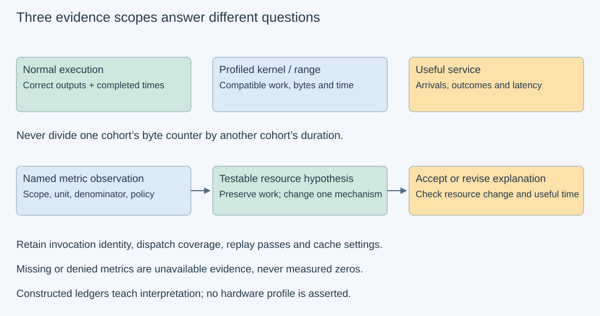
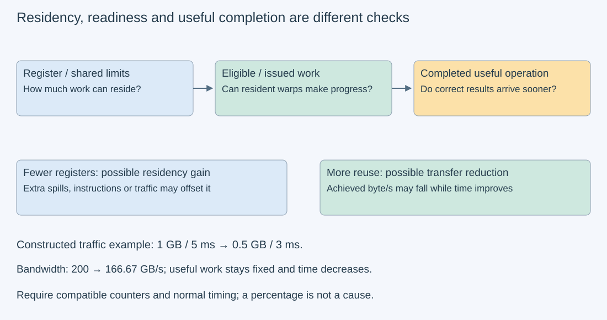

# M9-C13: Using kernel profilers to explain hardware bottlenecks

> **Status: Complete — detailed chapter authored and documentation validated; experimental procedures are proposed unless explicitly labelled observed**

**Module:** Make measurement and correctness part of the foundation

**Category:** [Measurement, experimentation, and economics](index.md)

[Module 9 reading order](../module-9.md) · [Previous: M9-C12](m9-c12-reading-cpu-gpu-timelines-and-scheduling-gaps.md) · [Next: M9-C14](../networking-and-communication/m9-c14-measuring-transfer-and-collective-completion.md) · [Execution plan and progress](../chapter-execution-plan.md)

## Target concepts

Memory traffic, bandwidth, compute throughput, occupancy, stalls, spills, cache behavior, roofline reasoning, profiler replay and perturbation, isolated versus serving measurements.

## Concepts

### 1. Choose a question before collecting counters

A **kernel profiler** measures properties of selected device execution: memory transfers, instructions, resource use and readiness. A **counter** counts defined events; a **metric** can be a count, rate, ratio or derived summary. A system timeline locates work and dependencies across host/device lanes; a kernel profile investigates selected execution more deeply. Use completed [M9-C12](m9-c12-reading-cpu-gpu-timelines-and-scheduling-gaps.md) to find work relevant to useful completion before diagnosing its internals.

A **bottleneck hypothesis** names a resource or dependency that limits a stated workload at a stated operating point. “The memory percentage is high” is an observation, not a complete hypothesis. A stronger statement is: repeated transfers at a named interface contribute enough service demand that reducing them, with equivalent outputs and unchanged external load, should reduce the completed operation time. Then check whether the intervention actually changes those transfers, other demands and useful completion.

Record device/context/stream, kernel identity and invocation, request/iteration/epoch, input shape/strides, arithmetic path, library dispatch and selected range. One library operation may launch several kernels. A metric from one kernel cannot automatically explain the whole operation. A profile may cover a range instead of a kernel; preserve its actual scope. Unsupported or denied counters are unavailable evidence, not zeros. Rust is the eventual engine context; this chapter provides specifications and experimental designs without implementation code.

### 2. Match bytes, work, time and capacity

For a compatible completed scope, let **F** be useful floating-point operations under a declared convention, **Q_l** bytes crossing memory interface l, and **t** elapsed execution time. Define:

**P_useful=F/t; B_l=Q_l/t; I_l=F/Q_l**, for positive t and Q_l.

Fused multiply-add conventionally counts as two FLOPs. Useful dense work, executed instructions, padded arithmetic and sparse “dense equivalent” work are different ledgers. Compute capacity must match precision, instruction path, sparsity, partition and clock assumptions. For each memory level, document the interface, read/write directions, aggregation and counter units. If a metric counts sectors, use its documented sector size; do not assume all levels use the same transaction unit. Do not add a total to its components.

[Completed M3-C16](m3-c16-using-the-roofline-model-to-predict-bottlenecks.md) gives the conditional envelope **P≤min(P_compute, B_capacity,l I_l for each compatible level)**. Equivalently, **t_lower=max(F/P_compute, Q_l/B_capacity,l)** across the chosen resources. A point below an envelope does not identify the cause of the gap. Logical read-once bytes do not become measured DRAM traffic merely because a roofline plot needs a denominator. Cache-resident reads and buffered writes can change the interface/window seen by a counter.

Here is a **constructed profile-compatible ledger**, not GPU data. Suppose F=8×10⁹ useful FLOPs, compatible compute capacity 8 TFLOP/s and DRAM capacity 400 GB/s. Decimal GB=10⁹ bytes, TFLOP/s=10¹² FLOP/s and ms=10⁻³ seconds. An equivalent hypothetical transformation halves DRAM traffic but also changes achieved rates:

| Record | DRAM bytes | Completed profile interval | Useful throughput | Observed DRAM rate | DRAM intensity |
| --- | --- | --- | --- | --- | --- |
| Baseline | 1×10⁹ | 5 ms | 1.6 TFLOP/s | 200 GB/s | 8 FLOP/byte |
| Candidate | 0.5×10⁹ | 3 ms | 2.6667 TFLOP/s | 166.6667 GB/s | 16 FLOP/byte |

The candidate is faster even though observed bandwidth falls from 50% to about 41.67% of the hypothetical capacity. Moving less data can reduce both time and achieved byte/s. Maximizing bandwidth percentage is not the objective. The DRAM-only resource lower bounds change from 2.5 to 1.25 ms, while the compute term stays 1 ms. An inner-cache constraint or dependency may still prevent reaching either envelope. These constructed records illustrate arithmetic, not proof of a measured speedup or causal diagnosis.

*Every arrow needs preserved operation identity. A convenient metric or roofline position is insufficient without a compatible interval and an intervention that preserves correctness.*

### 3. Occupancy describes residency, not progress

A **warp** is a group of device threads scheduled together. A **resident warp** has resources allocated on a streaming multiprocessor, or SM. **Occupancy** compares resident warps with a supported maximum, with theoretical and achieved definitions retained separately. A warp can be resident yet unable to issue its next instruction. **Eligible** work is ready to issue; issued work actually uses a scheduling opportunity. Raising residency helps only if it produces useful ready work without increasing other costs.

A simplified constructed SM has 65,536 registers, a 64-warp maximum, 256-thread blocks and 32-thread warps. If each thread uses 64 registers and register allocation is assumed exact, each block needs 16,384 registers, allowing four such blocks and 32 warps, or 50% theoretical occupancy. At 32 registers/thread, the register-only arithmetic permits eight blocks and 64 warps. Actual hardware allocation granularity, block/thread limits, shared memory and architecture rules can lower that figure. These are teaching constraints, not a supplied GPU specification.

A **spill** moves a value that would otherwise stay in a register to another storage path. Forcing fewer registers may increase residency but introduce extra instructions and transfers. **Local memory** means thread-private address space; it is not synonymous with a fast on-chip cache. Local accesses may result from spills or other compiler storage decisions. Establish spill attribution with supported compiler/instruction evidence, not local traffic alone. Retain any architecture-specific spill placement rather than assuming one universal destination. Completed [M3-C06](../hardware-architecture-and-topology/m3-c06-registers-shared-memory-and-local-resource-pressure.md) explains the resource tradeoff.

### 4. Stalls and cache ratios need their denominators

A **stall** describes why an observed warp cannot issue an instruction at a particular observation: memory dependency, arithmetic dependency, synchronization or another reason. A memory-dependency stall can reflect latency even when DRAM bandwidth is far from saturated. A large reported stall category does not mean the whole GPU was idle for that same percentage of request wall time. Read whether the metric is sampled, per-warp, per-issued-instruction, active-cycle or elapsed-cycle based. Different denominators cannot be added as disjoint latency components.

Use readiness/scheduler evidence together with occupancy, traffic and completed time. If most schedulers have ready work, one prominent sampled stall reason may not be the limiting cause of throughput. If there is little eligible work, investigate dependencies, grid size, synchronization and resource limits. Correlated source/instruction observations can guide a hypothesis, but sampled evidence and compiler mappings have coverage limits. Do not promise source-line precision for an opaque library kernel.

A **cache hit ratio** is hits divided by a documented lookup population. High hit ratio alone does not establish low total traffic. In a separate constructed example, 90% hits over 1,000,000 lookups leaves 100,000 misses; 80% over 100,000 leaves 20,000 misses. The lower hit ratio has fewer misses. Neither count is a byte volume unless lookup/transaction units are established. Working-set changes, request granularity, bypasses, read/write policies and replay history all affect interpretation.

| Observation | Candidate explanation to test | Evidence still needed |
| --- | --- | --- |
| High DRAM byte rate | Transfer demand near a compatible capacity | Boundary/count definitions, calibrated conditions and effect of reducing traffic |
| Low occupancy | Resource ceiling or insufficient resident work | Registers/shared allocation, launch size and eligible/issued work |
| Many local accesses | Spill or explicit thread-private storage | Compiler/instruction attribution and resulting traffic/time |
| High dependency stall metric | Latency or serialized readiness | Metric denominator, scheduler readiness and dependency intervention |
| High cache hit ratio | Reuse within that lookup population | Absolute requests, misses, bytes and complete operation time |

*The tradeoffs are hypotheses to test. The numerical example is constructed and does not claim measured spill traffic or hardware utilization.*

### 5. Replay changes the experiment

A profiler may need several **replay passes**, executions used to gather metric subsets that cannot be collected together. The [Nsight Compute profiling guide](https://docs.nvidia.com/nsight-compute/ProfilingGuide/index.html) defines the available collection modes and their constraints. Kernel replay, application replay and range modes are not interchangeable: some rerun selected kernels, others rerun the application or a defined range. A range report may aggregate multiple kernels and preserve a different concurrency pattern. Record the mode, pass count, selected metrics and supported API/operation coverage.

Saving/restoring ordinary memory does not restore the original hardware cache state. Cache flushing, preceding priming work and application replay can therefore create a different observation from a warm production iteration. State whether tool-controlled cache flushing is enabled, how priming is performed, whether clocks are controlled, and what concurrency is retained or serialized. Keep these choices identical across compared candidates unless that policy is the intended experimental variable. Repeating the same addresses does not guarantee residency.

A β=1 operation reads its previous output. Replaying it without the correct seed/restoration semantics changes the mathematical work. Keep independent references and epoch identity across passes; replayed executions are not extra useful request completions. Host buffers, workspace and mapped state must remain valid for the chosen mode. If the tool cannot preserve a required dependency or state contract, declare that collection unsupported rather than forcing it to run.

The [Nsight Compute CLI documentation](https://docs.nvidia.com/nsight-compute/NsightComputeCli/index.html) explains selection by context/stream/name/invocation and discovery of supported metrics/sections. Use the installed tool's definitions; metric names, suffixes and availability can differ across versions/devices. Start with a minimal question-driven set and expand only when unresolved evidence justifies it. Excess metrics can add passes and perturbation without resolving the hypothesis.

### 6. An isolated profile does not certify serving behavior

Maintain separate evidence cohorts: **unprofiled correctness/timing**, **system timeline**, and **kernel/range counters**. They can study the same fixture, but one cohort's byte count divided by another cohort's time is not directly observed bandwidth. Use the profiler's compatible work/count/time scope for its rates and separate unprofiled intervals for performance comparisons. Preserve profiling duration and any application-level slowdown as observation-quality evidence, not a universal correction factor.

A constructed serial request takes 15 ms of other work plus the baseline 5 ms kernel. If an equivalent kernel actually took 3 ms with everything else fixed, request time would fall from 20 to 18 ms: **20/18≈1.1111×**, while local kernel speedup is 5/3≈1.6667×. Queueing, overlap, dispatch changes and shared resources can invalidate that serial model. A library algorithm that wins in isolation may lose with other kernels or real arrival patterns. Full serving evidence needs model/token identity, arrivals, concurrency, context lengths, cache policy, failures and useful completion distributions.

The HFT lens is to trace useful event latency and freshness through real dependencies while preserving correctness. A better cache ratio or more resident warps is not an event-latency result. No exchange behavior, trading outcome or hard real-time guarantee follows from a GPU profile. A stale or cancelled result must not inflate useful throughput, even if its counters look efficient.

## Experiments

All four experiments are **proposed**. The worked ledgers and capacities are teaching constructions, not observations from a machine. No GPU counter capture, dispatch comparison, spill experiment or serving benchmark has been executed. Rust is the eventual engine context; no implementation is supplied.

### E1 — Reconcile throughput, traffic and a roof

- **Description:** Rebuild the two constructed profile records and test the interpretation of a lower achieved bandwidth.
- **Purpose/objective:** Distinguish useful work, transferred bytes, resource bounds and measured-rate arithmetic.
- **Target concepts:** Memory traffic, bandwidth, compute throughput, roofline reasoning and compatible scopes.
- **Baseline and workload:** F=8×10⁹; DRAM Q=1×10⁹ versus 0.5×10⁹ bytes; t=5 versus 3 ms; hypothetical 8 TFLOP/s and 400 GB/s capacities. No hardware trials.
- **Controls and prediction:** Keep F, arithmetic convention and boundary fixed. Predict rates 1.6/2.6667 TFLOP/s, 200/166.6667 GB/s, intensities 8/16 and DRAM time bounds 2.5/1.25 ms, with rounding labelled.
- **Procedure:** Derive every value independently and explain why bandwidth percentage can fall as time improves. Add a hypothetical 2 ms inner-cache bound to both cases: combined lower bounds become 2.5 and 2 ms. Reject use of one profile's Q with a separate unprofiled time as directly observed bandwidth.
- **Hardware/software:** Paper or calculator suffices; a real roof additionally needs the actual arithmetic path, interface and operating-point evidence.
- **Failure and HFT connection:** Better counters alone cannot establish useful-response improvement. Keep incorrect or stale work out of useful completion while retaining its resource costs.
- **Exit criteria:** All rate/bound arithmetic reconciles; the inner-cache case and denominator mismatch are diagnosed; no fabricated achieved capacity or causal speedup is claimed.

### E2 — Challenge occupancy, stall and cache explanations

- **Description:** Audit the simplified register model and cache lookup records, then define falsifiable hypotheses.
- **Purpose/objective:** Prevent optimization of percentages that do not measure useful progress.
- **Target concepts:** Occupancy, stalls, spills, cache behavior and resource tradeoffs.
- **Baseline and workload:** The 65,536-register/64-warp teaching SM, 256-thread blocks,64 versus 32 registers/thread; separate 90%-of-1,000,000 versus 80%-of-100,000 lookup records. No compiled kernel or hardware observation.
- **Controls and prediction:** Preserve arithmetic and assume only the stated register constraint for the paper model. Predict register-only residency 50% versus 100%, but no required timing improvement; miss counts 100,000 versus 20,000.
- **Procedure:** Calculate the block/warp limits, then add a hypothetical shared-memory cap of four blocks and show both reach at most 32 warps. Explain how spills could add traffic despite a nominal occupancy gain. For an actual study require compiler/resource, instruction/local-storage and readiness evidence plus completed unprofiled time before attributing a cause. State the stall metric denominator and reject adding it to request wall time.
- **Hardware/software:** Paper analysis requires none. A future compiled/library-kernel comparison needs exposed supported configurations and matching precision/layout; do not assume every binary offers a register-limit knob.
- **Failure and HFT connection:** Do not loosen precision or remove a required synchronization edge to make residency improve. HFT-style latency evidence also requires actual useful completion rather than a surrogate utilization target.
- **Exit criteria:** Residency and miss counts reconcile; the extra resource cap is respected; local traffic is not automatically labelled spills and no cache/stall percentage becomes a latency claim.

### E3 — Compare normal timing with two controlled profile policies

- **Description:** Plan a single-device GEMM study that separates unprofiled timing from policy-dependent counter collection.
- **Purpose/objective:** Learn how replay/cache settings affect the credibility of a bottleneck explanation.
- **Target concepts:** Profiler replay, perturbation, cache history, traffic and isolated measurements.
- **Baseline and workload:** Binary32 α=β=1 GEMM shapes (M,K,N)∈{(17,13,9),(64,64,64)}. A[i,k]=((i+k+e) mod 4)−1, B[k,j]=((2k+j) mod 4)−1 and seed C0[i,j]=e+i−j. Use nonaliased row-major mathematical views translated to the actual API; each backing row has one padding element plus 32-byte prefix/suffix guards. Reset seed and inputs each trial; exact reference is AB+C0. One operation/generation at a time.
- **Controls and prediction:** Fix device/library/dispatch-selection policy, arithmetic, stream, allocation/workspace and preparation history. For each shape compare three modes: unprofiled; supported kernel replay with documented tool cache flushing; and supported application replay with tool flushing disabled and identical declared priming. For the primed mode, do one completed untimed GEMM at the same addresses, then restore the β=1 seed; this restoration is part of the history and can affect cache. Neither mode is assumed production-warm. These paired policies change both replay and cache handling, so their difference cannot isolate cache flushing as the sole cause. Predict possible policy differences without a required direction.
- **Procedure:** Use three independent sessions, ten excluded warmup trials per unprofiled shape/session and twenty measured unprofiled trials per shape/session, e=0…59 across sessions; warmups use e=0. Validate full input bytes in diagnostic echoes before compute, then all output values/untouched bytes after completion, as in M3-C18. Record completed operation time and wider host preparation-to-validated-retirement. Separately collect three logical operation instances per shape/profile-policy/session, e=0,1,2 with explicit session identity: 36 planned profiled instances, not a fixed replay-pass count. Select and retain all actual dispatched kernels or declare a justified subset; a single kernel's counters cannot be labelled the whole GEMM. Retain each replay's actual coverage and compatible duration, plus submission/completion status and correctness evidence.
- **Hardware/software:** One supported GPU/library path, sufficient event/transfer support and permission to read relevant counters; installed Nsight Compute definitions determine supported metrics/modes. Reserve 1 MiB raw host/device fixture allowance each plus explicit library/workspace/runtime/profiler budgets. Permission denial or unsupported replay is recorded as unavailable, not bypassed.
- **Failure and HFT connection:** Record slot/session/epoch identity and keep every buffer through actual completion, replay requirements and validation-reader retirement. A 120-second watchdog stops admission and records unknown completion; it cannot authorize reclamation. Reject wrong seeds, changed guards and stale outputs even if the profile report looks plausible.
- **Exit criteria:** Account for 120 measured unprofiled trials, 60 excluded warmups and 36 planned logical profiled instances independently; retain failures/unsupported captures without silent replacement. Successful operation outputs pass exact checks. Rate/roof claims use compatible scope and arithmetic, and cache/replay conclusions stay policy-specific. No serving capacity is inferred.

### E4 — Test whether a profile explains useful service

- **Description:** Audit a serial end-to-end calculation and build an evidence chain for an actual intervention.
- **Purpose/objective:** Connect local counters to useful latency without treating isolated profiles as serving measurements.
- **Target concepts:** Isolated versus serving measurements, causal hypotheses, perturbation and end-to-end validation.
- **Baseline and workload:** The constructed 15+5 ms request and 15+3 ms candidate, with the same valid useful result. Separately review paper faults: mismatched kernel invocation, unavailable counter recorded as zero, range aggregation labelled as one kernel, and β=1 replay without a restored seed.
- **Controls and prediction:** Preserve serial dependencies and all other 15 ms work. Predict local 5/3≈1.6667× and request 20/18≈1.1111×. Each paper fault invalidates its affected attribution or computation gate rather than proving a bottleneck.
- **Procedure:** Name one mechanism, the counter evidence it should change, and an unprofiled completed-time prediction. Verify the intended work/traffic/resource change and exact/numerical contract before timing claims. For a future serving comparison fix model/tokenizer/adapter/precision, prompt/output/context distributions, arrival trace, concurrency, queue/deadline/cancellation policy and useful-response boundaries. Preserve full outcome accounting and distributions. Use system-timeline evidence from M9-C12 to check concurrency lost in isolation; no serving study is executed here.
- **Hardware/software:** Paper analysis requires none. A real serving test needs the actual service/device manifest and representative load; the tiny E3 fixture cannot stand in for it.
- **Failure and HFT connection:** Retain rejected, failed, cancelled, timed-out, stale and unfinished outcomes under declared accounting. A reduced kernel time that moves a queue or delays fresh useful completion is not established end-to-end benefit.
- **Exit criteria:** Both speedups reconcile, all paper faults are rejected for stated reasons, and any future claimed improvement includes correct useful completions and workload-specific latency/failure evidence. Unknown causal links remain unresolved.

## Verification

### Experiment-to-evidence mapping

| Experiment | Reference/invariant | Measurement and profiling | Acceptance and limits |
| --- | --- | --- | --- |
| E1 | Same F/interface/time scope and compatible capacities | Independent rate/roof calculations | Lower byte rate can accompany faster completion; cross-cohort division rejected |
| E2 | Register-only limits and explicit lookup population | Residency/miss arithmetic; hypothetical resource-cap intervention | No occupancy/stall/cache ratio accepted as standalone cause |
| E3 | Independent exact GEMM-plus-seed and byte/guard identity | Separate normal timing and policy-specific kernel reports | Complete outcome/dispatch/replay ledger; unsupported evidence stays unavailable |
| E4 | Valid serial dependency model and equivalent result | Paper speedup calculation; future end-to-end evidence contract | Local and useful-service benefit distinguished; four faulty records rejected |

E4’s paper faults have specific rejection reasons; these are review expectations, not observed profiler failures:

| Fault record | Rejecting evidence gate |
| --- | --- |
| Kernel invocation does not match the intended operation | Identity/coverage: retain the real invocation and withhold attribution to the requested operation. |
| Unavailable counter reported as zero | Metric availability: no observation exists from which zero can be asserted. |
| Range aggregate labelled as one kernel | Scope: preserve all kernels in the range and its own compatible duration. |
| β=1 replay lacks the required seed | Computation/state: the result no longer evaluates the declared AB+C0 reference; reject that trial. |

E3 has a deliberately small, independently checkable ledger:

| M×K×N | Output coordinates/operation | Useful core FLOPs, 2MKN | Seed additions | Padded A/B/C bytes before guards |
| --- | --- | --- | --- | --- |
| 17×13×9 | 153 | 3,978 | 153 | 2,152 |
| 64×64×64 | 4,096 | 524,288 | 4,096 | 49,920 |

Three 32-byte-prefix/suffix pairs add 192 bytes per operation's backing set, so maximum guarded device A/B/C is 50,112 bytes. Host upload/echo/result/reference buffers fit the 1 MiB fixture allowance; workspace/runtime/profiler allocations are additional. The 120 unprofiled measured operations contain **254,940 planned output coordinates**, **31,695,960 useful core FLOPs** and **254,940 seed additions**. The 36 profile instances contain 76,482 planned output coordinates before any internal replay; replay passes must not multiply useful application completions.

For K≤64, input magnitudes≤2, product magnitudes≤4 and 64-term partial-sum magnitudes≤256. Measured e≤59 and i≤63 give seed magnitude≤122, so a conservative output magnitude bound is 378. All are exactly representable binary32 integers under the declared arithmetic policy. Compare every logical output to an independent integer reference, retaining represented inputs. This exact fixture gate does not establish tolerances for arbitrary model tensors or authorize a changed arithmetic path; use completed [M9-C17](../numerics-and-correctness/m9-c17-comparing-logits-with-justified-numerical-tolerances.md) for general budgets.

Each retained metric record needs its installed name/definition, unit, sum/average/ratio aggregation, denominator, device/instance, kernel or range identity, replay mode/pass count, cache/clock settings, coverage and compatible duration. Archive compiler/library resource evidence when attributing spills; if unavailable, keep that hypothesis unconfirmed. Report missing/denied/unsupported metrics distinctly from measured zero. No profile can supply a first/full-request latency distribution without the application events and workload that define it.

For each unprofiled shape/session retain all twenty outcomes, median, nearest-rank p95 and maximum, plus failures. For n successful sorted values, p95 rank is ceil(0.95n), one-based; n=20 gives rank 19. Preserve sessions and exact comparison conditions, do not average percentiles, and do not claim stable p99 from twenty observations. Profile cohorts are explanatory evidence, not replacements for this timing population. Apply completed [M9-C07](m9-c07-latency-distributions-and-statistical-uncertainty.md) for uncertainty. Compare profiler application-level slowdown against an equivalent unprofiled case as observation-quality evidence; do not “correct” each kernel time by subtracting one overhead percentage.

### Six dimensions applied

| Dimension | Chapter-specific check |
| --- | --- |
| Semantics and invariants | Counters refer to the intended invocation, precision and exact/numerical contract; correct outputs gate useful work. |
| Workload and variability | Keep shapes, contexts, reuse/priming, concurrency and operating point explicit; isolated dispatch may differ from serving. |
| Resources and bottlenecks | Separate DRAM/cache traffic, register/shared constraints, local storage and ready work; test a resource hypothesis. |
| Time and distributions | Match count/time scope, keep replay separate and validate completed application intervals and distributions. |
| Ownership and coordination | Replay, seed restoration and readers retain live buffers and epoch identity until true retirement. |
| Failure and adaptation | Preserve unsupported counters, failed captures and unknown completion; stop unsafe admission rather than fabricate measurements. |

### Eight engineering principles applied

| Principle | Application |
| --- | --- |
| 1. Correctness defines the optimization boundary | Register/algorithm/precision changes must preserve the declared result; a faster wrong replay is invalid. |
| 2. Performance depends on workload and operating point | Shape, cache policy, concurrency and clocks determine what a profile can explain. |
| 3. Data movement is part of the algorithm | Count bytes at each interface; higher effective reuse can reduce achieved bandwidth while improving time. |
| 4. State has ownership, lifetime, and recovery cost | Input/seed/workspace and host state must remain valid across collection and recovery. |
| 5. Dependencies determine latency; bottlenecks determine capacity | Use readiness and critical-path context before blaming a high counter or improving a noncritical kernel. |
| 6. Variability and synchronization shape the tail | Replay/serialization can change concurrency; isolated means and stall ratios do not establish serving tails. |
| 7. Local improvements must be evaluated end to end | Local 1.6667× becomes 1.1111× only in the stated serial teaching model; real service needs its own evidence. |
| 8. Claims require reproducible evidence | Retain references, metric definitions, raw reports, replay/cache settings, outcomes and unprofiled comparisons. |

## Specifications, articles, and hardware

| Primary source | Role and limits |
| --- | --- |
| [Nsight Compute profiling guide](https://docs.nvidia.com/nsight-compute/ProfilingGuide/index.html) | Metric interpretation, readiness/resource concepts and replay/cache semantics; match installed version and actual device. |
| [Nsight Compute CLI guide](https://docs.nvidia.com/nsight-compute/NsightComputeCli/index.html) | Metric/section discovery and invocation selection; no fixed metric names or replay counts assumed portable. |
| [CUDA Programming Guide](https://docs.nvidia.com/cuda/cuda-programming-guide/index.html) | Execution, memory and capability specifications; follow the relevant installed architecture documentation. |

E1/E2/E4 require paper analysis only. E3 needs one supported GPU, a documented dense binary32 library path, supported counters/replay and completion/transfer mechanisms; no NIC, second GPU or model weights are required. Record exact GPU SKU/architecture/partition, active resources and register/shared/cache/memory capacities, CPU/RAM/NUMA/connection path, operating system, driver/runtime/library/Rust-binding/compiler/profiler versions, arithmetic and workspace policies, clocks/power/thermals and competing activity. Retain actual vendor specifications and counter permissions/capabilities, following completed [M9-C16](../hardware-architecture-and-topology/m9-c16-recording-hardware-conditions-that-change-measurements.md). The teaching capacities and SM model are not supplied hardware. No real machine, profile, bandwidth, spill count or serving improvement is asserted.

## Completion and next chapter

Track acceptance in the clickable [execution plan](../chapter-execution-plan.md). [M3-C19: Designing trustworthy asynchronous GPU benchmarks](m3-c19-designing-trustworthy-asynchronous-gpu-benchmarks.md) is now complete. Next in **authoring order** is [M3-C20](m3-c20-benchmarking-memory-copies-across-sizes-and-paths.md). Next in **Module 9 reading order** is [M9-C14: Measuring transfer and collective completion](../networking-and-communication/m9-c14-measuring-transfer-and-collective-completion.md), which remains an outline until its scheduled turn. Module 9 supports Modules 1–7; Module 8 is excluded.
