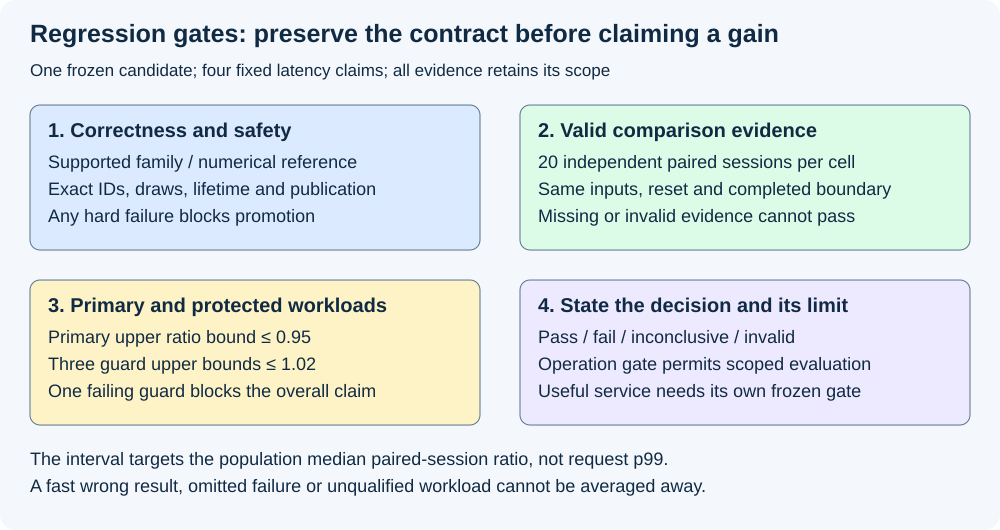
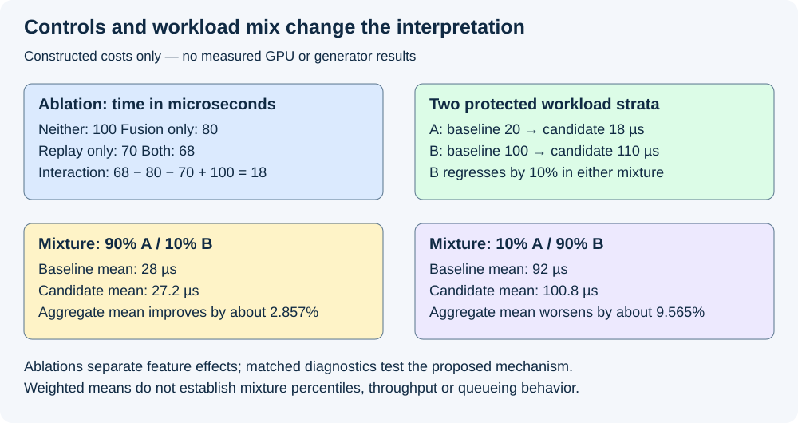

# M9-C27: Designing regression experiments and validation gates

> **Status: Complete — detailed chapter authored and documentation validated; experimental procedures are proposed unless explicitly labelled observed.**

**Module:** Make measurement and correctness part of the foundation

**Category:** [Measurement, experimentation, and economics](index.md)

[Module 9 reading order](../module-9.md) · [Previous: M9-C26](../reliability-and-capacity-control/m9-c26-load-testing-overload-backpressure-and-failure-recovery.md) · [Next: M9-C28](../measurement-experimentation-and-economics/m9-c28-evaluating-cost-and-energy-per-useful-result.md)

## Target concepts

Hypothesis-driven changes, baseline preservation, correctness-before-speed gates, matched traces, ablation controls, workload-specific regressions, distribution shifts, minimum evidence, reproducible pass and fail criteria.

[Execution plan and progress](../chapter-execution-plan.md)

## Concepts

### 1. An experiment needs a decision that can be wrong

A **regression** is a change that worsens an agreed behavior or cost. It can be a wrong token, unsafe storage reuse, worse tail latency, more retained memory or a loss on one important workload. A **gate** is a rule that determines whether evidence permits the next step. It must specify the population, reference, measurement boundary, practical threshold and treatment of uncertainty before seeing candidate results.

A hypothesis is a prediction with a possible refutation. “Fusion is faster” is incomplete. A useful hypothesis is: “For the fixed FP32 LayerNorm family at R=1,D=129, eliminating intermediate materialization reduces completed-operation latency by at least 5%, while preserving the approved numerical contract and keeping each of three named guard workloads within a 2% latency regression budget.” R is the number of rows and D the features per row. These percentages are this chapter's proposed study decisions, not general production targets or observed gains.

The prediction about mechanism is separate: expect fewer launches/intermediate writes, with no new spills or synchronization that explain away the gain. Correctness can pass while speed fails; speed can pass while the proposed mechanism is unsupported. Preserve both outcomes.

This supporting Module 9 chapter applies the completed [M4-C20 validation gates](../numerics-and-correctness/m4-c20-validating-fused-kernels-and-graph-replay.md), [M9-C11 comparison controls](m9-c11-controlled-comparisons-warmup-and-reproducibility.md) and [M9-C01 reference contract](../numerics-and-correctness/m9-c01-defining-reference-behavior-and-evidence-before-optimizing.md). It supports Modules 1–7 without introducing a dependency on excluded Module 8. Rust is the host context for identities, ownership and timing; no implementation code or pseudocode is supplied.

### 2. Freeze the baseline and the rules

A **baseline** is a preserved reference configuration, not whichever older binary happens to be available. Save its source revision, actual executable/kernel hashes, compiler/runtime flags, model/tokenizer/adapter identity where relevant, policy, numerical contract, workload and reset state. Keep its outputs and known limitations. Separate development/tuning cases from the frozen evaluation manifest. Selecting a candidate on evaluation results and then reporting the same results as fresh confirmation introduces selection bias; use a new held-out evaluation study for the selected candidate. Rebuilding the same source with a new compiler creates a different executable identity; it needs a labelled comparison rather than silently replacing historical evidence.

A **comparison unit** is the independently repeated unit used for inference. Here it is a paired session: baseline and candidate see the same fixture and state protocol within one block of comparable machine conditions. Repeated operations inside a session improve that session's measurement but are not hundreds of independent machines or sessions. Preserve the actual AB/BA order and reset logs from completed M9-C11.

| Predeclared item | Concrete study choice |
|---|---|
| Candidate | One frozen change: fusion, replay, or their declared combination; candidate identity fixed before evaluation |
| Correctness | M4-C20 contract/value/safety/publication gates; numerical coordinates and exact token/support/draw checks remain separate |
| Primary cell | FP32 LayerNorm, R=1,D=129, ε=stored FP32 10⁻⁵, γ=1, β=0; completed device-operation latency |
| Guard cells | LayerNorm R=8,D=4096; sampling R=1,V=4096 with k=8, top-p disabled; sampling R=8,V=4096 with top-k disabled, top-p=0.9; T=1 in sampling |
| Effect unit | Ratio of candidate session median to paired baseline session median; positive completed times in the same units |
| Minimum evidence | 20 independent paired sessions per cell, 50 completed scratch warmups per arm/session, 200 completed measured invocations per arm/session |
| Practical budgets | Primary ratio upper bound ≤0.95; each guard ratio upper bound ≤1.02; exact contract/safety failures override timing |
| Analysis family | Four fixed latency claims; conservative simultaneous median-ratio intervals defined below; no optional stopping |
| Scope | Operation-family qualification only; generator/service benefit requires its separate endpoint and outcome gate |

Use the M4-C20 accepted ranges and out-of-place storage policy. Norm rows use exact quarter-valued scores **x[j,v]=(((17v+11j) mod 19)−9)/4**. Sampling uses the same formula for logits and supplied uniforms **u=(b+1/2)/256** for b=0…199 during the 200-invocation session; associate b with the logical invocation and reuse it in the paired arm, not with worker order. Fixed supplied draws establish coupled decisions; they are not a random-generator quality test. All rows and masks stay identical between arms.

Preparation uses owned scratch state, checked completion and the same reset contract. Split the 50 warmups into five groups of ten; a greater-than-2% difference between the final two group medians flags the session as unstable/incomplete for this frozen design. This is an operational flag, not proof of stationarity. Retain its logs; do not extend just one arm until it looks favorable. Compilation/capture/first-use and retained memory are recorded separately. If a session fails the predeclared stability/eligibility checks, keep its outcome and classify the study incomplete or invalid. Do not quietly replace slow or failed sessions until the minimum count looks favorable. A revised protocol requires a new study identity applied to both arms.

### 3. Correctness first, then performance, then useful service

The gates form a sequence rather than a weighted score. An invalid ID cannot be compensated by a 20% latency reduction. A cancelled invocation cannot be removed from the denominator merely because it completed no useful tokens. A candidate that intentionally changes numerical precision, sampling law or allowed outputs belongs to a separately declared approximation/constraint study.

*Correctness and safety failures stop promotion. Timing uncertainty produces an inconclusive decision, while missing or invalid evidence remains visible.*

For each workload preserve offered, admitted, successful, failed, cancelled and still-unresolved attempts. Reconcile logical requests separately from retries. Record enqueue, device completion, result-ready and terminal/publication times with their clock domains. An endpoint measures the same useful work only if model, policy, stopping, supplied draws, token caps and result ownership agree. Use completed M9-C19 for token identity and M9-C02 for event boundaries.

If a candidate falls back, charge the decision and fallback costs at the operation/service boundary. If completion is unknown, retain storage/state claims and do not run a duplicate attempt without recovery accounting. Qualification cannot assume that a timed-out caller proves device work ended. Passing this chapter's operation gate allows further evaluation of that family; it does not certify production safety or a full generator speedup.

### 4. Paired effects and a finite evidence rule

Let A_j and B_j be the baseline and candidate median completed-operation times in paired session j. Define **r_j=B_j/A_j** for j=1…20. Ratios below 1 favor the candidate. Each session uses 200 completed invocations; its ordinary sample median is the mean of the two central sorted values. A ratio is formed only from positive finite times. A ratio of session medians is not a ratio of pooled request p99 values or a guarantee for every invocation.

Sort the 20 ratios, calling the fifth-smallest r_(5) and sixteenth-smallest r_(16). For this study, use **I=[r_(5),r_(16)]** as a conservative interval for the population median paired-session ratio. Under independent, identically distributed sessions and a continuous ratio distribution with a unique median, the number of observations below that median has a Binomial(20,1/2) distribution. This is a sign-count/order-statistic construction related to the [NIST sign-test description](https://www.itl.nist.gov/div898/software/dataplot/refman1/auxillar/signtest.htm). Its interval coverage is

**1 − 2 Σ(k=0…4) C(20,k)/2²⁰ = 1 − 12,392/1,048,576 ≈ 0.9881820679.**

C(n,k) counts ways to choose k positions out of n. The interval therefore covers its target in about 98.8182% of repeated studies under the assumptions. It is not a probability that a fixed observed interval contains the true value. Ties/discrete distributions require a conservative median convention and coverage review; correlated drift or a changing workload invalidates the simple independent-session argument. Do not disguise this problem by treating each invocation as an independent session.

There are exactly four predeclared latency claims. Using the union-bound argument behind [Bonferroni simultaneous coverage](https://itl.nist.gov/div898/handbook/prc/section4/prc473.htm), simultaneous coverage is at least **1−4(1−0.9881820679) ≈ 0.9527282715**, without requiring independence between cells. This controls the fixed four-claim family conservatively; it does not cover arbitrary extra candidates, metrics, repeated looks or tuning searches. Correctness gates remain mandatory independent of this statistical construction. NIST's [confidence-interval guidance](https://www.itl.nist.gov/div898/handbook/prc/section1/prc14.htm) explains repeated-study interpretation.

| Observed bounds, after valid correctness evidence | Decision for that cell |
|---|---|
| Upper bound ≤ its budget | Pass the stated median-ratio gate |
| Lower bound > its budget | Fail the stated gate |
| Otherwise | Inconclusive; neither established compliance nor established excess |
| Missing/invalid sessions or violated assumptions | Incomplete/invalid evidence; no pass |

Promotion requires primary and all three guards to pass, plus all hard correctness/resource gates: stay within the declared fixture budget, retain no unresolved unsafe allocation, and return live storage to the declared baseline after all users retire. Allocator reservation may remain but must be accounted for, not called a live leak. A primary interval entirely above 0.95 can fail the promised 5% improvement even when every ratio is below 1: failing the promised gain is distinct from demonstrating an actual slowdown. A guard lower bound above 1.02 establishes a budget-exceeding regression under the stated model.

**Constructed gate fixtures, not measured timings:** for j=0…19, primary ratios 0.900+0.002j give I=[0.908,0.930], passing 0.95. A guard sequence 0.980+0.002j gives [0.988,1.010], passing 1.02. A second guard 1.000+0.001j gives [1.004,1.015], also passing. A third guard 1.020+0.002j gives [1.028,1.050], failing 1.02: the overall candidate fails despite the primary gain. Ratios 0.940+0.002j give [0.948,0.970], inconclusive for the primary 0.95 budget. These fixtures test the decision rule and arithmetic; they supply no evidence about a GPU.

For invocation-level p95/p99, report the definition, population and counts and use an uncertainty method appropriate to dependence and quantile estimation; these median-ratio intervals do not supply it. Twenty sessions and 4,000 invocations per arm/cell are this design's minimum, not a universal sample-size guarantee or proof of reliable p99. A study needing narrower uncertainty must declare a new larger design before observation, rather than repeatedly extending until it passes.

### 5. Ablations and matched traces explain the mechanism

An **ablation** removes one feature while keeping the other declared conditions fixed. A two-factor study of fusion F and graph replay G has four cells: neither, fusion only, replay only, both. This is a full factorial design, meaning every combination of levels is represented. It exposes interactions that a single baseline-versus-combined comparison cannot identify; see [NIST's factorial design guide](https://www.itl.nist.gov/div898/handbook/pri/section3/pri3331.htm).

| Constructed configuration | F | G | Completed operation time |
|---|---:|---:|---:|
| Staged eager | 0 | 0 | 100 µs |
| Fused eager | 1 | 0 | 80 µs |
| Staged graph | 0 | 1 | 70 µs |
| Fused graph | 1 | 1 | 68 µs |

Fusion saves 20 µs in eager mode but only 2 µs with replay. The additive interaction contrast is **68−80−70+100=18 µs**. An additive prediction from the isolated savings would be 50 µs, not 68. The positive contrast here means the two savings overlap or interfere relative to that additive scale; it is not proof of a specific hardware mechanism. The combined 100/68≈1.47059× speedup cannot be attributed entirely to fusion. All four times are stipulated examples.

A **matched trace** follows the same case, operation/request identity, policy, valid shape and reset condition in a separate diagnostic run for each arm. It need not reproduce the identical hardware schedule. Match producer, launches, synchronization, output readiness and fallback attempts; compare critical-path dependencies and resource evidence. A trace showing fewer launches can support the mechanism but cannot establish clean latency improvement if the tracing itself changes execution. Keep untraced timing and diagnostic profiling separate, as explained by [Nsight Systems](https://docs.nvidia.com/nsight-systems/UserGuide/index.html) and completed M9-C12/C13. For counter profiles record replay/cache policies and binary identity; graphs may change launch overhead without changing device arithmetic.

### 6. Per-workload gates survive changes in the mix

An aggregate can hide a protected-stratum regression. A **stratum** is a named subgroup such as short decode, long prefill, high concurrency or a particular vocabulary width. Freeze its definition before measurement. A **distribution shift** changes the frequencies or characteristics of inputs/arrivals/state relative to the evaluation population.

Consider two constructed latency strata, A and B. Baseline times are 20 and 100 µs; candidate times 18 and 110 µs. At weights 90% A / 10% B, baseline weighted mean is **28 µs** and candidate **27.2 µs**, about 2.857% faster in mean latency. At 10% A / 90% B, the means are **92 µs** and **100.8 µs**, about 9.565% slower. The candidate's 10% loss in B existed in both mixtures. This is weighted-mean arithmetic, not measured throughput, a percentile of a mixture or proof of a queueing model.

*Four configurations separate effects and interactions. The same per-stratum costs can yield an aggregate gain or loss when the workload mix changes.*

Keep protected cells and their budgets even when their current traffic weight is small. Add stress cohorts for flat sampling distributions, awkward tails, graph misses, cold preparation, bursts and cancellation; report them separately. Exact input/trace replay helps attribution but may omit closed-loop arrival feedback, contention and naturally evolving cache state. An unfamiliar workload can use the validated ordinary path; do not silently extend the qualified family. Drift detection, adaptation and requalification need named triggers such as a new dtype/policy/layout family or operating conditions outside the recorded window.

## Experiments

All four studies below are proposed. The chapter's observed authoring work is limited to exact/high-precision arithmetic, document checks and rendered review. No benchmark, trace, generator or hardware result is claimed.

### E1 — Gate decisions and baseline integrity

- **Name:** Freeze the comparison and challenge the gates.
- **Description:** Review immutable baseline/candidate manifests and run reference fixtures through the specified acceptance rules.
- **Purpose/objective:** Predict that wrong ownership, changed decisions or incomplete evidence blocks promotion regardless of apparent speed.
- **Target concepts:** Hypotheses, baseline preservation, correctness-before-speed and reproducible pass/fail criteria.
- **Baseline:** Completed M4-C20 contract/value/safety/publication gates and the four fixed latency budgets above.
- **Workload:** M4-C20 norm/sampling references, guard/epoch and exact-draw checks; constructed pass, fail, inconclusive and missing-session records from this chapter. Include a changed binary with the same source label, an omitted cancelled outcome and a stale reference epoch.
- **Controlled variables:** Stored inputs, reference and binary identities, numerical/policy versions, case manifest and decision-rule revision. A deliberately invalid evidence record remains labelled invalid, never a candidate performance result.
- **Hardware requirements:** CPU for exact reference/gate arithmetic; actual compatible device and sanitizer support only for later candidate safety evidence.
- **Exit criteria:** Every deliberate mismatch is rejected/classified correctly; all valid constructed gate decisions match the stated rule; no runtime candidate passes until M4-C20's actual evidence is available. Report that absence explicitly rather than fabricating a pass.

### E2 — Frozen paired qualification and minimum evidence

- **Name:** Primary gain with protected workloads.
- **Description:** Execute the four-cell 20-session paired design with frozen candidate and predeclared intervals/budgets.
- **Purpose/objective:** Test the ≥5% primary improvement prediction while guarding against >2% median-ratio regressions in three named cells.
- **Target concepts:** Minimum evidence, pairing, uncertainty, workload regressions and pass/fail/inconclusive decisions.
- **Baseline:** Immutable staged/eager reference and one frozen candidate configuration; M4-C20 correctness evidence required first.
- **Workload:** Four cells, exact score/uniform fixtures and 50-warmup/200-measurement/20-pair counts above. Use a separately archived order with ten AB and ten BA sessions per cell. Collect all admitted invocations and failed/unresolved outcomes; invalid sessions prevent the fixed-design pass.
- **Controlled variables:** Device/session conditions, clocks, reset/cache state, shape/dtype/policy, input/draw mapping, completion boundary and compiler/binary identity. No tuning or interim stopping during these evaluation sessions.
- **Hardware requirements:** Compatible FP32 GPU and completion timing, controlled host/NUMA/affinity, resource manifests and sufficient bounded fixture workspace; cap fixture storage at 64 MiB host and 64 MiB device and record tool/model storage separately.
- **Exit criteria:** All hard gates and four interval gates pass for operation-family promotion; any fail blocks it, overlap is inconclusive and invalid evidence cannot pass. Publish per-cell ratios/intervals, sample counts and observed failure outcomes. No service claim follows automatically.

### E3 — Remove features and match diagnostic evidence

- **Name:** Fusion/replay factorial and trace reconciliation.
- **Description:** Compare staged eager, fused eager, staged graph and fused graph under the same accepted operation contract.
- **Purpose/objective:** Predict fewer intermediate writes/launches from fusion and reduced host submission cost from replay; test whether resource pressure or overlapping savings changes that explanation.
- **Target concepts:** Ablation controls, matched traces, hypotheses and causal limits.
- **Baseline:** Staged eager plus each single-feature arm; the combined candidate is not its own sole control.
- **Workload:** Primary and three guard cells; ten complete four-configuration blocks, 50 scratch warmups and 200 measured completed invocations per configuration/block. Archive a balanced configuration order before running. Capture one separate matched trace and representative counter/resource profile per configuration/cell.
- **Controlled variables:** Inputs, contract, pending uniforms, slot generations, reset/thermal state, compiled numerical flags and completed timing boundary; graph preparation/first use remain distinct from warm timing. Diagnostic runs carry their own identities.
- **Hardware requirements:** GPU/runtime supporting admitted graph paths plus host/device timeline and compiler/resource/counter visibility; explicitly record any unsupported diagnostic path.
- **Exit criteria:** All arms meet correctness and exact-state gates; effect/interaction contrasts and traces reconcile with the explanation or the mechanism claim is revised. This explanatory study does not add uncorrected promotion claims to E2's four-test family; any new formal claim needs a new frozen design.

### E4 — Shifted populations and useful-service guardrails

- **Name:** Workload-mix stress and generator confirmation.
- **Description:** Reweight fixed strata analytically, then evaluate a versioned request corpus under the qualified candidate and ordinary baseline.
- **Purpose/objective:** Predict that protected-stratum and failure behavior can reverse a reported aggregate gain; establish the limits of operation-level promotion.
- **Target concepts:** Distribution shifts, per-workload regressions, outcome accounting and end-to-end verification.
- **Baseline:** Fixed per-stratum references and the same model/tokenizer/policy generator using the validated ordinary path.
- **Workload:** The exact A/B 90/10 and 10/90 fixtures above; proposed generator confirmation uses M4-C18's 32-prompt corpus at concurrency 1/8/32 in 20 independent paired sessions, one corpus replay per arm/session, with identical token IDs, caps, arrival schedule and request-owned randomness. Separate fault/stress runs cover cold preparation, graph misses, flat rows, cancellation and unknown completion.
- **Controlled variables:** Model/adapter/tokenizer, useful-output and stopping identity, state/reset, arrival schedule and traceable request outcomes. Predeclare new service metrics/budgets and dependence-aware uncertainty before collecting service results; E2's median-ratio coverage does not transfer to them.
- **Hardware requirements:** Selected model capacity/headroom, compatible host/device/interconnect and event/clock records; actual service studies remain proposed when these are unavailable.
- **Exit criteria:** Mixture arithmetic and every terminal-outcome count reconcile; no protected workload is erased by reweighting. Generator benefit is reported only after its own frozen correctness, useful-throughput/latency/resource gates pass; without a declared service design or sufficient uncertainty evidence, classification is incomplete/inconclusive. Do not relabel the microstudy a production win.

## Verification

### Match evidence to the claim

| Experiment | Evidence and measurements | Decision and scope |
|---|---|---|
| E1 | Manifest/reference hashes, exact fixtures, M4-C20 accepted/rejected cases, synthetic decision records | Known-invalid records fail; constructed arithmetic is authoring QA, not candidate qualification |
| E2 | Four cells × 20 paired-session ratios, sorted bounds, warmup/reset/order logs, resource/safety and all outcomes | Frozen four-claim operation gate only; correctness overrides timing and missing evidence cannot pass |
| E3 | Four-way contrasts, matched request/operation traces, launch/copy/wait counts, register/shared/spill reports | Mechanism evidence and interaction scope; instrumentation never replaces clean paired timings |
| E4 | Fixed-stratum arithmetic, corpus/arrival identity, completed useful tokens, TTFT/inter-token/terminal latency and outcome/resource records | Separate service endpoint and uncertainty; distributions, queueing and failures retain their own populations |

TTFT means time to first token. For tails, retain event-level observations and session grouping; publish the quantile definition and effective comparison unit. Missing completion is not a fast successful sample. Preserve cold setup, warm runtime, fallback and retention costs in their actual scopes. Account for allocated/live/reserved bytes and profiler overhead separately. M9-C07 supplies uncertainty foundations, M9-C12/C13 diagnostic scope, M9-C15 memory accounting and M9-C16 hardware conditions.

Independent authoring QA checks binomial counts/coverage, interval ranks and gate classifications, factorial contrast/speedup, mixture arithmetic and protocol invocation counts. The 20-session rule has explicit assumptions and does not prove independence from observed timing data. All actual frozen-baseline runs, sanitizer evidence, traces, counters and generator studies remain unexecuted.

Archive accepted and failed artifacts, not just a winning summary: immutable baseline/candidate, case definitions, order/reset logs, outputs and discrepancies, raw timestamps/outcomes, analysis-rule version, diagnostic identities and manifest. Store logical request/token/attempt/epoch/generation identities with completion/publication records so stale data or duplicate retry cannot masquerade as a speed improvement. A future compiler, operation contract or qualified-family change invalidates the old scope until requalified.

## Engineering dimensions and principles

### Six dimensions in the regression decision

| Dimension | Concrete application |
|---|---|
| Semantics and invariants | Fixed references, exact tokens/draws and lifetime/publication gates before a latency ratio |
| Workload and variability | Four protected cells, frozen mix plus shifted/stress cohorts; no silent extrapolation to new layout/policy |
| Resources and bottlenecks | Trace movement/launch changes and spills; guard retained memory, fallback and setup costs |
| Time and distributions | Completed operation/session endpoints; dependence-aware tails and fixed stopping, not enqueue speed or pooled fake replication |
| Ownership and coordination | Immutable evidence plus per-request random/epoch/allocation identities and one-time commit |
| Failure and adaptation | Keep cancelled/failed/unknown outcomes, quarantine unresolved state and requalify drift rather than hiding it |

### Eight practical principles

| Principle | Gate-design consequence |
|---|---|
| 1. Correctness defines the boundary | A hard correctness/safety failure blocks promotion whatever the primary speed |
| 2. Operating point determines performance | Protected strata and workload-mix reversal prevent an aggregate-only approval |
| 3. Data movement is part of algorithm | Predict eliminated materialization and verify real traffic/passes rather than assuming all savings are arithmetic |
| 4. State has ownership/lifetime/recovery cost | Match baseline reset and graph/random/slot generations; charge safe fallback and retention |
| 5. Dependencies determine latency; bottlenecks capacity | Matched traces explain completed critical paths and overlapping fusion/replay savings |
| 6. Variability and synchronization shape tails | Paired sessions and protected cohorts retain queueing, cold and failure effects; median claims do not establish p99 |
| 7. Local gains require end-to-end evaluation | Passing E2 permits scoped operation evaluation; E4 needs a separate useful-service gate |
| 8. Claims require reproducible evidence | Fixed minimum evidence, four-claim coverage, immutable artifacts and explicit fail/inconclusive states |

Through the HFT lens, a market-event fast path must preserve sequence ownership and exact decision rules while being tested under bursts, rare paths and stale-state hazards. Small average gains can coexist with a protected workload's unacceptable delay. These systems lessons transfer; text-generation sampling contracts and illustrative percentages do not establish acceptable financial decision errors, trading results or hard real-time guarantees.

## Specifications, articles, and hardware

| Primary source | Use and boundary |
|---|---|
| [NIST paired versus unpaired comparisons](https://www.itl.nist.gov/div898/handbook/eda/section3/eda353.htm) | One-to-one pairing and comparison units; this chapter uses its own explicitly derived binomial interval, not an unpaired t-test |
| [NIST confidence intervals](https://www.itl.nist.gov/div898/handbook/prc/section1/prc14.htm) | Repeated-study coverage and one/two-sided scope |
| [NIST sign test](https://www.itl.nist.gov/div898/software/dataplot/refman1/auxillar/signtest.htm) and [Bonferroni coverage](https://itl.nist.gov/div898/handbook/prc/section4/prc473.htm) | Binomial sign counts and conservative simultaneous-coverage reasoning; interval ranks/coverage derived locally |
| [NIST full factorial designs](https://www.itl.nist.gov/div898/handbook/pri/section3/pri3331.htm) | Factor combinations and interaction reasoning; no inherited inference speedup |
| [NVIDIA Nsight Systems guide](https://docs.nvidia.com/nsight-systems/UserGuide/index.html) | Trace interpretation and collection settings; diagnostic capture is separate from clean timing |
| [CUDA Graphs guide](https://docs.nvidia.com/cuda/cuda-programming-guide/04-special-topics/cuda-graphs.html) | Execution/dependency/update semantics used by the ablation; application ownership remains explicit |

Sources checked 2026-10-28. The formulas and numerical fixtures are explained locally so evaluation does not depend on an external article's unstated defaults. No CPU/GPU/model or measured benchmark has been supplied.

| Hardware/specification area | Required manifest |
|---|---|
| Host | CPU/NUMA/affinity, OS/kernel, Rust/binding/framework/allocator versions and competing load |
| Device/interconnect | GPU model/architecture/UUID/partition/effective memory, SM count, clocks/power/temperature, PCIe/NVLink topology when relevant |
| Software/operation | Runtime/driver/compiler/Triton, actual binary and numerical flags, R/D/V/dtype/strides, graph slots and sampling/norm policy |
| Model/state | Checkpoint/tokenizer/template/adapter, output caps/EOS, cache/reset/warmup, request/random/epoch/generation identities |
| Evidence | Case/corpus and arrival revisions, comparison/session order, timer/trace/counter settings, allocated/live/reserved storage and analysis-rule identity |

## Key takeaways

A regression gate combines a preserved contract, a protected population and a predeclared evidence rule. Explain the mechanism with controls and matched diagnostics, while retaining inconclusive results and failed outcomes. A scoped operation win still needs independent confirmation at the useful-service boundary.

## Continue learning

Next in Module 9 reading order is [M9-C28: Evaluating cost and energy per useful result](m9-c28-evaluating-cost-and-energy-per-useful-result.md), which remains an outline. The next authoring chapter is [M5-C18: Choosing chunk sizes and balancing prefill with decode](../scheduling-and-queueing/m5-c18-choosing-chunk-sizes-and-balancing-prefill-with-decode.md), position 125. Follow the [execution plan and progress tracker](../chapter-execution-plan.md). Only M9-C27 is authored in this step.
