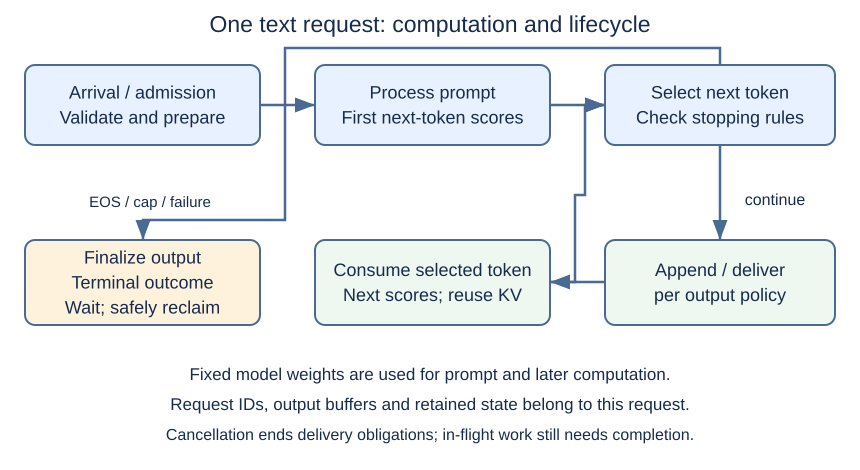
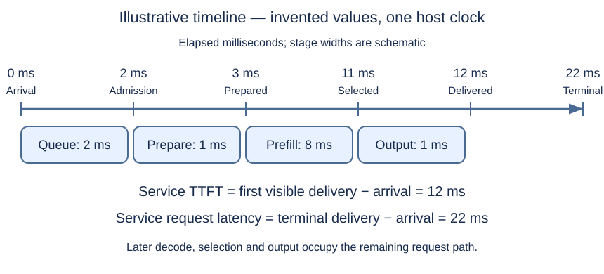

# M1-C01: From a prompt to the next token

> **Status: Complete — detailed chapter authored and documentation validated; experimental procedures are proposed unless explicitly labelled observed**

**Module:** Understand exactly what happens when an LLM generates a token

**Category:** [Model computation and semantics](index.md)

[Module 1 reading order](../module-1.md) · [Next: M1-C02](../interfaces-protocols-and-streaming/m1-c02-representing-text-as-tokens.md)

## Target concepts

LLMs, inference, decoder-only models, model weights, token-by-token generation, stages of a single request.

## What you should be able to explain

A request arrives containing “The market is”. What turns that text into a continuation, and what has to finish before the first useful output reaches its caller? By the end of this chapter you should be able to draw that path, distinguish fixed model weights from temporary request state, trace two token decisions by hand, and propose a benchmark that measures the whole request without confusing a prediction with an observed result.

Assume basic programming knowledge and no prior machine learning or GPU knowledge. This is a conceptual introduction to one text request on one device. Detailed tokenization, matrix arithmetic, attention, sampling, caching, and scheduling follow later. Every experiment below is a **proposed procedure**; no model execution or hardware performance measurement is reported here. There is no implementation code.

## Concepts

### 1. A language model assigns probabilities to continuations

A **language model** assigns probabilities to sequences of text units. A **large language model (LLM)** uses a neural network with many learned numerical parameters to do this. A neural network is a chain of numerical transformations whose parameters are adjusted during learning. “Large” has no universal parameter-count threshold.

A **prompt** supplies the initial context. A **token** is a unit from a model's vocabulary: it can represent a word fragment, punctuation, whitespace, or a control marker. A **vocabulary** is the set of token IDs the model can score. An ID is an integer label, not a numerical measure of a word's meaning. One word can require several tokens, and a token need not be a complete visible character. Treat a token sequence and the text shown to a user as distinct objects. The [Transformers v4.57.1 text-generation guide](https://huggingface.co/docs/transformers/v4.57.1/llm_tutorial) describes generation from a prompt and previously generated tokens until a stopping condition.

The model estimates what continuation fits the context. High probability does not establish factual truth, exchange validity, or permission to act. In this curriculum, market-related prompts are test inputs for engineering exercises; model output is not a trading decision.

### 2. Training changes weights; inference uses them

**Weights**, also called parameters, are the learned numbers used in the transformations. **Training** adjusts those numbers against examples and an objective. **Inference** evaluates the trained model on new inputs. Here, weights stay fixed for the lifetime of a loaded model version: generating another token does not retrain them.

A **checkpoint** is a saved set of model parameters and associated configuration. **Architecture** describes the arrangement of transformations, while configuration specifies choices such as the number of layers. A **layer** is one stage of numerical transformation. Matching a checkpoint name alone is insufficient for repeatability: weights, configuration, tokenizer, and text-formatting rules must belong to a recorded compatible revision.

| Object | What it contains | Owner and lifetime in this chapter |
| --- | --- | --- |
| Model configuration and weights | Structure and learned numbers | Loaded model; may be shared read-only across requests |
| Tokenizer and chat template | Text-to-ID rules and conversation formatting | Versioned model resources; the template supplies role/control markers |
| Prompt and generated IDs | This request's context and decisions | Request; retained until its output and cleanup obligations finish |
| Intermediate values | Temporary numerical results, called activations | Executor while evaluating the model; reusable storage needs safe completion |
| Attention cache, when enabled | Earlier attention keys and values | Request-specific derived state; details arrive in M1-C17 |
| Output buffers and status | Pending delivery and one final outcome | Service/request; cancellation does not automatically finish device work |

An **executor** is the component that performs model computation. A **service** also accepts requests and delivers responses. Distinguishing them matters: a correct executor can sit inside a service that misroutes tokens or reports completion too early.

For a simple weight-storage estimate:

**Weight payload in bytes = P × b**

Here **P** is the number of stored parameters and **b** is bytes per parameter. For an illustrative 500,000,000 parameters stored in two bytes each, payload is 1,000,000,000 bytes: 1 decimal GB, or about 0.931 GiB, where one GiB is 2³⁰ bytes. This calculation excludes activations, cache, temporary workspace, file metadata, and runtime overhead. Two-byte formats such as BF16 store each value in 16 bits; their numerical behavior is explained in M1-C07. A model fitting in memory establishes capacity, not request latency.

### 3. What decoder-only means

A **Transformer** combines attention, which mixes information from permitted token positions, with other learned transformations. The original Transformer used both an encoder and a decoder. A **decoder-only** language model uses a causal stack to predict continuations without a separate encoder stack. **Causal** means a prediction cannot use tokens that have not yet been supplied. The original paper explains decoder masking and autoregressive dependencies; it is historical background, not the exact architecture specification of every modern LLM. See [Attention Is All You Need, sections 3–3.1](https://arxiv.org/html/1706.03762v7).

**Autoregressive generation** means feeding earlier generated tokens back as context for later decisions. Prompt tokens are already known, so much prompt computation can be parallelized across their positions while obeying causality. The next ordinary token decision depends on the previous selected token; a device doing parallel arithmetic does not remove that dependency.

A **forward pass** evaluates the model for supplied token positions. The final relevant position produces a **logit**, or unnormalized score, for each vocabulary entry. **Softmax** converts these scores into nonnegative probabilities summing to one. The calculation and numerical stability come in M1-C06. A **decoding policy** turns the scores into a selected token. “Decoder-only” names an architecture; “decoding policy” names a selection rule.

### 4. The model and the selection policy are separate

Let **x** be the prompt token sequence, **y₁ … yₙ** the generated token IDs, and **θ** the fixed weights. A conditional probability **pθ(yᵢ | x, y₁ … yᵢ₋₁)** means the probability of token yᵢ given the prompt and earlier output. The vertical bar means “given”. For a specified n-token continuation:

**pθ(y₁ … yₙ | x) = ∏ᵢ₌₁ⁿ pθ(yᵢ | x, y₁ … yᵢ₋₁)**

The product symbol means multiply the successive conditional probabilities. This is the chain rule used in autoregressive language modeling; see the [GPT-2 report, section 2](https://cdn.openai.com/better-language-models/language_models_are_unsupervised_multitask_learners.pdf). If a policy filters or reshapes probabilities, its output distribution need not equal this original model distribution. A complete probability for a variable-length response must also account for how it stops.

For **greedy selection**, choose the highest-scoring permitted token, with a declared rule for ties. **Sampling** draws a token according to probabilities, so identical weights and prompts can produce different valid outputs. A random seed initializes the random generator; a seed alone does not guarantee identical output across different numerical backends or execution orders. [Transformers v4.57.1 generation strategies](https://huggingface.co/docs/transformers/v4.57.1/generation_strategies) distinguishes greedy search from sampling.

The following is a **constructed teaching example**, not actual tokenizer IDs or a model prediction. Suppose a prompt is represented by IDs [11, 42, 7]. Consider a toy vocabulary with only three possible next tokens:

| Candidate | Probability after this prompt | Greedy decision |
| --- | --- | --- |
| ID 21, “ calm” | 0.60 | Select ID 21 |
| ID 35, “ volatile” | 0.30 | Do not select |
| ID 99, end marker | 0.10 | Do not select |

The new context is [11, 42, 7, 21]. Suppose the next distribution assigns 0.70 to the end marker and 0.30 to a full stop. Greedy selection now ends the response. The probability of the chosen pair under these assumed model distributions is **0.60 × 0.70 = 0.42**. The second 0.70 is conditional on choosing ID 21 first; it is not an independent coin toss. Greedy selection itself picks this pair deterministically in this toy case.

The end marker is a selected token but produces no visible word under this display policy. There were two selections and one visible text fragment. The prompt was not generated. Keeping those counts distinct prevents misleading token-rate claims.

### 5. A request has a lifecycle around the model

*Figure 1. An ordinary single-request path with KV reuse. The terminal branch applies the output policy to the final selection before cleanup. The loop describes dependencies, not implementation instructions. Prompt processing makes the first next-token scores available; a later iteration consumes the newly selected token.*

**Arrival** means the service has received the request at a declared boundary. **Admission** means it accepts the request for execution resources. Waiting between them is queueing. A single-request exercise can have no intentional queue while still experiencing operating-system delays.

**Preparation** validates the input, applies any chat template, and converts text into token IDs. The **context limit** constrains how much input and output a configuration supports. Invalid limits should receive a declared rejection rather than silent truncation. An empty user message can still become nonempty model input after formatting; record the actual prepared IDs.

**Prefill** processes the known prompt. Its final relevant scores support the first selected output token. With a **key-value (KV) cache**, earlier attention results are retained, and subsequent **decode** steps process newly selected tokens using that retained state. Without a cache, a simple reference evaluates the growing full prefix again. Both should represent the same causal prediction, subject to justified numerical differences. [Transformers v4.57.1 caching documentation](https://huggingface.co/docs/transformers/v4.57.1/cache_explanation) explains what KV reuse preserves. Cache layouts and validation are deferred to M1-C17–C19.

After selection, stopping rules decide whether the token ends generation, counts against the output limit, or contributes to output. An **end-of-sequence (EOS)** token is a configured control token. A **length cap** is a maximum number of selected new tokens under this chapter's contract, including any selected EOS. A **terminal outcome** says completed, rejected, cancelled, timed out, or failed, with a more specific reason such as EOS or length cap. A **stream** delivers incremental output; one network chunk may contain zero, one, or several tokens. It is not automatically a token timestamp.

Cancellation stops the obligation to produce new output, but already submitted device work may still be in flight. **Reclamation** means making storage safe for reuse. It must wait for all users of that storage, even after the caller has left. A restarted request with a new identity must not receive output from an older attempt.

### 6. Trace the critical path before talking about speed

A **CPU** is the general-purpose processor coordinating the request. A **GPU** accelerates parallel numerical work and usually has its own memory. **Bandwidth** is a data-transfer rate; **latency** is time from a specified start to a specified finish. Data placement, transfer, waiting, and output handling can all lie on the **critical path**, the dependency chain that determines completion time.

*Figure 2. Invented timings for reasoning, not benchmark results. All timestamps are from one host's monotonic clock, a clock measuring elapsed time without wall-clock adjustments.*

Let **tₐ** be arrival, **t𝒹₁** first output-token delivery, and **t𝒻** terminal delivery at that same service boundary:

**Service TTFT = t𝒹₁ − tₐ**; **service request latency = t𝒻 − tₐ**

**TTFT** means time to first token at the named boundary. In Figure 2, it is 12 − 0 = **12 ms**; total request latency is 22 − 0 = **22 ms**. If prefill ends at 11 ms and began at 3 ms, prefill is only 8 ms. Claiming “first-token latency is 8 ms” would omit queueing, preparation, selection, and delivery overhead as applicable. One millisecond (ms) is 0.001 seconds. A request producing only a hidden EOS has no visible first-token delivery; record TTFT as unavailable, not zero.

For a deliberately serial baseline producing **n** selected tokens with n ≥ 1:

**Trequest = Q + A + F + Σᵢ₌₁ⁿ Sᵢ + Σᵢ₌₂ⁿ Dᵢ + U**

**Q** is queueing, **A** preparation, **F** prompt processing, **Sᵢ** the selection/stopping work for token i, **Dᵢ** the later model evaluation producing scores for token i, and **U** the remaining serial output and terminal-delivery work. There are n − 1 later evaluations because prefill supplies the first scores. The sigma symbol means add the indicated terms. If n = 1, the second sum is empty and equals zero. The formula excludes model loading in a warm, already loaded service. It does not apply unchanged to overlapping output delivery, speculative generation, or shared execution. Never add overlapping profile spans as if they were serial durations.

In HFT, parsing an event, updating state, deciding, and emitting an order also form a dependency chain. Request IDs resemble event-sequence identities, and a stale response resembles a decision based on obsolete state. This analogy motivates explicit boundaries and cancellation checks. It does not imply that token probabilities obey exchange protocols, that inference belongs on an order path, or that HFT and inference share latency budgets.

## Experiments

### Shared contract and preparation

E1 is a paper exercise requiring no model or accelerator. E2 and E3 are optional-to-run experimental designs for an **existing**, inspectable inference tool, not a request to implement one. To count either hardware experiment as executed, the tool must expose prepared IDs, selected IDs, effective generation settings, terminal reasons, and completion events. If those are unavailable, record the limitation and do not substitute guessed internal behavior. A paper trace remains a paper trace.

Use one text request at a time, with no other client load, no adapters, no speculative generation, and cross-request prefix reuse disabled. An **adapter** supplies request-dependent changes to selected model computations. Fix weights, model configuration, tokenizer, template, precision, device placement, cache mode, and software versions. Start with greedy selection, no sampling or score-altering penalties, an explicit allowed-token policy, and a recorded tie rule. Set EOS IDs explicitly from the compatible generation configuration and record the **effective** settings rather than relying on defaults. Set a new-token cap of 16 unless a test below states otherwise.

A concrete reference candidate is **Qwen/Qwen2.5-0.5B-Instruct**, snapshot **eaa56b503cc0a8a4d15de1dd8bd2a7e95a716be2**. The [snapshot commit](https://huggingface.co/Qwen/Qwen2.5-0.5B-Instruct/commit/eaa56b503cc0a8a4d15de1dd8bd2a7e95a716be2) contains weights, tokenizer resources, model configuration, and generation configuration. Its generation defaults enable sampling and include two EOS IDs, whereas its model configuration has one EOS ID. Therefore explicitly choose greedy behavior and record the EOS list; do not assume the downloaded defaults implement this experiment. This distinction is a useful specification check, not an error in the checkpoint.

For all experiments, write a prediction first. Keep raw event records and explain agreement or disagreement afterward. No universal speed target is asserted; an explained lack of improvement is an acceptable outcome.

### E1 — Two decisions, one visible fragment

**Description:** Hand-trace the toy three-candidate example through a complete request, then alter its stopping policy and identity events.

**Purpose/objective:** Test the claim that each decision uses the newly extended context while weights remain unchanged; distinguish selected tokens, visible output, and terminal status.

**Target concepts:** LLM probabilities, inference versus training, fixed weights, decoder-only causality, token-by-token generation, complete request stages.

**Hypothesis/prediction:** The second decision sees ID 21; it cannot legitimately use a future token. A cap of one stops after ID 21. Under the original cap of two, the selected EOS ends generation while only one text fragment is visible.

**Baseline, controls, and workload:** Use exactly the constructed probabilities, prompt IDs, and display policy above. Compare six labelled cases: normal EOS; cap one; EOS on the first selection with probability one; invalid negative cap; cancellation before selection; and a late completion event carrying an old request identity after cancellation. Change only the named condition in each case. Keep the toy weights symbol θ fixed; no hardware or software runtime is required.

**Procedure:** First draw a row for arrival, validation, prompt processing, each selection with its complete preceding context, visible output, terminal outcome, and safe cleanup. Then trace the normal case and calculate its pair probability. Repeat for the five altered cases. Declare invalid caps rejected before execution. For cancellation, declare that no new output becomes visible after cancellation is acknowledged; already delivered text remains delivered. For the late event, retain the old identity and prevent delivery into a new request. Finally identify which storage still needs an in-flight-work completion check.

**HFT and systems connection:** Treat context and request identity like an event-sequence contract: a stale completion cannot become a fresh result. The exercise checks causal ordering and ownership, not market prices or profitability.

**Exit criteria:** All six traces have the stated context, selected/visible counts, one final outcome, and a justified cleanup boundary. The normal pair probability is 0.42; the cap-one case has one selection; EOS-first has zero visible fragments; invalid input never enters model execution. Any use of future context or reassignment of stale output fails the exercise. A cancellation policy that frees in-use storage also fails, even when its visible output looks correct.

### E2 — The request boundary changes the latency claim

**Description:** Observe the same short request in a cold process and a warm loaded process; compare complete-request latency with internal model time.

**Purpose/objective:** Test whether loading, preparation, and delivery explain a gap between model execution and useful response time.

**Target concepts:** Inference, model weights and loading, prompt processing, first selection, later decode, stages of a single request.

**Hypothesis/prediction:** Including initialization will usually increase latency, while selected IDs remain unchanged under the same effective numerical and decoding contract. A near tie or nondeterministic backend may break exact output repeatability; that is an investigation, not permission to ignore a mismatch.

**Baseline, controls, workload, and requirements:** Use the shared reference, hardware record below, and one fixed user message: “Explain what a bid price means in one sentence.” Retain its exact formatted IDs. Baseline is warm, cache-empty request state, one request outstanding, cap 16, and no intentional queue. Compare against a fresh process loading the same locally available artifacts. Do not include downloading in one run and exclude it in another. Call this **process-cold**; the operating system may still cache weight files, so it is not storage-cold.

**Procedure:** First save the manifest and effective policy. Record process launch, model ready, service arrival, admission, preparation complete, first selection, first visible delivery, and terminal delivery with unique request identity. Use a same-host caller clock to time an operation that either launches the cold process and submits its request when ready, or submits directly to an already ready warm process; stop at receipt of the terminal outcome. Label this initialization-inclusive caller duration separately from service arrival-to-terminal latency. The warmup interval is outside the warm caller operation. Complete a cold run. Warm the process using excluded requests until preparation and execution durations stop showing a systematic settling trend; record the actual number and criterion. Complete paired warm/cold trials using the verification design below. Finally compare model-loading and transfer intervals with total elapsed time, and inspect any output mismatch before interpreting speed.

**HFT and systems connection:** Startup recovery and steady-state event handling have different paths. This experiment separates availability/setup delay from warm response delay without borrowing a trading system's latency target.

**Exit criteria:** Every trial has correct identity and output accounting, distinguishable process-cold and warm states, valid ordered timestamps, and terminal outcome. The report reconciles internal versus complete-request boundaries and attributes their gap or records it as unexplained. No improvement claim passes if output correctness or the event record fails.

### E3 — Change context length, then challenge the lifecycle

**Description:** Sweep prepared prompt length and allowed output length, then test cancellation and invalid requests separately from successful completions.

**Purpose/objective:** Test whether request cost depends on both known context and sequential output work, and whether termination preserves ownership.

**Target concepts:** Decoder-only causal context, sequential generation, fixed weights versus growing request state, request stages.

**Hypothesis/prediction:** Longer contexts or more actual selections can increase work; the amount depends on the device and cache mode. Raising a cap alone need not increase work when EOS occurs early. Cancellation may end delivery before it is safe to reuse execution buffers.

**Baseline, controls, workload, and requirements:** Use the same loaded model/tool and hardware as E2. Prepare fixed, archived text fixtures whose total formatted input lengths are 32, 128, and 512 tokens, including template markers; verify counts with the pinned tokenizer rather than equating words with tokens. Keep the concluding question fixed and record all filler text. Cross these three fixtures with caps of 1 and 16 for six cells, one request outstanding. Baseline is 32 input tokens and cap one. Keep EOS enabled, precision and cache mode fixed, and record actual selected and visible counts.

**Procedure:** First predict each cell's stage changes and verify its length fits the declared context budget including the output allowance. Warm and measure each cell in randomized order. Then separately submit a negative cap and an input exceeding the configured context budget; expect explicit rejection before model execution under this exercise's service contract. Test cancellation once before admission and once after first visible delivery in a trace where that event occurs. Wait for cancellation acknowledgement, terminal accounting, and completion of already submitted work. Submit a new request with a new identity and check for old output or stale state. Record unsupported cancellation or missing completion evidence as an unexecuted capability check, not a pass.

**HFT and systems connection:** Different message sizes and bursts can change work even under the same decision logic. This single-request sweep investigates size and state lifetime; it does not establish burst capacity, shared-queue fairness, or p99 under live arrivals.

**Exit criteria:** All six cells have verified input lengths, actual output counts, a reference trace, and an explanation of stage/resource changes. Both invalid requests are rejected as specified. Both cancellation scenarios have one terminal outcome and no new visible output after acknowledgement; the new request receives no old data. Reclamation waits for completion evidence. Early EOS or unsupported visibility must be explicitly reported and cannot be treated as a completed fixed-length or cancellation test.

## Verification

### Reference behavior before performance

The local application of [M9-C01](../numerics-and-correctness/m9-c01-defining-reference-behavior-and-evidence-before-optimizing.md) is a declared reference: E1 uses exact constructed probabilities; E2/E3 use a frozen, inspectable tool and manifest. The tool is an operational reference, not proof that every internal mathematical operation is correct. The Module 9 chapter is currently an outline; the required introductory contract is stated here.

In E1 require exact ID counts, the complete context for each decision, and the stated arithmetic. For E2/E3 require matching prepared IDs, valid vocabulary IDs, a fixed loaded weight identity, cap compliance, configured EOS handling, no output cross-contamination, and one terminal outcome. Exact IDs and counts have zero tolerance. An internal weight checksum before/after a run, if available, can strengthen the fixed-weight check; matching rendered text alone cannot prove it.

Compare repeated greedy runs only within the same manifest. A divergent selected ID fails the repeatability assumption until investigated. Do not invent a logit tolerance here: numerical comparisons and near ties require the methods in M1-C07 and M9-C17. A different precision, tokenizer, or decoding policy changes the contract and needs a separate comparison. A fluent answer is neither a numerical reference nor evidence of lifecycle correctness.

### Target-concept coverage

| Target concept | Explanation | Exercise and check |
| --- | --- | --- |
| LLMs | Concepts 1 and 4: probabilities over token continuations | E1 conditional probability and distinct selection/display counts |
| Inference | Concepts 2 and 5: evaluate fixed learned parameters | E1 fixed θ; E2/E3 frozen manifest and repeatability checks |
| Decoder-only models | Concept 3: causal continuation without a separate encoder stack | E1 forbids future context; E3 preserves the complete prepared prefix |
| Model weights | Concept 2: identity, shared lifetime, storage estimate | E2 loading attribution and weight identity; optional before/after checksum |
| Token-by-token generation | Concepts 4 and 6: feedback and sequential decisions | E1 context extension, E3 actual selections versus cap |
| Stages of a single request | Concepts 5 and 6 and both figures | E2 event boundaries; E3 rejection, cancellation, safe cleanup, next-request isolation |

### Timing and outcome definitions

Apply [M9-C02](../measurement-experimentation-and-economics/m9-c02-request-events-clocks-and-measurement-boundaries.md) by keeping service timestamps on one monotonic host clock. Service arrival is receipt of the complete request at the instrumented service; first visible delivery is release of the first output-bearing fragment by that service; terminal delivery is release of the final status. These boundaries exclude subsequent network transport to a remote caller. A client benchmark must instead time send-to-receive on its own monotonic clock and label the result client latency. Do not subtract timestamps from unrelated clocks.

Also record first **selection** independently from visible delivery. GPU submission can return before computation finishes: an observed CPU submission span is not GPU execution time. Device timing needs completion-aware events and explicit host/device correlation; without that capability report host end-to-end durations and mark device attribution unavailable.

For every submitted request count exactly one of completed, rejected, cancelled, timed out, failed, or unfinished at observation end. At drain, let all admitted work finish or record the remaining unfinished population. Never drop errors from latency reporting without reporting their counts separately. Requests with no visible output have no TTFT sample. EOS selections, visible text fragments, and transport chunks remain separate counts, applying the introductory output checks from [M9-C19](../interfaces-protocols-and-streaming/m9-c19-validating-tokenization-stopping-and-final-output.md).

### Verification matched to each experiment

| Experiment | Correctness and failure evidence | Measurements and benchmark comparison | Profiling and limits |
| --- | --- | --- | --- |
| E1 | Six hand traces; contexts and fixed θ; selected/visible counts; 0.42 calculation; EOS/cap/reject/cancel outcomes; stale event isolated | Count selections and critical-path stages; use the invented timeline only to check 12 ms TTFT and 22 ms request latency | Paper dependency diagram identifies ordering only. It cannot establish CPU time, GPU occupancy, or measured latency. |
| E2 | Prepared and output IDs; effective policy and identities; terminal reasons; repeatability investigation for any divergence | Paired caller operation-start-to-terminal duration; cold launch-to-ready duration; ready-to-arrival gap; service TTFT, request latency, selected count, loading duration, and peak host/device memory | Existing host stage traces; optional Nsight Systems CPU/GPU timeline on NVIDIA hardware to distinguish loading, transfers, execution, and idle gaps. A timeline gap alone does not prove memory bandwidth is the bottleneck. |
| E3 | Six validated workloads; output/cap/EOS counts; invalid requests; cancellation acknowledgement and completion records; isolated next request | Service TTFT and total latency per cell; actual selections and visible counts; peak memory; cancellation-to-acknowledgement and acknowledgement-to-safe-reuse durations separately | Attribute changes to preparation, prompt processing, later evaluations, or output; compare state size before/after cancellation and drain. An allocator may retain reserved memory, so a nonzero memory reading alone is not a leak. |

**Sample and uncertainty plan for E2/E3:** Begin with five pilot pairs for E2 and five requests per E3 cell to establish warmup behavior, logging quality, and a rough spread; exclude pilots from final comparisons. Then collect 30 cold/warm pairs for E2 and 30 requests per cell in each of three separate warmed sessions for E3. Randomize pair/cell ordering and retain run/session identity. These are introductory comparison counts, not a license to claim stable p99. Report every observation, median, minimum/maximum, actual output counts, and per-session spread. If the direction of a comparison changes across sessions or is comparable to measurement overhead, call it inconclusive; increase observations in a separately declared follow-up.

For a later p99 study, choose a representative arrival workload and enough independent request observations to examine the tail with uncertainty. At 100 samples, only about one observation lies beyond the estimated 99th percentile; even 10,000 samples offer only about 100 observations there, and correlation reduces the information. This chapter's serial runs cannot support production tail or saturation claims. [M9-C07](../measurement-experimentation-and-economics/m9-c07-latency-distributions-and-statistical-uncertainty.md) will develop that analysis.

Record warmup counts, excluded observations with reasons, clock resolution, background activity, temperature/power conditions, and early stops. Pair comparisons by identical fixture and settings; differing actual output lengths must be shown rather than hidden by reporting only tokens per second. Use no fixed performance pass threshold here because no hardware, service target, or acceptable regression budget has been supplied.

**Instrumentation check:** Repeat representative warm measurements with minimal tracing and detailed tracing, holding workload and settings fixed. Compare their complete-request distributions; an overhead comparable to the claimed benefit makes attribution uncertain. Use short representative profiles separately from the primary minimally instrumented benchmark. NVIDIA's [Nsight Systems guide](https://docs.nvidia.com/nsight-systems/UserGuide/index.html) explains timeline collection and collection-related overhead; record the exact installed profiler version and enabled collectors. Profiling is an explanation aid, not an independent performance result.

### Evidence record and acceptance

Keep a manifest containing fixture text and prepared IDs, complete model/tokenizer/template revision, effective generation settings and EOS list, cache state, precision, software versions, hardware record, timing definitions, warmup and trial schedule. Preserve per-request IDs, events, selected IDs, output counts, terminal outcomes, raw timings, and representative profiles. If privacy prevents publishing fixtures, disclose the resulting reproducibility limit. The controls implement the introductory guidance of [M9-C11](../measurement-experimentation-and-economics/m9-c11-controlled-comparisons-warmup-and-reproducibility.md), which remains an outline.

A finished experimental report explains predicted versus observed results, failures and unsupported checks, and full-request consequences. A faster prefill with slower total delivery is not an end-to-end improvement. Documentation completion here means the procedures and checks are specified and reviewed; **none of E1–E3 has been claimed as an executed hardware experiment**.

## Engineering dimensions and principles

### Six dimensions applied to this chapter

| Dimension | Application and evidence |
| --- | --- |
| Semantics and invariants | The current prefix determines the next distribution; weights stay fixed. E1 checks causal contexts; E2/E3 check prepared IDs, policies, caps, and final outcomes before interpreting speed. |
| Workload and variability | Prepared length and actual selections matter more than word counts or caps alone. E3 varies both; EOS and runtime jitter explain why nominally similar requests can differ. Only text is in scope; other modalities are excluded with Module 8. |
| Resources and bottlenecks | Weights, temporary activations, retained state, and output buffers consume different resources. E2 separates weight loading; E3 tracks memory and stage times. A capacity estimate does not identify a time bottleneck. |
| Time and distributions | First-token delivery includes more than prefill. E2/E3 retain per-request durations and session variation; their small serial samples cannot establish production p99 or queueing behavior. |
| Ownership and coordination | Shared read-only weights differ from private request state. E1/E3 challenge stale completions and require safe reuse only after in-flight work finishes. |
| Failure and adaptation | Invalid limits reject; EOS and caps terminate; cancellation stops delivery without magically completing execution. E3 checks the next request after cancellation and records unsupported capabilities honestly. |

### Eight principles as concrete decisions

1. **Correctness defines the optimization boundary.** Shortening input or changing sampling to obtain speed changes the experiment. E2/E3 first enforce the frozen identity and stopping contract; approximations require a separate numerical/quality study.
2. **Performance depends on workload and operating point.** E3 reports each length/cap cell and actual output counts. A result for one serial request is not a statement about concurrent service.
3. **Data movement is part of the algorithm.** Loading weights and transferring inputs occupy real intervals in E2. Arithmetic timing alone cannot explain arrival-to-delivery time.
4. **State has ownership, lifetime, and recovery cost.** Weights can survive a request; its cache and buffers have separate obligations. E3 measures acknowledgement-to-safe-reuse and checks the next request for contamination.
5. **Dependencies determine latency; bottlenecks determine capacity.** The next ordinary selection needs the previous token; Figure 1 makes that chain explicit. Serial experiments inspect this path but do not measure the maximum sustainable request rate.
6. **Variability and synchronization shape the tail.** Device completion and output delivery can lag submission. Session spread and overhead checks precede any claim about rare slow requests.
7. **Local improvements must be evaluated end to end.** Compare prefill or loading changes with complete-request delivery in E2/E3, including output-length differences and failures.
8. **Claims require reproducible evidence.** E1 provides exact reference arithmetic; E2/E3 require immutable identities, explicit event boundaries, raw results, failure accounting, and declared limitations. No measured speedup is supplied by this chapter.

## Specifications, articles, and hardware

### Reference specifications and reading

Sources below were checked on **24 October 2026**. Versioned documentation is a conceptual/reference choice, not an instruction to install software. External sources may contain code; no implementation is reproduced here.

| Primary source | What to read and what it establishes |
| --- | --- |
| [GPT-2 report, 2019, section 2](https://cdn.openai.com/better-language-models/language_models_are_unsupervised_multitask_learners.pdf) | The sequence probability factorization underpinning the worked two-token example; model probability is distinct from factual correctness. |
| [Attention Is All You Need, v7, section 3](https://arxiv.org/html/1706.03762v7) | Original encoder/decoder organization and causal decoder masking. Modern decoder-only architecture details must come from their own specifications. |
| [Transformers v4.57.1 text generation](https://huggingface.co/docs/transformers/v4.57.1/llm_tutorial), [strategies](https://huggingface.co/docs/transformers/v4.57.1/generation_strategies), and [caching](https://huggingface.co/docs/transformers/v4.57.1/cache_explanation) | Prompt continuation, greedy versus sampled selection, and retained attention state. Read descriptions; this chapter provides no library implementation. |
| [Qwen2.5-0.5B-Instruct model card](https://huggingface.co/Qwen/Qwen2.5-0.5B-Instruct) | Model-specific context and parameter scale; verify the model-specific section rather than general claims for the entire Qwen family. |
| [Pinned model configuration](https://huggingface.co/Qwen/Qwen2.5-0.5B-Instruct/blob/eaa56b503cc0a8a4d15de1dd8bd2a7e95a716be2/config.json) and [generation configuration](https://huggingface.co/Qwen/Qwen2.5-0.5B-Instruct/blob/eaa56b503cc0a8a4d15de1dd8bd2a7e95a716be2/generation_config.json) | This configuration has 24 layers, a 151,936-entry output vocabulary, and 32,768 position capacity; BF16 is the recorded weight-type setting. These are not requirements for every decoder-only model, nor guarantees that a chosen runtime admits that full context. Record actual runtime limits. |
| [NVIDIA hardware reference](https://docs.nvidia.com/enterprise-reference-architectures/hgx-ai-factory-h100-h200-b200/latest/components.html) and [Nsight Systems guide](https://docs.nvidia.com/nsight-systems/UserGuide/index.html) | Distinguish hardware capacity and bandwidth from achieved latency; interpret optional execution timelines with overhead controls. These pages are unversioned references checked on the date above. |

### Hardware requirements and experiment manifest

No hardware has been selected or measured. E1 needs paper or a document viewer. For E2/E3, an illustrative **provisioning target** for the small reference model is a 64-bit host, at least four physical CPU cores, 16 GiB system RAM, and 5 GiB free local storage for artifacts and traces. These are conservative experiment-planning choices, not published minimum requirements or a validated installation. The runtime's dependencies and actual model/state footprint must be checked before execution. CPU-only execution is valid if supported and recorded; it produces a separate result population from GPU execution.

An optional GPU path can use one device with at least 8 GiB local memory and supported numerical operations; validate that weights, context, workspace, and runtime allocations fit together. Do not silently spill part of the model to CPU, change precision, or compress weights when comparing cells. Compression of numerical values is quantization and belongs to a separate contract. Inter-device links and network adapters are irrelevant to this one-device local-service experiment unless transfers or a remote client are explicitly added.

For a concrete manufacturer specification, the **NVIDIA H100 SXM** has **80 GB HBM3** device memory and a stated **3.35 TB/s** memory bandwidth in the [NVIDIA component table](https://docs.nvidia.com/enterprise-reference-architectures/hgx-ai-factory-h100-h200-b200/latest/components.html). HBM is high-bandwidth device memory; TB/s is decimal trillions of bytes per second. These are an illustrative hardware reference, not the recommended purchase or the machine used here. Do not transfer these numbers to an H100 PCIe variant or infer achieved token latency from peak bandwidth.

Record the actual CPU model, physical/logical core counts and affinity (which cores the process may use), system RAM, storage type, device model and variant, usable/allocated device memory, connection to the host, driver/runtime versions, arithmetic and storage precision, framework/backend release, power settings, and background load. A **backend** is the numerical execution implementation. Record profiler version and collectors separately. This manifest is a prerequisite to interpreting measurements; unknown fields stay unknown rather than being filled with the illustrative specifications above.

## Key takeaways

A decoder-only LLM repeatedly scores the next token from the current causal context using fixed learned weights. A selection policy chooses a token; stopping and display rules decide what becomes visible and when the request finishes. Prompt processing provides the first scores, and later ordinary decisions depend on selected tokens.

A correct low-latency system must preserve token identity and request ownership across preparation, computation, delivery, cancellation, and cleanup. Measure the boundary the caller cares about, retain actual workload and failure counts, and treat formulas, proposed benchmarks, and observed results as different forms of evidence.

Next, [M1-C02](../interfaces-protocols-and-streaming/m1-c02-representing-text-as-tokens.md) explains how text becomes token IDs and how templates and special tokens affect that identity. Tensor mathematics and attention then make the model's numerical transformations concrete.
