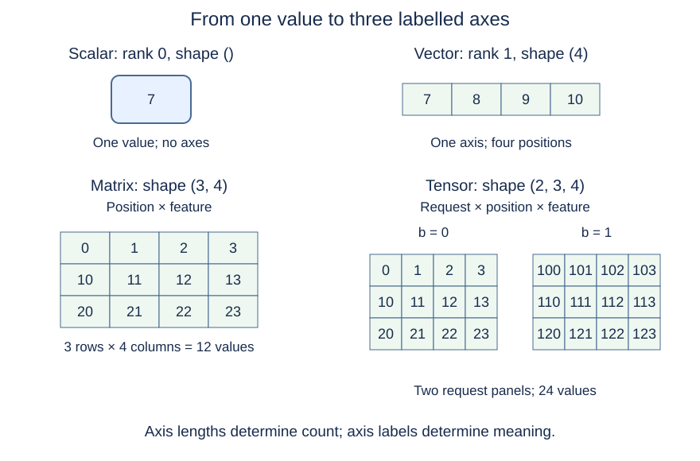
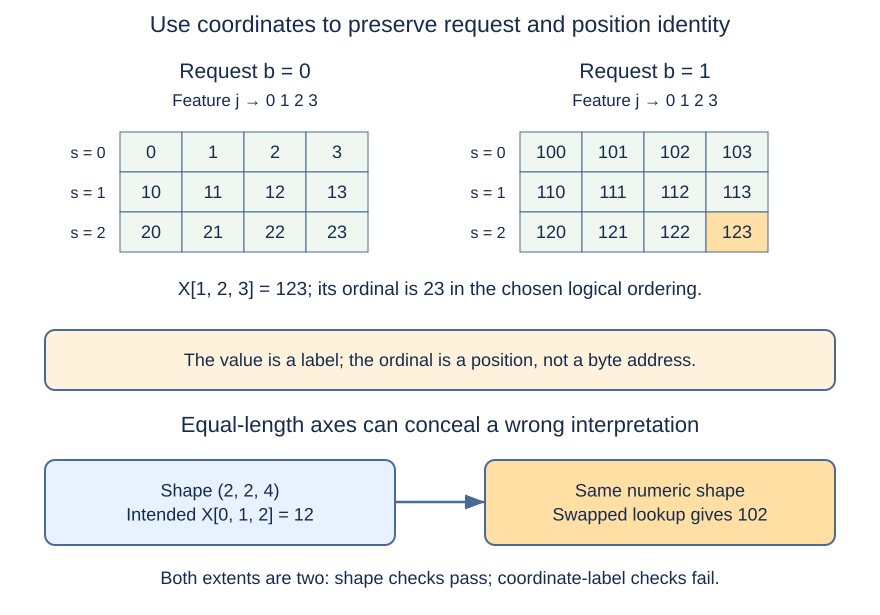

# M1-C03: Numbers, vectors, matrices, and tensors

> **Status: Complete — detailed chapter authored and documentation validated; experimental procedures are proposed unless explicitly labelled observed**

**Module:** Understand exactly what happens when an LLM generates a token

**Category:** [Model computation and semantics](index.md)

[Module 1 reading order](../module-1.md) · [Previous: M1-C02](../interfaces-protocols-and-streaming/m1-c02-representing-text-as-tokens.md) · [Next: M1-C04](m1-c04-dot-products-and-matrix-multiplication.md)

## Target concepts

Scalars, vectors, matrices, tensors, axes, dimensions, shapes, indexing, basic Rust representations.

## What you should be able to explain

[M1-C01](m1-c01-from-a-prompt-to-the-next-token.md) followed a generation request; M1-C02 explained how text becomes token IDs. After those IDs enter numerical computation, how do we describe which values belong to which request, token position, and feature? This chapter supplies that vocabulary before introducing matrix multiplication.

You should be able to read a shape, calculate its element count, locate a value using coordinates, distinguish an empty array from a scalar, and explain what a Rust collection does and does not guarantee. Only basic programming knowledge is assumed. The examples are constructed teaching data, not actual model activations, market observations, or benchmark results. The experiments below are proposed procedures. There is no implementation or pseudocode.

## Concepts

### 1. A number needs a meaning and a representation

A **scalar** is one value, such as a temperature, a token count, or a model score. In this chapter, a **tensor** means a numerical array described by its values, element type, and shape, as commonly used in machine learning. This is an array-oriented introduction; it does not develop the more general mathematical theory of tensors and changes of basis.

An **integer** represents a number without a fractional part. A **floating-point number** is a computer representation used for quantities such as learned weights and scores; it approximates many real numbers. A **data type**, often called **dtype**, specifies how stored bits are interpreted. The mathematical quantity, its units, and its stored type are separate parts of the contract. The integer token ID 123 is an identity label, while a model score of 123 is a numerical value. Equal printed numbers do not make those uses interchangeable.

We will use small whole-number labels so the examples can be checked exactly. When a proposed runtime experiment stores these labels in 32-bit floating point, the small values used here remain exact. The reasons rounding becomes important for real model arithmetic are developed in M1-C07; no precision change is part of this chapter's experiments. Market prices below are only analogies for labelled data, not advice about representing financial quantities.

### 2. Scalars, vectors, matrices, and higher-dimensional arrays

A **vector** is an ordered one-axis collection. A **matrix** has two axes, conventionally rows and columns. Higher-dimensional arrays have more axes; a scalar has none. An **axis** is one independent coordinate along which we select a value. Its **length** tells us how many positions are available.

**Rank**, in this array context, is the number of axes. The linear-algebra term “matrix rank” has a different meaning and is not being used here. **Shape** is the ordered list of axis lengths. The word **dimension** is often used for either rank or an axis length; prefer “three axes” and “feature-axis length four” when precision matters. NumPy's [version 2.3 array documentation](https://numpy.org/doc/2.3/reference/arrays.ndarray.html) distinguishes number of dimensions, shape, element count and element size.

| Object | Example meaning | Shape in this chapter | Rank | Element count |
| --- | --- | --- | --- | --- |
| Scalar | One selected score, value 7 | `()` | 0 | 1 |
| Vector | Four feature values, [7, 8, 9, 10] | (4) | 1 | 4 |
| Matrix | Three token positions, four features each | (3, 4) | 2 | 12 |
| Rank-three tensor | Two requests, three positions, four features | (2, 3, 4) | 3 | 24 |

Parentheses here list lengths; (4) means one axis of length four, and () is an empty list of lengths. They are explanatory notation, not Rust type or expression syntax. Square brackets around numbers denote example values. A vector of length four has no row/column orientation until an operation supplies one. A row matrix of shape (1, 4), a column matrix of shape (4, 1), and a vector of shape (4) all contain four values but have different shape contracts.

{#rank-and-shape-diagram}

*Figure 1. Rank counts axes; shape gives their ordered lengths. The two matrix panels represent separate requests, not extra features. Nothing in the drawing specifies a physical memory layout.*

### 3. Shape is both a count and a semantic contract

For rank **r**, let the shape be **(d₀, d₁, …, dᵣ₋₁)**, where each d is a nonnegative integer axis length. The total number of logical elements **N** is:

**N = ∏ₖ₌₀ʳ⁻¹ dₖ**

The product symbol means multiply all the axis lengths. For (2, 3, 4), **N = 2 × 3 × 4 = 24**. Doubling one axis while keeping the others fixed doubles the count, regardless of what the values mean.

This formula has two important boundary cases. With no axes, the **empty product** is defined to equal one, so a scalar has one element. With an axis of length zero, the product is zero, so the tensor is empty. The [ONNX tensor definition](https://onnx.ai/onnx/repo-docs/IR.html#tensor-definition) uses these conventions and distinguishes scalars from one-element vectors.

| Shape | Meaning under a declared axis contract | Count | Valid conclusion |
| --- | --- | --- | --- |
| `()` | Scalar | 1 | Exactly one value with no coordinate axes |
| `(1)` | Vector with one position | 1 | One axis remains present |
| `(1, 1)` | Matrix with one row and column | 1 | Two axes remain present |
| `(0)` | Empty vector | 0 | No element can be selected |
| `(2, 0, 4)` | Two requests, no positions, four features | 0 | Rank is three even though there are no values |
| Unknown shape | Metadata not yet established | Unknown | Do not treat unknown as zero or scalar |

An empty data buffer alone cannot distinguish (0), (0, 4), or (2, 0, 4). Shape metadata is needed even when no values exist. A scalar value of zero is also different from an empty tensor. A service can reject zero-length model input even though the array representation can describe it; library representability does not define model admission policy.

The shape (2, 3, 4) does not identify its axes by itself. In our inference example, they are **B × S × D**: **B** requests in a batch, **S** token positions per request, and **D** numerical features per position. A **batch** groups requests for a computation. A **feature** is a numerical component used by the model, not necessarily a human-readable property. These values and sizes are invented for teaching; real model configuration determines its feature width.

A (2, 3) table of request-by-position IDs and a (3, 2) table of position-by-request IDs both have six elements. Treating one as the other changes the interpretation. When two axis lengths happen to match, swapping them can even leave the numeric shape unchanged. Labels and coordinate checks therefore complement shape validation.

### 4. Indexing selects a value by coordinates

An **index** selects a position on an axis. This chapter uses **zero-based indexing**: an axis of length d accepts indices from zero through d − 1. For a rank-three tensor X, write **X[b, s, j]** for the value at request b, token position s, and feature j. This is mathematical coordinate notation, not a Rust implementation.

For our shape (2, 3, 4), the valid coordinate ranges are **0 ≤ b < 2**, **0 ≤ s < 3**, and **0 ≤ j < 4**. Supplying the wrong number of coordinates, a negative coordinate, or a coordinate equal to an axis length violates this exercise's indexing contract. Some libraries support negative indices; the contract here deliberately does not.

Assign a recognizable label to each coordinate:

**X[b, s, j] = 100b + 10s + j**

For the small axis ranges used here, these labels uniquely expose which coordinate was selected. This formula is a constructed test pattern, not an LLM calculation.

| Request b | Position s | Four features in order j = 0, 1, 2, 3 |
| --- | --- | --- |
| 0 | 0 | [0, 1, 2, 3] |
| 0 | 1 | [10, 11, 12, 13] |
| 0 | 2 | [20, 21, 22, 23] |
| 1 | 0 | [100, 101, 102, 103] |
| 1 | 1 | [110, 111, 112, 113] |
| 1 | 2 | [120, 121, 122, 123] |

Thus **X[1, 2, 3] = 100 + 20 + 3 = 123**, whereas **X[0, 2, 3] = 23**. Fixing the request index leaves a position-by-feature matrix. Fixing both request and position leaves a feature vector. Selecting all three coordinates produces one scalar. Retaining a length-one axis instead of removing it gives a different result shape; operations must say which convention they use.

For a simple logical enumeration in which j changes fastest, then s, then b, define a zero-based element ordinal **q**:

**q = (b × S + s) × D + j**

Here S = 3 and D = 4. Coordinate (1, 2, 3) has **q = (1 × 3 + 2) × 4 + 3 = 23**, the last of 24 positions. A zero-based ordinal 23 names the twenty-fourth element. This gives a hand-checkable reference ordering. It is not a general pointer-offset formula: views, strides and physical layouts are introduced in M1-C05. The first number in each table row is a value, not a memory address.

{#coordinate-contract-diagram}

*Figure 2. Coordinate-labelled data can expose an axis mistake that an element count cannot. The miniature equal-length-axis example uses the same label formula on shape (2, 2, 4).*

### 5. Shape follows data through inference

Before numerical processing, input token IDs can form a B × S matrix. A representation that associates D numerical components with every position has shape B × S × D. An attention mask may have shape B × S under a particular interface. Output scores for a vocabulary of size V can have shape B × S × V, or B × V when only the selected positions' scores are returned. **V** is the number of output score positions in the declared model interface. The interface must state which positions were selected; these are illustrative shape conventions, not a universal runtime specification.

An input ID matrix is not a feature matrix just because both are rank two. Record element type, axis meaning and valid-position rules along with shape. M1-C09 explains the actual transformation from IDs to feature values; M1-C04 first develops the arithmetic such transformations need.

Requests also vary in length. Suppose two requests have two and three valid token positions. A rectangular batch can use S = 3, with one padding position in the shorter request. With D = 4, dense shape (2, 3, 4) contains **24 elements**, but only **(2 + 3) × 4 = 20 feature elements** correspond to valid token positions. Padding still occupies four elements in that dense representation. The **mask** marks positions as valid or padding; a numerical zero in a valid position must not be mistaken for padding.

A list of independently sized request buffers is a **ragged** representation: inner lengths differ. It needs lengths or offsets and a documented mapping to request identity. It is not a rectangular B × S tensor until a representation policy establishes that structure. Comparing dense and ragged storage fairly requires preserving the same valid values, order and masks/lengths, not silently dropping positions.

### 6. Basic Rust representations carry different guarantees

Rust names below identify concepts and types; they are not implementation snippets. Rust calls its growable sequence container a vector; it can hold numbers or other element types, whereas a mathematical vector here means a one-axis numerical object. Its [numeric-type reference](https://doc.rust-lang.org/reference/types/numeric.html) defines `f32` as binary32 floating point and `u32` as a 32-bit unsigned integer. `usize` is a pointer-width unsigned type commonly used for collection lengths and indices. It is platform-dependent, so it is not a portable serialized token-ID format by assumption.

| Representation | Useful role | What must still be established |
| --- | --- | --- |
| One numeric value | A scalar score or count | Type, units and semantic role |
| Fixed-length array | A known number of values whose length is part of its type | Axis meanings and compatibility with the consumer |
| `Vec` | Owned, contiguous, growable sequence of one element type | Shape metadata, initialized length, capacity and ownership across handoff |
| Borrowed slice | Access to a sequence owned elsewhere | Valid owner lifetime, access permissions and the intended shape |
| Nested vectors | Separate variable-length rows or requests | Whether rows are rectangular; no guarantee that all numeric rows occupy one contiguous allocation |
| Flat numeric buffer plus shape | Explicit multidimensional interpretation of a sequence | Element-count agreement, coordinate ordering, dtype and axis semantics |
| Rust `ndarray` array or view | Library representation with dimensionality and indexing | Chosen version, supported operations, ownership and application-specific axis contract |

The [Rust array reference](https://doc.rust-lang.org/reference/types/array.html) specifies fixed length. Fixed length does not imply that an array must live on the stack: storage placement depends on how it is owned. The stack holds automatically managed call-local storage; the heap supplies separately allocated storage. These are storage-management concepts, not mathematical shapes.

The standard library's [`Vec` guarantees](https://doc.rust-lang.org/std/vec/struct.Vec.html#guarantees) distinguish **length**, the number of initialized elements, from **capacity**, the room reserved for elements. A vector with capacity 24 and length zero does not contain 24 usable numerical values. Increasing length beyond available capacity can require reallocation, which replaces storage and can move elements. Neither capacity nor a one-dimensional collection automatically supplies a B × S × D contract.

A borrowed slice exposes existing elements without owning their storage. Safe Rust borrowing constrains invalid lifetimes and conflicting access, as explained in the [Rust book's slice chapter](https://doc.rust-lang.org/book/ch04-03-slices.html). Those guarantees help memory safety; they do not prove that axis 0 means request, that two rows belong to the intended callers, or that a device has finished using data through an external interface. After cancellation, owners still need to honor any outstanding consumer's completion obligations.

[The `ndarray` 0.16.1 reference](https://docs.rs/ndarray/0.16.1/ndarray/struct.ArrayBase.html#indexing-and-dimension) describes dimensionality, indexing and owned/borrowed arrays. Its support is an example of a Rust array interface, not a dependency being installed or an engine architecture decision. A chosen library can check structural constraints while the application remains responsible for semantic labels. Detailed layout, views and copies belong to M1-C05.

### 7. From counts to bounded resource use

For a dense numeric payload, let **w** be bytes per element. Then:

**Payload bytes = N × w**

For the toy (2, 3, 4) tensor stored as four-byte values, **24 × 4 = 96 bytes**. Valid-position values account for **20 × 4 = 80 bytes**, with **16 bytes** of dense padding payload. These counts exclude the owner object, shape metadata, masks, alignment, spare capacity, allocator overhead, and copies. Four-byte token IDs and four-byte scores can have equal storage sizes while requiring different interpretation.

The declared dense contract should verify that all extents are nonnegative, the product is representable, the byte budget is acceptable, and the actual initialized buffer length equals N before access. A **representable** count fits the finite integer range used by the runtime. An arithmetic product that wraps around to a small integer must be rejected, not used to justify a tiny allocation. Apply a separate operational byte budget even when arithmetic fits: mathematical representability does not promise available memory. Empty shapes and any zero extent follow their declared rules without permitting invalid element access.

In HFT, a table might use instrument × time × feature axes. Swapping instrument and time can attach the right-looking number to the wrong event. In inference, a similar mistake can attach a feature or output to the wrong request or token position. This analogy motivates axis labels, exact coordinate tests and ownership checks. Learned model features are not prices or exchange fields, and these tensor exercises do not validate a trading strategy or exchange protocol.

## Experiments

### Shared reference and prerequisites

The prerequisite is the completed M1-C01; M1-C02 provides useful context for ID identity. No model weights, GPU, live market feed, or implementation is needed for the paper portions. Optional runtime studies use an **existing inspectable array tool or benchmark harness**, meaning an already available tool that loads fixtures, exposes shape/type/value records and measures its work. Do not build a tensor library to complete this chapter.

Before execution, record the tool/backend release, Rust compiler release if relevant, element type, accepted shapes, enumeration order, checked-access policy, representation, ownership/completion rules and hardware manifest below. An execution backend is the implementation performing array operations. If an observation or representation is unavailable, report that case unexecuted rather than infer a result from source documentation.

Use exact small integer labels as the mathematical reference. For optional four-byte floating-point storage, preserve those exact labels and perform no arithmetic transformation besides the stated fixture construction. Define the service boundary policy now: reject negative extents, count/buffer mismatches, unsupported ranks/dtypes, out-of-range coordinates and excessive byte requests before handing them to a consumer. Zero-extent tensors are valid representation fixtures; a model interface may separately reject them. No negative-index wrapping or silent shape repair is allowed in these exercises.

### E1 — Count and classify without losing axes

**Description:** Classify scalar, vector, matrix and higher-rank fixtures, calculate element counts, and distinguish zero extents from missing shape metadata.

**Purpose/objective:** Test whether “one element”, “no axes” and “empty” are being treated as different states rather than collapsed into one representation.

**Target concepts:** Scalars, vectors, matrices, tensors, axes, dimensions and shapes.

**Hypothesis/prediction:** (), (1), and (1, 1) each contain one element but have ranks zero, one and two. (2, 0, 4) retains three axes and no values. Unknown shape cannot establish any of those states.

**Baseline, variables and controls:** Use the two shape tables above as references. Add shapes (2, 3), (3, 2), and (2, 3, 4), assigning explicit axis labels before comparison. Vary one extent, rank or metadata state at a time; hold dtype and meaning fixed where meaningful. Paper work needs only the tables. An optional array inspector must preserve rank-zero and zero-extent metadata.

**Procedure:** First predict rank, count, coordinate range and four-byte payload for every fixture. Then pair shapes with labelled values and explain why equal counts do or do not make them interchangeable. Check an empty scalar shape with one value, an empty vector with zero values, and an invalid scalar with no value. Present negative extents and a mismatched buffer length as rejection cases. If using a tool, compare its records with the paper reference and investigate the first discrepancy instead of accepting its display label as proof.

**HFT and systems connection:** A table with no events differs from one event whose measured value is zero. Here the distinction concerns array structure, not the economic meaning of a market observation.

**Exit criteria:** Every fixture has correct rank, count, labelled axes and payload arithmetic. A scalar with no value, negative extent and mismatched initialized count fail the exercise's contract; valid zero extents remain distinct from unknown metadata. No fixed performance threshold applies to paper classification.

### E2 — Locate every value and expose an axis swap

**Description:** Trace coordinates in the labelled B × S × D fixture, then challenge equal-size axes, length-one axes and padding interpretation.

**Purpose/objective:** Test whether the intended request and token position are preserved even when shape and element count alone would accept a mistake.

**Target concepts:** Tensors, axes, dimensions, shape, indexing, vectors and scalar selection.

**Hypothesis/prediction:** The label 100b + 10s + j reveals a coordinate mix-up. On shape (2, 2, 4), exchanging request and position leaves the shape unchanged but changes which value belongs to a requested coordinate. Padding cannot be inferred from numerical zero.

**Baseline, workload and controls:** Baseline is the full 24-entry table for (2, 3, 4). Also use (2, 2, 4), (1, 3, 4), (2, 1, 4), and (2, 3, 1), with the same label rule. For the padded (2, 3, 4) variant, request 0 has two valid positions and request 1 has three; position 2 of request 0 is padding, marked invalid in a separate mask. Vary only the named axis/selection or valid-length policy. Paper tracing is sufficient; optional runtime inspection must retain the axis and mask records.

**Procedure:** Predict selected values and result shapes before inspection. Check every coordinate against the labelled reference; include (0, 0, 0) and (1, 2, 3) in the main fixture. For the equal-size-axis case, compare the intended value at (0, 1, 2), which is 12, with the wrongly routed value from (1, 0, 2), which is 102. Require a negative control, meaning a deliberate error whose detection demonstrates the check works. Then distinguish fixing/removing an axis from retaining a length-one axis. Finally verify five valid token positions and one padding position; a valid feature value of zero at (0, 0, 0) stays valid. Challenge one-past-end coordinates and an empty-axis selection as rejected cases.

**HFT and systems connection:** Event identity must survive a table lookup. The inference counterpart is preserving request/position identity through numerical processing; no inference claim about live trading follows.

**Exit criteria:** All main-fixture coordinates and selected result shapes match exactly; ordinal 23 corresponds to value 123 under the declared enumeration. The equal-axis negative control is caught despite unchanged shape. The mask yields 20 valid feature elements within 24 dense elements, and valid zero is not discarded. All out-of-range and empty-axis accesses are rejected under the stated contract.

### E3 — Representation, ownership and preparation cost

**Description:** Compare representation contracts on paper and, where supported by an existing harness, benchmark acquisition and validated handoff of identical dense values using fresh allocation versus reusable owned capacity.

**Purpose/objective:** Test whether storage/ownership choices preserve tensor meaning and whether avoiding repeated allocation improves the declared preparation boundary.

**Target concepts:** Basic Rust representations, scalars and arrays, shapes, indexing, dtype and ownership metadata.

**Hypothesis/prediction:** A flat owned sequence needs explicit shape information; reserved capacity alone supplies no initialized values. Nested vectors can express ragged rows. Borrowing may avoid a copy but extends the owner's obligations. Reuse may reduce allocation work at some sizes, but costs can be too small to resolve or be dominated by initialization and validation.

**Baseline, controls and workload:** On paper, classify fixed arrays, owned vectors, borrowed slices, nested rows of unequal lengths, and a library array/view against the table above. For optional timing, baseline is fresh owned allocation and full initialization of the requested payload. Candidate is sufficient previously allocated owned capacity, fully reinitialized to the same values before handoff; retained capacity and prior work are reported separately. Use shapes (1, 1, 4), (2, 3, 4), and (8, 128, 64), with four-byte values. For the last shape use a collision-free label **100000b + 100s + j**; its largest label is 712763. Keep shape, labels, dtype, validation and downstream consumer work identical. Borrowed or fixed-size variants are separate comparisons only if the tool already supports them. Never interpret handing out a reference as equivalent to performing allocation plus initialization.

**Procedure:** Predict each representation's ownership, initialized length, capacity and shape obligations. Independently check all element and byte counts. Validate all candidate values and coordinate order before interpreting speed. For runtime timing, warm the tool, randomize paired baseline/candidate order and observe acquisition, initialization, validation and complete handoff durations separately. Include a declared consumer read of the full payload, with an externally checked value result, so an optimizer cannot silently remove the work. Record how result checking and tracing alter cost. For a borrowed variant, use a lifecycle trace in which the consumer is still active when cancellation arrives; the owner must remain valid until consumer completion. Use supported safe APIs or a paper trace rather than attempting invalid memory access.

**HFT and systems connection:** A preallocated event buffer can reduce setup work but must never expose stale or uninitialized fields. Inference buffers have the same need for complete initialization and identity; these serial tests do not establish a concurrent feed handler's latency budget.

**Exit criteria:** Paper contracts distinguish initialized length from capacity, ownership from borrowing, and ragged rows from a rectangular tensor. Every timed candidate preserves all values, axis meanings and metadata. Timing records include actual capacity, initialization, complete consumption and memory definitions; any speed claim must survive measurement overhead and session variation. Cancellation never authorizes reuse while a consumer remains active. Unsupported variants and unavailable completion observations remain unexecuted, not passed.

## Verification

### Exact references before speed

The introductory application of [M9-C01](../numerics-and-correctness/m9-c01-defining-reference-behavior-and-evidence-before-optimizing.md) is a declared tensor contract: type, rank, ordered extents, axis meanings, values, mask/length interpretation and owner lifetime. That supporting chapter remains an outline, so the needed checks are defined here.

Integer shapes, indices, lengths, masks and test labels require **exact equality**. No floating-point tolerance excuses a swapped axis. The labels in E2 and E3 are small enough to be exactly represented in the chosen four-byte binary32 storage; there is no lossy conversion or reduction in the correctness test. If a tool changes dtype or performs real model arithmetic, that becomes a separate numerical contract requiring M1-C07/M9-C17 rather than an unexplained relaxed threshold.

| Target concept | Explanation | Exercise/check |
| --- | --- | --- |
| Scalars | Concepts 1–3 | E1 rank-zero/one-value contract; E2 fully selected coordinate |
| Vectors | Concept 2 | E1 rank-one shapes; E2 remaining feature axis |
| Matrices | Concepts 2 and 5 | E1 rows/columns; E2 request-selected position-feature table |
| Tensors | Concepts 1–5 | E1 counts; E2 full labelled fixtures |
| Axes and dimensions | Concepts 2–5 | E2 equal-size swaps and length-one cases |
| Shapes | Concepts 2–3 and 7 | E1 empty/scalar distinctions; E3 initialized-count and budget gate |
| Indexing | Concept 4 | E2 every coordinate, ordinal and boundary rejection |
| Basic Rust representations | Concept 6 | E3 ownership/length/capacity/ragged cases and optional preparation benchmark |

The **negative controls** are deliberate failures: swapped axes with equal lengths, a scalar with no initialized value, and a valid zero incorrectly treated as padding. A successful verification must detect them. Checking only a total sum would miss some permutations; for the small fixtures compare the complete coordinate-labelled map. A library display reporting “tensor” or “matrix” is not independent evidence of its semantic axes.

### Resource arithmetic and failure cases

The local application of [M9-C15](../state-memory-and-caching/m9-c15-accounting-for-weights-kv-state-workspace-and-fragmentation.md), still an outline, separates payload from reserved storage and process memory. In E3 the three dense counts are **4, 24 and 65536 elements**, or **16, 96 and 262144 bytes** at four bytes each. The largest is **256 KiB**, with one KiB equal to 1024 bytes. The padded fixture's 96-byte payload is not an 80-byte allocation simply because only 80 bytes correspond to valid positions.

Challenge a descriptor whose element-count or byte-count product exceeds the selected integer range, without allocating the requested payload. For a declared 64-bit unsigned counting example, **2³² × 2³² = 2⁶⁴** does not fit, since the largest value is 2⁶⁴ − 1. A real collection may impose stricter limits, and a much smaller operational budget can reject the request first. Record the reason; do not rely on debug/release overflow behavior or attempt an enormous allocation to prove rejection. A negative extent must be rejected before conversion to an unsigned length.

Also test supported rank-zero and zero-extent descriptors, too few or too many initialized values, a wrong dtype, a stale request identity and cancellation before handoff. After handoff, pending readers constrain reuse. The service must reject incompatible metadata and invalid access rather than silently relabel axes, truncate the buffer or read spare capacity. If the existing tool cannot expose safe rejection or lifecycle events, retain that limitation instead of claiming an executed fault test.

Allocation failure, overload and worker loss require later execution mechanisms. Conceptually, admit work only within a declared byte budget, preserve the active consumer's ownership, and account for discarded/retried attempts under their identities. These introductory serial experiments do not validate a concurrent allocator, shared queues, or asynchronous GPU lifetimes.

### Measurements matched to each experiment

| Experiment | Correctness evidence | Measurement/benchmark | Profiling and boundary |
| --- | --- | --- | --- |
| E1 | Ranks, ordered extents, exact counts and rejection cases | Compare counts and four-byte payloads; no elapsed-time claim from hand arithmetic | Paper structure/count trace only. It cannot establish memory bandwidth, allocation latency or processor use. |
| E2 | All coordinate values, axis labels, selected shapes, mask and negative controls | Compare expected/observed positions and valid/padded counts; record first divergence | Use coordinate traces. Optional inspector timing is tooling overhead, not model execution performance. |
| E3 | Complete values/metadata, initialized length, capacity, owner/consumer lifecycle | Fresh/reused acquisition, initialization, validation, complete consumption; bytes, allocations, reserved capacity, optional complete-request timing | Existing CPU sampling or allocation trace, with tool version and options recorded. Attribute work to allocation, initialization, checks and consumer reads; memory retention alone is not a leak. |

For E3, use the introductory boundaries of [M9-C02](../measurement-experimentation-and-economics/m9-c02-request-events-clocks-and-measurement-boundaries.md), also an outline. One host **monotonic clock** measures elapsed intervals without wall-clock adjustment. Define start as the tool receiving the shape/data description; define completion as the declared consumer finishing its read and result acceptance. Keep input fixture construction outside that boundary for both variants; full initialization of the requested buffer stays inside. Record acquisition-only and full-boundary durations separately. Warm resource setup is excluded and reported; a process-cold trial is a separate population. Submission or reference creation alone is not completion.

A **sampling profiler** periodically observes which work is executing. An **allocation trace** records memory requests and releases. Use whichever existing tool exposes the relevant boundary, and record unavailable attribution rather than infer it. Compare minimal instrumentation against detailed tracing on the same fixture. When a timer is too coarse, time a declared group of operations and report an aggregate per-operation estimate; it does not create individual latency samples. Keep the value result observable and disclose any validation/result-check cost. Four-byte payload size is a count, not evidence of physical traffic or cache behavior.

A constructed full-request example shows the limit of local claims: if a serial request takes **10 ms**, including **0.2 ms** buffer preparation, halving preparation changes the total to **9.8 + 0.1 = 9.9 ms**, a **1%** latency reduction, despite a **2×** preparation speedup. These are invented values and assume all other work and dependencies stay fixed. A real generator comparison requires unchanged prompts, weights, output policy and request outcomes from M1-C01; no such generator benchmark is reported here.

### Repetitions, uncertainty and evidence record

For E1/E2, enumerate every listed finite fixture and all coordinates of the small tensors, repeat independent paper/reference checks, and preserve both successes and mismatches. This is fixture coverage, not a proof about every possible tensor.

For optional E3 timing, begin with five pilot pairs per shape to verify instrumentation and observe warmup. Exclude those pilots, then use 30 randomized fresh/reused pairs per shape in each of three independently warmed sessions. Declare the warmup settling criterion and actual excluded count. Report raw durations, medians, ranges and between-session variation. These introductory counts can expose large differences; they do not justify production p99, the slow percentile near which 99% of requests lie. Change direction across sessions, or an effect comparable to timer/tracing overhead, makes a speed claim inconclusive. Explain what a larger or better-controlled follow-up would need.

Retain shape/type/axis definitions, coordinate-label formulas, expected values, valid-length records, initialized length and capacity, byte budgets, tool/library/compiler releases, build profile, hardware conditions, clocks and outcome records. A build profile determines compilation choices such as optimization; changing it between comparisons changes the experiment. Apply [M9-C11](../measurement-experimentation-and-economics/m9-c11-controlled-comparisons-warmup-and-reproducibility.md) by freezing these choices before collecting comparisons; its detailed chapter remains an outline.

Count every submitted trial as completed, rejected, cancelled, failed or unfinished at observation end, with a distinct timeout reason if applicable. Stop submission and **drain**, allowing active consumers to finish or explicitly recording what remains, before closing the run. A faster result obtained by abandoning work or skipping initialization fails the contract. Label hand-derived results, proposed procedures and any future runtime observations separately. This chapter claims documentation validation only, not measured tensor or inference performance.

## Engineering dimensions and principles

### Six dimensions applied to this chapter

| Dimension | Application |
| --- | --- |
| Semantics and invariants | Type, shape, axis meaning and coordinate values establish correctness. E1 distinguishes scalar/empty; E2 detects an equal-shape axis swap; E3 preserves the full contract. |
| Workload and variability | Request count, sequence length, feature width and unequal valid lengths change counts. E2 examines padding/singleton axes; E3 varies sizes. Text generation is the scope; other modalities remain excluded. |
| Resources and bottlenecks | Payload, padding, spare capacity, initialization and copies have different costs. E3 measures allocation and complete preparation; a shape count alone does not establish a bottleneck. |
| Time and distributions | Shape validation and initialization precede safe consumption. E3 separates acquisition from completed reads and compares session spread, without a queueing or production-tail claim. |
| Ownership and coordination | Arrays, owned vectors, slices and views have different lifetime obligations. E3 forbids reuse while consumers are active, including after cancellation. Rust memory safety does not supply request-axis meaning. |
| Failure and adaptation | Reject negative/overflowing extents, count mismatches and invalid coordinates. Keep zero extents distinct from missing data. E3 records stale/cancelled work; concurrency and worker-loss tests remain later extensions. |

### Eight principles as concrete decisions

1. **Correctness defines the optimization boundary.** Dropping padded storage is equivalent only under a contract preserving valid values and their mapping. E2/E3 require exact axis/value checks before discussing savings.
2. **Performance depends on workload and operating point.** E3 separates tiny and larger payloads at fixed concurrency and thread settings; a metadata-heavy small case need not behave like a larger initialization.
3. **Data movement is part of the algorithm.** Creating, initializing, copying and consuming a buffer involve work beyond computing N. E3 includes complete initialization and reads instead of timing only a cheap reference handoff.
4. **State has ownership, lifetime, and recovery cost.** Retained vector capacity can reduce later allocation while holding memory. Borrowed views extend owner obligations; E3 tracks cancellation and consumer completion separately.
5. **Dependencies determine latency; bottlenecks determine capacity.** A consumer needs a validated shape and initialized data. Serial buffer timings describe this dependency boundary, not the sustainable capacity of a concurrent inference service.
6. **Variability and synchronization shape the tail.** Allocation, initialization size and delayed consumers can vary. E3 reports individual durations and session differences; an average allocation reduction cannot establish p99 behavior.
7. **Local improvements must be evaluated end to end.** The constructed 10 ms example limits a 2× preparation gain to 1% request-latency reduction under its assumptions. A real improvement needs complete-request evidence.
8. **Claims require reproducible evidence.** Record tensor semantics, exact labelled fixtures, expected boundary failures and measurement configuration. A matching count or checksum alone cannot prove request/position identity.

## Specifications, articles, and hardware

### Primary sources and reading

Sources were checked on **24 October 2026**. Their implementation examples are external reference material; none is reproduced here. Documentation versions describe the source consulted, not an instruction to install packages or change a compiler.

| Source | Relevant content and limit |
| --- | --- |
| [NumPy 2.3 array documentation](https://numpy.org/doc/2.3/reference/arrays.ndarray.html) and [glossary](https://numpy.org/doc/2.3/glossary.html) | Shape, axes, dimensionality, dtype and counts. These are reference concepts; Python implementation knowledge is unnecessary. |
| [ONNX IR tensor definition](https://onnx.ai/onnx/repo-docs/IR.html#tensor-definition) | Shape/rank and scalar/zero-extent conventions. The page identified ONNX 1.24.0 when checked; no ONNX runtime or serialized engine interface is being introduced. |
| [Harris and colleagues, Array Programming with NumPy, 2020](https://arxiv.org/abs/2006.10256v1) | Primary article explaining the organizing role of numerical arrays. It provides background, not a Rust-versus-Python speed claim. |
| [Rust numeric types](https://doc.rust-lang.org/reference/types/numeric.html) and [array types](https://doc.rust-lang.org/reference/types/array.html) | Numeric representations, pointer-width sizes and fixed array length. Live reference pages were checked on the date above. |
| [Rust vector guarantees](https://doc.rust-lang.org/std/vec/struct.Vec.html#guarantees) and [slice reference](https://doc.rust-lang.org/std/primitive.slice.html) | Initialized length, capacity, storage and borrowing concepts. The consulted standard-library pages identified release 1.99.1, commit 58cf8f9c3; this is not a claim about an installed compiler. |
| [The Rust book: vectors](https://doc.rust-lang.org/book/ch08-01-vectors.html) and [slices](https://doc.rust-lang.org/book/ch04-03-slices.html) | Beginner explanations of collections, indexing and borrowed access. Read the prose without treating examples as required chapter implementations. |
| [`ndarray` 0.16.1 ArrayBase](https://docs.rs/ndarray/0.16.1/ndarray/struct.ArrayBase.html) | Rust array dimensionality, indexing, owned data and views. It illustrates an interface, not a project dependency choice. |

### Hardware requirements and reproducibility manifest

Paper experiments need a document viewer. An illustrative provisioning target for optional CPU array studies is a **64-bit host, four physical CPU cores, 8 GiB system RAM and 1 GiB free local storage** for bounded fixtures and traces. These are planning allowances, not measured or vendor minimum requirements. The largest proposed numerical payload is only 256 KiB; the larger host allowance covers the tool/runtime and tracing, not an invented tensor memory requirement. Run the initial comparison with one worker and fixed backend thread settings, and bound trace volume.

Record the actual CPU model, instruction architecture, physical/logical core counts, allowed execution cores, RAM, storage, operating system, power/frequency settings, background load, allocator/tool versions, compiler/build profile where relevant, and measured initialized/reserved bytes. Report whether process memory includes shared libraries and retained allocator pages. Do not infer cache residency from payload size alone.

GPU, device-link and network specifications are irrelevant to these CPU/paper boundaries because no device or remote request is used. Adding a GPU or a full model run requires the separate M1-C01 manifest and completion-aware timing; it cannot be implied by a tensor-shaped drawing. No hardware has been selected, purchased or benchmarked for this chapter.

## Key takeaways

A tensor description needs values, type, ordered shape and axis meaning. Rank counts axes, shape lists their lengths, and indexing chooses coordinates. A scalar has no axes and one element; a zero-length axis makes an empty tensor. Equal counts, and sometimes equal shapes, can conceal incorrect interpretation.

Rust arrays, vectors and slices help express storage and ownership, but the application must preserve tensor semantics, initialized length and consumer lifetime. Compute and check the declared counts before accessing data, distinguish payload from reserved memory, and judge faster preparation through unchanged useful work.

Next, [M1-C04](m1-c04-dot-products-and-matrix-multiplication.md) uses these coordinates and shapes to explain weighted sums, dot products and matrix multiplication.
