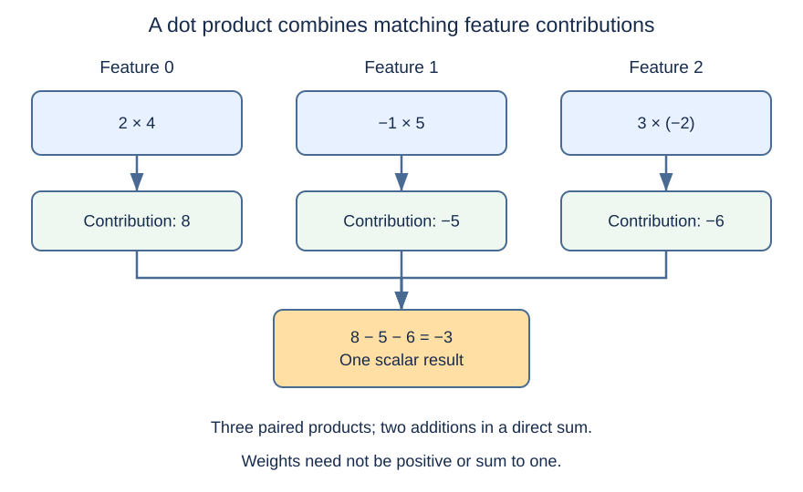
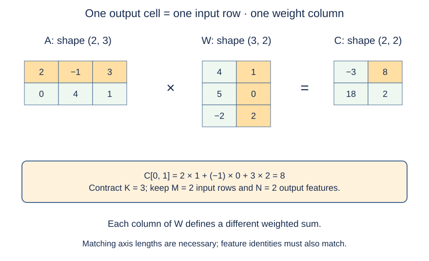
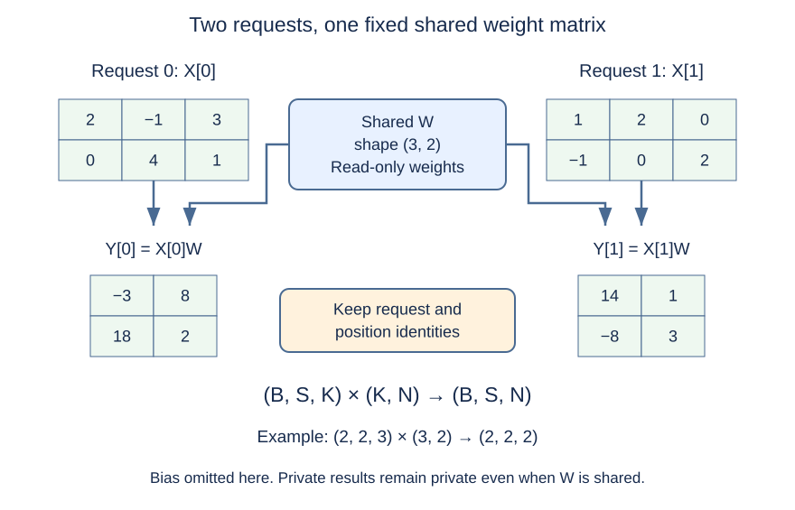

# M1-C04: Dot products and matrix multiplication

> **Status: Complete — detailed chapter authored and documentation validated; experimental procedures are proposed unless explicitly labelled observed**

**Module:** Understand exactly what happens when an LLM generates a token

**Category:** [Model computation and semantics](index.md)

[Module 1 reading order](../module-1.md) · [Previous: M1-C03](m1-c03-numbers-vectors-matrices-and-tensors.md) · [Next: M1-C05](../state-memory-and-caching/m1-c05-how-tensors-occupy-memory.md)

## Target concepts

Weighted sums, dot products, matrix multiplication, dimension compatibility, batched multiplication, model projections.

## What you should be able to explain

M1-C03 gave numerical values coordinates and shapes. This chapter explains how a model combines those values: multiply matching features by weights, add their contributions, and repeat to produce new features. By the end, you should be able to calculate a small projection by hand, predict its output shape, identify a wrong weight orientation, and design a comparison of separate versus grouped computation that preserves request identity.

Assume basic programming knowledge and the completed M1-C03. All matrices, scores and timings below are **constructed teaching examples**, not measured model activations, market signals or performance results. Experiments are proposed procedures using paper references and, optionally, an existing inspectable numerical tool. No implementation or pseudocode is provided. Arithmetic is over real numbers unless a storage/accumulation type is explicitly named; complex-valued dot-product conventions are outside this chapter.

## Concepts

### 1. A weighted sum combines contributions

A **weight** tells us how strongly one input contributes to a result. A **weighted sum** multiplies each input by its corresponding weight, then adds those products. The weights can be positive, negative or zero. They need not sum to one. The result need not be a probability, average or value within the input range.

Let **xₖ** be input feature k and **wₖ** its matching weight, with **K** features indexed from zero. The scalar result **z** is:

**z = Σₖ₌₀ᴷ⁻¹ xₖwₖ**

Sigma means add the indicated terms. Each x and w is paired by the same feature identity, not merely by whichever order happened to be stored. For **x = [2, −1, 3]** and **w = [4, 5, −2]**:

| Feature k | Input xₖ | Weight wₖ | Contribution xₖwₖ |
| --- | --- | --- | --- |
| 0 | 2 | 4 | 8 |
| 1 | −1 | 5 | −5 |
| 2 | 3 | −2 | −6 |

Therefore **z = 8 − 5 − 6 = −3**. A zero weight removes that feature's contribution in this particular sum; it does not remove the input position or change the shape. If a feature carries physical units, the weights and result need compatible unit meanings. Our toy features are dimensionless, meaning no physical measurement unit is assigned.

{#weighted-sum-diagram}

*Figure 1. Three contributions produce one scalar. Negative contributions are legitimate; the diagram supplies no probability interpretation.*

### 2. A dot product is that weighted sum viewed as a vector operation

For two vectors with the same length K, their **dot product** is **x · w = Σₖ xₖwₖ**. It produces a scalar. The [NumPy 2.3 dot specification](https://numpy.org/doc/2.3/reference/generated/numpy.dot.html) describes the one-dimensional case as a vector inner product. Libraries can give the same operation name additional higher-rank meanings, so record the actual operand ranks.

For our real-valued vectors, swapping the two complete vectors leaves the mathematical dot product unchanged. Reordering only one vector generally changes it. Swapping the first two weights in the example gives **2 × 5 + (−1) × 4 + 3 × (−2) = 0**, instead of −3. The lengths still match, so a length check cannot detect a semantic feature-order error. Reordering both vectors by the same permutation, meaning the same rearrangement of positions, preserves the real-number sum.

For positive K, a direct dot-product calculation uses **K multiplications and K − 1 additions** when the first product starts the sum. K = 3 gives three multiplications and two additions. This is an arithmetic count, not a latency prediction. A **reduction** combines several values into fewer values; summing the products is one such reduction. Later chapters explain how evaluation order and floating-point representation can affect a numerical reduction.

A single input can also be written as a one-row matrix of shape (1, K). Multiplying it by a weight column of shape (K, 1) produces a (1, 1) matrix. That contains the same scalar value but has two axes. An interface returning a rank-zero scalar is making an additional shape choice, as M1-C03 emphasized.

### 3. Matrix multiplication computes many dot products

Let **A** contain M input rows and K features per row. Let **W** have K rows and N output columns. Their shapes are **(M, K)** and **(K, N)**. The matrix product **C = AW** has shape **(M, N)**, with:

**C[i, j] = Σₖ₌₀ᴷ⁻¹ A[i, k]W[k, j]**

Here **i** selects an input row, **j** selects an output feature, and **k** runs over the shared input-feature axis. One output cell is the dot product of one row of A and one column of W. The shared K axis is summed away; the M and N axes remain. This is sometimes called **contracting** the shared axis: combining its matching entries into a sum.

Use the following explicit matrices:

| Matrix | Row 0 | Row 1 | Row 2 |
| --- | --- | --- | --- |
| A, shape (2, 3) | [2, −1, 3] | [0, 4, 1] | No third row |
| W, shape (3, 2) | [4, 1] | [5, 0] | [−2, 2] |

The first output column uses weights [4, 5, −2]; the second uses [1, 0, 2]. The four calculations are:

| Output cell | Row-by-column calculation | Result |
| --- | --- | --- |
| C[0, 0] | 2 × 4 + (−1) × 5 + 3 × (−2) | −3 |
| C[0, 1] | 2 × 1 + (−1) × 0 + 3 × 2 | 8 |
| C[1, 0] | 0 × 4 + 4 × 5 + 1 × (−2) | 18 |
| C[1, 1] | 0 × 1 + 4 × 0 + 1 × 2 | 2 |

Thus C has rows **[−3, 8]** and **[18, 2]**. All four cells must be correct; a plausible first cell or a matching total is insufficient evidence.

{#row-column-product-diagram}

*Figure 2. Row 0 and column 1 meet at C[0, 1] = 8. Shape matching establishes structural compatibility; labelled features establish which terms should meet.*

This operation differs from **elementwise multiplication**, which multiplies corresponding cells without summing a feature axis. For example, two same-shape (2, 3) arrays can have an elementwise product of shape (2, 3), while their ordinary matrix product in that order is invalid because inner lengths 3 and 2 differ. State which operation is intended; a multiplication symbol alone is not a complete interface contract.

### 4. Compatibility, order and transpose must be explicit

For this matrix convention, **(M, K) × (K, N) → (M, N)**. Equal inner lengths are necessary. Their semantics must also match: pairing an input's feature k with a different feature's learned weight is wrong even if both axes have length K.

| Operand shapes | Decision in this chapter |
| --- | --- |
| (2, 3) and (3, 2) | Valid; output (2, 2) |
| (2, 3) and (4, 2) | Reject: shared feature lengths differ |
| (2, 3) and (2, 3) | Reject as ordinary matrix multiplication in this order |
| (1, 3) and (3, 1) | Valid; output remains a (1, 1) matrix |
| Same counts but wrong feature ordering | Reject semantic mismatch; shape alone cannot detect it |

Matrix multiplication generally depends on operand order. In the worked example, WA is structurally possible but has shape (3, 3), so it cannot equal the (2, 2) result AW. Even with equal square shapes, order can change values. For **P with rows [1, 1], [0, 1]** and **Q with rows [1, 0], [1, 1]**, PQ has rows **[2, 1], [1, 1]**, while QP has rows **[1, 1], [1, 2]**. This contrasts with the commutative scalar dot product above.

A **transpose** exchanges a matrix's row and column coordinates. Write **Aᵀ[j, i] = A[i, j]**. Its logical shape becomes (K, M) when A was (M, K). Changing coordinate interpretation is not the same as proving whether any bytes were copied; physical layout, views and copies are covered in M1-C05.

A **GEMM** is a general matrix-multiplication interface, commonly including scaling, transpose choices and an existing output term. BLAS means Basic Linear Algebra Subprograms, a family of numerical interfaces. The [Netlib BLAS reference](https://netlib.org/blas/dgemm.f) specifies those mathematical options. To mean the plain product here, set product scaling to one, existing-output scaling to zero, and use the declared operand orientations. Otherwise a repeated call can accidentally accumulate old output. The [ONNX Gemm version 13 specification](https://onnx.ai/onnx/operators/onnx__Gemm.html#gemm-13) similarly distinguishes transpose flags, scaling and an optional added tensor. These are specifications to inspect, not implementations supplied by this chapter.

For the proposed experiments, M, K and N must be positive. Empty sums have a mathematical interpretation, but a zero-sized runtime operation needs its own interface contract. Reject it under this exercise policy rather than infer support from a library that accepts a different case.

### 5. Learned projections change the feature representation

A model uses learned weight matrices to turn input features into output features. In LLM terminology this is often called a **projection**. It can expand, shrink or preserve feature width; it need not act like dropping a point onto a line or plane, and it need not be square. The weights come from training and remain fixed during the inference operation.

A **linear map** preserves addition and scalar multiplication in exact mathematics. Multiplication by fixed W is such a map. An optional **bias** adds a learned offset bⱼ to output feature j:

**Y[i, j] = Σₖ A[i, k]W[k, j] + bⱼ**

The same bias vector is added to every row in this convention. A map with a nonzero bias is **affine**, meaning a linear map plus an offset; the original point zero need not map to zero. For b = [1, −2], the worked C becomes Y with rows **[−2, 6]** and **[19, 0]**. A zero input row produces the bias, not necessarily a zero output row.

Different libraries can store the same logical weights in different orientations. [PyTorch 2.14 Linear](https://docs.pytorch.org/docs/2.14/generated/torch.nn.Linear.html) specifies weights with shape (output features, input features), applying their transpose to row-oriented input. Its stored weight table for our example would have rows **[4, 5, −2]** and **[1, 0, 2]**. That is Wᵀ, not the (3, 2) W table above. Equal values in an artifact are insufficient without the orientation contract. The logical transpose does not by itself require a newly materialized copy.

For token features X of shape **(B, S, K)**, applying one shared projection on the feature axis yields shape **(B, S, N)**. B identifies requests, S token positions, K input width and N output width. Each request-position pair contributes one row. Model projections prepare feature representations used later in attention and feed-forward layers; the [original Transformer paper, sections 3.2–3.3](https://arxiv.org/html/1706.03762v7), describes learned transformations and position-wise processing. Their exact composition comes later in this module. A projection's row independence does not mean the entire model treats token positions independently: attention can combine information across permitted positions.

### 6. Shared projections and batched matrix products have distinct contracts

There are two useful ways to group the same work.

For **shared weights**, X has shape (B, S, K) and W has shape (K, N):

**Y[b, s, j] = Σₖ X[b, s, k]W[k, j]**

The same W is read for every request and position. Keeping each (b, s) row's identity, this can also be described as one matrix with M = B × S rows. The mathematical product has shape (B × S, N), then the result is interpreted with its original request-position mapping. This is a statement about the algebra, not a guarantee that a particular reshape or library call avoids copying.

For **one weight matrix per batch member**, X has shape (B, S, K) and weights U have shape (B, K, N):

**Y[b, s, j] = Σₖ X[b, s, k]U[b, k, j]**

Now request b must receive its own weight matrix. Replacing all U[b] with U[0] changes the operation unless they were intentionally identical. Library **broadcasting** can logically share an operand across a leading axis; the [NumPy 2.3 matrix-product specification](https://numpy.org/doc/2.3/reference/generated/numpy.matmul.html) describes leading-axis rules, and [ONNX MatMul version 13](https://onnx.ai/onnx/operators/onnx__MatMul.html#matmul-13) adopts those semantics. This chapter uses explicit shared or equal-batch shapes. Broader broadcast and physical-layout rules belong to M1-C05. Do not assume that a generic higher-rank dot operation has the same batch behavior as matrix multiplication.

For a hand-checkable shared-weight example, use B = 2, S = 2, K = 3, N = 2. Request 0 contains the two rows of A above. Request 1 contains rows **[1, 2, 0]** and **[−1, 0, 2]**. Without bias, request 1's projected rows are **[14, 1]** and **[−8, 3]**. With the same bias [1, −2], they become **[15, −1]** and **[−7, 1]**.

{#shared-projection-diagram}

*Figure 3. Shared weights do not imply shared mutable output. Results remain associated with the original request and position. The displayed products omit bias.*

A fixed row count also does not establish that every row is a valid token. Padded positions retain their validity metadata; a bias can produce nonzero values even for zero-filled padded input. Output values cannot replace the mask or valid-length record. Cancellation can make a request's result unwanted while its rows are still being computed. Wait for all consumers before reclaiming shared inputs or output buffers; discard late results by request identity.

### 7. Arithmetic counts inform a hypothesis, not a latency claim

For positive M, K and N, the direct real-number product uses:

**Multiplications = MKN**; **additions = MN(K − 1)**

The toy 2 × 3 by 3 × 2 product has **12 multiplications + 8 additions = 20 arithmetic operations**. Adding a bias costs a further MN = 4 scalar additions in this description.

Performance reports often use the conventional count **2MKN floating-point operations**, counting a multiply and an accumulation as two operations. An instruction may perform a **fused multiply-add**, combining them into one instruction with its own numerical behavior. Thus the same toy product is conventionally counted as 24 FLOPs, even though a minimal direct sum has only 20 arithmetic steps. FLOPs count work; FLOP/s is a rate, work divided by elapsed seconds. [NVIDIA's matrix-multiplication background guide](https://docs.nvidia.com/deeplearning/performance/dl-performance-matrix-multiplication/index.html) uses the conventional count and explains why shapes and data movement affect achieved performance. Its device examples are not measurements of this chapter's experiments.

With many input rows, a numerical backend may reuse weights across rows and amortize operation-submission overhead, meaning fixed setup cost is spread across more useful work. It may also incur packing, copying, thread coordination or waiting to collect rows. For one sequential decode request, future rows are not freely available: the next selected token still depends on the previous decision. This chapter compares already available rows; it does not authorize waiting indefinitely to assemble a batch.

In HFT, a small weighted feature calculation can sit on a critical path, while grouping independent calculations can improve resource use at the cost of waiting. Inference has a similar tradeoff between useful completion and capacity. The analogy concerns dependencies, framing and bounded waiting; a learned projection here is not a trading signal, and no exchange-latency or profitability claim follows.

## Experiments

### Shared reference and prerequisites

Use the completed M1-C03 shape and coordinate conventions. E1–E3 have paper references; optional execution requires an **existing inspectable numerical tool or benchmark harness**, which must expose inputs, shapes, dtype, effective operation, complete outputs and request-row identity. Do not implement a matrix library to perform this documentation exercise. If a required observation is unavailable, mark the corresponding runtime case unexecuted.

Freeze backend/tool and library release, thread counts, element type, accumulation type, transpose/scaling flags, bias behavior, input ownership, output reuse and completion boundary. The initial contract uses binary32 inputs, products and accumulation, with no reduced-precision numerical mode or quantization. For the small integer-valued fixtures below, all products and partial sums remain exactly representable; exact output checks are justified. Arbitrary model weights require later numerical-reference and tolerance work, not a silently relaxed threshold.

No checkpoint, tokenizer, model weights, GPU or live market feed is needed for these matrix-only studies. Optional whole-request evaluation uses the separate M1-C01 manifest. Restrict dimensions to positive integers, require matching contracted axes and declared batch behavior, reject invalid metadata before numerical execution, and preserve input/weight ownership until consumers finish. A library accepting a broader case does not change this exercise contract.

### E1 — Contributions, feature order and one scalar

**Description:** Trace the weighted sum and dot product by hand, then challenge feature order, zero weights and a mismatched input length.

**Purpose/objective:** Test whether corresponding feature identities are paired correctly and whether the output is understood as one scalar.

**Target concepts:** Weighted sums, dot products and dimension compatibility.

**Hypothesis/prediction:** The reference vectors produce −3. Swapping only the first two weights produces zero while preserving length. Swapping both vectors consistently preserves −3 in exact arithmetic.

**Baseline, variables and controls:** Baseline is x = [2, −1, 3] and w = [4, 5, −2]. Change one condition at a time: swap only weights 0 and 1; swap both vectors' first two positions; set w₁ to zero; remove the final weight. Keep remaining feature labels and the scalar-output contract unchanged. Paper tracing needs only the contribution table; optional execution uses the shared numerical/tool record.

**Procedure:** First predict every product, accumulated sum and output shape. Recalculate using the table rather than a single unexplained answer. Inspect the zero-weight case, whose result is 8 + 0 − 6 = 2. Compare a vector dot returning a scalar with a row-by-column product returning shape (1, 1), keeping value equality separate from shape equality. Present the short weight vector as an invalid contracted-axis request, which the exercise rejects before computation. Preserve the deliberate feature-order mistake as a negative control that a semantic check must catch.

**HFT and systems connection:** Reordering a feature feed without its coefficient mapping can produce a plausible wrong result. The same identity risk applies to model features; these test numbers carry no market meaning.

**Exit criteria:** All contributions and final values match the stated references, shape differences are explained, and the semantic negative control is detected despite equal lengths. The shortened weight vector is rejected. No hardware-time claim follows from a paper trace.

### E2 — Every matrix cell and the weight-orientation trap

**Description:** Compute the four cells of AW and compare direct weights, correctly transposed stored weights, bias, and invalid/scaling cases.

**Purpose/objective:** Test the row-by-column contract and detect a wrong orientation or accidental accumulation before interpreting output as a model projection.

**Target concepts:** Matrix multiplication, dimension compatibility, dot products and model projections.

**Hypothesis/prediction:** The worked product is [−3, 8] then [18, 2]. Correctly interpreting a stored (2, 3) weight matrix as Wᵀ preserves that result. Treating it as already (3, 2), adding bias twice, or accumulating previous output changes the contract.

**Baseline, workload and controls:** Use A, W and bias from Concepts 3 and 5. Baseline has no bias, unit product scale, no transpose on the already correctly oriented W, and zero existing-output scale. Vary only weight representation/orientation, bias enabled/disabled, or existing-output accumulation. Add incompatible shapes (2, 3) × (4, 2), the square P/Q pair, and an intentionally wrong weight table with rows [4, 5], [−2, 1], [0, 2], whose shape alone appears acceptable. This wrong table represents an orientation/interpretation mistake, not the correctly transposed route. Paper references are independent of optional backend outputs.

**Procedure:** Predict shape and every cell before using a tool. Compute the unbiased and once-biased outputs, then repeat with the stored Wᵀ representation and its required logical transpose. Check PQ and QP to expose order dependence. Re-run the plain product into a reused output buffer and verify that previous values do not accumulate. Inspect the deliberate extra-bias case and the incompatible-dimension rejection. Finally compare all coordinate values and orientation metadata; a matching output shape is insufficient.

**HFT and systems connection:** A stale accumulator or wrong coefficient table can mislabel otherwise valid arithmetic. Here this checks a fixed inference projection rather than a trading model's economic validity.

**Exit criteria:** Every reference cell and shape matches; the correctly interpreted stored-weight route agrees exactly. The incompatible matrix shape is rejected, the wrong-orientation/extra-bias/old-output cases are detected, and repeated plain-product calls return the same complete output. Unavailable flag or buffer observations remain unexecuted.

### E3 — Shared weights, request isolation and per-batch weights

**Description:** Compare separate request products, a shared-weight batched product and a logically stacked-row product; then switch to intentionally different per-request weights.

**Purpose/objective:** Test whether grouping numerical work preserves request/position identity and applies exactly the declared weights and bias.

**Target concepts:** Batched multiplication, matrix multiplication, model projections and dimension compatibility.

**Hypothesis/prediction:** With shared W, every valid row agrees across separate and grouped descriptions. With U[0] = W and U[1] equal to W with one added to every entry, request 1's unbiased rows instead become [17, 4] and [−7, 4]. Reusing W for both requests in that case is wrong even though shapes can match.

**Baseline, workload and controls:** Use the two-request fixture from Concept 6, B = 2, S = 2, K = 3, N = 2. Baseline is separate products in recorded request order. Keep inputs, dtype and row mapping fixed while changing the grouping route. Treat per-request weights and bias on/off as separate labelled contracts. For padding, mark request 0's position 1 invalid and supply zeros in that row; retain the mask and other valid rows.

**Procedure:** Predict all outputs, then compare them by request and position rather than only by flat-array position or total sum. Reorder the request submission list and require the output identities to follow it correctly. Apply shared W, then distinct U, preserving that change in the manifest. Test a mismatched batch extent without silently broadcasting it; sharing is permitted only in the explicitly shared-weight case. For the padded zero row, demonstrate that bias creates [1, −2] while the row remains invalid. Finally trace cancellation after grouped submission: discard the cancelled request's late result while allowing the surviving request to complete, and retain shared buffers until completion obligations end. Use supported lifecycle observations or a paper trace, not an assumed fault-test pass.

**HFT and systems connection:** Grouping independent event calculations must not cross-route results or substitute another event's coefficient state. This is an inference identity test; one projection's row independence does not establish independence of a complete Transformer.

**Exit criteria:** All shared-weight valid outputs match the separate baseline exactly, per-request U produces its distinct references, reorderings preserve identity, and batch mismatches are rejected. Padded-row validity survives nonzero bias. The cancellation trace leaves surviving results unchanged and does not reclaim active storage early. Record unsupported runtime cases explicitly.

### E4 — Separate rows versus one ready-row matrix

**Description:** Compare an existing tool's M individual row projections with one matrix projection containing the same M rows and fixed shared weights.

**Purpose/objective:** Test whether grouping already available work improves the declared completion boundary without changing arithmetic, dtype or useful output.

**Target concepts:** Weighted sums, matrix multiplication, batched work and model projections.

**Hypothesis/prediction:** Shared-weight matrix execution may amortize setup and reuse weights more effectively for some M, while packing and coordination can erase the benefit at other sizes. Lower time per row does not prove lower service latency if rows had to wait for a batch.

**Baseline, variables and controls:** Use K = 128, N = 64 and M = 1, 8, 64. Baseline completes all M rows separately; candidate completes the same rows in one matrix operation. Weights are shared and bias is disabled. Define exact data with **A[i, k] = ((i + 2k) mod 5) − 2** and **W[k, j] = ((3k + j) mod 5) − 2**, where mod 5 means the remainder from division by five; i, k and j are nonnegative. Inputs lie between −2 and 2, so the sum of absolute products for any output is at most 128 × 4 = 512. Freeze the shared numerical settings, CPU thread counts and output contract. Input and weight construction occur before either timed route; route-specific packing or copying must be recorded and included in the full operation boundary.

**Procedure:** Predict the tradeoff before measurement. Validate every output against an independent exact-integer reference, keeping the test patterns and all M values fixed. Warm the tool, randomize paired route order, and record both numerical execution and complete input-ready-to-all-results-accepted duration where exposed. Compare all M results as a group; also record individual-row completion times for the separate route if available. Inspect allocation, packing, calls and computation in a representative profile. Report time per group and rows per second without assuming equal within-group completion timestamps. If a service path is available, separately measure actual arrival-to-result latency with unchanged requests and explicit waiting; otherwise keep end-to-end effects hypothetical.

**HFT and systems connection:** Already ready calculations can be grouped; waiting for future events introduces a new dependency and potential stale information. The experiment varies ready-row execution, not a live-market batching policy.

**Exit criteria:** Every output and identity matches before speed is considered. Report each M separately with group and full-boundary durations, actual dtype/flags, packing costs, memory and uncertainty. An absent speedup or inconclusive difference is acceptable; skipped outputs, reduced precision, missing completion or excluded candidate-only preparation invalidate an improvement claim. No universal speed threshold is asserted.

## Verification

### Correctness references and coverage

The local application of [M9-C01](../numerics-and-correctness/m9-c01-defining-reference-behavior-and-evidence-before-optimizing.md), now complete, is an explicit mathematical and interface reference. Preserve operand values, feature order, shape, transpose interpretation, bias/scaling settings, batch identity and complete outputs. E1–E3 use the hand-derived references above. E4 uses its exact integer-valued formula and complete output comparison, independent of the candidate backend.

All integer metadata and IDs require exact equality. Exact numerical equality is also justified for these deliberately bounded binary32 fixtures: input integers, products and all partial sums fit exactly in the declared arithmetic. That does not establish bitwise equivalence for arbitrary learned weights or a different precision mode. Do not invent a universal logit tolerance here. General rounding/reduction behavior belongs to M1-C07 and numerical-reference methods to M9-C17. A mismatch in this controlled exercise must be investigated rather than excused with a relaxed threshold.

| Target concept | Explanation | Exercise and check |
| --- | --- | --- |
| Weighted sums | Concept 1 | E1 contribution table, sign/zero-weight changes |
| Dot products | Concept 2 | E1 feature pairing, scalar versus (1, 1) output |
| Matrix multiplication | Concepts 3–4 | E2 every output cell, operand-order and accumulation controls |
| Dimension compatibility | Concepts 3–4 | E1/E2 contracted-axis checks; E3 explicit batch policy |
| Batched multiplication | Concept 6 | E3 shared/distinct weights and result identity; E4 ready-row comparison |
| Model projections | Concept 5 | E2 bias and weight orientation; E3 leading-axis preservation; E4 unchanged shared projection |

A single matching sum or checksum can miss permutations. Compare full coordinate-labelled outputs and include a deliberate feature swap, wrong stored-weight interpretation and cross-request weight substitution as negative controls. Validate the controls fail for the intended reason. Shape agreement alone cannot establish feature or request identity.

### Measurements, benchmarks and profiling

| Experiment | Correctness evidence | Measurement/comparison | Profiling boundary and limitation |
| --- | --- | --- | --- |
| E1 | Contributions, −3/0/2 references, shape choices, bad-length rejection | Arithmetic counts and exact values; no hardware timing from paper tracing | Explain which products contribute; no CPU/GPU capacity claim |
| E2 | All four cells, bias once, stored-weight transpose, PQ/QP, no old-output accumulation | Compare every coordinate across declared equivalent routes and flag changed contracts | Optional operation trace separates conversion/packing from product; paper arithmetic cannot identify execution bottlenecks |
| E3 | Shared and distinct U references, row identities, masks and terminal-state trace | Separate versus grouped outputs, surviving-request outcomes and invalid batch cases | Optional grouped-operation timeline; submission is not completion; supported fault observations required |
| E4 | Full exact outputs at every M, fixed dtype/modes and ownership | Group latency, full boundary, observed row completion if exposed, rows/s, conventional FLOP/s, packing/allocation bytes | Existing CPU sampling/allocation profile with tool release/options; attribute preparation versus numerical work and compare tracing overhead |

Use [M9-C02](../measurement-experimentation-and-economics/m9-c02-request-events-clocks-and-measurement-boundaries.md) by defining one host's **monotonic clock**, which measures elapsed time without wall-clock adjustments. For the primary E4 full boundary, start when all M rows and W are ready in the agreed source representation; stop after all outputs have completed and passed result acceptance. Include route-specific packing, submission, execution, completion waiting and output handling. The baseline boundary covers all M calls, not just one. Acquisition/fixture construction excluded from both routes must be reported separately; numerical-only intervals must be labelled narrower measurements.

For CPU tests, state when the numerical call has finished its work. If later adding a GPU, a host call may return before device work completes; use completion-aware device timing with its own correlation method. This chapter provides a CPU/paper design, not a validated GPU benchmark.

The per-group **row rate = M / group elapsed seconds**. Conventional **FLOP/s = 2MKN / numerical elapsed seconds**, with the count convention and timing boundary stated. A shorter per-row average does not describe each request's completion time, and a larger FLOP/s value does not automatically establish better useful service. Keep invalid, rejected and incomplete work out of the useful-rate numerator while reporting its counts and elapsed cost.

For E4 at M = 64, A has 8192 elements, W has 8192, and C has 4096. With four-byte values their logical payloads are **32768 + 32768 + 16384 = 81920 bytes**, or **80 KiB**, with one KiB equal to 1024 bytes. This excludes packing copies, library workspace, object metadata and cache traffic. W is shared once in the logical inventory; actual physical reads depend on implementation and hardware. The conventional work count is **2 × 64 × 128 × 64 = 1048576 FLOPs**; the direct multiplication-plus-minimal-addition count is **64 × 64 × 255 = 1044480 operations**. Neither number predicts measured time without evidence.

A constructed service example makes the scope clear: if other work and waiting total 9 ms and projection takes 1 ms, halving projection time changes serial latency from 10 ms to **9 + 0.5 = 9.5 ms**, a **5%** reduction. Introducing another 2 ms of batching wait instead makes it **11.5 ms**. These invented numbers explain why local improvement and service latency must be checked separately; they are not observations.

### Repetition, uncertainty and failures

For E1–E3, enumerate every listed finite fixture and compare all values and metadata. Paper references are independent arithmetic checks, not a runtime-performance study. Wrong dimensions, unsupported zero extents, wrong dtype/modes, invalid flags and insufficient initialized storage are exercise rejections before computation. A stale weight/version descriptor or request identity must not be silently accepted as a new compatible input.

For E4, collect five pilot pairs per M to verify correctness, measurement overhead and warmup. Exclude pilots from the final comparison. Then collect 30 randomized separate/grouped pairs per M in each of three independently warmed sessions. Declare the warmup settling criterion and actual warmup count. Report raw group durations, medians, ranges, per-session spread, setup costs and any exposed per-row completion. These counts suit an introductory comparison of substantial effects; they do not establish production p99. Investigate differences comparable to timer resolution, profiling overhead or session variation as inconclusive outcomes.

A **sampling profiler** observes where work runs at intervals; an **allocation trace** records storage requests and releases. Compare minimal instrumentation with detailed tracing on representative fixtures. If operations are shorter than timing resolution, time a declared repeated group and report an aggregate estimate, without manufacturing individual-request percentiles. Keep outputs observable to the existing harness so the intended work is not optimized away; disclose result-checking cost. Do not silently exclude candidate-only packing or weight conversion.

Record completed, rejected, cancelled, failed and unfinished groups/requests, with timeout reasons where relevant. Stop arrivals and **drain**, waiting for active work to finish or explicitly recording what remains, before ending accounting. Cancellation after submission may suppress delivery while shared execution continues. Keep fixed weights and live inputs valid, reject stale results by identity, and reclaim buffers only after consumers complete. An executor/worker loss and overload admission policy require later runtime chapters; this chapter does not certify those mechanisms.

Apply [M9-C11](../measurement-experimentation-and-economics/m9-c11-controlled-comparisons-warmup-and-reproducibility.md), also an outline, by saving the complete fixture formulas/values, shape labels, weight identity, transpose/scaling/bias flags, storage and accumulation precision, library/backend releases, thread settings, compiler/build profile if applicable, clock boundaries, raw samples and hardware record. Label proposed, hand-derived and future runtime-observed evidence separately. No matrix or model performance experiment has been executed for this chapter.

## Engineering dimensions and principles

### Six dimensions applied to this chapter

| Dimension | Chapter-specific application |
| --- | --- |
| Semantics and invariants | Contracted feature identity, output shape, bias, orientation and request mapping establish correctness. E1/E2 expose plausible but incorrect sums; E3 rejects cross-request substitution. |
| Workload and variability | M, K, N, valid rows, ready-row availability and shared/distinct weights change work. E3 includes padding and E4 sweeps M; only text-generation context is in scope. |
| Resources and bottlenecks | Weights, inputs, outputs, packing and workspace consume storage and CPU work. E4 separates logical 80 KiB payload from physical traffic and profiles before attributing a bottleneck. |
| Time and distributions | Dot reductions and result acceptance lie on the dependency path. E4 covers the entire group and session variation; the constructed waiting example shows why efficient batching can still worsen latency. |
| Ownership and coordination | Share fixed W read-only; preserve each result's request/position identity. E3 cancellation retains live storage and keeps surviving outputs correct. |
| Failure and adaptation | Reject incompatible axes, flags and stale descriptors. Account for cancelled/unfinished work; overloaded pools and worker recovery need later runtime tests, not inferred passes. |

### Eight principles as concrete decisions

1. **Correctness defines the optimization boundary.** E4 compares the same projection and exact fixtures. Reducing precision, omitting bias or substituting a different W is a changed contract that needs its own validation.
2. **Performance depends on workload and operating point.** Report M = 1, 8 and 64 separately under fixed K/N, backend and threading. Larger groups do not automatically reduce an individual request's latency.
3. **Data movement is part of the algorithm.** Weight reuse can help, while packing/copying can consume the gain. E4's full boundary includes candidate-specific preparation and does not confuse logical payload with memory traffic.
4. **State has ownership, lifetime, and recovery cost.** Fixed weights can outlive requests, but mutable outputs cannot be cross-routed or reused early. E2 tests old-output accumulation and E3 tests cancellation ownership.
5. **Dependencies determine latency; bottlenecks determine capacity.** Each output needs its contracted products and sum. Grouping available rows changes execution; waiting for future rows adds a dependency. These serial benchmarks do not establish maximum serving capacity.
6. **Variability and synchronization shape the tail.** Thread coordination, grouping wait and completion order can vary. E4 preserves raw/session results and makes no production p99 claim.
7. **Local improvements must be evaluated end to end.** A faster projection may save little request time or be outweighed by waiting, as the 9.5/11.5 ms constructed example shows. Useful result completion is the eventual acceptance boundary.
8. **Claims require reproducible evidence.** Independent exact fixtures, negative controls, effective math flags, workload/hardware records and completion-aware timing accompany each comparison. Fluent model output or peak FLOP/s is insufficient evidence.

## Specifications, articles, and hardware

### Primary references

Sources were checked on **24 October 2026**. Equations and prose here are educational specifications; external sources may contain implementation examples, none of which is reproduced. Versioned documentation is not a package-installation requirement.

| Source | Relevant material and boundary |
| --- | --- |
| [MIT 18.06, Lecture 3: Multiplication and inverse matrices](https://ocw.mit.edu/courses/18-06-linear-algebra-spring-2010/resources/lecture-3-multiplication-and-inverse-matrices/) | Gilbert Strang's course resource for multiple views of matrix multiplication; inverse matrices are outside this chapter. |
| [NumPy 2.3 dot](https://numpy.org/doc/2.3/reference/generated/numpy.dot.html) and [matmul](https://numpy.org/doc/2.3/reference/generated/numpy.matmul.html) | Vector-dot scalar output, matrix-product dimensions and leading-axis behavior. Higher-rank operation names are not interchangeable by assumption. |
| [ONNX MatMul 13](https://onnx.ai/onnx/operators/onnx__MatMul.html#matmul-13) and [Gemm 13](https://onnx.ai/onnx/operators/onnx__Gemm.html#gemm-13) | Operator contracts, batch semantics, transpose/scaling and added-tensor choices. The consulted site identified ONNX 1.24.0; no runtime deployment or operator implementation is being introduced. |
| [Netlib DGEMM reference documentation](https://netlib.org/blas/dgemm.f) | Plain multiplication versus a general scaled/accumulating operation. Its Fortran source is consulted only for its documented contract; no implementation is copied. |
| [PyTorch 2.14 Linear](https://docs.pytorch.org/docs/2.14/generated/torch.nn.Linear.html) | Affine feature transformation, stored output-by-input weight shape and preservation of leading input dimensions. It illustrates a real orientation convention, not a new project dependency. |
| [Vaswani and colleagues, Attention Is All You Need, v7](https://arxiv.org/html/1706.03762v7) | Primary paper describing learned transformations and position-wise feed-forward processing. Attention and full block construction are developed in later Module 1 chapters. |
| [NVIDIA Matrix Multiplication Background](https://docs.nvidia.com/deeplearning/performance/dl-performance-matrix-multiplication/index.html) | Vendor explanation of matrix shapes, conventional 2MKN work counts and performance factors. The live guide was checked on the date above; its GPU examples are not results from these CPU experiments. |

### Hardware requirements and reproducibility manifest

Paper experiments require a document viewer. A planning allowance for optional CPU benchmarks is a **64-bit host, four physical CPU cores, 8 GiB RAM and 1 GiB free local storage** for the existing numerical tool, bounded fixtures and traces. These are unmeasured provisioning choices, not vendor minimum requirements. The largest E4 logical data inventory is only 80 KiB; the host allowance includes tooling, not an invented model footprint.

Start with one worker and a recorded, fixed numerical-library thread count. Record the actual CPU model/architecture, physical/logical cores, allowed cores, RAM, storage, operating system, power/frequency conditions, background load, library/backend version, math mode, compiler/build profile where relevant, and profiling tools/options. Identify whether reused weights and workspace are warm and whether timing includes packing, allocation and result checking. Payload size alone does not prove cache residency.

A GPU, device links and networking are unnecessary for the core experiments because they measure paper arithmetic or local CPU operations. If extending to accelerated or full-request execution, add the actual GPU variant, memory capacity, interconnect, driver/runtime, operation/accumulation mode and completion measurement to the M1-C01 manifest. Do not substitute a manufacturer's peak arithmetic rate for a measured result. No device purchase or hardware experiment is claimed.

## Key takeaways

A dot product pairs corresponding features and reduces them to one scalar. Matrix multiplication repeats that operation across input rows and output columns, contracting matching inner axes. Operand orientation, feature order, bias/scaling and batch identity belong to the correctness contract.

A learned projection applies fixed weights to change feature representation, often sharing them across request-position rows. Equivalent grouped algebra does not automatically preserve numerical behavior under changed precision, eliminate data movement, or improve arrival-to-result latency. Validate complete outputs and useful completion before interpreting speed.

Next, [M1-C05](../state-memory-and-caching/m1-c05-how-tensors-occupy-memory.md) explains how these logical shapes and transformations occupy actual storage, including strides, layouts, views and copies.
