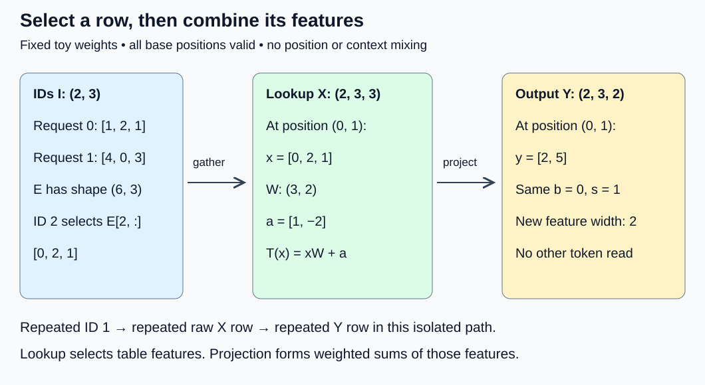
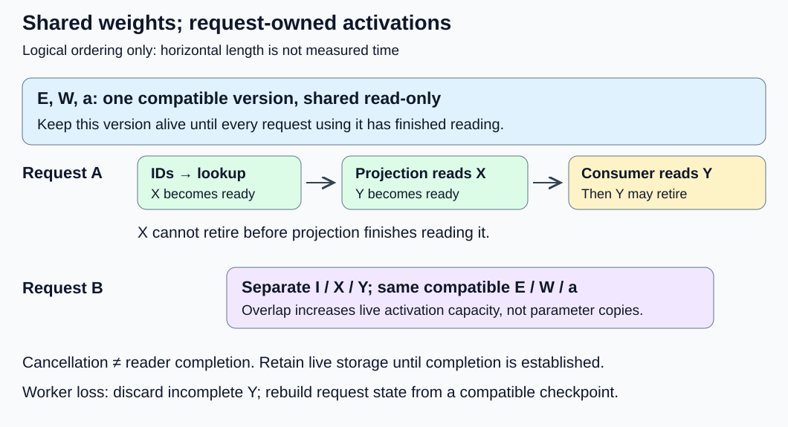

# M1-C09: Token embeddings and learned projections

> **Status: Complete — detailed chapter authored and documentation validated; experimental procedures are proposed unless explicitly labelled observed**

**Module:** Understand exactly what happens when an LLM generates a token

**Category:** [Model computation and semantics](index.md)

[Module 1 reading order](../module-1.md) · [Previous: M1-C08](../measurement-experimentation-and-economics/m1-c08-operation-counts-and-actual-execution-cost.md) · [Next: M1-C10](../model-computation-and-semantics/m1-c10-attention-one-dimension-at-a-time.md)

## Target concepts

Embedding lookup, embedding dimensions, learned weights, linear transformations, intermediate activations, tensor shape tracing.

## Concepts

### 1. A token ID selects a row; it is not a numerical feature

After [tokenization](../interfaces-protocols-and-streaming/m1-c02-representing-text-as-tokens.md), a request contains integer token IDs. An ID is a label in a particular vocabulary. ID 4 is not twice the meaning of ID 2. Multiplying an ID by a learned number would impose an ordering that the vocabulary does not promise.

An **embedding** replaces that label with a vector of learned numbers. A vector is an ordered list of features. The **embedding table** E has V rows and D columns: V is vocabulary size; D is embedding dimension, the number of features per token. D is neither the number of tokens in a request nor its maximum allowed context length. The table has V × D parameters, meaning stored model values selected during training. In inference we load those values from a checkpoint, a saved model version, and keep them fixed for this chapter.

A feature need not have a simple name such as “price” or “noun.” Learned representations can spread information across many coordinates. Looking at one coordinate or two nearby IDs does not establish semantic similarity. The values below are deliberately constructed arithmetic fixtures, not trained embeddings or evidence of language quality.

The tokenizer's ID-to-token mapping and the checkpoint's row mapping must agree. A tokenizer revision that assigns a different token to row 4 can produce plausible shapes and completely wrong computation. Record tokenizer files, template identity where used, vocabulary mapping and checkpoint identity together. An HFT analogy is an instrument identifier selecting a row of instrument metadata: using yesterday's identifier mapping can produce a valid-looking record for the wrong instrument. Embeddings are learned features, however, not market facts, trading signals or guarantees of profitability.

### 2. Trace lookup from two requests to a tensor

Use zero-based indices throughout. Let B be batch size (number of requests), S the number of token positions per request, and I the ID tensor with shape (B, S). Then lookup produces an activation X:

**X[b, s, d] = E[I[b, s], d], with X shape (B, S, D).**

Here b identifies a request, s a position and d a feature. The symbols in square brackets select coordinates; they are mathematical notation, not implementation instructions. An **activation** is an intermediate value produced while evaluating a request. E is a shared parameter; X is request-dependent state. The lookup appends the feature axis and preserves request and position axes, consistent with the [PyTorch 2.14 embedding shape contract](https://docs.pytorch.org/docs/2.14/generated/torch.nn.Embedding.html).

Our complete toy table has V = 6 and D = 3:

| Token ID | E row: three features |
|---|---|
| 0 | [0, 0, 0] |
| 1 | [1, 0, −1] |
| 2 | [0, 2, 1] |
| 3 | [−1, 1, 2] |
| 4 | [2, −1, 0] |
| 5 | [1, 1, 1] |

Choose B = 2 and S = 3. These IDs do not stand for any real words:

| Request b | I[b, :] | X[b, :, :] |
|---|---|---|
| 0 | [1, 2, 1] | [[1, 0, −1], [0, 2, 1], [1, 0, −1]] |
| 1 | [4, 0, 3] | [[2, −1, 0], [0, 0, 0], [−1, 1, 2]] |

Both occurrences of ID 1 select the same raw row. At this boundary there is no position information or attention to surrounding tokens. Later contextual representations can differ. Nor is the zero row automatically padding: in this base fixture all six positions are valid, including ID 0. Padding means a position is outside the request's valid length; its validity is separate metadata.

One mathematical description uses a **one-hot vector** oᵢ: V coordinates, with 1 at ID i and 0 elsewhere. Then oᵢE = E[i, :]. This proves the row-selection interpretation; it does not require materializing a (B, S, V) tensor or doing a dense multiplication. Lookup selects D values per position rather than computing V weighted contributions per feature. Physical traffic depends on storage and reuse. Do not assume that a gather returns a no-copy view into E.

*The two operations preserve request and position identity. Only the final feature width changes from D = 3 to H = 2.*

### 3. A learned projection mixes features

A **linear transformation** takes weighted sums of input features. Use row vectors and a mathematical matrix W with shape (D, H), where H is output feature width:

**L(x) = xW.**

For feature h, L(x)[h] = Σ over d = 0 through D − 1 of x[d] × W[d, h]. A **bias** a is a learned vector of H offsets. Adding it gives an **affine transformation** T(x) = xW + a. Libraries often call an affine layer “linear”; distinguish the mathematical meanings. Use a for bias so it cannot be confused with the batch index b.

For our fixture:

| Input feature d | W[d, 0] | W[d, 1] |
|---|---:|---:|
| 0 | 2 | −1 |
| 1 | 0 | 3 |
| 2 | 1 | 1 |

**a = [1, −2].** Thus T(x)[0] = 2x[0] + x[2] + 1, and T(x)[1] = −x[0] + 3x[1] + x[2] − 2.

For ID 2, x = [0, 2, 1]: T(x)[0] = 0 + 1 + 1 = 2; T(x)[1] = 0 + 6 + 1 − 2 = 5. Every position uses these same weights:

**Y[b, s, h] = Σ over d of X[b, s, d]W[d, h] + a[h].**

| ID | L(E[id]) | T(E[id]) |
|---|---|---|
| 0 | [0, 0] | [1, −2] |
| 1 | [1, −2] | [2, −4] |
| 2 | [1, 7] | [2, 5] |
| 3 | [0, 6] | [1, 4] |
| 4 | [4, −5] | [5, −7] |
| 5 | [3, 3] | [4, 1] |

Consequently Y has shape (2, 3, 2). Request 0 yields [[2, −4], [2, 5], [2, −4]]; request 1 yields [[5, −7], [1, −2], [1, 4]]. A projection mixes features within a position. It does not by itself combine different token positions. Attention, introduced in [M1-C10](m1-c10-attention-one-dimension-at-a-time.md), supplies that different operation. The original Transformer distinguishes position-wise transformations and learned token embeddings in [Sections 3.3–3.4](https://arxiv.org/html/1706.03762v7#S3.SS3).

Linearity has testable meaning: L(x + z) = L(x) + L(z), and L(cx) = cL(x) for scalar c. With x = E[1] and z = E[2], x + z = [1, 2, 0]. T(x + z) = [3, 3], whereas T(x) + T(z) = [4, 1]. The extra bias explains the difference. Also T([0, 0, 0]) = [1, −2]; projecting a zero padding row does not keep it zero. Carry validity separately and exclude invalid positions from useful-token counts.

“Projection” here is a learned feature map, not a promise of an orthogonal geometric projection or lossless encoding. For v = [1, 1, −2], vW = [0, 0]. Therefore T(x + v) = T(x), despite different inputs. Reducing three features to two can discard distinctions; no inverse is promised. This does not itself establish whether a trained model loses useful task information.

### 4. Shape compatibility is necessary but insufficient

The chapter uses W in (input, output) order. [PyTorch 2.14 Linear](https://docs.pytorch.org/docs/2.14/generated/torch.nn.Linear.html) stores its weight A in (output, input) order and evaluates xAᵀ + a, preserving leading axes. For this fixture A = Wᵀ has rows [2, 0, 1] and [−1, 3, 1]. A transpose changes the coordinate relationship. Merely reinterpreting A's six flattened numbers as a (3, 2) matrix gives rows [2, 0], [1, −1], [3, 1]. It has the expected shape, but ID 1 would incorrectly yield [0, −3]. Check orientation through values, not dimensions alone.

For a position-wise projection, flattening (B, S, D) into (M, D), M = B × S, is mathematically valid when row m = bS + s stays attached to its original (b, s). The inverse is b = floor(m/S), s = m mod S, where mod is the division remainder. Restore (B, S, H) after projection. A layout change may require a copy; the mathematical equality does not establish no-copy storage. Swapping batch and sequence axes without carrying their identities can mix requests even when an element count matches. Permute whole requests or whole positions and verify the corresponding output permutation; do not infer correctness from a flat checksum.

An output head later maps a contextual feature vector to V scores, called logits, before softmax. Some architectures share, or **tie**, input embedding weights with an output map Eᵀ. This requires the output-head input width to equal D and the architecture to specify sharing. Our toy Y has width 2, while Eᵀ expects width 3: Y cannot directly use that head. Sharing is architecture-specific, not an automatic consequence of the word embedding. The [Transformer paper, Section 3.4](https://arxiv.org/html/1706.03762v7#S3.SS4), describes its own weight sharing and embedding scaling; neither is silently added to this fixture.

### 5. Storage, work and ownership are part of the meaning

Assume 64-bit integer IDs (8 bytes each) and FP32 parameters/activations (4 bytes each), contiguous and uniquely allocated for the following accounting. FP32 means a 32-bit floating-point representation; the small integer calculations above are exactly representable. Parameter counts exclude training gradients and optimizer state because this chapter evaluates fixed inference weights.

| Object | Shape | Elements | Logical bytes | Role |
|---|---|---:|---:|---|
| I | (2, 3) | 6 | 48 | Request input IDs |
| E | (6, 3) | 18 | 72 | Shared learned table |
| W | (3, 2) | 6 | 24 | Shared projection weights |
| a | (2) | 2 | 8 | Shared bias |
| X | (2, 3, 3) | 18 | 72 | Lookup activation |
| Y | (2, 3, 2) | 12 | 48 | Projection activation |

There are 26 parameters, or 104 bytes; X and Y total 120 activation bytes. All six objects live together occupy 272 logical bytes. This is not process memory or an allocator's peak: headers, alignment, temporary workspace, extra copies, library caches and allocator retention are excluded. Sharing parameters across requests does not duplicate their unique storage; each concurrent request still needs its own live activation capacity.

For M = BS positions, lookup selects MD values. Projection's conventional operation count is **2MDH floating-point operations**, counting a multiply-add as two operations, with **MH bias additions separately**. For the toy fixture that is 72 conventional operations plus 12 bias additions. A direct dot product uses D multiplications and D − 1 sum additions per output, so its exact count differs from the conventional approximation. Neither count predicts lookup time, allocation time or the actual instruction count.

The dependency is IDs ready → lookup complete → projection complete → consumer finished. Submission alone does not release X or Y. The owner may recycle X only after all readers, including projection, finish; Y remains live until its consumer finishes. E, W and a must remain the same version for the whole request. To change a model, route new work to a complete compatible version and retain the old parameters until its readers finish. Cancellation stops useful work but does not prove readers have stopped; worker loss requires discarding incomplete outputs and reconstructing state from the compatible checkpoint. An HFT comparison is retaining a snapshot until readers finish: it explains consistency and lifetime, not equivalence between language-model state and an order book.

*The intervals show dependency and ownership, not measured durations. Concurrent requests require separate activation lifetimes even when their parameters are shared.*

## Experiments

All four experiments are **proposed procedures**. No implementation or runtime results are supplied. E1–E3 can be completed on paper; an existing operator harness may additionally exercise them. E4 requires an existing CPU operator benchmark capable of loading explicit fixed weights, inspecting outputs and measuring completed work. Rust remains the intended systems-language context; operator contracts are language-independent, and the Python-library references describe established behavior rather than an instruction to write Python code. No training, positional encoding, normalization, dropout, implicit embedding scaling or weight mutation is included.

### E1 — Prove row identity before interpreting features

- **Description:** Compare every selected embedding coordinate against the six-row table, including repeated IDs and deliberate identity failures.
- **Purpose/objective:** Test the hypothesis that the same valid ID selects the same raw vector independent of position, provided model and tokenizer identity are fixed.
- **Target concepts:** Embedding lookup, embedding dimensions, learned weights, tensor shape tracing.
- **Baseline and workload:** The full toy E and two-request I above; enumerate all six vocabulary rows separately as a coverage extension. Use one-hot multiplication only as a mathematical reference.
- **Controls and prediction:** Fix E and D = 3; preserve request/position labels. Predict the displayed X exactly, including equality of positions (0, 0) and (0, 2).
- **Procedure:** Trace the 18 selected coordinates; cross-check the corresponding one-hot row products. Swap table rows 1 and 2 while keeping the claimed model identity unchanged, and identify the first wrong coordinate. Then consider IDs −1, 6 and fractional 1.5. This chapter's token contract rejects them before lookup, rather than wrapping, clamping or replacing them silently. Test a mismatched tokenizer manifest even when all IDs are in range. A correctly declared new model is a different reference, not a valid comparison against the old one.
- **Hardware/software:** Paper or calculator suffices. In an existing harness, require explicit weights and integer ID type, no training or renormalization; capture operator version and checkpoint/tokenizer manifests.
- **Failure and HFT connection:** A valid array bound does not establish correct instrument/token identity. Reject a version mismatch before publishing any result.
- **Exit criteria:** All valid X coordinates match; all six table rows are checked; row swaps and identity mismatches are detected; invalid-ID cases have explicit rejected outcomes with no accepted activation.

### E2 — Separate linear algebra from layer naming

- **Description:** Evaluate the same feature vectors under L, T, the correctly transposed library weight and the shape-compatible incorrect weight.
- **Purpose/objective:** Falsify the assumptions that bias preserves mathematical linearity and that the right shape establishes the right projection.
- **Target concepts:** Linear transformations, learned weights, intermediate activations, tensor shape tracing.
- **Baseline and workload:** The six E rows, W and a above; additional x = E[1], z = E[2], scalar c = 2 and v = [1, 1, −2].
- **Controls and prediction:** Freeze input order and full FP32 arithmetic if using a harness. Predict the six T outputs, linear additivity/homogeneity, affine additivity failure, vW = 0 and the incorrect [0, −3] result.
- **Procedure:** Obtain each output through coordinate dot products and compare with the table. Check L(x + z), L(x) + L(z), L(2x) and 2L(x); repeat additivity with T. Evaluate x + v and x under T. Compare mathematical W to stored A = Wᵀ. Deliberately use the incorrect reshape, omit the bias, and try a feature-width mismatch. Record the first differing output; a width mismatch must be rejected before consumption.
- **Hardware/software:** Paper is sufficient. Any existing operator harness must use these weights, explicit bias, no reduced-precision path, and document orientation. GPU use is unnecessary.
- **Failure and HFT connection:** A wrong coefficient orientation resembles applying risk coefficients to the wrong feature columns: fast arithmetic does not repair a bad contract. This exercise makes no financial-risk claim.
- **Exit criteria:** All 12 projection coordinates match; algebraic checks have the predicted outcomes; wrong orientation and omitted bias fail; invalid dimensions produce an explicit rejection.

### E3 — Preserve request identity and activation lifetime

- **Description:** Follow shapes, storage and ownership through lookup, flattening, projection, restoration and retirement.
- **Purpose/objective:** Test that a position-wise feature map preserves request/position association and that zero values do not encode validity or completion.
- **Target concepts:** Tensor shape tracing, intermediate activations, embedding dimensions, learned weights.
- **Baseline and workload:** Both toy requests, with all six positions initially valid. A separate right-padding case uses request 1 IDs [4, 3, 0] and marks its final position (1, 2) invalid; the base fixture remains unchanged. Two overlapping logical requests share E/W/a but have distinct X/Y ownership.
- **Controls and prediction:** Freeze the mapping m = 3b + s, parameter version and dtype. Predict the same valid Y after a reversible flatten/restore; the padded slot remains invalid although its computed value is [1, −2].
- **Procedure:** Label all six positions and compare the direct three-axis result with the restored six-row result. Swap requests, then reverse positions within each request and carry their labels; require the same permutations in Y. Inject an incorrect row restoration and detect it coordinate by coordinate. Draw lifetimes for two overlapping requests; flag a proposed reuse of X before projection completion. Trace cancellation before and after submission and worker loss before Y completion: retain live readers, discard unfinished outputs and identify what must be reconstructed. Count unique parameter and per-request storage without double-counting shared E. Never simulate a race by corrupting a live production buffer.
- **Hardware/software:** Paper ownership timelines and byte accounting suffice. Existing harness extensions must record actual allocation/copy behavior separately from these logical totals.
- **Failure and HFT connection:** Reused scratch space can leak another request's state just as reused event storage can lose event identity. The comparison concerns ownership, not trading behavior.
- **Exit criteria:** All coordinate permutations and restored values match; the invalid slot is excluded from useful work; the 272-byte base ledger is reconciled; premature reuse and stale-version cases are rejected in the lifecycle analysis. Paper evidence is labelled as such.

### E4 — Benchmark a fixed lookup-to-projection path under reuse and shape changes

- **Description:** Measure an existing lookup followed by a shared affine projection for four shapes and two ID patterns, with correctness gates before timing.
- **Purpose/objective:** Test whether shape and row reuse change stage costs and the completed pipeline's latency. Predict possible lookup locality benefits, not a guaranteed speedup or universal bottleneck.
- **Target concepts:** Embedding lookup, learned weights, intermediate activations, tensor shape tracing, embedding dimensions, linear transformations.
- **Baseline and workload:** Synthetic V = 4096, D = 64, H = 32; B in {1, 8} and S in {1, 32}, giving four shapes. Define E[v, d] = v + d; W[d, h] = ((d + 3h) mod 5) − 2; a[h] = (h mod 3) − 1. For each shape compare a hot-row pattern I[b, s] = 7 with a dispersed pattern I[b, s] = 7 + 257b + 17s. All IDs are in range and the dispersed pattern has BS distinct IDs for these shapes. These are arithmetic fixtures, not representative language statistics.
- **Controls and prediction:** Use contiguous int64 IDs, fixed resident FP32 E/W/a, FP32 computation with reduced-precision modes disabled, no gradients or training, one CPU thread and one request in flight. Choose ordinary materialized X and Y for every configuration; include their allocation in full-path timing and record the allocator's reuse state. Keep ID generation and parameter loading outside that boundary. Alternate pattern order within each paired repetition to reduce order bias; hold device, affinity, software, data type and measurement boundary fixed.
- **Procedure:** Check every output against an independent integer dot-product reference before timing. Run five untimed warmups per configuration, then 30 paired repetitions per shape in each of three fresh process sessions. Each observation is one completed lookup-plus-projection job; retain all observations and failed outcomes. If clock overhead dominates, choose a common block size using an untimed pilot, time that many complete jobs, and report block-average latency explicitly rather than calling it individual-job latency. Capture lookup-only and projection-only measurements with their inputs already ready, then separately profile the full path for allocation, copies and operator costs. Do not sum isolated stage medians as if they were the pipeline's latency. Report ns/job and valid token positions/s; BS positions per job are all valid here.
- **Hardware/software:** One CPU host with at least 1 GiB free RAM beyond runtime requirements; no GPU is needed. Record actual specifications below and the existing harness's exact version and completion/clock behavior. If no suitable harness exists, leave this experiment unexecuted; do not substitute an invented measurement.
- **Failure and HFT connection:** Include an invalid-ID job and a checkpoint-identity mismatch outside the timed valid population, record their rejection counts, and never pass them to unchecked lookup. Under overload or cancellation, the single-in-flight study supplies no service-tail guarantee; a future arrival-driven study must count all admitted and terminal outcomes. Reuse skew resembles a concentration of market events on a few instruments, but this fixture models neither market arrival patterns nor a deployed language service.
- **Exit criteria:** All eight configurations pass full coordinate checks; each has five warmups per session and 90 retained measured observations (or explicitly labelled block averages), with per-session distributions, paired differences, failures and metadata. Reconcile storage and work counts below; explain supported bottleneck evidence and inconclusive cases. A null or noisy locality result is valid evidence, not a failed experiment.

## Verification

### Reference and evidence contract

Use [M9-C01](../numerics-and-correctness/m9-c01-defining-reference-behavior-and-evidence-before-optimizing.md) for an independent coordinate reference; [M9-C02](../measurement-experimentation-and-economics/m9-c02-request-events-clocks-and-measurement-boundaries.md) for completed timing boundaries; [M9-C11](../measurement-experimentation-and-economics/m9-c11-controlled-comparisons-warmup-and-reproducibility.md) for paired sessions; [M9-C15](../state-memory-and-caching/m9-c15-accounting-for-weights-kv-state-workspace-and-fragmentation.md) for unique/live/peak bytes; and [M9-C19](../interfaces-protocols-and-streaming/m9-c19-validating-tokenization-stopping-and-final-output.md) for tokenizer/model identity. These pages remain outlines. The introductory contracts needed here are stated locally; their detailed chapters are not prerequisites for reading this one. Module 8 and non-text modalities are outside this curriculum.

The reference specifies I, E, W, a, shape labels, validity and version, not merely a library's result. Compare coordinates before summaries. The toy arithmetic uses small integers. E4 has |E| ≤ 4158 and |W| ≤ 2, so each product has magnitude ≤ 8316; every possible partial sum is bounded by 64 × 8316 = 532224, plus at most 1 bias. These integer values lie below 2²⁴, the exact-integer range of FP32. Thus require **exact numeric equality**, finite values and matching shapes for these fixtures, with no tolerance chosen to hide an orientation or identity bug. This argument assumes the stated full-FP32 operations and inputs; it does not authorize a reduced-precision path. For actual checkpoint values with fractional rounding, use the error-budget methodology of [M1-C07](../numerics-and-correctness/m1-c07-floating-point-arithmetic-and-numerical-correctness.md) rather than transferring this exactness guarantee.

### V1 — Verify E1 lookup and identity

The independent oracle is the explicit table, checked through all 18 X coordinates and all six standalone rows. The one-hot identity is a second mathematical route, not an independent implementation benchmark. Log each case as pass, mismatch or expected rejection, including the first wrong coordinate and both claimed identities. Swapping rows 1 and 2 first changes X[0, 0, 0] from 1 to 0. Reject −1, 6 and 1.5 and mismatched manifests before accepted activation creation; record zero published valid results for these cases. Generic [ONNX Gather-13](https://onnx.ai/onnx/operators/onnx__Gather.html#gather-13) permits negative indices within its operator bounds, so this chapter's nonnegative token-ID policy must be enforced above that contract.

No latency inference comes from a paper trace. If an existing harness is used, time only completed lookup with I and E ready; separately declare whether allocation is inside. Profiling is optional for this correctness exercise and cannot turn row equality into a locality claim. Repeating an exact paper check measures no statistical uncertainty; a harness must retain every failure and its software/weight manifests.

### V2 — Verify E2 values and transformations

Check all six rows in the projection table, L(2x) = 2L(x) = [2, −4], affine additivity's [3, 3] versus [4, 1], and vW = [0, 0]. Correctly transposed A must match W; the wrong reshape must fail at ID 1 and a dimension mismatch must be rejected. Omitted bias gives the L column, which is a different specified operation. This distinction prevents “optimization” from silently changing reference behavior.

For an optional existing harness, compare coordinate references before any projection-only timing; X must already be ready at the start and Y complete at the end. Record whether layout conversion and allocation are included. An operator profile may identify those costs, but the six-row example supports no hardware speed claim. Report exact checks as deterministic outcomes, not confidence intervals or a language-quality score.

### V3 — Verify E3 association, validity and lifetime

Compare every restored (b, s, h), not a sum over Y. Because two positions contain ID 1, their output values alone cannot prove that their labels were preserved; retain request/position identity as well. Require the expected request and position permutations and preserve separate validity metadata. The padding extension has five valid positions; [1, −2] in its invalid slot does not count as useful output. Validate parameter identity at start and publication, not only vocabulary size.

Reconcile 104 shared parameter bytes, 48 ID bytes, 72 X bytes and 48 Y bytes. In the paper overlap trace, two fully live equal-sized requests with distinct I/X/Y require 104 + 2 × (48 + 72 + 48) = 440 logical bytes, excluding validity metadata and all allocation overhead. Draw the last reader before every release. Cancellation remains a separate terminal outcome; incomplete worker-loss output cannot be labelled successful. A paper timeline demonstrates a contract, not a tested concurrent allocator. A runtime extension must observe completed reader events and peak live storage, and separately profile allocator retention/copies. Record failures and untested lifecycle cases explicitly.

### V4 — Verify E4 benchmark conclusions

At maximum B = 8, S = 32, M = 256, the ledger is:

| Item | Calculation | Bytes or operations |
|---|---|---:|
| E | 4096 × 64 × 4 | 1,048,576 bytes (1 MiB) |
| W | 64 × 32 × 4 | 8,192 bytes |
| a | 32 × 4 | 128 bytes |
| I | 256 × 8 | 2,048 bytes |
| X | 256 × 64 × 4 | 65,536 bytes |
| Y | 256 × 32 × 4 | 32,768 bytes |
| All objects simultaneously live | Sum of six rows | 1,157,248 bytes |
| Projection work | 2 × 256 × 64 × 32 | 1,048,576 conventional operations |
| Bias additions | 256 × 32 | 8,192 additions |

One hot row spans 256 logical bytes; 256 distinct rows span 65,536 bytes. These are unique selected-row payloads, not measured DRAM traffic. Both workloads produce X with the same 65,536-byte size at this shape. Lookup reuse does not eliminate X/Y writes, nor does the table's 1 MiB capacity prove each request reads 1 MiB. Measure cache misses or memory traffic with a documented counter scope before claiming a bandwidth cause. Counters may be unavailable or too coarse; then state that latency differences alone do not identify a bottleneck.

The full boundary starts with resident IDs/weights ready, before X allocation and lookup, and ends when Y is complete and ready for its consumer. It excludes text tokenization, checkpoint loading, attention, sampling, network, queues and consumer work. It is end to end **for this two-stage path**, not a language-model service benchmark. Valid positions/s = BS divided by completed job time in seconds. Count failed/rejected work separately; never improve throughput by dropping cases. Report minimum, median, maximum and individual observations per session; paired hot-minus-dispersed differences compare workloads, not semantically equivalent outputs. Use session-to-session spread to expose instability; 90 single-in-flight observations do not establish production p99. Block averages suppress within-block variation and cannot describe individual latency tails.

Record clock resolution/overhead and empty-harness overhead separately, without blindly subtracting overhead from every observation. Compare profiled versus unprofiled completion time to estimate observer impact; treat profiles as attribution evidence from separate runs. The [PyTorch 2.14 benchmark utility](https://docs.pytorch.org/docs/2.14/benchmark_utils.html) documents warmup, thread control and accelerator synchronization concerns for an existing compatible harness. The CPU study here requires completion rather than asynchronous submission timing. An accelerator extension would need explicit device completion and transfer boundaries, its own hardware record, and new evidence.

### Target-concept coverage

| Target concept | Explanation | Experiment and check |
|---|---|---|
| Embedding lookup | Concepts 1–2: labels select rows, one-hot equivalence | E1/V1 exact coordinates and rejection; E4/V4 reuse |
| Embedding dimensions | Concepts 1–2 and 4: V versus D versus S versus H | E1/V1 shapes; E3/V3 restoration |
| Learned weights | Concepts 1, 3 and 5: fixed checkpoint parameters | E1/V1 row/version mismatch; E2/V2 orientation |
| Linear transformations | Concepts 3–4: L versus affine T | E2/V2 algebra and dot products |
| Intermediate activations | Concepts 2, 3 and 5: X/Y depend on requests | E3/V3 lifetime and bytes; E4/V4 stage/full timing |
| Tensor shape tracing | Concepts 2–5: coordinate identity through each stage | E1–E3/V1–V3; all E4 outputs before timing |

## Engineering dimensions and principles

### Six dimensions applied to this path

| Dimension | Chapter-specific learning and evidence |
|---|---|
| Semantics and invariants | E1/V1 binds token labels to checkpoint rows; E2/V2 binds output coordinates to the declared W and bias. Correct shape alone is insufficient. |
| Workload and variability | E4/V4 varies B, S and ID reuse separately; a hot row is synthetic skew. Text-only inputs are in scope; arrival variability and non-text modalities are not measured. |
| Resources and bottlenecks | E3/V3 separates shared parameter capacity from private activation storage. E4/V4 counts projection work, selected-row bytes and output writes before profiling a cause. |
| Time and distributions | Lookup precedes projection on the critical path. E4/V4 compares completed stage/full observations and session spread; queues, shared-device contention and production tails require later load studies. |
| Ownership and coordination | E3/V3 requires fixed parameter versions and last-reader completion before reuse, including cancellation. Shared read-only weights do not imply shared writable X/Y. |
| Failure and adaptation | E1 rejects invalid IDs/mappings; E2 rejects wrong dimensions. E3 traces stale versions, cancellation and worker loss. Overload requires bounded admission and complete outcome accounting in a later serving study, not unmeasured recovery claims here. |

### Eight practical engineering principles

1. **Correctness defines the optimization boundary.** A different lookup mechanism must preserve ID-to-row association; removing bias changes the operation. E1–E3 require exact fixture checks before any performance comparison.
2. **Performance depends on workload and operating point.** E4 holds feature widths fixed while varying positions and reuse. A locality benefit on these eight CPU configurations says nothing universal about long prompts or high concurrency.
3. **Data movement is part of the algorithm.** Lookup selects rows and produces X; projection reads X/weights and writes Y. E4 separates unique payload from actual traffic and includes allocations in the full boundary.
4. **State has ownership, lifetime and recovery cost.** E3's 440-byte overlap example shares only parameters. A lost worker rebuilds request activations; a checkpoint version remains available until all its readers finish.
5. **Dependencies determine latency; bottlenecks determine capacity.** Projection cannot read an unfinished lookup. E4's single-in-flight stage observations do not measure saturated capacity or prove that asynchronous overlap is possible.
6. **Variability and synchronization shape the tail.** Hot/dispersed IDs, allocator state and shared CPU activity can change observations. V4 keeps distributions and session variation and makes no p99 claim from a small closed workload.
7. **Local improvements must be evaluated end to end.** A faster lookup may be hidden by projection or allocation. V4 requires the completed two-stage path; a model-service improvement additionally needs the full service boundary.
8. **Claims require reproducible evidence.** Exact manifests, coordinates, shape labels, fault outcomes, hardware/software records and retained measurements accompany E1–E4. A proposed procedure or checked arithmetic is never labelled a measured latency result.

## Specifications, articles, and hardware

| Primary reference | What to inspect and how it is used |
|---|---|
| [Vaswani et al., Attention Is All You Need, Sections 3.3–3.5](https://arxiv.org/html/1706.03762v7) | Position-wise transforms, learned embeddings, output weights and architecture-specific positional treatment. Read as an original architecture, not a universal checkpoint specification. |
| [PyTorch 2.14 Embedding](https://docs.pytorch.org/docs/2.14/generated/torch.nn.Embedding.html) | Lookup shapes and explicit weight loading; disable max_norm because its forward path can modify the weight. Padding configuration does not substitute for request-validity metadata. |
| [PyTorch 2.14 Linear](https://docs.pytorch.org/docs/2.14/generated/torch.nn.Linear.html) | Stored (output, input) weight orientation, optional bias and preservation of leading dimensions. |
| [ONNX Gather-13, ONNX documentation 1.24.0](https://onnx.ai/onnx/operators/onnx__Gather.html#gather-13) | Axis-0 row selection and index bounds. The token interface here deliberately rejects all negative IDs even though generic Gather permits some. |
| [PyTorch 2.14 benchmark utilities](https://docs.pytorch.org/docs/2.14/benchmark_utils.html) | Existing harness timing, warmup and thread/completion controls; no implementation is supplied. |

For E1–E3 a paper calculation has no CPU clock, cache or bandwidth requirement; do not fabricate a hardware configuration for it. E4 requires an actual record before measurement:

| Hardware/software field | Required specification |
|---|---|
| CPU and placement | Vendor/model, instruction set used by the library, physical/logical core count, selected core, affinity, simultaneous multithreading and NUMA placement (which memory region is local to the selected processor). |
| Memory and cache | Installed/available RAM, relevant L1/L2/last-level cache sizes, memory channels/speed if known, and actual working-set/allocation observations. Unknown values stay unknown. |
| Operating conditions | OS/kernel, CPU frequency/power policy, thermal state, background load, one-thread library configuration and any observed migration. |
| Runtime and precision | Harness/library/backend versions, build identity, allocator behavior, explicit FP32 settings, int64 IDs and clock source/resolution. Record exact fixture manifests; do not use random initial weights. |
| Accelerator extension only | Device model, memory, driver/runtime, precision mode, interconnect and explicit synchronization/transfer boundaries. It is a separate experiment, not a requirement of this CPU baseline. |

The benchmark table specifies logical storage, not RAM consumed by a framework. No host configuration, memory counter, runtime benchmark, trained-model result, deployment or trading outcome has been observed for this chapter. Documentation arithmetic and rendering checks are recorded separately in the [execution plan](../chapter-execution-plan.md).

## Key takeaways

- Token IDs are labels tied to a tokenizer and checkpoint; embeddings select learned rows with D features.
- A shared projection mixes features per position. Bias makes the operation affine; attention and position handling are separate steps.
- Trace values, axes, validity and version together. Correct shapes and zero padding rows cannot establish those contracts alone.
- Shared parameters and request activations have different lifetimes. Count their bytes and completed dependencies before reasoning about performance.
- Validate exact fixtures first, then benchmark the whole declared path across shapes and reuse patterns. Production latency and quality require additional evidence.
