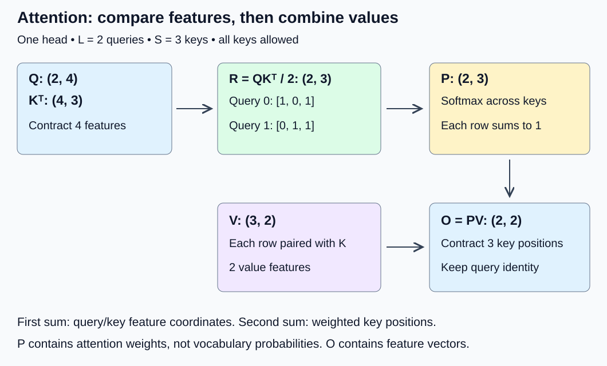
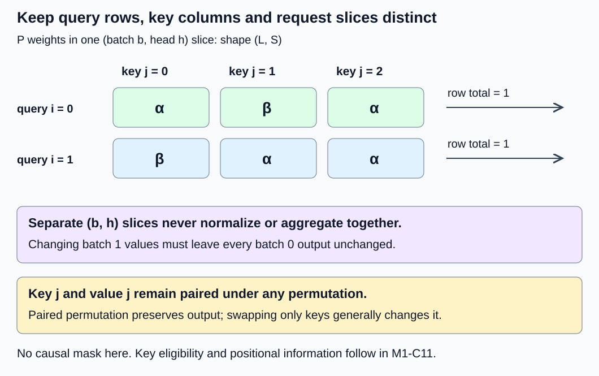

# M1-C10: Attention, one dimension at a time

> **Status: Complete — detailed chapter authored and documentation validated; experimental procedures are proposed unless explicitly labelled observed**

**Module:** Understand exactly what happens when an LLM generates a token

**Category:** [Model computation and semantics](index.md)

[Module 1 reading order](../module-1.md) · [Previous: M1-C09](../model-computation-and-semantics/m1-c09-token-embeddings-and-learned-projections.md) · [Next: M1-C11](../model-computation-and-semantics/m1-c11-causal-masking-and-positional-information.md)

## Target concepts

Queries, keys, values, batch and sequence axes, heads, head dimensions, QKᵀ, scaling by √dₖ, softmax axes, weighted value aggregation.

## Concepts

### 1. Queries ask; keys are compared; values are combined

[M1-C09](m1-c09-token-embeddings-and-learned-projections.md) showed how a learned projection changes the features at one token position. **Attention** lets a position combine information from several positions. It first computes comparison scores, turns them into nonnegative weights that sum to one, then forms a weighted combination of vectors.

Three roles make this easier to follow. A **query** q is the feature vector doing the comparison. A **key** k is a feature vector it is compared with. A **value** v is the vector contributed to the result. “Ask,” “key” and “value” are explanatory names for numerical roles, not a symbolic database lookup or a guarantee that a model retrieves a factual answer. In a model these vectors normally come from learned projections, such as Q = XW_Q, K = XW_K and V = XW_V. Their weights need not be equal. The score depends on queries and keys; the content combined comes from values.

A **head** is one such attention computation with its own feature coordinates. In this chapter each head is independent, with equal query, key and value head counts. The number of heads H is not the feature width of a head. We expose the head axis here; splitting model features, combining heads, output projections and grouped head variants belong to M1-C12. These examples start with already supplied Q, K and V and do not claim to be a complete model.

An HFT systems analogy is comparing one event against several candidate records, then aggregating associated features. The useful lesson is to preserve event identity, snapshot identity and latency boundaries. Attention uses learned numerical comparisons and soft weights; it does not implement exchange priority, order matching or a trading strategy. Its weights alone are not evidence of causation or financial relevance.

### 2. Name every axis before multiplying

Use this explicit four-axis convention throughout:

| Symbol | Meaning | Example size |
|---|---|---:|
| B | Batch: independent requests | 2 |
| H | Independent attention heads per request | 3 |
| L | Query positions: outputs to compute | 2 |
| S | Key/value positions available to each query | 3 |
| dₖ | Features per query and per key | 4 |
| dᵥ | Features per value and output vector | 2 |

All indices start at zero. Batch index b and head index h select one independent problem. Query position i selects a row of outputs; key position j selects a candidate contribution. Feature index r selects a comparison coordinate; t selects a value coordinate. dₖ and dᵥ may differ. Query and key feature widths must agree; key and value position counts must agree. This chapter requires positive B, H, L, S, dₖ and dᵥ and finite inputs; reject an empty key set or a nonpositive feature width rather than assigning an undefined softmax result.

| Tensor | Shape | What one row means |
|---|---|---|
| Q | (B, H, L, dₖ) | One query vector |
| K | (B, H, S, dₖ) | One key vector |
| V | (B, H, S, dᵥ) | One value vector paired with that key |
| R | (B, H, L, S) | Scaled comparison scores for one query |
| P | (B, H, L, S) | Weights across keys for one query |
| O | (B, H, L, dᵥ) | One weighted value vector |

In self-attention, Q, K and V originate from the same sequence representation. Evaluating every position together commonly gives L = S. The rectangular L ≠ S case is also useful for understanding a subset of queries or a different source sequence. **Here all S keys are deliberately allowed for every query.** There is no causal mask, padding, position encoding, dropout or cached state. This isolated unmasked calculation is not a complete decoder-only generation step. M1-C11 introduces which keys a decoder query is allowed to use and how positions are represented.

### 3. QKᵀ makes one score for each query–key pair

Fix b and h for now. Q is (L, dₖ) and K is (S, dₖ). Transposing K's final two axes gives (dₖ, S), so QKᵀ is (L, S). It does not transpose the batch or head axes. Each entry is a dot product:

**C[b, h, i, j] = Σ over r = 0 … dₖ − 1 of Q[b, h, i, r] × K[b, h, j, r].**

C denotes raw scores; scaled scores are **R = C / √dₖ**. This is not elementwise multiplication of Q and K. The operation combines feature coordinates while retaining separate query and key axes. The [original Transformer paper, Section 3.2.1](https://arxiv.org/html/1706.03762v7) defines scaled dot-product attention this way.

Use a constructed single-head fixture, with L = 2, S = 3, dₖ = 4 and dᵥ = 2:

| Object | Row 0 | Row 1 | Row 2 |
|---|---|---|---|
| Q | [2, 0, 0, 0] | [0, 2, 0, 0] | No third query |
| K | [1, 0, 0, 0] | [0, 1, 0, 0] | [1, 1, 0, 0] |
| V | [2, 0] | [0, 4] | [2, 4] |

For query 0, q·k₀ = 2, q·k₁ = 0 and q·k₂ = 2. Query 1 gives [0, 2, 2]. Therefore:

| Stage | Query 0 scores | Query 1 scores |
|---|---|---|
| Raw C = QKᵀ | [2, 0, 2] | [0, 2, 2] |
| R = C / √4 | [1, 0, 1] | [0, 1, 1] |

Why √dₖ? Under the illustrative assumption that all query/key coordinates are independent with mean zero and variance one, each product has variance one and the sum's variance is dₖ. Its standard deviation, a measure of spread, is √dₖ. Dividing by that factor keeps the illustrative score variance at one as width grows. Learned vectors need not satisfy those assumptions. Scaling is part of the specified computation, not a guarantee that all scores have the same spread, or that overflow becomes impossible. This motivation is stated in [the paper's Section 3.2.1 footnote](https://arxiv.org/html/1706.03762v7).

### 4. Softmax normalizes across keys for each query

For fixed (b, h, i), use the [stable softmax from M1-C06](../numerics-and-correctness/m1-c06-reductions-probabilities-and-stable-softmax.md):

**m = maximum over j of R[b, h, i, j].**

**P[b, h, i, j] = exp(R[b, h, i, j] − m) / Σ over u = 0 … S − 1 of exp(R[b, h, i, u] − m).**

exp is the exponential function; u is a key-position index in the denominator. Normalize along the **last, S-sized key axis**, independently for every query in every head and request. In this finite unmasked case, each P is nonnegative and Σ over j of P[b, h, i, j] = 1. These weights are not vocabulary probabilities; they distribute a query's contribution across key positions. Softmax does not mix requests or heads.

Let e = exp(1), α = e/(2e + 1), and β = 1/(2e + 1). Then 2α + β = 1. Values below are rounded displays, not the verification reference:

| Query | P across the three keys | Approximate values |
|---|---|---|
| 0 | [α, β, α] | [0.4223187983, 0.1553624035, 0.4223187983] |
| 1 | [β, α, α] | [0.1553624035, 0.4223187983, 0.4223187983] |

Omitting scaling instead produces α₂ = e²/(2e² + 1) ≈ 0.4683105308 and β₂ ≈ 0.0633789383. It changes the reference operation and makes these rows more concentrated; it is not an equivalent optimization. Normalizing this (2, 3) score matrix down the query axis gives column sums of one but row sums of **1.5**, not one. A wrong-axis result may look smooth while failing the contract.

A query vector of all zeros gives equal zero scores and a uniform row P = [1/3, 1/3, 1/3]. Scaling query 0 by 1000 gives R = [1000, 0, 1000]. Subtracting its maximum yields [0, −1000, 0], so the weights are extremely close to [1/2, 0, 1/2]. A finite-precision exponential can underflow the middle weight to zero. Maximum subtraction avoids a needless exp(1000) overflow but cannot repair a dot product that already overflowed or a non-finite input. Check stages before attributing an error to softmax.

### 5. PV combines values across positions

The output is **O = PV**, with (L, S) × (S, dᵥ) → (L, dᵥ) for each (b, h):

**O[b, h, i, t] = Σ over j = 0 … S − 1 of P[b, h, i, j] × V[b, h, j, t].**

The first multiplication combined comparison features; this second multiplication combines **key positions**. Key j and value j must stay paired. Using query 0's weights gives O₀ = α[2, 0] + β[0, 4] + α[2, 4] = [4α, 4(α + β)]. Query 1 gives O₁ = [2(α + β), 8α].

| Query | Approximate output O |
|---|---|
| 0 | [1.6892751930, 2.3107248070] |
| 1 | [1.1553624035, 3.3785503860] |

Because each row's weights are nonnegative and sum to one, each output coordinate lies between the minimum and maximum of that coordinate in V. Here output coordinate 0 lies in [0, 2], coordinate 1 in [0, 4]. This is a **convex combination**: an average with nonnegative weights summing to one. It does not mean O is a selected token or a new embedding-table row. Equal scores yield an arithmetic mean of values; unequal scores give different weighted mixtures.

There are useful falsifiable invariants. Permuting keys and values together leaves O unchanged after accounting for rounding; permuting only keys generally changes O. Adding the same vector c to every value shifts every output by c because the weights sum to one. Permuting queries permutes output rows. Changing a different request's values must not change this request's output. These checks find association errors that a shape check cannot.

*Shapes shown for one head. The two sums contract different axes: comparison features first, key positions second.*

### 6. Restore batches and heads without cross-request mixing

For B = 2 and H = 3, copy the toy Q and K into each (b, h) slice, and define V[b, h, j, t] = V_base[j, t] + 10b + 3h. This adds a distinct constant to both value coordinates in each slice. The probabilities stay the same; outputs equal the two toy output rows plus 10b + 3h. For example, slice (1, 2) has offset 16 and output row 0 approximately [17.6892751930, 18.3107248070]. Head 2 and request 1 are identities, not additional sequence positions.

The result has shape (2, 3, 2, 2). Libraries can have different accepted layouts or broadcasting rules; this chapter requires **exact matching B and H**, with no implicit broadcasting or grouped head sharing. [PyTorch 2.14 scaled-dot-product attention](https://docs.pytorch.org/docs/2.14/generated/torch.nn.functional.scaled_dot_product_attention.html) documents the query/key feature agreement, separate value width and output axes. Audit the actual interface rather than assuming a four-dimensional tensor uses this order.

With FP32 (4 bytes per value) and distinct materialized R and P, the teaching ledger is:

| Object | Elements | Logical bytes |
|---|---:|---:|
| Q: 2 × 3 × 2 × 4 | 48 | 192 |
| K: 2 × 3 × 3 × 4 | 72 | 288 |
| V: 2 × 3 × 3 × 2 | 36 | 144 |
| R: 2 × 3 × 2 × 3 | 36 | 144 |
| P: same as R | 36 | 144 |
| O: 2 × 3 × 2 × 2 | 24 | 96 |
| All six live together | 252 | 1,008 |

Raw C is not retained separately in that ledger; R is its scaled storage. Extra raw-score storage, softmax workspace, allocator overhead and layout copies would add bytes. This is a declared materialized baseline, not a claim about an optimized operator's peak. A backend may avoid storing the full P or R; that needs its own allocation evidence.

Conventional multiplication work is **2BHLSdₖ for QKᵀ**, plus **2BHLSdᵥ for PV**, or **2BHLS(dₖ + dᵥ)** total. The toy batched case uses 288 + 144 = 432 conventional floating-point operations, excluding scaling, softmax, projections and copies. L = S = n makes these products and score storage grow with n²; L = 1 makes their dependence on S linear. These formulas do not establish total generation cost or bandwidth. Exponentials, allocation, thread scheduling and actual memory movement can dominate small cases.

The dependency chain is Q/K ready → scores → row softmax → weighted values → completed O. V must be ready before aggregation. Q/K/V belong to a consistent request snapshot and cannot be changed while readers are active. Private R/P/O buffers cannot be reused until their last readers finish. Cancellation is not reader completion; retain live buffers until work actually stops. A lost worker's incomplete O must be discarded, and the computation reconstructed from compatible request state. Caching and distributed recovery mechanisms are later topics, not implemented or tested here.

*Each row normalizes across keys. Batch/head isolation and key–value pairing are correctness boundaries.*

## Experiments

These are **proposed, code-free experiment designs**, not runtime results. E1–E3 support paper or calculator work; E4 requires an existing inspectable operator benchmark. Rust remains the intended systems-language context. The library references define operator behavior, not a requirement to implement Python or Rust code. All inputs are synthetic and make no language-quality or HFT performance claim.

### E1 — Reconstruct one rectangular attention calculation

- **Description:** Trace the toy Q/K/V through raw scores, scale, key-axis softmax and PV.
- **Purpose/objective:** Test that score comparison and value aggregation contract different axes and yield the stated outputs.
- **Target concepts:** Queries, keys, values, QKᵀ, scaling by √dₖ, softmax axes, weighted value aggregation, head dimensions.
- **Baseline and workload:** The complete L = 2, S = 3, dₖ = 4, dᵥ = 2 single-head fixture above; all positions valid and all keys allowed.
- **Controls and prediction:** Fix row identity, weights, scale 1/2 and no dropout. Predict the displayed C/R, symbolic α/β probabilities and O coordinates; the zero-query extension predicts [4/3, 8/3].
- **Procedure:** Independently calculate all six dot products, each row's maximum and denominator, then all four output coordinates. Compare a coordinate calculation to matrix-shape reasoning. Replace query 0 with a zero vector and check its value mean. Change V[0, 0] from 2 to 3 while keeping Q/K fixed; P must not change, and the two output coordinate-0 increments must be α and β respectively. Keep all other coordinates fixed.
- **Hardware/software:** Paper and a high-precision calculator suffice. An existing operator harness must record dtype, version, exact tensor contents and no mask/dropout settings.
- **Failure and HFT connection:** A correct score cannot repair a value paired with the wrong record. Reject incompatible feature widths or K/V lengths before publishing output, as one would reject inconsistent event-record schemas.
- **Exit criteria:** Every stage's shape and coordinate agrees with the reference within V1's justified display/runtime budgets; the zero-query and value-perturbation predictions pass, and incompatible shapes have explicit rejected outcomes.

### E2 — Expose scale and softmax-axis errors

- **Description:** Compare the specified normalization with deliberately omitted scaling, wrong-axis normalization, score shifts and extreme finite scores.
- **Purpose/objective:** Falsify the claim that any normalized-looking score tensor is equivalent attention, and distinguish stable normalization from earlier arithmetic overflow.
- **Target concepts:** QKᵀ, scaling by √dₖ, softmax axes, weighted value aggregation.
- **Baseline and workload:** E1's two score rows; a row-shift case adds 7 to every score of query 0; an extreme case scales query 0 by 1000. For width motivation, compare the theoretical independent unit-variance sums at dₖ = 4 and 64.
- **Controls and prediction:** Fix V and the last-axis denominator. Predict unchanged probabilities under a common row shift, changed probabilities without scaling, wrong-axis row sums 1.5, and a limiting extreme output [2, 2]. The theoretical unscaled standard deviations are 2 and 8; scaled variances are one under the stated assumptions.
- **Procedure:** Calculate α₂/β₂ for the unscaled path and its output, then compare against E1 as an intentionally different computation. Normalize columns of R and check both row and column sums. Shift query 0's scores and check invariance. Use maximum-subtracted exponentials for the extreme row and identify the tiny contribution that may underflow. Separately consider a non-finite Q entry: reject it, rather than assuming maximum subtraction will repair it.
- **Hardware/software:** Paper/calculator for algebra; an optional existing FP64 harness must expose R/P/O and preserve full precision settings and exact input records.
- **Failure and HFT connection:** A fast but differently normalized aggregation changes a decision input. The connection is contract discipline, not equivalence to a trading model or a profitability assertion.
- **Exit criteria:** Each deliberate error is detected, shift invariance passes, the extreme output satisfies V2's absolute budget, and non-finite inputs are rejected with no accepted output.

### E3 — Check head isolation and key–value association

- **Description:** Trace the B = 2, H = 3 offset fixture, then permute and perturb labelled axes and draw buffer lifetimes.
- **Purpose/objective:** Test whether identical shapes can hide cross-request mixing, incorrect head association or mismatched keys and values.
- **Target concepts:** Batch and sequence axes, heads, head dimensions, QKᵀ, softmax axes, weighted value aggregation.
- **Baseline and workload:** The six (b, h) slices with offset 10b + 3h and their explicit coordinate labels, each containing two queries and three keys. Use two overlapping logical requests in a separate ownership trace.
- **Controls and prediction:** Fix Q/K, scale, dtype and snapshot identity. Predict O_base + 10b + 3h for every slice, query permutation equivariance (outputs follow the permutation), and unchanged outputs under a paired K/V permutation.
- **Procedure:** Check all 24 output coordinates. Swap keys 0 and 1 and their values together; compare O. Swap only the keys and require a detected output change. Permute queries and whole batches/heads while carrying their labels; restore labels before comparison. Change only batch 1 values by +1 and verify batch 0 is unchanged. Reject mismatched B/H instead of silently broadcasting. Draw last-reader events for R, P and O; mark premature reuse, cancellation with live readers, allocation failure and worker loss as distinct failed or unfinished outcomes. A paper trace must not be described as a tested concurrent allocator.
- **Hardware/software:** Paper labelled tensors and ownership timelines suffice. An optional existing harness must document layout, actual copies and completed reader events; do not induce unsafe live-buffer corruption.
- **Failure and HFT connection:** Treat independent requests like separate event streams whose state must not leak. If allocation fails, do not publish a partial or stale O; retain and retire prior live readers safely.
- **Exit criteria:** All isolation/permutation checks pass, the unpaired permutation fails, the 1,008-byte materialized ledger reconciles, and each lifecycle case has an explicit publication/reclamation decision. No runtime safety claim follows from paper evidence.

### E4 — Benchmark the completed attention core across rectangular shapes

- **Description:** Measure one existing attention core at four (L, S) pairs and inspect full-path versus stage costs.
- **Purpose/objective:** Test whether arithmetic/score growth predicts the observed cost trend at a declared CPU operating point. A mismatch is evidence to investigate, not permission to fit the operation count after the fact.
- **Target concepts:** All assigned target concepts, especially query/key lengths, head dimensions, row normalization and aggregation.
- **Baseline and workload:** B = 1, H = 2, dₖ = 4, dᵥ = 2; L in {1, 16}, S in {16, 64}. Query i repeats toy Q row (i mod 2); key j repeats toy K row (j mod 3); V[h, j, t] = V_base[j mod 3, t] + 10h. mod is division remainder. All keys are allowed, there is no mask, and all queries count as valid. These repeated features give an analytic reference, not realistic language statistics.
- **Controls and prediction:** Use contiguous FP64 inputs, one CPU thread, one job in flight, explicit scale 1/2, no dropout/gradients or model projections. Keep inputs resident and preparation outside timing. Use the same existing core/backend and allocation policy for all configurations. Predict a sixteenfold product-count increase from L = 1 to 16 at fixed S and fourfold from S = 16 to 64 at fixed L; do not predict the same latency ratios without measurement.
- **Procedure:** Check every output before timing against the high-precision reference described in V4. In each of three fresh process sessions, perform five untimed warmups per configuration, then 30 measurements per configuration, cycling shape order forward and backward on alternate repetitions. Start before score/output workspace allocation and end when O is complete and ready. Separately measure completed QKᵀ/scale, softmax and PV stages in an existing materialized harness, declaring their allocations and ready inputs; label these as a different observation path if the full core does not expose stages. Profile separate full runs for copies, allocation, operators and CPU activity. Do not sum isolated medians to manufacture full latency or call a fused operator's absent intermediate an allocation bug.
- **Hardware/software:** A CPU host with at least 1 GiB available RAM beyond runtime requirements and an existing FP64 attention harness is sufficient. Record actual specifications below. If unavailable, leave E4 unexecuted; do not write an implementation as part of this chapter.
- **Failure and HFT connection:** Retain failures and rejected cases separately from successful timings. An invalid dimension and a non-finite input must be rejected outside the valid benchmark population. This single-in-flight core study does not measure arrival queues, overload, market bursts or service p99. Future serving tests must preserve intended arrivals and all terminal outcomes.
- **Exit criteria:** Each shape has exact input manifests, passing V4 checks, 90 retained completed-job observations across three sessions and five warmups per session. Report latency spread, query vectors/s, logical bytes, observed allocation/profile limits and unsupported claims. A noisy or non-proportional trend is acceptable if reported honestly.

## Verification

### Reference, tolerance and Module 9 support

Apply [M9-C01](../numerics-and-correctness/m9-c01-defining-reference-behavior-and-evidence-before-optimizing.md) to stage references; [M9-C02](../measurement-experimentation-and-economics/m9-c02-request-events-clocks-and-measurement-boundaries.md) to completed timing; [M9-C11](../measurement-experimentation-and-economics/m9-c11-controlled-comparisons-warmup-and-reproducibility.md) to controlled sessions; [M9-C15](../state-memory-and-caching/m9-c15-accounting-for-weights-kv-state-workspace-and-fragmentation.md) to live intermediates; and [M9-C17](../numerics-and-correctness/m9-c17-comparing-logits-with-justified-numerical-tolerances.md) to error budgets and first divergence. M9-C01, M9-C02 and M9-C17 are complete; the other linked support chapters remain outlines; the required introductory contracts follow here. Module 8 and non-text modalities are excluded.

The oracle uses the specified real-number formulas and high-precision exponentials, independently of the timed operator. Recompute at 80 and 120 decimal digits and require reference coordinates to agree to at least 50 decimal digits; keep more digits than displayed. Stage shapes and identities must match exactly. For these bounded fixtures evaluated in FP64, set absolute allowances before testing: **10⁻¹² per R or P coordinate**, **10⁻¹² per P row sum**, and **10⁻⁹ per O coordinate**; require finite outputs and P coordinates within [−10⁻¹², 1 + 10⁻¹²]. The tiny negative allowance is for comparison, not a new definition of probabilities.

These are fixture-specific acceptance budgets, not universal guarantees about an exponential library. Their propagation is interpretable: if each of S probability errors is at most ε and values have magnitude at most Mᵥ, then the error contribution to one weighted output is at most **SMᵥε**, before aggregation rounding. Here S ≤ 64 and Mᵥ ≤ 14 in E4, so this contribution is at most 8.96 × 10⁻¹⁰; the 10⁻⁹ output budget leaves 1.04 × 10⁻¹⁰ for aggregation error. E3 has S = 3 and Mᵥ ≤ 20, a smaller bound. The allowances comfortably distinguish the deliberate axis/scale/pairing errors. A failed budget needs investigation, not automatic widening. Record maximum per-stage errors and the first divergent (b, h, i, j/t), even when the final output happens to pass.

Printed ten-decimal examples may differ from the oracle by up to 5 × 10⁻¹¹ due to display rounding. They are explanatory approximations, not reference files. FP32 or reduced-precision production comparisons need new justified budgets using [M1-C07](../numerics-and-correctness/m1-c07-floating-point-arithmetic-and-numerical-correctness.md); do not reuse the FP64 limits. This chapter supplies no language-quality or distributional-token test.

### V1 — Verify E1 stage meanings

The exact raw/scale references are C = [[2, 0, 2], [0, 2, 2]] and R = [[1, 0, 1], [0, 1, 1]]. Compare P against α/β formulas and O against [4α, 4(α + β)] and [2(α + β), 8α]. Check two row sums and each coordinate's convex bounds. The zero-query mean is [4/3, 8/3]; modifying one value changes only the corresponding output feature, by α or β as stated. This isolates score errors from aggregation errors. Reject an empty key set, nonpositive feature width, mismatched dₖ, K/V length, or output shape rather than interpreting a partial result.

Paper calculations establish deterministic arithmetic evidence; repeated paper work creates no latency distribution. For an optional harness, measure only completed attention with Q/K/V ready and declare allocation boundaries. Profiling is unnecessary for this small correctness exercise; it cannot establish a bottleneck from a few arithmetic operations. Record every expected rejection and mismatch, not just successes.

### V2 — Verify E2 normalization boundaries

Require row-shift invariance within the FP64 budget. The unscaled path's query-0 output is [4α₂, 4(α₂ + β₂)], approximately [1.8732421233, 2.1267578767], which must fail the scaled reference. Wrong-axis normalization has row sums 1.5 in this fixture and must fail independently of output appearance. A row sum of one alone is necessary but cannot prove the correct key order or scale.

For the extreme row the exact middle probability is exp(−1000)/(2 + exp(−1000)); retain it in the high-precision reference. A stored zero is acceptable under this absolute budget but loses the tail's relative accuracy. Compare O to [2, 2] using 10⁻⁹ absolute allowance; log underflow separately from NaN/infinity, which fails. Reject non-finite input before accepted output. Do not call the deliberately unscaled result an equivalent candidate or benchmark its speed as an optimization. Timing/profiling is optional here; no repeated paper outcome estimates hardware speed or model stability.

### V3 — Verify E3 isolation, association and storage

Check every (b, h, i, t) against O_base + 10b + 3h. Permuting paired K/V rows must preserve O; an unpaired swap changes query 0's coordinate 0 by 2(β − α), about −0.5339127895, in the base slice. Query, batch and head permutations must follow their labels. Adding one to batch 1 values shifts only batch 1 outputs by one. Keep snapshots and labels as evidence: repeating equal numeric rows can otherwise hide an identity error.

The materialized FP32 ledger is 192 + 288 + 144 + 144 + 144 + 96 = 1,008 bytes. FP64 doubles that to 2,016 bytes; neither is a runtime allocator peak. Do not double-count aliased storage or assume intermediates are materialized by every backend. In ownership traces, release R only after its softmax reader, P after aggregation, and O after its consumer; observe actual completion before reuse in any runtime extension. Cancellation/allocation failure/worker loss are distinct terminal or unfinished outcomes, never useful outputs. A paper trace verifies reasoning only; race freedom and recovery latency remain untested. Profiles in an optional extension must name the allocation/copy boundary and observer overhead.

### V4 — Verify E4 cost and benchmark evidence

Count keys of each repeated type. For S = 16, counts (n₀, n₁, n₂) are (6, 5, 5); for S = 64 they are (22, 21, 21). For an even query i, the group logits are (1, 0, 1); for an odd query they are (0, 1, 1). With group logit ℓ_g and base value v_g, the independent analytic output is:

**O[h, i, t] = (Σ over g = 0, 1, 2 of n_g exp(ℓ_g) v_g[t]) / (Σ over g of n_g exp(ℓ_g)) + 10h.**

Compare this grouped reference with a separate per-key high-precision sum to ensure the repetition counts have not hidden a shape error. Check all output coordinates for every shape; require row sums where the materialized path exposes P. An opaque full operator must pass its output reference, with R/P inspection recorded as unavailable for that path rather than falsely claimed. Disable dropout explicitly: [PyTorch 2.14's attention contract](https://docs.pytorch.org/docs/2.14/generated/torch.nn.functional.scaled_dot_product_attention.html) makes the supplied dropout probability control that operation, documents FP64 math support and notes backend-dependent numerical differences.

For the largest configuration, a materialized FP64 reference has:

| Object or work | Count | Logical bytes or operations |
|---|---|---:|
| Q | 1 × 2 × 16 × 4 | 1,024 bytes |
| K | 1 × 2 × 64 × 4 | 4,096 bytes |
| V | 1 × 2 × 64 × 2 | 2,048 bytes |
| R | 1 × 2 × 16 × 64 | 16,384 bytes |
| P | Same as R | 16,384 bytes |
| O | 1 × 2 × 16 × 2 | 512 bytes |
| All six live | Sum of above | 40,448 bytes |
| Two matrix products | 2 × 1 × 2 × 16 × 64 × (4 + 2) | 24,576 conventional operations |

This excludes raw C retained separately, workspace, projections and headers. Score storage grows with LS, but this table is not measured physical traffic. Use documented allocation observations and cache/memory counters before attributing a trend to bandwidth. Without counters, report the attribution limit. Inspect copies and transpose handling; a mathematical transpose does not prove a physical copy or its absence.

The full timing boundary begins with Q/K/V resident and ends with completed O, including core allocation but excluding input generation, projections, tokenization, masks, cache management, queues and consumer work. Report ns/job, minimum/median/maximum and all individual observations per session; **query vectors/s = BHL / completed job seconds**. Do not call this tokens/s for a full model. Retain all rejected/failed outcomes separately. If timer overhead dominates, select a common block size in an untimed pilot and label observations as block averages; they cannot describe individual-job tails. Record clock resolution and empty-harness overhead without blindly subtracting it.

Compare separate profiled and unprofiled runs to identify observer impact; never infer full time by summing isolated stage medians. Use three-session spread to expose uncertainty and inconclusive ratios. Ninety single-in-flight observations do not establish service p99, capacity under load or production readiness. [PyTorch 2.14 benchmark utilities](https://docs.pytorch.org/docs/2.14/benchmark_utils.html) explain warmup, controlled threads and completion-aware measurement for an existing compatible harness. No experiment here has been executed as a runtime benchmark.

### Target-concept coverage

| Target | Explanation | Experiment and verification |
|---|---|---|
| Queries, keys, values | Concepts 1, 3 and 5: score roles versus value content | E1/V1 value perturbation; E3/V3 pairing |
| Batch and sequence axes | Concepts 2 and 6: B versus L/S | E3/V3 request isolation; E4/V4 rectangular lengths |
| Heads | Concepts 1, 2 and 6: independent (b, h) slices | E3/V3 offsets and labelled permutations |
| Head dimensions | Concepts 2–3: dₖ versus dᵥ | E1/V1 rectangular products and rejected widths |
| QKᵀ | Concept 3: last-two-axis transpose and dot products | E1/V1 six scores; E3/V3 association |
| Scaling by √dₖ | Concepts 3–4: variance motivation and score scale | E2/V2 omitted-scale counterexample |
| Softmax axes | Concept 4: one distribution across keys per query | E2/V2 wrong-axis sums; E4/V4 row checks |
| Weighted value aggregation | Concept 5: contraction over key positions | E1/V1 outputs/convex bounds; E3/V3 shifts |

The stage/axis checks cover the full target list without treating attention weights as vocabulary probabilities.

## Engineering dimensions and principles

### Six dimensions

| Dimension | Application to attention and its evidence |
|---|---|
| Semantics and invariants | E1/V1 requires paired key/value identity and key-axis row sums; E2 rejects normalization or scale changes disguised as equivalent computation. |
| Workload and variability | E4 varies query and key lengths independently; L = 1 and L = S have different growth. Synthetic repeated keys do not establish natural-language, arrival or non-text workload behavior. |
| Resources and bottlenecks | E3/V3 counts private intermediates; E4/V4 separates conventional products, softmax, allocation and actual traffic. CPU time and workspace remain part of the core cost. |
| Time and distributions | Scores precede normalization and aggregation. E4 retains completed-job distributions and session variation; shared queues, barriers and burst arrivals require later service studies. |
| Ownership and coordination | E3/V3 binds Q/K/V to one request snapshot and requires last-reader completion before R/P/O reuse, including cancellation. |
| Failure and adaptation | Reject incompatible/non-finite inputs; report allocation failure and incomplete worker-loss results. E3's lifecycle reasoning supplies no measured recovery guarantee, and overload requires later admission/outcome tests. |

### Eight practical principles

1. **Correctness defines the optimization boundary.** Removing scale, normalizing the wrong axis or unpairing K/V changes the operation. E1–E3 gate timing with coordinate references.
2. **Performance depends on workload and operating point.** E4's four rectangular cases probe L and S separately at one thread and one job in flight. No latency ratio is universal.
3. **Data movement is part of the algorithm.** R/P storage scales with BHLS in the materialized baseline; E4 profiles copies and allocations instead of treating product counts as a traffic measurement.
4. **State has ownership, lifetime and recovery cost.** E3 tracks consistent Q/K/V and live R/P/O; reconstruction after worker loss needs compatible inputs and discarded incomplete output.
5. **Dependencies determine latency; bottlenecks determine capacity.** PV needs completed probabilities. V may become ready separately, but overlap requires both resources and satisfied dependencies. E4 measures the core critical path, not loaded capacity.
6. **Variability and synchronization shape the tail.** CPU scheduling, allocator reuse and shared resources can perturb E4. Session spread and observer checks matter; block averages and small samples cannot certify p99.
7. **Local improvements must be evaluated end to end.** Faster score multiplication can be offset by softmax or allocation. V4 requires completed core time; a service improvement additionally needs projections, generation and serving boundaries.
8. **Claims require reproducible evidence.** Input formulas, axis labels, reference precision, tolerances, failed cases, hardware identity and retained observations accompany every proposed experiment. Paper arithmetic is not a runtime result.

## Specifications, articles, and hardware

| Primary source | Reading purpose and boundary |
|---|---|
| [Vaswani et al., Attention Is All You Need, Section 3.2](https://arxiv.org/html/1706.03762v7) | Original scaled-dot-product formula and variance motivation. Head combination and decoder masking are later chapters; do not assume the toy unmasked core is a complete decoder. |
| [PyTorch 2.14 scaled-dot-product attention](https://docs.pytorch.org/docs/2.14/generated/torch.nn.functional.scaled_dot_product_attention.html) | Interface shapes, scale, explicit dropout control, FP64 support and backend differences. This chapter fixes equal head counts and disables masks/grouped sharing. |
| [ONNX Attention operator, documentation 1.24.0](https://onnx.ai/onnx/operators/onnx__Attention.html) | A specification comparison for separately named query/key sequence lengths and value head width. The page contains several operator versions: record the exact imported version before applying any extra feature. Its cache/mask/precision extensions are outside this fixture. |
| [PyTorch 2.14 benchmark utilities](https://docs.pytorch.org/docs/2.14/benchmark_utils.html) | Existing harness warmup, thread controls, replication and completed-work timing. No implementation is supplied. |

E1–E3 require paper/calculator arithmetic and no particular hardware. E4 needs an actual machine record before measurement:

| Field | Required specifications |
|---|---|
| CPU and placement | Vendor/model, physical/logical core counts, instruction set used, affinity and chosen core, simultaneous multithreading and NUMA placement (local memory region for the processor). |
| Memory and cache | Installed/available RAM, relevant cache capacities, memory speed/channels where known, actual allocation peaks and working-set observations; leave unknown fields explicitly unknown. |
| Operating conditions | OS/kernel, CPU frequency/power policy, temperature/throttling observations, background load and one-thread runtime settings. |
| Software and arithmetic | Exact existing harness/library/backend versions, selected operator/path, FP64 mode, no dropout/gradients/masking, layout/allocation policy, clock source/resolution, fixtures and reference precision. |
| Separate accelerator extension | Device model, memory, driver/runtime, link, precision modes and explicit device-completion/transfer boundaries. CPU observations do not establish GPU behavior. |

The 1 GiB availability requirement is room for a runtime, not a claim that the 40,448-byte logical ledger consumes 1 GiB. No hardware experiment, trained-model validation, trading test or deployment has been performed for this chapter. Documentation checks belong to the [execution plan](../chapter-execution-plan.md).

## Key takeaways

- QKᵀ compares query and key features; key-axis softmax makes weights; PV combines paired values across key positions.
- Label B, H, L, S, dₖ and dᵥ separately. Equal element counts do not establish correct identities or axes.
- Scale is part of the reference operation. Stable softmax protects normalization but cannot repair earlier overflow or incorrect inputs.
- Verify coordinate values, row sums, convex bounds, key/value pairing and batch/head isolation before measuring speed.
- Count intermediate storage and completed dependencies alongside arithmetic. A core benchmark is one piece of full generation and service evidence.
