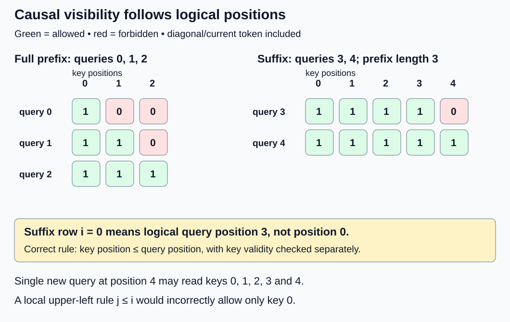
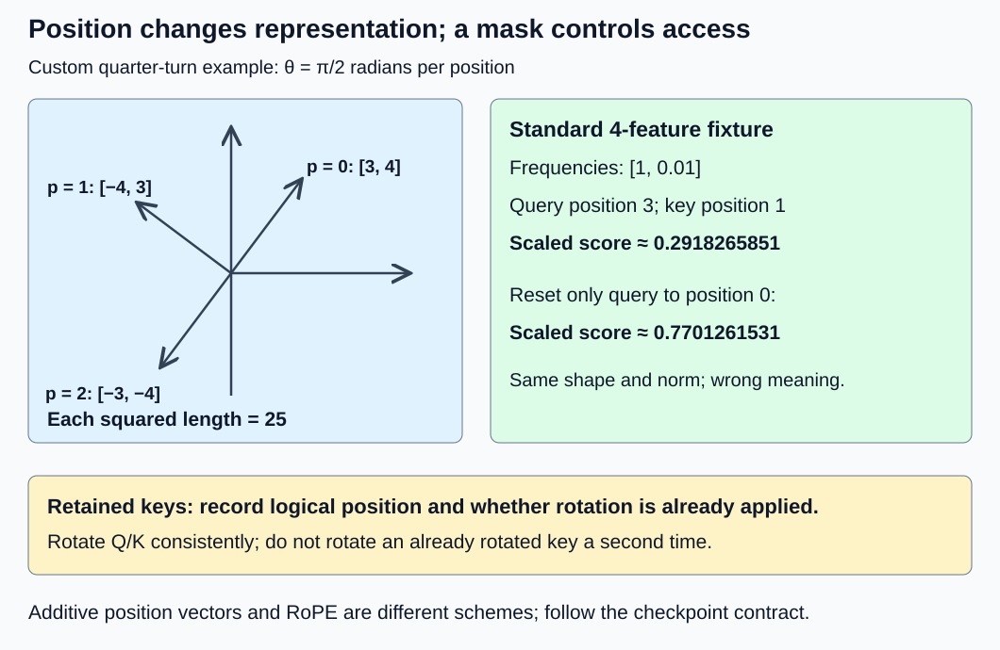

# M1-C11: Causal masking and positional information

> **Status: Complete — detailed chapter authored and documentation validated; experimental procedures are proposed unless explicitly labelled observed**

**Module:** Understand exactly what happens when an LLM generates a token

**Category:** [Model computation and semantics](index.md)

[Module 1 reading order](../module-1.md) · [Previous: M1-C10](../model-computation-and-semantics/m1-c10-attention-one-dimension-at-a-time.md) · [Next: M1-C12](../model-computation-and-semantics/m1-c12-multi-head-attention-and-its-variants.md)

## Target concepts

Autoregressive dependencies, causal masks, position indices, positional encoding, RoPE, position handling during generation.

## Concepts

### 1. Autoregressive generation has a direction

[M1-C10](m1-c10-attention-one-dimension-at-a-time.md) calculated attention with every key allowed. A decoder generating a sequence needs a stricter contract. **Autoregressive** means that the probability of the next token is conditioned on tokens already available:

**Pr(x₀, …, xₙ₋₁) = Pr(x₀) × product over p = 1 … n − 1 of Pr(xₚ | x₀, …, xₚ₋₁).**

xₚ denotes the token at sequence position p, not its vocabulary ID or a byte offset. A beginning-of-sequence token, when required by the model/template, is part of the actual input sequence. After consuming an input token at p, its hidden representation can attend to positions **up to and including p** and can supply logits for the token at p + 1. “Predict next” does not mean masking out the current input token. Conversely, allowing p to read p + 1 while evaluating the reference would leak future information.

For a prompt with three input tokens at positions 0, 1 and 2, the output at position 2 predicts the first generated token, whose eventual input position is 3. That generated token is then consumed at position 3 to predict the token at 4. **Prefill** evaluates the supplied prompt; **decode** evaluates newly supplied generated tokens. These stages use the same position/visibility contract, even though their query counts differ. This chapter explains the contract, not a full generation engine.

In HFT engineering, a decision must distinguish information available at its decision point from later events. This motivates careful dependency and snapshot records. Token positions are sequence coordinates, however, not exchange timestamps; a causal mask neither reconstructs market causality nor implements a trading strategy. No trading result or financial recommendation follows from these examples.

### 2. A causal mask defines eligible keys before softmax

Reuse Q/K/V shapes (B, H, L, dₖ), (B, H, S, dₖ) and (B, H, S, dᵥ). B is request count, H head count, L query positions, S key/value slots and dₖ/dᵥ feature widths. Let qpos[b, i] and kpos[b, j] be **logical positions in that request's sequence**. Let key_valid[b, j] say whether a slot contains a real token. For a valid query i, define eligibility:

**A[b, i, j] = key_valid[b, j] AND (kpos[b, j] ≤ qpos[b, i]).**

AND requires both conditions. Requests remain separate through batch indexing; the same logical rule applies independently to each head here. A has shape (B, L, S), with a shared head rule, or may be represented with an explicit head axis. For an interface expecting scores in (B, H, L, S) order, represent this head-shared mask as (B, 1, L, S), with an explicit size-one head axis. Do not assume a (B, L, S) tensor broadcasts as intended: its B axis can align with H instead, including a silent error when B = H. A Boolean “true” means allowed in this chapter. Some interfaces reverse mask polarity: [PyTorch 2.14 scaled-dot-product attention](https://docs.pytorch.org/docs/2.14/generated/torch.nn.functional.scaled_dot_product_attention.html) uses true for participation, while its MultiheadAttention key-padding interface uses true for exclusion. Match the particular contract.

Let R = QKᵀ/√dₖ be the scaled scores. An additive mask M has 0 for an allowed pair and −∞ for a forbidden pair. Softmax uses R + M, so forbidden entries have weight zero and the denominator includes only allowed keys. Mathematically, for allowed keys:

**P[i, j] = exp(R[i, j] − m) / Σ over allowed u of exp(R[i, u] − m), where m is the maximum allowed score.**

Forbidden P[i, j] = 0, and **O[i, t] = Σ over allowed j of P[i, j]V[j, t]**. Batch/head indices are omitted only for readability. Masking occurs before normalization, as in the [original Transformer decoder description, Section 3.2.3](https://arxiv.org/html/1706.03762v7).

Multiplying forbidden *scores* by zero is wrong: score zero still has exp(0) = 1. Multiplying already normalized weights by zero is also wrong unless the remaining mass is correctly renormalized. Using a finite negative sentinel rather than exclusion must be justified against score range and precision; this chapter's mathematical reference excludes forbidden keys exactly. It does not claim every backend stores literal infinities or physically skips their arithmetic.

For a square full-prefix calculation at positions [0, 1, 2], the allowed matrix is:

| Query position | Key 0 | Key 1 | Key 2 |
|---|---:|---:|---:|
| 0 | 1 | 0 | 0 |
| 1 | 1 | 1 | 0 |
| 2 | 1 | 1 | 1 |

1 means allowed, 0 forbidden. This is a lower triangle **including the diagonal**. With zero scores and scalar values V = [2, 4, 8], outputs are [2, 3, 14/3]. They average the eligible values. Normalizing all three keys first and then zeroing forbidden weights without renormalization gives [2/3, 2, 14/3], a different operation. Replacing the future value 8 by 80 must leave outputs at 0 and 1 unchanged; it changes the final output to 86/3. Such a perturbation tests the actual dependency, not merely a mask's appearance.

A valid query with no eligible key has no ordinary softmax distribution: the denominator is empty and a maximum of all −∞ entries cannot be subtracted meaningfully. This chapter **rejects that case** before publishing output. Invalid padded query slots are excluded from output and useful-work counts; an interface may produce dummy rows for them, but those rows are not valid query results. Require positive feature widths and finite unmasked Q/K/V inputs. Zero-length requests, sliding windows and packed multiple-sequence segments require separately specified policies and are outside this fixture.

### 3. A new query's row number is not its sequence position

Suppose P₀ = 3 tokens have already been consumed and the next C = 2 supplied tokens occupy positions [3, 4]. Here P₀ denotes prefix length, not attention probabilities P. The key set contains positions [0, 1, 2, 3, 4]. Query row i = 0 refers to position 3, not position 0. Thus:

**qpos[i] = P₀ + i; kpos[j] = j; eligibility is j ≤ P₀ + i.**

| Query row i | Logical position | Allowed key positions | Forbidden |
|---|---:|---|---|
| 0 | 3 | 0, 1, 2, 3 | 4 |
| 1 | 4 | 0, 1, 2, 3, 4 | None |

The previous three keys and both new keys can all be present while the first new query must still exclude the second new key. For a single new query at position 4, all five keys are eligible. A local rule j ≤ i instead allows only key 0 in that case. With zero scores and V = [2, 4, 8, 16, 32], the correct two-query outputs are [7.5, 12.4]; the local upper-left triangle gives [2, 3]. A single query at 4 must give 12.4, not 2.

This is why an “is causal” flag needs an alignment specification. [PyTorch 2.14's attention interface](https://docs.pytorch.org/docs/2.14/generated/torch.nn.functional.scaled_dot_product_attention.html) documents upper-left alignment for a non-square causal mask. That is a defined operator behavior; it is not the offset-aware mask above. For this chapter's rectangular reference, use an explicit absolute-position eligibility contract with the separate causal flag disabled. Do not combine both options or assume a backend chooses the intended offset.

*The rectangular query rows represent positions 3 and 4. A shape-compatible local triangle would hide valid prefix keys.*

### 4. Logical positions, padding slots and encodings are different

A **position index** identifies a token's place in its logical input. A **storage slot** identifies where its data currently resides. Padding, batching and later memory layouts can change the latter without changing the former. The token ID is a third identity: two copies of the same token can occur at different positions.

For an explicit left-padding policy, consider two requests stored in five slots:

| Request | Storage slots 0 … 4 | Logical positions of real tokens | Next token position |
|---|---|---|---:|
| A, length 2 | [pad, pad, pad, a, b] | [—, —, —, 0, 1] | 2 |
| B, length 5 | [c, d, e, f, g] | [0, 1, 2, 3, 4] | 5 |

Letters here name toy tokens, not actual tokenizer IDs. Padded slots are invalid keys and queries. After appending a new token to each request, A's new token has position 2 and B's has position 5 even if both occupy a new batch column. Store validity and each request's logical length separately. Do not infer positions from text character counts, padded batch width or the number of decoding calls. If a call consumes C tokens, the next position advances by C real tokens, not by one call. This is a fixture policy; a real checkpoint's position/template conventions must be followed and recorded.

Visibility alone does not encode a token's exact coordinate. A **positional encoding** makes position affect numerical representations. One approach adds a position vector to the token embedding: **zₚ = E[tokenₚ] + eₚ**. E is the learned token table; eₚ has the same feature width and may be a learned position-table row or a fixed function. For example, embedding [1, −1] and position vector [0, 1] produce [1, 0]. Adding the same token at a different eₚ can produce a different vector.

The original Transformer uses fixed sinusoidal position vectors. For model width d_model and pair index r starting at zero:

**PE(p, 2r) = sin(p / 10000^(2r/d_model)); PE(p, 2r + 1) = cos(p / 10000^(2r/d_model)).**

Angles are in **radians**, a unit where a full turn is 2π. At d_model = 4, PE(0) = [0, 1, 0, 1]. PE(1) ≈ [0.8414709848, 0.5403023059, 0.0099998333, 0.9999500004]. See [Section 3.5 of the paper](https://arxiv.org/html/1706.03762v7). This is an example of additive position information, not a requirement to add sinusoidal vectors to a checkpoint that uses a different scheme. A causal mask constrains access; an encoding changes representations. Neither substitutes for the other.

### 5. RoPE rotates query/key feature pairs

**Rotary position embedding (RoPE)** makes positions affect query–key comparisons by rotating feature pairs. It is distinct from adding eₚ to an embedding. This chapter uses column-vector rotation notation within each pair, even though attention tensors still store their feature coordinates on the last axis. For angle φ, define:

**Rot(φ)[u, v] = [u cos φ − v sin φ, u sin φ + v cos φ].**

This is a numerical transformation of a two-coordinate vector, not implementation code. For position p and frequency θᵣ, rotate pair r of Q and K by φ = pθᵣ. The frequency is the angle increment per position. Use an even rotary width d_rot ≤ dₖ; coordinates outside that width are unchanged. In the fully rotary four-feature example d_rot = dₖ = 4, with adjacent pairs (0, 1) and (2, 3) and zero-based r in {0, 1}:

**θᵣ = 10000^(−2r/d_rot), so θ₀ = 1 and θ₁ = 0.01.**

For raw q = [1, 0, 1, 0] at p = 1, the rotated vector is approximately [0.5403023059, 0.8414709848, 0.9999500004, 0.0099998333]. Notice the coordinate order differs from the additive PE example. The [RoFormer paper, Sections 3.2–3.3](https://arxiv.org/html/2104.09864v5), derives this rotation and frequency construction. Our fixtures rotate Q/K only and leave V unchanged. Record a real model's pair layout, rotary width, base frequency, scaling policy and point of application; do not assume every checkpoint uses this exact convention.

A simple geometric demonstration uses a deliberately custom frequency θ = π/2. A vector [3, 4] becomes [−4, 3] at position 1 and [−3, −4] at position 2. Its squared length stays 25. This quarter-turn fixture is chosen for exact arithmetic; it is not the θ₀ = 1 frequency of the standard example.

Why can absolute rotations express relative position? For fixed unrotated vectors q and k and positions m and n:

**(Rot(mθ)q)ᵀ(Rot(nθ)k) = qᵀ Rot((n − m)θ)k.**

The score depends on their position difference when content and frequencies are fixed. Shifting **both** positions by the same offset leaves that pure rotary dot product unchanged. It does not establish that arbitrary full-model outputs or arbitrary position encodings are shift-invariant. Changing only the new query's position while leaving old keys unchanged generally changes scores.

For the four-feature q = k = [1, 0, 1, 0], query position m = 3 and key position n = 1 give an unscaled dot product **cos(2) + cos(0.02) ≈ 0.5836531701**, and scaled score approximately 0.2918265851 after division by √4 = 2. Resetting only the query to position 0 gives **cos(1) + cos(0.01) ≈ 1.5402523063**, scaled approximately 0.7701261531. The dimensions and vector lengths still look correct; the positional meaning is wrong. RoPE also does not itself exclude future keys: their rotated scores must still be masked when they are not eligible. Being able to evaluate a trigonometric function at a larger position is not evidence that a checkpoint supports that context length or preserves its quality.

*Masking and position encoding solve different problems. A retained key must keep the same position and rotation convention as the query comparing against it.*

### 6. Generation must retain positional identity

When a prompt of length P₀ has been consumed at positions 0 … P₀ − 1, the next supplied token belongs at P₀ under this convention. New C-token chunks use P₀ … P₀ + C − 1. Whether keys are recomputed or retained for later attention, their logical positions and model identity must remain compatible. Later chapters explain a KV cache, which stores keys and values for reuse; here the requirement is simply that a retained numerical key still means the same thing.

Record whether retained keys are already rotated or unrotated. Applying RoPE again to an already rotated pair normally changes its angle from pθ to 2pθ. Resetting only new-query positions, mixing pairing layouts, or changing frequencies while keeping old keys produces stale state. A safe introductory response to a compatibility mismatch is to reject reuse and recompute from the compatible request/model reference; designing a cache migration is outside this chapter. Reindexing a memory slot does not automatically change a logical position or authorize rotating its contents again.

Logical length is request-owned state. Advance it only for tokens actually committed to that request's sequence. A speculative candidate or cancelled operation must not silently advance the next accepted position. Speculation algorithms are later topics; the local invariant is that state publication, token identity and position advance agree. Keep input/position/validity buffers alive until all readers finish. Cancellation alone does not prove completion, and worker loss must not publish partially prepared positions or output. Overload requires a later admission/load policy rather than dropping tokens to reduce measured latency.

There is also a resource consequence. For a dense, materialized single-head reference, L × S eligibility entries accompany L × S scores/probabilities. A Boolean mask with an explicit one-byte-per-entry representation uses LS bytes; an FP64 additive mask uses 8LS bytes. At L = 4, S = 20 these are 80 and 640 bytes. Broadcasting one request mask across heads does not require H unique copies unless the implementation materializes them. Masking forbidden pairs does not prove that a dense matrix product skips their work. RoPE itself handles a linear number of feature pairs per supplied Q/K vector, while score computation depends on LS; profiling must distinguish these stages and actual memory traffic.

## Experiments

All experiments are **proposed procedures**, with no implementation or observed runtime results. E1–E3 can use paper and a high-precision calculator. E4 needs an existing inspectable operator harness. Rust remains the intended systems-language context; the library documentation specifies contracts rather than directing a Python implementation. Synthetic fixtures validate mathematics and identity, not a trained model's language quality or HFT returns.

### E1 — Prove that future information cannot affect an earlier query

- **Description:** Compare correct pre-softmax masking with unmasked and post-softmax-zeroed alternatives.
- **Purpose/objective:** Test that each valid query combines exactly its allowed prefix and includes its current token.
- **Target concepts:** Autoregressive dependencies, causal masks.
- **Baseline and workload:** Single head, three queries/keys at positions [0, 1, 2], zero raw scores and scalar V = [2, 4, 8]. All three positions are valid.
- **Controls and prediction:** Freeze positions and zero scores; predict [2, 3, 14/3]. Replacing only V[2] with 80 predicts unchanged first two outputs and final output 86/3.
- **Procedure:** Enumerate all nine eligibility bits and the three normalized rows. Compare against softmax over all keys followed by unrenormalized zeroing; identify the wrong mass/output. Compare with zeroing forbidden raw scores, which leaves every zero score equal. Test accidental exclusion of the diagonal: query 0 would have no allowed key. Separately mark a padded query invalid and confirm it contributes no valid output. Reject a valid fully excluded row before publication rather than treating NaN as success.
- **Hardware/software:** Paper/calculator suffices; any existing harness extension records exact input, mask polarity, dtype, dropout disabled, operator version and normalization boundary.
- **Failure and HFT connection:** Future-value perturbation resembles testing whether a decision consumes unavailable events. It is a dependency check, not a claim of exchange-time correctness.
- **Exit criteria:** All eligibility bits and output references pass V1; future perturbation does not affect earlier outputs; the two incorrect mask operations fail; invalid query and empty-eligibility cases have explicit outcomes.

### E2 — Reconcile prefix offsets, chunk rows and padding

- **Description:** Compare a full-prefix reference with suffix-query masks and two differently padded request layouts.
- **Purpose/objective:** Falsify the assumption that query row, padded storage slot and logical token position are interchangeable.
- **Target concepts:** Causal masks, position indices, position handling during generation, autoregressive dependencies.
- **Baseline and workload:** Zero-score five-key fixture V = [2, 4, 8, 16, 32]; suffix queries [3, 4] and single query [4]. Separately use the left-padded requests A and B above, both before and after appending one real token.
- **Controls and prediction:** Preserve each request's token order and declared left-padding policy. Predict suffix outputs [7.5, 12.4], single output 12.4, and next logical positions 2 and 5 for the two padded requests.
- **Procedure:** Derive masks from qpos/kpos/validity rather than matrix corners. Compare suffix rows to rows 3 and 4 of a full five-query causal calculation. Inject the local upper-left rule j ≤ i and detect its [2, 3] outputs. Move A's real tokens to an unpadded layout while preserving logical positions and compare valid outputs. In a two-head extension of both padded requests, compare every head against its own request's mask using an explicit (B, 1, L, S) mask shape; do not allow a B = H coincidence to swap the request and head meanings. Check that consuming a two-token chunk advances logical length by two. Reject contradictory lengths, a stale position manifest and a valid query with no valid prior/current key; exclude padded query slots from useful work.
- **Hardware/software:** Paper and labelled tables suffice. An existing harness must accept explicit eligibility or document equivalent alignment, and record Boolean polarity and separate validity metadata.
- **Failure and HFT connection:** A relocated event buffer must not acquire a new logical event identity. The analogy concerns metadata consistency, not market data sequencing rules.
- **Exit criteria:** Every rectangular bit matches the absolute-position reference; full and suffix rows agree; the local-mask error is detected; padding relocation preserves real-token semantics and all invalid-state cases are accounted for.

### E3 — Validate position arithmetic and rotary compatibility

- **Description:** Compare additive position vectors, geometric rotations, and standard four-feature RoPE across full, shifted and incorrectly reset positions.
- **Purpose/objective:** Test norm preservation and relative-position scores while detecting incompatible retained-key interpretations.
- **Target concepts:** Position indices, positional encoding, RoPE, position handling during generation.
- **Baseline and workload:** Additive PE at positions 0 and 1 with width 4; custom quarter-turn [3, 4] example; standard adjacent-pair d_rot = dₖ = 4, base 10000, q = k = [1, 0, 1, 0], positions m = 3 and n = 1.
- **Controls and prediction:** Keep raw content, radians, pairing, frequencies and scale 1/2 fixed. Predict preserved pair norms, the stated PE/RoPE coordinates and scaled score 0.2918265851. Shift both m/n by +7 and predict the same score; reset only m to 0 and predict 0.7701261531.
- **Procedure:** Evaluate two-coordinate rotations and compare the direct rotated dot product with the difference-angle identity. Verify the quarter-turn squared norm 25 and standard vector squared norm 2. Evaluate the two different position shifts. Deliberately rotate the retained key twice; distinguish a raw key from an already rotated key in its manifest and detect the wrong score. Consider a changed frequency base or pair layout: require a new compatible reference or reject reuse. Check an odd requested rotary width and out-of-contract negative position as rejected inputs for this fixture.
- **Hardware/software:** High-precision trigonometric calculator sufficient; an optional existing FP64 harness must expose before/after Q/K, record precision, rotary dimensions/layout and applied positions. Do not invent a checkpoint identity for synthetic vectors.
- **Failure and HFT connection:** Mixing feature-snapshot conventions resembles combining records from incompatible reference versions. Norm equality alone cannot prove correct identity, just as valid numeric ranges cannot prove a correct event mapping.
- **Exit criteria:** All coordinates, norms and score identities satisfy V3; reset/double-rotation errors are caught; compatible versus stale positional state is explicitly distinguished. No general model shift-invariance or context-length quality claim is made.

### E4 — Compare full and suffix evaluation with position-aware preparation

- **Description:** Benchmark a full causal calculation and a suffix-query calculation that must return the same newest C output rows.
- **Purpose/objective:** Test whether smaller query counts reduce completed core cost after rotary and mask preparation, while preserving positions and visibility.
- **Target concepts:** All six assigned target concepts.
- **Baseline and workload:** B = H = 1, dₖ = d_rot = 4, dᵥ = 2, prefix length P₀ in {4, 16}, new-query count C in {1, 4}, total N = P₀ + C. At every position p the raw q and k are [1, 0, 1, 0], V[p] = [p mod 3, (p + 1) mod 5]. mod means remainder. Standard frequencies [1, 0.01], scale 1/2, positions 0 … N − 1, no padding, no dropout. Full evaluation uses N queries and N keys; suffix evaluation uses queries P₀ … N − 1 with the same N keys and values.
- **Controls and prediction:** Use an existing CPU FP64 harness, contiguous inputs, one thread and one job in flight. Raw vectors, positions and V are ready before timing. Inside the boundary, both paths rotate their requested Q and all N keys afresh, construct their explicit Boolean eligibility, allocate core intermediates and complete attention. There is no measured KV-cache reuse. The full path computes N rows, the suffix path C rows; equality is required only for those newest C rows, the declared useful result.
- **Procedure:** Validate all reference outputs/mask bits before timing. In each of three fresh process sessions, perform five untimed warmups per path/configuration, then 30 paired full/suffix measurements per configuration, reversing pair order on alternating repetitions. Retain each completed-job time and every failed outcome. Separately time/profile rotary preparation, mask construction and attention with ready inputs; include allocation policy in each record. Profile separate full runs for copies, allocation and operator costs, comparing observer impact with unprofiled times. Do not sum isolated stage medians as if they were a full measurement.
- **Hardware/software:** CPU host with at least 1 GiB free RAM beyond runtime requirements and an existing harness exposing the required operations/settings. Record actual specifications below. If unavailable, leave this experiment unexecuted; no implementation is requested.
- **Failure and HFT connection:** Introduce a wrong suffix offset, a stale rotary manifest and an incompatible validity shape outside the timed valid population; reject them or detect the expected reference failure, retaining counts. Cancellation and overload need later arrival-driven tests with all outcomes counted. This fixture models neither market bursts nor a deployed generation service.
- **Exit criteria:** All four configurations pass V4; each path/configuration retains 90 observations across three sessions, five warmups per session, paired differences, failures and metadata. Explain where preparation/allocation or noise limits the claim. A lack of measured speedup is a valid result; dropping valid outputs or changing mask semantics is not.

## Verification

### Local reference contract and Module 9 support

Use [M9-C01](../numerics-and-correctness/m9-c01-defining-reference-behavior-and-evidence-before-optimizing.md) for independent mask/position references, [M9-C02](../measurement-experimentation-and-economics/m9-c02-request-events-clocks-and-measurement-boundaries.md) for completed timing, [M9-C11](../measurement-experimentation-and-economics/m9-c11-controlled-comparisons-warmup-and-reproducibility.md) for paired sessions, [M9-C17](../numerics-and-correctness/m9-c17-comparing-logits-with-justified-numerical-tolerances.md) for error budgets, [M9-C19](../interfaces-protocols-and-streaming/m9-c19-validating-tokenization-stopping-and-final-output.md) for token identity and [M9-C20](../numerics-and-correctness/m9-c20-validating-kv-reuse-and-prefix-cache-identity.md) for position/mask compatibility of retained keys. M9-C01, M9-C17 and M9-C19 are complete; the other linked support chapters remain outlines; the required elementary contracts are stated here. Module 8 and non-text modalities are excluded.

All IDs, lengths, integer positions, validity bits, eligibility bits and manifest identities must agree **exactly**. This fixture requires nonnegative positions, positive lengths/widths and an even positive d_rot ≤ dₖ. Reject mismatched batch/sequence dimensions, non-finite raw input and a valid query with no eligible key. Padded queries contribute no valid output; they cannot hide a failed real query. The policy is explicit rather than an assertion that every library rejects those cases identically.

For mathematical references, evaluate rational outputs exactly and trigonometric/exponential outputs at 80 and 120 decimal digits, requiring agreement to at least 50 decimal digits. Use these references, not rounded displays or a second call to the timed operator. For the bounded synthetic FP64 fixtures, predeclare absolute budgets: **10⁻¹² per rotated coordinate, pair squared norm, finite scaled score, probability coordinate and probability row sum; 10⁻⁹ per output coordinate**. Forbidden keys must have zero probability under the reference; a materialized mask-exclusion path must report exactly zero forbidden weights, not just a passing row sum. If an opaque operator does not expose probabilities, require output agreement plus future-value perturbation and report that limitation.

These budgets are fixture-specific engineering allowances, not a guarantee for every math library or long context. E4 has S = N ≤ 20 and |V| ≤ 4, so probability-coordinate error ε = 10⁻¹² contributes at most **S × max|V| × ε ≤ 8 × 10⁻¹¹** to one output, leaving 9.2 × 10⁻¹⁰ of its output budget for aggregation error. Independently compare scaled scores to catch errors from rotary computation before normalization. Ten-decimal displays permit up to 5 × 10⁻¹¹ display rounding and cannot substitute for the high-precision oracle. A failure prompts investigation, not automatic budget widening. FP32, quantized paths, large positions, approximate trigonometry and real checkpoints need newly justified budgets and quality evidence; none is certified here.

### V1 — Verify E1 visibility and future independence

Require the square lower triangle including its diagonal and normalized rows [1, 0, 0], [1/2, 1/2, 0] and [1/3, 1/3, 1/3]. Check outputs [2, 3, 14/3] against exact fractions. Both deliberate incorrect operations must fail. After the future-value change, require [2, 3, 86/3]. Inspect a first differing coordinate when a test fails: mask bits, finite allowed scores, normalization, then aggregation. An excluded diagonal must trigger the empty-row rejection for query 0. Record invalid/padded queries and expected rejections separately.

Paper arithmetic supplies deterministic evidence without timing uncertainty. An optional existing harness measures completed attention with declared ready inputs and allocation policy; profiling is unnecessary for this small correctness exercise and cannot establish a production bottleneck. Retain each failure and exact operator/mask settings rather than reporting only a successful output.

### V2 — Verify E2 alignment and logical identity

The correct rectangular rows are [1, 1, 1, 1, 0] and [1, 1, 1, 1, 1]. The single-query row at position 4 is all ones. Require suffix outputs to equal full-reference rows 3 and 4 within the FP64 output budget. The wrong local triangle gives [2, 3] and single-query output 2, which must fail. For left padding, remove invalid slots, preserve real-token order/positions and compare the remaining per-request masks and valid outputs; verify next positions 2 and 5 independently of storage width. Check length advance by the number of committed real tokens.

Position, validity and token manifests are part of the evidence, not optional labels. A table trace does not prove race-free metadata updates. In an existing harness extension, declare whether position/mask construction is inside timing and separately profile copies/allocations; optional timing starts with request state ready and ends when valid outputs are complete. No statistical uncertainty or throughput follows from repeating a paper mask. Log stale/malformed state and empty-row rejections as distinct outcomes.

### V3 — Verify E3 rotations and retained-key compatibility

Compare PE(0)/PE(1), the standard rotated q at 1, the quarter-turn vectors and squared norms. For standard positions (3, 1), independently compare rotated-coordinate dot products to cos(2) + cos(0.02), then apply scale 1/2. Compare a common +7 shift against the same reference. Resetting only the query must fail that reference. Rotating the key at position 1 twice effectively changes its angle to position 2; its scaled score against query 3 becomes **(cos(1) + cos(0.01))/2**, about 0.7701261531, also a detected error. A norm test alone passes these wrong-angle cases and is insufficient.

Check the mask separately: a correct rotary score does not authorize future visibility. Record raw-versus-rotated key state and base/pairing/width/position identity before permitting reuse. Reject incompatible identity or recompute a compatible reference; do not claim a cache migration was tested. Optional existing-harness timing distinguishes completed rotary preparation from the whole mask/attention path, recording trigonometric precision and allocation. Profiles may show preparation cost but supply no language quality, long-context reliability or production-tail evidence. All paper rejections and untested runtime failures stay visible.

### V4 — Verify E4 suffix equivalence, work and measurement

For raw q = k = [1, 0, 1, 0], an allowed pair at positions m and n has independent reference score:

**R[m, n] = (cos(m − n) + cos(0.01(m − n)))/2.**

Normalize only over n = 0 … m, then sum V[n] with those weights. Compare this difference-angle reference to a second route using explicitly rotated Q/K coordinates and their dot products. Check all full outputs and every suffix output for each configuration; the suffix must equal full rows P₀ … N − 1. Perturb a future value and confirm all preceding queries are unchanged. Wrong-offset masking must fail. Keep keys/values paired and positions unchanged; matching only a checksum can conceal a wrong row.

At the largest P₀ = 16, C = 4, N = 20 case, a declared materialized FP64 core has:

| Quantity | Full L = 20, S = 20 | Suffix L = 4, S = 20 |
|---|---:|---:|
| Rotated Q, 8Ldₖ bytes | 640 bytes | 128 bytes |
| Rotated K, 8Sdₖ bytes | 640 bytes | 640 bytes |
| V, 8Sdᵥ bytes | 320 bytes | 320 bytes |
| Scaled score matrix, 8LS bytes | 3,200 bytes | 640 bytes |
| Probabilities, 8LS bytes | 3,200 bytes | 640 bytes |
| O, 8Ldᵥ bytes | 320 bytes | 64 bytes |
| Six-tensor logical total | 8,320 bytes | 2,432 bytes |
| One-byte Boolean eligibility | 400 bytes | 80 bytes |
| Dense product count, 2LS(dₖ + dᵥ) | 4,800 conventional operations | 960 conventional operations |
| Eligible query–key pairs | 20 × 21 / 2 = 210 | 4 × 16 + 4 × 5 / 2 = 74 |

The ledger excludes raw Q/K retained alongside rotated tensors, position arrays, sine/cosine tables, extra raw scores, headers and workspace; it is not peak process memory or measured physical traffic. Dense product counts exclude rotary preparation, mask creation, normalization and copies. The smaller eligible-pair count does not establish how many pairs an actual backend skips. Inspect documented operator profiles, allocation observations and counter scopes before making a memory/bandwidth claim; unavailable counters limit attribution.

The full timing boundary starts with raw Q/K, V and position/validity inputs resident, before rotary/mask preparation and allocation, and ends with completed outputs ready for consumption. It excludes input selection/generation, learned projections, checkpoint loading, retained-KV management, tokenization, sampling, queues and consumer work. Full evaluation produces N rows while suffix evaluation produces C; **useful new-position outputs/s = C / completed job seconds** for both paths, with this difference in total work disclosed. This is an isolated reference comparison, not a measured KV-cache or model-service speedup.

Retain ns/job, minimum/median/maximum and individual observations per session, paired differences, rejected/failed/unfinished counts and three-session spread. If clocks dominate, choose one common block size during an untimed pilot and label results as block averages; they do not describe individual-job tails. Record clock source, resolution and empty-harness overhead; do not blindly subtract overhead. Compare separate profiled versus unprofiled runs to expose observer effects. Ninety single-in-flight observations per path/configuration do not establish service p99, loaded capacity or behavior under bursts. [PyTorch 2.14 benchmark utilities](https://docs.pytorch.org/docs/2.14/benchmark_utils.html) explain warmup, replication and thread/completion controls for an existing compatible harness. No runtime experiment was executed for this chapter.

### Target-concept coverage

| Target concept | Explanation | Experiment and verification |
|---|---|---|
| Autoregressive dependencies | Concepts 1–2: next-token conditioning and allowed current/past inputs | E1/V1 future perturbation; E2/V2 suffix reference |
| Causal masks | Concepts 2–3: pre-softmax exclusion and absolute alignment | E1/V1 incorrect masking; E2/V2 rectangular bits |
| Position indices | Concepts 3–4 and 6: logical token coordinate versus storage slot | E2/V2 padding/chunk advance; E3/V3 compatible keys |
| Positional encoding | Concept 4: additive learned/fixed examples | E3/V3 PE and coordinate checks |
| RoPE | Concept 5: pair rotations, frequencies and relative scores | E3/V3 norms/shifts/wrong angles; E4/V4 two reference routes |
| Position handling during generation | Concepts 3 and 6: prefix offsets, committed lengths and retained-key identity | E2/V2 logical lengths; E4/V4 full/suffix equivalence |

## Engineering dimensions and principles

### Six dimensions

| Dimension | Application and evidence |
|---|---|
| Semantics and invariants | E1/V1 prevents future influence and preserves the diagonal. E3/V3 tests positional meaning beyond correct dimensions or preserved norms. |
| Workload and variability | E2 varies real lengths/padding and chunk sizes; E4 varies prefix length and new queries. Position identity follows real tokens, not padded width or arrival count. Non-text modalities are excluded. |
| Resources and bottlenecks | E4/V4 counts mask/score/probability storage and dense products separately from rotary preparation and actual traffic. Allocation and CPU time can dominate tiny fixtures. |
| Time and distributions | Rotary Q/K and compatible masks precede valid normalized scores; aggregation then precedes completed output. E4 reports paired session variation; service queues and tails require a later arrival-driven study. |
| Ownership and coordination | Concept 6 and E2/E3 bind tokens, logical length and retained-key state to a request. Readers must finish before positions or buffers can be recycled. |
| Failure and adaptation | Reject stale position/rotation identities and empty valid rows; discard incomplete output after loss. Cancellation does not advance committed length by itself. Overload/admission and recovery latency remain later measured obligations. |

### Eight practical principles

1. **Correctness defines the optimization boundary.** A shorter suffix calculation must preserve the full reference's newest rows. Faster local triangular masking with the wrong offset fails E2/V2.
2. **Performance depends on workload and operating point.** E4 compares four prefix/chunk configurations. At small sizes preparation or allocation may dominate; product-count ratios are not latency promises.
3. **Data movement is part of the algorithm.** Masks, position arrays and sine/cosine or rotated buffers occupy storage alongside scores. V4 distinguishes logical bytes from measured traffic and profiles copies.
4. **State has ownership, lifetime and recovery cost.** E3 records raw/rotated keys and compatible position settings. Recompute incompatible state rather than reusing it silently; wait for readers before reclaiming it.
5. **Dependencies determine latency; bottlenecks determine capacity.** Eligible-score normalization depends on both compatible rotations and visibility. E4 times completed preparation plus core work, without claiming saturated service capacity.
6. **Variability and synchronization shape the tail.** Length/padding skew, CPU activity and buffer reuse can change costs. Paired sessions and observer checks help; small closed studies cannot certify p99 under load.
7. **Local improvements must be evaluated end to end.** Fewer score rows can be offset by preparation/copies. V4 measures the complete declared core boundary; a generation-service claim additionally needs projections, KV management and serving work.
8. **Claims require reproducible evidence.** Exact position/validity manifests, mask polarity, rotary convention, numerical budgets, hardware/software identity and all outcomes accompany E1–E4. Documentation completion is distinct from executed runtime evidence.

## Specifications, articles, and hardware

| Primary source | What to inspect |
|---|---|
| [Vaswani et al., Attention Is All You Need, Sections 3.2.3 and 3.5](https://arxiv.org/html/1706.03762v7) | Decoder visibility up to the current position and additive sinusoidal encodings. These are original architecture choices, not a universal checkpoint format. |
| [Su et al., RoFormer, Sections 3.2–3.3](https://arxiv.org/html/2104.09864v5) | Pairwise rotation construction, relative-position dot-product identity and frequency schedule. Checkpoint-specific pairing/scaling and quality require their own evidence. |
| [PyTorch 2.14 scaled-dot-product attention](https://docs.pytorch.org/docs/2.14/generated/torch.nn.functional.scaled_dot_product_attention.html) | Boolean mask polarity, non-square upper-left causal alignment, explicit dropout control and available precision. The experiments specify explicit masks with the separate causal flag disabled. |
| [PyTorch 2.14 benchmark utilities](https://docs.pytorch.org/docs/2.14/benchmark_utils.html) | Existing timing harness warmup, controlled threads, replication and completed work. |

Paper E1–E3 need no particular CPU/GPU; high-precision trigonometric/exponential evaluation is a reference requirement, not a hardware-performance claim. Before E4, record actual conditions:

| Field | Required specifications |
|---|---|
| CPU/placement | Vendor/model, instruction set used, physical/logical cores, affinity/chosen core, simultaneous multithreading and NUMA locality (processor-local memory region). |
| RAM/cache | Installed and available RAM, cache capacities, memory speed/channels if known, allocator/working-set observations. Unknown fields stay explicitly unknown. |
| Operating state | OS/kernel, power/frequency policy, temperature/throttling observations, background activity and single-thread settings. |
| Runtime/math | Existing harness/library/backend versions, FP64 mode, trigonometric path, mask representation/polarity, layout/allocation behavior, clock source/resolution, exact inputs and reference precision. |
| Model extension | Checkpoint/tokenizer/template identity, input token IDs, position policy, maximum supported context and exact RoPE width/base/pair layout/scaling; do not infer these from the toy fixture. |
| Separate accelerator extension | Device model/memory, driver/runtime, precision modes, interconnect, transfers and explicit device-completion boundaries. CPU proposals do not establish GPU latency. |

The 1 GiB availability requirement leaves runtime headroom; it is not a measured allocation for these small tensors. No runtime, checkpoint-quality, long-context, HFT or deployment experiment has been performed. Documentation arithmetic, source checks and rendered review are recorded in the [execution plan](../chapter-execution-plan.md).

## Key takeaways

- A causal mask excludes future and invalid keys before softmax; it includes the current valid token.
- Logical positions follow committed token order. Query rows, padding slots and calls are different coordinates.
- Additive positional vectors and rotary Q/K transformations change representations; neither replaces visibility rules.
- RoPE preserves norms but wrong angles can still produce wrong scores. Retained keys require compatible positions, rotation state and model conventions.
- Compare suffix results to the full positional reference before measuring preparation, memory or latency. A smaller mathematical workload does not establish a production speedup.
