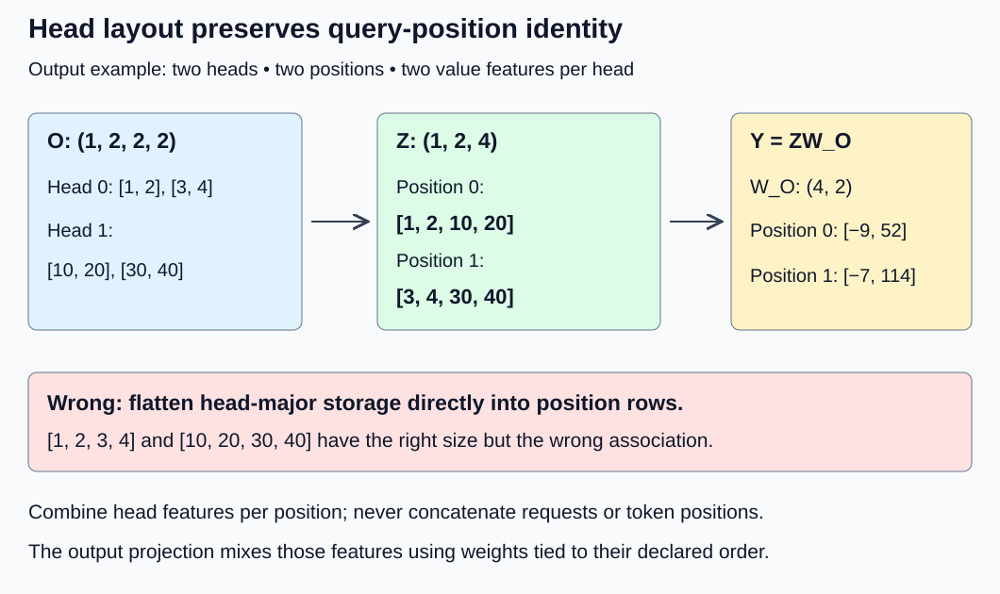
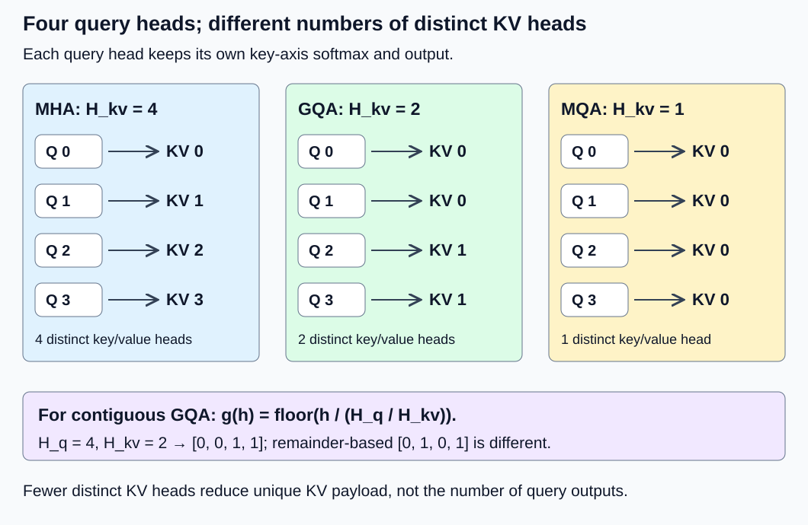

# M1-C12: Multi-head attention and its variants

> **Status: Complete — detailed chapter authored and documentation validated; experimental procedures are proposed unless explicitly labelled observed**

**Module:** Understand exactly what happens when an LLM generates a token

**Category:** [Model computation and semantics](index.md)

[Module 1 reading order](../module-1.md) · [Previous: M1-C11](../model-computation-and-semantics/m1-c11-causal-masking-and-positional-information.md) · [Next: M1-C13](../model-computation-and-semantics/m1-c13-building-a-complete-transformer-block.md)

## Target concepts

Splitting and combining heads, attention output projection, multi-head attention, multi-query attention, grouped-query attention, query-head versus KV-head counts.

## Concepts

### 1. Several attention heads do not form one larger softmax

[M1-C10](m1-c10-attention-one-dimension-at-a-time.md) described a head as an independent query–key comparison followed by weighted value aggregation. [M1-C11](m1-c11-causal-masking-and-positional-information.md) added valid-key eligibility and position handling. Now we put heads into an attention layer and distinguish three sharing arrangements.

Use B for independent requests, L for query positions, S for key/value positions, D for input model width, dₖ for each query/key feature width and dᵥ for each value width. **H_q is the query-head count; H_kv is the key/value-head count.** K and V have the same number of heads here. Heads are feature groups, not token positions, requests or CPU threads. Their mathematical independence does not guarantee simultaneous hardware execution.

For projected tensors, use Q shape (B, H_q, L, dₖ), K shape (B, H_kv, S, dₖ) and V shape (B, H_kv, S, dᵥ). Each query head obtains its **own** scores and softmax across eligible key positions, even when several query heads share K/V. The result O has shape (B, H_q, L, dᵥ). Sharing keys does not require identical queries or identical probabilities.

High-Frequency Trading (HFT) systems process market events under tight timing constraints. An engineering analogy is several analyses reading the same consistent event snapshot: common read-only inputs can reduce duplicated state without making the analyses identical. Learned attention is not an exchange matching rule or trading strategy, and this analogy supplies no profitability or market-latency claim.

### 2. Splitting heads requires an axis mapping

Learned projections start with input X of shape (B, L, D):

**Q_flat = XW_Q, with W_Q shape (D, H_q dₖ).**

For self-attention keys/values from the source representation X_source with shape (B, S, D), W_K has shape (D, H_kv dₖ) and W_V shape (D, H_kv dᵥ). Biases are omitted in these examples; a checkpoint that includes them needs its own affine reference. The projections select learned feature combinations, as in M1-C09. Splitting their output width merely assigns coordinates to heads:

**Q[b, h, i, r] = Q_flat[b, i, h dₖ + r].**

The conceptual shape change is (B, L, H_q dₖ) → (B, L, H_q, dₖ) → (B, H_q, L, dₖ). The final step exchanges sequence and head axes. A reshape alone need not perform that exchange. Memory strides and contiguity determine whether a physical copy is needed; these equalities specify coordinate meaning, not allocation behavior.

For B = 1, L = 2, H_q = 3 and dₖ = 2, let Q_flat's two position rows be [0, 1, 2, 3, 4, 5] and [10, 11, 12, 13, 14, 15]. The correct head slices are:

| Head | Query position 0 | Query position 1 |
|---|---|---|
| 0 | [0, 1] | [10, 11] |
| 1 | [2, 3] | [12, 13] |
| 2 | [4, 5] | [14, 15] |

A shape-compatible reinterpretation can mix these positions. Preserve (request, position, head, feature) labels and compare coordinates, not just element counts. Often architectures choose D = H_q dₖ; this is a configuration choice, not required by the projection formula. Always validate the actual widths and head counts.

### 3. Combine heads in declared order, then project

Once each head has an output, combine their **feature** coordinates at each query position. Define Z shape (B, L, H_q dᵥ):

**Z[b, i, h dᵥ + t] = O[b, h, i, t].**

This is concatenation in head order, not averaging heads or joining tokens along the sequence. A learned output projection mixes the concatenated features:

**Y = ZW_O, with W_O shape (H_q dᵥ, D_out), Y shape (B, L, D_out).**

D_out is output width. A model commonly chooses D_out = D; the arithmetic fixtures use D_out = 2 to keep every sum visible. The [original Transformer, Section 3.2.2](https://arxiv.org/html/1706.03762v7), describes head concatenation followed by this projection. Its details do not establish a universal checkpoint layout.

Consider two heads, two query positions and dᵥ = 2. Head 0 outputs [[1, 2], [3, 4]]; head 1 outputs [[10, 20], [30, 40]]. Correct Z rows are [1, 2, 10, 20] and [3, 4, 30, 40]. Use:

| Concatenated feature | W_O column 0 | W_O column 1 |
|---|---:|---:|
| 0 | 1 | 0 |
| 1 | 0 | 1 |
| 2 | 1 | 1 |
| 3 | −1 | 2 |

Thus Y rows are [−9, 52] and [−7, 114]. Flattening the head-major storage directly into two rows instead gives [1, 2, 3, 4] and [10, 20, 30, 40], producing [0, 13] and [0, 130]. Every dimension can look plausible while the result is wrong. Negative projected outputs are valid: the convex-combination bounds of each attention head do not apply after an arbitrary learned W_O.

*Splitting and combining preserve token-position identity. The output projection mixes head features at one position; it does not perform another softmax.*

### 4. MHA, MQA and GQA differ in key/value sharing

**Multi-head attention (MHA)** uses H_kv = H_q: each query head has its own key and value head. **Multi-query attention (MQA)** uses H_kv = 1: all query heads share one K head and one V head. The original [MQA paper](https://arxiv.org/abs/1911.02150) motivates this by reducing repeated key/value state and its movement during incremental decoding.

**Grouped-query attention (GQA)** uses an intermediate H_kv, grouping query heads that share one K/V head. The [GQA paper, Section 2.2](https://arxiv.org/html/2305.13245v3), includes MQA and MHA as endpoint cases. This chapter fixes a contiguous, equal-size grouping convention. Require positive counts and H_q divisible by H_kv. Let **gsize = H_q / H_kv** and **g(h) = floor(h / gsize)**. floor means round down to the nearest integer.

| Arrangement with H_q = 4 | H_kv | gsize | KV head used by query heads [0, 1, 2, 3] |
|---|---:|---:|---|
| MHA | 4 | 1 | [0, 1, 2, 3] |
| GQA | 2 | 2 | [0, 0, 1, 1] |
| MQA | 1 | 4 | [0, 0, 0, 0] |

For fixed request b, head h and query position i, the scores and output are:

**R[b, h, i, j] = dot(Q[b, h, i, :], K[b, g(h), j, :]) / √dₖ.**

**P[b, h, i, :] = softmax over allowed key positions j of R[b, h, i, :].**

**O[b, h, i, t] = Σ over allowed j of P[b, h, i, j] V[b, g(h), j, t].**

Each h has its own normalization. The score/probability tensors still have shape (B, H_q, L, S), and Z still has width H_q dᵥ. Do not replace H_q by H_kv in those dimensions. Likewise, the normalization factor uses dₖ, not H_q, H_kv or the whole model width. Causal/validity masks and rotary conventions remain compatible with each logical query/key position; sharing a KV head does not permit future or cross-request access.

For GQA with H_q = 4, H_kv = 2, L = 1, S = 2, dₖ = 4, dᵥ = 1, use these already supplied, unrotated vectors:

| Head/role | Query vector or two source rows |
|---|---|
| Query heads 0 and 2 | [2, 0, 0, 0] each |
| Query heads 1 and 3 | [0, 2, 0, 0] each |
| Both K heads, separately labelled | [[1, 0, 0, 0], [0, 1, 0, 0]] |
| V head 0 | [2, 4] |
| V head 1 | [10, 20] |

All keys are eligible for this isolated core; it can represent a newest query seeing two valid keys. No dropout, positional transform or learned input projection is implicitly added. Define τ = exp(1)/(exp(1) + 1) ≈ 0.7310585786 and υ = 1 − τ. Even query heads have scores [1, 0] and probabilities [τ, υ]; odd heads have scores [0, 1] and probabilities [υ, τ]. Sharing K/V does not collapse those distributions:

| Query head | KV head | Scalar output |
|---|---:|---|
| 0 | 0 | 4 − 2τ ≈ 2.5378828427 |
| 1 | 0 | 2 + 2τ ≈ 3.4621171573 |
| 2 | 1 | 20 − 10τ ≈ 12.6894142137 |
| 3 | 1 | 10 + 10τ ≈ 17.3105857863 |

Concatenate those four scalars in head order and apply the same 4-by-2 W_O above. The result is **Y = [14 − 22τ, 42 + 12τ] ≈ [−2.0832887299, 50.7727029436]**. These are synthetic arithmetic results, not trained representations or model quality evidence.

### 5. Equivalent expansion is different from changing an architecture

A mathematical reference can expand a compact GQA/MQA K/V tensor to H_q heads by repeating each KV head gsize times. Expanded heads [0, 1, 2, 3] in the two-group fixture refer to original KV heads [0, 0, 1, 1]. Ordinary per-head attention on that expansion must produce the same O and Y, within justified numerical allowances. This is a check on **evaluating one fixed sharing contract**. It does not require the production path to allocate duplicated state; a group-aware path may read compact storage directly.

Using h mod H_kv, the division remainder, instead of floor(h/gsize) would give [0, 1, 0, 1] in this fixture. That is a different grouping and must fail this reference. Repeating in the wrong order can silently move values between heads even when all shapes match. An output permutation can only preserve final meaning if the corresponding W_O feature rows and all head associations are transformed consistently; a changed concatenation order alone is not harmless.

Converting an arbitrary MHA checkpoint to fewer KV heads is a different operation. Its K/V projection weights can differ across heads, so selecting or averaging them changes the learned function. The [GQA paper, Section 2.1](https://arxiv.org/html/2305.13245v3), describes checkpoint conversion followed by additional training; its empirical results do not certify arbitrary weight collapse as lossless. In the toy fixture, replacing V head 1 with V head 0 changes heads 2/3 and Y. That is an intentional architecture/content change, not a valid speed optimization against the original outputs. Compare real architectures with their own checkpoints and quality references; this chapter does not train or convert one.

*Query-head count and output width stay fixed. Only the number of distinct KV heads changes in this comparison.*

### 6. Count unique state, work and lifetimes separately

Let qbytes be bytes per stored value. One layer's K/V payload for B requests and S stored positions is:

**KV_bytes = qbytes × B × S × H_kv × (dₖ + dᵥ).**

This counts keys and values once, excluding headers, padding capacity, allocation overhead and all other model state. If retained across generation steps, this payload is part of a KV cache; allocation/paging and full cache management are later chapters. At B = 1, S = 32, dₖ = 4, dᵥ = 1 and FP64 (64-bit floating point, 8 bytes per value):

| H_kv | Distinct K/V bytes | Explicit H_q = 4 expanded K/V bytes |
|---:|---:|---:|
| 4 | 5,120 | 5,120 |
| 2 | 2,560 | 5,120 |
| 1 | 1,280 | 5,120 |

A materialized expansion retained alongside compact inputs increases live storage: for H_kv = 2, 2,560 + 5,120 = 7,680 K/V bytes. A view or direct group-aware implementation has different allocation behavior. Unique parameter/state capacity is not measured DRAM traffic, and a fourfold payload reduction is not a fourfold latency guarantee.

Ignoring biases, projection parameters total **D H_q dₖ + D H_kv dₖ + D H_kv dᵥ + H_q dᵥ D_out**. Reducing H_kv reduces K/V projection parameters and stored K/V, while leaving query and output projections fixed at the declared widths. Attention's conventional two-product count remains **2BH_q LS(dₖ + dᵥ)** for direct per-query-head evaluation. At B = L = 1, H_q = 4, S = 32, dₖ = 4, dᵥ = 1 this is 1,280 operations for each sharing arrangement. W_O adds **2BL(H_q dᵥ)D_out = 16** conventional operations for D_out = 2. Scaling, softmax, expansion, allocation and copies are additional costs. These are mathematical operation counts, not actual instructions or measured bottlenecks.

Shared K/V must remain immutable until **all** query heads and any later users finish reading. Finishing head 0 does not authorize reclaiming a K/V head still used by head 1. Head outputs and concatenation buffers are request-owned; the output projection must wait for the required head results. A straggling head or resource contention can affect completion even if the average head is fast. Cancellation is not reader completion; worker loss requires discarding partial output and reconstructing compatible state. Record model/head mapping, positions, precision and raw/rotated-key conventions before permitting reuse. On incompatible state, reject reuse or recompute; do not silently reassign heads to reduce memory pressure.

## Experiments

All four experiments are **proposed, code-free designs**. E1–E3 support paper/calculator execution. E4 needs an existing inspectable harness capable of both explicit expansion and compact grouped evaluation; if that capability is unavailable, leave it unexecuted. Rust remains the eventual systems-language context; library sources describe contracts rather than prescribing an implementation language. No runtime, training or quality result is claimed.

### E1 — Trace split, concatenation and output projection

- **Description:** Follow labelled features into head slices, then combine labelled head outputs into query-position rows and project them.
- **Purpose/objective:** Test that splitting and combining preserve the intended position/head coordinate relationship rather than just tensor size.
- **Target concepts:** Splitting and combining heads, attention output projection, multi-head attention.
- **Baseline and workload:** The two-position, three-head Q_flat split example and the separate two-head, dᵥ = 2 output example with the displayed W_O.
- **Controls and prediction:** Preserve zero-based feature/head order and distinguish the two fixtures. Predict the six Q rows, correct Z rows and Y = [[−9, 52], [−7, 114]].
- **Procedure:** Label every source coordinate and reconstruct the split formula. For the output fixture, compare explicit per-position concatenation with the incorrect direct head-major flatten; the latter predicts [[0, 13], [0, 130]]. Permute heads and require a matching W_O row-block permutation to preserve Y. Reject incompatible W_O input width. Inspect a layout change separately from its mathematical equality; do not infer a no-copy view from a successful shape calculation.
- **Hardware/software:** Paper sufficient; an optional existing operator harness records strides/layout, dtype, actual copies and weight orientation.
- **Failure and HFT connection:** Wrong feature association resembles applying coefficients to the wrong event fields. Correct arithmetic on mislabelled fields does not establish correct service.
- **Exit criteria:** All split/concat coordinates and Y values match exactly for these integer fixtures; the wrong flatten and unchanged-W_O head permutation fail; a compatible joint permutation passes and invalid widths are rejected.

### E2 — Prove compact grouping against an expanded reference

- **Description:** Evaluate the four-query-head, two-KV-head toy calculation both through its explicit g(h) mapping and a repeated-head reference.
- **Purpose/objective:** Test equivalence for a fixed GQA contract while detecting wrong grouping and mistaken head normalization.
- **Target concepts:** Grouped-query attention, query-head versus KV-head counts, multi-query attention, attention output projection.
- **Baseline and workload:** The complete L = 1, S = 2, H_q = 4, H_kv = 2 fixture and its W_O. An endpoint extension uses H_kv = 1, repeating V head 0 for all query heads, with its own reference.
- **Controls and prediction:** Fixed queries, compact K/V, contiguous grouping, scale 1/2, key-axis softmax and no dropout. Predict the four τ-based outputs and Y above; expanded and compact calculations must agree.
- **Procedure:** Enumerate every g(h), score, probability and O. Expand K/V in [0, 0, 1, 1] order and compare each coordinate, then concatenate/project. Inject [0, 1, 0, 1] order and require failure. Check that heads 0 and 1 have different probabilities despite sharing K/V. In a separate perturbation, change only K head 1, source row 0, feature 0 from 1 to 2; heads 0/1 must stay unchanged and head 2 must change. This tests key-group selection even though the baseline K groups have equal numeric contents. Reject H_q = 4, H_kv = 3, unequal K/V head counts and a non-finite input. Carry causal/position validity from M1-C11 when extending beyond this all-eligible single query.
- **Hardware/software:** High-precision calculator sufficient; an optional existing FP64 harness must state supported head-count constraints and expansion behavior, not assume a particular backend supports compact GQA.
- **Failure and HFT connection:** Shared read-only state can serve distinct analyses only if each reader selects the right state group. Norms and dimensions alone cannot detect a wrong group.
- **Exit criteria:** Every group and stage matches V2, the wrong mapping fails, MQA endpoint outputs match their separate reference, and invalid configurations have explicit rejected outcomes.

### E3 — Separate architecture changes, payload savings and lifetime

- **Description:** Compare MHA/GQA/MQA state counts and deliberate collapse of distinct KV content, then trace shared-reader ownership.
- **Purpose/objective:** Falsify the assumptions that fewer KV heads preserve any checkpoint and reduce all attention work by the same factor.
- **Target concepts:** Multi-head attention, multi-query attention, grouped-query attention, query-head versus KV-head counts.
- **Baseline and workload:** H_q = 4 with H_kv in {4, 2, 1}; the B = 1, S = 32 FP64 byte ledger; toy GQA content before and after replacing its V head 1 with V head 0. Keep the original reference and changed-content reference separately labelled.
- **Controls and prediction:** Fix dₖ = 4, dᵥ = 1, L = 1 and W_O. Predict the displayed KV bytes, constant 1,280 attention operations, and changed Y after content collapse. An explicitly duplicated MHA representation of the same GQA content is equivalent, whereas arbitrary independent MHA heads need not be.
- **Procedure:** Derive parameter and unique-state formulas; count compact plus separately materialized expanded storage. Compare collapsed-content outputs to both original and newly specified references. Draw the last-reader event for each shared KV head and for concatenation/projection buffers. Mark early reuse after only one reader, cancellation with live readers, allocation failure and incomplete worker-loss output. On stale model/mapping/position identity, reject reuse or identify compatible reconstruction; do not claim a concurrent allocator was implemented.
- **Hardware/software:** Paper accounting and timelines suffice. Runtime extensions must separately record actual memory allocation/retention and completion events; capacity formulas are not physical traffic counters.
- **Failure and HFT connection:** A shared snapshot survives until all readers finish. Replacing distinct snapshots with one can change meaning even if it saves bytes; that engineering analogy makes no trading claim.
- **Exit criteria:** All counts reconcile, collapsed content fails the original output reference, equivalent duplication passes, and each lifecycle case states whether output can publish and storage can retire. Runtime safety and model quality remain untested.

### E4 — Benchmark compact versus explicitly expanded evaluation

- **Description:** Compare two evaluations of the same per-configuration sharing contract, including expansion, concatenation and output projection.
- **Purpose/objective:** Test whether avoiding materialized head duplication improves completed-path cost at the chosen shapes without changing results.
- **Target concepts:** All six assigned target concepts.
- **Baseline and workload:** B = L = 1, H_q = 4, H_kv in {1, 2, 4}, S in {2, 32}, dₖ = 4, dᵥ = 1, D_out = 2. Query h is [2, 0, 0, 0] for even h and [0, 2, 0, 0] for odd h. Every KV group uses key [1, 0, 0, 0] at even j and [0, 1, 0, 0] at odd j; V[g, j] = (2 + 8g)(1 + (j mod 2)). Use the displayed W_O, scale 1/2, FP64 and all keys eligible. The query is the newest position; no mask/rotary preparation is timed. These repeated features supply a reference, not natural-language statistics.
- **Controls and prediction:** Same inputs, per-configuration grouping and output reference across paths; one CPU thread, one job in flight, resident compact Q/K/V/W_O. The baseline allocates a distinct expanded K/V copy on every observation, including an identity copy at H_kv = 4 as a control. The compact path reads group-selected K/V without that extra materialization. Confirm this capability exists before running; automatic repetition inside an opaque “compact” operator must be measured and disclosed rather than assumed absent.
- **Procedure:** Check every stage/output against V4 before timing. In each of three fresh sessions, perform five untimed warmups per path/configuration and 30 paired completed-job measurements, alternating path order. Start before expansion/core allocation and end when Y is complete; include head combination/output projection in both. Separately time completed attention-only and output-combination/projection stages with ready inputs, recording allocations. Profile separate full runs for materialized copies, workspace, operator costs and observer overhead. Predict lower extra KV capacity for compact storage, not a guaranteed latency win or a head-count-proportional speedup.
- **Hardware/software:** CPU host with at least 1 GiB free RAM beyond runtime requirements and an existing FP64 harness exposing both paths. A library/API name alone does not establish backend support. Record specifications below; if unavailable, leave this study proposed.
- **Failure and HFT connection:** Test wrong grouping and stale weight/position manifests outside the timed valid population; record their detected failures/rejections. A single-in-flight operator study measures neither burst arrivals, cancellation recovery nor service p99 (99th-percentile latency); later load tests must count all admitted and terminal outcomes.
- **Exit criteria:** All six configurations pass correctness; each path/configuration retains 90 observations across three sessions and five warmups per session, paired differences, failure counts, actual expansion/allocation evidence and metadata. Null/noisy results are valid; silently changing H_kv or omitting W_O is not.

## Verification

### References, numerical budgets and Module 9 support

Apply [M9-C01](../numerics-and-correctness/m9-c01-defining-reference-behavior-and-evidence-before-optimizing.md) to coordinate/group references; [M9-C02](../measurement-experimentation-and-economics/m9-c02-request-events-clocks-and-measurement-boundaries.md) to completed timing; [M9-C11](../measurement-experimentation-and-economics/m9-c11-controlled-comparisons-warmup-and-reproducibility.md) to paired sessions; [M9-C15](../state-memory-and-caching/m9-c15-accounting-for-weights-kv-state-workspace-and-fragmentation.md) to unique/live storage; and [M9-C17](../numerics-and-correctness/m9-c17-comparing-logits-with-justified-numerical-tolerances.md) to error propagation and first divergence. M9-C01, M9-C02 and M9-C17 are complete; the other linked support chapters remain outlines; needed contracts are given locally. Module 8 and non-text modalities are excluded.

Require exact shapes, coordinate/head identities, positive counts, equal K/V head counts, H_q divisibility, compatible dₖ, K/V sequence lengths and output-projection width. Reject non-finite inputs or stale model/mapping/position manifests before accepted output. Any valid query must have at least one allowed key. Do not silently broadcast a request or use a head-sharing flag to repair a malformed model.

E1's integers require exact arithmetic equality. For E2/E4's synthetic FP64 calculations, independently evaluate τ and every reference at 80 and 120 decimal digits, requiring agreement to at least 50 digits. Predeclare absolute budgets **10⁻¹² per scaled score, probability coordinate and row sum; 10⁻⁸ per head output; 10⁻⁷ per final Y coordinate**. Require finite outputs and compare all coordinates, not just final totals. At S ≤ 32 and |V| ≤ 52, probability-coordinate error 10⁻¹² contributes at most **32 × 52 × 10⁻¹² = 1.664 × 10⁻⁹** to a head output, below its allowance. W_O's largest absolute column sum is 4, so head errors bounded by 10⁻⁸ contribute at most 4 × 10⁻⁸ to Y; the remainder allows projection rounding. These are explicit fixture budgets, not a guarantee for every library or checkpoint. Record measured maxima and first divergence, and investigate failures rather than widening limits automatically.

Printed ten-decimal values are approximations with up to 5 × 10⁻¹¹ display rounding; they are not oracle files. FP32/reduced-precision paths, different weights and real-model quality need separately justified budgets, following M1-C07. Expanding one fixed compact tensor is an equivalence check; comparing different H_kv architectures is not that same check.

### V1 — Verify E1 layout and projection

Compare all 12 split-feature coordinates, eight concatenated features and four Y coordinates against the explicit tables. Require wrong-flatten outputs [[0, 13], [0, 130]] to fail the original reference. A head permutation must carry the corresponding W_O row blocks; otherwise final output can change. Record whether each layout transformation is a view or a materialized copy in a runtime extension, without inferring it from mathematical shape. Exact paper traces have no timing uncertainty. Optional harness timing must state whether layout copies and projection allocation are included and end at completed Y; profiling may attribute those costs but this tiny fixture makes no runtime claim. Keep invalid-width and mismatch outcomes visible.

### V2 — Verify E2 head-sharing equivalence

The independent reference uses g(h) = [0, 0, 1, 1], the displayed τ/υ rows, four scalar O values and Y = [14 − 22τ, 42 + 12τ]. Compare that coordinate reference with ordinary per-head attention on explicitly expanded K/V. For the MQA endpoint using only V head 0, head outputs become [4 − 2τ, 2 + 2τ, 4 − 2τ, 2 + 2τ] and **Y = [6 − 6τ, 10 + 4τ]**. This is its own reference, not the original GQA's Y. The wrong remainder-based grouping changes head 1 and head 2; locate the first wrong group before inspecting softmax or projection. In the K-head perturbation, heads 0/1 stay fixed and head 2 changes to 20 − 10τ₂, where τ₂ = exp(2)/(exp(2) + 1); head 3 stays fixed because its query reads the unchanged second key feature. Check each head's key-axis probability sum, not a sum across heads.

Paper verification needs no profile or latency distribution. An optional existing harness must declare compact/expanded paths, actual grouping, backend/precision and whether expansion is timed; end timing at completed Y. Record unsupported backend capability as unexecuted, not a correctness pass. Retain all invalid-count/non-finite cases and no accepted outputs for rejected inputs.

### V3 — Verify E3 accounting, architecture boundary and ownership

Check the KV payloads 5,120/2,560/1,280 bytes, expanded 5,120 bytes and simultaneous GQA compact-plus-expanded 7,680 bytes. These are unique payload counts under distinct allocations, not process peaks. The attention operation count remains 1,280 because every query head still compares with S keys and aggregates a value vector. A compact KV reference cannot establish actual DRAM bytes, cache hits or runtime overlap.

Replacing toy V head 1 with head 0 yields the MQA-style output reference in V2 and fails the original GQA reference. Duplicating GQA content into four explicitly repeated MHA heads preserves that fixed computation; neither result proves an arbitrary MHA checkpoint can be collapsed. In timelines retain each shared K/V until its last reader, each O until concatenation/consumer completion, and Z until W_O finishes. Cancellation and worker loss cannot publish partial Y; allocation failure cannot justify stale-buffer output. Paper ownership reasoning is not a tested concurrency or recovery result. Runtime extensions need actual completion and allocation evidence, separate observer overhead and all failed/unfinished outcomes.

### V4 — Verify E4 full-path results and attribution

Both source lengths are even, so there are S/2 keys of each parity. Their repetition cancels in normalization. With c_g = 2 + 8g and g = g(h), the independent scalar head reference is:

**O[h] = c_g(2 − τ) for even h; O[h] = c_g(1 + τ) for odd h.**

Compute Y by the displayed W_O, then compare this closed reference with a separate per-key high-precision softmax/sum for every configuration. Require compact and expanded results to match their own per-configuration reference; do not compare different architectures as if their outputs must match. Require all output-head identities and W_O ordering, even when repeated numeric keys could hide an association error.

At S = 32, the baseline's extra expanded payload is 5,120 bytes for any H_kv; score/probability matrices each contain B H_q L S = 128 FP64 values, or 1,024 bytes. Q is 128 bytes, O is 32 bytes, a separately materialized Z is another 32 bytes, W_O is 64 bytes and Y is 16 bytes. A view of O used for Z is not another unique allocation. The 1,280 attention plus 16 output-projection conventional operations do not include expansion, scaling, softmax, copies or allocation. Record actual compact input, expanded copy and workspace peaks; a backend that secretly expands may have no claimed storage benefit. In the H_kv = 4 control the baseline copy is redundant by design; disclose it rather than presenting that comparison as a necessary MHA cost.

Report ns/job and **completed projected-input path positions/s = BL / completed job seconds**, counting one position per request, not H_q heads as H_q generated tokens. The boundary covers ready Q/K/V/W_O through expansion where applicable, attention, head combination and completed output projection. It excludes learned input projections, mask/rotary preparation, KV-cache management, tokenization, queues, sampling and consumer work. It is a declared projected-input layer path, not a full model or service benchmark.

Keep individual observations, session minimum/median/maximum, paired differences, failed/rejected/unfinished outcomes and three-session spread. If clock overhead dominates, choose a common block size using an untimed pilot and label observations as block averages; these cannot establish individual latency tails. Record clock resolution/empty-harness overhead and compare separate profiled/unprofiled runs for observer impact. Never manufacture full latency by summing isolated medians. Ninety single-in-flight observations per path/configuration cannot establish production p99 or loaded capacity. [PyTorch 2.14 benchmark utilities](https://docs.pytorch.org/docs/2.14/benchmark_utils.html) explain warmup, controlled threads and completion-aware timing for an existing compatible harness. No runtime study was executed here.

### Target-concept coverage

| Target concept | Explanation | Experiment and verification |
|---|---|---|
| Splitting and combining heads | Concepts 2–3: coordinate formulas and order | E1/V1 labelled split/concat and permutation |
| Attention output projection | Concept 3: ZW_O and learned feature mixing | E1/V1 exact Y; E2/V2 full output |
| Multi-head attention | Concepts 1 and 4: independent query heads, H_kv = H_q | E1/V1; E3/V3 equivalent duplication versus model change |
| Multi-query attention | Concept 4: H_kv = 1 | E2/V2 endpoint; E3/V3 payload and changed reference |
| Grouped-query attention | Concepts 4–5: contiguous groups and fixed-contract expansion | E2/V2 mapping; E4/V4 compact versus expanded |
| Query-head versus KV-head counts | Concepts 1, 4 and 6: output/work versus unique KV state | E3/V3 counts/lifetimes; E4/V4 operation and allocation evidence |

## Engineering dimensions and principles

### Six dimensions

| Dimension | Chapter-specific application |
|---|---|
| Semantics and invariants | E1/V1 binds concatenation order to W_O; E2/V2 binds query heads to the right K/V group and key-axis normalization. |
| Workload and variability | E4 changes S and H_kv independently with fixed H_q. Natural-language reuse, arrival bursts and non-text modalities are not represented by repeated toy keys. |
| Resources and bottlenecks | E3/V3 separates unique K/V bytes from expanded copies and query-head work. E4 profiles allocation, movement and projection rather than inferring speed from head counts. |
| Time and distributions | Head results precede concatenation/projection; a slow reader can extend shared-state lifetime. E4 reports completed full-path/session variation; loaded queues and service tails need later tests. |
| Ownership and coordination | Shared K/V survive all readers; O/Z/Y remain request-associated. E3 rejects early reuse, stale mapping and publication before completion. |
| Failure and adaptation | Reject incompatible counts, widths, snapshots and non-finite inputs. Cancellation/loss cannot produce valid partial Y; overload requires later admission and all-outcome accounting, not silent head collapse. |

### Eight practical principles

1. **Correctness defines the optimization boundary.** E2/E4 compare two evaluations of the same sharing contract. Collapsing arbitrary trained heads changes the model and needs new quality evidence.
2. **Performance depends on workload and operating point.** Compact sharing may reduce extra movement, but E4's tiny one-thread cases can be allocation-bound; different lengths/concurrency need new evidence.
3. **Data movement is part of the algorithm.** Layout transformations and expanded copies can erase a compact-storage advantage. V4 counts unique allocations and profiles actual copies.
4. **State has ownership, lifetime and recovery cost.** E3 retains shared K/V until all readers finish; incompatible model/head/position state requires compatible reconstruction.
5. **Dependencies determine latency; bottlenecks determine capacity.** Output projection waits on the required head results. Mathematical head independence alone cannot guarantee overlap or saturated capacity.
6. **Variability and synchronization shape the tail.** Uneven head execution, CPU scheduling and shared memory pressure can alter completion. E4's session spread does not certify service p99.
7. **Local improvements must be evaluated end to end.** Attention-only savings can be offset by duplication, combination or W_O. E4 includes those stages; full generation needs a wider boundary.
8. **Claims require reproducible evidence.** Grouping, weights, tensor identities, precision/budgets, actual backend support, hardware and all outcomes accompany comparisons. Proposed measurements remain distinct from checked arithmetic.

## Specifications, articles, and hardware

| Primary reference | Reading purpose |
|---|---|
| [Vaswani et al., Attention Is All You Need, Section 3.2.2](https://arxiv.org/html/1706.03762v7) | Separate head projections, concatenation and output projection. |
| [Shazeer, Fast Transformer Decoding: One Write-Head is All You Need](https://arxiv.org/abs/1911.02150) | Original MQA shared-key/value motivation; its measured outcomes are not measurements of these fixtures. |
| [Ainslie et al., GQA, Sections 2.1–2.2](https://arxiv.org/html/2305.13245v3) | Grouped sharing, endpoint cases and conversion plus additional training; do not infer arbitrary lossless checkpoint conversion. |
| [PyTorch 2.14 scaled-dot-product attention](https://docs.pytorch.org/docs/2.14/generated/torch.nn.functional.scaled_dot_product_attention.html) | Separate query/KV head shapes, divisibility/equal-KV-count constraints, dropout and backend limitations. Grouped support is backend-specific; this page does not establish a suitable compact CPU harness. |
| [PyTorch 2.14 benchmark utilities](https://docs.pytorch.org/docs/2.14/benchmark_utils.html) | Existing harness warmup, thread controls, replication and completed work. |

E1–E3 require no particular hardware. E4 requires a real condition record before any performance claim:

| Field | Required specifications |
|---|---|
| CPU/placement | Vendor/model, instruction set used, physical/logical cores, affinity, simultaneous multithreading and NUMA locality (processor-local memory region). |
| Memory/cache | Installed/available RAM, relevant cache sizes, memory speed/channels where known, observed allocation/retention peaks and copies. Leave unknown fields unknown. |
| Operating state | OS/kernel, frequency/power policy, temperature/throttling observations, background load and one-thread settings. |
| Runtime/model contract | Exact harness/library/backend versions and supported paths, FP64 mode, no dropout, head mapping/layout, W_O orientation, raw/rotated and position identity, allocator behavior and clock source/resolution. |
| Real-checkpoint extension | Tokenizer/template, checkpoint/configuration, H_q/H_kv/dₖ/dᵥ, positional conventions and task-quality reference. Each different architecture has its own reference. |
| Separate accelerator extension | Device model/memory, driver/runtime, interconnect, precision modes, backend eligibility, transfer/completion boundaries; no CPU proposal establishes GPU performance. |

The 1 GiB requirement is runtime headroom, not a tensor-allocation measurement. No runtime, model-quality, training, trading or deployment experiment was performed. Documentation source/arithmetic/rendering evidence is recorded in the [execution plan](../chapter-execution-plan.md).

## Key takeaways

- Split/concatenate by explicit position/head/feature coordinates; W_O must agree with the head order.
- MHA uses one KV head per query head, MQA one KV head total, and GQA one per query-head group. Query outputs and softmax rows still follow H_q.
- Compact grouping and correctly repeated K/V can evaluate the same function. Collapsing distinct trained heads generally changes that function.
- Count unique KV state separately from query-head arithmetic, materialized copies and complete layer cost.
- Preserve shared-reader lifetimes and validate per-head/full outputs before claiming memory or latency gains.
