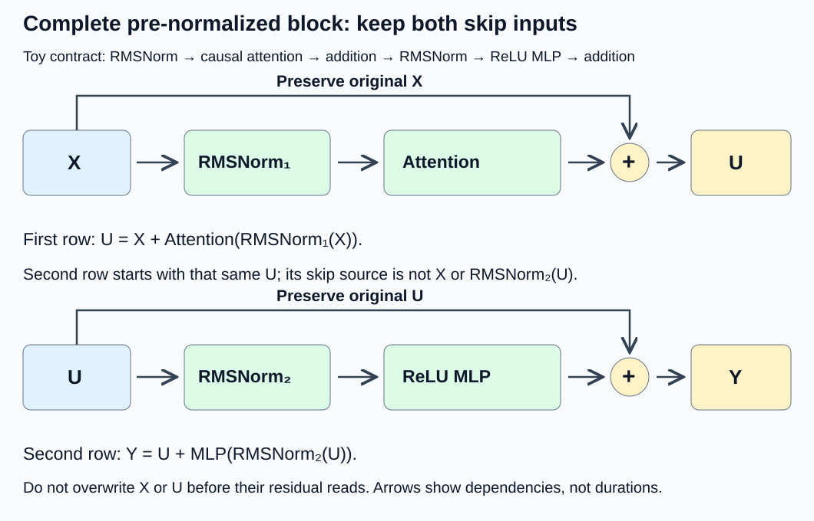
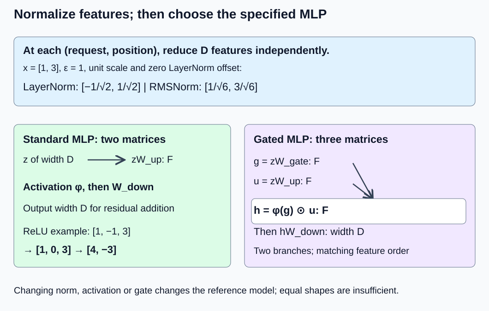

# M1-C13: Building a complete Transformer block

> **Status: Complete — detailed chapter authored and documentation validated; experimental procedures are proposed unless explicitly labelled observed**

**Module:** Understand exactly what happens when an LLM generates a token

**Category:** [Model computation and semantics](index.md)

[Module 1 reading order](../module-1.md) · [Previous: M1-C12](../model-computation-and-semantics/m1-c12-multi-head-attention-and-its-variants.md) · [Next: M1-C14](../model-computation-and-semantics/m1-c14-assembling-a-small-decoder-only-transformer.md)

## Target concepts

Residual connections, normalization, LayerNorm and RMSNorm, MLPs, activation functions, gated MLPs, operation ordering.

## Concepts

### 1. A block transforms features while preserving token positions

A **Transformer block** combines an attention sublayer, which exchanges information between eligible token positions, with a position-wise feed-forward sublayer. A **sublayer** is a named part of that computation. Its input and final output have shape (B, S, D): B requests, S supplied token positions, D features per position. Blocks can be stacked because their external widths agree. Embeddings, final model normalization and vocabulary logits are outside this block and belong to M1-C14.

A **residual connection** adds a sublayer's result back to an earlier representation: **r = x + F(x)**. The original x is the residual or skip path; F(x) is a learned update. Both must describe the same request, position and feature coordinates and have exactly matching shape in our contract. Elementwise addition is not concatenation. For x = [1, 3] and update [2, −1], r = [3, 2]. A zero update leaves x unchanged, but a real sublayer is not assumed to be zero or small.

**Normalization** rescales a feature vector using statistics of that vector and learned coefficients. It changes numerical representations; it does not check correctness, normalize attention probabilities or mix token positions. Its location relative to the residual addition is part of the architecture. In a **pre-normalized** block, the update reads a normalized input while the skip path retains the original representation. In a **post-normalized** block, normalization follows the addition. The [original Transformer, Sections 3.1 and 3.3](https://arxiv.org/html/1706.03762v7), uses post-normalization; [Xiong et al.](https://arxiv.org/html/2002.04745v2) explicitly study the placement distinction. Neither paper makes the two orders numerically interchangeable at inference.

High-Frequency Trading (HFT) systems process events under tight timing constraints. A useful engineering analogy is a sequence of feature transformations tied to one event snapshot: fast local arithmetic is valuable only when all stages preserve the declared data identity and dependencies. Residual neural features are not an order book, and this analogy supplies no trading strategy or profitability claim.

### 2. LayerNorm and RMSNorm normalize different quantities

For one position's vector x with D features, define **μ = (Σ over d of x[d])/D** and **v = (Σ over d of (x[d] − μ)²)/D**. μ is the mean; v is the population variance, using divisor D, not D − 1. With learned per-feature scale γ, optional learned offset β and a positive constant ε:

**LayerNorm(x)[d] = γ[d] × (x[d] − μ)/√(v + ε) + β[d].**

The reduction here is over the **last feature axis only**, separately for each (request, position). Reducing over batch or sequence would change this block's contract and could make one request or future position affect another. [PyTorch 2.14 LayerNorm](https://docs.pytorch.org/docs/2.14/generated/torch.nn.LayerNorm.html) specifies the normalized axes and divisor-D variance. Statistics are computed from the current input even in inference; evaluation mode does not freeze them to a training-time average.

**Root mean square normalization (RMSNorm)** instead uses the mean square of uncentered features:

**RMSNorm(x)[d] = γ[d] x[d]/√((Σ over r of x[r]²)/D + ε).**

r is another feature index. In this definition there is no mean subtraction and no β. RMS means the square root of the mean of squares, with the stabilizing ε included in the denominator above. The [RMSNorm paper](https://arxiv.org/abs/1910.07467) motivates this distinct normalization; the [PyTorch 2.14 contract](https://docs.pytorch.org/docs/2.14/generated/torch.nn.RMSNorm.html) defines its axes, scale and epsilon behavior. Set ε explicitly rather than relying on a library- or dtype-dependent default.

For readable arithmetic, use **ε = 1**, γ = [1, 1], β = [0, 0] in the following fixtures. This deliberately large epsilon is a teaching choice, not a recommended checkpoint value. A real model's epsilon, affine parameters, accumulation precision and placement must be recorded exactly.

| Input x | LayerNorm reference | RMSNorm reference |
|---|---|---|
| [1, 3] | [−1/√2, 1/√2] | [1/√6, 3/√6] |
| [2, 2] | [0, 0] | [2/√5, 2/√5] |
| [0, 0] | [0, 0] | [0, 0] |

For [1, 3], μ = 2 and v = 1, whereas mean square is 5. LayerNorm's normalized vector has mean zero but variance **1/2** here, not one, because ε is positive. RMSNorm's output has mean square **5/6**, not one. Learned γ/β can further change those statistics. Do not use “mean zero, variance one” as an unconditional acceptance test.

LayerNorm before its affine parameters is unchanged by adding a common scalar to every feature; both x and its mean shift together. RMSNorm generally changes under that shift. Positive rescaling is not exactly invariant when ε remains fixed. Placing ε outside the square root, replacing one norm by the other, changing γ/β, or using a different reduction axis changes the specified computation. Very large finite inputs can still overflow a low-precision sum of squares; ε prevents a zero denominator but does not repair overflow or NaN. Use the numerical reasoning from M1-C07 and compare intermediate statistics.

### 3. The MLP mixes features at each position

A **multilayer perceptron (MLP)** here is a position-wise sequence of learned projections with a nonlinear activation between them. It is also called the feed-forward network, or FFN. For row vector z of width D, hidden width F and output width D:

**MLP(z) = φ(zW_up + b_up)W_down + b_down.**

W_up has shape (D, F), W_down (F, D); biases have widths F and D. φ acts separately on each scalar. F is an intermediate **feature** width, not sequence length. The same weights are applied to each position; this sublayer does not itself combine positions. Without a nonlinear φ, two bias-free projections compose into one linear map. Adding more linear maps alone does not provide that nonlinearity.

An **activation function** is a specified scalar transformation. ReLU means rectified linear unit, SiLU sigmoid linear unit, and GELU Gaussian error linear unit. Common examples are:

| Activation | Formula and meaning | Values at [−1, 0, 1], approximately |
|---|---|---|
| ReLU | max(0, z), clipping negative values to zero | [0, 0, 1] |
| SiLU / Swish with coefficient 1 | z σ(z), where σ(z) = 1/(1 + exp(−z)) | [−0.2689414214, 0, 0.7310585786] |
| GELU | z Φ(z), where Φ is the standard normal cumulative probability up to z | [−0.1586552539, 0, 0.8413447461] |

exp is the exponential function. The standard normal distribution has mean zero and variance one. [PyTorch 2.14 GELU](https://docs.pytorch.org/docs/2.14/generated/torch.nn.GELU.html) distinguishes its normal-CDF definition from a tanh approximation, and [SiLU](https://docs.pytorch.org/docs/2.14/generated/torch.nn.SiLU.html) specifies its sigmoid product. Record the chosen function and approximation; neither swapping ReLU for SiLU nor choosing a different GELU approximation is an automatically equivalent optimization. A real checkpoint's reference determines whether a numerical approximation is acceptable.

For a small bias-free ReLU MLP, use:

| Input feature | W_up's three columns |
|---|---|
| 0 | [1, −1, 0] |
| 1 | [0, 0, 1] |

| Hidden feature | W_down's two columns |
|---|---|
| 0 | [1, 0] |
| 1 | [0, 1] |
| 2 | [1, −1] |

For z = [1, 3], the up-projection is [1, −1, 3], ReLU gives [1, 0, 3], and the down-projection gives [4, −3]. Removing ReLU would give [4, −4]. This counterexample distinguishes a nonlinear stage from two adjacent linear transformations.

### 4. A gated MLP has two input projections

A **gate** forms an elementwise product of two feature branches. GLU stands for gated linear unit. In a bias-free gated MLP:

**g = zW_gate; u = zW_up; h = φ(g) ⊙ u; output = hW_down.**

⊙ multiplies matching coordinates, not matrices. W_gate and W_up each have shape (D, F); W_down has shape (F, D). The gate and up weights need not be equal. A **SwiGLU** uses SiLU for φ; a **GEGLU** uses GELU. The [GLU variants paper, Section 2](https://arxiv.org/html/2002.05202v1) defines these branches and their variants. A gate is not an attention probability: SiLU can be negative, and the product need not be between zero and one.

For constructed projected branches g = [−1, 2] and u = [3, −4], SiLU(g) ⊙ u is approximately **[−0.8068242641, −7.0463766238]**. These are intermediate branch vectors, not outputs of the ReLU MLP above. Use the selected architecture's weights and activation rather than quietly adding or removing a branch.

At M = BS positions, a bias-free standard MLP has 2DF parameters and conventionally 4MDF multiplication/addition operations; a gated MLP of the same F has 3DF parameters and 6MDF operations, excluding nonlinearities and elementwise products. A roughly two-thirds gated hidden width can match the two-matrix parameter count, but that accounting equality does not preserve the learned function. Extra branches also affect live activation memory and bandwidth.

### 5. Fix the complete operation order

This chapter's complete reference block is **pre-normalized, RMSNorm, single-head causal self-attention, then an ungated ReLU MLP**, with all biases absent, dropout disabled and two separate learned norm scales. The mathematical stages are:

**N₁ = RMSNorm₁(X); A = Attention(N₁); U = X + A.**

**N₂ = RMSNorm₂(U); F_out = MLP(N₂); Y = U + F_out.**

Attention includes its Q/K/V projections, eligible-key softmax, weighted values and output projection as covered in M1-C10–C12. Both residual additions require width D. The second skip path is **U**, not the original X or normalized N₂. This is one deliberately specified block, not a universal architecture. Positional encoding is not added inside this toy block; X is a supplied feature tensor and causal eligibility uses explicit positions. A real model must supply its own positional treatment and mask contract.

For contrast, a post-normalized pattern is U_post = Norm₁(X + Attention(X)), followed by Y_post = Norm₂(U_post + MLP(U_post)). Moving normalization changes its inputs and the residual path. Even for a simple identity sublayer F(x) = x, pre-normalization gives x + Norm(x), whereas post-normalization gives Norm(2x). For x = [1, 3] with our RMSNorm, these are **[1 + 1/√6, 3 + 3/√6]** versus **[2/√21, 6/√21]**. They are plainly different. Reordering additions may also change floating-point rounding even when a real-number expression is equivalent; M1-C07 supplies that separate numerical boundary.

*Each skip path preserves its own earlier input. Norm placement, activation and gates are part of the model contract.*

### 6. Work through an entire one-position block

Set B = S = 1, D = 2, one attention head with dₖ = dᵥ = 2, and X = [1, 3]. Both RMSNorms use ε = 1 and γ = [1, 1]. W_Q, W_K, W_V and attention W_O are **four distinct 2-by-2 identity matrices**. The MLP is the displayed W_up/W_down with F = 3 and ReLU, no biases. The only query/key has logical position 0 and is eligible. No other tokens, padding, cache, dropout, positional transform or model state is implied.

Let **t = 1/√6**, **r = 1 + t**, and **a = r/√(5r² + 1)**. Every intermediate follows from the declared block:

| Stage | Reference | Approximate values |
|---|---|---|
| N₁, Q, K and V | [t, 3t] | [0.4082482905, 1.2247448714] |
| Scaled attention score | (t² + 9t²)/√2 = 5/(3√2) | 1.1785113020 |
| Attention probability | [1] | [1] |
| Weighted value and attention output A | [t, 3t] | [0.4082482905, 1.2247448714] |
| First residual U | [r, 3r] | [1.4082482905, 4.2247448714] |
| Second normalization N₂ | [a, 3a] | [0.4262369787, 1.2787109360] |
| MLP up-projection | [a, −a, 3a] | [0.4262369787, −0.4262369787, 1.2787109360] |
| ReLU | [a, 0, 3a] | [0.4262369787, 0, 1.2787109360] |
| MLP output F_out | [4a, −3a] | [1.7049479147, −1.2787109360] |
| Final residual Y | [r + 4a, 3r − 3a] | [3.1131962052, 2.9460339354] |

This one-key case makes attention's normalization trivial, so it cannot establish a general attention implementation's correctness. E4 extends the same block to four positions, where causal attention has nontrivial probability rows. The computed Y is a feature vector, not vocabulary logits or generated text.

### 7. The block has live state and a critical path

X must survive while its normalized copy drives attention because X is still needed for U. U must survive while N₂ drives the MLP because U is needed for Y. An in-place optimization that overwrites either skip input before its last read changes the result or creates an unsafe lifetime. Shared parameters remain immutable for the request; activations are request-owned. A view and its source share storage and cannot be counted or retired as independent copies.

The dependency is first norm → attention → first addition → second norm → MLP → final addition. Faster MLP arithmetic may not dominate total block latency. A small pointwise operation can be limited by allocation, data movement or operator dispatch, meaning the cost of submitting an operation, rather than its arithmetic count. Independent position-wise MLP rows may be batched without changing their mathematical function; attention cannot arbitrarily lose its eligible-key dependencies.

The toy block has 16 attention-projection values, 12 MLP values and 4 norm-scale values: **32 parameters**, or 256 bytes in FP64 (64-bit floating point, 8 bytes/value). Identity matrices are still counted as distinct dense parameter tensors in this baseline; a special identity shortcut would change the measured workload. Norm reductions/residuals require additional intermediate storage, described in V4. Cancellation is not reader completion; retain live buffers until all readers stop. Allocation failure or worker loss must discard incomplete output and reconstruct compatible request state rather than publish a partial Y. Later chapters measure concurrency, recovery and overload; the diagrams here establish their local ownership requirements only.

*Normalization reduces the feature axis independently at each position. Gated and standard MLPs are separate architecture choices.*

## Experiments

All four experiments are **proposed designs without implementation code**. E1–E3 can be performed with paper and a high-precision calculator. E4 requires an existing inspectable operator harness. Rust remains the eventual systems-language context; the library references specify behavior and do not require a Python implementation. Synthetic fixtures establish neither trained-model quality nor trading performance.

### E1 — Distinguish normalization contracts and order

- **Description:** Compare feature-axis LayerNorm/RMSNorm, epsilon placement and pre/post residual normalization.
- **Purpose/objective:** Falsify the assumptions that all norms are interchangeable, always produce unit variance, or can move across an addition unchanged.
- **Target concepts:** Residual connections, normalization, LayerNorm and RMSNorm, operation ordering.
- **Baseline and workload:** Inputs [1, 3], [2, 2], [0, 0], plus [1, 3] shifted by +7 or multiplied by 2. Use ε = 1, γ = [1, 1] and zero β where applicable; separate affine extension γ = [2, 1], β = [1, −1] for LayerNorm.
- **Controls and prediction:** Fix the last-feature reduction, divisor D and epsilon inside the square root. Predict the displayed table, LayerNorm shift invariance, lack of exact RMS rescaling invariance at fixed epsilon, and different pre/post outputs for the identity sublayer.
- **Procedure:** Compute μ, population variance, mean square, denominator and output coordinates separately. Apply the affine extension after normalization. Compare with deliberate divisor D − 1, epsilon outside the square root and statistics pooled across two labelled positions or requests. Check that a zero residual branch preserves x before any separately specified post-normalization. Reject nonpositive epsilon, zero feature width and non-finite input under this fixture policy.
- **Hardware/software:** High-precision calculator sufficient. An optional existing harness records normalized axes, epsilon, affine parameters, dtype/accumulation and library version.
- **Failure and HFT connection:** Mixing request statistics resembles contaminating one event's features with unrelated events. This tests numerical/data isolation, not market correctness.
- **Exit criteria:** All standalone references meet V1; wrong axes, estimator, epsilon placement and order are detected; affine behavior and explicit rejected outcomes are recorded.

### E2 — Trace activations, standard MLP and gating

- **Description:** Compare nonlinear scalar functions and the separate standard/gated MLP calculations.
- **Purpose/objective:** Test that a nonlinear activation and two-branch gate are actual specified operations rather than names that can be substituted freely.
- **Target concepts:** MLPs, activation functions, gated MLPs, operation ordering.
- **Baseline and workload:** Activation inputs [−1, 0, 1], the two-matrix ReLU MLP at [1, 3], and projected SwiGLU branches g = [−1, 2], u = [3, −4].
- **Controls and prediction:** Fix activation definitions, no biases, matrix orientation and gate/up roles. Predict ReLU MLP [4, −3], the no-activation alternative [4, −4] and the two displayed gated coordinates.
- **Procedure:** Evaluate each activation using its real-number definition. Check that applying SiLU to g then multiplying by u differs from applying SiLU after the product or to u instead. Inspect the standard MLP's three hidden features and final two outputs. Compare standard/gated parameter and operation formulas at the same D/F without treating equalized parameter budgets as equivalent models. Reject a gate/up shape mismatch. Treat GELU tanh approximation as a separately named numerical candidate requiring its own reference/budget, not an assumed exact identity.
- **Hardware/software:** Paper/high-precision exponential and normal-CDF evaluation sufficient; optional existing FP64 harness must expose exact activation mode and weight/branch identities.
- **Failure and HFT connection:** A fast substituted transform changes the input to subsequent decisions; a coefficient/branch identity record is as necessary as timing. No trading outcome is tested.
- **Exit criteria:** All activation/MLP/gate references meet V2, wrong branch/activation orders fail, counts reconcile and invalid shapes have explicit rejected outcomes.

### E3 — Reconstruct a full block and protect both skip paths

- **Description:** Follow the complete one-position block from X through every intermediate to Y and trace buffer readers.
- **Purpose/objective:** Test that locally plausible stages compose in the declared order with the correct residual sources.
- **Target concepts:** All assigned concepts, with gated MLPs checked as an alternative contract rather than inserted into this ReLU block.
- **Baseline and workload:** The fully specified B = S = 1, D = 2 reference in Concepts 6, with all parameters fixed and no dropout. Use the same finite inputs for every deliberate error.
- **Controls and prediction:** Predict the symbolic t/r/a stage table and final Y. Fix two separate norm scales, four identity attention matrices, the causal diagonal and the ReLU MLP weights.
- **Procedure:** Compare stage references in order: N₁, projections, score/probability, attention output, U, N₂, up-projection, activation, down-projection and Y. Deliberately add the last branch to X instead of U, omit ReLU, replace RMSNorm with LayerNorm and move a norm after addition; each is a different computation and must fail the original reference. Draw last-reader lifetimes for X and U and identify premature in-place reuse. Trace cancellation with live readers, stale weights/epsilon and worker loss before final addition: no partial Y may publish. Do not corrupt live production buffers to simulate a race.
- **Hardware/software:** Paper/high-precision arithmetic and ownership timeline suffice. An optional existing harness records actual aliases/allocations and completed reads separately from the conceptual trace.
- **Failure and HFT connection:** A complete result must preserve one compatible snapshot across the whole chain, not merely pass isolated stage checks. Timeline reasoning does not establish runtime race freedom.
- **Exit criteria:** Every stage and final output meet V3; deliberate source/order/norm/activation errors fail; parameter counts reconcile and every lifetime/failure case states publication and reclamation conditions.

### E4 — Compare position-wise MLP execution inside the full block

- **Description:** Benchmark the same complete block with its MLP evaluated one position at a time versus a batched set of feature rows.
- **Purpose/objective:** Test whether batching an independent position-wise sublayer improves completed block cost without changing causal attention or residual semantics.
- **Target concepts:** All assigned concepts; gated MLPs remain a separate unbenchmarked alternative unless separately specified with their own weights/reference.
- **Baseline and workload:** B in {1, 2}, S in {1, 4}, D = 2, F = 3, same complete block weights/epsilon as Concepts 6. Define X[b, i] = [1 + b + (i mod 2), 3 + b + (i mod 3)], where mod means remainder. All positions are valid; query/key positions are 0 … S − 1 in each request, with eligibility j ≤ i. No rotary/positional transform, dropout, cache or learned embedding is included.
- **Controls and prediction:** Existing CPU FP64 harness, one thread, one job in flight, resident X/weights/mask ready outside timing. Preserve dense identity projections, both norms/additions and the same attention path. Only MLP row grouping changes: per-position calls versus (BS, D) feature rows with reversible request/position labels. Include necessary packing/copies and allocation in full timing. Predict equal outputs; batching may reduce dispatch cost but tiny shapes may show no benefit.
- **Procedure:** Validate all stage/output coordinates before timing. In each of three fresh process sessions, run five untimed warmups per path/configuration then 30 paired completed-block observations, alternating path order. Start before N₁/allocation and end when Y is complete. Separately measure MLP-only with N₂ ready; profile full block runs for normalization, attention, residual additions, packing/copies, MLP and allocations. Compare separate profiled/unprofiled timings to assess observer impact, and never sum isolated medians to invent a full-block time.
- **Hardware/software:** CPU host with at least 1 GiB free RAM beyond runtime requirements and an existing harness exposing both MLP paths and stage outputs. If unavailable, leave E4 unexecuted; no implementation is requested.
- **Failure and HFT connection:** Test stale epsilon/weights, wrong residual source and incompatible packing outside the timed valid population; retain their reference failures or rejections. Future-value/input perturbation must not affect earlier valid causal outputs. This closed workload models neither market bursts nor loaded serving; later studies must count arrivals, cancellations and all terminal outcomes.
- **Exit criteria:** All four configurations pass V4; each path/configuration retains 90 observations across three sessions and five warmups per session, paired differences, failures and metadata. Explain whether full-block benefit survives packing/other stages, including null or noisy results. Changing normalization, activation or masks invalidates the comparison.

## Verification

### Reference contract and Module 9 support

Apply [M9-C01](../numerics-and-correctness/m9-c01-defining-reference-behavior-and-evidence-before-optimizing.md) to independent full/stage references; [M9-C02](../measurement-experimentation-and-economics/m9-c02-request-events-clocks-and-measurement-boundaries.md) to completed timing; [M9-C11](../measurement-experimentation-and-economics/m9-c11-controlled-comparisons-warmup-and-reproducibility.md) to paired sessions; [M9-C15](../state-memory-and-caching/m9-c15-accounting-for-weights-kv-state-workspace-and-fragmentation.md) to parameter/activation lifetimes; and [M9-C17](../numerics-and-correctness/m9-c17-comparing-logits-with-justified-numerical-tolerances.md) to first divergence and error budgets. M9-C01 and M9-C17 are complete; the other linked support chapters remain outlines; the needed introductory checks follow here. Modules 1–7 use this support; Module 8 and non-text modalities are excluded.

Shape, (request, position, feature) identity, weights, mask eligibility, normalization axis, epsilon and activation mode must match exactly. Require positive widths/lengths and epsilon, finite inputs/parameters and at least one eligible key per valid query. Residual additions require exact matching shapes, with no unintended broadcasting. An incompatible manifest must be rejected or assigned its own reference, never silently accepted as the same block.

Use exact fractions/integers where applicable and independent 80/120-decimal-digit square roots, exponentials and normal-CDF calculations otherwise, requiring agreement to at least 50 digits. Printed ten-decimal values have up to 5 × 10⁻¹¹ display rounding and are not oracle files. For standalone E1/E2 FP64 checks allow 10⁻¹¹ absolute error per coordinate/statistic. For E3/E4 use predeclared tiered absolute budgets:

| Stage | Allowance per coordinate |
|---|---:|
| N₁ and projected Q/K/V | 10⁻¹¹ |
| Finite scaled scores, probabilities and probability row sums | 10⁻¹⁰ |
| Weighted values, attention output A and residual U | 10⁻⁹ |
| N₂, MLP pre-activation and ReLU result | 10⁻⁸ |
| Down-projected F_out | 10⁻⁷ |
| Final residual Y | 10⁻⁶ |

These are fixture-specific engineering budgets, not guarantees for a library, low precision or a trained checkpoint. In E4, normalized value magnitudes are below 2 and S ≤ 4, so probability error 10⁻¹⁰ contributes at most 8 × 10⁻¹⁰ per weighted-value coordinate, before input/aggregation rounding. With ε = 1 and unit norm scales, RMSNorm's sensitivity to a small maximum-coordinate input error is bounded by a factor of 2 in this two-feature fixture. Thus a 10⁻⁹ error in U fits inside the 10⁻⁸ N₂ budget with margin. W_up has maximum absolute column sum 1, ReLU cannot enlarge an absolute scalar difference, and W_down has maximum absolute column sum 2. An N₂ error of 10⁻⁸ therefore contributes at most 2 × 10⁻⁸ to F_out, before rounding. Adding U's error still fits the final budget. Record all observed stage maxima and first divergence; a passing Y alone can hide cancelling mistakes.

Forbidden probabilities must be zero in a materialized exclusion reference. An opaque attention path must pass output and future-perturbation checks, with unobservable probability stages labelled unavailable. Do not claim they were inspected. New precisions, different epsilons/weights, gated alternatives or activation approximations require new propagation/quality budgets. A failed check prompts investigation rather than automatic tolerance widening.

### V1 — Verify E1 normalization and residual order

Use the Concepts 2 formulas and table, not a second library call. For [1, 3], verify μ = 2, v = 1 and mean square = 5; after unit affine LayerNorm the variance is 1/2. The affine extension gives [1 − √2, 1/√2 − 1]. Shifted LayerNorm must agree with the original, whereas shifted RMSNorm generally differs. RMSNorm(2[1, 3]) = [2/√21, 6/√21], distinct from RMSNorm([1, 3]). Pre-normalization with an identity update gives [1 + 1/√6, 3 + 3/√6]; post-normalization gives [2/√21, 6/√21]. Check each wrong-axis/estimator/epsilon case against its stated original reference. Separate expected rejection from numerical mismatch.

Paper references have no latency distribution. In an optional existing harness, record reduction/accumulation precision, exact normalized shape and current-input statistics in evaluation mode. Time completed normalization/addition with declared ready inputs/allocation; profiles may identify reduction/copy costs but cannot establish a full-block benefit. Repeating deterministic arithmetic does not supply a statistical confidence interval.

### V2 — Verify E2 activation and branch identity

Compare ReLU exactly for integer inputs and SiLU/GELU against independent high-precision definitions. Validate the selected exact or approximate GELU mode separately; the tanh expression is not an exact replacement for Φ. The standard MLP must yield [4, −3] with activation and [4, −4] without it. The gated reference is [−3/(1 + exp(1)), −8/(1 + exp(−2))]. Applying SiLU to the product or swapping its branch must differ from that reference. Parameter counts are 2DF versus 3DF at equal widths; direct projection counts are 4BSDF versus 6BSDF, excluding activations/gate products. Shape mismatch is a rejection, not a shorter valid output.

No runtime benchmark follows from these scalar traces. An optional harness must expose activation mode, branch values and completed outputs; declare whether projections/nonlinearities/packing are inside timing and profile the selected path without attributing a whole-block improvement to a faster activation alone. Retain all deliberate errors and unsupported modes explicitly.

### V3 — Verify E3 complete composition and lifetime

Require every symbolic and numeric stage in Concepts 6, including the single-key probability one and the correct final residual source U. First divergence locates which stage changed: replacing the final U with X, for example, loses exactly the earlier attention contribution [t, 3t] from Y when all other stages stay fixed. The one-position score check is arithmetic evidence, but the probability-one case alone cannot verify general attention. The 32 distinct dense parameters occupy 256 FP64 bytes, with no bias or optimizer-state bytes included.

Trace X until the first residual read, U until the final residual read, and intermediates until their last consuming operation. Do not count a view as independent storage. Retain compatible parameters until all readers finish; cancellation or worker loss cannot justify publishing a partially updated Y. Paper traces establish no race-free implementation or measured recovery. Runtime extensions require actual alias/last-reader/completion observations and separately declared profile overhead; failures/rejections/unfinished work remain separate from successful results.

### V4 — Verify E4 full-block equivalence and performance evidence

For every (B, S), independently evaluate feature-axis RMSNorm, dense identity Q/K/V projections, scaled causal attention, identity W_O, the first addition, second RMSNorm, the explicit ReLU MLP and final addition. Compare every stage against the reference, then compare per-position versus packed/batched MLP paths after restoring labels. Row independence applies to the MLP, not to the preceding attention computation. Change the last input position and require earlier positions to remain unchanged. For B = 2, perturb only request 1 and require request 0 to remain unchanged; global normalization would violate this isolation.

A deliberately fully retained reference ledger makes the materialization boundary visible. Let M = BS, with distinct FP64 arrays and raw scores scaled into their score storage:

| Logical objects | Bytes |
|---|---:|
| X, N₁, U, N₂, F_out, Y: six (B, S, 2) arrays | 96M |
| Q, K, V, weighted values T, attention output A: five more (B, S, 2) arrays | 80M |
| MLP pre-activation and activation: two (B, S, 3) arrays | 48M |
| Scaled scores and probabilities: two (B, 1, S, S) arrays | 16BS² |
| Parameters | 256 |
| One-byte-per-entry causal eligibility | BS² |

Here T names the weighted-value tensor before the attention output projection; this fixture has one head. At B = 2, S = 4, M = 8, the 13 feature arrays plus two score/probability arrays total **2,304 bytes**; parameters add 256 and the declared Boolean mask adds 32, giving **2,592 bytes**. This is a fully retained logical ledger for inspection, not a required runtime peak. Aliasing, freed intermediates, norm statistics, workspace, headers, allocator retention, packing copies and any additional raw-score storage change observed memory and must be recorded separately.

Four dense 2-by-2 attention projections conventionally cost 32BS operations; the two attention products cost 8BS²; the MLP projections cost 24BS. Total **B(56S + 8S²)** excludes normalization, ReLU, residual additions, softmax, mask application and copies. At S = 1 this is 64B; at S = 4 it is 352B, unchanged by MLP row grouping. Actual instruction counts and CPU time can differ. Do not optimize away identity matrices in only one path or infer DRAM traffic from these logical bytes. Use documented copy/allocation/operator/counter evidence before identifying a bandwidth bottleneck; unavailable counters limit attribution.

The full boundary is resident X/weights/mask through N₁, attention, both residual additions, N₂, MLP and completed Y, including packing/copies/allocation. It excludes embeddings, positional/mask preparation, KV-cache management, vocabulary projection, sampling, networking, queues and consumers. Report ns/block job and **completed supplied positions/s = BS / completed job seconds**, not full-model tokens/s. MLP-only measurements begin with N₂ ready and cannot replace the full-block comparison.

Retain all observations, per-session minimum/median/maximum, paired differences, failed/rejected/unfinished outcomes and three-session spread. If clock overhead dominates, use an untimed pilot to choose a common block of repetitions and label measurements as block averages, which cannot establish individual-job tails. Record clock source/resolution and empty-harness overhead without blindly subtracting it. Compare separate profiled and unprofiled runs for observer impact; never sum isolated medians into a fabricated full time. Ninety single-in-flight observations per path/configuration do not establish service p99 (99th-percentile latency), loaded capacity or performance under bursts. [PyTorch 2.14 benchmark utilities](https://docs.pytorch.org/docs/2.14/benchmark_utils.html) describe warmup, replication and thread/completion controls for an existing compatible harness. No runtime experiment has been performed here.

### Target-concept coverage

| Assigned concept | Explanation | Experiment and verification |
|---|---|---|
| Residual connections | Concepts 1 and 5–7: matching coordinates, two skip sources and lifetimes | E1/V1 identity update; E3/V3 wrong source; E4/V4 full output |
| Normalization | Concept 2: feature-only reductions, epsilon and scale | E1/V1 axes/statistics; E4/V4 request/future isolation |
| LayerNorm and RMSNorm | Concept 2: centered versus uncentered formulas and affine parameters | E1/V1 independent references and rejected substitutions |
| MLPs | Concept 3: up/activation/down, feature width versus positions | E2/V2 matrices; E4/V4 row grouping |
| Activation functions | Concept 3: ReLU/SiLU/GELU definitions and modes | E2/V2 scalar and omitted-activation checks |
| Gated MLPs | Concept 4: independent gate/up branches, product and down map | E2/V2 branch/order/count checks; separate architecture boundary |
| Operation ordering | Concepts 5–7: pre/post order and complete stage ledger | E1/V1 norm placement; E3/V3 first divergence/lifetimes |

## Engineering dimensions and principles

### Six dimensions

| Dimension | Application and evidence |
|---|---|
| Semantics and invariants | E1 distinguishes norm definitions/axes; E3 fixes both residual sources and the chosen activation/order. Passing shapes alone cannot validate the block. |
| Workload and variability | E4 varies B/S and MLP row grouping; only the pointwise MLP is position-independent. Real request-length/arrival skew and non-text modalities are outside this synthetic study. |
| Resources and bottlenecks | Gating changes projection/activation capacity; E4/V4 separates dense work, logical/live bytes, copies, dispatch and measured counters. |
| Time and distributions | Norms, attention, additions and MLP form a critical path. Full-block paired distributions and session spread matter more than one isolated operator's minimum. |
| Ownership and coordination | X and U must survive their branch computations for later additions. E3 records last readers, aliases and shared parameter lifetime. |
| Failure and adaptation | Reject non-finite/incompatible manifests and residual broadcasting. Cancellation/allocation failure/loss cannot publish partial Y; recovery/load policies require later measured studies. |

### Eight practical principles

1. **Correctness defines the optimization boundary.** Batching the same position-wise MLP can preserve behavior; replacing norms, gates, activations or residual sources changes the model contract and needs new evidence.
2. **Performance depends on workload and operating point.** E4's four tiny CPU shapes may be dispatch/allocation-bound. A batching benefit cannot be extrapolated to long prompts or high concurrency.
3. **Data movement is part of the algorithm.** Residuals retain inputs, norms read/reduce/write features, and gated branches add intermediates. V4 inspects copies and actual allocations alongside operation counts.
4. **State has ownership, lifetime and recovery cost.** E3 preserves X/U through their last reads; stale weights/epsilon require compatible reconstruction, not opportunistic buffer reuse.
5. **Dependencies determine latency; bottlenecks determine capacity.** The second norm needs U, and final addition needs both U and F_out. E4 measures completed block time without claiming loaded serving capacity.
6. **Variability and synchronization shape the tail.** Packing, CPU activity, allocator state and shared resources can change timings. Session spread and observer checks help; closed small samples cannot certify p99.
7. **Local improvements must be evaluated end to end.** Faster MLP calls can be offset by packing or unchanged attention/norm costs. V4 requires the whole block; a service claim needs the wider model/request boundary.
8. **Claims require reproducible evidence.** Exact weights, normalization/activation conventions, positions, reference precision, budgets, hardware and every outcome accompany E1–E4. Arithmetic checks remain distinct from runtime or model-quality results.

## Specifications, articles, and hardware

| Primary source | Reading purpose |
|---|---|
| [Vaswani et al., Attention Is All You Need, Sections 3.1/3.3](https://arxiv.org/html/1706.03762v7) | Original residual/post-normalization and position-wise feed-forward structure. |
| [Xiong et al., On Layer Normalization in the Transformer Architecture](https://arxiv.org/html/2002.04745v2) | Pre/post placement as an architecture distinction; training findings are not inference measurements for this fixture. |
| [Zhang and Sennrich, Root Mean Square Layer Normalization](https://arxiv.org/abs/1910.07467) | Motivation for uncentered RMS normalization rather than an interchangeable LayerNorm alias. |
| [PyTorch 2.14 LayerNorm](https://docs.pytorch.org/docs/2.14/generated/torch.nn.LayerNorm.html) and [RMSNorm](https://docs.pytorch.org/docs/2.14/generated/torch.nn.RMSNorm.html) | Axis, variance, affine and epsilon contracts; the fixture passes epsilon explicitly. |
| [PyTorch 2.14 GELU](https://docs.pytorch.org/docs/2.14/generated/torch.nn.GELU.html) and [SiLU](https://docs.pytorch.org/docs/2.14/generated/torch.nn.SiLU.html) | Scalar definitions and GELU approximation mode. |
| [Shazeer, GLU Variants Improve Transformer, Section 2](https://arxiv.org/html/2002.05202v1) | Two-branch activation/product variants and three-matrix versus two-matrix accounting. |
| [PyTorch 2.14 benchmark utilities](https://docs.pytorch.org/docs/2.14/benchmark_utils.html) | Existing warmup, thread controls, replication and completed-work timing. |

E1–E3 require paper/high-precision arithmetic rather than particular hardware. Before E4, record the actual conditions:

| Field | Required specifications |
|---|---|
| CPU/placement | Vendor/model, instruction set used, physical/logical cores, affinity, simultaneous multithreading and NUMA locality (processor-local memory region). |
| Memory/cache | Installed/available RAM, cache sizes, memory speed/channels where known, actual allocation/retention and packing/copy observations; leave unknowns explicit. |
| Operating state | OS/kernel, frequency/power policy, temperature/throttling observations, background activity and one-thread settings. |
| Runtime/math | Exact harness/library/backend versions, FP64 and reduction precision, explicit epsilons/axes/scales, ReLU or separately named activation mode, layouts/aliases, clock source/resolution and observed instrumentation overhead. |
| Model extension | Exact checkpoint/tokenizer/template, block order, attention/position/mask conventions, norm type/epsilon/affine parameters, MLP widths/gates/activation/biases and quality reference. Do not infer these from this toy block. |
| Separate accelerator extension | Device/memory, driver/runtime, link, precision modes and transfer/device-completion boundaries; CPU proposals do not establish GPU behavior. |

The 1 GiB requirement is runtime headroom, not an observed tensor allocation. No runtime, model-quality, training, trading or deployment study has been executed. Source/arithmetic/rendering evidence is recorded in the [execution plan](../chapter-execution-plan.md).

## Key takeaways

- A block's residual sources, norm placement, activation and gates define its computation; they are not freely interchangeable optimizations.
- LayerNorm centers features; RMSNorm does not. Declare axes, epsilon and learned affine parameters, and test the actual formula.
- An MLP transforms features independently per position; a gated MLP has an extra learned branch and product.
- Trace the complete block's intermediate values and last readers before changing memory reuse or execution grouping.
- Validate the complete output, then measure the full declared block boundary. Arithmetic counts and isolated MLP timings cannot establish production latency or quality.
