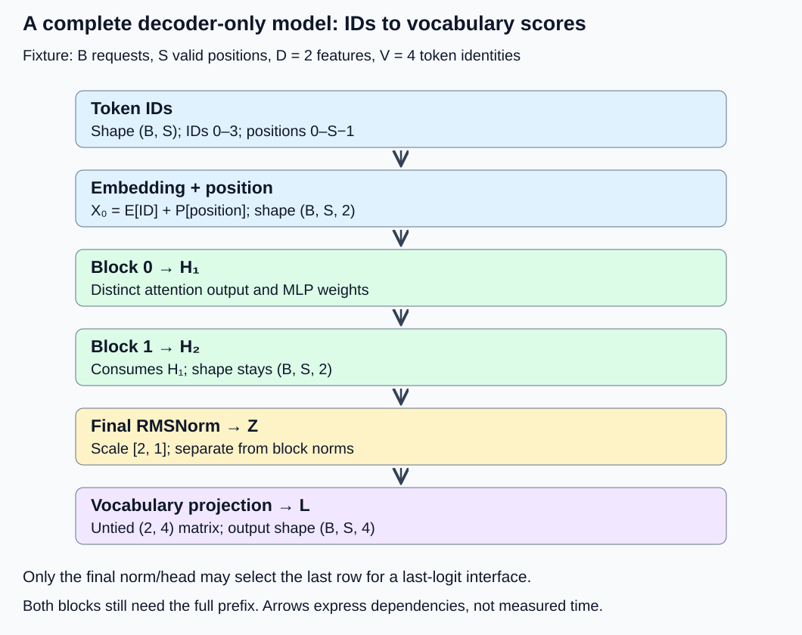
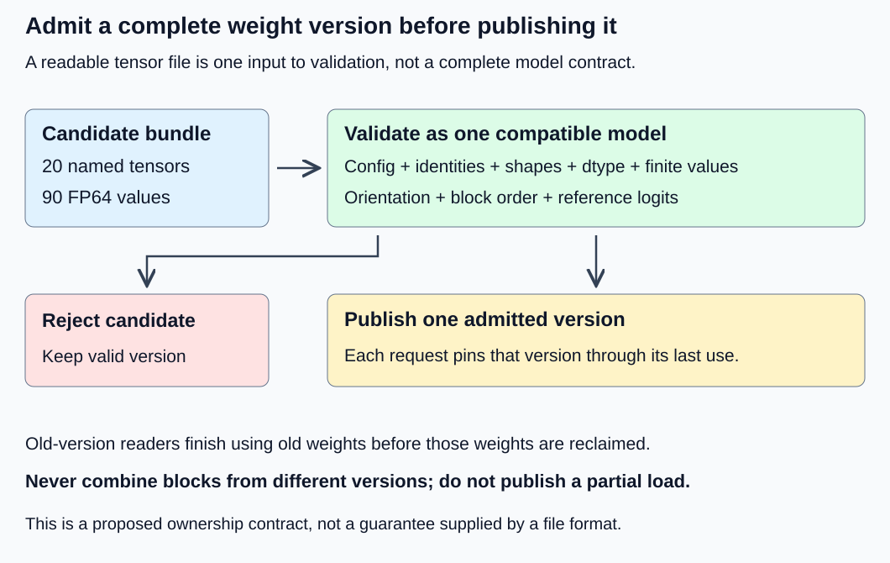

# M1-C14: Assembling a small decoder-only Transformer

> **Status: Complete — detailed chapter authored and documentation validated; experimental procedures are proposed unless explicitly labelled observed**

**Module:** Understand exactly what happens when an LLM generates a token

**Category:** [Model computation and semantics](index.md)

[Module 1 reading order](../module-1.md) · [Previous: M1-C13](../model-computation-and-semantics/m1-c13-building-a-complete-transformer-block.md) · [Next: M1-C15](../model-computation-and-semantics/m1-c15-turning-logits-into-the-next-token.md)

## Target concepts

Model configuration, stacked blocks, final normalization, vocabulary projection, logits, fixed weights, loading weights, inference versus training.

## Concepts

### From a block to a model

A Transformer block transforms a sequence of feature vectors into another sequence of the same width. A complete decoder-only model surrounds an **ordered stack** of these blocks with an input representation and an output vocabulary projection. Decoder-only means that each position can use its own token and earlier tokens in the same request; this model has no encoder and no cross-attention to an encoder's output.

The path is token IDs → token and position embeddings → block 0 → block 1 → final normalization → vocabulary logits. A **logit** is a real-valued score for one vocabulary entry, before a probability normalization or token-selection rule. Negative logits are legal. Producing logits is a forward pass; choosing a token and repeatedly extending a sequence belongs to [M1-C15](m1-c15-turning-logits-into-the-next-token.md), which is now complete.

The input has shape (B, S): B independent requests, each containing S token IDs. Hidden states have shape (B, S, D), where D is the feature width. The final scores have shape (B, S, V), where V is the vocabulary size. Block count changes the depth of the dependent computation; vocabulary size changes the number of output scores. Neither is the number of requests.

*Both blocks preserve the hidden-state shape. Their order and weight identities matter even when their shapes match. Final normalization is a separate operation after the stack.*

### A complete, deliberately small specification

This chapter defines a synthetic mathematical model, not a pretrained language model or a downloadable checkpoint. A **checkpoint** is a saved collection of model parameter values and associated identity information. Every parameter here is specified below, so the reference does not depend on random initialization. The tiny vocabulary labels have no natural-language meanings.

| Configuration item | Exact chapter contract |
|---|---|
| Vocabulary and valid IDs | V = 4; integers 0, 1, 2, 3; ID 0 is a valid ordinary token |
| Sequence and position bounds | 1 ≤ S ≤ 4; position at row i is i, starting at 0; no padding |
| Width, blocks, heads | D = 2; two distinct blocks in order 0 then 1; one query/key/value head per block; head width 2 |
| MLP | Intermediate width F = 3; ReLU activation; no gate or bias |
| Normalization | Pre-RMSNorm before attention and MLP; separate final RMSNorm; ε = 1 everywhere |
| Attention | Causal within each request, scaled by √2; no attention dropout |
| Positions | Absolute position table added once at the input; no rotary transformation |
| Output | Untied, bias-free vocabulary projection; raw logits, without sampling |
| Arithmetic and state | FP64 reference; fixed weights; no dropout, cache, gradient updates or optimizer |

The large ε is chosen for transparent arithmetic, not recommended as a production default. “Untied” means the output projection is its own parameter tensor rather than an alias of the token table. Architectures differ: replacing these choices with a familiar model's defaults would change this reference.

Token embedding E and absolute position table P have four rows of two features each:

| Row | E[row] | P[row] |
|---|---|---|
| 0 | [0, 0] | [0, 0] |
| 1 | [1, 3] | [1, 0] |
| 2 | [2, 1] | [0, 1] |
| 3 | [−1, 2] | [−1, 0] |

For request b and position i, **X₀[b, i] = E[ID[b, i]] + P[i]**. Lookup selects a row; it does not multiply the numeric token ID by the table. The position table plays the role of a learned absolute embedding, but these particular values were constructed by hand. They are frozen during inference. Sequence lengths of zero or five, and IDs outside 0–3, are rejected before lookup.

### Specify each block, then compose in order

For a row vector x with D = 2, define RMSNorm with scale γ by:

**R(x; γ) = γ ⊙ x / √((x₀² + x₁²)/2 + 1).**

The symbol ⊙ means feature-by-feature multiplication. Normalization reduces features within a position; it never pools requests or positions. Each block has two independent scale vectors, both [1, 1]. The final scale is different: [2, 1].

For either block, let N = R(X; [1, 1]). Q, K and V are projections of N, all using the 2 × 2 identity matrix in this fixture. At position i, attention uses only j ≤ i in the same request:

**sᵢⱼ = (Nᵢ · Nⱼ)/√2; aᵢⱼ = exp(sᵢⱼ − mᵢ) / Σₖ₌₀ⁱ exp(sᵢₖ − mᵢ), where mᵢ = max₀≤ₖ≤ᵢ sᵢₖ.**

For j > i, aᵢⱼ = 0 exactly; those positions are excluded from the denominator. The attention result before its output projection is Tᵢ = Σⱼ₌₀ⁱ aᵢⱼ Nⱼ. Subtracting mᵢ preserves the softmax mathematically while avoiding unnecessary exponential growth.

The rest of block ℓ is:

**U = X + T W_O,ℓ.**

**G = R(U; [1, 1]); M = ReLU(G W_up); Blockℓ(X) = U + M W_down,ℓ.**

ReLU replaces each negative feature with zero. All products use row vectors on the left and the stored matrix on the right. The matrices are:

| Parameter | Block 0 | Block 1 |
|---|---|---|
| W_Q, W_K, W_V | Each [[1, 0], [0, 1]] | Each [[1, 0], [0, 1]] |
| W_O | [[1, 0], [0, 1]] | [[1/2, 0], [0, 1/2]] |
| W_up, shape (2, 3) | [[1, −1, 0], [0, 0, 1]] | [[1, −1, 0], [0, 0, 1]] |
| W_down, shape (3, 2) | [[1, 0], [0, 1], [1, −1]] | [[0, 1], [1, 0], [−1, 1]] |
| First and second norm scales | Two separate [1, 1] vectors | Two separate [1, 1] vectors |

Identical contents do not imply shared parameter ownership: each block owns its named tensors. The two different output/down matrices make accidental block reversal or reuse observable. Preserve each residual source until its addition, as explained in [M1-C13](m1-c13-building-a-complete-transformer-block.md).

The full model is **H₁ = Block₀(X₀); H₂ = Block₁(H₁); Z = R(H₂; [2, 1]); L = Z W_vocab**. These are mathematical definitions, not implementation instructions. Blocks depend on the preceding block's output. Adding their independent outputs, feeding both the original embedding, or using block 0 twice computes another model.

The output matrix has shape (D, V) = (2, 4):

**W_vocab = [[1, 0, 1, −1], [0, 1, 1, 1]].**

Consequently, a final normalized row [z₀, z₁] produces **[z₀, z₁, z₀ + z₁, −z₀ + z₁]**. These columns correspond to IDs 0, 1, 2, 3 in that order. This matrix is not E transposed. A checkpoint specification must state whether weights are tied and how matrices are oriented; equal element counts do not establish equivalence.

### A complete one-token trace

Take B = S = 1, token ID 1 at position 0. There is only one permitted attention key in each block, so each attention probability is 1. The attention projection and MLP still operate; attention does not become the identity on the unnormalized input.

| Boundary | Shape | Reference row, rounded to 10 decimal places |
|---|---|---|
| Embedding plus position X₀ | (1, 1, 2) | [1, 3] |
| Block 0 output H₁ | (1, 1, 2) | [3.1131962052, 2.9460339354] |
| Block 1 output H₂ | (1, 1, 2) | [2.6661773248, 5.3301280768] |
| Final normalized Z | (1, 1, 2) | [1.2311465324, 1.2306324560] |
| Vocabulary logits L | (1, 1, 4) | [1.2311465324, 1.2306324560, 2.4617789884, −0.0005140763] |

The nearly zero fourth logit is a subtraction of two nearby values; relative error alone is unsuitable there. The negative value is a score, not an invalid probability. Reversing the two blocks instead gives a hidden state approximately [1.3158480579, 5.2862116280], so matching shapes is insufficient.

At input position i, the output scores refer to the token **after** that position. Training commonly compares that row with a label shifted one token forward. Given a whole known prefix, its positions can be processed together with causal masking. Generating an unknown next token still depends on the previous selection. Reading every position's logits is useful for a full trace; obtaining only the last position's logits can be sufficient for a next-token interface. Neither operation alone is text generation.

### Fixed weights and a trustworthy load boundary

Loading restores a specified parameter collection into a compatible architecture. It is not training, and successful parsing does not establish compatibility. The proposed manifest below is a list of expected tensor names, shapes and identities. The chapter supplies their mathematical values; it does **not** supply a serialized weight file or claim to have run a loader.

| Named tensors | Number | Values in each | Total values |
|---|---:|---:|---:|
| token_embedding, position_embedding | 2 | 4 × 2 = 8 | 16 |
| blocks.ℓ.attn.q, .k, .v, .out, for ℓ = 0, 1 | 8 | 2 × 2 = 4 | 32 |
| blocks.ℓ.norm1.scale, .norm2.scale | 4 | 2 | 8 |
| blocks.ℓ.mlp.up, .down | 4 | 6 | 24 |
| final_norm.scale | 1 | 2 | 2 |
| vocab_projection | 1 | 2 × 4 = 8 | 8 |
| **Total** | **20** | | **90** |

Dense FP64 parameter payload is **90 × 8 = 720 bytes**. This excludes headers, configuration, tensor objects, allocator rounding, temporary load copies and runtime activations. It is not a process-memory measurement. The abbreviated block names expand into separate complete names for each index; the identity matrices also occupy separate tensors in this reference.

Before publication, bind the weights to the exact architecture, all 20 names/shapes, dtype, matrix orientation, block order, scale/epsilon rules, position policy, vocabulary-column mapping and untied ownership policy. Use the tables as the expected toy values. For an actual bundle, additionally record file/tensor digests and the exact configuration and tokenizer artifacts; no digest is invented here. A digest checks against a recorded byte identity, not whether that identity describes a useful language model.

Require complete keys, finite values, correct contents and an explicit dtype policy. This experiment requires FP64 with no implicit conversion. Reject missing or unexpected tensors, truncation, incompatible dimensions and mismatched metadata; never silently fill a missing tensor with random values. A valid shape can still contain the wrong layer's weights.

The [PyTorch 2.14 Module specification](https://docs.pytorch.org/docs/2.14/generated/torch.nn.Module.html) describes exact key matching for strict state loading. That check alone does not establish configuration, tokenizer or semantic identity. Its assignment policy also affects which tensor properties are preserved, so checking a file's dtype alone does not prove the resident model's dtype.

The [Safetensors v0.6.2 format description](https://github.com/safetensors/safetensors/blob/v0.6.2/README.md) defines named tensors with dtype, shape and byte offsets, using a header and contiguous tensor data. File structure is not the model's forward definition. The format permits nonfinite tensor values, so finiteness is a separate model-admission check. Memory mapping a file does not prove that all its pages have already been faulted into resident memory.

*Build and validate a complete candidate before making its version available. Existing readers retain ownership of their old version until they finish; a failed candidate never becomes a partially mixed model.*

For the HFT lens, this resembles publishing a coherent parameter snapshot to readers processing events. The transferable issue is consistent ownership and version identity, not trading profitability. A stale request must not combine one block from a new version with another from an old version. Recovery retains the known compatible version, records the rejection and retries a corrected candidate; reclamation waits for its last reader. This is a proposed systems contract, not a claim that a particular loader supplies atomic publication.

### Inference is more than a mode name

Training includes a forward pass, a loss against labels, backward computation of gradients and an optimizer update to parameters. Inference uses fixed parameters to produce outputs. Gradient tracking stores relationships needed for backward work; suppressing it can reduce unnecessary state, but does not itself put every module in evaluation behavior.

| Control | What it establishes | What still needs checking |
|---|---|---|
| Evaluation behavior | Mode-sensitive modules use their evaluation behavior | Gradient tracking and weight mutation policy |
| Gradient-disabled inference scope | Backward-related bookkeeping is suppressed within its documented scope | Evaluation behavior and explicit parameter updates elsewhere |
| Fixed, versioned weights | The request uses one admitted parameter identity | Mode, gradient settings, inputs and numerical behavior |

[PyTorch's inference-mode documentation](https://docs.pytorch.org/docs/2.14/generated/torch.autograd.grad_mode.inference_mode.html) states that this mode is thread-local and does not automatically select evaluation behavior. Check controls in the executing thread. The Module documentation separately defines evaluation behavior. Our fixture has no dropout or running batch statistics, so identical train/eval logits would not prove that the correct controls were selected. Audit the controls and parameter identity directly; do not infer them solely from output equality.

### Work, storage and the last-position interface

Count a multiply-add as two arithmetic operations. For this dense, ungated toy block, the attention projections and MLP cost 56BS operations, and dense score/value products cost 8BS². Two blocks therefore cost **B(112S + 16S²)**. This convention counts dense square attention products even though the mask is causal; it does not predict how a particular causal kernel avoids work.

A vocabulary projection costs 2DSV per request: 16S here. The all-position model's counted matrix work is **B(128S + 16S²)**. If the required result is only the last row, both blocks still process the whole prefix, but final normalization and vocabulary projection can operate on the selected final hidden row. Its counted matrix work becomes **B(112S + 16S² + 16)**. Normalization, lookup, position addition, softmax, ReLU, residual additions, gathering and allocation remain outside these matrix counts and inside the measured full-forward boundary.

At B = 2, S = 4, the counts are 1,536 versus 1,440 operations, a saving of 96. At S = 1 they are equal. The last-row path can lose time to gathering or dispatch even when its matrix count is lower. This is a controlled comparison of the same requested last logits, not a claim that it supplies all earlier logits.

FP64 output storage is 32BS bytes for all logits and 32B for last logits: 256 versus 64 bytes in that example. A hidden tensor is 16BS = 128 bytes; retaining both block outputs would require 256 bytes, but sequential inference need not retain both after their last use. Final normalized storage is 128 versus 32 bytes if materialized separately. Do not add every stage's payload and call it peak memory: reuse, overlapping lifetimes, scratch space and allocator behavior determine the peak. Weights already counted in the 720 bytes must not be counted again as embedding or head storage.

## Experiments

These are proposed procedures, not executed model benchmarks. Use an existing numerical or inference environment if available; this chapter supplies no implementation. Complete the semantic checks before comparing performance. M9-C01 and M9-C17 are complete; the other supporting Module 9 chapters remain outlines; the necessary local contracts are stated here.

### E1 — Assemble and trace the complete model

**Description:** Follow the specified input, both distinct blocks, final normalization and untied head through to vocabulary scores.

**Purpose/objective:** Establish a complete reference and locate errors at their first boundary rather than judging only the selected token.

**Target concepts:** Model configuration, stacked blocks, final normalization, vocabulary projection, logits and fixed weights.

**Baseline and workload:** The exact tables and equations above; first ID 1 at position 0, then B ∈ {1, 2}, S ∈ {1, 4}, ID[b, i] = (1 + b + i) modulo 4. Positions are i; every row is valid.

**Controls and prediction:** FP64, ε = 1, identical frozen values and axis conventions. Expect the displayed trace and identical request-local prefix outputs when later tokens change. Block reversal, reuse of block 0, omitted final normalization and replacing the head with E transposed must fail the reference.

**Procedure:** Record configuration and shape at every named boundary. Compare the one-token trace, then every position of the four workload shapes with a high-precision mathematical reference. Alter only a future token and confirm earlier logits remain within budget; alter only request 1 and check request 0. Evaluate each deliberate wrong-model case separately. Submit invalid lengths and IDs outside valid inputs.

**Hardware/software:** One CPU thread, FP64-capable CPU, enough memory for reference traces; record the environment specified below. No accelerator required.

**Failure and HFT connection:** Matching output shape can hide a wrong parameter snapshot or stage order. Preserve intermediate evidence and reject the candidate. This mirrors checking an event-processing pipeline's invariants before tuning its speed, without asserting exchange or trading equivalence.

**Exit criteria:** V1 passes all reference, shape, isolation and input-rejection checks; all deliberate wrong models are detected. Report numerical tolerances and any unsupported fixture, without relaxing a budget after seeing a mismatch.

### E2 — Admit only a complete compatible weight set

**Description:** Review a proposed serialized version of the 20-tensor fixture against its manifest and model configuration.

**Purpose/objective:** Separate a readable file from an admissible, version-consistent model.

**Target concepts:** Loading weights, fixed weights, configuration, block identity and projection orientation.

**Baseline and workload:** A bundle exactly representing these 90 FP64 values, if such a bundle is available in the reader's environment. The mathematical tables remain the independent reference. Otherwise leave execution unperformed; this documentation does not provide that file.

**Controls and prediction:** Fixed configuration, exact expected values, no casting or missing-key fallback; retain a previous valid version if exercising replacement. Expect only the complete compatible version to reach publication.

**Procedure:** Inspect tensor names, shapes, dtypes, counts, finite values and expected identities before publishing. Compare resident values after loading and run the E1 probes. Separately present a missing key, extra key, wrong shape, FP32 tensor, nonfinite value, truncated file and swapped same-shape block output matrices. Verify rejection and inspect the surviving version. Record a bundle digest only for real bytes that were supplied.

**Hardware/software:** Same CPU reference setup, plus the exact loader and format version, storage medium, file size and mapping/copy policy. Account separately for temporary load memory.

**Failure and HFT connection:** A mixed-version model is invalid even if every tensor is finite. Preserve the old reader-visible snapshot and wait for its readers before reclaiming it. Rejection is an outcome to count, not a fast successful load.

**Exit criteria:** V2 establishes all 20 names and 90 values, the 720-byte parameter payload, correct resident properties and rejection before publication for every malformed case. No partial version reaches a request; no loading result is claimed if no bundle was exercised.

### E3 — Separate load, first forward and warm inference

**Description:** Audit inference controls and measure distinct readiness and execution boundaries for a fixed admitted model.

**Purpose/objective:** Avoid attributing disk access, lazy initialization or backward bookkeeping to steady-state model computation.

**Target concepts:** Inference versus training, fixed weights, loading weights and full-model execution.

**Baseline and workload:** E1's B = 1, S = 4 fixture. If a real E2 bundle exists, use three fresh-process sessions, one admitted load and first forward per session, then five untimed warmups and 30 warm forwards per session.

**Controls and prediction:** One CPU thread and one forward in flight; identical input, dtype, version and completion rule. Audit evaluation behavior, gradient tracking in the executing thread, and unchanged parameters separately. The fixture's mode-insensitive outputs may match even when controls differ, so inspect controls explicitly. Predict potential first-use overhead, not a guaranteed slowdown.

**Procedure:** Define load from opening the supplied bundle through completed validation, placement and publication. Record first-forward time separately, then warm times. Record parameter identity before and after the session. Distinguish file-cache state, page faults and lazy initialization; fresh process alone does not establish cold storage. If comparing a gradient-tracked control, use the same forward and no optimizer update, exclude its setup from warm observations and label it separately.

**Hardware/software:** Record CPU/OS/runtime/loader details below, storage and file-cache conditions. For a future accelerator extension, explicitly complete device work at each timing endpoint; report that separately from this CPU experiment.

**Failure and HFT connection:** Loading failure, stale version or changed parameters invalidates readiness. Count those outcomes independently. Like preparing a latency-sensitive service before accepting events, “file opened” and “ready to serve a completed result” are different boundaries.

**Exit criteria:** V3 reports each boundary and session, 90 eligible warm observations if completed, all excluded/failing outcomes, and independent evidence of mode, gradient and parameter controls. No unsupported cold-start, speedup or tail claim.

### E4 — Request only the final vocabulary row

**Description:** Compare an all-position final normalization/head with a final-position-only normalization/head after the same complete stack.

**Purpose/objective:** Test whether doing less output work improves the end-to-end last-logit interface at this operating point.

**Target concepts:** Final normalization, vocabulary projection, logits, stacked dependencies and model configuration.

**Baseline and workload:** All four B/S fixtures in E1. Baseline computes all logits then returns each request's last row. Candidate selects each last H₂ row and normalizes/projects only that row. Both compute embeddings and both blocks for every input position.

**Controls and prediction:** Same fixed weights, CPU thread count and FP64; one forward in flight. The returned rows should agree. Predict 16B(S − 1) fewer counted matrix operations, but no guaranteed latency improvement; S = 1 provides an overhead control.

**Procedure:** Correctness-check all results first. In each of three sessions and each shape, warm each path five times, then collect 30 paired trials, alternating which path runs first. Time resident IDs and weights ready through completed returned last logits, including required gather, allocation and both blocks. Exclude loading, tokenization, token selection and networking from both paths. Profile stages in separate runs; report profiling overhead separately.

**Hardware/software:** Same CPU reference environment; record temporary allocation and library dispatch policies. No GPU-performance extrapolation from these tiny fixtures.

**Failure and HFT connection:** Skipping earlier block states would break attention dependencies even if only the last output is requested. The transferable lesson is to remove work outside the required result while preserving its dependency chain. Log every failed trial and investigate reference mismatches before timing.

**Exit criteria:** V4 validates all returned logits, boundaries and work/storage counts, and reports 90 paired observations per shape if executed, including regressions and uncertainty. A slower candidate is a valid finding; output inequality is not.

## Verification

### Reference, numerical budgets and outcome rules

Use the equations and fixed tables independently of any serialized file as the reference. Keep intermediate reference values at high precision, and use the displayed decimals only for explanation. Check the small mathematical reference at two precisions, such as 80 and 120 decimal digits, before using it to judge FP64 candidates. This checks reference stability; it is not a measurement of an optimized runtime.

All IDs, positions, shapes, mask membership, tensor names and version identities are exact checks. For this bounded fixture, predeclare absolute coordinate-error limits: H₁ ≤ 10⁻⁹, H₂ ≤ 10⁻⁸, final Z ≤ 10⁻⁷ and logits ≤ 10⁻⁶. Compare every coordinate with its reference, including near-zero logits. Record maximum absolute error and the location of its maximum; relative error may be supplementary only. These are teaching-fixture acceptance budgets, not general model tolerances or claims about any backend.

Check each full-stack boundary against its original reference input; a later stage does not pass merely because it agrees with a calculation on an already wrong earlier output. The infinity norm is the largest absolute coordinate; a sensitivity bound limits how much that error can grow. Final normalization and the head can amplify earlier discrepancies: with ε = 1, the final norm has a conservative infinity-norm sensitivity bound of 4 (RMSNorm at most 2, times maximum scale 2); the head's maximum absolute column sum is 2. Thus a final hidden-state perturbation δ can contribute up to 8δ to a logit before rounding. Do not assume a per-block allowance automatically proves the entire model's budget. Check the actual final result as well, and investigate a failure instead of increasing tolerance.

| Experiment | Reference and exact checks | Measurements and failure handling |
|---|---|---|
| E1 | Every boundary, all four workload shapes, exact causal/request membership and input domain | V1 stage/logit errors and deliberate wrong-model detection; invalid inputs never enter valid timing populations |
| E2 | Manifest plus equations, not loader output as its own reference | V2 keys/values/dtype/identity, load memory and publication/rejection outcomes |
| E3 | Same admitted model and E1 reference on every observed forward | V3 distinct load/first/warm distributions and independent inference-control audit |
| E4 | Baseline's last row and mathematical reference, not only path-to-path agreement | V4 paired completed-forward times, stage profiles and separately reported failures |

### V1 — Verify the stack and the meaning of logits

Across E1's four shapes there are 60 full-logit coordinates: 4 × (1 + 4 + 2 + 8). Check all of them, not only a maximum-score ID. Check H₁, H₂ and Z too. Verify that columns keep vocabulary identity and that changing a future token does not affect earlier outputs. Request isolation must hold at every block, not just the final projection.

For the one-token trace, confirm the two residual additions within each block, the half-scaled second attention output, its distinct down projection, the final [2, 1] scale, and all four output columns. Explicitly test block reversal, reusing block 0, omitting final normalization and using E transposed as the head; each must disagree with the reference. Invalid IDs and lengths must fail before accessing a table, not be clipped or wrapped into valid IDs.

### V2 — Verify admission and ownership

Reconcile all 20 named tensors, 90 values and the 720-byte dense parameter payload. Check each table's orientation and actual resident contents, including the two different block output/down matrices and final scale. Same-shape swapping must fail expected identity or reference probes. Validate every listed malformed case separately, record its reason, and confirm that a reader sees either the old admitted version or the complete new one throughout replacement. Readers of the old version must remain valid until their last use.

Measure read/parse, validate, placement and publication stages only if the environment can expose them without changing the declared boundary. Report combined time where decomposition is unavailable. Count mapped versus resident bytes, temporary copies and peak allocated/resident memory with their measurement source. Payload arithmetic does not prove physical memory consumption or readiness.

### V3 — Verify readiness and inference controls

Record three load/first observations separately from the 90 warm observations; three samples cannot establish a cold-start tail. For warm forwards report each session's median and range, all observations or a machine-readable evidence table, and the aggregation rule. Record clock resolution and empty-timing overhead; if the tiny forward is near that overhead, report measurement limits rather than a precise speed claim.

Inspect actual evaluation behavior, gradient state in the executing thread, absence of optimizer updates, and unchanged weight identity. The chapter's fixed tables allow exact before/after value checks. Persist the model version with each result so stale-version output is observable. Any mutation, mixed version, incomplete result, mismatch or timeout goes into the outcome ledger and is excluded only from the explicitly successful numerical/timing population, with its count retained.

### V4 — Verify the last-row comparison end to end

Check all 24 returned coordinates over the four shapes: 4 × (1 + 1 + 2 + 2). Reference comparison is additional to agreement between paths. The final normalization is row-local, so selecting the final H₂ row before that normalization preserves the requested mathematical output. This argument does not permit selecting only the final row before the attention stack.

Reconcile the 1,536/1,440 operation example and 256/64 logit-byte example, while identifying excluded arithmetic and all actual allocations. For each shape report paired baseline-minus-candidate latency differences, per-session medians, spread and the fraction of pairs improved. An exploratory bootstrap interval over the three session-level paired summaries may be reported with its method and weak sample-size limitation; avoid treating 90 nearby trials as 90 independent machines or days. Do not infer p99 service behavior from these small isolated trials.

Profile embedding/position addition, each block's attention and MLP, final normalization, last-row selection, vocabulary projection and allocation. Use separately instrumented runs to explain a result; the uninstrumented completed-forward comparison decides whether useful output improved. Report CPU time, elapsed time, memory and page-fault counters with scope and units. Faster projection alone does not establish a faster full forward.

## Engineering dimensions and principles

| Dimension | Application within this model and its experiments |
|---|---|
| Semantics and invariants | E1 fixes architecture, order, all 20 tensors and vocabulary-column identity; V1 checks every boundary and rejects wrong models. |
| Workload and variability | E4 varies B and S, including S = 1; E3 separates first use from warm execution. These synthetic IDs do not establish real-language or market-arrival representativeness. |
| Resources and bottlenecks | E2 separates 720-byte parameter payload from load copies; E4 counts head work and live outputs, then profiles the complete path. |
| Time and distributions | Blocks form a dependent critical path. E3 separates readiness from serving; E4 reports paired variation, not unsupported production p99. |
| Ownership and coordination | E2 admits complete versions, pins request readers and waits before reclamation. Equal parameter contents do not imply intended sharing. |
| Failure and adaptation | Invalid inputs, malformed files, mixed versions and numerical mismatches have explicit rejection/recovery outcomes before performance conclusions. |

| Practical principle | Chapter learning path |
|---|---|
| 1. Correctness defines the optimization boundary | E4 changes the output work for the same last-logit contract; changing block order, norm or head is a model change, not an equivalent optimization. |
| 2. Performance depends on workload and operating point | Compare every B/S shape and warm state; an extra gather can dominate the S = 1 case. |
| 3. Data movement is part of the algorithm | Loading, mapped pages, parameter placement and output materialization can outweigh arithmetic in this tiny model. |
| 4. State has ownership, lifetime and recovery cost | A fixed weight version survives all its readers; failed candidate admission retains the previous compatible version. |
| 5. Dependencies determine latency; bottlenecks determine capacity | Block 1 consumes block 0 output. Removing unused head rows preserves this chain; extra parallelism cannot remove it. |
| 6. Variability and synchronization shape the tail | First-use faults and completion waits alter timing. Small single-flight trials do not characterize queues, overload or p99. |
| 7. Local improvements must be evaluated end to end | Compare completed last logits including gather and both blocks; a smaller head alone is insufficient evidence. |
| 8. Claims require reproducible evidence | Keep configuration, manifests, references, tolerances, all outcomes and paired observations; distinguish proposed runtime work from arithmetic QA. |

The HFT analogy stops at systems reasoning: state snapshots, bounded dependencies and readiness matter in both domains. This synthetic model defines no exchange protocol, execution strategy, market-data workload or profitability criterion. No trading or production-capacity claim follows from its correctness or operation counts.

## Specifications, articles, and hardware

| Primary source | What it supports, and its limit |
|---|---|
| [Attention Is All You Need](https://arxiv.org/html/1706.03762v7) | Background on stacked attention blocks and embedding/output transformations. Its original encoder–decoder architecture is not this chapter's decoder-only fixture. |
| [PyTorch 2.14 Module specification](https://docs.pytorch.org/docs/2.14/generated/torch.nn.Module.html) | Evaluation behavior and state-loading key/assignment semantics; not a complete model-admission or publication contract. |
| [PyTorch 2.14 inference mode](https://docs.pytorch.org/docs/2.14/generated/torch.autograd.grad_mode.inference_mode.html) | Scope and limits of backward-bookkeeping suppression, including thread-local behavior and separate evaluation mode. |
| [Safetensors v0.6.2 format description](https://github.com/safetensors/safetensors/blob/v0.6.2/README.md) | File-level named tensor layout and validation limits; does not specify this model or certify finite/compatible parameter values. |
| [M1-C13: complete block](m1-c13-building-a-complete-transformer-block.md) | Prerequisite equations, normalization and residual/MLP contracts used inside each specified block. |

The proposed reference hardware is a CPU supporting FP64, at least 1 GiB free RAM for the environment and reference evidence, one execution thread and no accelerator. This is an experiment requirement, not a measured host specification or minimum memory for a production model. The 720-byte parameter payload is far smaller than interpreter/library overhead. Record exact CPU model, core/socket/NUMA topology, available RAM, cache sizes, OS, frequency/power policy, affinity, background load, runtime/library versions, thread counts, dtype and timing source. NUMA describes memory access that depends on which processor owns a memory region. For loading, also record storage medium, filesystem, bundle size, checksum, mapping strategy and what is known about page-cache state. Mark unavailable facts as unknown.

Module 9 provides the planned support: [M9-C01](../numerics-and-correctness/m9-c01-defining-reference-behavior-and-evidence-before-optimizing.md) for model/stage references, [M9-C02](../measurement-experimentation-and-economics/m9-c02-request-events-clocks-and-measurement-boundaries.md) for readiness/completion boundaries, [M9-C11](../measurement-experimentation-and-economics/m9-c11-controlled-comparisons-warmup-and-reproducibility.md) for paired controls, [M9-C15](../state-memory-and-caching/m9-c15-accounting-for-weights-kv-state-workspace-and-fragmentation.md) for distinct memory populations, [M9-C17](../numerics-and-correctness/m9-c17-comparing-logits-with-justified-numerical-tolerances.md) for logit evidence, and [M9-C19](../interfaces-protocols-and-streaming/m9-c19-validating-tokenization-stopping-and-final-output.md) for artifact/token identity. M9-C01, M9-C02, M9-C17 and M9-C19 are complete; the other linked support pages remain outlines; this chapter defines its own required checks. This chapter’s successor in the **authoring dependency order is M9-C01** (now complete; consult the execution plan for current progress); the next Module 1 reading chapter remains M1-C15.

Documentation acceptance checks the complete mathematical trace, reference stability, shape/count/error-bound arithmetic, causal/request isolation, deliberate wrong-model cases, local links, diagrams and strict site build. It does not execute a model runtime, loader, training job, hardware benchmark or production service. Runtime latency, memory, model quality and failure-recovery outcomes remain to be measured through E1–E4.
