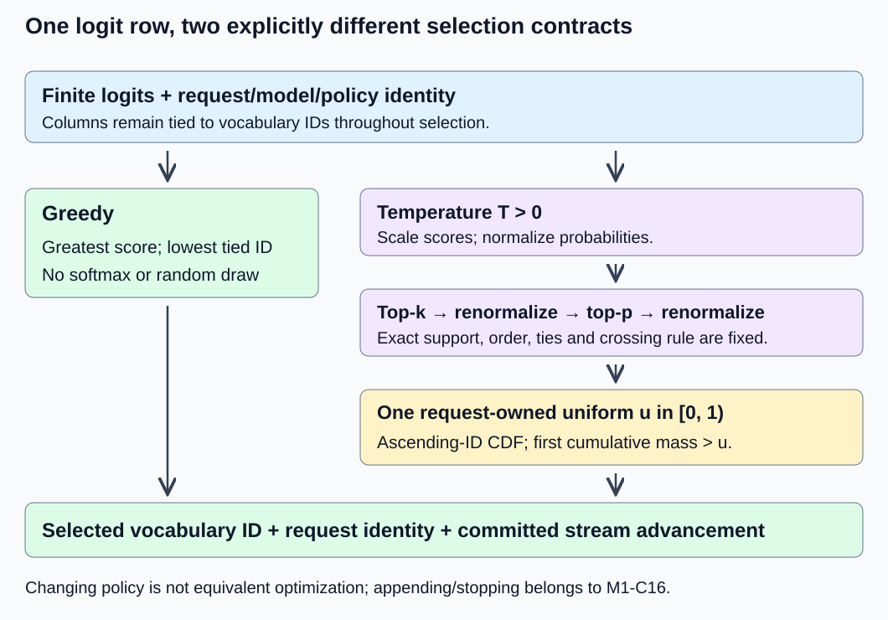
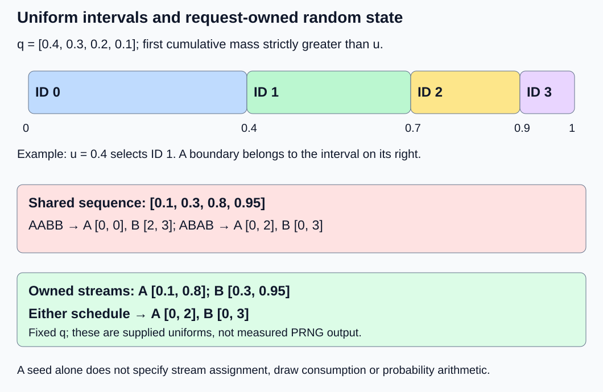

# M1-C15: Turning logits into the next token

> **Status: Complete — detailed chapter authored and documentation validated; experimental procedures are proposed unless explicitly labelled observed**

**Module:** Understand exactly what happens when an LLM generates a token

**Category:** [Model computation and semantics](index.md)

[Module 1 reading order](../module-1.md) · [Previous: M1-C14](../model-computation-and-semantics/m1-c14-assembling-a-small-decoder-only-transformer.md) · [Next: M1-C16](../interfaces-protocols-and-streaming/m1-c16-building-the-single-request-generation-loop.md)

## Target concepts

Greedy decoding, temperature, top-k and top-p filtering, probability renormalization, random sampling, seeds, tie handling.

## Concepts

### The model produces scores; a decoding policy chooses an ID

A **logit** is an unnormalized score for a vocabulary entry. [M1-C14](m1-c14-assembling-a-small-decoder-only-transformer.md) produces one row of V logits at each input position. A next-token policy consumes the last valid row for a request and returns one token ID. It does not itself append the ID, stop at end-of-sequence, decode text or send a response. Those steps are explained in the completed M1-C16 chapter.

The distinction matters: changing temperature or filtering changes the distribution used to select an ID even when the model weights and logits are unchanged. That is a policy change, not an equivalent optimization of the original distribution. A **distribution** assigns a nonnegative probability to each ID with total probability one. A **categorical draw** selects one of these discrete IDs according to those probabilities.

This chapter uses a deliberately explicit policy rather than relying on library defaults. The result carries request ID, selected vocabulary ID and policy/version identity. Rust is the primary language context for eventual ownership of the input scores and random state; no implementation is supplied or assumed to exist.

| Part of the chapter contract | Exact choice |
|---|---|
| Inputs | One nonempty, finite score row; columns retain vocabulary IDs; model and policy identity fixed for a selection |
| Greedy mode | Greatest logit; lowest token ID wins an exact tie; no random draw, temperature or filters |
| Sampling temperature | Finite T > 0; T = 0 is rejected rather than divided by zero |
| Ranking | Descending score/probability, then ascending token ID for exact ties |
| Top-k | Disabled explicitly, or an integer 1 ≤ k ≤ V; keep exactly k ranked entries |
| Top-p | Disabled explicitly, or finite threshold 0 < τ ≤ 1; retain the smallest ranked prefix with cumulative mass ≥ τ for τ < 1; τ = 1 disables further truncation |
| Sampling order | Temperature → top-k → normalize retained mass → top-p on that normalized distribution → normalize again → draw |
| Draw convention | One logical uniform u in [0, 1) per successful sampling selection, even for singleton support; no draw for greedy or validation failure |
| Draw traversal | Accumulate final probabilities in ascending vocabulary-ID order; select the first cumulative total strictly greater than u |
| Failure | Reject invalid parameters, nonfinite external scores, unsupported numerical range or empty/zero-mass support; return no selected ID |

A logical uniform draw may require several generator words internally. Record the word-to-uniform conversion and consumption rules separately. This contract does not require every library to use the same rules. Greedy is selected as a separate mode; its unused sampling parameters must be absent. Exact policy identity includes the ordering and boundary rules above.

*Model output and selection policy have separate contracts. The sampling branch keeps vocabulary identity through ranking and restores it for the final draw; the greedy branch consumes no randomness.*

### Greedy selection and ties

For a row ℓ, **g = min {v : ℓᵥ = maxⱼ ℓⱼ}** under this chapter's tie rule. The indices v and j are vocabulary IDs. Finding this maximum requires no softmax because a strictly increasing transformation preserves order. A positive finite temperature also preserves mathematical order; computing probabilities would add work without changing the greedy answer when the arithmetic remains valid.

For [2, 2, 0, −1], greedy returns ID 0. Reordering physical storage must not change that logical-ID tie rule. For [1, 1.00000001, 0, −1], ID 1 wins; a small numerical perturbation can change a near tie, as [M9-C17](../numerics-and-correctness/m9-c17-comparing-logits-with-justified-numerical-tolerances.md) explains. Passing a logit tolerance does not automatically guarantee the same greedy decision. If exact replay is required, check both the logits and the resulting ID.

Greedy at one position is not a search for the most likely complete sequence. Future score rows depend on the chosen token and evolving prefix. Nor does selecting the greatest probability establish the best natural-language continuation or task quality. Here we validate one selection, not language quality or a completed generation service.

### Temperature changes probability ratios

For sampling, define **pᵥ(T) = exp((ℓᵥ − m)/T) / Σⱼ exp((ℓⱼ − m)/T)**, where m = maxⱼ ℓⱼ and T > 0. Subtracting the maximum preserves the real-number distribution while avoiding unnecessarily large positive exponentials. It does not eliminate finite-precision underflow or every extreme intermediate; use sufficient precision and reject unsupported cases instead of silently clamping the policy.

For two IDs, **pᵢ(T)/pⱼ(T) = exp((ℓᵢ − ℓⱼ)/T)**. With a unique maximum, lowering T increases its advantage; raising T reduces relative differences. As T approaches zero from above the unique maximum receives nearly all mass. If several maxima tie exactly, the mathematical limit shares mass equally among them; it is not the chapter's lowest-ID greedy rule. Infinite temperature and zero temperature are not valid input values here.

A transparent standalone fixture is **ℓ = [ln 4, ln 3, ln 2, ln 1]**, with IDs 0–3. ln is the natural logarithm. These are constructed scores, not outputs claimed from M1-C14. The unnormalized weights at temperature T are proportional to [4^(1/T), 3^(1/T), 2^(1/T), 1].

| T | Probabilities in ID order, rounded where needed |
|---|---|
| 1/2 | [16/30, 9/30, 4/30, 1/30] ≈ [0.533333, 0.300000, 0.133333, 0.033333] |
| 1 | [4/10, 3/10, 2/10, 1/10] = [0.4, 0.3, 0.2, 0.1] |
| 2 | [0.325401, 0.281805, 0.230093, 0.162700] |

The symbolic weights provide an independent reference for this small fixture. A runtime stores rounded logarithms, so compare its arithmetic against the actual represented inputs as well as the intended mathematical fixture. Do not feed six-decimal display values to an exact-boundary verifier.

### Top-k limits count; top-p limits retained mass

**Support** means the set of IDs with permitted positive probability. Top-k keeps exactly k entries under the declared total ranking. Removed IDs receive zero probability; the remaining probabilities must be divided by their retained sum. For the T = 1 fixture and k = 2, retained mass is 0.7 and the final distribution is **[4/7, 3/7, 0, 0]**. Returning [0.4, 0.3, 0, 0] without renormalizing loses 0.3 of probability and leaves an incomplete categorical distribution.

For top-p, sort by descending probability, breaking ties by ID. Let π₁, π₂, … be that ranking. Define **n = min {r ≥ 1 : Σⱼ₌₁ʳ pπⱼ ≥ τ}**. Keep the first n entries and divide by their total mass. The entry that first reaches or crosses the threshold stays. The retained mass can exceed τ; it is not reduced to exactly τ.

For the T = 1 fixture, τ = 0.7 keeps IDs 0 and 1 in exact arithmetic. τ = 0.75 keeps IDs 0, 1 and 2, mass 0.9, yielding **[4/9, 1/3, 2/9, 0]**. As an explicit endpoint convention, τ = 1 disables additional top-p truncation and keeps every currently permitted entry, including any probability rounded to zero; entries excluded by top-k stay excluded. The smallest-prefix formula above applies to 0 < τ < 1. A floating-point cumulative sum close to a threshold needs explicit checking against the declared arithmetic/reference; a tolerance does not authorize silently adding or removing an ID.

For a uniform four-ID row, k = 2 keeps IDs {0, 1} by our exact-count tie rule; top-p at τ = 0.5 also keeps {0, 1}. These are policy decisions. The [Transformers v4.57.1 processor source](https://raw.githubusercontent.com/huggingface/transformers/v4.57.1/src/transformers/generation/logits_process.py) uses a top-k score threshold that can keep more than k entries when scores tie. Its top-p implementation works through the low-probability tail. Do not claim byte-for-byte compatibility with it merely because both interfaces say “top-k” or “top-p.” Validate boundary/tie semantics for the exact version in use.

The [original nucleus-sampling paper](https://arxiv.org/html/1904.09751v2) motivates selecting a probability-dependent set and rescaling its mass. It is background for the policy family, not evidence that this toy selector produces good text or improves production latency. The chapter's tie and numerical conventions remain explicitly specified here.

### Composition order is observable

Apply T = 1/2, k = 3 and τ = 0.8 to the logarithmic fixture. Temperature gives weights [16, 9, 4, 1]. Top-k retains [16, 9, 4, 0], with normalized probabilities [16/29, 9/29, 4/29, 0]. Top-p keeps the first two because 16/29 < 0.8 while 25/29 ≥ 0.8. Renormalization gives **q = [16/25, 9/25, 0, 0] = [0.64, 0.36, 0, 0]**.

Changing order can change support. With T = 1, k = 2 and τ = 0.5, top-k first creates [4/7, 3/7, 0, 0]; top-p then retains only ID 0 because 4/7 ≥ 0.5. If top-p is applied first to [0.4, 0.3, 0.2, 0.1], it retains IDs 0 and 1; subsequent top-k keeps both. The results are [1, 0, 0, 0] versus [4/7, 3/7, 0, 0]. A benchmark of these paths compares different policies, not equivalent implementations.

Temperature, top-k and top-p settings are therefore part of the reproducibility manifest, together with order, normalization precision and tie handling. A library's generation configuration can also enable other processors; the [Transformers v4.57.1 generation specification](https://huggingface.co/docs/transformers/v4.57.1/en/main_classes/text_generation) lists such controls. Freeze the effective configuration, not only the three visible values you intended to change.

### One uniform value becomes one token ID

A uniform u in [0, 1) gives each equal-length interval equal probability in the ideal model. Let **Fᵥ = Σⱼ₌₀ᵛ qⱼ** for final probabilities in ascending ID order. Choose **s = min {v : Fᵥ > u}**. This is inverse cumulative-distribution selection; a cumulative distribution function, or CDF, is the probability accumulated up to an ID. Zero-probability entries have empty intervals and cannot be selected.

For q = [0.4, 0.3, 0.2, 0.1], the intervals are:

| ID | Uniform interval |
|---|---|
| 0 | [0, 0.4) |
| 1 | [0.4, 0.7) |
| 2 | [0.7, 0.9) |
| 3 | [0.9, 1) |

Thus u = 0.4 selects ID 1, not ID 0. u = 1 is invalid. For the composed [0.64, 0.36, 0, 0] distribution, u = 0.63 selects ID 0 and u = 0.64 selects ID 1. A negative score never means a negative probability; scores are exponentiated and normalized before this draw.

For finite arithmetic, require nonnegative finite probabilities, positive retained mass and a normalized row within the declared numerical budget. The cumulative final endpoint may be pinned to one for the last positive-probability ID after normalization passes, to close a tiny rounding gap; record that convention and compare its effect with the mathematical distribution. Never use such a rounding repair to hide a large normalization error or select an excluded zero-mass ID. A finite-bit uniform source also lives on a grid; it approximates the ideal continuous-uniform model and needs its own conversion contract. Exact supplied decimal uniforms below are deterministic test inputs, not evidence about any PRNG.

*Random-state ownership is part of exact replay. Two schedules can consume one shared sequence in different request orders even though the shared sequence itself is unchanged.*

### Seeds initialize state; they do not describe the entire execution

A random number generator is abbreviated RNG. A **pseudo-random number generator** (PRNG) deterministically transforms an internal state into output values and a new state. A **seed** initializes that state. Repeating a seed reproduces a token sequence only if the generator algorithm/version, initialization, word-to-uniform mapping, draw count/order, probability arithmetic and policy all reproduce too.

The [Rust Rand Book's seeding guidance](https://rust-random.github.io/book/guide-seeding.html) distinguishes seeding from selecting a fixed generator algorithm. Its [reproducibility guidance](https://rust-random.github.io/book/crate-reprod.html) discusses limited value-stability guarantees and nonportable generator types. These are reasons to capture the actual algorithm and dependency versions, not claims that an unspecified Rust generator is stable forever. No PRNG has been installed or exercised for this chapter.

A small deterministic example shows the ownership issue. Hold q = [0.4, 0.3, 0.2, 0.1] fixed for two selections per request; do not evolve model logits. A shared supplied uniform sequence is [0.1, 0.3, 0.8, 0.95]. Under schedule A, A, B, B, request A gets IDs [0, 0] and B gets [2, 3]. Under A, B, A, B, A gets [0, 2] and B gets [0, 3]. The sequence is identical, but its assignment changes.

Instead, bind the supplied stream [0.1, 0.8] to A and [0.3, 0.95] to B. Both schedules then yield A = [0, 2], B = [0, 3]. This tests request-local consumption; it does not prove that two independently seeded PRNG streams are statistically independent. Reinitializing the same seed before every draw repeats the first value and is not equivalent to advancing a stream.

A request owns its stream state and logical draw index. In this proposed contract, parameter validation occurs before consuming a draw; successful sampling consumes one logical uniform even if filtering leaves one ID. A committed selection and its updated state are recorded together. A retry must replay the committed result or restore the pre-attempt snapshot under an explicit policy; it must not accidentally consume another request's randomness. Cancellation of A must not advance B's stream. Scheduling, checkpointing and cancellation mechanisms remain conceptual here; no serving implementation is claimed.

## Experiments

All runtime procedures below are proposed. The fixtures are mathematical examples rather than generated text, model-quality results or trading measurements. Use an existing numerical/model environment if one is available; no implementation code is supplied.

### E1 — Verify policy composition, boundaries and ties

**Description:** Derive greedy and sampled distributions for the logarithmic fixture, then compare them with the fixed model's last-logit row.

**Purpose/objective:** Establish exact policy semantics before comparing selection algorithms or runtimes.

**Target concepts:** Greedy decoding, temperature, top-k/top-p, renormalization and tie handling.

**Baseline and workload:** ℓ = [ln 4, ln 3, ln 2, 0]; T ∈ {1/2, 1, 2}; separate k = 2 and τ ∈ {0.7, 0.75, 1}; composed T = 1/2, k = 3, τ = 0.8; order counterexample T = 1, k = 2, τ = 0.5; uniform and tied-max rows; M1-C14's ID 1 at position 0.

**Controls and prediction:** FP64 candidate arithmetic with independent high-precision/fraction references, fixed ID order and chapter policy. Predict the displayed probabilities/supports, composed [0.64, 0.36, 0, 0], and different order-counterexample supports. Greedy on the M1-C14 row should return ID 2 and consume no draw.

**Procedure:** Compare each temperature row, retained set, retained mass and renormalized distribution separately. Check just below, exactly at and just above the 0.7 top-p boundary using exact fractions for the mathematical reference. Check k = 1/V, τ = 1, uniform ties and a nearly tied maximum. Independently submit T ≤ 0/NaN/infinity, k = 0/noninteger/>V, τ ≤ 0/>1/NaN, empty rows and nonfinite external logits; require rejection without advancing random state.

**Hardware/software:** One FP64-capable CPU thread and high-precision reference environment; record arithmetic/backend settings and any library processor version.

**Failure and HFT connection:** A boundary or ordering change alters the decision contract, like changing event-priority rules in a latency-sensitive pipeline. Treat it as a policy difference, not a numerical speed optimization or trading claim.

**Exit criteria:** V1 validates every stage and predicted set/ID under its declared reference, and records all invalid-input outcomes separately. A normalization error or wrong support cannot be excused by one matching selected token.

### E2 — Audit exact draws and random-state ownership

**Description:** Use supplied uniforms to isolate categorical selection from PRNG behavior, then exercise replay and scheduling contracts.

**Purpose/objective:** Distinguish mapping correctness, stream consumption and seed replay.

**Target concepts:** Random sampling, seeds, tie/boundary handling and probability renormalization.

**Baseline and workload:** q = [0.4, 0.3, 0.2, 0.1], uniforms 0, 0.4, 0.7, 0.9, 0.999; the composed [0.64, 0.36, 0, 0] with uniforms 0/0.63/0.64/0.999; the A/B schedules above. Also use ten midpoints (j + 1/2)/10 for j = 0–9.

**Controls and prediction:** Strict F > u, ascending ID CDF, fixed q and one logical uniform per successful sampling selection. Predict midpoint counts [4, 3, 2, 1], schedule-dependent assignments for a shared stream, and invariant per-request assignments for owned streams. These counts are deterministic grid arithmetic, not random-frequency measurements.

**Procedure:** Record each input uniform, selected ID and draw index. Check invalid u < 0, u = 1 and NaN. Replay both schedules with shared and owned supplied streams. Exercise greedy, singleton support and pre-draw validation failure to check consumption rules. In an available PRNG environment only, pin the named algorithm/version, seed bytes/encoding and mapping, then compare a run with an exact replay; record unavailable capabilities as untested.

**Hardware/software:** Same CPU/reference setup; an existing PRNG runtime is optional for the additional seed-replay check. No particular library output sequence is asserted.

**Failure and HFT connection:** Shared mutable random state can make unrelated requests depend on scheduling. Pin ownership and capture pre/post state for diagnosis, as with coherent event-processing state. A retry/cancellation extension must preserve other requests' streams.

**Exit criteria:** V2 reproduces all supplied-uniform outcomes and draw counts; any claimed seed replay identifies its complete environment. Schedule invariance is claimed only for the fixed-q, request-owned fixture or a separately justified model/policy path.

### E3 — Check a fixed categorical distribution with repeated draws

**Description:** Compare empirical ID frequencies from an existing sampler with a known four-ID target, separately from exact stream replay.

**Purpose/objective:** Detect large distributional mistakes that a few selected IDs or one seed can miss.

**Target concepts:** Random sampling, probability renormalization, seeds and distributional versus exact correctness.

**Baseline and workload:** Fixed q = [0.4, 0.3, 0.2, 0.1], no changing prefix. Three predeclared runs of N = 100,000 selections using recorded seed inputs 101, 202 and 303 with an explicitly identified seed-to-state mapping. These are separate runs of a fixed distribution, not generated sequences from evolving logits.

**Controls and prediction:** Same admitted generator/mapping/policy and FP64 arithmetic; no reseeding within a run, no rejected draws silently replaced. Predeclare maximum absolute frequency error 0.03 for each of four IDs in each run. The conservative statistical reasoning for this diagnostic screen is given in V3; it does not certify generator independence or rare-token quality.

**Procedure:** Validate q and deterministic mapping first. Freeze the generator/version and seeds before observing counts. Record all 100,000 outcomes per run or losslessly aggregate them with the draw-count record. Compute each frequency and signed/absolute deviation. Preserve failures and do not search for a passing seed. Compare exact replay only within the same manifest; another correct sampling algorithm need not produce the same IDs.

**Hardware/software:** Same CPU plus an available, named PRNG/sampler environment. Record seed encoding, generator state/version and uniform conversion. If unavailable, leave E3 unperformed.

**Failure and HFT connection:** Frequency evidence and per-request replay answer different questions, just as aggregate service outcomes do not explain one event's execution. Count invalid IDs, unsupported states and incomplete runs separately; no production or trading conclusion follows.

**Exit criteria:** V3 reports all three counts/frequencies, the frozen screening verdict and its assumptions, with exact zeros for any separately tested excluded support. A failed screen triggers diagnosis and retained evidence, not automatic tolerance expansion.

### E4 — Measure an equivalent greedy selection path end to end

**Description:** Compare full sorting with a single maximum reduction for the same greedy-ID contract.

**Purpose/objective:** Test a genuine implementation-equivalence performance hypothesis without changing decoding policy.

**Target concepts:** Greedy decoding, tie handling and the cost of next-token selection.

**Baseline and workload:** Baseline sorts score/ID pairs using the chapter ranking and returns the first; candidate finds the greatest score and lowest tied ID without sorting the whole row. Use the four-ID fixture, the tied row [2, 2, 0, −1], and a standalone V = 4,096 row ℓᵥ = (((37v + 11) modulo 4,096)/256) − 8. Separately compare both selections after the same complete M1-C14 forward for B = 1, S = 4 with IDs [1, 2, 3, 0]. The larger row is a selector fixture, not an enlarged M1-C14 vocabulary.

**Controls and prediction:** Greedy only, no filter/temperature/randomness, same FP64 row representation, thread count and input/weight identities. Predict identical IDs and less selection work from a maximum reduction, especially for larger V; do not promise a wall-time improvement on four entries or a faster complete model.

**Procedure:** Verify correctness first. In three sessions, warm each path five times per case, then collect 30 paired timings per case/session, alternating path order. Selection-only boundary is resident row ready through returned ID, including required allocation/copy/sort/gather. For the model case, use inputs/weights ready through returned ID and include both blocks and output head equally. Profile in separate runs and record instrumentation overhead.

**Hardware/software:** One CPU thread with recorded runtime/compiler/backend, allocation policy and clock; no accelerator required. A Rust runtime is not assumed to exist; use an existing environment or leave timing unperformed.

**Failure and HFT connection:** Removing an unnecessary full sort can shorten a decision path while preserving priority/tie rules. A changed rule or incomplete result is not a faster equivalent decision. Single-flight measurements do not characterize overload or service p99.

**Exit criteria:** V4 establishes exact ID/tie agreement and zero random consumption, then reports per-case selection and model-boundary timings, regressions, uncertainty and all failed attempts. A slower candidate is a valid finding.

## Verification

### V1 — Validate distributions before selected tokens

Use exact fractions/powers for the standalone reference and independent 80/120-digit evaluation of its logit formulas. For represented runtime logarithms, preserve the actual inputs and identify input-rounding versus arithmetic error as in M9-C17. Require exact vocabulary/support identity and finite nonnegative probabilities, maximum coordinate error ≤ 10⁻¹⁰ and row-sum error ≤ 10⁻¹⁰ for these bounded FP64 exercises. These are teaching-fixture budgets, not universal sampling tolerances. A support mismatch near a threshold is reported separately; do not use a probability tolerance to redefine an exact boundary.

Reconcile the T = 1/2 weights [16, 9, 4, 1], k = 3 retained sum 29, nucleus mass 25/29 and final denominator 25. For τ = 0.7 at T = 1, exact cumulative mass equals the threshold; a high-precision calculation on rounded logarithms may lie slightly to either side. Report the symbolic and represented-input references separately, and use nonboundary cases for broad approximate-distribution comparisons. Keep the deliberate threshold tests precisely labelled.

For M1-C14, retain its original logit/stage budgets and compare against its fixed model reference before selecting ID 2. [M9-C01](../numerics-and-correctness/m9-c01-defining-reference-behavior-and-evidence-before-optimizing.md) supplies the correctness/intentional-policy distinction and [M9-C17](../numerics-and-correctness/m9-c17-comparing-logits-with-justified-numerical-tolerances.md) supplies the numerical evidence. Neither permits a greedy mismatch merely because logits are close.

### V2 — Validate CDF boundaries, consumption and replay

For q's first boundary row, expected IDs are [0, 1, 2, 3, 3] for [0, 0.4, 0.7, 0.9, 0.999]. For the composed row, IDs are [0, 0, 1, 1] for [0, 0.63, 0.64, 0.999]. Supplied exact-decimal boundaries test the mathematical rule; actual binary CDF boundaries must also be checked using their recorded values. Verify each excluded entry remains unselectable, including when a cumulative endpoint is repaired to one. A bad row-sum fails before any repair.

Check schedule AABB yields shared-stream A = [0, 0], B = [2, 3], while ABAB yields A = [0, 2], B = [0, 3]. Owned streams must give the latter per-request results under either schedule. Record successful sampling calls, logical uniforms and underlying PRNG word consumption separately. Greedy and validation failure consume zero; singleton sampling consumes one logical uniform by this chapter's contract. Document any library adapter whose behavior differs.

An exact replay manifest includes generator algorithm/version, full seed/state encoding, request-to-stream mapping, logical selection indices, policy order/ties, probability dtype, uniform conversion and actual inputs. A seed alone is incomplete evidence. Random-state checkpoint/restore or cancellation recovery is only claimed if actually exercised; this chapter's supplied streams establish the ownership principle without a running server.

### V3 — Interpret frequencies with a stated uncertainty model

Let Cᵥ be an ID's count and **fᵥ = Cᵥ/N** its frequency. Under an ideal independent, identically distributed categorical-draw model, the variance of fᵥ is **qᵥ(1 − qᵥ)/N ≤ 1/(4N)**. Variance measures mean squared deviation from the expected frequency. The probability that an absolute deviation exceeds ε is at most variance/ε²; this follows by bounding the chance that the nonnegative squared deviation exceeds ε² by its mean divided by ε².

Summing that conservative bound across four IDs and three runs gives **Pr(any screen violation) ≤ 12/(4Nε²)**. At N = 100,000 and ε = 0.03, the bound is 1/30, approximately 0.03333. Summing bounds does not require the twelve checks to be independent, but the within-run variance calculation does require the stated draw model. This justifies the predeclared coarse screen at less than 5% family false-alarm probability under those assumptions. It is loose, does not rule out smaller biases, and is not proof that a real PRNG supplies independent draws. No experiment was executed to produce frequency results here.

Report every run's four frequencies, count total, largest deviation and invalid/rejected/incomplete outcomes. Expected counts are [40,000, 30,000, 20,000, 10,000], not mandatory exact observed counts. Exact midpoint-grid counts in E2 are not random observations and must not be used as evidence that a PRNG passes E3. If the screen fails, retain the failed run, verify normalization/support/mapping/consumption, and plan a separately declared follow-up; do not repeatedly rerun until a seed passes. Advanced distribution tests are deferred to the M9-C18 outline.

### V4 — Verify equivalent work and useful timing boundaries

A maximum reduction visits V entries; a comparison sort typically requires O(V log V) comparisons. Big-O describes how work grows with vocabulary size, not an actual clock-time ratio. Both still read a row, and full-forward time may be dominated by model computation. The V = 4,096 score fixture uses exactly represented binary fractions and has a unique maximum; its maximum is ID 996, since (37 × 996 + 11) modulo 4,096 is 4,095. Verify that identity before timing. Check explicit ties separately, including all-equal scores, so an ordering accident cannot masquerade as equivalence.

The four-entry FP64 input payload is 32 bytes and the 4,096-entry payload is 32,768 bytes. These are row payloads, not allocator peaks or total traffic; sort buffers and ID storage are additional. Report all required copies/allocations inside the selection boundary and keep them consistent with the intended caller interface. For the model case, preserve the entire forward and compare completed returned IDs; a locally faster maximum reduction does not establish a useful improvement by itself.

If executed, retain 90 paired observations per case over the three sessions, with separate session medians/ranges and paired baseline-minus-candidate differences. Positive differences favor the candidate. Record attempts and failed pair members rather than dropping invalid results silently. Show mixed or near-overhead results as inconclusive where appropriate; three sessions do not establish production p99 or capacity. Measure empty timing-bracket overhead and clock resolution, confirm caller-readable completion, and keep diagnostic/profile work out of both uninstrumented paths equally.

Profile row validation, ranking or reduction, normalization/filtering where applicable, CDF/draw mapping, allocation and returned-ID handling in separately labelled runs. The greedy E4 paths exclude filtering and draws by design; a sampling profile is a different workload. A full selection-plus-forward trace must pin model/policy/request identity and preserve input/state ownership until comparison finishes. No speed, memory or quality outcome is asserted without actual evidence.

## Engineering dimensions and principles

| Dimension | Chapter-specific application |
|---|---|
| Semantics and invariants | E1 freezes order, support and ties; E2 checks exact CDF boundaries; policy changes are distinct from equivalent optimizations. |
| Workload and variability | Temperature and peaked/flat/tied rows change retained mass and candidate count; E4 separates V = 4 from V = 4,096 and full-forward work. |
| Resources and bottlenecks | Ranking, cumulative sums, RNG state, buffers and row movement have costs; greedy does not require softmax or a full sort. |
| Time and distributions | Probability distributions and latency distributions answer different questions. E3 quantifies a coarse frequency screen; E4 uses completed-output paired timing. |
| Ownership and coordination | Each request owns its random stream and selection index; replay binds policy, input and state versions, not just a seed. |
| Failure and adaptation | Reject invalid parameters/support, count failed attempts and preserve state on validation failure; retries/cancellation require an explicit consumption policy. |

| Practical principle | How the reader applies it |
|---|---|
| 1. Correctness defines the optimization boundary | Greedy sort versus reduction preserves a named ID/tie contract; changing top-p, temperature or order changes policy. |
| 2. Performance depends on workload and operating point | Compare vocabulary sizes, retained supports, tie cases and complete-model boundaries rather than extrapolating a four-ID result. |
| 3. Data movement is part of the algorithm | Include score reads, sort/gather buffers and returned-ID materialization in the measured interface. |
| 4. State has ownership, lifetime and recovery cost | Pin per-request random state and commit the selected ID with its advancement; preserve snapshots needed for retries. |
| 5. Dependencies determine latency; bottlenecks determine capacity | Selection consumes completed logits; a faster selector may leave the model critical path dominant. |
| 6. Variability and synchronization shape the tail | Candidate count and scheduling alter costs; shared RNG coordination can couple requests, and isolated timings do not prove service tails. |
| 7. Local improvements must be evaluated end to end | E4 measures both selection-only and full-forward-to-ID outcomes with the same greedy policy. |
| 8. Claims require reproducible evidence | Keep exact reference sets, numerical budgets, draw records, seeds/state manifests, frequency assumptions and all outcomes. |

HFT means High-Frequency Trading, whose systems process market events under tight timing constraints. Useful parallels are explicit decision rules, reproducible replay, request/state ownership and measuring complete critical paths. Token probabilities are not market probabilities or execution guarantees; this chapter specifies no exchange protocol, strategy, profitability or production trading results.

## Specifications, articles, and hardware

| Primary source | Scope and limit |
|---|---|
| [Holtzman et al., The Curious Case of Neural Text Degeneration, v2](https://arxiv.org/html/1904.09751v2) | Primary nucleus/top-k/temperature background. Its experiments do not establish quality for our synthetic fixture or a universal recommended policy. |
| [Transformers v4.57.1 generation specification](https://huggingface.co/docs/transformers/v4.57.1/en/main_classes/text_generation) | Effective generation controls; defaults and additional processors must be recorded rather than assumed. |
| [Transformers v4.57.1 processor source](https://raw.githubusercontent.com/huggingface/transformers/v4.57.1/src/transformers/generation/logits_process.py) | Concrete temperature/filter and threshold behavior; this chapter intentionally declares its own exact-count tie rule. No source implementation is reproduced. |
| [Rust Rand Book: seeding](https://rust-random.github.io/book/guide-seeding.html) and [reproducibility](https://rust-random.github.io/book/crate-reprod.html) | Algorithm/state and value-stability guidance. The book is unversioned; executed runs must pin actual generator/dependency versions and conversion semantics. |
| [M9-C01](../numerics-and-correctness/m9-c01-defining-reference-behavior-and-evidence-before-optimizing.md) and [M9-C17](../numerics-and-correctness/m9-c17-comparing-logits-with-justified-numerical-tolerances.md) | Completed correctness and numerical-reference support applied above. |

Proposed requirements are a CPU supporting FP64, one execution thread and at least 1 GiB free RAM for the environment and evidence. These are exercise requirements, not observed hardware specifications or production sizing. Record CPU model, cores/sockets, cache/RAM, NUMA placement (memory proximity to processors), affinity, power/frequency policy, OS, compiler/runtime/backend/library versions, arithmetic settings and clock. For sampling, also record the generator, seed/state encoding, uniform conversion, stream ownership and draw consumption. Mark unknown settings as unknown. No GPU, NIC or interconnect is required; later accelerator/distributed paths need their own completion, memory and scheduling evidence. Model fixtures use M1-C14's fixed mathematical weights and synthetic IDs, no adapter/cache/tokenizer decoding and no supplied serialized checkpoint.

M9-C02 is now complete. [M9-C11](../measurement-experimentation-and-economics/m9-c11-controlled-comparisons-warmup-and-reproducibility.md), [M9-C18](../numerics-and-correctness/m9-c18-testing-sampling-distributions-and-random-state-behavior.md) remain outlines; [M9-C19](../interfaces-protocols-and-streaming/m9-c19-validating-tokenization-stopping-and-final-output.md) is now complete; [M9-C07](../measurement-experimentation-and-economics/m9-c07-latency-distributions-and-statistical-uncertainty.md) is now complete; the necessary elementary timing, repetition, uncertainty and identity contracts are defined locally. This chapter’s authoring successor is M9-C07, now complete (consult the execution plan for current progress); the next Module 1 reading chapter is M1-C16.

## Key takeaways

Separate model scores from the selection policy. Specify temperature, filter order, ties, renormalization and CDF boundaries before comparing results. A seed is only one part of replay, and a matching token is only one part of correctness. Validate exact mapping and distributions separately, then measure equivalent complete outputs. The chapter's arithmetic/documentation checks are not runtime sampling, model-quality, hardware-performance or production-service results; all procedures remain proposed unless explicitly observed.
