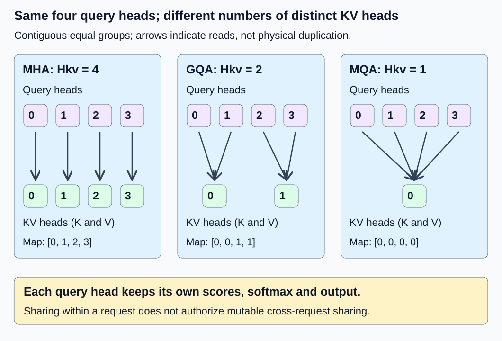

# M2-C02: Attention head sharing: MHA, GQA, and MQA

> **Status: Complete — detailed chapter authored and documentation validated; experimental procedures are proposed unless explicitly labelled observed**

**Module:** Treat the KV cache as a first-class systems problem

**Category:** [Model computation and semantics](index.md)

[Module 2 reading order](../module-2.md) · [Previous: M2-C01](../state-memory-and-caching/m2-c01-what-the-kv-cache-retains-and-why.md) · [Next: M2-C03](../state-memory-and-caching/m2-c03-calculating-kv-memory-and-request-capacity.md)

## Target concepts

Query heads versus KV heads, multi-head attention, grouped-query attention, multi-query attention, cache shapes, architecture-dependent memory requirements.

## Concepts

### 1. Count query heads and KV heads separately

A head is a feature group performing a query–key comparison and weighted value aggregation. It is not a request, CPU thread or token position. [M1-C12](m1-c12-multi-head-attention-and-its-variants.md) established head splitting and concatenation; [M2-C01](../state-memory-and-caching/m2-c01-what-the-kv-cache-retains-and-why.md) established what processed context the cache retains. This chapter connects those definitions to Module 2’s storage problem. Rust remains the eventual language context; no implementation is provided.

Let Hq be the number of query heads and Hkv the number of key heads and value heads, equal here. Let B be independent requests, T new query positions, N valid key/value positions supplied to attention and d the per-head query/key/value width. This chapter assumes equal key/value widths, full causal self-attention and positive head counts. More general checkpoints require their actual dimensions.

**Q shape = (B,Hq,T,d); K and V shapes = (B,Hkv,N,d); output O shape = (B,Hq,T,d).**

For decode T is normally one; for prefill T can be the prompt length. For a retained cache, N counts processed valid positions, not selected-but-unprocessed IDs or reserved capacity. Each query head still produces its own output even when several query heads read the same K/V. Thus shrinking Hkv does not shrink O’s head axis.

| Arrangement, with Hq = 4 | Hkv | Query heads [0,1,2,3] use KV heads | Meaning |
|---|---:|---|---|
| Multi-head attention (MHA) | 4 | [0,1,2,3] | One K/V head per query head |
| Grouped-query attention (GQA) | 2 | [0,0,1,1] | Two query heads share each K/V head |
| Multi-query attention (MQA) | 1 | [0,0,0,0] | All query heads share one K/V head |

For the equal contiguous grouping convention used here, require Hq divisible by Hkv. Define **R = Hq/Hkv** query heads per group and **g(h) = floor(h/R)** for zero-based query head h. floor rounds down. A checkpoint using another head ordering needs an explicit compatible mapping, not an assumption based on these labels. Reject Hq = 4/Hkv = 3 under this convention before indexing.

The [GQA paper, v3](https://arxiv.org/html/2305.13245v3) describes intermediate KV-head counts and the MHA/MQA endpoints. The original [MQA paper](https://arxiv.org/html/1911.02150v1) motivates reducing retained K/V and their movement during incremental inference. These architecture choices do not by themselves establish a speedup on a particular backend.

*The query-head count stays four. The number of distinct K/V heads changes; each arrow is a read relationship, not a separate cache copy.*

### 2. Sharing K/V does not share the softmax

For request b, query head h and query position i, use KV head g(h). With eligible logical key positions j:

**Score s[h,i,j] = dot(Q[b,h,i], K[b,g(h),j]) / √d.**

**Weight α[h,i,j] = exp(s[h,i,j]) / [Σ over eligible m of exp(s[h,i,m])].**

**O[b,h,i] = Σ over eligible j of α[h,i,j] V[b,g(h),j].**

The dot is a dot product, exp is the exponential and each sum runs over key positions allowed for that query. Query heads normalize independently. Two heads reading the same keys can assign different probabilities because their Q vectors differ. Concatenate outputs in query-head order before any learned output projection; do not average query heads merely because they share state.

An independent attention fixture has B = T = d = 1, Hq = 4, Hkv = 2 and N = 2. The current query is at logical position 1, so both positions 0 and 1 are eligible. There is no positional transform, dropout or output projection. Use K0 = [0,1], V0 = [10,20], K1 = [0,2], V1 = [100,200]. The query scalars below use ln(3), the natural logarithm of three, so exp(ln(3)) = 3.

| Query head h | Q scalar | g(h) | Attention weights over positions [0,1] | O scalar |
|---|---|---:|---|---:|
| 0 | 0 | 0 | [1/2,1/2] | 15 |
| 1 | ln(3) | 0 | [1/4,3/4] | 17.5 |
| 2 | 0 | 1 | [1/2,1/2] | 150 |
| 3 | ln(3)/2 | 1 | [1/4,3/4] | 175 |

For head 1, scores [0,ln(3)] give weights [1/4,3/4] and output **10/4 + 3 × 20/4 = 17.5**. Head 0 reads the same K/V yet outputs 15. For head 3, the larger key 2 offsets the smaller query ln(3)/2. Final concatenated output is [15,17.5,150,175]. This is a synthetic attention reference, not a pretrained checkpoint or an extension of M1-C14’s single-head model.

An interleaved mapping [0,1,0,1] is a fault under this fixture’s contract: head 1 then uses scores [0,2ln(3)] and values [100,200], giving **100/10 + 9 × 200/10 = 190**, while head 2 falls to 15. A plausible tensor shape cannot detect that semantic mismatch alone.

### 3. Compact storage and expanded reference can be equivalent

For a reference calculation, duplicate each GQA K/V head R times along the head axis. Here the four reference heads are [K0,K0,K1,K1] and [V0,V0,V1,V1]. Evaluating ordinary per-query-head attention on that expanded representation gives the same mathematical outputs as direct grouped access. The architecture is still the fixture’s GQA: expansion does not create independently learned head parameters.

A compact cache stores only the two distinct heads. An expanded temporary or persistent cache may physically duplicate them; a logical view may instead alias the original data. Name which representation is being counted. A reference that expands K/V for clarity is not evidence that the production kernel avoids expansion. Inspect unique backing allocations and peak temporary storage when measuring memory.

For one layer and one request in FP64 (eight bytes per element), the fixture’s compact K/V payload is **2 × 2 × 2 × 1 × 8 = 64 bytes**. Physically expanded K/V is **2 × 4 × 2 × 1 × 8 = 128 bytes**. Each Q and O tensor is still **4 × 1 × 1 × 8 = 32 bytes**. Metadata, allocation alignment, scores and workspace are additional. If compact K/V remains live while the expanded copy is created, the two together occupy 192 payload bytes; peak storage is not just the larger tensor.

The [PyTorch 2.14 attention specification](https://docs.pytorch.org/docs/2.14/generated/torch.nn.functional.scaled_dot_product_attention.html) gives equal K/V-head and divisible-query-head constraints plus an expanded conceptual GQA reference. It also documents backend-dependent behavior and mask conventions. Treat it as one versioned operator contract, not proof of an arbitrary runtime’s layout, memory footprint or support. For cached non-square attention, explicitly check eligible logical positions; a generic causal flag need not align the suffix as intended.

### 4. Architecture controls the retained payload

For a uniform full-attention model with L layers and w bytes per element:

**Mkv = 2L B Hkv N d w bytes.**

The factor two counts K and V. Holding L/B/N/d/w fixed, payload scales with **Hkv**, not Hq. Compared with an otherwise dimension-matched MHA configuration, the ratio is **Mkv,shared / Mkv,MHA = Hkv/Hq = 1/R**. This is a logical payload ratio, not a guaranteed reduction in total model memory, physical traffic or elapsed time.

| Illustrative configuration: L = 2, B = 1, Hq = 4, N = 3, d = 2, w = 8 | Hkv | Logical retained K/V bytes |
|---|---:|---:|
| MHA | 4 | 768 |
| GQA | 2 | 384 |
| MQA | 1 | 192 |

These are three hypothetical configurations, not three equivalent checkpoints. They differ from the preceding one-layer scalar fixture. With hidden width D, Q projection width is Hq d, while K and V widths are each Hkv d. The corresponding no-bias projection weights have shapes (D,Hq d), (D,Hkv d) and (D,Hkv d); output concatenation still has Hq d features. D = Hq d is common but must come from the actual configuration.

The current query still forms scores and aggregates values for Hq heads. Under a conventional two-operations-per-multiply-add count, QK and weighted-V work is approximately **4B Hq T N d** operations, excluding softmax, masks and projections. For the scalar fixture this is 32 counted operations in both compact and expanded GQA representations. Fewer distinct stored heads can improve reuse, but a backend may reread the same values or materialize duplicates. Logical payload is not measured DRAM traffic. [M2-C03](../state-memory-and-caching/m2-c03-calculating-kv-memory-and-request-capacity.md) is now complete for detailed capacity accounting.

### 5. Changing the checkpoint is a different correctness question

Storing the same GQA computation compactly versus expanding it is an equivalence comparison. Replacing distinct MHA heads with fewer K/V projections changes the learned computation unless a special equality is established. Equal head counts are not the only identity fields: weights, grouping, positional transforms, precision and output projection matter too.

For a simple counterexample, intentionally make all fixture queries read K0/V0. The new outputs are [15,17.5,15,approximately 16.3397459622]; heads 2/3 no longer produce 150/175. This illustrates a model change, not an optimization bug in correctly implemented GQA. A conversion that averages projection parameters likewise needs a new reference and quality evaluation; neither low memory use nor matching a few greedy IDs establishes unchanged behavior. The GQA paper studies checkpoint conversion followed by additional training. Its quality results cannot be transferred to an untrained head-count edit here.

Group sharing is within one layer/request. It does not authorize cross-request mutable cache reuse or premature reclamation. A consumer must retain the correct request, layer, positions, KV head and live storage. Cancellation can release shared-within-request state only after every in-flight reader completes. Rust host ownership alone does not establish device completion. On a failed append, follow M2-C01’s conservative invalidation policy rather than publish partially valid head state.

## Experiments

All procedures below are proposed. Numerical fixtures and payload counts are constructed references; no attention kernel, model conversion, allocation measurement or speed result has been executed.

### E1 — Verify the head mapping and independent probabilities

**Description:** Evaluate the four-query/two-KV scalar fixture and an intentionally wrong mapping.

**Purpose/objective:** Detect head-axis errors that survive shape checks.

**Target concepts:** Query versus KV heads, MHA/GQA/MQA mapping and per-head softmax.

**Baseline and workload:** Use the exact Q/K/V values, two eligible key positions and contiguous mapping [0,0,1,1] above. Separately enumerate MHA and MQA endpoint mappings for Hq = 4.

**Controls and prediction:** Hold tensors, mask, scale and query-head order fixed; vary only the faulty mapping. Predict [15,17.5,150,175], with head 1 becoming 190 under [0,1,0,1].

**Procedure:** Derive each head’s scores, normalized probabilities and output independently. Confirm heads 0/1 differ despite sharing K/V. Inject interleaving and query-head averaging as faults. Reject zero head counts, unequal K/V-head counts and the nondivisible 4/3 configuration under this contract before accessing tensors.

**Hardware/software:** CPU FP64, one worker and at least 1 GiB free RAM for evidence tools. Record CPU and arithmetic-tool version/reference precision; no GPU is required.

**Failure and HFT connection:** Several analyses may read one consistent market snapshot while producing different decisions. A shared input does not imply a shared calculation; attention probabilities are not trading decisions or exchange semantics.

**Exit criteria:** All mappings, probabilities and outputs match their reference, and every invalid configuration or deliberate mapping/averaging defect is detected.

### E2 — Compare compact and expanded representations

**Description:** Evaluate direct grouped reads versus a physically duplicated four-head reference of the same GQA computation.

**Purpose/objective:** Separate mathematical equivalence from physical duplication.

**Target concepts:** Cache shapes, grouped sharing, output-head count and memory boundaries.

**Baseline and workload:** One layer/request, N = 2, d = 1, FP64; compact K/V have two heads, expanded K/V four duplicated heads, with unchanged Q.

**Controls and prediction:** Hold values, logical positions and masking fixed. Predict equal per-head outputs, compact/expanded K/V payloads 64/128 bytes and unchanged 32-byte Q/O tensors.

**Procedure:** Compare every output and duplicated coordinate against the compact source. Audit unique backing storage, aliasing and simultaneous lifetimes rather than infer allocation from shape. If both copies coexist, account for 192 KV payload bytes. Inject wrong group duplication, stale valid length and a wrong-owner/layer reference as separate negative controls. Keep borrowed data alive until every reader completes.

**Hardware/software:** CPU reference review; record dtype, strides/layout and whether expansion is a view or actual copy. A backend experiment must expose allocation and completion evidence.

**Failure and HFT connection:** Sharing a read-only snapshot can avoid duplicate buffers in an HFT pipeline, but aliases still require a valid lifetime. This analogy supplies no concurrent-memory-safety proof.

**Exit criteria:** Equivalent outputs and exact coordinate mappings pass; payload/peak accounting names real versus logical copies and invalid identity/lifetime cases cannot pass as ordinary sharing.

### E3 — Distinguish representation savings from architecture changes

**Description:** Reconcile the three illustrative payload configurations and the all-to-KV0 output counterexample.

**Purpose/objective:** Falsify the claim that reducing Hkv preserves any existing checkpoint automatically.

**Target concepts:** MHA/GQA/MQA architecture, projection widths and architecture-dependent memory.

**Baseline and workload:** Use L = 2/B = 1/Hq = 4/N = 3/d = 2/w = 8 for payload only. Separately remap the scalar fixture to K0/V0 for every query; do not combine its outputs with the two-layer sizing model.

**Controls and prediction:** Hold dimensions except Hkv fixed for sizing. Predict 768/384/192 bytes; in the scalar model-change example predict head 2 becomes 15 and head 3 approximately 16.3397459622.

**Procedure:** Recompute all tensor/projection dimensions and payload ratios. Contrast E2’s duplicated representation with the changed computation. Require checkpoint and grouping identity in cache metadata. Describe the additional quality/reference evaluation needed for a genuine model conversion; do not invent trained weights, quality scores or an equivalence tolerance for that change.

**Hardware/software:** CPU worksheet/high-precision arithmetic suffices. Any future quality study needs named trained checkpoints, held-out evaluation data, stopping policy and task acceptance; none is supplied here.

**Failure and HFT connection:** Reducing stored information may change decisions even when a system is faster, as a reduced market-state representation can. Model quality and trading utility have different evaluation contracts.

**Exit criteria:** Payload arithmetic and counterexample outputs match; architectural conversion is classified as changed behavior with a new evaluation contract, not reported as a lossless memory optimization.

### E4 — Benchmark one GQA computation under two storage paths

**Description:** Specify an attention-only compact-versus-expanded timing comparison, keeping the computation fixed.

**Purpose/objective:** Test whether a storage saving becomes an execution benefit on an actual backend.

**Target concepts:** Head sharing, cache footprint, access reuse, bottlenecks and end-to-end limits.

**Baseline and workload:** Use the scalar fixture for B = 1 and B = 4 independent request lanes with identical values but separate owner identities. Compare direct grouped access with physically expanded K/V. Propose three sessions, five excluded warmups per path/shape and 30 timed pairs per shape/session: 180 pairs/360 timed invocations and 60 warmups.

**Controls and prediction:** Pin dtype, scale, logical masks, backend, thread count, layout and allocation policy; counterbalance path order. Predict compact K/V payload 64B bytes versus 128B expanded, but no universal time ratio on these tiny shapes.

**Procedure:** Pass E1/E2 first. Begin with compact Q/K/V ready; end when all required O elements are available after completion. Include expansion/allocation in the expanded path when performed per invocation. Report a separately labelled pre-expanded kernel-only boundary if studied; do not mix it into the primary comparison. Record peak live allocated/reserved memory, output correctness and completion-aware elapsed time. Compare minimal instrumentation with a diagnostic subset; profile group reuse, expansion copies, allocations and scheduling separately, then remeasure without heavy profiling. Set a predeclared 120 s host deadline for hang detection, retaining unresolved device/cleanup events separately.

**Hardware/software:** CPU specs, cores/affinity, RAM, OS/power policy, compiler/runtime/numerical library, clock resolution and allocator versions are required. A conditional GPU extension additionally records GPU/VRAM, driver/runtime, attention backend, dtype support, stream completion and profiler versions. Do not assume an FP64 scalar fixture selects a fast fused kernel.

**Failure and HFT connection:** Keep wrong-owner, failed-append and cancellation trials separate from successful timing samples. HFT likewise requires a local buffer saving to survive full-path evaluation; this attention-only benchmark establishes no complete generation or trading latency improvement.

**Exit criteria:** All 360 invocations reconcile with outcomes and correct outputs. Report paired shape-specific timings, session variation, overhead and peak footprint. Whole-request benefit remains unestablished until a separately supplied generator is measured with the same output contract.

## Verification

| Check | Reference and acceptance evidence |
|---|---|
| V1 ↔ E1 | Independently derive weights [1/2,1/2] or [1/4,3/4] and O = [15,17.5,150,175]. Wrong interleaving gives head 1 = 190/head 2 = 15. Require positive divisible counts, equal K/V heads, exact mapping and independent head normalization. |
| V2 ↔ E2 | Expanded head order must be [0,0,1,1]; compare every coordinate and all outputs against the compact representation. Verify 64/128-byte K/V, 32-byte Q/O and 192 bytes when both K/V copies remain live; inspect actual unique allocations separately. |
| V3 ↔ E3 | Recompute 768/384/192-byte hypothetical configurations and Hkv/Hq ratios. Use independent 80/120-digit scalar references for the changed architecture: [15,17.5,15,16.3397459622…]. Never demand these changed outputs equal the original GQA fixture. |
| V4 ↔ E4 | Check 3 × 2 × 30 = 180 pairs, 360 timed invocations and 3 × 2 × 2 × 5 = 60 warmups. Each path has 90 invocations per B; if all succeed, 360 outputs per path at B = 1 plus 1440 at B = 4 were checked, for 3600 scalar outputs across both paths. Compare the same completed-work boundary before interpreting timing. |

For the bounded FP64 attention fixture, compare unrounded high-precision references and require finite coordinates within **10⁻¹⁰ absolute + 10⁻¹⁰ × reference magnitude**. This is an exercise screen, not a universal tolerance for trained/fused/low-precision backends. Exact shape, owner, group mapping and mask checks are separate gates; they cannot be waived by passing a numerical average. Use [M9-C01](../numerics-and-correctness/m9-c01-defining-reference-behavior-and-evidence-before-optimizing.md) and [M9-C17](../numerics-and-correctness/m9-c17-comparing-logits-with-justified-numerical-tolerances.md) for reference and numerical-budget reasoning. Intentional architecture changes require a separately justified quality/distribution contract.

For executed timing work, retain raw outcomes, shape, boundary, allocation and hardware manifests; publish failed/inconclusive results as well as successes. [M9-C02](../measurement-experimentation-and-economics/m9-c02-request-events-clocks-and-measurement-boundaries.md) supplies completed-work clocks and [M9-C07](../measurement-experimentation-and-economics/m9-c07-latency-distributions-and-statistical-uncertainty.md) population/uncertainty guidance. Ninety pairs per shape are an initial design, not production p99 evidence. Device submission, a shape-based memory estimate or a profiler correlation is not a measured whole-request gain. Advanced cache-memory and profiler chapters remain outlines; elementary requirements are local. No runtime experiment has been performed here.

## Engineering dimensions and principles

| Dimension | Application in this chapter |
|---|---|
| Semantics and invariants | E1/E2 preserve per-head probabilities, group mapping, masks, request ownership and outputs; E3 explicitly changes the architecture contract. |
| Workload and variability | Head counts, context, batch lanes, query positions, layout and backend change reuse; non-text modalities remain outside scope. |
| Resources and bottlenecks | Distinct KV payload shrinks while Hq outputs/attention remain; copies, aliasing, peak coexistence and physical traffic need separate evidence. |
| Time and distributions | E4 fixes completed-output boundaries, separates warmups/profile runs and retains shape-specific timing uncertainty. |
| Ownership and coordination | Within-request grouped readers share valid state; no cross-request mutable sharing or reclamation before readers complete is implied. |
| Failure and adaptation | Invalid ratios, wrong mapping, stale owners, append failure and cancellation require explicit rejection/invalidation and retained outcomes. |

1. **Correctness defines the optimization boundary.** Compact/expanded GQA can be equivalent; collapsing independent learned heads is a different model.
2. **Performance depends on workload and operating point.** A small FP64 reference and a long-context fused kernel expose different overheads and reuse.
3. **Data movement is part of the algorithm.** Avoided KV duplication matters only if the actual path avoids costly copies/reloads.
4. **State has ownership, lifetime and recovery cost.** Shared-within-request K/V stays live until all consumers finish; failed head updates cannot publish partial validity.
5. **Dependencies determine latency; bottlenecks determine capacity.** Hq query calculations persist even with fewer distinct heads; capacity gains do not imply equal latency gains.
6. **Variability and synchronization shape the tail.** Backend selection, temporary allocation and completion waits can dominate a small average saving.
7. **Local improvements must be evaluated end to end.** E4’s attention-only result cannot certify faster complete generation.
8. **Claims require reproducible evidence.** Record model/group identity, representation, memory boundary, outputs and actual hardware with every claim.

## Specifications, articles, and hardware

Primary sources checked 25 October 2026:

- [Fast Transformer Decoding: One Write-Head is All You Need, v1](https://arxiv.org/html/1911.02150v1) (6 November 2019): MQA’s shared K/V and incremental-inference motivation. Its performance/quality findings are not measurements of this chapter.
- [GQA: Training Generalized Multi-Query Transformer Models from Multi-Head Checkpoints, v3](https://arxiv.org/html/2305.13245v3) (23 December 2023): grouped KV heads and conversion/additional-training methodology, not automatic lossless head removal.
- [PyTorch 2.14: Scaled dot-product attention](https://docs.pytorch.org/docs/2.14/generated/torch.nn.functional.scaled_dot_product_attention.html): tensor axes, GQA constraints, conceptual expanded reference, mask and backend caveats. Rust-oriented implementations still need their own matching operator contract.

Hardware requirements/manifests are in E1/E4. No actual allocation, bandwidth or device specification is invented. Module 9 supports these checks across Modules 1–7; Module 8 is excluded.

## Key takeaways

Hq determines how many query-head outputs exist; Hkv determines how many distinct K/V heads are retained. Map the two axes explicitly. Sharing K/V preserves independent query probabilities, while compact storage and physical duplication have different memory costs. Treat representation changes and architecture changes with different references, and measure complete useful work before claiming a performance benefit.

Its reading and authoring successor is now complete: [M2-C03: Calculating KV memory and request capacity](../state-memory-and-caching/m2-c03-calculating-kv-memory-and-request-capacity.md). Consult the [execution plan](../chapter-execution-plan.md) for current progress.
