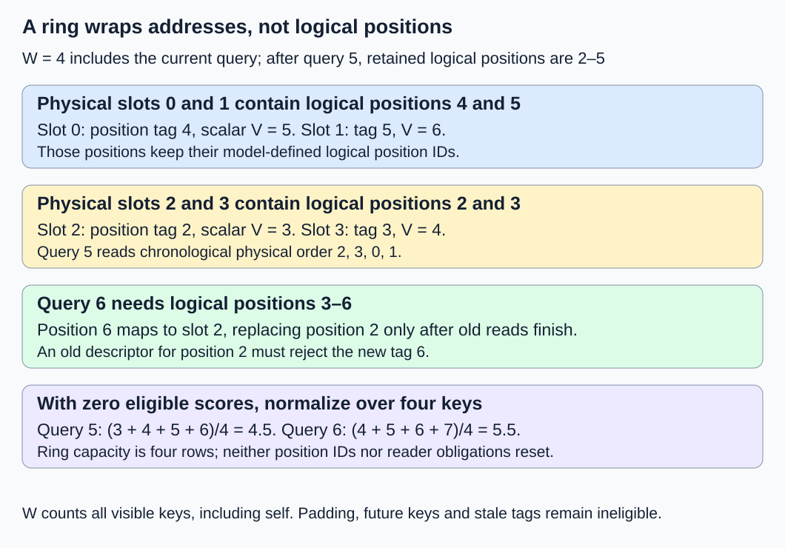
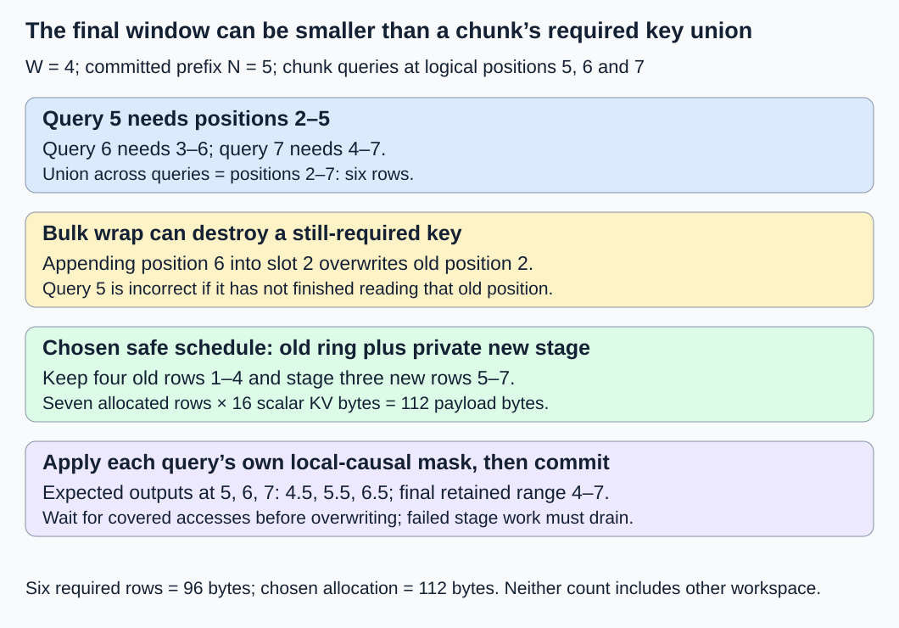

# M2-C17: Sliding-window attention and bounded cache state

> **Status: Complete — detailed chapter authored and documentation validated; experimental procedures are proposed unless explicitly labelled observed**

**Module:** Treat the KV cache as a first-class systems problem

**Category:** [Model computation and semantics](index.md)

[Module 2 reading order](../module-2.md) · [Execution plan and progress](../chapter-execution-plan.md) · [Previous: M2-C16](../reliability-and-capacity-control/m2-c16-completion-cancellation-and-allocation-failure.md) · [Next: M2-C18](m2-c18-architecture-specific-state-multi-head-latent-attention.md)

## Target concepts

Model-defined attention windows, retained token ranges, logical versus physical positions, ring-buffer mapping, per-layer windows, hybrid attention, limits of dropping old state.

## Concepts

### 1. A window is part of the model's attention operation

**Sliding-window attention** permits a query to read only a bounded range of nearby keys. It is exact relative to a model whose declared attention uses that window. Imposing a smaller window on a full-attention model changes its operation; it is not merely a storage optimization. [M1-C11](m1-c11-causal-masking-and-positional-information.md) defined causality and positions, while [M2-C07](../kernels-compilers-and-execution/m2-c07-how-attention-reads-a-paged-kv-layout.md) established that valid logical keys must be read through the actual storage mapping.

Let i be a zero-based logical query position, j a logical key position, and W a positive integer counting **all visible positions, including the current position**. This chapter's local-causal eligibility rule is:

**Allowed(i,j) = key_valid(j) AND max(0, i − W + 1) ≤ j ≤ i.**

A padding row, another request's state or a future key is ineligible even if its address lies inside the ring allocation. The current input token can attend to itself; its result predicts a later token. W = 1 means self-only attention. Reject W ≤ 0 and invalid/overflowing positions before publication. Some papers/APIs count prior positions rather than total visible keys; translate their actual mask semantics instead of assuming every field named “window” uses our convention. This chapter has no attention sinks, dilation or cross-attention.

The [original Mistral 7B paper, version 1](https://arxiv.org/html/2310.06825v1), motivates local attention, rolling storage and chunked prefill. Its notation and reported performance are not specifications or measurements of our fixture. Across stacked local layers, information can propagate through intermediate hidden states from beyond one layer's direct window. That does not turn a local mask into full attention or prove that a model supports arbitrary logical positions. Context limits and positional-encoding behavior remain model contracts.

For a scalar check, choose one query/KV head with one feature, FP64 K/V, zero scaled scores for every eligible pair and **V_j = j + 1**. Softmax over equal scores assigns each eligible key weight 1/m, where m is the number allowed. Thus:

**m = min(W, i + 1); o_i = sum(V_j over allowed j) / m.**

These are supplied scalar attention inputs, not hidden states from a checkpoint. A future numerical harness must normalize only over allowed keys; zeroing forbidden scores does not exclude them. At W = 4:

| Query i | Allowed key positions | m | Scalar output o_i |
|---|---|---:|---:|
| 0 | 0 | 1 | 1 |
| 3 | 0–3 | 4 | 2.5 |
| 4 | 1–4 | 4 | 3.5 |
| 5 | 2–5 | 4 | 4.5 |
| 6 | 3–6 | 4 | 5.5 |
| 11 | 8–11 | 4 | 10.5 |

Full attention at i = 5 averages values 1–6 and gives 3.5, whereas this local contract gives 4.5. Accidentally truncating a full-attention cache therefore fails even this simple reference. An older token outside a local layer's direct window may still have influenced its current inputs through earlier layers; the scalar check does not model those indirect dependencies.

### 2. Logical positions keep increasing while physical slots wrap

A **ring buffer** reuses a fixed set of slots in cyclic order. For capacity W rows, store logical position p in **slot(p) = p mod W**. Modulo gives the remainder. A slot number is an address coordinate, not the token's logical position, a RoPE position ID or a proof that its old contents may be overwritten.

After N sequential positions have completed and committed, retained positions are:

**[max(0, N − W), N − 1], with min(N,W) valid rows.**

N = 0 has no valid range. Before processing i = N, the new query needs the previous **min(N,W − 1)** positions plus its current row. Position N − W, if present, falls outside this query's window and shares the new row's physical slot. It is reusable only after every earlier reader requiring it has completed. The baseline has one serial writer per request/layer and no overlapping query execution; admitted host/device readers must finish before a wrap write. Sharing the same writable ring across independent requests is outside this baseline.

With W = 4, after i = 5 commits, N = 6 and the retained logical range is 2–5:

| Physical slot | Current logical-position tag | Scalar V | Order used by query 5 |
|---|---:|---:|---:|
| 0 | 4 | 5 | Third |
| 1 | 5 | 6 | Fourth |
| 2 | 2 | 3 | First |
| 3 | 3 | 4 | Second |

Chronological order follows slots **2,3,0,1**, not raw address order. Query 6 can replace position 2 in slot 2 only after query 5 and any other admitted reader are done with it. A descriptor identifies request/attempt, layer, logical range, valid rows, layout and slot-assignment generation. Check the current logical tag, not just p mod W: an old descriptor for p = 2 must not read p = 6 after wraparound.

Position encodings use the model's logical position IDs. Do not reset them to 0–3 each time the buffer wraps. RoPE keys already carry their declared positional transform; changing storage location does not change that transform. Any relative-position rebasing needs an explicit mathematical/backend contract and validation. The zero-score fixture cannot detect a wrong RoPE implementation, so exact position-tag checks are a separate gate and real model comparisons remain necessary.

In Rust systems terms, a valid allocation plus an in-bounds index does not establish correct logical identity or exclusive mutation. The read descriptor and completion obligations from the earlier ownership chapters still apply. When an old reader is outstanding, wait or use separately budgeted storage; do not overwrite merely because the logical retention policy has expired the row.

*The physical ring is bounded; logical sequence positions and reader lifetimes do not reset when it wraps.*

### 3. A chunk can need more rows than the final window

**Chunked prefill** evaluates several consecutive prompt queries as a group. Earlier queries in that group can need rows that the final query no longer needs. Appending the whole chunk into the final-sized ring before evaluating all queries can overwrite those rows too soon.

Let s be the first query position in a chunk and c ≥ 1 its query count. The union of key positions needed by all chunk queries is:

**[max(0, s − W + 1), s + c − 1], containing c + min(s,W − 1) rows.**

Each query still uses its own local-causal mask; the union is storage availability, not permission for early queries to read future rows. This union count is not necessarily the actual peak allocation, because an old ring, staging buffers and kernel workspace can coexist.

Take W = 4, an already committed prefix of N = s = 5 positions, and c = 3 new queries at positions 5,6,7. Their windows are **2–5, 3–6 and 4–7**. The union is positions **2–7**, six rows. Writing position 5 into slot 1 replaces old position 1, which none of these queries needs. Writing position 6 into slot 2 replaces position 2, which query 5 still needs. Bulk overwrite is therefore incorrect if query 5 has not finished.

Choose a teaching staging contract: keep the old four-row ring holding positions 1–4, prepare the three new rows 5–7 in private temporary storage, evaluate all three queries using ring plus staged rows and their masks, then commit the new ring contents only after required reads/writes complete. Final retained positions are 4–7. Before copying staged rows into the ring, close new ring-read admission and drain all old readers. Copy the three new rows, wait for those writes, then publish the new logical range and reopen reads under the authority. The metadata publication is one protected decision; device copies are not assumed atomic. Failure before ring-copy writes begin leaves the old ring unchanged. Once those writes begin, cancellation or partial-copy failure can invalidate old contents: keep the ring closed, drain/quarantine submitted work and fail or reconstruct from preserved history rather than claiming the old range is intact. Submitted stage/copy work remains protected until completion.

For the scalar one-head/one-feature FP64 K/V fixture, **k_scalar = 2 × 1 × 8 = 16 bytes/position**. The required six-row union is 96 bytes of KV payload. The chosen old-ring-plus-stage allocation is **(4 + 3) × 16 = 112 bytes**, excluding outputs, Q, metadata and other workspace. It holds one old row outside the union. A steady four-row ring uses 64 bytes; that does not bound chunk peak memory at 64 bytes. Alternatively, strictly sequential query processing can safely reuse four rows, at the cost of a different execution schedule. Neither schedule has a measured speed advantage here.

The scalar outputs at 5,6,7 must be **4.5, 5.5, 6.5**. The uninterrupted nonoverwriting masked reference and the staged/ring path must agree; a full-attention reference with the wrong mask is not an appropriate equivalence oracle.

*The final four-row window is smaller than the six-row union needed across this chunk. Staging avoids overwriting query 5's key at position 2.*

### 4. Per-layer windows determine which state is bounded

A **hybrid-attention model** uses different attention rules in different layers. The [Gemma 2 technical report, version 3](https://arxiv.org/html/2408.00118v3), describes alternating local and global layers. This is a model-specific architectural example, not a claim that our tiny fixture reproduces Gemma. The [Transformers v4.57.1 cache guide](https://huggingface.co/docs/transformers/v4.57.1/en/kv_cache) also distinguishes layers whose cache growth stops at a local limit. Pin actual model and backend versions before interpreting a configuration field or allocating storage.

For layer ℓ, let k_ℓ be KV payload bytes/position. Let r_ℓ(N) = min(N,W_ℓ) for our local window convention, or N for full causal attention. The ideal valid retained payload is:

**M_valid(N) = sum over layers ℓ of k_ℓ × r_ℓ(N).**

This is not total reserved/allocated memory. It excludes alignment, block rounding, ring capacity unused during warmup, metadata, shared/retiring state and temporary computation. Full-attention layers remain linear in N even when neighboring layers are local.

Use a separate two-layer storage fixture, each with two KV heads, two features/head and eight-byte FP64 elements, including K and V. **k_ℓ = 2 × 2 × 2 × 8 = 64 bytes/position/layer**; both full layers together recover the prior 128-byte/position all-layer count. At N = 12:

| Layer 0 / layer 1 rules | Retained rows per layer | Ideal valid payload |
|---|---|---:|
| Full / full | 12 / 12 | 1,536 bytes |
| Local W = 4 / local W = 4 | 4 / 4 | 512 bytes |
| Local W = 4 / local W = 8 | 4 / 8 | 768 bytes |
| Local W = 4 / full | 4 / 12 | 1,024 bytes |

For the final hybrid case, choose separate layer storage: a preallocated four-row local ring (256 bytes) and full-layer blocks of B = 4 rows each (256 bytes/block). At N = 5, valid retained payload is **(4 + 5) × 64 = 576 bytes**, while assigned payload is **256 + ceil(5/4) × 256 = 768 bytes**. At N = 3 it is 384 valid versus 512 assigned; at N = 12 both are 1,024 bytes. The local ring is allocated at full capacity even before it fills.

If physical blocks instead pack both layers together in four-row, 512-byte blocks, the full layer at N = 12 needs all three blocks, or 1,536 assigned bytes. Expiring old local rows does not release the blocks holding global rows. Separate cache groups/layouts can recover the intended storage saving but need their own allocation, attention and lifetime interfaces. Dropping global rows to force the 512-byte all-local bound changes this hybrid model's computation.

### 5. Bound the claim as carefully as the cache

Safe removal requires both **semantic obsolescence** (no future authorized query under that layer's contract needs the row) and **lifetime completion** (no previously admitted access still needs it). A ring slot that satisfies only one condition is not yet writable. Delayed readers, chunk staging and cancelled writes can temporarily raise physical usage above the steady window target.

Masking out old full-attention state, adding sinks, changing a window or rebasing positions is a model/approximation decision requiring its own correctness or quality evaluation. A backend that stores W rows does not by itself establish which window was evaluated. Longer context support also requires valid logical positions, retained dependencies in every layer and an executor that respects its actual shape limits. This chapter provides no model-quality or unlimited-context result.

The HFT analogy is a rolling event window with explicit sequence identities: overwriting a slot does not change an event's logical sequence number, and an active consumer must finish before reuse. Market-time windows, late/out-of-order events and exchange protocols have different semantics; the analogy transfers buffer ownership and stale-read reasoning, not trading results.

## Experiments

All procedures below are proposed without implementation code. Exact references and documentation checks are distinct from executed attention, model or device experiments.

### E1 — Local mask and tagged ring wraparound

- **Description:** Compare sequential ring attention with a nonoverwriting local-mask reference.
- **Purpose/objective:** Validate exact window boundaries, position identity and safe wraparound.
- **Target concepts:** Model-defined windows, retained ranges, logical/physical positions and ring mapping.
- **Baseline and workload:** Twelve positions with zero scores and V_j = j + 1; one scalar FP64 KV head. Test W = 1,4,8 and empty warmup state. A valid query always includes its own row.
- **Controls and prediction:** Same represented inputs and local mask. At W = 4 predict the table, retained positions 2–5 after N = 6 and physical slot order 2,3,0,1 for query 5. Full attention at query 5 gives 3.5 instead of local 4.5.
- **Procedure:** Enumerate every allowed logical key independently. Check request/layer/position tags before reads. Test wrong window endpoint, stale descriptor for overwritten p = 2, future/padding keys and resetting logical positions to ring indices. An outstanding old reader blocks wrap write; do not publish new contents early.
- **Hardware/software:** Exact rational mask/output ledger first; later harness records model/mask/layout and completion contract. The scalar fixture does not certify RoPE.
- **Failure and HFT connection:** Reused buffer addresses do not imply repeated event identity. Rolling storage still needs consumer completion and sequence validation.
- **Exit criteria:** All 36 window/query cases match exact eligibility and rational scalar references; every stale/invalid identity rejects. Any actual numerical implementation uses predeclared justified error gates; no hidden full-attention truncation passes.

### E2 — Chunk union and overwrite hazard

- **Description:** Compare staged three-query prefill with a nonoverwriting reference and serial processing.
- **Purpose/objective:** Preserve early queries' keys while bounding peak storage honestly.
- **Target concepts:** Retained ranges, ring mapping and limits of overwriting old state.
- **Baseline and workload:** W = 4, committed positions 0–4, queries 5–7; old ring holds 1–4 and stage holds new 5–7.
- **Controls and prediction:** Same masks/positions; outputs 4.5,5.5,6.5. Union has six rows; chosen staging has seven allocated rows, or 112 scalar KV bytes.
- **Procedure:** Audit each query's eligible old/staged keys. Deliberately append all three rows into a four-row ring before evaluating query 5 and demonstrate loss of required position 2. In the correct staged path, delay publication until all covered accesses finish. Inject cancellation before ring-copy writes and preserve the old range; cancellation during wrap copying invalidates the ring until explicit recovery. An unresolved stage/copy writer keeps its storage protected.
- **Hardware/software:** Row-identity ledger and payload accounting now; any device test records per-query streams, masks and completion dependencies.
- **Failure and HFT connection:** A batch's earliest consumer may require state that its last consumer has already aged out. Final-window size is not peak batch-state demand.
- **Exit criteria:** Correct schedules match the same local reference and preserve the six-row union; bad bulk overwrite fails identity/dependency checks. No partial new range is published and no pending stage storage is reclaimed; a failed in-place copy never masquerades as an intact old ring.

### E3 — Hybrid-layer memory boundaries

- **Description:** Audit full/local, unequal-local and hybrid layer budgets.
- **Purpose/objective:** Separate semantic retention from actual allocation and expose global-layer growth.
- **Target concepts:** Per-layer windows, hybrid attention and limits of dropping old state.
- **Baseline and workload:** Two layers, 64 bytes/position/layer; N = 12 with the four policies above. Hybrid allocation additionally checks N = 3,5,12 with a four-row local ring and four-row global blocks.
- **Controls and prediction:** Same per-layer KV dimensions; vary only declared attention rule or grouping. Predict 1,536/512/768/1,024 valid bytes at N = 12, and hybrid N = 5 gives 576 valid versus 768 assigned bytes.
- **Procedure:** Enumerate retained logical coordinates per layer, then count separately allocated capacity. Compare separate groups with packed all-layer blocks. Use a full-layer query whose omitted older V changes its output as a negative control; a local layer's expiry cannot authorize that omission. Validate any real model under its actual layer/position configuration.
- **Hardware/software:** Exact payload/rounding ledger; actual hardware tests record cache groups, strides, allocation granularity, staging/workspace and model revisions.
- **Failure and HFT connection:** Different consumers can require different history horizons; one short horizon cannot justify discarding another consumer's required state.
- **Exit criteria:** All tables reconcile without double-counting payload or hiding unused ring capacity. Packed shared allocations remain occupied while their global rows are live. No claim that every hybrid model has bounded total KV.

### E4 — Conditional retained-key enumeration benchmark

- **Description:** Compare a full-history label scan with direct tagged-ring enumeration, if both representations become available.
- **Purpose/objective:** Measure metadata work while holding local-attention semantics fixed.
- **Target concepts:** Ring mapping, retained ranges, workload size and reproducible evidence.
- **Baseline and workload:** W = 4, sequential positions for N = 8 and N = 12, one request/layer. Baseline stores every position label and tests every prefix label against the mask; ring stores four labels and enumerates only the valid window after each append. Both emit the same ordered logical-key lists. No attention kernel or KV payload writes are timed.
- **Controls and prediction:** Same labels, query order and output buffers. Three sessions, two lengths, 30 randomized balanced representation pairs per length/session; exclude five warmups per representation/length/session. Predict key counts below, not a duration winner.
- **Procedure:** Prepare inputs/empty state outside timing; time first label append through final query's emitted key list, including append, wrap/tag validation and mask/range enumeration. Verify lists and scalar references afterward. Profile candidate checks, tag validation and result writes in separate runs; preserve failures/unresolved cases and reset outside timing. A 120-second watchdog does not permit unsafe ring reuse in any later asynchronous variant.
- **Hardware/software:** Single-worker CPU metadata harness with the manifest below; actual attention/GPU and concurrent-reader benchmarks need separate protocols.
- **Failure and HFT connection:** Fewer candidate checks or a smaller ring do not establish end-to-end latency or consumer safety under concurrency.
- **Exit criteria:** If supported, 180 pairs yield 360 timed trials and 60 excluded warmups; each representation/length has 90 trials. Exact lists agree, raw durations and all outcomes remain available; unsupported implementations yield no timing result.

## Verification

| Pair | Reference and correctness gate | Measurement, benchmarking and profiling |
|---|---|---|
| V1 / E1 | Exact per-query local mask and rational scalar output; current request/layer/position tags | Eligible-key counts, stale-tag rejection, wrap order and completed-reader evidence; position-encoding validation separate |
| V2 / E2 | Same local reference across staged/serial schedules; complete chunk union | Retained/staged/peak payload, premature-overwrite failures, publication and cancellation completion scope |
| V3 / E3 | Exact per-layer retention and independent allocation/group accounting | Valid/assigned/backing/temporary bytes, live global rows and negative truncation verdicts |
| V4 / E4 | Identical ordered logical-key lists for both representations | Duration by representation/length/session, median/spread, candidate checks and faults; profiling separate from unprofiled timing |

For N queries, **emitted eligible keys = sum over i = 0…N−1 of min(i + 1,W)**. At W = 4, N = 8 gives 26 and N = 12 gives 42. The full-history scan considers **N(N + 1)/2** candidates, or 36 and 78 respectively; the ring enumerates 26 and 42. Both append N metadata labels and emit identical useful key counts. A ring still needs exact tag checks, and scan simplicity/locality can affect actual timing.

Across E4, each representation processes **90 × (8 + 12) = 1,800 query positions** and emits **90 × (26 + 42) = 6,120 logical-key entries**. Both together give 3,600 queries and 12,240 emitted entries. Full-history candidate checks total **90 × (36 + 78) = 10,260** versus 6,120 ring candidates. These are proposed fault-free accounting totals, not measured instructions, memory transactions or attention FLOPs. Metadata-only timings cannot demonstrate the projected KV payload saving or generation speedup.

Use completed [M9-C01](../numerics-and-correctness/m9-c01-defining-reference-behavior-and-evidence-before-optimizing.md) for identity/reference gates, [M9-C02](../measurement-experimentation-and-economics/m9-c02-request-events-clocks-and-measurement-boundaries.md) for completion/timing, [M9-C07](../measurement-experimentation-and-economics/m9-c07-latency-distributions-and-statistical-uncertainty.md) for populations and [M9-C17](../numerics-and-correctness/m9-c17-comparing-logits-with-justified-numerical-tolerances.md) for any actual numerical comparison. Eligibility, logical positions and ownership checks are exact; numerical tolerance cannot excuse missing keys or altered masks. Scalar references here are rational. For these 36 bounded FP64 scalar cases, predeclare absolute output error ≤ 1e−12 after exact mask/tag checks: outputs lie in 1–12 and each weighted sum has at most eight nonnegative terms, with no cancellation. This conservative small-fixture gate is not a tolerance for an arbitrary model. Pin a real numerical execution contract before measuring model differences. Advanced M9-C15/M9-C22 remain outlines with elementary byte/lifetime gates provided locally. Ninety trials per representation/length do not establish reliable p99.

A real generator comparison preserves checkpoint, per-layer window convention, tokenizer/tokens, logical positions, masks, chunking, numerical settings, arrivals and stopping. Compare uninterrupted versus ring/staged KV, attention outputs, logits and complete-request behavior under justified numerical gates; changing a full model's window needs separate approximation/quality evaluation. Measure decode/first-token/complete-request latency, useful throughput, staging/retiring capacity and all failure outcomes under representative lengths and concurrency. Preserve raw logical ranges, physical tags, allocation groups, completion events, fault points, seeds/trial order, timing units/resolution and uncertainty. A bounded steady ring does not establish bounded whole-service memory or unlimited context.

## Engineering dimensions and principles

| Dimension | Chapter-specific application |
|---|---|
| Semantics and invariants | Model-defined per-layer masks and logical positions determine which keys are required; full attention cannot be truncated silently. |
| Workload and variability | Warmup, long sequences, window sizes and chunk lengths change retained/temporary state and enumeration work. |
| Resources and bottlenecks | Distinguish valid rows, fixed ring capacity, packed global blocks, staged rows and metadata traffic. |
| Time and distributions | Earlier chunk queries and delayed readers gate overwrite; fewer candidates do not establish request tails. |
| Ownership and coordination | One writer and covered read/write completions permit wrap; stale descriptors cannot read a new logical row. |
| Failure and adaptation | Invalid windows, early overwrite, cancellation, incomplete staging and unsupported layer rules have explicit rejection/drain paths. |

1. **Correctness defines the optimization boundary:** A local-model ring preserves its mask; imposing locality on full attention changes semantics.
2. **Performance depends on workload and operating point:** Window/chunk sizes, global layers and concurrency change memory and critical-path costs.
3. **Data movement is part of the algorithm:** Wrapping changes placement; staging/gathering can add traffic and temporary storage despite bounded steady retention.
4. **State has ownership, lifetime, and recovery cost:** Expired logical rows still require reader completion before physical overwrite; failed stage work must drain.
5. **Dependencies determine latency; bottlenecks determine capacity:** Early query dependencies precede reuse, while global-layer allocation and workspace can dominate capacity.
6. **Variability and synchronization shape the tail:** Delayed readers and chunk barriers can stall wrap; serial metadata medians cannot establish service p99.
7. **Local improvements must be evaluated end to end:** Smaller local KV or fewer checks matter through correct useful model service under matched workloads.
8. **Claims require reproducible evidence:** Record exact window conventions, layer rules, logical tags, peak allocations and completion scope; separate formulas from measurements.

## Specifications, articles, and hardware

- [Mistral 7B paper, version 1, 10 October 2023](https://arxiv.org/html/2310.06825v1), architectural details: local attention, rolling buffers and chunk prefill. Translate notation into an explicit eligibility predicate; published performance is not reproduced here.
- [Gemma 2 technical report, version 3, 2 October 2024](https://arxiv.org/html/2408.00118v3), model architecture: local/global layer alternation. The synthetic two-layer fixture is independent of its checkpoint shapes and limits.
- [Transformers v4.57.1 KV cache strategies](https://huggingface.co/docs/transformers/v4.57.1/en/kv_cache), checked 26 October 2026: layer-specific cache growth limits and cache choices. Actual supported interfaces must match the pinned backend/model.

Paper ledgers need no device. A proposed metadata harness uses one CPU worker and at least 1 GiB available RAM for tiny records and harness overhead. Record CPU model, cores/cache sizes, affinity, frequency/power policy, RAM capacity/speed, OS/kernel/page size, Rust/compiler/optimization settings, allocator and descriptor/layout versions. Scalar FP64 KV uses 16 payload bytes/position; the separate two-layer accounting fixture uses 64 bytes/position/layer. Choose 64-byte-aligned bases if materializing them; report actual allocation padding rather than assuming payload equals reserved memory. Model/device experiments additionally record checkpoint/config, per-layer mask/window convention, RoPE settings, context limit, GPU/count/VRAM, driver/runtime, numerical/backend settings, chunk/stage sizes, strides/groups, streams and completion boundaries. No attention implementation, ring runtime, CUDA test, model-quality evaluation or CPU/GPU benchmark was executed for this chapter.

## Key takeaways

A bounded cache follows a model-defined per-layer retention rule plus safe physical reuse. Logical positions survive wraparound, chunk peaks can exceed the final window, and global layers can keep a hybrid cache growing. Progress is tracked in the [execution plan](../chapter-execution-plan.md). [M2-C18: Architecture-specific state: Multi-head Latent Attention](m2-c18-architecture-specific-state-multi-head-latent-attention.md) is now a completed detailed chapter. M2-C19 is next for authoring.
