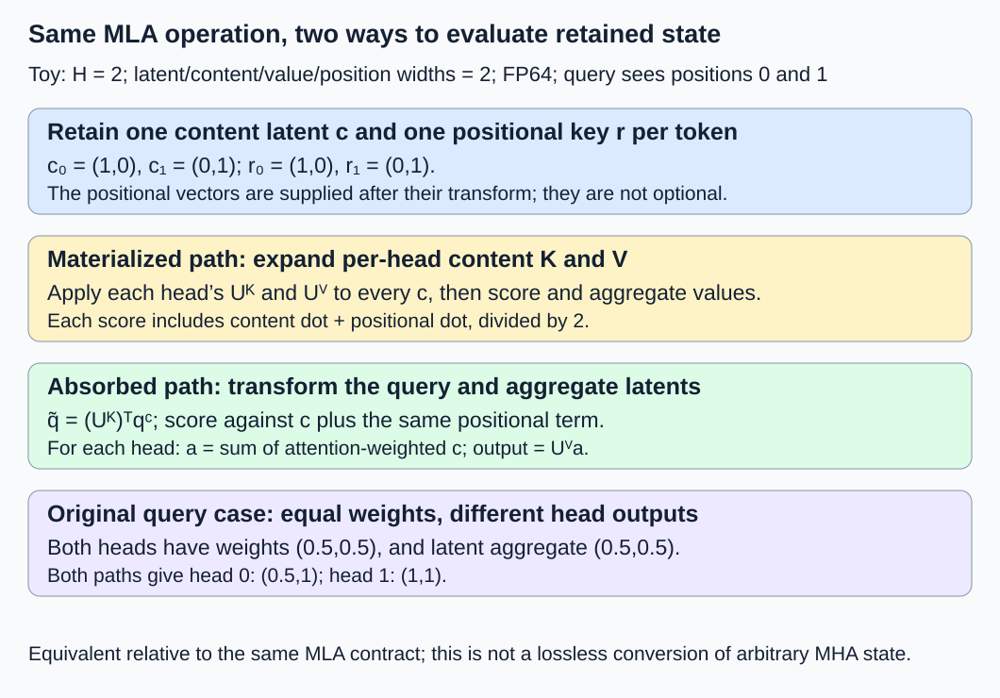
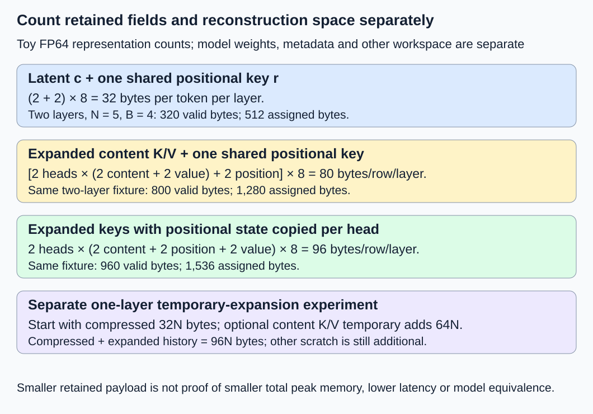

# M2-C18: Architecture-specific state: Multi-head Latent Attention

> **Status: Complete — detailed chapter authored and documentation validated; experimental procedures are proposed unless explicitly labelled observed**

**Module:** Treat the KV cache as a first-class systems problem

**Category:** [Model computation and semantics](index.md)

[Module 2 reading order](../module-2.md) · [Execution plan and progress](../chapter-execution-plan.md) · [Previous: M2-C17](m2-c17-sliding-window-attention-and-bounded-cache-state.md) · [Next: M2-C19](../runtime-and-concurrency/m2-c19-connecting-block-allocation-to-the-request-generator.md)

## Target concepts

MLA compressed latent state, positional components, architecture-specific cache representations, storage versus reconstruction work, limits of the conventional KV formula.

## Concepts

### 1. Cache the representation the architecture actually uses

**Multi-head Latent Attention (MLA)** retains a shared compact representation from which attention heads derive content keys and values, together with required positional state. A **latent vector** is an intermediate learned representation; **down-projection** maps a larger feature vector into it, and **up-projection** maps it into head-specific features. [M1-C04](m1-c04-dot-products-and-matrix-multiplication.md) provides the matrix algebra, and [M2-C02](m2-c02-attention-head-sharing-mha-gqa-and-mqa.md) distinguished query heads from retained KV heads.

The [DeepSeek-V2 paper, version 5, section 2.1](https://arxiv.org/html/2405.04434v5), introduces joint latent KV compression and decoupled positional keys. Its learned factorization is an architecture choice, not a lossless compressor that can be applied to arbitrary MHA cache bytes. Replacing a trained model's attention with another architecture requires separate conversion/training and quality evidence. Here equivalence means two evaluation paths for the **same declared MLA projections and inputs**. It does not mean MLA and an unrelated MHA model produce identical text.

MLA also differs from simply setting the KV-head count to one. A shared latent can feed different head-specific projections and different attention weights. A **low-rank factorization** represents a larger linear map as two narrower maps; its expressible transformations and trained parameters are part of the model. Reducing the latent width changes that contract. No implementation code or architecture conversion is provided.

For one layer, let c_j be the retained content latent at token position j, with width d_c. Let r_j be the retained, already position-transformed key component of width d_r, shared across heads in this teaching contract. A request retains one pair (c_j,r_j) per processed token per layer, not one pair per query head. A current query has separate content vector q_h^C of width d_k and already transformed positional vector q_h^R of width d_r for head h. Query-side temporaries are not historical KV cache.

The [DeepSeek-V3 technical report, version 2, section 2.1.1](https://arxiv.org/html/2412.19437v2), also describes latent and positional components; its model details include normalization/scaling that a real backend must preserve. In this chapter c means the value at the exact declared retained boundary, after any required latent normalization. The algebra below assumes bias-free linear up-projections from that boundary. It does not authorize moving a nonlinear normalization across a matrix or omitting checkpoint-specific scaling.

### 2. Describe the shapes before deriving the attention

Use column vectors. For H heads, head h has content-key matrix U_h^K of shape (d_k,d_c), and value matrix U_h^V of shape (d_v,d_c). Reconstructing explicit head state gives:

**k_hj^C = U_h^K c_j; v_hj = U_h^V c_j.**

The complete conceptual key is content k_hj^C concatenated with shared positional r_j. For this teaching contract, scaled scores and head outputs are:

**z_hj = ((q_h^C)ᵀ k_hj^C + (q_h^R)ᵀ r_j) / sqrt(d_k + d_r).**

**α_hj = exp(z_hj − m_h) / sum over eligible t of exp(z_ht − m_h), where m_h is the maximum eligible score.**

**o_h = sum over eligible j of α_hj v_hj.**

Transpose ᵀ turns a column into a row for the dot product. Eligibility follows the model's causal/position mask, as explained in [M1-C11](m1-c11-causal-masking-and-positional-information.md). Concatenated head outputs would feed the model's output projection, which is outside the numerical fixture. The scale above is explicitly chosen; real positional-extension or other score scaling must come from the pinned model contract.

A retained descriptor must identify more than “two KV heads”:

| Descriptor field | Required meaning in this chapter |
|---|---|
| Architecture and model revision | MLA variant, actual trained projections and required normalization/scaling |
| Content latent | d_c, dtype, layout/strides and precise pre/post-normalization boundary |
| Positional key | d_r, dtype, sharing rule, logical position IDs and whether the transform is already applied |
| Consumer contract | H, d_k, d_v, score scale, mask and supported materialized/latent evaluation path |
| Storage identity | Request/attempt/layer, pool/slot generation, valid rows, owners and covered completion |

The [Transformers v4.57.1 DeepSeek-V2 configuration reference](https://huggingface.co/docs/transformers/v4.57.1/en/model_doc/deepseek_v2) exposes distinct latent, nonrotary, rotary and value dimensions. A configuration alone does not establish what an execution backend physically caches. Inspect that backend's versioned representation rather than treating every public cache interface as an optimized latent-only layout. No source-default dimensions are used as measurements here.

### 3. Reassociate linear operations instead of expanding the history

The explicit path reconstructs keys and values for all retained positions before attention. For the same linear maps, matrix associativity permits a second path. Define a transformed content query and a per-head weighted latent:

**q̃_h = (U_h^K)ᵀ q_h^C, with width d_c.**

**z_hj = (q̃_hᵀ c_j + (q_h^R)ᵀ r_j) / sqrt(d_k + d_r).**

**a_h = sum over eligible j of α_hj c_j; o_h = U_h^V a_h.**

This is the **absorbed path** in our discussion: move the content-key projection to the query side and apply the value projection after weighted latent aggregation. It need not reconstruct full per-position K/V. Head-specific q̃_h, α_hj and a_h remain distinct even though c_j is shared. A backend can additionally combine suitable projections with other linear maps; such fusion needs its own shape and numerical contract.

These identities hold over exact real arithmetic. Floating-point reassociation changes rounding and reduction order; validate numerical differences rather than requiring bitwise equality without evidence. The model's weights still exist: caching fewer features does not remove those parameters or their access cost. Query-side transformations, larger latent dot products in some architectures, and workspace can change the operating point.

The positional term cannot simply be discarded. To see why naively rotating reconstructed content keys complicates one-time absorption, suppose k_j = R_j U c_j and the query is R_i q. Then:

**(R_i q)ᵀ R_j U c_j = (Uᵀ R_jᵀ R_i q)ᵀ c_j.**

R_i and R_j denote the position rotations. The transformed query on the right depends on key position j; it cannot generally be computed once for every key. The decoupled positional term keeps the content projection separate and evaluates position dependence explicitly. This derivation does not say RoPE is impossible with compressed state, nor that rotations commute with arbitrary learned matrices. A kernel must preserve the model's actual arrangement.

*Shared retained state does not imply identical head outputs. The positional contribution remains present in both paths.*

### 4. Work through two heads and two retained positions

Choose a synthetic one-layer fixture: **H = 2; d_c = d_k = d_v = d_r = 2; FP64 elements; no bias, dropout or extra normalization**. The supplied c/r values already represent their declared retained boundaries; this is not a RoPE implementation or checkpoint trace. One query at logical position 1 attends to positions 0 and 1, including itself. The score divisor is sqrt(2 + 2) = 2.

Retained column vectors are **c₀ = (1,0), c₁ = (0,1); r₀ = (1,0), r₁ = (0,1)**. Matrices below are written as two rows separated by a semicolon:

| Head h | U_h^K rows | U_h^V rows | q_h^C | q_h^R |
|---|---|---|---|---|
| 0 | (1,0); (0,1) | (1,0); (0,2) | (1,0) | (0,1) |
| 1 | (1,1); (0,1) | (2,0); (1,1) | (0,1) | (1,0) |

Explicit reconstruction gives:

| Head | Content keys for j = 0 / j = 1 | Values for j = 0 / j = 1 | Content dot terms | Positional dot terms |
|---|---|---|---|---|
| 0 | (1,0) / (0,1) | (1,0) / (0,2) | 1 / 0 | 0 / 1 |
| 1 | (1,0) / (1,1) | (2,1) / (0,1) | 0 / 1 | 1 / 0 |

Each head's total dot terms are (1,1), so scores are (0.5,0.5) and weights are (0.5,0.5). The outputs are **o₀ = (0.5,1), o₁ = (1,1)**. The absorbed path gives q̃₀ = (1,0), q̃₁ = (0,1), and both a_h = (0.5,0.5); applying each distinct U_h^V yields the same outputs.

Equal scores are convenient for auditing, but insufficient coverage. Change only head 0's content query to **q₀^C = (0,1)**, keeping its positional query (0,1) and all retained state fixed. Scores become (0,1). Let **b = exp(1)/(1 + exp(1)) ≈ 0.731058578630005**. Its output becomes **o₀ = (1 − b, 2b) ≈ (0.268941421369995, 1.462117157260010)**; head 1 stays (1,1). Both paths must match this nonuniform case.

As a negative control, keep the original queries but omit the positional term. Head 0's scores become (0.5,0), so its weights and output change; head 1 changes too. Using a position tag as a substitute for the actual r vector is also wrong: the tag validates identity but does not supply the positional contribution. Swapping r₀/r₁ without changing c must fail the original-reference check. Numerical tolerance cannot authorize either semantic change.

### 5. Count retained fields, assigned blocks and temporary expansion separately

For a latent-only MLA representation with one shared positional key per layer/token, latent width d_c, positional width d_r and equal element width w bytes:

**Retained bytes per token per layer = w × (d_c + d_r).**

For requests i of retained length N_i and layers ℓ with potentially different fields/dtypes:

**M_valid = sum over i,ℓ of N_i × (d_c,ℓ × w_c,ℓ + d_r,ℓ × w_r,ℓ).**

Compression reduces retained feature width, not the number of logically required tokens: full-causal MLA still grows with N unless the model declares a different retention rule. Add actual quantization scales, alignment, metadata and any other retained fields separately. This representation is distinct from retaining both expanded heads and latent state simultaneously. Query compression does not automatically reduce historical KV again.

In the toy fixture, one latent/positional row has **(2 + 2) × 8 = 32 bytes/layer**. Explicit content K/V with one still-shared positional key uses **[H × (d_k + d_v) + d_r] × w = [2 × 4 + 2] × 8 = 80 bytes/layer**. If positional keys are physically duplicated into every head key, the row becomes **H × (d_k + d_r + d_v) × w = 2 × 6 × 8 = 96 bytes/layer**. Sharing through a view and copying into expanded storage are different allocations.

For **two identical layers, N = 5, B = 4 rows/block**, independently allocated per layer with no quantization or extra fields:

| Retained representation | Bytes/row/layer | Valid payload | Assigned payload, two blocks/layer | Tail slack |
|---|---:|---:|---:|---:|
| Latent + one positional key | 32 | 320 bytes | 512 bytes | 192 bytes |
| Expanded content K/V + shared positional key | 80 | 800 bytes | 1,280 bytes | 480 bytes |
| Expanded K/V with positional key copied per head | 96 | 960 bytes | 1,536 bytes | 576 bytes |

These are representation choices for the same toy computation, not three measured model capacities. Conventional **2 × layers × positions × KV heads × head width × element bytes** assumes separately retained K/V with equal widths. Substituting Hkv = 2, d = 2 into that formula gives 640 bytes here; it describes neither our 320-byte latent representation nor the expanded keys that also have positional dimensions. Treat the formula as conditional on stored fields, not a universal law. Weight matrices and execution workspace remain outside all three payload rows.

For a one-layer single-query evaluation with N retained positions, choose a materialized path that starts with the 32N-byte latent/positional cache and reconstructs only content K/V in a temporary of **H × N × (d_k + d_v) × w = 64N bytes**. It reuses the already retained positional keys without copying them per head. Compressed plus expanded-history payload coexisting is **96N bytes**. At N = 8 this is 768 bytes; at N = 32 it is 3,072 bytes. This subtotal excludes scores/weights, query/output vectors, matrices, allocator padding and other workspace. The absorbed path needs no history-sized expanded K/V temporary, but still has those other costs, including per-head transformed queries/aggregates.

*Persistent latent payload, an optional reconstruction temporary and model weights are different accounting boundaries.*

### 6. Storage savings do not establish a latency improvement

A **multiply-accumulate (MAC)** is counted here as one scalar multiplication paired with accumulation, conventionally two FLOPs; it is a work-count convention, not a hardware instruction claim. For the dense toy matrices and one query, the explicit path uses **H × N × d_c × (d_k + d_v) = 16N MACs** reconstructing content K/V, **H × N × (d_k + d_r) = 8N** scoring, and **H × N × d_v = 4N** value aggregation: **28N MACs** total.

The absorbed path uses **H × d_k × d_c = 8 MACs** transforming queries, **H × N × (d_c + d_r) = 8N** scoring, **H × N × d_c = 4N** latent aggregation and **H × d_v × d_c = 8** final projection: **12N + 16 MACs**. These counts exclude softmax, input/query/positional generation, mask checks, output projection and common administration. Dense zero entries are still counted; no special zero/uniform-score shortcut is assumed. At N = 2/8/32 the totals are **56/224/896** versus **40/112/400**. Other latent/head dimensions can change the tradeoff substantially.

Real performance also depends on projection-weight reuse, latent width, batch/query shape, temporary traffic, precision, fusion, launch overhead and completion dependencies. Prefill and single-query decode can favor different execution paths. Neither a smaller cache, fewer nominal MACs nor a paper's throughput result determines latency on an unspecified machine.

Ownership rules remain: publish a row only after all required latent and positional components complete and are visible; a content-only row is not a valid cache hit. Sharing/reuse needs exact model/projection/position/layout identity and lifetime protection. Cancellation during temporary expansion keeps submitted buffers pinned until covered completion. A wrong architecture descriptor must reject before reinterpretation, even if an allocation is large enough to contain the resulting addresses. The HFT analogy is retaining a compact event-derived state with enough versioned information for its consumers; it transfers reconstruction costs and contract reasoning, not permission to compress arbitrary market history or claim trading results.

## Experiments

The following are proposed procedures without implementation code. Exact arithmetic/documentation checks are separate from actual MLA kernels, checkpoint quality or device measurements.

### E1 — Materialized and absorbed attention agree

- **Description:** Compare both algebraic paths on the two-position, two-head fixture and its nonuniform query variant.
- **Purpose/objective:** Establish equivalent computation relative to one MLA contract before optimizing storage or work.
- **Target concepts:** Shared latent state, head-specific projections and reconstruction versus absorbed evaluation.
- **Baseline and workload:** Declared c/r matrices and queries, FP64, causal keys 0–1, divisor two; no extra normalization/dropout. Use an independent exact/high-precision reference.
- **Controls and prediction:** Vary evaluation path only. Original outputs are (0.5,1)/(1,1); the changed head-0 query gives (1−b,2b)/(1,1).
- **Procedure:** Check projected keys/values, separate content/position dot terms, scaled scores, normalization weights, weighted latents and outputs. Compare both paths to the reference rather than only to each other. Preserve head ordering and matrix orientation. Repeat the nonuniform case to expose a misplaced softmax or a shared per-head aggregate.
- **Hardware/software:** Paper rational audit and stabilized high-precision exponential reference first; later numerical harness records compiler/backend and reduction contract.
- **Failure and HFT connection:** Two consumers of a compact snapshot can derive different outputs; sharing the snapshot does not collapse their consumer-specific computations.
- **Exit criteria:** All exact identities/shapes and eight output coordinates across both cases pass the predeclared numerical gate below. No claim that an arbitrary MHA checkpoint is equivalent to MLA.

### E2 — Positional component and descriptor negative controls

- **Description:** Omit/swap positional state and reject incompatible cache descriptors.
- **Purpose/objective:** Demonstrate that the latent alone and a generic head count do not define valid MLA state.
- **Target concepts:** Positional components, architecture-specific representation and cache identity.
- **Baseline and workload:** Original E1 inputs and reference outputs. Independent mutations omit r, swap r₀/r₁, use the wrong projection revision or read a stale position tag.
- **Controls and prediction:** Hold other inputs fixed. Omission/swapping changes reference scores/outputs; projection/tag mismatch must reject before payload consumption.
- **Procedure:** Check full record identity and component readiness. Use an unfinished positional write as an unavailable-row case, even when c is complete. Compare a separately prepared valid descriptor before accepting it. Do not “repair” a missing positional vector by zero-filling or applying RoPE twice.
- **Hardware/software:** Exact descriptor/input ledger; real position tests require actual model transform, dtype/strides and completion events, not only supplied rotated vectors.
- **Failure and HFT connection:** A valid snapshot label cannot replace a missing required feature or silently reinterpret another version's state.
- **Exit criteria:** All independent mutations are detected; semantic changes fail the original oracle, identity failures attach nothing and incomplete rows stay unpublished. A passed toy case does not certify a real RoPE implementation.

### E3 — Retained-field and reconstruction-space budgets

- **Description:** Audit the three persistent representations and the separate one-layer expansion temporary.
- **Purpose/objective:** Replace an unsuitable conventional formula with field-based accounting.
- **Target concepts:** Architecture-specific cache representations, storage/reconstruction work and KV-formula limits.
- **Baseline and workload:** Two-layer N = 5/B = 4 table; separately one-layer N = 8/32 materialization with shared positional storage.
- **Controls and prediction:** Same mathematical attention; vary retained/temporary layout only. Predict 320/800/960 valid bytes and 512/1,280/1,536 assigned bytes; expansion temporary is 64N bytes in its separate fixture.
- **Procedure:** Enumerate physical fields and owning allocations once, including positional sharing versus copies. Add actual alignment/scales/metadata when present; measure query/score workspace separately. Inspect actual backend representation before applying the latent formula. Inject expansion failure/cancellation after submission and retain its buffers until completion; do not corrupt persistent c/r.
- **Hardware/software:** Exact byte/block ledger; later allocator/profiler runs record shapes, dtype, storage aliases, weight residency and scratch high-water marks.
- **Failure and HFT connection:** Compact retained state can reduce inventory while moving work to reconstruction; a small payload counter alone does not establish a small peak working set.
- **Exit criteria:** Every table and temporary subtotal reconciles without counting shared views as copies or hiding retained expanded state. Unresolved temporary work remains occupied; payload projections are not reported as observed memory.

### E4 — Conditional one-query evaluation benchmark

- **Description:** Compare explicit content reconstruction with the absorbed path, if both general FP64 implementations become available.
- **Purpose/objective:** Measure the complete selected attention subproblem while holding semantics and persistent inputs fixed.
- **Target concepts:** Storage versus reconstruction work, latent evaluation and reproducible numerical/performance evidence.
- **Baseline and workload:** One layer, H = 2 and all widths two; N = 8 and N = 32. Alternate supplied (c₀,r₀) and (c₁,r₁) from E1; use original queries and full causal visibility for the final query. These repeated position-labelled vectors are synthetic inputs, not actual RoPE outputs for a long checkpoint sequence.
- **Controls and prediction:** Both paths start with the same compressed cache. Preallocate scratch outside timing but include reconstruction writes inside explicit-path timing. Three sessions, two lengths, 30 randomized balanced path pairs per length/session; exclude five warmups per path/length/session. Predict original per-head outputs for these balanced sequences, not a timing winner.
- **Procedure:** Time declared current queries and retained cache through completed head outputs. Include explicit expansion versus query transforms/latent aggregation/value projection, plus scoring/softmax in both. Exclude common input generation/output projection equally. Use general dense operations without uniform-score shortcuts. Check numerical gates outside timing; profile separately. Keep unsupported paths and failures visible, and do not recycle submitted scratch before covered completion. A 120-second watchdog records unresolved work rather than proving completion.
- **Hardware/software:** Single-worker CPU harness first; any GPU experiment is a separate manifest with actual launch/completion boundaries and supported MLA kernels.
- **Failure and HFT connection:** Lower arithmetic or scratch traffic in a local operation matters only through useful correct service; small synthetic shapes cannot establish HFT tails or production serving speed.
- **Exit criteria:** If supported, 180 pairs yield 360 timed trials and 60 excluded warmups; each path/length has 90 trials. Outputs pass, raw durations and all outcomes remain available. No implementation means no measured performance result.

## Verification

| Pair | Reference and correctness gate | Measurement, benchmarking and profiling |
|---|---|---|
| V1 / E1 | Independent exact/high-precision stage reference for original and nonuniform cases | Per-head keys/values, content/position terms, scores, weights, latent aggregates and outputs; report first divergence |
| V2 / E2 | Exact architecture/projection/position/layout identity and complete c/r publication | Mutation verdicts, row/component readiness and no unauthorized attachment; numerical tolerance never excuses wrong state |
| V3 / E3 | Independently enumerated physical fields and owning allocations | Valid/assigned/backing/cache/weight/scratch bytes, materialization high-water mark and cancellation scope |
| V4 / E4 | Both paths pass the same reference gate before timing comparison | Duration by path/length/session, median/spread, allocation/traffic/projection profiles and fault counts; separate profiled runs |

For the two E1 cases and the two balanced E4 lengths, use FP64 and predeclare **absolute output error ≤ 1e−12** per coordinate against stabilized reference behavior, after exact shape/mask/identity checks. Values, matrices and queries are bounded by two in magnitude; these tiny sums avoid extreme cancellation and softmax ranges. Verify exponential-based references at 80 and 120 decimal digits and require their output difference ≤ 1e−60 before using them as the oracle. The gate applies only to this small supplied corpus, not arbitrary trained-model logits. For any real checkpoint, choose its numerical budgets using completed [M9-C17](../numerics-and-correctness/m9-c17-comparing-logits-with-justified-numerical-tolerances.md), retaining reference uncertainty and reduction/precision differences.

Each E4 trial returns two heads × two features, so **360 × 4 = 1,440 output scalars**. Each path sees **90 × (8 + 32) = 3,600 retained-position visits** across its queries, or 7,200 across both paths; this is a logical workload count, not memory transactions. Nominal MAC totals are **90 × (224 + 896) = 100,800** for reconstruction versus **90 × (112 + 400) = 46,080** for the absorbed path. Explicit expansion writes **90 × (64 × 8 + 64 × 32) = 230,400 projected content-payload bytes**. These formulas exclude repeated cache reads, matrices, softmax, score buffers and actual hardware effects; none is a measured instruction/traffic count or speedup.

Use completed [M9-C01](../numerics-and-correctness/m9-c01-defining-reference-behavior-and-evidence-before-optimizing.md) for references, [M9-C02](../measurement-experimentation-and-economics/m9-c02-request-events-clocks-and-measurement-boundaries.md) for completion and [M9-C07](../measurement-experimentation-and-economics/m9-c07-latency-distributions-and-statistical-uncertainty.md) for populations/uncertainty. Advanced M9-C15/M9-C22 remain outlines; elementary ownership and accounting obligations are stated locally. Ninety trials per path/length do not establish reliable p99. Retain errors, unsupported cases and unresolved outcomes rather than reporting only successful samples.

Actual end-to-end evaluation preserves model/tokenizer/projection/adapter revision, positions/masks, precision/scales, length/batch/arrival distributions, admission limits and stopping. Compare retained-state compatibility, logits/output under justified budgets, complete-request latency, useful throughput and peak whole-service memory. Prefill, decode, concurrency, quantized state and mixed adapters need separate representative cases. Preserve raw inputs/identities, allocation scope, completion events, fault points, seeds/trial order, clocks/units/resolution and all outcomes. An architecture paper's performance or a payload ratio is not evidence for the unspecified deployment.

## Engineering dimensions and principles

| Dimension | Chapter-specific application |
|---|---|
| Semantics and invariants | Both paths evaluate the same MLA projections, positional term and mask; arbitrary MHA conversion is outside equivalence. |
| Workload and variability | Latent/head widths, context length, batch and prefill/decode shape change arithmetic, reuse and temporary demand. |
| Resources and bottlenecks | Count c/r fields, projection weights, expanded history and score/query scratch at separate boundaries. |
| Time and distributions | Query transforms, expansion and completion lie on different dependency paths; smaller cache alone does not establish tails. |
| Ownership and coordination | A row is ready only when all retained components complete; shared state and submitted scratch need protected lifetimes. |
| Failure and adaptation | Wrong descriptor, missing positional state, stale tags and failed materialization have explicit rejection/drain paths. |

1. **Correctness defines the optimization boundary:** Reassociation preserves this MLA operation in real arithmetic; omitting positions or converting another model changes semantics.
2. **Performance depends on workload and operating point:** Projection dimensions and batch/context shape determine whether reconstruction or absorbed evaluation is favorable.
3. **Data movement is part of the algorithm:** Expansion adds writes/reads; latent storage still requires weights, projections and positional state.
4. **State has ownership, lifetime, and recovery cost:** Persistent c/r and temporary expanded buffers have different readiness, sharing and cleanup obligations.
5. **Dependencies determine latency; bottlenecks determine capacity:** Required projections and completions precede useful output, while cache and workspace can constrain capacity differently.
6. **Variability and synchronization shape the tail:** Mixed shapes and delayed scratch completion can change tails; small serial medians do not certify p99.
7. **Local improvements must be evaluated end to end:** Lower bytes/MACs matter through correct useful service with full request and memory boundaries visible.
8. **Claims require reproducible evidence:** Pin stored-field schemas, checkpoint transforms and numerical gates; distinguish projected counts from measured behavior.

## Specifications, articles, and hardware

- [DeepSeek-V2 paper, version 5, 19 June 2024](https://arxiv.org/html/2405.04434v5), section 2.1 and Appendix C: latent joint compression, decoupled positional state and linear reassociation. The worked fixture and benchmark dimensions here are independently chosen.
- [DeepSeek-V3 Technical Report, version 2, 18 February 2025](https://arxiv.org/html/2412.19437v2), architecture and model details: MLA components and checkpoint-specific normalization/scaling. Its model/quality/performance results are not reproduced here.
- [Transformers v4.57.1 DeepSeek-V2 reference](https://huggingface.co/docs/transformers/v4.57.1/en/model_doc/deepseek_v2), checked 26 October 2026: separate configuration dimensions. Inspect the actual cache consumer/storage contract; configuration support is not proof of a latent-only backend.

Paper references need no device. A proposed CPU subproblem harness uses one worker and at least 1 GiB available RAM for tiny FP64 arrays and harness overhead. Record CPU model, cores/cache sizes, affinity, frequency/power policy, RAM capacity/speed, OS/kernel/page size, Rust/compiler/optimization settings, allocator, numerical/matrix library and reduction contract. Use 64-byte-aligned bases if materializing the chosen B = 4 layouts: their latent/shared-expanded/copied-expanded blocks contain 128/320/384 payload bytes per layer; record actual padding separately. Device/model experiments additionally record checkpoint/config, retained-boundary normalization, positional transforms, per-field dtype/scales, GPU/count/VRAM, driver/runtime, supported kernels, workspace, weight residency, streams and completion boundaries. No MLA implementation, checkpoint conversion, numerical backend benchmark, quality evaluation or GPU experiment has been executed for this chapter.

## Key takeaways

MLA caches architecture-specific latent and positional fields rather than an assumed pair of equal-width K/V head arrays. Reconstruction and absorbed evaluation can compute the same declared operation while using different work and temporary storage. Count the actual representation and validate its numerical and lifetime contract. Progress is tracked in the [execution plan](../chapter-execution-plan.md). [M2-C19: Connecting block allocation to the request generator](../runtime-and-concurrency/m2-c19-connecting-block-allocation-to-the-request-generator.md) is now a completed detailed chapter. M2-C20 is next for authoring.
