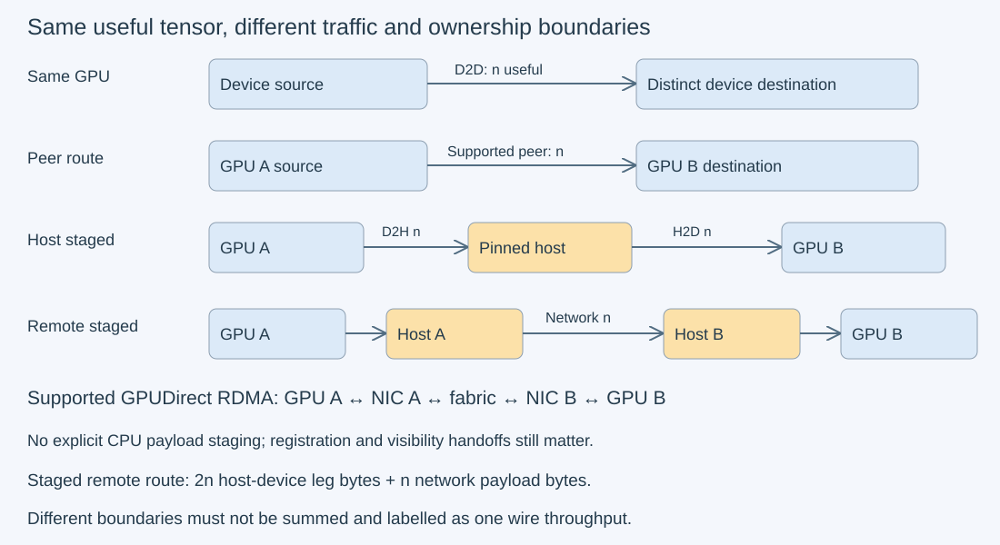
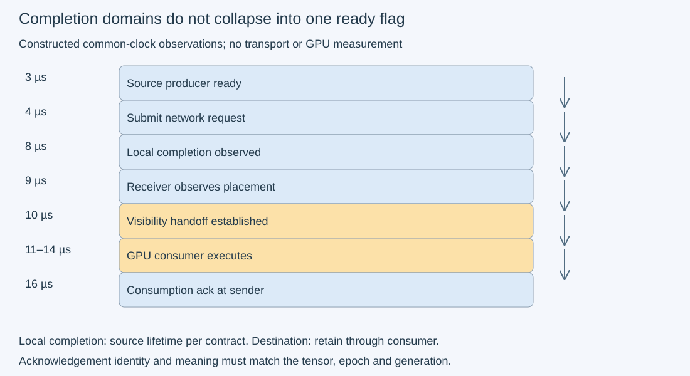

# M3-C14: Moving tensors between devices and hosts

> **Status: Complete — detailed chapter authored and documentation validated; experimental procedures are proposed unless explicitly labelled observed**

**Module:** Learn GPU architecture through data movement

**Category:** [Networking and communication](index.md)

[Module 3 reading order](../module-3.md) · [Previous: M3-C13](../hardware-architecture-and-topology/m3-c13-pcie-nvlink-numa-and-device-topology.md) · [Next reading: M3-C15](../measurement-experimentation-and-economics/m3-c15-counting-flops-and-bytes-at-a-defined-boundary.md) · [Execution plan and progress](../chapter-execution-plan.md)

## Target concepts

Host-device, device-device, peer-to-peer and staged transfers, network fabrics, RDMA and GPUDirect concepts, transfer completion, shared-link contention, communication scope and limits.

## Concepts

### 1. A tensor transfer needs both a data contract and a route

A **tensor** is an indexed collection of values. Moving it requires identifying its element type, shape, byte order, layout and logical identity, not merely a pointer and length. **Serialization** defines the byte representation sent to a consumer. A **stride** tells how far storage advances when an index changes. A raw memory copy preserves bytes; it does not infer a transpose, change element type or automatically pack a strided view.

Consider two rows of three unsigned 32-bit integers with a four-element row stride. Storage is [10,11,12,padding,20,21,22,padding]. A packed row-major representation is [10,11,12,20,21,22], containing 24 bytes. The allocation contains 32 bytes, and the span through the last logical element is 28 bytes. Copying the first 24 storage bytes would include padding and omit 22. Explicit packing or an appropriate documented multidimensional operation is needed. A raw 32-byte transfer is a different representation unless the receiver agrees on padding and stride.

Define a transfer record containing request epoch, tensor ID, element type, shape/layout, source/destination identity, byte range and buffer generation. An **epoch** distinguishes input instances; a **generation** distinguishes successive uses of a reusable allocation. Validate compatible destination capacity and representation before submission. In Rust, slices and ownership can describe CPU access, but an external device's pending access needs the selected binding's explicit lifetime/completion contract. This chapter provides no implementation code.

### 2. Local routes move the same useful payload through different boundaries

H2D means host to device; D2H means device to host. **Device-to-device** can mean two buffers on one GPU or buffers on different GPUs, so always state endpoints. **Peer-to-peer** means a supported device path between GPUs without explicit host staging in the application. It does not itself identify PCIe versus NVLink. An **explicit staged transfer** uses host storage as an intermediate buffer.

| Route for n useful bytes | Required application stages | Logical boundary accounting |
| --- | --- | --- |
| Host → GPU | H2D | n host-device payload bytes |
| GPU → host | D2H | n host-device payload bytes |
| Same GPU, distinct device buffers | D2D | No host-device payload; n logical device reads + n writes |
| GPU A → GPU B, supported peer operation | Peer copy | n useful inter-device bytes; physical path needs evidence |
| GPU A → host → GPU B | Completed D2H, then H2D | 2n host-device leg bytes; n useful destination bytes |
| GPU A → host A → network → host B → GPU B | D2H, network transfer, H2D with ordered handoffs | 2n host-device leg bytes plus n network payload bytes |
| GPU A ↔ NIC A ↔ network ↔ NIC B ↔ GPU B using supported GPUDirect RDMA | Registered GPU/NIC path and documented ordering | n network payload; endpoint GPU-NIC traffic is separately scoped; no explicit CPU payload staging |

NIC means network interface controller. These counts exclude protocol headers, control messages, initialization and verification. They are not measured DRAM/link counters. In the last row, absence of explicit CPU staging does not mean absence of CPU coordination, registration or synchronization.

The [CUDA memory specification](https://docs.nvidia.com/cuda/cuda-runtime-api/cuda_runtime_api/group__CUDART__MEMORY.html) defines individual copy contracts. The [peer-access specification](https://docs.nvidia.com/cuda/cuda-runtime-api/cuda_runtime_api/group__CUDART__PEER.html) defines directional access capabilities. A successful capability query, a wide link and a fast copy remain separate claims, as explained in [M3-C13](../hardware-architecture-and-topology/m3-c13-pcie-nvlink-numa-and-device-topology.md).

*Every route delivers n useful bytes, but different boundaries carry different traffic. Host staging must remain owned through both dependent legs.*

### 3. Network fabrics and RDMA add another completion domain

A **network fabric** is the adapters, links, switches and transport rules connecting machines. Ethernet and InfiniBand are network technologies; **RoCE**, RDMA over Converged Ethernet, carries RDMA semantics over Ethernet. **RDMA**, remote direct memory access, lets a supported NIC transfer registered memory under a transport contract without a remote CPU copying each payload byte. CPU work still establishes connections, registers memory, posts operations, handles completions and coordinates the application. The [DOCA 3.5.0 RDMA-aware guide](https://networking-docs.nvidia.com/doca/archive/3-5-0/rdma-aware-networks-programming-guide) explains these objects and transport distinctions; do not treat every Ethernet connection as RDMA-capable.

A **queue pair** consists of transport send/receive work queues. **DMA**, direct memory access, means hardware moves data without a CPU copying each payload byte. A **registered memory region** identifies storage and permitted device accesses for the transport. A **work request** asks the NIC to perform an operation. A **completion queue** supplies records about finished requests; a record's identity and success/error status must be checked. Reliable transport is not equivalent to a remote application having consumed the tensor. A plain one-sided write does not, by itself, define the receiver's entire notification and consumption protocol.

For ordinary non-inline sends in this chapter's conceptual model, local buffer reuse requires the documented local completion conditions. The [rdma-core send manual](https://man7.org/linux/man-pages/man3/ibv_post_send.3.html) describes buffer lifetime and operation-specific exceptions. The [completion manual](https://man7.org/linux/man-pages/man3/ibv_poll_cq.3.html) distinguishes polling results from completion status and warns about queue overrun. Clearing a CPU-side flag or receiving any completion record is insufficient; it must be the intended operation and a valid successful outcome.

### 4. GPUDirect RDMA requires device visibility, not just transport progress

**GPUDirect RDMA** provides a supported path between GPU memory and a third-party device such as a NIC. It is distinct from a CUDA peer copy between two GPUs. Hardware, topology, drivers, registration, allocation type and transport integration must all support the path. The [GPUDirect RDMA guide](https://docs.nvidia.com/cuda/gpudirect-rdma/index.html#synchronization-and-memory-ordering) describes GPU memory registration and ordering requirements. A NIC's completed write and a concurrently running GPU kernel do not automatically form a correct producer-consumer relation. The receiving side must establish the documented ordering/visibility handoff before launching a dependent GPU consumer; platform-specific requirements must be checked rather than inferred from a network completion alone.

**Visibility** here means the consumer is permitted to observe the producer's completed writes under the relevant memory contract. An application acknowledgement can then report a chosen milestone, such as receiver consumption. It must carry tensor/epoch/generation identity and specify what it acknowledges. An acknowledgement of receipt is not an acknowledgement of GPU consumption unless the protocol says so and establishes the dependency.

Use a constructed timeline to distinguish the milestones. Its times are invented microseconds on a common illustrative clock, not timestamps from separate hosts. Notification order does not prescribe the time of final wire arrival:

| Milestone | Time | What this teaching protocol may infer |
| --- | --- | --- |
| GPU source producer finishes | 3 | Source data ready after the documented producer handoff |
| Network request submitted | 4 | Operation accepted for execution, not completed |
| Local transport completion observed | 8 | Source reuse only if its operation contract permits and no other users remain |
| Receiver observes completed placement | 9 | Destination transfer milestone, not yet the GPU consumer |
| Receiver establishes visibility/ordering | 10 | Dependent consumer can be submitted under the checked platform contract |
| GPU consumer runs | 11–14 | Destination must remain stable throughout the read |
| Consumption acknowledgement reaches sender | 16 | Protocol's remote-consumption milestone, with matching identity |

Source-producer-to-acknowledgement time is 13 µs; submission-to-local-completion is 4 µs. These are different scopes. Destination reuse needs consumer completion and exclusion of any later remote writes, not merely time 9. A production protocol also needs bounded admissions, registration lifetime and recovery for disconnects and ambiguous outcomes; this chapter does not supply such a protocol implementation.

*The receiver's GPU consumer follows both transfer and visibility obligations. Local completion cannot stand in for remote consumption.*

### 5. Shared links and staging can dominate communication cost

For serial stages with payload n, a teaching model is **T_serial = Σ(αᵢ+n/βᵢ)**, where αᵢ is each stage's fixed overhead and βᵢ its sustained useful payload rate. Add packing, consumer and acknowledgement costs when those belong to the target scope. Independent messages may pipeline, but same-message dependencies remain. A dependency-free rate is also limited by shared resources: **Σ demand on edge e ≤ capacity of edge e** is necessary for sustained flow.

Suppose two same-direction 8 MiB flows must cross an invented 16 GB/s shared resource. Each alone needs at least 0.524288 ms of payload service; together they require at least 1.048576 ms. Distinct streams or queue pairs cannot create extra edge capacity. Actual overhead and contention can increase elapsed time. Opposite directions, unrelated routes and a fabric's advertised aggregate require different accounting.

A staged route's extra copy is sometimes the correct supported fallback. It must remain visible in the route label, retained-memory budget and timing. Cancelling an unwanted result suppresses publication but does not prove that GPU copies or NIC accesses have stopped. Preserve source, staging and destination leases until their actual users retire; unknown completion quarantines the uncertain resources. Follow [M3-C12](../runtime-and-concurrency/m3-c12-asynchronous-copies-and-useful-overlap.md) for bounded pools and backpressure rather than overwriting busy buffers to accept more work.

### 6. Define the scope of a communication claim

“Transfer complete” must name the endpoint and observer: host-readable buffer, destination GPU-ready data, remote receipt, remote GPU consumption or acknowledged application result. The [CUDA synchronization specification](https://docs.nvidia.com/cuda/cuda-runtime-api/api-sync-behavior.html) explains why an “Async” suffix or a host return alone cannot settle every copy's completion semantics. Network and CUDA domains additionally need an explicit handoff.

HFT systems make this distinction familiar: submission, delivery and useful processing are different events, and stale answers can have no value. That is a lens for ownership, queueing and tail latency, not an assertion that a CUDA event or RDMA completion behaves like an exchange acknowledgement. These tensor-transfer exercises establish neither trading results nor a hard real-time service.

## Experiments

All experiments are **proposed, without implementation code**. E1/E4 are paper exercises; E2 describes a future one-GPU benchmark and E3 an optional two-GPU benchmark. No network or GPU transfer is executed here. Use completed [M9-C01 references](../numerics-and-correctness/m9-c01-defining-reference-behavior-and-evidence-before-optimizing.md), [M9-C02 timing](../measurement-experimentation-and-economics/m9-c02-request-events-clocks-and-measurement-boundaries.md), [M9-C07 uncertainty](../measurement-experimentation-and-economics/m9-c07-latency-distributions-and-statistical-uncertainty.md), [M9-C15 scoped bytes](../state-memory-and-caching/m9-c15-accounting-for-weights-kv-state-workspace-and-fragmentation.md) and [M9-C17 correctness](../numerics-and-correctness/m9-c17-comparing-logits-with-justified-numerical-tolerances.md). Exact byte-preserving transport needs no floating-point tolerance.

### E1 — Audit tensor representation and route byte ledgers

- **Description:** Serialize a padded tensor and compare local, staged and remote boundary ledgers on paper.
- **Purpose/objective:** Prevent confusion between logical tensor payload, storage span and summed traffic across different resources.
- **Target concepts:** Host/device, D2D, peer/staged routes, communication scope and representation.
- **Baseline and workload:** Shape 2×3, unsigned 32-bit little-endian elements, row stride four elements. Storage values [10,11,12,999,20,21,22,999]; packed row-major values [10,11,12,20,21,22]. Compare each route in the concept table for n=24 bytes.
- **Controls and prediction:** Predict 24 logical bytes, 28-byte minimal storage span, 32-byte full allocation. Packed integer sum is 96. Same-GPU D2D logically reads/writes 48 bytes total; explicit two-GPU staging crosses 48 host-device payload bytes. Remote host staging adds 24 network payload bytes to its 48 host-device bytes, not 72 wire bytes.
- **Procedure:** Enumerate each logical coordinate and storage offset, then write each integer's four little-endian bytes in logical order. Show why a raw first-24-byte copy fails. Retain schema/offset identity even when copying the complete padded allocation. Trace source, staging and destination users through each route.
- **Hardware/software:** Paper or spreadsheet; no GPU, NIC or transport registration required.
- **Failure and HFT connection:** A fast message with the wrong representation is not a valid low-latency result. Metadata agreement is part of processing correctness.
- **Exit criteria:** Values, byte counts, sum and all route ledgers reconcile; the raw-prefix failure is detected; no sum of different boundary counts is labelled as one network payload rate.

### E2 — Establish a completed-copy baseline on one GPU

- **Description:** Copy one exact contiguous buffer using H2D, D2H and same-GPU D2D routes at three sizes.
- **Purpose/objective:** Establish route-specific correctness and completed-copy timing before introducing optional peers or networks.
- **Target concepts:** Host-device/device-device transfers, completion, byte scope and safe buffer reuse.
- **Baseline and workload:** Sizes n ∈ {4,096; 1,048,576; 8,388,608} bytes, three routes, nine cells. Interpret each buffer as m=n/4 unsigned 32-bit little-endian labels. At epoch e ∈ {0,…,59}, label j is **Lⱼ(e)=e×2²⁴+j**, j=0,…,m−1. Every label in a buffer is unique and carries its epoch in the upper byte.
- **Controls and prediction:** Allocate two pinned host buffers and two device buffers, streams and final events outside timing. One transfer in flight; same stream/host completion mechanism; exact source initialization and destination sentinel initialization completed before timing. Predict identical destination bytes in all routes, with no required rate ranking. Fixed topology, affinity and page placement follow M3-C13.
- **Procedure:** Three sessions/cell, 10 excluded warmups plus 20 measured trials/session; epochs 0–59 per cell. Start the host monotonic interval before copy submission and stop after the correct final completion. Validate host destinations directly; read device destinations to the separate verification host buffer outside timing. Prefill every destination byte with its expected byte XOR 255 before the measured copy, using setup transfers outside timing where needed. Check every label/byte, endpoint and range before reuse. Rotate cell order and keep profile trials separate.
- **Hardware/software:** One supported CUDA GPU, documented copy operation, pinned host allocation and exact versioned binding/runtime. Peak raw payload is 16 MiB host + 16 MiB device, 32 MiB combined, plus allocation/registration/runtime overhead. No model, second GPU or NIC required.
- **Failure and HFT connection:** Submission-only timing can reward work not yet delivered. Any stale epoch, wrong offset, immediate error or failed final completion is a failure outcome, not a fast sample. A 120-second watchdog records unknown completion and preserves affected leases.
- **Exit criteria:** Reconcile 540 measured trials and 270 warmups; all successful destinations equal their full reference. Retain per-route latency, n/T and outcome counts; distinguish same-GPU logical read/write traffic from host-device payload bytes and setup/readback work.

### E3 — Compare peer and staged delivery under two-flow demand

- **Description:** On an optional supported GPU pair S → D, compare peer and explicit host-staged routes with one or two simultaneous independent messages.
- **Purpose/objective:** Test route work and shared-resource contention through completed useful delivery, rather than stream count alone.
- **Target concepts:** Peer-to-peer, staged copies, shared-link contention, completion and route limits.
- **Baseline and workload:** Three E2 sizes × two routes × q ∈ {1;2} independent messages = 12 cells. Keep direction S → D fixed; this is not a reverse-direction study. For message a=0,…,q−1 use label Lⱼ(e,a)=(e+64a)×2²⁴+j, so simultaneous messages have distinct identities. The peer route must be supported by its operation contract; otherwise mark those cells unsupported.
- **Controls and prediction:** Use disjoint buffers and per-message streams/records, supported peer configuration and fixed staging-page placement. Hold qn useful bytes fixed when comparing routes within a q cell; q=1 and q=2 have different total work. Predict exact labels. Two streams permit independence but do not guarantee overlap, higher aggregate rate or equal per-message latency.
- **Procedure:** Three sessions/cell, 10 warmups and 20 measured trials/session, epochs 0–59. Complete setup before a common host start; submit q messages, observing each staged first-leg completion before its own second leg. Stop the common host interval only after all q destination completions. Record each message's completion offset as well as the cohort makespan. Read back/check all destinations afterward. Keep staging buffers through second-leg completion and all CPU readers through validation. Do not silently substitute a staged route for an unsupported peer cell.
- **Hardware/software:** Two GPUs and a supported peer operation for the full comparison; NVLink is optional and cannot be inferred from peer success. At n=8 MiB,q=2 retain two source and two destination buffers (16 MiB/device), two staging host buffers (16 MiB) and reusable 8 MiB host initialization/readback buffers each. Raw total is 32 MiB host + 32 MiB across GPUs =64 MiB, plus overhead. Record actual topology and route evidence.
- **Failure and HFT connection:** Extra independent work can interfere on a shared edge and extend individual latency. Report each message and all outcomes; an incomplete cohort is not a successful higher-throughput sample. Cancellation cannot release a staging buffer still read by the second leg.
- **Exit criteria:** Up to 720 measured trials and 360 warmups reconcile; all q exact destination messages pass. Report useful qn/T, cohort makespan, per-message completion, retained bytes and supported/unsupported counts. Peer useful inter-device payload is qn; staged host-device leg payload is 2qn. Interpret contention from evidence, not an assumed physical path.

### E4 — Validate remote visibility and consumption milestones on paper

- **Description:** Apply a receiver-consumption protocol contract to the constructed network timeline, then audit missing handoffs and identity errors.
- **Purpose/objective:** Distinguish local transport completion, remote placement, GPU visibility and application consumption without unsafe hardware tests.
- **Target concepts:** Network fabrics, RDMA/GPUDirect, completion domains, ownership and communication limits.
- **Baseline and workload:** One tensor, epoch 9, generation 7, operation 100; milestones 3,4,8,9,10,11–14,16 µs from the concept table. Assume a supported registered path and an operation contract allowing source reuse at successful local completion with no remaining source users. Receiver buffer has one GPU consumer and no later permitted writers before reuse.
- **Controls and prediction:** Source reuse may occur at 8; destination reuse may occur after consumer finish at 14 and exclusion of later remote writes; acknowledgement at 16 certifies that protocol's consumption milestone. Predict 4 µs submission-to-local completion and 13 µs source-ready-to-ack time. These are illustrative common-clock values, not cross-host measurements.
- **Procedure:** Reject six paper variants: producer not finished before NIC access; GPU consumer launched before the visibility handoff; local completion treated as receiver consumption; wrong epoch/generation acknowledgement; cancellation used to release pending registrations; failed/unknown completion treated as success. Duplicate valid acknowledgements must be idempotent, meaning they cannot release ownership twice. On uncertainty stop new use of the affected slot and retain registrations/buffers until the actual recovery contract establishes safety. Do not issue a blind retry to a potentially recycled remote destination.
- **Hardware/software:** Paper only; no network transmission, RDMA registration, concurrent kernel polling or deliberate device/network fault. A future runnable test needs two controlled hosts, supported NIC/fabric/GPU/driver integration, explicit memory-registration and GPU-ordering contracts, and bounded acknowledgements/admissions.
- **Failure and HFT connection:** A delivery notification can precede useful processing; a stale acknowledgement can refer to a recycled object. Deadline expiry suppresses usefulness but does not erase in-flight DMA or remote writes.
- **Exit criteria:** All baseline times/scopes and six rejected cases agree. No transport completion or CPU flag is accepted as an undocumented GPU visibility primitive. Define future remote consumption timing with a sender-clock acknowledged round trip, or explicitly calibrated clocks; do not subtract unrelated host clocks and call it one-way latency.

## Verification

### Reference behavior and byte accounting

E1's packed bytes begin 0A 00 00 00, 0B 00 00 00, 0C 00 00 00 and then 14 00 00 00 for decimal 20. The first 24 raw storage bytes would decode [10,11,12,999,20,21], proving both the padding inclusion and missing final value. Layout conversion is explicit work, not an automatic consequence of DMA.

For E2/E3, byte k=0,…,3 of label L is **floor(L/256ᵏ) mod 256**. Maximum E2 label is 59×2²⁴+2,097,151=991,952,895; E3 message 1 reaches 123×2²⁴+2,097,151=2,065,694,719. Both fit unsigned 32-bit storage. Avoid floating-point conversion in the reference. A wide integer sum can supplement, but cannot replace, per-index checks:

**Σ labels = m(e+64a)2²⁴ + m(m−1)/2**, with a=0 for E2.

The unique labels detect whole-block permutation, stale epoch, wrong message and offset errors that a repeated byte pattern or checksum alone might miss. Record tensor schema, lengths and exact ranges, and reject capacity mismatches before copying. Empty payloads submit no payload work and have no useful-bandwidth quotient; a one-byte tail requires an explicit byte representation rather than a truncated four-byte label. These are paper boundary checks, not extra benchmark cells.

For E2's nine fully successful cells, primary route payload totals **180×(4,096+1,048,576+8,388,608)=1,699,430,400 useful bytes**. Only H2D/D2H cross the host-device payload boundary; same-GPU D2D has its own read/write scope. For E3, sum qn separately from staged 2qn leg traffic, initialization and verification. A NIC counter may include headers/retries/control traffic and other processes. It is not interchangeable with these logical payload totals.

| Experiment | Correctness gate | Measurement, benchmarking or profiling | Claim boundary |
| --- | --- | --- | --- |
| E1 | Logical coordinate/byte identity; padding and span distinguished | Packed route ledger and deliberate raw-prefix failure | No transfer hardware result |
| E2 | Full byte/label reference, final recording and retired readers | Completed host interval, route-specific n/T, setup/checked-cycle times | Host return alone is insufficient |
| E3 | Distinct message/generation identity and supported routes | Cohort qn/T, individual completion offsets, scoped path profile | Two-flow speedup or NVLink use is not presumed |
| E4 | Producer → transfer → visibility → consumer, identified acknowledgement | Constructed milestone audit and six fault rejections | No RDMA performance or production protocol claimed |

### Measurement and profiling contracts

For local copies, time from just before submission to a successful completion observation covering the destination. For staged cohorts, include every required first-leg handoff and final completion in the same host-clock interval. Keep setup, source generation and sentinel initialization outside primary copy timing; report a checked-cycle time through readback and exact validation as an additional boundary. One must not compare a local copy-only interval with a remote consume-and-ack interval as though they were the same service.

Retain raw session samples, all errors and warmup counts. In each cell use the stated three sessions of 20 trials; report median, range and variation between sessions. Nearest-rank percentile p uses sorted rank ceil(pN). Twenty samples do not establish a stable p99; never average session percentiles or discard slow successful trials. Reconcile unsupported configurations before admission separately from failed, cancelled, unknown and successful admitted transfers. Cohort success requires all q messages; one successful message cannot conceal another failed destination.

Use separate short [Nsight Systems](https://docs.nvidia.com/nsight-systems/UserGuide/index.html) captures for CUDA calls, copies, waits, streams and endpoints. Correlate intended routes with available link counters and the topology manifest; do not infer a physical route merely from peer capability or a copy bar. Tracing affects execution, so preserve unprofiled timing cohorts. Observe host submission time, stage idle gaps, first-leg waits and shared-resource intervals to explain results, not just an aggregate throughput number.

For a future remote test, retain work-request identity, completion status, endpoint generation, receiver visibility handoff, consumer completion and acknowledgement meaning. Local success is one scope, remote consumption another. A sender-clock measurement ending at a matching consumption acknowledgement avoids subtracting independent clocks, but includes the return control path. A round trip divided by two is not automatically one-way latency. Unknown completion, queue overrun or disconnect requires the documented recovery scope and retained ownership; no generic error reset proves memory is safe.

Evaluate eventual inference impact with unchanged tensor values, request completion/cancellation counts, useful tokens/second, end-to-end latency and retained state. Tensor copies do not perform a collective reduction or distributed model partition. This chapter makes no claim about collective correctness, inter-node model scaling, serving performance or trading outcomes.

## Engineering dimensions and principles

| Dimension | Application in this chapter |
| --- | --- |
| Semantics and invariants | Agree on shape/type/layout/byte order and exact labels; destination consumers follow the correct transfer and visibility handoffs. |
| Workload and variability | Three sizes, different routes and one/two independent messages; separate copy latency from remote consumption and preserve slow samples. |
| Resources and bottlenecks | Account for host/device staging, registration, GPU memory, shared links, NIC queues and CPU coordination at distinct byte boundaries. |
| Time and distributions | Measure successful destination completion, cohort makespan and scoped acknowledgement timing; avoid unsupported one-way/p99 claims. |
| Ownership and coordination | Track tensor/epoch/generation/operation identity and source, staging, remote-write and reader lifetimes through different completion domains. |
| Failure and adaptation | Label unsupported paths/fallbacks, reject stale acknowledgements, stop uncertain admissions and retain registrations during cancellation/recovery. |

1. **Correctness defines the optimization boundary.** Packed and padded representations are equivalent only under an explicit schema. Missing visibility edges invalidate fast transfers.
2. **Performance depends on workload and operating point.** Transfer size, q and route change overhead and contention; equal stream counts do not imply equal service.
3. **Data movement is part of the algorithm.** Distinguish n useful bytes from host staging legs, device read/write traffic and network payload/control bytes.
4. **State has ownership, lifetime and recovery cost.** Registered memory and destination generations remain live through actual transport/device/consumer users, including cancelled work.
5. **Dependencies determine latency; bottlenecks determine capacity.** A staged second leg follows its first leg; multiple flows cannot exceed the capacity of their shared directional edge.
6. **Variability and synchronization shape the tail.** Queueing, shared traffic and different completion scopes alter observed distributions; average link rate does not establish predictable request latency.
7. **Local improvements must be evaluated end to end.** Copy speed and reduced staging matter through correct useful consumers and whole-request outcomes; acknowledgements add their own path.
8. **Claims require reproducible evidence.** Preserve schemas, exact references, support matrices, identity ledgers, all outcomes, raw timing and explicit profiling/clock limitations.

## Specifications, articles, and hardware

| Primary source | Role and limits |
| --- | --- |
| [CUDA Runtime 13.4 memory management](https://docs.nvidia.com/cuda/cuda-runtime-api/cuda_runtime_api/group__CUDART__MEMORY.html) | Copy directions, supported operations and registration contracts for the actual binding/runtime. |
| [CUDA peer access](https://docs.nvidia.com/cuda/cuda-runtime-api/cuda_runtime_api/group__CUDART__PEER.html) | Directional capability/enablement; no assumption that supported peer work uses NVLink. |
| [CUDA API synchronization behavior](https://docs.nvidia.com/cuda/cuda-runtime-api/api-sync-behavior.html) | Host blocking/completion depends on operation and arguments. |
| [GPUDirect RDMA 13.4 guide](https://docs.nvidia.com/cuda/gpudirect-rdma/index.html) | Supported GPU/NIC path, registration and memory-ordering constraints; actual platform integration must be established before a device consumer. |
| [DOCA 3.5.0 RDMA-aware programming guide](https://networking-docs.nvidia.com/doca/archive/3-5-0/rdma-aware-networks-programming-guide) | Registered regions, work requests, queues and fabric concepts; not a universal guarantee for every Ethernet or GPU platform. |
| [rdma-core posting](https://man7.org/linux/man-pages/man3/ibv_post_send.3.html) and [completion polling](https://man7.org/linux/man-pages/man3/ibv_poll_cq.3.html) manuals | Local request/buffer lifetime and completion status; this is primary project documentation mirrored as manual pages. |
| [Benchmarking GPUDirect RDMA on Modern Server Platforms](https://developer.nvidia.com/blog/benchmarking-gpudirect-rdma-on-modern-server-platforms/) | Historical 2014 article illustrating route-dependent performance methodology. Its hardware rates and “modern” label are historical, not this chapter's measurements. No article code is reproduced. |
| [Nsight Systems user guide](https://docs.nvidia.com/nsight-systems/UserGuide/index.html) | Separate CUDA timeline profiling, with overhead and route-visibility limits. |

A future manifest records GPU model/UUID/PCI identity and memory, CPU/socket/node/page placement, PCIe/NVLink path and negotiated state, peer support, stream/event flags, pinned/registered byte budgets, OS/kernel, driver/toolkit/compiler/Rust binding and profiler versions, clock/power/thermal state and competing work. Any remote extension adds both hosts' NIC model/firmware/port, transport/fabric, physical topology, memory-registration method, queue and completion policy, GPU visibility contract, acknowledgement protocol and clock assumptions. Model weights and tokenizers are irrelevant to these exact copy fixtures.

Baseline E2 needs one GPU and 16 MiB pinned host +16 MiB device raw payload plus overhead. Optional E3 needs two supported GPUs and up to 32 MiB host +16 MiB on each GPU. Network/RDMA/GPUDirect work remains paper-only here; a NIC, second host and network configuration are unnecessary for baseline correctness. No actual hardware setup, transport implementation, device benchmark or network trace is supplied.

## Completion and next chapter

Track acceptance in the clickable [execution plan](../chapter-execution-plan.md). [M9-C16: Recording hardware conditions that change measurements](../hardware-architecture-and-topology/m9-c16-recording-hardware-conditions-that-change-measurements.md) is now complete and supports the coming GPU experiments. The next **authoring** chapter is [M3-C16](../measurement-experimentation-and-economics/m3-c16-using-the-roofline-model-to-predict-bottlenecks.md). The next Module 3 **reading** chapter remains the completed [M3-C15: Counting FLOPs and bytes at a defined boundary](../measurement-experimentation-and-economics/m3-c15-counting-flops-and-bytes-at-a-defined-boundary.md). Module 9 supports Modules 1–7; Module 8 is excluded.
