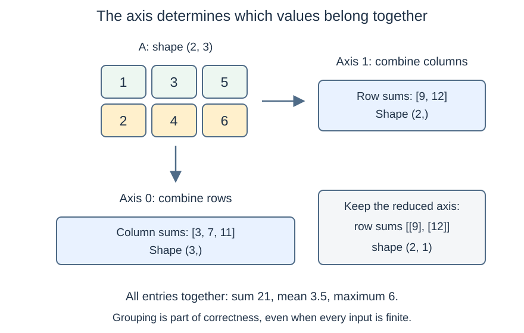
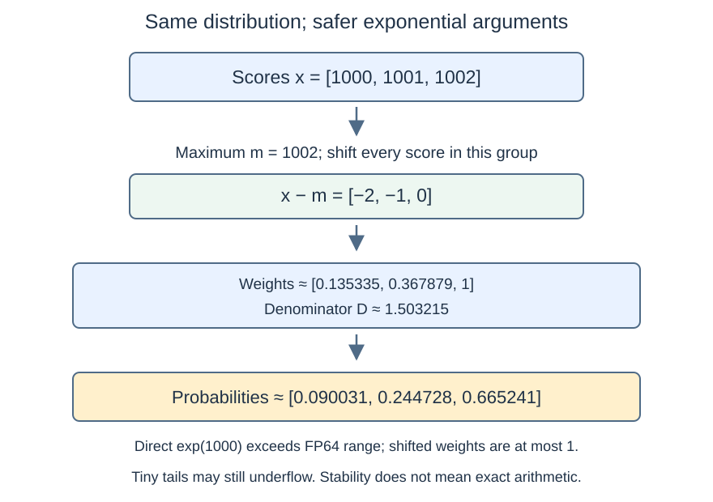

# M1-C06: Reductions, probabilities, and stable softmax

> **Status: Complete — detailed chapter authored and documentation validated; experimental procedures are proposed unless explicitly labelled observed**

**Module:** Understand exactly what happens when an LLM generates a token

**Category:** [Numerics and correctness](index.md)

[Module 1 reading order](../module-1.md) · [Previous: M1-C05](../state-memory-and-caching/m1-c05-how-tensors-occupy-memory.md) · [Next: M1-C07](m1-c07-floating-point-arithmetic-and-numerical-correctness.md)

## Target concepts

Sums, means, maxima, reduction axes, probability distributions, exponentials, softmax, overflow, underflow, subtracting the maximum.

## What you should be able to explain

A model can produce one score for each possible next token. Turning those scores into probabilities requires combining information across the correct set of candidates. This chapter explains that combination, why a mathematically valid formula can fail on a computer, and how to validate a safer formula before considering its speed.

[M1-C03](../model-computation-and-semantics/m1-c03-numbers-vectors-matrices-and-tensors.md) supplies the prerequisite shape and axis vocabulary. Memory-layout examples connect to [M1-C05](../state-memory-and-caching/m1-c05-how-tensors-occupy-memory.md). General floating-point analysis continues in M1-C07; this chapter introduces only the precision and error checks needed for these experiments. **All runtime experiments are proposed procedures. No implementation or measured performance results are supplied.**

## Concepts

### 1. A reduction combines values into a summary

A **reduction** combines a group of values into fewer values. For a nonempty vector x with K entries, indexed from 0 through K − 1:

**Sum S = Σ x[j]; mean μ = S / K; maximum m = max x[j].**

The Σ symbol means add the entries in the selected group. The mean is their arithmetic average. The maximum is the largest value, not its index. A separate operation, often called argmax, finds an index attaining that value; ties need an explicit index-selection policy if an index is required.

For x = [−2, 3, 5], S = 6, μ = 2 and m = 5. The maximum can be negative: for [−5, −2], it is −2. Starting every maximum calculation at zero would be wrong for that group. A direct sum of K values takes K − 1 additions; a direct maximum takes K − 1 comparisons. These counts describe a simple mathematical evaluation, not a particular CPU or GPU execution time.

[NumPy 2.3 sum](https://numpy.org/doc/2.3/reference/generated/numpy.sum.html), [mean](https://numpy.org/doc/2.3/reference/generated/numpy.mean.html) and [max](https://numpy.org/doc/2.3/reference/generated/numpy.max.html) specify their axes, output shapes and numeric options. Record the **accumulator type**, the representation used while combining values, as well as the input and output types. FP32 occupies four bytes per value; FP64 occupies eight and offers more range and precision. The order of rounded additions can affect a non-exact sum; counting additions alone does not establish numerical equivalence.

An empty sum can have a library-defined identity of zero. An empty mean has no ordinary arithmetic average, and an empty maximum needs a special policy. The exercises here **reject an empty reduction group** rather than silently inventing a mean, maximum or probability distribution. That exercise policy is distinct from each library's defaults.

### 2. The reduction axis determines what belongs together

Use A with shape (2, 3):

| Row | Column 0 | Column 1 | Column 2 |
| --- | --- | --- | --- |
| 0 | 1 | 3 | 5 |
| 1 | 2 | 4 | 6 |

Reducing axis 1 combines columns within each row. Reducing axis 0 combines rows within each column. Reducing all axes combines all six cells.

| Selected group | Sum | Mean | Maximum | Shape when reduced axes are removed |
| --- | --- | --- | --- | --- |
| Each row, axis 1 | [9, 12] | [3, 4] | [5, 6] | (2,) |
| Each column, axis 0 | [3, 7, 11] | [1.5, 3.5, 5.5] | [2, 4, 6] | (3,) |
| All six entries | 21 | 3.5 | 6 | Scalar, shape () |

**Keeping reduced dimensions** retains length-one axes. Row maxima then have shape (2, 1), values [[5], [6]], rather than shape (2,). This lets each row's maximum be subtracted from every value in that row through the broadcasting rules in M1-C05. The shifted rows are **[−4, −2, 0]** and **[−4, −2, 0]**.

*The tensor is unchanged; the grouping changes. A row statistic with retained shape (2, 1) has one value per row and can broadcast back across three columns.*

For text-generation scores with shape (B, S, V), B identifies requests, S token positions and V vocabulary candidates. Normalizing over V produces a distribution over candidate tokens for each request and position. Normalizing across B would mix requests. Normalizing across S would answer a different question about positions. Equal shapes or plausible-looking values do not prove the intended grouping.

Default axes differ across tools. [SciPy 1.16.2 softmax](https://docs.scipy.org/doc/scipy-1.16.2/reference/generated/scipy.special.softmax.html) defaults to the entire array, while [ONNX Softmax version 13](https://onnx.ai/onnx/operators/onnx__Softmax.html#softmax-13) defaults to the last axis. ONNX is a model interchange format; its operator version is part of the computation contract. Declare the axis instead of relying on a familiar default.

### 3. A probability distribution has a defined outcome set

A discrete probability distribution assigns probability p[j] to each outcome j in a specified finite set. Its conditions are:

**0 ≤ p[j] ≤ 1 for every j, and Σ p[j] = 1.**

For p = [0.2, 0.3, 0.5], the probability of either of the first two outcomes is 0.2 + 0.3 = 0.5. A uniform distribution over K outcomes assigns 1/K to each. The outcome labels matter: moving 0.5 to the wrong token changes the distribution even if the sum stays one.

Model **logits** are scores before this normalization. They can be negative and need not sum to one. For logits [−1, 0, 1], dividing by their sum is impossible because it is zero. Even when a score sum is nonzero, division can produce negative values, violating the probability contract.

A probability describes the model's allocation of mass over its declared candidates. It does not by itself establish that the selected token is factually correct, calibrated to real-world frequencies, or suitable for a trading decision. Sampling, temperature and filtering are later chapters. Here the entire fixed candidate set participates, with no token exclusions or stochastic draws.

### 4. Exponentials turn finite scores into positive weights

The exponential function **exp(t) = eᵗ** uses e ≈ 2.718281828. It is positive for finite real t, increases as t increases, and obeys exp(a + b) = exp(a)exp(b). exp(0) = 1, exp(1) ≈ 2.71828, exp(−1) ≈ 0.367879. [NumPy's exponential documentation](https://numpy.org/doc/2.3/reference/generated/numpy.exp.html) describes this real-valued function.

For finite logits x, **softmax** divides each exponential weight by the sum of weights in that same group:

**p[j] = exp(x[j]) / Z, where Z = Σ exp(x[k]) over the selected candidates k.**

Z is the normalizing denominator. This definition gives positive probabilities summing to one in exact real arithmetic. It preserves score ordering: the largest score has a largest probability, though softmax does not choose the outcome itself.

| Candidate | Logit x[j] | exp(x[j]), approximately | Probability, approximately |
| --- | --- | --- | --- |
| 0 | 0 | 1 | 0.090030573170 |
| 1 | 1 | 2.718281828459 | 0.244728471055 |
| 2 | 2 | 7.389056098931 | 0.665240955775 |

Here Z ≈ 11.107337927390. The displayed decimals are rounded illustrations, not the numerical reference for validation. Identical logits [7, 7, 7] produce [1/3, 1/3, 1/3]; one candidate produces [1]. Near ties should not be interpreted as a guaranteed index choice after rounding.

### 5. Overflow and underflow can invalidate a direct evaluation

Computers store a finite range of values. **Overflow** occurs when a result is too large for its numeric type. **Underflow** concerns results near zero that cannot retain ordinary precision and may round to zero. A **subnormal** is a representable small nonzero value below the normal range; some execution modes replace such values with zero. FP32 and FP64 have different limits. Record the actual type and mode; [NumPy finfo](https://numpy.org/doc/2.3/reference/generated/numpy.finfo.html) exposes maximum, smallest normal and smallest subnormal values.

In conventional binary64 arithmetic, exp(1000) is beyond the largest finite value, while exp(−1000) is below the smallest positive subnormal. FP32 has a narrower range. These examples are comfortably beyond both types' ranges; they do not rely on an exact library-specific threshold.

A direct evaluation on **[1000, 1001, 1002]** may produce infinite weights, then infinity divided by infinity. On **[−1000, −1001, −1002]**, all weights may become zero, leading to zero divided by zero. Both can produce **NaN**, “not a number,” a marker for an invalid numeric result. A warning, exception or non-finite output must be recorded; returning a uniform vector or replacing NaNs with zero does not restore the intended probabilities.

The two examples are not the same distribution: the first favors candidate 2, the second candidate 0. Stability must preserve that distinction. Merely avoiding a crash is insufficient.

### 6. Subtracting the maximum preserves the mathematical distribution

For any finite common shift c, the factor exp(c) cancels:

**exp(x[j] − c) / Σ exp(x[k] − c) = exp(x[j]) / Σ exp(x[k]).**

Choose **m = max x[k]**, and define **w[j] = exp(x[j] − m)** and **D = Σ w[k]**. Then **p[j] = w[j] / D**.

Every shifted score is at most zero. At least one is zero, so at least one weight is exactly exp(0) = 1. In real arithmetic for K finite candidates, **1 ≤ D ≤ K**. The exponential evaluations therefore avoid positive overflow, and the denominator cannot disappear merely because every original logit was very negative. This is the shifted formulation studied in [Blanchard, Higham and Higham, 2019, section 4](https://arxiv.org/html/1909.03469) and used by the [SciPy softmax implementation](https://docs.scipy.org/doc/scipy-1.16.2/reference/generated/scipy.special.softmax.html).

For x = [1000, 1001, 1002], m = 1002. The shifted scores are [−2, −1, 0], weights approximately [0.135335283237, 0.367879441171, 1], and D ≈ 1.503214724408. The probabilities match the [0, 1, 2] table above. For [−1000, −1001, −1002], the shifted scores are [0, −1, −2], so the same probabilities appear in reverse order.

*Subtract one maximum per candidate group. The maximum, exponential weights, denominator and normalization are mathematical dependencies, not a requirement to implement four separate runtime operations.*

**Stable does not mean exact.** Tiny shifted weights can still underflow. For [0, −1000], the second true probability is approximately 5.07595889755 × 10⁻⁴³⁵, below binary64's positive range. A computed [1, 0] can be sensible in absolute probability error while losing that tail completely in relative error. If a downstream task needs logarithms of tiny probabilities, use a documented stable log-probability operation rather than taking the logarithm of an underflowed zero. [PyTorch 2.14 log_softmax](https://docs.pytorch.org/docs/2.14/generated/torch.nn.functional.log_softmax.html) documents why the direct combination is numerically problematic; log-probability treatment itself is beyond this chapter's experiments.

Finite-precision shifts can also change score differences if the shifted inputs were rounded before evaluation. Adding an enormous constant to small differences is not a valid invariance test unless those differences survive representation. Very extreme finite operands can overflow during subtraction even before exp; the exercises bound input ranges and do not promise safety for every possible floating-point pattern. M1-C07 develops those limits.

### 7. Stability requires an input and lifecycle contract

The main exercises accept **nonempty groups of finite real scores**. They reject NaN, positive infinity and negative infinity, and reject an invalid axis before publishing a probability row. This is an explicit introductory policy, not a statement that every framework raises an exception for those inputs.

A later attention mask can use negative infinity to exclude candidates. That requires a distinct contract, including what happens if every candidate is excluded: subtracting negative infinity from itself is invalid. Masking is taught in M1-C11; do not silently add “all-masked gives uniform” to this chapter. No valid distribution exists over zero eligible outcomes under the usual sum-to-one requirement.

For a batched tensor, each row's maximum and denominator belong to that row and its request identity. A stale maximum from another row may cause overflow or underflow even though a common finite shift would preserve the exact mathematical ratio. A stale denominator directly changes normalization. Outputs must not become visible until complete; cancellation or an invalid row must not leak partially normalized values as a successful result. Shared input is read-only and must remain alive until all readers finish. Failure of a worker to finish is an incomplete outcome, not permission to reuse its storage immediately.

The HFT analogy is a market-event statistic: computing a mean across the wrong instrument or mixing a stale window can be fast and wrong. The transferable lessons are grouping, freshness and completion. Softmax is a model normalization operation, not a price forecast or a trading rule.

### 8. Reductions create dependencies and resource costs

For one K-entry group, a straightforward shifted evaluation performs K − 1 maximum comparisons, K shifts, K exponentials, K − 1 denominator additions and K normalizations. The actual library may combine stages, reuse registers or read data multiple times. An exponential is not interchangeable with one addition in a timing estimate. Library options can also change accumulator precision and execution order.

The maximum must be known before the corresponding shifted weights are finalized; normalized probabilities depend on the denominator. Parallel work helps only where these dependencies and available resources permit it. A **barrier** is a point at which cooperating workers must wait for required work; such waits can make slow participants matter. No GPU barrier behavior is measured here.

For FP64 scores of shape (8, 4096), input and output each contain 32,768 values, **262,144 bytes = 256 KiB**. Together they require 512 KiB of element storage. Each additional full-size intermediate adds another 256 KiB while live; one scalar statistic per row requires 8 × 8 = 64 bytes. Actual workspace, allocator reserves and allocation peaks need inspection. A fused library operation may reduce temporary movement, but its name alone does not prove fewer reads or faster execution.

## Experiments

### Shared setup and reference policy

Use hand calculation or a high-precision calculator for the mathematical references, and existing array tools for proposed runtime measurements. No new engine or implementation is requested. NumPy 2.3 reductions and SciPy 1.16.2 softmax provide documented reference contracts; record actual patch releases, builds and CPU environment if exercised. Rust remains the eventual implementation context. These reference tools are used because their operations and numerical behavior are inspectable, not to require a Python implementation in the chapter.

Use FP64 inputs, intermediates and outputs for the main experiments. The integer and quarter/eighth-valued fixtures are exactly representable before exponentiation. The high-precision reference evaluates the shifted formula at **80 decimal digits**, repeated at **120 digits**; it must agree well beyond the acceptance thresholds below. Python 3.12's [decimal arithmetic documentation](https://docs.python.org/3.12/library/decimal.html) describes configurable precision and exponential evaluation, one possible independent reference tool. Store full reference values, not the rounded teaching table. FP32 range demonstrations may be recorded separately but do not share the FP64 error gates automatically.

### E1 — Reduce the intended group

**Name:** Row, column and whole-tensor summaries.

**Description:** Compare sum, mean and maximum along axis 1, axis 0 and all axes of A in Concept 2, including retained dimensions.

**Purpose/objective:** Test whether grouping and shape contracts are correct before normalization uses them.

**Target concepts:** Sums, means, maxima, reduction axes and shape preservation for broadcasting.

**Hypothesis and baseline:** The complete table in Concept 2 is the baseline. Predict each output value and shape before inspection. A row reduction and a column reduction answer different questions; keeping a dimension changes representation without changing the statistic.

**Workload and controls:** Fix A, FP64 and the accumulator type. Vary only the reduction and selected axis or retained-dimension option. A basic CPU or paper worksheet suffices; timing six-element reductions is optional and cannot establish a hardware bottleneck.

**Procedure:** First label the groups and calculate their sums, counts, means and maxima. Inspect output metadata and every value. Subtract retained row maxima and check both shifted rows. Then check [−5, −2] to expose a wrong zero-initialized maximum. Present an empty group and an out-of-range axis to the exercise validator and require rejection; record raw library behavior separately rather than changing the policy to match it.

**Systems and HFT connection:** The same grouping discipline applies to per-request activation statistics and per-instrument event windows. This experiment models tensor groups, not market activity or a serving scheduler.

**Exit criteria:** All listed outputs and shapes match exactly, including means 1.5, 3.5 and 5.5, which are exactly representable here. The shifted rows are [−4, −2, 0]. Negative-only maxima are correct, and empty groups/invalid axes are rejected under the stated policy. No speed conclusion follows from paper tracing.

### E2 — A normalized vector can still be wrong

**Name:** Probability values, candidate labels and axis isolation.

**Description:** Evaluate row softmax on X with rows [0, 1, 2] and [2, 1, 0], then compare with deliberate whole-array and wrong-axis normalization.

**Purpose/objective:** Test the claim that sum-to-one alone proves correct probabilities and expose cross-request mixing.

**Target concepts:** Probability distributions, exponentials, softmax and reduction axes.

**Hypothesis and baseline:** Each row must match the high-precision three-candidate table, with the second row reversed. Whole-array normalization has total mass one but only one-half per row for this fixture. A deliberately substituted uniform vector passes sum-to-one and fails coordinate values.

**Workload and controls:** Fix FP64 X, candidate order, explicit axis 1 and the shared CPU/tool assumptions. Negative controls change only the axis or output distribution. Include [7, 7, 7] and [7] as equal-score and single-candidate cases; no sampling is involved.

**Procedure:** First predict every probability and axis-specific sum. Evaluate the valid row operation and compare each candidate against the high-precision reference. Apply the wrong groupings outside performance measurement and verify their rejection by the row reference. Permute candidates and require correspondingly permuted probabilities; restore the original. Finally compare a uniform replacement against the nonuniform reference even though both sum to one. Keep independent row identity and candidate labels in all records.

**Systems and HFT connection:** Inference must not normalize a request against another request's logits. As with instrument-labelled statistics in HFT systems, preserving labels is part of correctness. No model accuracy or trading outcome is inferred.

**Exit criteria:** Valid outputs pass the FP64 numerical gate below, shape and labels match, and every wrong-axis/uniform negative control fails a relevant reference check. Equal scores and the single-candidate case match their references. Report any non-finite output as failure, not a probability.

### E3 — Large offsets, small tails and rejected inputs

**Name:** Direct exponentiation versus maximum-shifted softmax.

**Description:** Compare direct and shifted mathematical evaluations on ordinary scores, large positive/negative offsets and a nearly one-hot distribution.

**Purpose/objective:** Test whether subtracting the maximum prevents offset-driven failures while retaining the intended candidate distribution and exposing underflow limits.

**Target concepts:** Exponentials, overflow, underflow, maxima, softmax and subtracting the maximum.

**Hypothesis and baseline:** High-precision shifted references are the baseline. [0, 1, 2], [1000, 1001, 1002] and [−1000, −999, −998] have the same exact distribution. [−1000, −1001, −1002] reverses that distribution. Direct FP64 exponentiation is expected to fail for the extreme offsets. Shifted [0, −1000] may have a zero tail in FP64; its tail-relative error must be reported rather than hidden by its tiny absolute error.

**Workload and controls:** Fix candidate order, FP64, rounding/exponential library and explicit axis; change only offset or evaluation formula. Use existing calculator/runtime facilities. Include empty input, NaN, positive infinity and negative infinity as rejected policy cases, not as benchmark successes.

**Procedure:** First write a predicted result or rejection for every case. Compare direct and shifted evaluations to the independently recomputed reference. Inspect maximum, shifted range, denominator and final row; capture warnings, exceptions and non-finite results. Count output zeros and inspect the [0, −1000] tail against the nonzero decimal reference. Verify common-shift invariance only for the listed exactly representable inputs. Finally test invalid-input validation and a lifecycle trace in which cancellation occurs before normalization completes: require no successful partial row and retain the input until readers complete. Use supported fault controls if a runtime is available; otherwise label this a paper lifecycle check.

**Systems and HFT connection:** A rare range failure can contaminate later inference stages, much as invalid statistics can escape into an event pipeline. Stability and explicit terminal outcomes matter before speed. This does not simulate a trading decision or claim a production failure test.

**Exit criteria:** Shifted ordinary/offset cases meet the numerical gate and preserve ordering. Direct failures are detected and recorded. The tiny tail is classified using absolute error, relative loss and zero count. Invalid groups are rejected; cancellation does not publish partial success. Do not claim subtracting the maximum prevents every possible numerical failure.

### E4 — Measure a completed normalization job

**Name:** Staged versus library shifted softmax across group widths.

**Description:** Compare existing tool operations that expose separate shifted-formula stages with a documented library softmax operation; both must implement the same stable row contract.

**Purpose/objective:** Test whether differences in temporary movement and stage overhead affect full job time without sacrificing probability accuracy.

**Target concepts:** Reductions, exponentials, stable softmax, axis semantics and resource/dependency costs.

**Hypothesis and baseline:** The staged shifted evaluation is the baseline; SciPy 1.16.2 softmax is the comparison. Predict results separately by shape; no fusion or speed advantage is presumed. A direct unshifted formula that fails E3 is not an eligible performance alternative.

**Workload and controls:** Use shape (B, K), B = 1 or 8 and K = 32, 256 or 4096, giving six configurations. Define H[r, j] = (((j + r) mod 16) − 8)/4 + r/8, where r is row index and mod is the remainder after division. This creates bounded, exactly representable scores with row-specific candidate patterns. Hold FP64 input/intermediate/output types, axis 1, C-order layout, one runtime thread, one ready job and immutable input fixed. Initial construction and page touching are outside both routes; route-specific allocations and temporaries are inside. Record both implementations' identities and numerical options.

**Procedure:** First calculate references from the 16 distinct quarter-step scores, preserving each row's rotation and candidate labels. Compare every probability for each route before timing. Warm the runtime and measure paired completed jobs using the protocol below. In separate profiled runs inspect maximum/sum work, exponentiation, allocation, copies and any synchronization exposed by the tool. Record whether stages are actually combined; a library call is not proof of fusion. Repeat all six configurations. Run a row-permutation identity check and invalid-row/cancellation accounting outside the timed valid workload; use a fresh valid input afterward.

**Systems and HFT connection:** This represents a local inference-normalization stage with varying candidate widths. HFT's critical-path discipline motivates measuring the whole stage, but this workload contains neither market events nor real request arrivals. It cannot establish tail latency or full token-generation speed.

**Exit criteria:** Every configuration passes the numerical and metadata gate before timing. Report full job latency, rows/s with K stated, live/peak storage and stage attribution or an explicit attribution limit. Preserve variation and failed/rejected/cancelled/incomplete outcomes. Claim improvement only where the complete boundary and repeated evidence support it; otherwise report no benefit or inconclusive.

## Verification

### Module 9 support applied locally

[M9-C01](m9-c01-defining-reference-behavior-and-evidence-before-optimizing.md) supports reference and invariant checks; [M9-C02](../measurement-experimentation-and-economics/m9-c02-request-events-clocks-and-measurement-boundaries.md) supplies timing/completion boundaries; [M9-C11](../measurement-experimentation-and-economics/m9-c11-controlled-comparisons-warmup-and-reproducibility.md) supplies paired comparisons. [M9-C17](m9-c17-comparing-logits-with-justified-numerical-tolerances.md) motivates independent reference precision, coordinate errors and near-zero treatment. M9-C01, M9-C02 and M9-C17 are complete; the other linked support chapters remain outlines; their required introductory checks are specified here. General error analysis and other precisions are deferred to M1-C07 and the later detailed Module 9 treatments.

### Concept coverage and exact checks

| Target concept | Explanation | Experiment/reference |
| --- | --- | --- |
| Sums | Concepts 1–2 | E1 row/column/global sums; E2–E4 denominators |
| Means | Concepts 1–2 | E1 values and exact group counts |
| Maxima | Concepts 1–2, 6 | E1 negative maximum; E3 per-group shift |
| Reduction axes | Concept 2 | E1 shapes; E2 wrong-axis controls; E4 row identity |
| Probability distributions | Concept 3 | E2 bounds, sums and coordinate labels |
| Exponentials | Concepts 4–5 | E2 weights; E3 range failures |
| Softmax | Concepts 4, 6 | E2 coordinate references; E4 full arrays |
| Overflow and underflow | Concepts 5–6 | E3 positive/negative offsets and tiny tail |
| Subtracting the maximum | Concept 6 | E3 invariance and denominator; E4 equivalent routes |

E1's fixtures have exact sums, maxima and binary-representable means; require exact equality. Shape, axis, candidate identity, declared types and outcome accounting are exact contracts for every experiment. In E2–E4, normalization and exponentiation require numerical checks rather than exact decimal equality.

### Numerical acceptance for these FP64 fixtures

For reference probabilities p and observed probabilities q, define:

**Maximum coordinate error E∞ = max |q[j] − p[j]|.**

**Total absolute error E₁ = Σ |q[j] − p[j]|; row mass error M = |Σ q[j] − 1|.**

Compute these diagnostics at higher precision or with an independently checked accurate sum, not the candidate's possibly faulty reduction. **Relative error** is |q − p|/|p| for a nonzero reference value; it reveals complete loss of a tiny tail that absolute error can hide.

For accepted finite FP64 rows in E2–E4, require all values finite and within [0, 1], **E∞ ≤ 10⁻¹², E₁ ≤ 10⁻¹⁰ and M ≤ 10⁻¹²**. Also require relative error ≤ 10⁻⁹ for reference entries at least 10⁻¹². Check every row and coordinate. On the offset fixtures compare the same rounded input values, not an ideal real vector that was never supplied to the runtime.

These are explicit **synthetic-exercise accuracy budgets**, not universal softmax tolerances or a model-quality certificate. E₁ ≤ 10⁻¹⁰ limits the change in probability assigned to any subset of outcomes to at most 5 × 10⁻¹¹ for two exactly normalized distributions; this follows because their positive and negative mass differences balance. For an approximately normalized row, a corresponding subset-error bound is (E₁ + M)/2, at most 5.05 × 10⁻¹¹ under these gates. The mass gate therefore separately controls the fact that a computed row may not sum exactly to one. FP64 spacing near one is about 2.22 × 10⁻¹⁶, so the gates leave room for rounded arithmetic across up to 4096 entries while remaining much smaller than the wrong-axis and uniform-replacement errors. This spacing argument is motivation, not an error bound for a specific exponential implementation.

Before accepting the reference, require its 80- and 120-digit results to agree within **10⁻⁴⁰ absolute per coordinate**, well below the gates. A failure is a finding to investigate—input conversion, wrong axis, accumulator, exponential approximation or reduction order—not permission to loosen the gate after seeing the answer. Preserve errors below the display precision. Existing tools that cannot expose required types, completed output or a trustworthy reference are insufficient for the claimed comparison.

For [0, −1000], the zero tail has relative error one, so the usual relative gate would fail if applied there. It lies below the declared 10⁻¹² relative-check floor; record its reference magnitude, absolute error and complete relative loss explicitly. The absolute-distribution gate can pass while a downstream requirement to preserve tiny nonzero probabilities fails. That distinction is the experiment's result, not an exemption for arbitrary missing tail mass. Reject NaN and infinities before these calculations; NaN comparisons must not accidentally pass a tolerance check.

### Measurement and profiling matched to experiments

| Experiment | Correctness evidence | Measurement/benchmark | Profiling and limit |
| --- | --- | --- | --- |
| E1 | Full reduction table and metadata; negative/empty/invalid-axis controls | Arithmetic counts and group sizes; optional completed operation time | Paper counts cannot identify CPU or GPU bottlenecks; inspect accumulation/options if runtime available |
| E2 | Every probability, row sum and identity; wrong-axis/uniform controls | Probability errors and row isolation; optional valid row-job timing | Inspect grouping, not just aggregate sums; no sampling distribution or model-quality claim |
| E3 | Shifted/reference comparison, non-finite detection, zero counts, tail-relative loss and lifecycle outcomes | Error/range observations; successful valid cases timed separately from rejected/direct-failure cases | Record exponential/reduction warnings and modes; failures are not fast successful results |
| E4 | Every row/coordinate passes the gate; permutation and invalid-row controls | Full completed job time, rows/s, K and storage peaks per route | Separate CPU/allocation timeline; record actual temporaries and overhead rather than assuming fusion |

For E4, the exact real reference has a compact independent form. For each row, let a[j] = (((j + r) mod 16) − 8)/4. Each of the 16 values appears K/16 times, and the common r/8 shift cancels. Thus:

**p[r, j] = exp(a[j]) / ((K/16) × Σ exp((t − 8)/4), for t = 0 through 15).**

Use the 80/120-digit calculator to evaluate that expression; compare it with independently evaluating the full shifted row. This checks reference construction as well as the candidate. Row permutations must carry their identities, and candidate rotations must rotate the probability coordinates. Comparing only a row histogram would miss this bug.

### Boundaries, repetitions and uncertainty

Use one host **monotonic clock**, whose readings do not jump with wall-clock changes. Start a job when its input is ready, immediately before route-specific validation, allocation and normalization. Stop when every output row is complete and accepted by the same lightweight shape/finite-status policy, and temporary input readers have relinquished their references. Full high-precision comparison is outside both performance windows, performed in correctness runs and documented as excluded. If such verification belongs on a deployment's path, measure it separately and include it in that deployment's request boundary. Any asynchronous tool requires documented completion waiting, not merely a submission timestamp.

For each E4 shape, use five untimed warmup pairs, then **30 randomized-order pairs in each of three independently warmed sessions**. Keep each pair's order and raw samples. Six-element E1 or E2 checks are primarily semantic; if timed, apply the same repetition and clock rules and do not confuse timer overhead with useful work. Block multiple jobs when an individual job is too short to measure reliably, declaring block length and dividing only for a labelled per-job estimate. Preserve each job's input identity and prevent skipped work.

Report per-configuration medians, ranges and between-session variation. A difference comparable to those variations is inconclusive. Warm runs do not establish cold-cache behavior. Record timer resolution, empty measurement overhead, background load, thread count, frequency policy and allocator reuse. Profile in separate trials and compare profile-on with profile-off overhead; unavailable counters limit attribution. Do not infer a bandwidth bottleneck from bytes alone. Rows/s = completed valid rows divided by elapsed seconds; it is meaningful only with K, precision and boundary stated.

This small, single-job design does not support p99 or production capacity claims. Representative arrivals, long/short-group mixes, concurrent jobs and larger populations would be needed for tail studies. In the present controlled workload, row width and batch size vary explicitly; request-arrival variability is excluded.

For cancellation or failure, count each submitted job as success, rejected, cancelled, failed or incomplete, and reconcile the count after outstanding readers finish (**draining**). Do not reuse buffers or publish a partly completed row just because the caller stopped waiting. A failed worker with uncertain completion remains an unresolved lifecycle case; actual worker-loss recovery is a later integration experiment. The paper cancellation trace here can establish a rule, not certify an asynchronous runtime.

### End-to-end interpretation and reproducibility

A local softmax job excludes tokenization, the rest of the model, queueing and response delivery. For an invented 1,000 µs inference step containing 900 µs elsewhere and 100 µs of normalization, reducing normalization to 60 µs gives **960 µs**, a 4% step-time reduction. If an added copy or synchronization costs 70 µs, the result is **1,030 µs**. These are arithmetic illustrations, not measurements. A full-system claim also needs preserved model outputs under a justified numerical contract.

Preserve exact fixtures, axis/group labels, retained-dimension choices, input/intermediate/output and accumulator types, library patch/build, operation version, exponential/math mode, subnormal handling, calculator precision, raw error reports and all outcome counts. Record CPU/OS/memory conditions below, warmup, pairing order, clock boundaries, allocation/profile tools and profile overhead. No model weights or tokenizer are used here; if real logits replace these fixtures, record their model/checkpoint/tokenizer provenance and input identities. Do not infer generated-text equivalence from a normalized row alone.

## Engineering dimensions and principles

### Six dimensions applied

| Dimension | Chapter-specific application |
| --- | --- |
| Semantics and invariants | E1 groups the intended axes; E2 checks candidate-labelled probabilities, not only sums. E3 distinguishes finite output from correct distribution. |
| Workload and variability | E4 varies rows and candidate width; offsets and skewed mass change numerical behavior in E3. Text candidates are the scope; non-text modalities and Module 8 are excluded. Real arrival bursts are not measured. |
| Resources and bottlenecks | Maximum/sum reductions, exponentials, temporary buffers and CPU time all matter. E4 inspects actual movement and peaks rather than treating every operation as equally costly. |
| Time and distributions | Normalization depends on the denominator, which depends on shifted weights. E4 includes preparation/completion and variation; parallel barriers and queueing would need later evidence. |
| Ownership and coordination | Each row owns its statistics and request identity. Inputs outlive readers, outputs become visible only when complete, and stale denominators cannot cross rows. |
| Failure and adaptation | E3 rejects invalid/non-finite groups, detects direct-formula failure and accounts for cancellation. Switching to shifted evaluation must pass its reference gate; inventing a uniform fallback changes behavior. |

### Eight practical engineering principles

1. **Correctness defines the optimization boundary.** A shifted formula preserves the real distribution; replacing it with uniform values does not. Numerical gates, input policies and labels precede E4 timing.
2. **Performance depends on workload and operating point.** Width 32 and width 4096 can have different overhead/resource balance. Large offsets expose direct-formula failure independently of whether ordinary inputs are fast.
3. **Data movement is part of the algorithm.** Separate maximum, exponential and normalization stages can materialize intermediates. Count their bytes and allocations when comparing the complete routes.
4. **State has ownership, lifetime and recovery cost.** A row's maximum/denominator belong to its current input. Recompute invalid statistics and retain input until all consumers complete; cancellation does not erase these obligations.
5. **Dependencies determine latency; bottlenecks determine capacity.** Probabilities depend on a completed denominator. Extra threads cannot remove that dependency, and a single-job latency experiment cannot establish sustainable serving capacity.
6. **Variability and synchronization shape the tail.** Shape changes, first-use allocation, range failures and waits for readers can create slow or failed jobs. Keep them visible; a warm median is not p99 evidence.
7. **Local improvements must be evaluated end to end.** E4 includes allocation/completion and states excluded verification costs. The 1,000 µs example shows why a local gain can shrink or reverse in a full inference step.
8. **Claims require reproducible evidence.** Exact fixtures, independent precision, failure controls, coordinate errors, tool identities, raw timings and hardware conditions make the proposed studies repeatable. This chapter's validation is not an observed benchmark result.

## Specifications, articles, and hardware

### Primary sources and scope

Sources checked on 24 October 2026. Versioned documentation governs the stated exercise contracts; no runtime compatibility or installation is asserted.

| Source | Relevance |
| --- | --- |
| [NumPy 2.3 sum](https://numpy.org/doc/2.3/reference/generated/numpy.sum.html), [mean](https://numpy.org/doc/2.3/reference/generated/numpy.mean.html), [max](https://numpy.org/doc/2.3/reference/generated/numpy.max.html) | Axis/shape behavior, accumulation options and special cases; exercise rejection policy remains explicit. |
| [NumPy 2.3 exp](https://numpy.org/doc/2.3/reference/generated/numpy.exp.html) and [finfo](https://numpy.org/doc/2.3/reference/generated/numpy.finfo.html) | Exponential definition and numeric range terminology. |
| [SciPy 1.16.2 softmax](https://docs.scipy.org/doc/scipy-1.16.2/reference/generated/scipy.special.softmax.html) | Explicit axis, output distribution and shifted evaluation contract. |
| [ONNX Softmax version 13](https://onnx.ai/onnx/operators/onnx__Softmax.html#softmax-13) | Last-axis default, same-shape output and operator-version identity. Older versions must be checked separately. |
| [PyTorch 2.14 functional softmax](https://docs.pytorch.org/docs/2.14/generated/torch.nn.functional.softmax.html) and [log_softmax](https://docs.pytorch.org/docs/2.14/generated/torch.nn.functional.log_softmax.html) | Dimension/type options and the reason to use a stable log-probability operation when that is the required result. |
| [Blanchard, D. J. Higham and N. J. Higham, 2019, arXiv v1](https://arxiv.org/html/1909.03469) | Primary numerical-analysis article on shifted formulas, rounding and range behavior; advanced analysis extends beyond this introduction. |
| [Python 3.12 decimal documentation](https://docs.python.org/3.12/library/decimal.html) | Configurable high precision for an independent reference, with no code supplied here. |

### Hardware requirements and measurement manifest

Paper/calculator studies need no special hardware. For proposed CPU measurements, plan for a 64-bit CPU with at least four physical cores, **8 GiB RAM** and **1 GiB free local storage** for software and traces; these are planning allowances, not observed usage. E4 deliberately uses one runtime thread. Its largest input/output pair is 512 KiB before intermediates, workspace and metadata. A GPU, exchange feed, network adapter or model checkpoint is unnecessary for these studies.

Record actual CPU model, core/thread count, cache capacities, RAM configuration and availability, OS/kernel, power/frequency policy, core affinity (where work may run), memory placement, background work, runtime build and profiler. Do not assume a cache-line width or bandwidth. A separate GPU extension would require device/memory model, driver/runtime, precision modes, streams (ordered device work queues), synchronization and clock-domain records; do not merge those measurements into the CPU results.

## Key takeaways

Reduction axes define which values belong together. Probabilities require both the right normalization and the right candidate identities. Exponentials can overflow or underflow even when the real softmax result is well behaved. Subtracting the maximum avoids large positive exponential arguments and preserves the mathematical distribution, while leaving finite-precision and tiny-tail limits to validate. Correctness, completion and full-stage evidence are prerequisites for a useful performance claim.
