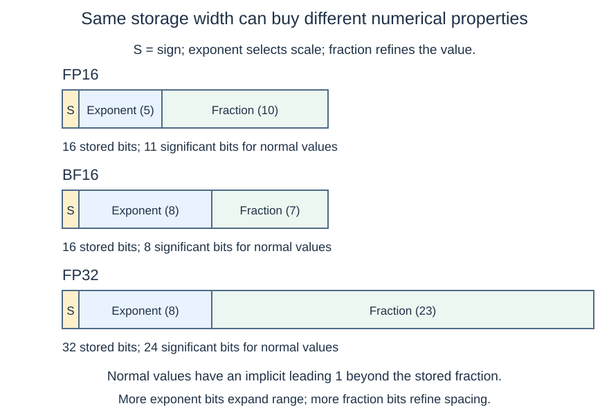
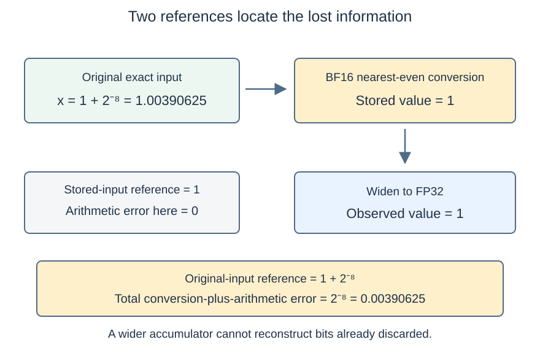

# M1-C07: Floating-point arithmetic and numerical correctness

> **Status: Complete — detailed chapter authored and documentation validated; experimental procedures are proposed unless explicitly labelled observed**

**Module:** Understand exactly what happens when an LLM generates a token

**Category:** [Numerics and correctness](index.md)

[Module 1 reading order](../module-1.md) · [Previous: M1-C06](m1-c06-reductions-probabilities-and-stable-softmax.md) · [Next: M1-C08](../measurement-experimentation-and-economics/m1-c08-operation-counts-and-actual-execution-cost.md)

## Target concepts

Floating-point representation, FP32, FP16, BF16, representable range, precision, rounding error, accumulation precision, comparison tolerances.

## What you should be able to explain

A numeric type determines which values a computer can store, not just how many bytes it uses. A model can have mathematically equivalent computations with different rounded answers. This chapter explains how to locate that difference, decide whether it is permitted, and measure a precision change without hiding conversion or validation costs.

Read [M1-C06](m1-c06-reductions-probabilities-and-stable-softmax.md) first. Its stable softmax avoids one class of range failure; it does not eliminate finite-precision error. This chapter supplies the introductory numerical framework needed before interpreting computation costs in M1-C08. **All runtime experiments below are proposed; no implementation or measured hardware speedup is supplied.**

## Concepts

### 1. A floating-point value is a point on a finite grid

A **floating-point format** stores a sign, an exponent and a fraction. The exponent selects a scale; the fraction selects a value within that scale. The combined leading digit and fraction are called the **significand**. For a finite, nonzero **normal** binary value:

**x = (−1)ˢ × (1 + f / 2ᵗ) × 2ᵉ.**

Here s is the sign bit, f is the integer encoded in t stored fraction bits, and e is the exponent after decoding its bias. A **bias** is a constant subtracted from the stored exponent field. The leading 1 is implicit for normal numbers, giving p = t + 1 significant binary digits. For example, 1.5 = (1 + 1/2) × 2⁰ is exactly representable in all three formats below. Many ordinary decimals, including 0.1, have no finite binary expansion and must be rounded.

[IEEE 754-2019](https://standards.ieee.org/ieee/754/6210/) specifies floating-point formats, operations and exceptions. Its public overview establishes the scope; the full standard is not reproduced here. [Rust's f32 documentation](https://doc.rust-lang.org/std/primitive.f32.html) describes the binary32 type and its basic-operation rounding. This is the Rust language context, without implementation code.

A zero exponent field is reserved for zeros and **subnormal** values, which extend the grid toward zero without the implicit leading 1. An all-ones exponent field represents infinities or **NaN**, “not a number,” depending on the fraction. Signed zeros compare numerically equal but have different bit patterns. NaN is not an ordinary number and must be checked explicitly; a numerical acceptance test must not accidentally accept it.

### 2. Range and precision are different resources

**Range** describes how large or small representable values can be. **Precision** describes the spacing of values at a given scale. FP16 here means IEEE binary16, BF16 means the bfloat16 format, and FP32 means IEEE binary32.

| Format | Bytes | Sign / exponent / stored fraction bits | Normal significant bits p | Exponent bias | Normal exponent range |
| --- | --- | --- | --- | --- | --- |
| FP16 | 2 | 1 / 5 / 10 | 11 | 15 | −14 through 15 |
| BF16 | 2 | 1 / 8 / 7 | 8 | 127 | −126 through 127 |
| FP32 | 4 | 1 / 8 / 23 | 24 | 127 | −126 through 127 |

The vendor format definitions for [FP16](https://docs.nvidia.com/cuda/cuda-math-api/cuda_math_api/struct____half.html) and [BF16](https://docs.nvidia.com/cuda/cuda-math-api/cuda_math_api/struct____nv__bfloat16.html) identify their bit allocations and conversion modes. BF16 spends more of its 16 bits on exponent range; FP16 spends more on fraction precision. Neither is universally more accurate.

*Field widths are proportional to bit counts. FP32 has more fraction bits than either 16-bit format. Matching exponent widths does not make BF16 and FP32 identical.*

For a format with normal exponent limits e_min and e_max:

**Largest finite value = (2 − 2⁻ᵗ) × 2^(e_max).**

**Smallest positive normal = 2^(e_min); smallest positive subnormal = 2^(e_min − t).**

| Format | Largest finite value, approximately | Smallest positive normal | Smallest positive subnormal in the format model |
| --- | --- | --- | --- |
| FP16 | 65,504, exactly | 2⁻¹⁴ ≈ 6.10352 × 10⁻⁵ | 2⁻²⁴ ≈ 5.96046 × 10⁻⁸ |
| BF16 | 3.38953 × 10³⁸ | 2⁻¹²⁶ ≈ 1.17549 × 10⁻³⁸ | 2⁻¹³³ ≈ 9.18355 × 10⁻⁴¹ |
| FP32 | 3.40282 × 10³⁸ | 2⁻¹²⁶ ≈ 1.17549 × 10⁻³⁸ | 2⁻¹⁴⁹ ≈ 1.40130 × 10⁻⁴⁵ |

These limits describe representations. An execution mode that **flushes subnormals to zero** does not preserve every value in this table during computation. Record the operation, hardware and mode; do not infer operational behavior solely from the storage format. [NumPy finfo](https://numpy.org/doc/2.3/reference/generated/numpy.finfo.html) distinguishes smallest normal and subnormal values for supported types. BF16 needs a tool that explicitly supports it; NumPy's ordinary dtype set must not be assumed to provide it.

The row of limits explains two tradeoffs. A finite 70,000 is outside FP16 range but within BF16 and FP32 range. Conversely, 1 + 2⁻⁸ = 1.00390625 is representable in FP16 and FP32 but lies halfway between BF16 values 1 and 1.0078125. FP16 offers finer local resolution while BF16 offers much larger normal range.

### 3. Rounding maps an exact value onto the grid

The exercises use **round to nearest, ties to even**: choose the closest representable value; at a midpoint choose the one whose last significand bit is even. “Even” concerns that binary digit, not whether the displayed decimal is an even integer. Rust's [basic f32 arithmetic contract](https://doc.rust-lang.org/std/primitive.f32.html) states this rounding direction; conversions and foreign/device operations require their own documented modes.

In the normal interval [1, 2), adjacent values are separated by **Δ = 2⁻ᵗ**. In [2, 4), spacing doubles. A **ULP**, unit in the last place, refers to a spacing at the scale under discussion; specify the interval at a power-of-two boundary because spacing differs on its two sides.

| Format | Gap from 1 to the next larger value, ε | Unit roundoff u = ε/2 |
| --- | --- | --- |
| FP16 | 2⁻¹⁰ = 0.0009765625 | 2⁻¹¹ |
| BF16 | 2⁻⁷ = 0.0078125 | 2⁻⁸ |
| FP32 | 2⁻²³ ≈ 1.19209 × 10⁻⁷ | 2⁻²⁴ |

For a correctly rounded basic operation with a normal result and without range failure, a useful model is **fl(z) = z(1 + δ), with |δ| ≤ u**. fl means the rounded result; z is the exact result of that one operation. This relative model is not a blanket bound on a whole algorithm, subnormal results or an arbitrary exponential implementation. Some sources use “machine epsilon” for u and others for the gap ε; state the convention. [Goldberg's original tutorial, reprinted by Oracle](https://docs.oracle.com/cd/E19957-01/806-3568/ncg_goldberg.html), explains rounding, ULPs and cancellation.

Under the stated rounding mode, converting 1 + 2⁻¹¹ to FP16 yields 1: it is halfway between 1 and 1 + 2⁻¹⁰, and the lower significand is even. The conversion error is −2⁻¹¹. Converting that stored 1 back to FP32 still gives 1; widening does not recover the discarded increment. Keep the intended real input and its stored value as separate references.

### 4. Order and fused operations can change the answer

Floating-point addition is generally not associative. Parentheses that are interchangeable over real numbers can change rounded intermediates.

For FP32, let a = 2²⁴ = 16,777,216, b = 1 and c = −2²⁴. All three inputs are exactly representable. Spacing above a is 2, so a + 1 is a midpoint and rounds back to a. Therefore:

**fl(fl(a + b) + c) = 0, while fl(a + fl(b + c)) = 1.**

The exact real result is 1. This is a specific rounding trace, not a promise that every library sum uses either parenthesization. Combining opposite large values can expose earlier error in a small residual; this is **cancellation**. Subtraction of nearby exactly represented numbers can itself be exact—the problem may be inaccurate operands rather than the subtraction.

A **fused multiply-add (FMA)** evaluates a × b + c with one final rounding, instead of rounding the product and the addition separately. With FP32 a = 1 + 2⁻¹³, b = 1 − 2⁻¹³ and c = −1, the exact result is −2⁻²⁶. A separate rounded product becomes 1, followed by a zero result; a correctly rounded FMA returns −2⁻²⁶. [NVIDIA's floating-point white paper](https://docs.nvidia.com/cuda/floating-point/index.html) discusses FMA, operation order and execution controls. This example concerns rounding semantics, not a GPU performance measurement.

An optimizer or library can alter order or fuse work; recording only an input dtype does not specify the complete computation. [PyTorch 2.14 numerical accuracy guidance](https://docs.pytorch.org/docs/2.14/notes/numerical_accuracy.html) cautions that mathematically equivalent operations and different platforms need not be bitwise identical. **Bitwise identity** means identical stored bits. **Numerical agreement** means passing an explicit error contract. They are distinct acceptance choices.

### 5. Stored precision is not accumulation precision

An **accumulator** holds a running or partial result. Low-precision inputs can be converted to a wider accumulator before addition. That can prevent loss during accumulation, but cannot restore information already lost from the inputs or guarantee that an eventual low-precision output will retain the answer.

Consider summing 4,096 copies of exactly representable 1, with a strict left-to-right addition rounded after every addition. The mathematical sum is 4,096.

| Accumulation format | Result under the specified sequential trace | Why |
| --- | --- | --- |
| BF16 | 256 | At 256 the upward spacing is 2; adding 1 ties and rounds back to 256 |
| FP16 | 2,048 | At 2,048 the upward spacing is 2; subsequent additions of 1 disappear |
| FP32 | 4,096 | All intermediate integer sums are exactly representable |

A balanced reduction tree can behave differently. The table is a controlled counterexample, not a claim that ordinary tensor libraries sequentially sum in the input format. A wider accumulator should be verified in the actual operation; low-precision input, multiplication, reduction and output conversions may each have separate modes. [PyTorch's accuracy notes](https://docs.pytorch.org/docs/2.14/notes/numerical_accuracy.html#reduced-precision-reduction-for-fp16-and-bf16-gemms) document that some GPU matrix paths can truncate intermediate reductions. A storage label alone is insufficient.

*Compare against the stored-input reference to test arithmetic, and against the original-input reference to evaluate the whole precision change. Widening after conversion only addresses later arithmetic.*

For a sum, separate these errors with the triangle inequality:

**|computed sum − original real sum| ≤ |computed sum − exact stored-input sum| + |exact stored-input sum − original real sum|.**

The first term captures arithmetic and output effects; the second captures input conversion. For positive inputs with no cancellation, these are often easier to interpret than for nearly cancelling sums. A theoretical relative bound can become uninformative when the true result is near zero. Use exact reference calculations for the constructed cases here instead of applying one universal percentage.

### 6. A tolerance is an application contract

For finite reference r and candidate q, define absolute error **|q − r|** and, when r ≠ 0, relative error **|q − r|/|r|**. A common mixed rule is:

**|q − r| ≤ atol + rtol × |r|.**

atol is an absolute allowance in the result's units; rtol is dimensionless. Use the agreed reference on the right. This rule need not be symmetric when r and q are exchanged. Near zero, atol dominates; exact shape and identity must be checked separately because some array comparison tools broadcast. [NumPy 2.3 allclose](https://numpy.org/doc/2.3/reference/generated/numpy.allclose.html) documents these cautions, including its unsuitable default absolute tolerance for some small-valued comparisons.

Suppose an exercise treats 10⁻⁸ as a meaningful small signal and permits 1% loss of it: choose atol = 10⁻¹⁰. Separately permit relative error 10⁻⁴ at larger scales. Then:

| Reference r | Candidate q | Absolute error | Mixed allowance | Decision |
| --- | --- | --- | --- | --- |
| 0 | 10⁻⁹ | 10⁻⁹ | 10⁻¹⁰ | Fail |
| 10⁻⁸ | 0 | 10⁻⁸ | 1.01 × 10⁻¹⁰ | Fail |
| 100 | 100.01 | 0.01 | 0.0100000001 | Pass |

These are deliberately chosen synthetic requirements, not tolerances for arbitrary logits or financial values. A relative test alone is undefined at zero; a generous default atol can erase a signal completely. Report maximum coordinate error, error locations, relative error where meaningful, non-finite counts and the number of failed coordinates. An average error can hide one badly wrong token score.

Do not match NaN with NaN as a successful numeric output in these exercises, or accept infinity because a comparison helper considers two infinities equal. Reject non-finite input/output under the stated policy. If signed zero matters to a downstream operation, test that separately; numerical equality alone will not preserve its bits.

### 7. Small score errors can change a discrete decision

Two logits [1, 1 + 2⁻⁸] have a unique maximum at candidate 1. BF16 round-to-nearest-even converts both to 1. A fixed policy that chooses the first candidate on a tie then returns candidate 0. An error check may pass while that discrete decision changes.

A useful sufficient condition is: if every score changes by at most ε and the reference top-two gap g satisfies **g > 2ε**, the unique maximum is preserved. The winning score can fall by ε while the runner-up rises by ε. If the inequality fails, the test is inconclusive, not proof that a flip occurs. Check actual ties and index selection.

The stable softmax distributions for the original and rounded pair differ by about **0.000976561258** per candidate, while each still sums to one. A declared absolute probability allowance of 0.002 would accept this difference; a requirement to preserve the greedy choice would reject it. State both outcomes. Greedy selection chooses the largest score; sampling has a different correctness contract and is outside this experiment.

For inference, model outputs, probability errors and token decisions need separate evidence. An HFT system likewise distinguishes a small numerical discrepancy from crossing a decision threshold, but a model's allowed approximations do not authorize changes to accounting, prices or market rules. This chapter makes no trading claim.

### 8. Precision choices also change work and state

One million stored values require 4,000,000 element bytes in FP32 or 2,000,000 in FP16/BF16, excluding metadata and workspace. A wider accumulator and FP32 output still consume space; conversion may allocate and move data. A smaller input does not guarantee half the latency, especially if a CPU emulates the reduced format or the job is dominated by conversion or dispatch overhead.

Keep original, converted and reference buffers distinct and labelled by input identity and precision policy. Reusing a stale converted tensor mixes semantic state, even if its numerical values look plausible. Shared inputs are read-only; cancellation does not permit recycling a buffer before its readers finish. Failed validation is a rejected result, not a successful fast request. A fallback to wider precision must be timed and validated through its own complete path.

## Experiments

### Shared setup and references

Use an exact binary/rational calculator for dyadic values (fractions whose denominators are powers of two), and an existing runtime inspector for optional observations. The model is round-to-nearest-even with gradual subnormal support; record any actual tool difference. Do not create an arithmetic engine here. Use native or documented emulated FP16/BF16 operations only when the tool exposes their behavior. NumPy 2.3 is useful for supported limits/comparisons; PyTorch 2.14 is one possible BF16-aware runtime. Record actual versions and backend, the component executing the operation. Rust remains the eventual language context; no code is supplied.

For exact fixtures, retain both intended rational inputs and exact decoded stored values. For the two-score softmax comparison use an 80-decimal-digit reference repeated at 120 digits as in M1-C06, requiring agreement within 10⁻⁴⁰ per probability before use. A reference must reproduce the declared input values and operation boundaries; merely selecting a higher dtype is not proof of exactness.

### E1 — Same byte count, different grid

**Name:** FP16, BF16 and FP32 conversion boundaries.

**Description:** Compare representations and one-way/widened conversions of selected finite values, separating range from local spacing.

**Purpose/objective:** Test whether equal storage width implies equal numeric behavior, and whether widening restores a discarded increment.

**Target concepts:** Representation, FP32, FP16, BF16, range, precision and rounding error.

**Hypothesis and baseline:** Exact rational values and the format table are the baseline. Predict every conversion under round-to-nearest-even, including midpoint ties and subnormal handling.

**Workload and controls:** Use 1, 1 + 2⁻⁸, 1 + 2⁻¹¹, 70,000, 2⁻²⁰ and 2⁻¹⁴⁰. Hold conversion direction and rounding fixed; vary only storage format. A calculator suffices for the format model. Runtime observations require documented format/conversion support and the CPU/device manifest below.

**Procedure:** First decode sign, exponent and fraction for 1 and 1.5, then derive each format's range and gap at 1. Predict the fixture values and inspect their exact stored values, not rounded display strings. Widen each converted value to FP32 and compare it with both the original and stored references. Record overflow, zero and subnormal classifications. If a tool flushes a subnormal, record that mode difference; it does not falsify the format's mathematical encoding. Reject NaN/infinite input as policy cases outside the finite conversion workload.

**Systems and HFT connection:** A compact activation buffer trades bytes against information. A compact event representation has a similar audit need, but its acceptable error must follow its own domain contract, not this model exercise.

**Exit criteria:** Every decoded value and classification matches the declared format/mode. Under the format model, FP16 overflows 70,000; BF16 rounds it to 70,144; FP32 stores it exactly. Widening a rounded 1 does not recover its increment. Mode differences and non-finite cases are explicit, with no speed claim from representation tracing.

### E2 — Locate the first lost contribution

**Name:** Accumulation, order and fused-operation traces.

**Description:** Compare strict sequential accumulation with wider accumulation, and compare the cancellation/FMA examples in Concepts 4–5.

**Purpose/objective:** Determine whether error originates at input conversion, a partial sum, product rounding or output conversion.

**Target concepts:** Rounding error, accumulation precision, FP32/FP16/BF16 behavior and comparison references.

**Hypothesis and baseline:** The exact sums and exact FMA expression are the baseline. Predict 256, 2,048 and 4,096 for the declared 4,096-one sequential traces. Predict the FP32 cancellation outcomes 0 and 1, and separate-product versus FMA outcomes 0 and −2⁻²⁶.

**Workload and controls:** Use exactly represented inputs; fix rounding and explicitly label where each result is rounded. Change only accumulator format, grouping or fusion, one at a time. Use a calculator for strict traces. A runtime sum with unknown reduction order is a separate observation, not a test of a claimed sequential implementation.

**Procedure:** First mark the partial sum where adding one stops changing the low-precision result. Repeat the same stored ones with FP32 accumulation and FP32 output. Trace both parenthesizations of [2²⁴, 1, −2²⁴], then the FMA expression. Separately convert 1 + 2⁻⁸ to BF16 before widening, to expose conversion loss that a wider accumulator cannot fix. In an existing runtime inspect reduction/output types, grouping and fusion evidence; classify unexposed controls as unknown rather than inferring them from the answer. Keep all inputs immutable outside isolated preparation.

**Systems and HFT connection:** A long activation reduction can lose contributions without overflowing. Window statistics in an event pipeline have related ordering risks; no financial calculation or production kernel is being certified.

**Exit criteria:** The declared arithmetic traces agree exactly with the references and identify first divergence. A library observation is attributed only to documented or observed modes. Input loss is separated from accumulation loss; cancellation and FMA differences are explained instead of forced through a loose tolerance. No timing claim is based on calculator traces.

### E3 — Validate the checker and the decision contract

**Name:** Near-zero tolerance and top-two margin controls.

**Description:** Apply the mixed-error rule to the Concept 6 table and evaluate the original/BF16-rounded two-score example through stable softmax and greedy selection.

**Purpose/objective:** Test whether an error gate detects meaningful small signals and distinguishes a permitted distribution approximation from a changed discrete decision.

**Target concepts:** Comparison tolerances, precision, rounding error, independent reference behavior.

**Hypothesis and baseline:** The table's pass/fail decisions and exact score ordering are the baseline. Predict that the 0.002 absolute probability budget accepts the two-score approximation while the greedy-identity contract fails under the fixed first-on-tie rule.

**Workload and controls:** Fix the stated atol = 10⁻¹⁰ and rtol = 10⁻⁴ for the scalar table. For the score example, fix original inputs, BF16 conversion mode, candidate labels and tie rule; evaluate both softmax distributions at high precision so storage loss is isolated from softmax arithmetic. Do not use these scalar tolerances as a universal probability or logit policy.

**Procedure:** First calculate error and allowance independently for each table row. Add negative controls for a mismatched shape, candidate swap, NaN and infinity; require rejection before the numeric gate. Compare the original and rounded scores, their gap and conversion errors. Then compare the distributions, mass and selected indices under the two separate contracts. Inspect where the first divergence occurs. Repeat the calculation at higher reference precision and retain every coordinate, including near zero. Runtime checker tests use existing tool facilities, with the shared hardware/software assumptions; paper checks establish no implementation coverage.

**Systems and HFT connection:** An inference precision change can preserve a probability budget while changing a selected token. Threshold-sensitive event systems motivate checking the consequential decision separately, but their thresholds and error policies are not model sampling policies.

**Exit criteria:** All scalar pass/fail predictions are correct; shape/label/non-finite controls fail. The two-score case records both approximate-distribution acceptance and greedy-identity rejection, without conflating them. Reference calculations agree beyond the required thresholds. Any unavailable checker/fault facility is recorded as untested, not silently passed.

### E4 — Smaller resident input versus full conversion cost

**Name:** Input format with verified FP32 reduction.

**Description:** Compare FP32, FP16 and BF16 stored inputs with explicit FP32 accumulation/output on a controlled row-sum workload; time both resident-input and conversion-inclusive boundaries.

**Purpose/objective:** Test whether smaller input storage improves completed work while meeting a declared approximation budget, rather than merely reporting smaller tensors.

**Target concepts:** FP32/FP16/BF16, accumulation precision, rounding error, range and comparison tolerances.

**Hypothesis and baseline:** FP32 input/accumulation/output is the baseline. Predict that FP16 preserves these particular inputs exactly and BF16 changes some inputs. Every route must produce the exact sum of its own stored inputs; the additional original-input approximation budget is **|sum − original sum| ≤ 0.001 × |original sum|**. This deliberately permits 0.1% error in this synthetic positive statistic, not arbitrary model outputs. A route that fails either contract is ineligible for a speed claim.

**Workload and controls:** Shapes are (B, K), B = 1 or 8 and K = 256 or 4096, four configurations. Let x[r, j] = 1 + (j mod 4)/256 + r/1024. r identifies the row, j the column, and mod is the remainder. Fix positive inputs, C-order layout, one runtime thread, one ready job and round-to-nearest-even. Use an existing reduction tool that documents FP32 accumulation, or explicitly widens stored values before its FP32 reduction and records that route. Do not assume FP32 output proves FP32 accumulation. Hold all output allocations/completion rules constant and record any internal widening or fallback.

**Procedure:** First derive original row sums and decode every converted input; construct exact stored-input sums. Confirm outputs against both references and the gate below before timing. Measure all supported formats with the paired protocol below. In the resident-input boundary, converted buffers are ready before timing; in the full boundary, start with the same FP32 original and include conversion, allocation and reduction setup. This workload computes row sums; it does not normalize probabilities. Profile separate trials for conversion, reduction, allocation and copies. Inspect native versus emulated execution. Outside timing, test a stale converted-input identity, non-finite input, cancellation before completion and a deliberate low-precision accumulation route; reject or classify each under its actual contract. Never deliberately free live storage.

**Systems and HFT connection:** This isolates how a precision policy affects one activation statistic. A reusable event snapshot has a comparable freshness/ownership obligation, but no real market workload, model output or request-arrival pattern is measured.

**Exit criteria:** Every eligible route is finite, has exact metadata and matches its stored-input sum exactly, then passes the explicit original-input budget. Record both latencies, storage/peaks, input format, actual accumulator/output types and failures. Report unsupported modes rather than treating a substituted mode as native. Claim benefit only at configurations and boundaries supported by repeated completed-job evidence; a failing or cancelled route is not a fast success.

## Verification

### Module 9 support and concept coverage

[M9-C01](m9-c01-defining-reference-behavior-and-evidence-before-optimizing.md) supplies the distinction between references and approximations; [M9-C02](../measurement-experimentation-and-economics/m9-c02-request-events-clocks-and-measurement-boundaries.md) supplies completion boundaries; [M9-C11](../measurement-experimentation-and-economics/m9-c11-controlled-comparisons-warmup-and-reproducibility.md) supplies controlled pairing. [M9-C17](m9-c17-comparing-logits-with-justified-numerical-tolerances.md) guides reference precision, near-zero errors and first divergence. These remain supporting outlines; the needed checks are defined here, without claiming advanced runtime validation has been completed.

| Target concept | Explanation | Experiment and evidence |
| --- | --- | --- |
| Floating-point representation | Concepts 1–2 | E1 decoded fields and exact stored values |
| FP32, FP16 and BF16 | Concepts 2–3 | E1 grid/range cases; E2 accumulators; E4 input formats |
| Representable range | Concepts 2, 8 | E1 overflow/subnormal/zero classification; E4 finite checks |
| Precision | Concepts 2–3, 7 | E1 midpoint conversions; E3 tied candidates |
| Rounding error | Concepts 3–5 | E2 first divergence, order and FMA traces |
| Accumulation precision | Concept 5 | E2 ones; E4 stored-input exact sum and actual type evidence |
| Comparison tolerances | Concepts 6–7 | E3 checker/decision controls; E4 dual reference gate |

### Exact arithmetic references and approximation gates

For E1 under the format model, the conversion outcomes are:

| Intended value | FP16 stored value | BF16 stored value | FP32 stored value |
| --- | --- | --- | --- |
| 1 | 1 | 1 | 1 |
| 1 + 2⁻⁸ | Exact original | 1 | Exact original |
| 1 + 2⁻¹¹ | 1 | 1 | Exact original |
| 70,000 | Positive infinity under nearest overflow | 70,144 | 70,000 |
| 2⁻²⁰ | Exact subnormal | Exact normal | Exact normal |
| 2⁻¹⁴⁰ | Zero | Zero | Exact subnormal |

The overflow row is an expected **diagnostic outcome**, not an accepted finite tensor. If an execution mode flushes subnormals, distinguish that observation from the table's gradual-underflow model. Inspect signed-zero/non-finite classification separately from value comparison. E2's dyadic traces require exact values under the specified rounding boundaries; generic closeness could conceal the point being tested.

For E3, require reference agreement within 10⁻⁴⁰ per probability at 80 versus 120 decimal digits. This independent reference error is far below the 0.002 synthetic probability budget. Require finite values, nonnegative probabilities, and row mass error at most 10⁻³⁰ in the high-precision calculation. The reference score gap is 2⁻⁸; BF16 conversion loses that increment. Keep the greedy-index outcome exact. These calculations isolate conversion, not the accuracy of a lower-precision softmax operator.

For E4, each original row has exact sum:

**S_original[r] = K × (1 + 3/512 + r/1024).**

Each quarter-pattern appears equally often because K is divisible by four. FP16 stores every fixture value exactly. Decode BF16 values before forming their independent reference. For example, at K = 256, row 0 sums to 257.5 in all three routes; row 1 originally sums to 257.75 but the BF16 stored-input reference sums to 258. The latter's 0.25 conversion difference is below its declared budget of 0.25775. At K = 4096, row 1 has original sum 4124, BF16 reference 4128, and allowance 4.124.

The exact stored-input requirement is justified specifically here: every stored input is a multiple of 2⁻¹⁰, and every positive partial sum is below 8192. FP32 can represent that entire grid below 8192, so addition of these stored inputs can be exact in any grouping that adds nonnegative partial sums without an intervening reduced-precision step. FP32 output is also sufficient. A mismatch therefore indicates a violated fixture, mode, accumulator or identity assumption; do not relax the exact check. This argument does not cover arbitrary signed reductions or matrix products.

Validate dual references independently: exact rational sums for intended and decoded inputs, and a documented-format calculator for conversions. High-precision decimal alone is not a substitute for specifying conversion rounding. Keep provenance for original tensor, converted buffer, mode and row. E4's 0.1% gate is a declared exercise requirement chosen before measurement; it is not derived from a universal acceptable BF16 error. A real model needs its own justified per-layer, probability and output-quality contract.

### Measurement, benchmarking and profiling by experiment

| Experiment | Correctness and negative controls | Measurement/benchmark boundary | Profiling and evidential limit |
| --- | --- | --- | --- |
| E1 | Decoded fields, midpoint ties, overflow and subnormal policies; widening cannot recover input | Bytes/value, gaps, range and conversion error; optional completed conversion timing | Paper grids establish no hardware speed. Record conversion mode and native/emulated support if run |
| E2 | Exact ones/order/FMA traces; first lost contribution; wrong accumulator is distinguishable | Error versus declared arithmetic path; optional completed existing-tool operation timing | Inspect grouping/fusion/types where exposed; unknown order prevents attributing output to a specific trace |
| E3 | Scalar gate table, shapes/labels/non-finites; approximate probability versus exact index | Error allowances, failed coordinates, gap and decision outcomes | A calculator validates numerical examples, not a production checker, sampling system or market decision |
| E4 | Exact stored-input and budgeted original-input sums; stale/type/non-finite/lifecycle controls | Resident and conversion-inclusive job latency, rows/s with K, allocation peaks and bytes | Separate conversion/reduction/allocation timeline; expose fallback, internal widening and instrumentation cost |

The smallest format is not automatically the winning route. At B = 8 and K = 4096, FP32 input requires **131,072 bytes = 128 KiB**, while each 16-bit input requires **65,536 bytes = 64 KiB**. Eight FP32 output sums require 32 bytes. In the conversion-inclusive route the original FP32 allocation remains live while conversion and reduction need it; adding the converted buffer gives at least 192 KiB of input storage, before output, workspace and metadata. An explicit FP32-widening buffer can add another 128 KiB. Count unique live allocations once and distinguish logical bytes from reserved allocator memory.

Use one monotonic host clock, whose readings do not jump with wall-clock adjustments. Resident timing begins with the relevant input ready and ends after all output rows are complete and temporary readers have released references. Full timing begins with the common original FP32 input ready and includes route-specific conversion, allocation and reduction through the same completed-output boundary. Include identical lightweight validity/shape checks in both routes; exact rational audits run outside timing and are explicitly excluded. Measure audits separately if a deployment puts them on the request path. A device extension must wait for documented device completion; submission time is not elapsed computation time.

For each E4 shape and supported format, use five untimed warmup pairs against FP32, then 30 randomized-order pairs in each of three independently warmed sessions. Preserve raw samples, pair order and which timing boundary is used. Keep resident and full studies separate. Report medians, ranges and differences between sessions; effects comparable to variation are inconclusive. If timer overhead dominates, use equal declared blocks of jobs and label the divided result as an estimate. Record timer resolution and an empty timing control; do not silently subtract unstable overhead. Profile separately and compare profile-on/off cost. Warmup does not establish cold-cache behavior, and an emulated 16-bit CPU route is not evidence of native low-precision throughput.

E1–E3 are primarily correctness studies. Optional runtime timings follow the same clock/repetition rules and name the actual operation measured. Paper or emulated traces do not establish device arithmetic throughput. No p99 or serving-capacity estimate is justified by this small one-job workload. Real tails need representative arrivals, concurrency, long/small reductions, larger populations and explicit failure accounting.

For every submitted job count success, rejected, cancelled, failed and incomplete outcomes, reconciling the counts after outstanding readers finish (**draining**). A fallback to FP32 is a separately labelled successful path only if it passes the contract and its full cost is included. Do not discard failed low-precision cases from an apparent speed average. In the paper cancellation trace, prohibit partial output publication and early reuse; runtime fault tests require supported facilities. Worker loss with uncertain completion requires retaining or quarantining affected storage until old readers are known stopped; actual worker-loss recovery is a later integration case, not a completed test here.

### End-to-end evidence and reproducibility

A local row sum excludes the rest of token generation. In an invented 1,000 µs step with 900 µs elsewhere and 100 µs here, reducing this stage to 50 µs gives 950 µs, a 5% step-time reduction. Adding 80 µs of conversion makes 1,030 µs instead. These are boundary calculations, not observations. A probability or greedy-identity rejection also invalidates a full-model equivalence claim regardless of local speed.

Preserve exact input formulas, bit fields, rounding/subnormal modes, intended/stored references, accumulation/product/output types, operation grouping/fusion evidence, tolerances with their reasons, first-divergence locations and decision policy. Record library patch/build, compiler/runtime settings, native versus emulated path, hardware/OS conditions below, clock boundaries, warmup/order, raw samples, memory peaks, profiler identity/overhead and all terminal outcomes. No model or tokenizer is used in the synthetic fixture; a later real-model comparison must record model/checkpoint/tokenizer identity and representative input provenance as well as these numeric modes.

## Engineering dimensions and principles

### Six dimensions applied

| Dimension | Chapter-specific application |
| --- | --- |
| Semantics and invariants | E1–E2 check specified rounding, not vague closeness; E3 separates a distribution allowance from exact decision identity. E4 uses two references to locate lost information. |
| Workload and variability | Magnitude, cancellation, reduction length and decision gaps change sensitivity. E4 varies B and K but excludes real arrivals. Text-generation is the target; non-text modalities and Module 8 are excluded. |
| Resources and bottlenecks | Narrow storage reduces input bytes; conversion, wider accumulators, temporary movement and CPU emulation may offset that saving. E4 profiles the complete routes. |
| Time and distributions | Conversion precedes consumption when reduced inputs are not resident. Warm medians do not describe fallback spikes, queueing or completion barriers. |
| Ownership and coordination | Original, converted and reference tensors have explicit identities and lifetimes. Reuse requires unchanged values/modes and completion of readers. |
| Failure and adaptation | Reject non-finites, stale conversions and failed contracts; use a validated wider fallback with its cost recorded. Cancellation and uncertain worker completion cannot authorize early reuse. |

### Eight practical engineering principles

1. **Correctness defines the optimization boundary.** E4's BF16 conversion is an approximation to original inputs; exact stored-input arithmetic does not make it exact to the original. E3 states separately whether a decision must remain identical.
2. **Performance depends on workload and operating point.** Long reductions, tiny jobs, near-zero sums and narrow decision gaps have different risks. A 16-bit winner on resident input may lose once conversion is included.
3. **Data movement is part of the algorithm.** Account for original, converted, widening and output buffers; two-byte inputs do not imply two-byte accumulation or half the end-to-end traffic.
4. **State has ownership, lifetime and recovery cost.** A converted tensor encodes a particular input and numeric policy. Lost or stale converted state needs reconstruction from a valid source, and readers must finish before reuse.
5. **Dependencies determine latency; bottlenecks determine capacity.** Widening and conversion may lie before reduction on the critical path. Lower input bytes matter for capacity only if that resource limits useful service.
6. **Variability and synchronization shape the tail.** Unsupported-mode fallbacks, allocation and waiting for readers can create slow paths. Preserve their counts; do not infer p99 from steady-state averages.
7. **Local improvements must be evaluated end to end.** E4 measures both resident and full boundaries. A small probability error that changes an impermissible token decision defeats a local numerical-speed claim for that application.
8. **Claims require reproducible evidence.** Format, operation order, mode, references, budgets, failures, hardware and raw samples are all part of the result. Documentation arithmetic checks are not observed runtime performance.

## Specifications, articles, and hardware

### Primary sources and their scope

Sources checked on 24 October 2026. Live documentation versions below identify what was inspected; no installed-runtime or package-compatibility claim is made.

| Source | Use |
| --- | --- |
| [IEEE 754-2019 public overview](https://standards.ieee.org/ieee/754/6210/) | Scope of the floating-point standard; the public overview does not replace the full normative text. |
| [Rust f32 documentation](https://doc.rust-lang.org/std/primitive.f32.html), displayed std 1.99.1 | Binary32 and nearest-even basic operations in the language context; device/foreign operations need their own contract. |
| [NVIDIA FP16](https://docs.nvidia.com/cuda/cuda-math-api/cuda_math_api/struct____half.html) and [BF16](https://docs.nvidia.com/cuda/cuda-math-api/cuda_math_api/struct____nv__bfloat16.html), CUDA Math API 13.4 | Bit fields and documented conversion behavior. Formula-derived range values here distinguish format from execution mode. |
| [Goldberg, What Every Computer Scientist Should Know About Floating-Point Arithmetic, 1991, edited Oracle reprint](https://docs.oracle.com/cd/E19957-01/806-3568/ncg_goldberg.html) | Primary tutorial on representation, rounding, cancellation and error interpretation. |
| [NVIDIA Floating Point and IEEE 754 white paper, documentation 13.4](https://docs.nvidia.com/cuda/floating-point/index.html) | FMA and operation-order/mode considerations; no GPU benchmark result imported. |
| [PyTorch 2.14 numerical accuracy](https://docs.pytorch.org/docs/2.14/notes/numerical_accuracy.html) | Implementation/platform differences and accumulation-mode cautions; a dtype name alone is insufficient. |
| [NumPy 2.3 finfo](https://numpy.org/doc/2.3/reference/generated/numpy.finfo.html), [sum](https://numpy.org/doc/2.3/reference/generated/numpy.sum.html), [allclose](https://numpy.org/doc/2.3/reference/generated/numpy.allclose.html) | Machine limits, accumulator options and mixed-comparison semantics. BF16 support must be checked separately. |
| [Google Cloud TPU bfloat16 guide](https://docs.cloud.google.com/tpu/docs/bfloat16) | Concrete vendor example of BF16 matrix inputs with FP32 accumulation; not a universal rule for every operation/device. |

### Hardware requirements and measurement manifest

Paper and exact-calculator studies require no special device. A proposed CPU measurement environment can use a 64-bit CPU with at least four physical cores, **8 GiB RAM** and **1 GiB free local storage** for tools and traces. These are planning allowances, not measurements. E4 uses one runtime thread and small synthetic arrays; unsupported low-precision modes may be explored as documented emulation for correctness but cannot establish native hardware performance.

Record exact CPU model and instruction support, physical/logical cores, cache capacities, RAM configuration/availability, OS/kernel, power/frequency policy, affinity (where work may execute), memory placement and competing load. Record runtime/library/compiler builds, rounding, subnormal, fusion and reduced-precision options and whether each operation is native, widened, emulated or unsupported. No cache-line size or theoretical bandwidth is assumed.

A separate GPU extension needs device model, memory capacity, driver/runtime/library versions, actual matrix/reduction precision modes, stream (ordered work queue), completion synchronization and profiler settings. Advertised low-precision peak rates do not establish this workload's useful latency. No GPU, exchange connection or model checkpoint is required for the introductory experiments.

## Key takeaways

Range and precision are different; FP16 and BF16 trade them differently. Rounding enters at conversions and intermediates, not only at the final output. Wider accumulation can retain contributions but cannot recover lost input bits. Exact stored-input references locate arithmetic error; original-input references evaluate the complete approximation. Tolerances need units, near-zero policy and a consequential-output contract, and performance claims need completed, validated work through the full relevant boundary.
