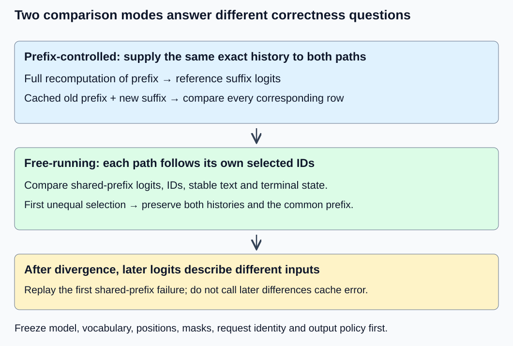
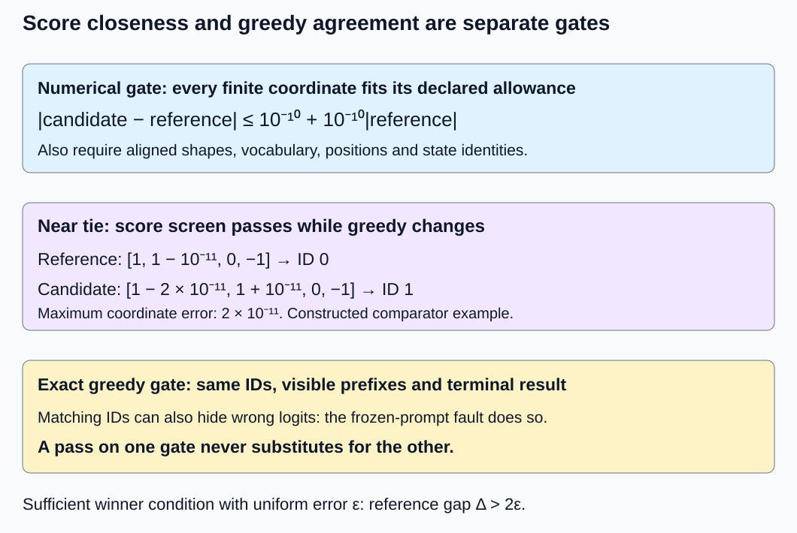

# M1-C19: Validating cached and uncached generation

> **Status: Complete — detailed chapter authored and documentation validated; experimental procedures are proposed unless explicitly labelled observed**

**Module:** Understand exactly what happens when an LLM generates a token

**Category:** [Numerics and correctness](index.md)

[Module 1 reading order](../module-1.md) · [Previous: M1-C18](../runtime-and-concurrency/m1-c18-understanding-prefill-and-decode.md) · [Next: M1-C20](../measurement-experimentation-and-economics/m1-c20-measuring-and-explaining-generation-latency.md)

## Target concepts

Full-prefix reference execution, matching next-token logits, numerical tolerances, greedy output comparison, cache lengths, position and masking errors, edge cases.

## Concepts

### Establish two independently meaningful paths

A **reference** is a separately established expected result, not simply another invocation of the candidate. An uncached reference recomputes every position of the complete supplied prefix. A cached candidate retains each layer's keys and values and computes only the new suffix. [M1-C17](../state-memory-and-caching/m1-c17-reusing-attention-state-with-a-kv-cache.md) establishes the reuse invariant; [M1-C18](../runtime-and-concurrency/m1-c18-understanding-prefill-and-decode.md) distinguishes prompt processing from later decode forwards. This chapter turns those mechanisms into a validation contract before comparing speed.

Use [M1-C14's fixed mathematical model](../model-computation-and-semantics/m1-c14-assembling-a-small-decoder-only-transformer.md): two ordered blocks, width two, one head of width two, vocabulary IDs 0–3, four absolute positions, pre-RMSNorm with epsilon one, FP64 reference and no dropout. Its equations and weights remain unchanged. Cache reuse changes computation scheduling, not model semantics. There is no pretrained checkpoint, tokenizer artifact or implemented engine supplied here. Rust is the eventual implementation context; all procedures below contain no implementation code.

An **identity contract** binds weights, model configuration, exact prepared IDs, request ID, layer order, vocabulary columns, positions, masks, arithmetic/backend settings and output policy. Pin these before comparing arrays. The [Transformer paper](https://arxiv.org/html/1706.03762v7) supplies causal-attention foundations; the [Transformers v4.57.1 cache specification](https://huggingface.co/docs/transformers/v4.57.1/en/cache_explanation) describes per-layer state and position tracking. Neither source proves a particular runtime is correct. A wrong position or stale prefix is a semantic failure, not a floating-point error to excuse with a larger tolerance.

### Compare common prefixes before comparing independent generation

In a **prefix-controlled comparison**, both paths receive the same externally supplied token history. For prefix length S split at n, the candidate has n old positions and receives r = S − n new IDs; compare its suffix logits against rows n through S − 1 from full recomputation. Those supplied tokens need not be the model's greedy choices. This isolates cache behavior from accumulated selection differences.

In a **free-running comparison**, each path selects its next ID, appends it and follows its own resulting prefix. This validates the actual greedy generation loop. At the first unequal selection, preserve both histories and the shared-prefix logits. Subsequent logits describe different conditional problems; do not keep subtracting them and call the differences cache error. Return to a prefix-controlled replay of the first divergence. These modes answer different questions and both are required for the declared generation contract.

*Stop conditional-logit comparison when histories diverge. The earliest mismatch is usually more informative than the last text difference.*

The core invariant after a successful append is: every layer's valid length equals the processed-prefix length; its old keys/values are unchanged; its new state belongs to the same exact prefix and absolute positions. Logical cache shape is (B, Hkv, N, d) per K/V tensor. For the single-request fixture, B = Hkv = 1 and d = 2. Selected history can be one ID longer than processed state at a terminal selection. Do not demand an unnecessary forward merely to make those lengths equal.

### Numerical and decision gates are separate

A logit is a raw vocabulary score. For finite reference coordinate rᵢ and candidate cᵢ, use **eᵢ = |cᵢ − rᵢ|** and declared allowance **bᵢ = a + t|rᵢ|**, with absolute allowance a and relative allowance t. For this small FP64 fixture, set **a = t = 10⁻¹⁰** before examining candidates, consistent with the earlier exercise screen. This is a conservative teaching budget for this bounded model; actual backends need documented error observations and stage review, not a universal FP64 guarantee. [M9-C17](m9-c17-comparing-logits-with-justified-numerical-tolerances.md) explains reference uncertainty, reduction order and budget justification.

Require every coordinate to pass, plus finite outputs, aligned shapes and identities. Report **E∞ = maxᵢ eᵢ**, failing-coordinate count and first failing request/position/vocabulary ID. Mean error alone can hide one decisive defect. Nonfinite values fail this fixture rather than being treated as equal or allowing NaN comparisons to disappear. An 80-digit reference cross-checked at 120 digits is strong exercise evidence but not a rigorous interval proof of reference error. Never loosen a budget after seeing failures merely to preserve a speed claim.

Greedy selection chooses the greatest logit, breaking exact ties toward the lowest vocabulary ID. Let winner w have reference gap **Δ = r_w − maxⱼ≠w rⱼ**. If each coordinate's error is bounded by ε and **Δ > 2ε**, the winner is preserved: its worst downward error and its rival's worst upward error cannot close the gap. With unequal coordinate bounds, the sufficient condition is **r_w − rⱼ > b_w + bⱼ** for every rival. Equality at the boundary does not establish a unique winner.

A standalone near-tie example uses reference [1, 1 − 10⁻¹¹, 0, −1] and candidate [1 − 2 × 10⁻¹¹, 1 + 10⁻¹¹, 0, −1]. Maximum error is 2 × 10⁻¹¹, so all coordinates pass the stated mixed screen; greedy changes from ID 0 to ID 1. This is a constructed comparator case, not M1-C14 model output. Under this chapter's exact greedy-trajectory requirement it fails the decision gate despite passing the numerical gate. If a future application accepts near-tie trajectory variation, that is a separately declared output contract and evaluation, not retroactive equivalence.

Conversely, a large error can preserve the winner. M1-C16's erroneous repeated original-prompt logits select [2, 2, 2] just like its correct evolving-prefix trace, while later logits are wrong. Selected IDs and final text cannot replace the numerical gate. The [PyTorch 2.14 numerical-accuracy guidance](https://docs.pytorch.org/docs/2.14/notes/numerical_accuracy.html) explains why mathematically equivalent shape/backend computations need not be bit-identical; it does not authorize semantic or decision mismatches.

*The numerical gate controls array error; the exact greedy gate controls the requested trajectory. A pass on one does not imply a pass on the other.*

### Build a finite corpus with observable faults

For prefix-controlled checks, use four seed sequences: A = [1, 2, 2, 2], B = [3, 0, 1, 2], C = [0, 0, 0, 0], D = [1, 3, 2, 0]. For each seed, take lengths S = 1 through 4, and every split n = 0 through S − 1. This is 16 labelled prefix cases and 40 split cases; some prefixes repeat across seeds deliberately. It contributes **4 × (1 + 3 + 6 + 10) = 80 suffix rows**, or **320 logit coordinates**. Compare every suffix row, not only the last. The n = 0 cases check empty-cache initialization; the n = S − 1 cases check single-position decode; intermediate splits expose multi-row suffix masks.

There are **4 × (1 + 6 + 18 + 40) = 260 eligibility entries** across split cases. For new query local row i, the allowed key condition is **j ≤ n + i**. With n = 2, r = 2, the two rows over keys 0–3 are [allow, allow, allow, block] and [allow, allow, allow, allow]. Local top-left triangular alignment is wrong for this cached suffix. The [PyTorch 2.14 attention specification](https://docs.pytorch.org/docs/2.14/generated/torch.nn.functional.scaled_dot_product_attention.html) documents its own non-square alignment and Boolean polarity; verify backend behavior rather than treating a causal flag as proof.

| Deliberate defect | Probe and required evidence |
| --- | --- |
| Reset new absolute positions to zero | Nonconstant position-table case [1, 2] + [2]; inspect embedded new row and logits. |
| Use a top-left suffix triangle | n = 2, r = 1 or 2; compare actual eligibility before scores. |
| Omit the new self-key/value | New query at position 2 must include key 2; inspect context and attention result. |
| Use layer 0 KV in layer 1 | Same shapes, different layer values; compare layer identities and first diverging normalized state. |
| Append a new ID twice or publish stale valid length | Exact processed-ID/length ledger must fail before accepting any later logits. |
| Reuse state for a different prefix/request | Prefix/owner manifest mismatch must reject reuse; shape equality is insufficient. |

A **negative control** is a deliberately incorrect behavior that the validation must detect. A defect need not alter every corpus case to be useful: all-zero logits may hide some numerical faults. Require each named defect to fail its designated probe. Also check that a rejected operation has not silently published an extended valid cache. If a layer fails midway, invalidate inconsistent request cache under M1-C17's elementary policy; no rollback allocator or device fault handler is implemented here.

### Exercise greedy and terminal edges separately

Use M1-C16's output contract: conservative admission P + G ≤ C = 4, EOS ID 3, lowest-ID greedy ties, hidden text stops over generated-only output, one terminal reason and strict finalization. Its constructed display is IDs 0/1/2 → a/b/c; EOS has no visible text. This display is distinct from M9-C19's scripted byte fixture.

| Case | Prepared prompt; cap/stop | Selected IDs | Visible output; reason | Final valid cache length |
| --- | --- | --- | --- | --- |
| R0 | [1]; G = 0 | None | Empty; length | 0 |
| R1 | [1]; G = 1 | [2] | c; length | 1 |
| R2 | [1]; G = 3 | [2, 2, 2] | ccc; length | 3 |
| R3 | [1, 2]; G = 2 | [2, 2] | cc; length | 3 |
| R4 | [3]; G = 3 | [3] | Empty; eos | 1 |
| R5 | [0]; G = 1 | [0] | a; length | 1 |
| R6 | [1]; G = 3; stop cc | [2, 2] | Empty; stop | 2 |
| R7 | [1]; G = 4 | None | Rejected reservation | 0 |

R4's prompt EOS is an input, not an instruction to skip the forward: its newly selected EOS terminates the request. R5 has exact zero logits and must select ID 0; masking or tie-policy errors cannot be excused by score closeness. R6 retains generated stop-trigger IDs internally while withholding their text. R7 has no model work. Across eight attempts there are seven admitted normal completions: five length, one eos and one stop; three admitted results are empty, but only R0 selects no ID. Expected total selected IDs and successful forwards are ten, comprising six prompt forwards and four subsequent decode forwards. Scripted-byte invalid-UTF-8 cases remain in completed M9-C19; they must not be relabelled as output from this mathematical model.

### Diagnose the first mismatch before timing

A useful evidence record contains the test/corpus version, manifests, prefix, split, layer lengths, positions, mask, reference/candidate logits, per-coordinate allowance, worst error coordinate, winner/gap and terminal state. At the first failure, inspect input identity, positions/mask, layer input normalization, new K/V and old prefix, attention, residual/MLP stages, then final normalization/head. This follows dependency order rather than assuming the cache allocation is always at fault.

Correctness runs may retain detailed traces. Benchmark runs should use a declared reduced instrumentation mode after correctness passes; measure its overhead separately. A profiler attributes costs but cannot establish equivalence. Compare completed useful requests, including required output/terminal work and cache updates; keep full diagnostic comparison cost separate when it is not part of the proposed deployment boundary. Cache verification, allocator safety, output identity and performance are complementary evidence, not one Boolean inferred from a plausible sentence.

## Experiments

All procedures are proposed for an independently supplied reference/runtime environment. The mathematical fixtures below are not implementations or observed inference benchmarks.

### E1 — Compare cache splits under identical supplied prefixes

**Description:** Compare every candidate suffix with a full-prefix reference. **Purpose/objective:** Isolate reuse correctness from token-selection drift. **Target concepts:** Full-prefix execution, matching logits, cache lengths, positions and masks.

**Baseline and workload:** Four seeds, 16 labelled prefixes and 40 splits defined above, with unchanged M1-C14 weights/positions and no padding. Use independent full-prefix equations, not the cached routine with a flag disabled.

**Controls and prediction:** Fixed FP64 contract, exact IDs, head/axis identity and layer order. Vary split only; every suffix row should match its full-prefix row within the declared screen, and all masks/lengths exactly.

**Procedure:** Establish full-prefix 80/120-digit references. Compare suffix logits and each layer's old-plus-new K/V against corresponding full-prefix state. Record every eligibility entry. Check unchanged old-prefix state and causal independence by perturbing only the final token. Supply position reset, top-left mask, missing self-key and wrong-layer state as negative controls on their designated probes.

**Hardware/software:** CPU mathematical reference; actual compiler/backend/precision recorded if a runtime is supplied. **Failure and HFT connection:** Replaying the same input history isolates state transformation errors, as in controlled event replay. Token prefixes are not market feeds. **Exit criteria:** V1's 320 logits and 260 discrete mask entries pass, exact state invariants hold, and all four numerical/structural defects are detected. Use V1.

### E2 — Separate numerical tolerance from greedy agreement

**Description:** Evaluate full trajectories and standalone comparator examples. **Purpose/objective:** Prevent same-text false confidence and near-tie score-only acceptance. **Target concepts:** Numerical tolerances, greedy output comparison and first divergence.

**Baseline and workload:** R0–R7 and the synthetic near-tie row; add the frozen-original-prompt fault for R2. Actual free-running paths each feed their own selections; prefix-controlled replay is used only for diagnosis.

**Controls and prediction:** Fix EOS, tie rule, cap, stops, display and manifests. Predict exact table outcomes. Near-tie scores pass the screen but fail exact decision equality; frozen-prompt scores fail despite matching IDs.

**Procedure:** Compare shared-prefix logits, selected IDs and terminal outcomes step by step. Stop conditional comparisons after the first ID mismatch and replay that prefix. Measure reference gaps against allowances. Test nonfinite candidate output as a comparator rejection, never as a fabricated model result. Keep probability/sampling tests outside this greedy scope.

**Hardware/software:** Same CPU reference environment; no PRNG or tokenizer runtime is needed. **Failure and HFT connection:** A tiny score change near a threshold can alter a decision, while unchanged decisions can hide bad state. There is no trading threshold policy established here. **Exit criteria:** V2 separates score and decision verdicts, exact ties choose ID 0, all table outcomes agree, and both misleading comparison examples are correctly rejected for their respective reasons. Use V2.

### E3 — Verify edge accounting and failed reuse

**Description:** Audit exact lengths, identity and terminal publication at boundary cases. **Purpose/objective:** Detect invalid state even when logits look plausible. **Target concepts:** Cache length, edge cases, invalid reuse and terminal handling.

**Baseline and workload:** R0–R7; structural negative controls are duplicate append/stale length and wrong prefix/request ownership. Include a paper scenario where layer 0 advances but layer 1 fails; actual allocator faults require an existing fault-capable runtime.

**Controls and prediction:** Fixed capacity four and private per-request state. A successful forward extends all layers coherently. Rejected admission does not populate cache; failed extension cannot become valid reused state.

**Procedure:** Compare processed versus selected histories, lengths/capacity and one terminal record. Check no post-terminal forward. Reject identity mismatch before use and invalidate partial extension; preserve committed token history for an explicitly separate recovery decision. Run repeated fresh requests and, if supported, interleave two request traces to check isolation. Document paper-only checks separately from executed fault trials.

**Hardware/software:** CPU ledger/reference environment; actual allocation/lifetime diagnostics only if supplied. **Failure and HFT connection:** Ownership and a known event disposition matter independently of payload plausibility; trading recovery requires its own contract. **Exit criteria:** V3 population balances, structural negative controls fail and any actual fault has a classified outcome without invalid reuse. Use V3.

### E4 — Benchmark only accepted complete requests

**Description:** Compare cached and uncached complete generation after E1–E3 pass. **Purpose/objective:** Relate speed to equivalent useful work and retained state. **Target concepts:** Reference execution, correctness-before-performance and reproducible comparison.

**Baseline and workload:** R2 and R3, same last-row head, output sink and terminal policy on both paths; each trial starts with empty request cache. Full-prefix recomputation is the baseline, cache reuse the candidate.

**Controls and prediction:** Fixed model/FP64/backend, thread/affinity, allocator mode, clock and required sink. R2 counts 944 versus 480 matrix operations; R3 counts 800 versus 480. These do not imply corresponding time ratios; small workloads can be dominated by overhead.

**Procedure:** In three sessions, warm each path/workload with five untimed trials, then collect 30 paired trials per workload, alternating order. Time prepared IDs/ready weights to final required visible text and terminal record with model work completed. Include cache construction and updates. Record cache reclamation separately if excluded from timing. Profile model stages, memory/copies and allocation in separate runs; compare full versus reduced tracing overhead separately.

**Hardware/software:** Existing CPU FP64 environment, monotonic clock and documented runtime/allocator; device extensions require completed work and separate device records. **Failure and HFT connection:** A faster wrong decision is not useful service; a local reduction must affect complete request cost. No HFT latency result is inferred. **Exit criteria:** V4 retains correctness/failure evidence, complete boundary timings and resource costs; mismatched output or inconclusive timing cannot become a speedup claim. Use V4.

## Verification

### V1 — Validate all coordinates and state identities

E1 has 4 × 10 = 40 split cases. Each seed contributes 20 suffix rows and 65 mask entries; totals are 80 rows, 320 logits and 260 entries. Across full combined caches after each split there are **960 K/V coordinate comparisons**, counting separate K and V in each of two layers even though their values coincide within a layer in this special model. Compare all coordinates, not one average. Exact old prefix equality is a state invariant; numerical candidate/reference closeness uses the fixed screen and diagnostic stage evidence.

The prefix-controlled corpus deliberately includes tokens the greedy model would not select and repeats some prefixes; it is a test of conditional computation, not 40 generation requests. Cross-check high-precision references at 80/120 digits, acknowledge empirically assessed reference uncertainty and save first-failure coordinates. Position reset uses nonconstant absolute embeddings; a content-only scalar attention fixture cannot expose it. Negative controls must fail the intended probe, not necessarily every zero/tie case. No performance measurement is needed to establish an eligibility mismatch.

### V2 — Check scores, margins and decisions independently

For E2, preserve full finite rows and maximum/failing-coordinate errors. The near-tie example has Δ = 10⁻¹¹ while a uniform maximum mixed allowance is about 2 × 10⁻¹⁰, so Δ > 2ε is not established. Its 2 × 10⁻¹¹ perturbation passes score tolerance and flips the winner. The exact zero row for R5 has gap zero and lowest-ID tie result 0. A tie is not a numerical failure by itself; violating the requested tie result is a decision failure.

For R2 the three reference winner gaps, rounded to six decimals, are 1.230632, 0.642534 and 0.877838. They greatly exceed twice the largest mixed allowance in their rows under this exercise budget; verify with unrounded values before relying on that sufficient condition. R2's frozen-prompt fault retains greedy ID 2 but must fail later logit comparisons. Do not center or softmax rows to hide raw-logit errors when raw logits are the requested interface. If a future contract compares probabilities instead, define that explicitly under M9-C17.

Free-running acceptance requires exact selected IDs and matching terminal/visible-prefix behavior on these cases as well as accepted shared-prefix logits. Any first mismatch triggers prefix-controlled diagnosis. A seed does not establish stochastic sampling equivalence; sampling/RNG validation remains a separate later treatment.

### V3 — Balance attempts and processed state

For E3, **8 attempted = 1 rejected + 7 admitted**, and **7 admitted = 5 length + 1 eos + 1 stop** for the unmodified base corpus. It has ten selected IDs/forwards, six prefills and four later decode calls. The three empty admitted outputs R0/R4/R6 have different reasons; first-visible time is undefined for all three and first-selection time is undefined for R0. R7 has no admitted generation result. Fault-injected variants have their own ledger and must not be counted as successful base cases.

Use M9-C19's generated-only stopping and strict output accounting; no post-terminal append is allowed. Layer valid length tracks processed inputs, not total selected history or reserved capacity. A duplicate append or stale-length publication fails an exact ledger even if a selected ID happens to agree. A different prefix or request owner fails identity before reuse. On partial layer failure, invalidate before another call and wait for last readers before reclaiming storage. These are expected contracts, not proof of real allocator or asynchronous cancellation safety.

### V4 — Preserve complete comparison evidence

E4 plans 90 pairs per workload across three sessions: 180 pairs/360 timed path trials total, plus **3 × 2 × 2 × 5 = 60** untimed warmup trials. Preserve every attempted pair, failed correctness check and incomplete member. Report session medians/ranges and paired uncached-minus-cached differences with units and clock granularity. [M9-C07](../measurement-experimentation-and-economics/m9-c07-latency-distributions-and-statistical-uncertainty.md) governs populations and uncertainty; this small isolated study cannot establish service p99 or capacity.

Reconcile R2's processed positions 6 versus 3 and counted matrix work 944 versus 480. For R3, full-prefix lengths 2 and 3 give 5 processed positions and **112 × 5 + 16 × (4 + 9) + 16 × 2 = 800** operations; cached processing totals three new positions, attention areas 4 + 3 and two vocabulary-row projections, giving **112 × 3 + 16 × 7 + 16 × 2 = 480**. Candidate final logical valid KV payload is 192 bytes in both cases. Normalization, softmax, allocation, cache movement and sink copying lie outside matrix counts but inside the declared complete timing boundary where required.

Calibrate empty timing brackets and instrumentation overhead. Separate detailed reference comparison from headline timing while preserving identical required result work. For asynchronous devices, stop timing only after required reads/writes and outputs complete, not when submission returns. A profile explains time and traffic but cannot substitute for E1–E3. Archive manifests, corpus and expected outputs, both histories, shared-prefix logits, margins, state/mask traces, fault verdicts, every timing attempt and hardware/software. No inference runtime, allocator fault experiment or performance benchmark was executed for this chapter.

## Engineering dimensions and principles

| Dimension | Application in this chapter |
| --- | --- |
| Semantics and invariants | Exact identity, causal masks and processed lengths precede numerical and decision gates. |
| Workload and variability | Diverse supplied prefixes, zero/tie/EOS/stop/cap cases and suffix splits reveal different defects; non-text modalities and padding are outside scope. |
| Resources and bottlenecks | Counts distinguish recomputation from retained KV and validation overhead; profiling requires an actual backend. |
| Time and distributions | First divergence is a diagnostic event; completion timing preserves empty/rejected/fault populations rather than hiding them. |
| Ownership and coordination | Requests/layers own distinct state, and partial updates cannot be published as a coherent cache. |
| Failure and adaptation | Invalid ownership/length rejects reuse; nonfinite rows fail; partial extension invalidates state before explicit recovery. |

| Practical principle | Evidence requirement |
| --- | --- |
| 1. Correctness defines the optimization boundary | All-coordinate numerical and exact greedy/terminal checks are separate mandatory gates. |
| 2. Performance depends on workload and operating point | Prefix lengths and output counts change saved work; tiny-model timing is not production performance. |
| 3. Data movement is part of the algorithm | KV reads/writes/copies and sink work remain in cost even when matrix work decreases. |
| 4. State has ownership, lifetime and recovery cost | Manifest and processed-prefix identity constrain reuse; invalidation preserves history for separately defined recovery. |
| 5. Dependencies determine latency; bottlenecks determine capacity | Diagnose the earliest stage mismatch; cached generation still follows dependent selections. |
| 6. Variability and synchronization shape the tail | Allocation and completed device work affect timing; isolated pairs do not establish serving tails. |
| 7. Local improvements must be evaluated end to end | Timing includes cache initialization/updates and final required output under identical contracts. |
| 8. Claims require reproducible evidence | Independent references, negative controls, exact ledgers and saved first-divergence records support acceptance. |

HFT means High-Frequency Trading, systems processing market events under tight timing constraints. Controlled replay, identity, coherent state and threshold-sensitive decisions are useful parallels. A token winner is not a trading decision, and a cache terminal result is not an exchange acknowledgement. No trading strategy, profitability, production latency or implemented recovery system is established here.

## Specifications, articles, and hardware

| Primary source | Scope and limit |
| --- | --- |
| [Transformer paper (2017)](https://arxiv.org/html/1706.03762v7) | Causal attention/projection foundations; exact fixture remains M1-C14. |
| [Transformers v4.57.1 caching](https://huggingface.co/docs/transformers/v4.57.1/en/cache_explanation) | Per-layer state and position context; neither runtime equivalence nor failure safety is implied. |
| [PyTorch 2.14 numerical accuracy](https://docs.pytorch.org/docs/2.14/notes/numerical_accuracy.html) | Finite precision and backend/shape differences; budgets require local justification. |
| [PyTorch 2.14 attention](https://docs.pytorch.org/docs/2.14/generated/torch.nn.functional.scaled_dot_product_attention.html) | Non-square causal alignment and mask polarity; actual eligibility must match the specified prefix. |

Proposed tiny-model/reference exercises require a CPU supporting FP64, one worker thread and at least 1 GiB free RAM for evidence. These are exercise requirements, not observed hardware or real-model sizing. Record CPU model, cores/sockets/cache/RAM, NUMA placement (memory proximity), affinity, OS, power/frequency/thermal and co-tenancy conditions, compiler/runtime/allocator, precision/backend/reduction settings, model identities, clock granularity, cache capacity and sink policy. No GPU or network adapter is needed. Device extensions require independently supplied model/hardware identities, driver/runtime, device memory and synchronized completion details.

Completed [M9-C01](m9-c01-defining-reference-behavior-and-evidence-before-optimizing.md), [M9-C17](m9-c17-comparing-logits-with-justified-numerical-tolerances.md), [M9-C19](../interfaces-protocols-and-streaming/m9-c19-validating-tokenization-stopping-and-final-output.md) and M9-C07 support reference, numerical, output and measurement evidence. M9-C20 advanced reuse validation remains outlined; needed elementary invariants are local. Module 9 supports later cache/kernel/serving/optimization/distributed work across Modules 1–7. Its authoring successor M9-C02 is now complete (consult the execution plan for current progress); the next Module 1 reading chapter is M1-C20.

## Key takeaways

Compare identical prefixes to isolate cached computation, then compare free-running greedy trajectories under the exact terminal contract. Numerical closeness, identical selected IDs and valid state are separate requirements. Preserve the first divergence, detect known defects and retain empty/fault outcomes before making complete-request speed claims. All runtime experiments remain proposed; mathematical and documentation validation do not execute an inference engine or establish production correctness.
