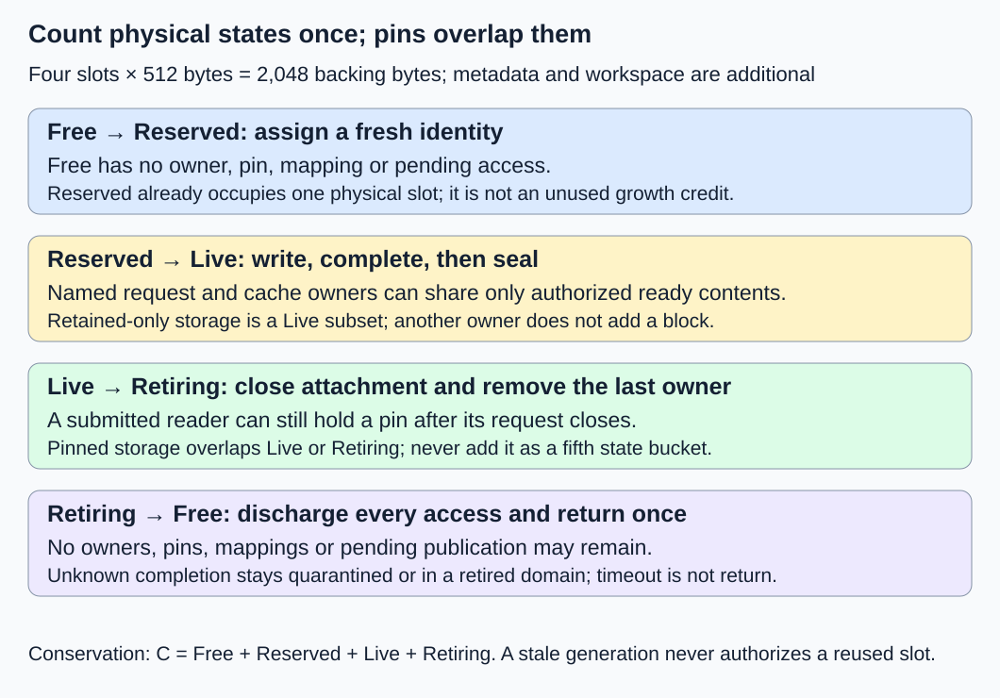
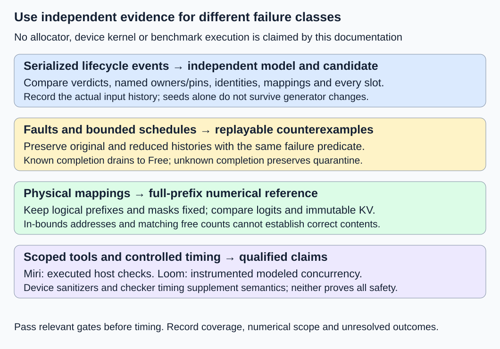

# M2-C20: Validating allocator and cache safety

> **Status: Complete — detailed chapter authored and documentation validated; experimental procedures are proposed unless explicitly labelled observed**

**Module:** Treat the KV cache as a first-class systems problem

**Category:** [Numerics and correctness](index.md)

[Module 2 reading order](../module-2.md) · [Previous: M2-C19](../runtime-and-concurrency/m2-c19-connecting-block-allocation-to-the-request-generator.md) · [Next: M2-C21](../measurement-experimentation-and-economics/m2-c21-benchmarking-kv-management-end-to-end.md) · [Execution plan and progress](../chapter-execution-plan.md)

## Target concepts

Reference state model, free-live-retained-pinned accounting, live-reference validity, shared-data immutability, randomized lifecycle traces, stale-handle detection, fault injection, cached-logit equivalence.

## Concepts

### Start with three different correctness questions

An allocator decides which physical storage a request may use. The cache retains attention keys and values, or KV, that later forwards read. A correct count of free blocks does not establish that a request reads its own prefix. A correct output on one prompt does not establish safe cancellation. We therefore need three gates: legal state transitions, valid memory access, and equivalent model results.

Read [M2-C19](../runtime-and-concurrency/m2-c19-connecting-block-allocation-to-the-request-generator.md) for the request-to-cache boundary, [M1-C19](m1-c19-validating-cached-and-uncached-generation.md) for numerical references, and [M9-C01](m9-c01-defining-reference-behavior-and-evidence-before-optimizing.md) for evidence contracts. This chapter specifies experiments; it supplies no Rust implementation or measured allocator results.

A **reference state model** is a deliberately simple description of legal behavior. Give it sets of slots, named ownership edges and access operations. Keep it independent of the candidate allocator's free stack, counters and reclamation routines: copying the same error into both sides defeats comparison. Feed the same serialized events to both sides, and compare the verdict and observable state after every event. A verdict says whether an operation was accepted or rejected.

Physical allocation policy may legitimately differ. Either configure the same declared slot-choice rule, or let the candidate report its selected slot and have the reference verify that the slot was eligible. Do not mistake a different legal free-slot choice for corruption. The worked trace below explicitly requests slot 0.

### Count physical states once; describe retention and pins separately

For capacity C physical slots, use four disjoint sets:

| Physical state | Meaning | May be assigned to a new owner? |
|---|---|---|
| Free | No owner, access pin, published mapping or pending writer | Yes, with a fresh allocation identity |
| Reserved | A physical slot has been assigned to a provisional owner; writing has not begun | No |
| Live | Writing or Ready storage belongs to at least one owner | No |
| Retiring | No strong owner remains, but outstanding access or cleanup prevents return | No |

A **strong owner** is a named request or cache edge that keeps an allocation alive. A **pin** records one submitted access whose completion has not yet been discharged. Pins can overlap Live and Retiring. A retained-only block is Ready Live storage with a cache owner and no active request owner. Neither retention nor pinning creates another physical slot.

The conservation equations are:

**C = F + Rₛ + L + T; O = Rₛ + L + T; P = count of slots with one or more pins.**

Here F, Rₛ, L and T are counts of Free, Reserved, Live and Retiring slots; O is occupied slots; P counts pinned slots, not pin operations. All quantities have units of slots. Never add P or retained-only slots to C again. Rₛ is assigned physical storage; it is different from unused growth credits in [M2-C15](../scheduling-and-queueing/m2-c15-admission-and-growth-under-a-finite-kv-budget.md), which promise capacity but have not assigned slots.

For B positions per block and k bytes of KV per position, **Q = B × k bytes/block** and backing storage is **C × Q bytes**. Our storage-only example uses B = 4, two layers, two KV heads per layer, two features per head, K and V, and eight-byte scalars. Thus k = 2 × 2 × 2 × 2 × 8 = 128 bytes/position, Q = 512 bytes/block and C = 4 gives 2,048 bytes backing storage. Metadata and workspace are additional. A pinned 512-byte block is already included in occupied storage.

### An in-bounds address can still refer to the wrong allocation

Use an allocation identity comprising **worker epoch, pool, slot and generation**. An epoch identifies a worker incarnation; a generation distinguishes successive assignments of the same slot. A descriptor also needs request/attempt identity, logical positions, layer, layout and the published table version. Checking only address bounds cannot distinguish yesterday's allocation from today's allocation at the same address.

A live reference requires a current identity, a valid ownership or access authority, initialized rows, the correct logical mapping, and the readiness promised to that reader. In M2-C19, a current-layer private reader can consume that layer's completed candidate rows; this does not authorize unrelated readers to consume an incompletely published prefix. Published valid length cannot advance just because submission succeeded.

Record ownership and pin tokens individually. Releasing the same token twice must not decrement another owner's count. A late completion for generation 7 must not discharge generation 8's writer. Reject count overflow and generation exhaustion before publication; wrapping either counter can manufacture false authority.

### Immutability and safe return are separate properties

A sealed shared block cannot be edited. A writer needs private, unsealed storage and exclusive write authority with no conflicting readers. Copy-on-write creates private storage before divergence; a reference-count check alone is insufficient if a reader can attach between that check and mutation.

For every sealed test block, retain the full reference payload. Label each coordinate by prefix identity, logical position, layer, K or V, head and feature. The four-position storage example has 4 × 2 × 2 × 2 × 2 = **64 scalar coordinates**. Compare every coordinate for immutability; a hash can help diagnostics but does not replace equality for this small corpus.

Return a particular allocation exactly once, after its owner set and pin set are empty, new attachment is closed, mappings are detached, and no pending write or publication can revive it. A cancelled request may have no owner edge while its previously submitted read still has a pin. Timeout is not completion. If completion is unknown after component loss, retain or quarantine the storage, or retire the isolated worker domain according to [M2-C16](../reliability-and-capacity-control/m2-c16-completion-cancellation-and-allocation-failure.md); never force it into Free to make a test pass.

### Work through a complete lifecycle

Initially all four slots are Free; slot 0's last generation was 6. A fills a four-position prefix [1,2,3,4]; cache edge K and request B share it. Later C uses a different prefix [5,6,7,8]. Slots 1–3 remain Free. Each table row is one serialized event, including the explicitly grouped retention action at event 4. n is strong-owner count, p outstanding pin count, and F free slots **after** that event. Writing and Ready are Live substates.

| Event | Action and expected verdict | Slot 0 state | n | p | F |
|---|---|---|---|---|---|
| 1 | Assign generation 7 to provisional A: accept | Reserved | 1 | 0 | 3 |
| 2 | Submit A writer, create pin WA: accept | Writing | 1 | 1 | 3 |
| 3 | Complete WA; all four rows ready and sealed: accept | Ready | 1 | 0 | 3 |
| 4 | Create named cache K and request B edges: accept | Ready | 3 | 0 | 3 |
| 5 | Begin B read, create pin RB: accept | Ready | 3 | 1 | 3 |
| 6 | Try editing sealed shared payload: reject | Ready | 3 | 1 | 3 |
| 7 | Close/detach A and release A edge: accept | Ready | 2 | 1 | 3 |
| 8 | Close/detach B and release B edge: accept | Ready, retained-only | 1 | 1 | 3 |
| 9 | Evict K, close attachment, detach and release K: accept | Retiring | 0 | 1 | 3 |
| 10 | Try assigning this same slot before RB completes: reject | Retiring | 0 | 1 | 3 |
| 11 | Complete RB and return generation 7 once: accept | Free | 0 | 0 | 4 |
| 12 | Assign slot 0, generation 8, to C: accept | Reserved | 1 | 0 | 3 |
| 13 | Try attaching an old generation-7 descriptor: reject | Reserved | 1 | 0 | 3 |
| 14 | Submit C writer, create pin WC: accept | Writing | 1 | 1 | 3 |
| 15 | Complete WC; four new rows ready and sealed: accept | Ready | 1 | 0 | 3 |
| 16 | Duplicate old RB completion for generation 7: reject | Ready | 1 | 0 | 3 |
| 17 | Close/detach C, release C, return generation 8: accept | Free | 0 | 0 | 4 |

The expected ledger contains **17 verdicts: 13 accepted and four rejected**. Two assignments match two returns; four owner creations match four releases; three pin creations match three completions. Event 10 targets the occupied slot explicitly: the existence of other free slots does not make that requested reuse legal. Event 13 is in bounds but stale. Events 6, 10, 13 and 16 leave state unchanged. These are specified reference outcomes, not observations of an allocator run.

### Explore more histories, then keep the smallest useful failure

Randomized lifecycle testing generates histories rather than isolated calls. The [Proptest state-machine guide](https://proptest-rs.github.io/proptest/proptest/state-machine.html) describes comparing a system with an abstract model and reducing failing transition sequences. Generate both valid actions and deliberately invalid actions with declared expected rejection; silently filtering all invalid actions removes precisely the boundaries we need to test.

For a proposed bounded campaign, use capacities 1, 2 and 4; three request identities; B = 4; requested lengths 0, 1, 3, 4 and 5; and seeds 0–31 per capacity. Each of **96 traces** schedules 256 actions, giving **24,576 generated actions** if the campaign finishes. Select equally among eight action families: assignment, write submission, write completion, sharing, read submission/completion, closure/eviction, stale or duplicate operations, and forbidden mutation. Within grouped families alternate the listed subactions; choose among eligible named objects uniformly. Record an explicit expected rejection when the chosen family has no eligible object; do not silently replace it with another family. Full-block sharing is the baseline; length 5 exercises growth. Empty requests must take the explicit no-block path.

Store the actual serialized events, generator version, random-number algorithm/version and seed. A seed alone does not reproduce a changed generator. Record coverage by accepted/rejected operation family, shared/retained/pinned state, generation reuse, block boundary and fault phase. A large action count does not imply those cases occurred.

When a failure appears, preserve its original history and state snapshots. **Shrinking** simplifies an input while retaining its failure, as explained in the [Proptest shrinking guide](https://proptest-rs.github.io/proptest/proptest/tutorial/shrinking-basics.html). Reduce events, lengths or owners only while preserving operation preconditions, relevant ordering and the original failure predicate. A shorter trace is not necessarily a globally minimal one. Keep both original and reduced artifacts.

Append a separately counted drain phase: close all surviving request/cache edges and complete each known submitted access exactly once. Known-completion tests must reach F = C. Unknown-completion tests must preserve explicit quarantine/retirement; they have a different expected terminal state.

## Experiments

### E1 — Replay the named-owner lifecycle

- **Description:** Replay the 17-event table against an independent state model and a future allocator candidate.
- **Purpose/objective:** Establish conservation, safe retirement, immutability and rejection without state changes.
- **Target concepts:** State model; free/live/retained/pinned accounting; live references; stale handles.
- **Baseline and workload:** Four slots, one selected slot reused across two generations, four owner tokens and three pins, exactly as specified above.
- **Controls and prediction:** Keep slot selection, payload labels and event grouping fixed. Predict 13 accepts, four rejects and complete recovery of four free slots.
- **Procedure:** Snapshot both sides after every event; compare identities, owner/pin sets, physical classes, mappings and all sealed payload coordinates. Save the first disagreement and its predecessor snapshot.
- **Hardware/software:** A single CPU process and reproducible reference/candidate versions suffice for logical replay; no GPU or production checkpoint is required.
- **Failure and HFT connection:** A late completion resembles a stale market-event callback referring to a reused buffer. Identity and lifetime checks transfer; trading decisions and inference logits have different correctness contracts.
- **Exit criteria:** All 17 verdicts and snapshots agree; four rejects change no state; each generation returns once; shared contents remain unchanged until no authorized reader needs them.

### E2 — Generate, interrupt and reduce lifecycle histories

- **Description:** Run the 96-trace campaign with deliberate invalid operations, fault checkpoints and bounded concurrency cases.
- **Purpose/objective:** Find histories missed by the hand-written example and preserve reproducible counterexamples.
- **Target concepts:** Randomized traces; fault injection; stale-handle detection; ownership and recovery.
- **Baseline and workload:** Independent set-based oracle; the capacities, lengths, seeds and 256-action prefixes above. Run the fault matrix below as named cases in addition to generated coverage.
- **Controls and prediction:** Pin the corpus, operation weights, fault positions and tool bounds. Predict exact agreement, no unaccounted slots and detection of each designated unsafe negative variant.
- **Procedure:** Compare after every action; record coverage; stop and shrink the first disagreement; append the appropriate known/unknown-completion drain. Explore both lookup-retain/eviction orderings separately.
- **Hardware/software:** CPU reference tests first; pin Rust, property-test library and candidate revisions. Any Miri/Loom/device checks require separately recorded compatible tool versions and configurations.
- **Failure and HFT connection:** Allocation exhaustion, cancellation bursts and stale callbacks resemble burst-driven buffer pressure. An inference retry must additionally preserve token/cache identity; market-message semantics cannot supply that reference.
- **Exit criteria:** Completed traces agree with the oracle; all named faults have the prescribed outcome; coverage gaps and unexecuted cases are reported; every failure has a replayable artifact. Passing a bounded campaign is evidence for its tested domain, not a proof of all schedules.

### E3 — Preserve logits across physical block placements

- **Description:** Compare cached execution using different physical mappings with the full-prefix mathematical reference.
- **Purpose/objective:** Detect logically wrong but in-bounds reads that allocator counts and memory tools cannot identify.
- **Target concepts:** Cached-logit equivalence; valid lengths; shared-data immutability; live-reference validity.
- **Baseline and workload:** Use the exact two-block, width-two, four-token-vocabulary FP64 (64-bit floating-point) model and four sequences from M1-C19. Set B = 2 and four physical slots; use every prefix length 1–4 and split n = 0 through S−1. This model uses 64 bytes/position, unlike E1's 128-byte storage-only fixture.
- **Controls and prediction:** Preserve model weights, token IDs, causal mask, positional semantics and arithmetic contract. Change only ordered injective block placement. Predict reference-equivalent logits and unchanged old KV.
- **Procedure:** For each mapped split, evaluate the uncached full-prefix reference and all newly processed cached rows at the same logical prefixes. Apply the coordinate gate below before comparing greedy outputs; run each designated wrong-mapping/mask variant separately.
- **Hardware/software:** CPU FP64 mathematical evaluation is sufficient for the proposed small reference. A future GPU candidate needs its actual backend, precision, layout and synchronization recorded; this chapter does not execute one.
- **Failure and HFT connection:** Like validating that a recovered order book represents the right event history, validate identity and contents before timing. Numerical tolerance is specific to the model arithmetic and does not relax ownership rules.
- **Exit criteria:** All 384 mapped split cases and 3,328 compared logit coordinates pass the justified gate; old KV is unchanged; each designated negative variant fails its intended check; decision differences receive a separate investigation.

### E4 — Measure the cost of complete reference checks

- **Description:** Compare explicit-set and compact-bitset representations (a bitset uses one binary membership flag per slot) of the independent checker, retaining the same full invariants after every event.
- **Purpose/objective:** Quantify validation overhead without weakening the correctness gate or confusing it with serving speed.
- **Target concepts:** Reproducible verification; conservation; workload-dependent checking cost.
- **Baseline and workload:** E1's exact 17-event trace, freshly reset before every trial. Three sessions, each with five excluded warm-ups per checker and 30 balanced paired trials, produce 90 pairs and 180 timed trials.
- **Controls and prediction:** Fix the candidate/event corpus, invariant set, payload equality checks, CPU placement and logging. Both checkers must accept/reject identically. No speed ordering is asserted before measurement.
- **Procedure:** Time first event through final full audit, including verdicts, state updates, global checks and payload comparisons; exclude preparation/reset. Alternate pair order evenly. Profile separate diagnostic trials to attribute snapshot, set/bitset comparison and payload-check cost.
- **Hardware/software:** Record CPU model, physical/logical cores, cache sizes, RAM, OS, Rust/compiler/build mode, clock source/resolution, affinity, frequency/power policy and background load. A GPU is unnecessary for this host-checker comparison.
- **Failure and HFT connection:** Instrumentation can perturb a latency-sensitive loop, so separate diagnostic attribution from ordinary timing. The analogy motivates measurement discipline; it establishes no production tail-latency benefit.
- **Exit criteria:** Equal verdicts/full checks, all trials accounted for, paired time distribution and confidence method disclosed. Correctness failures or 120-second watchdog expiry are failures/unresolved outcomes, never successful completion. Report no p99 claim from 90 trials per checker.

## Verification

### V1 — Audit conservation and immutability after every event

Check the partition by enumerating every physical slot, rather than trusting the candidate's free counter. Compare owner and pin identities, not only their totals. At event 8 there is one retained-only occupied block and one pinned block, both referring to the same 512 bytes. At event 9 there is zero retained Live storage but still 512 occupied Retiring bytes. At event 11 there are four free slots; at event 12 generation changes; at event 16 generation 8 remains untouched.

Audit all 64 scalar coordinates of the first sealed payload after events 3–10 and the new sealed payload after events 15–16. Do not require stale Free bytes to be zero: authorization and initialization govern reuse. Byte clearing is a separate security policy with its own specification.

### V2 — Make faults and concurrency claims explicit

| Named fault/probe | Expected evidence |
|---|---|
| Duplicate owner release | Unknown/already-consumed edge rejected; another owner survives |
| Premature return while a read pin exists | Reference mismatch before assignment or payload access; unsafe variant fails |
| Old-generation handle at a reused slot | Rejection despite valid address; new owner's state unchanged |
| Shared payload modification | Full coordinate comparison identifies the changed coordinate |
| Failure before a second destination assignment | First provisional destination unwound exactly once; unused credit restored once |
| Failure after access submission | Pending accesses drain before return, or explicit quarantine remains |
| Owner bound 3; attempt a fourth edge | Overflow rejected before attachment/publication; count remains 3 |
| Generation at declared maximum | Assignment rejected or pool retired; no wrap into an old identity |
| Partial-layer readiness or wrong self-key mask | Publication/reader contract or designated numerical probe fails |
| Lost worker epoch/unknown completion | Old-domain claims remain isolated; a new epoch cannot free its storage |

For the two-destination failure probe, start with two free slots backed by two unused growth credits and no submitted access. Assign the first destination, then fail before assigning the second. Roll back the first physical claim and restore only its consumed credit; the second credit was never consumed. Check both credit and physical conservation against M2-C15. This is an additional named case, not an event in E1.

For lookup-retain versus final eviction, enumerate two protected outcomes. If retention wins, the newly acquired request edge survives removal of the cache edge. If eviction wins, attachment is closed and the lookup becomes a miss. A sequential replay of these outcomes specifies behavior; it does not verify the real atomic implementation.

[Miri's official documentation](https://github.com/rust-lang/miri) describes undefined-behavior checking for particular Rust executions, including use-after-free and uninitialized accesses. Its passing result cannot certify all executions, host/device boundaries or logical cache identity. [Loom 0.7.2](https://docs.rs/loom/0.7.2/loom/) explores modeled concurrency using replacement primitives: hidden operations are outside the model, and schedule bounds and weak-memory limitations matter. Record which operations and bounds were covered.

For a future CUDA implementation, [Compute Sanitizer](https://docs.nvidia.com/compute-sanitizer/ComputeSanitizer/index.html) offers memcheck for out-of-bounds/misaligned access, initcheck for uninitialized global-memory reads, racecheck for shared-memory hazards and synccheck for synchronization misuse. Racecheck is not a general proof of global-memory race freedom. None of these tools validates prefix identity or logit equivalence. Report tool-specific findings and unsupported paths separately; no such implementation/tool run is claimed here.

### V3 — Count comparisons and justify numerical tolerance

Use M1-C19 sequences A = [1,2,2,2], B = [3,0,1,2], C = [0,0,0,0] and D = [1,3,2,0], with its fixed model specification. For length S and B = 2, the logical block count is ceil(S/2). With four physical slots there are four placements for one block and 4 × 3 = 12 ordered distinct placements for two blocks. A physical ordering such as [3,0] must still represent logical positions in their original order.

Per sequence, mapped split count is **1 × 4 + 2 × 4 + 3 × 12 + 4 × 12 = 96**. Four sequences give **384 cases**. Newly processed rows per sequence are **4 × 1 + 4 × (2+1) + 12 × (3+2+1) + 12 × (4+3+2+1) = 208**. Thus 832 rows × four vocabulary coordinates gives **3,328 logits**. There is no context beyond the inherited four-position model.

For candidate scalar c and reference r, use the inherited FP64 gate **abs(c−r) ≤ 10⁻¹⁰ + 10⁻¹⁰ × abs(r)**, with both finite. The absolute term covers near-zero values; the relative term scales with magnitude. Record maximum absolute error, maximum scaled error, failing coordinate and its token/layer/mapping context. This gate belongs to this fixed toy arithmetic; a production lower-precision backend needs its own justification.

Compare old KV exactly where the contract promises unchanged stored values. Independently check masks, logical positions, generation and valid lengths exactly. Greedy agreement is an additional decision gate: near ties may change a selected token despite small errors, and matching tokens can hide wrong logits. Use controlled common prefixes before any free-running comparison. Designate nondegenerate wrong-slot, wrong-layer, position, self-key-mask and stale-valid-length cases whose expected invariant or reference violation is known; an insensitive all-zero case alone is inadequate.

### V4 — Account for benchmark work and interpret it narrowly

The 180 timed trials project **3,060 event verdicts**, comprising 2,340 accepts and 720 expected rejections. They contain 360 assignments and 360 returns, 720 owner creations and 720 releases, and 540 pin creations and 540 completions. Four slots audited after each event give **12,240 logical slot classifications**; these are not CPU instruction counts. Thirty warm-up trials are excluded. Report actual completions and discrepancies rather than filling missing trials with predictions.

Report paired elapsed differences and ratios, medians and dispersion, plus session variation and the chosen paired confidence procedure. Preserve raw trials and pair ordering. Profile where full checks spend time, and keep heavily instrumented measurements separate. Faster reference checking cannot establish faster allocator critical paths, GPU attention, cancellation recovery or useful request throughput. Those end-to-end workloads belong to M2-C21 after M9-C15's memory-accounting foundation.

### Evidence required before making a safety claim

| Gate | Pass condition | Scope limit |
|---|---|---|
| E1 / V1 | Exact event, identity, partition and payload agreement | One deterministic history |
| E2 / V2 | Corpus replay, named faults and bounded schedules agree; drain/quarantine explicit | Tested cases and declared bounds |
| E3 / V3 | Mapped logits, immutable KV and exact semantic metadata pass | Fixed toy model and justified precision |
| E4 / V4 | Same checks/verdicts, complete trial ledger and reproducible timing | Host reference-checker overhead |

**Observed during chapter authoring:** arithmetic, document structure, local links, diagram validity and documentation rendering/build are checked. The state table is a specification checked for internal consistency. Candidate allocator execution, generated-corpus coverage, fault discovery, mapped model execution, Miri/Loom/sanitizer checks and CPU/GPU performance remain proposed experiments. Documentation completion is not production certification.

## Engineering dimensions and principles

| Dimension | Application in this chapter |
|---|---|
| Semantics and invariants | Compare named authority, initialized rows, immutable values and exact allocation identities before any timing claim. |
| Workload and variability | Sweep small capacities and boundary lengths; include reuse, retained prefixes, cancellation churn and invalid actions. |
| Resources and bottlenecks | Count unique occupied slots separately from owners/pins; profile full-checker snapshots and payload scans. |
| Time and distributions | Preserve pending-access intervals and event order; separate instrumented checks from measured host trials. |
| Ownership and coordination | Each strong edge and access pin has a unique identity and one discharge; lookup and eviction need a protected order. |
| Failure and adaptation | Inject pre/post-submission failures, duplicates, exhausted identities and unknown completion; retain explicit recovery state. |

1. **Correctness defines the optimization boundary.** A compact checker must enforce the same full contract; lower-precision output needs a separately justified equivalence boundary.
2. **Performance depends on workload and operating point.** Small-pool adversarial traces test safety; they do not represent production capacity or arrival distributions.
3. **Data movement is part of the algorithm.** Snapshot copying and full payload comparison cost memory traffic even when allocator arithmetic is trivial.
4. **State has ownership, lifetime, and recovery cost.** Retiring pinned storage consumes real capacity; logical cancellation cannot reclaim it early.
5. **Dependencies determine latency; bottlenecks determine capacity.** Safe return depends on completion; occupied retired slots constrain admission even with idle CPU.
6. **Variability and synchronization shape the tail.** Races may require rare schedules; a short timing sample cannot establish p99 behavior.
7. **Local improvements must be evaluated end to end.** A faster checker or allocation call matters only through its effect on correctly served requests under the intended workload.
8. **Claims require reproducible evidence.** Preserve serialized events, versions, raw results, counterexamples, tool scope and numerical reference behavior.

## Specifications, articles, and hardware

The test specification consists of the exact state partition, identity tuple, named-token authority, initialization/publication rules and safe-return predicate above. It assumes a fixed worker/pool identity during each ordinary trace, no generation wrap, full-block sharing, and explicit terminal recovery. Sliding-window, hybrid and MLA storage require their architecture-specific invariants from M2-C17/C18 in addition to these allocation checks; the small dense toy model does not validate them automatically.

The primary reading path is the [Proptest state-machine article](https://proptest-rs.github.io/proptest/proptest/state-machine.html) for independent transition models, its [shrinking tutorial](https://proptest-rs.github.io/proptest/proptest/tutorial/shrinking-basics.html) for counterexample reduction, [Miri](https://github.com/rust-lang/miri) for executed Rust memory checks, [Loom 0.7.2](https://docs.rs/loom/0.7.2/loom/) for instrumented concurrency exploration and [NVIDIA Compute Sanitizer](https://docs.nvidia.com/compute-sanitizer/ComputeSanitizer/index.html) for scoped CUDA checks. These are complementary sources of evidence, not interchangeable safety certificates. Freeze documentation/tool versions in an eventual experiment record.

No particular machine or model checkpoint has been supplied. E1–E3's toy references need a CPU with FP64 support and enough RAM for the small state corpus, model and captured histories; streaming history storage can bound memory. E4 requires the detailed CPU record specified above. A future device run must add GPU model/count, architecture, VRAM, ECC setting if supported, driver/runtime/toolkit versions, stream configuration, precision/layout and actual memory budget for payload, weights and workspace. Record host/device completion boundaries, tool overhead and any unsupported checks. Do not infer production memory requirements from the 2,048-byte storage fixture.

## Takeaways and next step

Validate who may access which generation, what that storage means, and when it can return. Independent state histories expose illegal lifetimes; full coordinate and numerical checks expose legal-address/wrong-content errors. Use scoped tools to add evidence, and retain explicit limits on every claim.

Track completion in the [execution plan](../chapter-execution-plan.md). The completed accounting prerequisite is [M9-C15: Accounting for weights, KV state, workspace, and fragmentation](../state-memory-and-caching/m9-c15-accounting-for-weights-kv-state-workspace-and-fragmentation.md). [M2-C21](../measurement-experimentation-and-economics/m2-c21-benchmarking-kv-management-end-to-end.md) is now complete, finishing Module 2. M3-C01 is next for authoring. Module 8 remains excluded.
