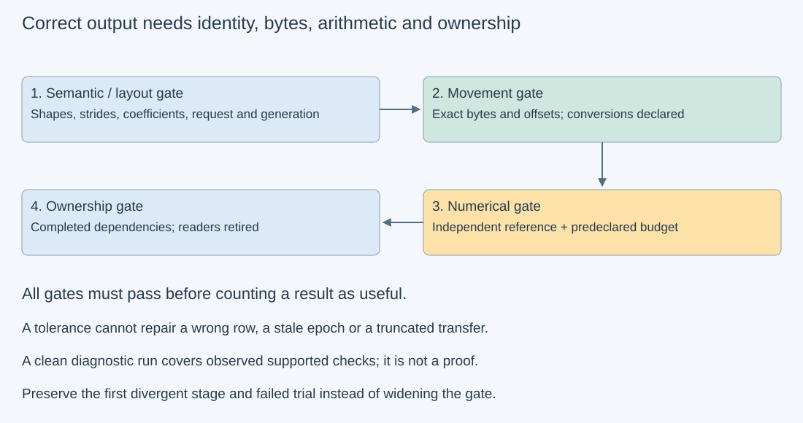
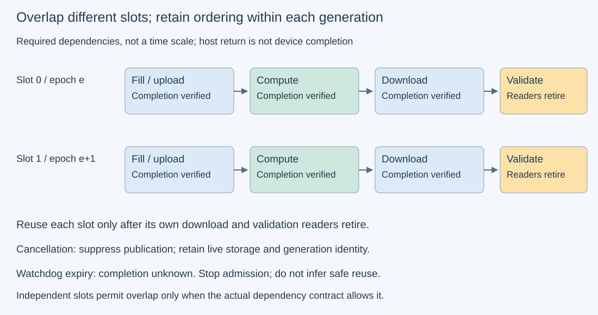

# M3-C18: Validating GPU computation and memory movement

> **Status: Complete — detailed chapter authored and documentation validated; experimental procedures are proposed unless explicitly labelled observed**

**Module:** Learn GPU architecture through data movement

**Category:** [Numerics and correctness](index.md)

[Module 3 reading order](../module-3.md) · [Previous: M3-C17](../scheduling-and-queueing/m3-c17-batching-weight-reuse-and-shifting-bottlenecks.md) · [Next: M3-C19](../measurement-experimentation-and-economics/m3-c19-designing-trustworthy-asynchronous-gpu-benchmarks.md) · [Execution plan and progress](../chapter-execution-plan.md)

## Target concepts

Reference GEMV and GEMM outputs, accumulation precision, absolute and relative tolerances, reduction-order differences, transfer integrity, shape and stride checks, race and lifetime faults.

## Concepts

### 1. Correctness has several independent gates

A GPU result can be numerically close to some answer while belonging to the wrong request, using a transposed input, or arriving before its transfer completed. Establish the operation and identity first. **GEMV** means matrix-vector multiplication, here y=αAx+βy. **GEMM** means matrix-matrix multiplication, here C=αAB+βC. A is M×K, B is K×N and C is M×N. Scalars α and β determine scaling and whether the previous output participates.

Define four gates before collecting performance evidence:

1. **Semantic/layout gate:** the shapes, axes, transpose flags, strides, coefficients, precision policy and request/generation identity match the intended operation.
2. **Movement gate:** raw copies preserve the specified bytes at the intended offsets; conversions have a separate numerical contract.
3. **Numerical gate:** each output matches an independent reference within a justified, predeclared budget, with explicit nonfinite handling.
4. **Ownership gate:** no state is overwritten, published or reclaimed before the necessary producers and readers retire.

A **generation identity** distinguishes successive uses of the same reusable storage slot. Matching an address does not establish matching content. Passing one gate does not imply the others passed. Rust's host ownership rules help establish CPU-side access, but a device command can outlive the function that submitted it. The binding and application must retain buffers and order their use across device completion. No implementation code is provided here.

*Numerical tolerance applies only after identity, layout and movement agree. A failed gate invalidates that trial's useful-result claim; it does not disappear from the outcome ledger.*

### 2. Build references small enough to inspect

A **reference** states the intended computation independently of the candidate library. Start with explicit products and sums; promoting the same erroneous descriptor into another library is not independence. Use represented input values for the computation reference, and retain a separate original-input reference if evaluating a format conversion. Wider arithmetic cannot recover information already rounded away.

For α=1, take A=[[1,2,3],[4,5,6]], x=[1,−1,2] and B=[[2,0],[−1,1],[3,2]]. Products give:

**Ax=[5,11].**

**AB=[[9,8],[21,17]].**

At β=1, with initial y=[10,20] and C=[[10,20],[30,40]], the results are **[15,31]** and **[[19,28],[51,57]]**. At β=0 the old output values do not participate, although valid output storage remains necessary. Restore a seed before every β=1 trial rather than repeatedly accumulating into the last result. Record seed preparation in the cache/timing history. The [cuBLAS operation reference](https://docs.nvidia.com/cuda/cublas/index.html) specifies coefficients, layout and leading dimensions; the selected API's contract governs actual storage.

For a transpose check, Aᵀ times [2,−1] gives **[−2,−1,0]**. Its input length and output length differ from Ax. Square, symmetric or constant-only fixtures can conceal transposes and permutations; include asymmetric dimensions and coordinate-varying data. Empty dimensions, K=0, unsupported layout, invalid strides and overflowing size calculations require explicit API-specific handling before submission. A positive-shape formula is not their specification.

### 3. Strides connect coordinates to bytes

A **stride** is the distance in elements between adjacent coordinates along an axis. For a mathematical row-major M×K input with row stride L_A, element A[i,k] is at element offset **iL_A+k**, or byte offset **s(iL_A+k)** for s-byte values. Row-major means contiguous columns within a row. A **leading dimension** in a library may instead describe column-major storage; translate the mathematical view to that API rather than copying this formula into every descriptor.

Store the 2×3 A above with L_A=4: backing rows [1,2,3,guard] and [4,5,6,guard]. Payload is 24 bytes in binary32. The span through the final logical element is **s[(M−1)L_A+K]=28 bytes**, while allocating both full padded rows uses **sML_A=32 bytes**. Payload, span and backing capacity differ. A contiguous 24-byte copy from the padded base would copy the first guard and omit a needed value; use the declared row layout or a deliberate packing step. A packing transformation has its own reference.

The output may also be padded: a 2×2 C with row stride 3 has four logical values in a six-element backing. Verify logical values and the two padding elements separately. **Canaries**, recognizable guard bytes outside the allowed write region, help detect some overwrites. Unchanged guards do not prove that every read was valid or that no race occurred. Guard storage itself is ordinary memory, not a hardware protection boundary. Validate offsets, alignment, span, backing capacity and nonoverlap with checked size arithmetic before launch; never intentionally submit a malformed pointer as a teaching shortcut.

### 4. Arithmetic format and accumulation both matter

An **accumulator** holds intermediate sums. Binary32 inputs do not by themselves specify the multiplication format, accumulation width, fused multiply-add behavior or reduction tree. A **reduction tree** determines how partial sums combine. Addition is not associative after rounding. For exactly represented inputs [2²⁴,1,−2²⁴], binary32 round-to-nearest, ties-to-even yields:

**((2²⁴+1) rounded − 2²⁴) = 0.**

**(2²⁴ + (1−2²⁴)) = 1.**

The exact real sum is 1. Either evaluation order may be permitted under a particular arithmetic contract, but this does not mean both meet a downstream application's accuracy requirement. A wider independent reference exposes the discrepancy. The [NVIDIA floating-point white paper](https://docs.nvidia.com/cuda/floating-point/index.html) discusses rounding, fused multiply-add and dot-product evaluation. A faster reduced-input-precision or sparse path requires explicit authorization in the numerical contract; it is not equivalent merely because C is stored in binary32.

For finite reference r and candidate c, define **absolute error e=|c−r|** and a common mixed comparison gate:

**e ≤ atol + rtol|r|.**

atol is an absolute allowance; rtol is a relative allowance. At r=0 only atol helps. A reference of 100 and candidate 100.0005 passes teaching values atol=10⁻⁶, rtol=10⁻⁵ because 0.0005≤0.001001. Reference 0 and candidate 0.00002 fails because 0.00002>0.000001. These demonstrate the gate; they are not universal GPU tolerances. Reject unexpected NaN/infinity explicitly before ordinary comparisons. A NaN is a non-number such as an invalid arithmetic result; it must not evade the gate through comparison behavior. Specify signed-zero and infinity behavior separately if the operation contract permits them.

Let r★ be the ideal result and reference uncertainty be bounded by η. Then **|c−r★|≤|c−r|+η**. A total allowed error T leaves only **T−η** for the observed discrepancy. If η is not established, describe the reference evidence without calling it a certified bound. Assess a numerical reference at two higher precisions and cross-check simple cases; agreement alone does not prove the formula correct. Completed [M9-C17](m9-c17-comparing-logits-with-justified-numerical-tolerances.md) develops these distinctions.

For intuition, a sequential sum of n represented inputs has a conventional bound **γ_(n−1)Σ|x_i|**, with **γ_k=ku/(1−ku)**, ku<1 and binary32 round-to-nearest **u=2⁻²⁴**. This assumes correctly rounded additions and no overflow or harmful underflow; a dot product also has multiplication errors and needs its own analysis. The bound grows with cancellation sensitivity and can be far too loose for useful service. It is neither a blanket GEMM tolerance nor a reason to excuse identity/layout faults.

### 5. Copies need byte checks; computation needs value checks

A raw host-to-device-to-host copy should preserve the declared byte sequence exactly when no conversion is requested. Compare all payload bytes and the intended untouched regions, not just a sum or checksum. A checksum can miss collisions and permutations. Include lengths near boundaries, interior offsets and nonzero generation tags. A float-only equality check can hide signed-zero changes or treat NaNs differently; raw transfer integrity concerns bits.

For a constructed length 17, offset 5 transfer, put distinct bytes at source positions 5…21 and preserve destination bytes outside that range. A length 16 truncation leaves byte 21 stale even if the first 16 match. Define whether the transfer is a contiguous backing copy, a row-wise logical copy or a conversion. Each has a different expected destination. If conversion is intentional, retain exact transport checks on the transported representation and a separate value/rounding reference for the conversion.

**Submission** means the runtime accepted work; **completion** means the relevant operation actually finished. The [CUDA API synchronization specification](https://docs.nvidia.com/cuda/cuda-runtime-api/api-sync-behavior.html) explains why an asynchronous API name or a returning call is insufficient evidence of device completion. Define explicit producer-to-consumer dependencies. One command's success may coexist with a later asynchronous failure; inspect completion status as well as submission status.

### 6. Ordering and lifetime remain correctness conditions

A **race** occurs when accesses without the required ordering can conflict; a **lifetime fault** occurs when storage is reused or released while an operation still needs it. Correctness requires the dependency chain:

**fill source → upload complete → compute complete → download complete → validate/publish → reuse.**

Some stages can overlap across different buffers. Within a dependency chain, actual events and waits must justify each edge. With two slots, slot 0 can serve generation e while slot 1 prepares another, but slot 0 cannot be overwritten merely because the host has moved on. Keep model/shape/epoch identity with the result. Cancellation suppresses useful publication under the stated policy; it does not imply device completion or immediate reclamation.

*The arrows show required ordering, not a latency scale. A timeout leaves completion unknown until a documented recovery/teardown path establishes that device access has ended.*

[NVIDIA Compute Sanitizer](https://docs.nvidia.com/compute-sanitizer/ComputeSanitizer/index.html) supplies complementary diagnostics. Memcheck targets out-of-bounds/misaligned accesses; initcheck targets uninitialized global-memory accesses; synccheck targets invalid synchronization; racecheck targets shared-memory access hazards. A clean racecheck run is not proof of correct global-memory, cross-stream or host/device ownership. Instrumentation changes timing and may change which interleavings occur. Keep sanitizer cohorts separate from performance trials; retain the exact tool/version/options, coverage and findings, and still check the application's ownership ledger.

The HFT lens emphasizes event identity, stale results, bounded in-flight state and critical-path completion. A tiny numeric deviation that changes a decision and a perfectly accurate result for a stale event are different failures. The same distinction matters for token selection and serving. No exchange semantics, financial outcomes or hard real-time guarantees are inferred from these GPU checks.

## Experiments

All four experiments are **proposed**. Worked references are teaching calculations; no GPU, sanitizer, transfer or serving measurements are supplied. Rust is the eventual application context, with the selected binding's documented descriptors, arithmetic and completion contracts. No implementation code is included.

### E1 — Establish independent shape and arithmetic references

- **Description:** Work through the small GEMV/GEMM, transpose and padded-layout examples before invoking a device library.
- **Purpose/objective:** Expose orientation, coefficient, seed and stride errors with inspectable answers.
- **Target concepts:** Reference outputs, shape/stride checks, exact fixtures and descriptor translation.
- **Baseline and workload:** A, x, B, initial y/C from Concepts 2; α=1, β∈{0,1}; Aᵀ times [2,−1]. Compare contiguous A against L_A=4, and C against row stride 3. All arithmetic is exactly representable in binary32.
- **Controls and prediction:** Preserve logical values and nonaliasing. Predict Ax=[5,11], AB=[[9,8],[21,17]], seeded results [15,31] and [[19,28],[51,57]], transpose [−2,−1,0]. Padding must not enter the operation or change.
- **Procedure:** Calculate every dot product independently, map each coordinate to its byte offset and verify payload/span/backing sizes. Translate to the chosen API's layout contract. Reject an incompatible x length, insufficient backing, overlapping operands or overflowing size before submission. Keep β=0 and β=1 seed semantics distinct.
- **Hardware/software:** Paper or calculator suffices. Any future library execution needs documented layout/precision support; no GPU required for these references.
- **Failure and HFT connection:** An axis permutation or wrong request identity is a semantic failure, not numerical noise. HFT event fields similarly cannot be reordered and then accepted through an error tolerance.
- **Exit criteria:** Every listed output and offset reconciles independently; bad descriptors are rejected before device work; guards and seeds have explicit expectations.

### E2 — Challenge a numerical gate with cancellation and near zero

- **Description:** Compare exact/wider references against two allowed binary32 sum orders and two mixed-tolerance records.
- **Purpose/objective:** Learn to justify an accuracy budget without widening it after a failure.
- **Target concepts:** Accumulation precision, reduction order, absolute/relative error and reference uncertainty.
- **Baseline and workload:** Sum [2²⁴,1,−2²⁴] with exact reference 1; left-associated and right-associated round-to-nearest binary32. Separately compare (100,100.0005) and (0,0.00002) using the teaching atol/rtol above. These are arithmetic exercises, not benchmarks.
- **Controls and prediction:** Fix represented inputs and rounding mode. Predict sum results 0 and 1; the first comparison passes and the near-zero record fails. Declare whether the application requires exact 1 or permits a justified wider budget before judging either sum.
- **Procedure:** Trace each rounding, report absolute error and per-coordinate budget, and explain why a small aggregate average cannot excuse a failing coordinate. Include unexpected NaN/infinity and a stale-generation record as unconditional contract failures. For a future dot-product precision study, distinguish original versus rounded inputs and assess reference uncertainty with independent higher-precision evaluations.
- **Hardware/software:** Exact rational reasoning and a specified binary32 arithmetic model suffice. No GPU or timing is required.
- **Failure and HFT connection:** Keep reduction-order differences separate from decision sensitivity. A budget acceptable for one numerical stage may still be too large for a later token or event decision.
- **Exit criteria:** All gate decisions and intermediate sums reconcile; η consumes the total budget explicitly; no tolerance is introduced to rescue byte, identity or lifetime failures.

### E3 — Validate a bounded transfer–compute pipeline

- **Description:** Design a single-GPU comparison of serialized and two-slot execution, checking bytes before arithmetic and every result afterward.
- **Purpose/objective:** Preserve the same valid outputs while varying interleaving and layout.
- **Target concepts:** Transfer integrity, exact GEMM references, strides, completion, race and lifetime checks.
- **Baseline and workload:** α=β=1 binary32 GEMM with (M,K,N)∈{(2,3,2),(8,8,8),(17,13,9)}. For measured epoch e, A[i,k]=((i+k+e) mod 4)−1, B[k,j]=((2k+j) mod 4)−1 and seed C0[i,j]=e+i−j. Reference C=AB+C0 uses independent integer products/sums. Two layouts: contiguous and each matrix row padded by one element. Two schedules: one completed trial at a time and two independently owned in-flight slots. There are twelve cells; each trial is one operation/result, not a two-operation batch.
- **Controls and prediction:** Fix the API, transpose mapping, arithmetic policy, stream/dependency design, workspace limit and dimensions per cell. Initialize padding plus 32-byte prefix/suffix guards on all A/B/C backings with recorded canaries. Compare exact bytes for all uploaded backing/guard regions and exact values for logical outputs. Different schedules/layouts must yield the same logical reference for the same e; no speedup is required.
- **Procedure:** Run three independent sessions, ten excluded warmup trials per cell/session and twenty measured trials per cell/session in a recorded balanced order. Measured e=0…59 per cell; warmups use e=0. Within each trial, upload complete initialized backings, echo A/B/seed-C including guards back to separate host storage and validate every byte, then compute, download complete C backing/guards and validate every coordinate and untouched byte. This diagnostic echo deliberately adds transfers. Record a completed device arithmetic interval and a separate host preparation-to-validated-retirement interval including echo checks. In the two-slot cell, alternate slot identities with at most two trials in flight; dependencies and independent host readback storage protect each generation. Sanitizer passes are separate, as described below.
- **Hardware/software:** One supported GPU with documented binary32 GEMM and host/device completion, independent CPU references, pinned host buffers if the selected asynchronous route requires them, and optional Compute Sanitizer tooling. Reserve at least 1 MiB each for raw host/device fixture storage, plus an explicit separate library/workspace/runtime budget. This is a fixture allowance, not a complete GPU memory requirement.
- **Failure and HFT connection:** Submission or completion failure stops new admission and invalidates useful publication. A 120-second watchdog records unknown completion; it never authorizes slot reuse. Retain pending storage until a documented completion or safe context teardown ends access. A stale epoch, changed guard or missing byte fails even if output numbers happen to match.
- **Exit criteria:** Account for 720 planned measured trials and 360 excluded warmups independently, with no silent replacement of failures. All successful trials pass byte, exact-output, guard and generation gates; both schedules retain legal ordering. Report failed/incomplete checks explicitly and make no transfer-bandwidth claim from the echo-heavy validation path.

### E4 — Test diagnostic coverage and forbidden transitions

- **Description:** Review six intentionally faulty paper records and define a separate sanitizer cohort for E3's valid pipeline.
- **Purpose/objective:** Establish which check catches each fault and where diagnostic coverage ends.
- **Target concepts:** Transfer integrity, shape/stride checks, numerical gates, race/lifetime faults and reproducible evidence.
- **Baseline and workload:** Fault records: length 17 copy truncated to 16; padded A interpreted as contiguous; result generation e−1 published as e; compute before upload completion; slot reuse while download/reader is pending; and an excessive tolerance hiding the E2 error. These are paper faults, not instructions to execute undefined behavior on hardware.
- **Controls and prediction:** Keep the valid E1–E3 contracts fixed. Predict a specific rejecting gate for every record. A matching checksum or a clean sanitizer report cannot override a failed identity or dependency invariant.
- **Procedure:** Trace the first violated condition and expected evidence for each record. For future tool execution, run two valid E3 trials, e=0 and e=1, in each of the twelve cells under each supported memcheck/initcheck/synccheck/racecheck tool: 48 planned tool runs and 96 tool-trials if all four are supported. The two-slot cells keep those two trials independently in flight to exercise their declared ordering. Restore initialization each time and retain findings plus unsupported/uncaptured cases. Do not mix tool durations with uninstrumented trial timing, and do not claim that the paper faults were dynamically detected.
- **Hardware/software:** Paper review requires none. The proposed 48-run/96-trial tool cohort needs compatible CUDA/Compute Sanitizer versions, supported device/library execution and access to the relevant diagnostics; retain coverage limits.
- **Failure and HFT connection:** The gate must refuse stale or incomplete work without unsafe reclamation. HFT freshness/ownership checks likewise remain necessary even when a numerical or memory-access tool is clean.
- **Exit criteria:** All six faulty records are rejected for stated reasons. Every tool-run and tool-trial combination is accounted for as passed, reported fault, failed run or unsupported; zero observed supported-tool findings are required before claiming this cohort passed, with no claim of exhaustive race freedom.

## Verification

### Match checks to the experiment

| Experiment | Reference/invariant | Measurement and diagnostic evidence | Acceptance and limits |
| --- | --- | --- | --- |
| E1 | Explicit dot products and layout offsets | Independent arithmetic and preflight size/stride review | Exact outputs; invalid descriptors refused before submission |
| E2 | Exact sum and predeclared finite-coordinate gate | Rounding trace, per-coordinate errors, nonfinite/identity policy | Correct pass/fail decisions; reference uncertainty and decision limits retained |
| E3 | Integer GEMM-plus-seed, byte echoes, untouched guards, slot generation | Completed arithmetic timing and wider validated interval, separate outcome records | Every successful trial passes every gate; timing excludes no failure records from accounting |
| E4 | Forbidden-transition ledger and tool scope | Six paper fault diagnoses; proposed separate supported-tool cohort | All paper faults rejected; no dynamic detection or global race-freedom claim inferred |

E4’s paper diagnoses are explicit acceptance references, not observed hardware faults:

| Fault record | Rejecting gate and expected evidence |
| --- | --- |
| Seventeen-byte copy truncated to sixteen | Movement: final expected byte 21 remains stale in the constructed offset 5 record. |
| Padded A interpreted as contiguous | Semantic/layout: descriptor disagrees with declared row stride; a value reference also exposes wrong operands. |
| Generation e−1 published as e | Identity: result metadata differs from the requested generation, regardless of numerical agreement. |
| Compute before upload completion | Ownership/order: required producer-completion edge is absent. |
| Reuse with download or validation reader pending | Ownership/lifetime: the slot is not retired, so overwrite/reclamation is forbidden. |
| Excessive tolerance introduced after E2 fails | Numerical policy: revised allowance violates the predeclared accuracy contract; the original failure remains recorded. |

E3's counts provide a reproducible workload ledger:

| M×K×N | Output coordinates/trial | Useful core FLOPs/trial, 2MKN | Seed additions/trial | Padded backing bytes A+B+C, before guards |
| --- | --- | --- | --- | --- |
| 2×3×2 | 4 | 24 | 4 | 92 |
| 8×8×8 | 64 | 1,024 | 64 | 864 |
| 17×13×9 | 153 | 3,978 | 153 | 2,152 |

For the first row, padded A/B/C contain 2×4 + 3×3 + 2×3 =23 elements. Prefix/suffix guards add 192 bytes per slot across the three backings. Maximum guarded device storage is 2,344 bytes per slot, or 4,688 bytes for two slots, excluding workspace/runtime. Retained raw host upload/echo/result/reference storage also fits the stated 1 MiB allowance; account actual backing and allocator charges separately. No allocated capacity should be labelled transferred traffic without the corresponding copy ledger.

Across all twelve cells and sixty measured epochs each, there are **53,040 planned output coordinates**, **1,206,240 useful core FLOPs** and **53,040 separate seed additions**. The three shapes use K≤13 and input values in {−1,0,1,2}; product magnitudes≤4 and partial-sum magnitudes≤52. With e≤59 and i≤16, seed magnitude≤75, so a conservative output magnitude bound is 127. Every integer here is exactly representable in binary32. This supports an exact fixture gate under the declared arithmetic policy; it does not establish tolerance for arbitrary model tensors or certify a different precision mode.

For E3 record every trial's identity, expected/copied byte count, first mismatching byte or coordinate, maximum value error, failing coordinate count, guard outcome, submission/completion status and safe retirement evidence. On any mismatch preserve the original inputs, descriptors, seeds, binding/library/arithmetic configuration and first divergent stage. Do not overwrite failed evidence by retrying the same buffers or increase tolerances after seeing the error.

For timing, retain twenty per-cell/session outcomes, median, nearest-rank p95 and maximum, and list failed/incomplete trials separately. For n successful timings sorted ascending, p95 rank is ceil(0.95n), using one-based ranks; at n=20 this is 19. Preserve paired schedule/layout identity and session drift. Do not average percentiles or claim stable p99 from twenty samples. A faster unvalidated path cannot be counted as useful performance. Follow [M9-C02](../measurement-experimentation-and-economics/m9-c02-request-events-clocks-and-measurement-boundaries.md) for clocks and [M9-C07](../measurement-experimentation-and-economics/m9-c07-latency-distributions-and-statistical-uncertainty.md) for uncertainty. Full model/token equivalence and serving latency require later end-to-end validation beyond this tiny primitive pipeline.

### Six dimensions applied

| Dimension | Chapter-specific check |
| --- | --- |
| Semantics and invariants | Match GEMV/GEMM axes, seeds, precision and request/generation before applying numerical budgets. |
| Workload and variability | Cover asymmetric shapes, padding, epoch changes, cancellation and two-slot interleavings; record tool perturbation. |
| Resources and bottlenecks | Bound raw backing, workspace and retained readbacks; distinguish diagnostic copies from production traffic. |
| Time and distributions | Measure actual completion and validated retirement, not submission return; preserve failures and timing populations. |
| Ownership and coordination | Each slot retains its producer/consumer/readback generation through validation and final reader retirement. |
| Failure and adaptation | Stop admission on unknown completion, suppress stale publication and retain storage until documented recovery is safe. |

### Eight engineering principles applied

| Principle | Application |
| --- | --- |
| 1. Correctness defines the optimization boundary | Approximate arithmetic has a separate contract; tolerance cannot excuse wrong bytes or identities. |
| 2. Performance depends on workload and operating point | Precision, shape, strides, overlap and instrumentation are recorded comparison conditions. |
| 3. Data movement is part of the algorithm | Copy exact bytes and offsets; packing/conversion are explicit operations with references. |
| 4. State has ownership, lifetime, and recovery cost | Cancellation/watchdog expiry cannot grant reuse of live input, output or workspace. |
| 5. Dependencies determine latency; bottlenecks determine capacity | Upload/compute/download/readers need ordering even when slots overlap; ready work alone is not completion. |
| 6. Variability and synchronization shape the tail | Repeated correct timings need session/distribution evidence; instrumented timings remain separate. |
| 7. Local improvements must be evaluated end to end | A faster GEMM is useful only with correct movement and publication; primitive checks do not certify full serving. |
| 8. Claims require reproducible evidence | Retain independent references, arithmetic policy, raw mismatches, guards, event identities and tool coverage. |

## Specifications, articles, and hardware

| Primary source | Role and limits |
| --- | --- |
| [cuBLAS 13.4 reference](https://docs.nvidia.com/cuda/cublas/index.html) | Operation, layout/leading-dimension and precision contracts; match installed API and Rust binding. |
| [NVIDIA Floating Point and IEEE 754 white paper](https://docs.nvidia.com/cuda/floating-point/index.html) | Rounding, fused multiply-add and dot-product accuracy; illustrative behavior does not certify model-level budgets. |
| [CUDA API synchronization behavior](https://docs.nvidia.com/cuda/cuda-runtime-api/api-sync-behavior.html) | Submission versus completion and copy-route behavior; do not rely on an “Async” name or undocumented blocking. |
| [Compute Sanitizer guide](https://docs.nvidia.com/compute-sanitizer/ComputeSanitizer/index.html) | Memory/init/synchronization/shared-hazard diagnostics and their limits; retain installed version and actual coverage. |

E1/E2 and the paper part of E4 require no GPU. E3 and E4's optional diagnostic cohort require one supported GPU with dense binary32 operations, suitable host buffers and completion mechanisms; a second GPU/NIC/model is unnecessary. Record exact device SKU/architecture/partition, active resources, memory capacity/type, host CPU/RAM/NUMA and transfer path, driver/runtime/library/binding/tool versions, arithmetic/rounding/reduced-precision policies, workspace limits, clocks/power/thermal state and competing work as in completed [M9-C16](../hardware-architecture-and-topology/m9-c16-recording-hardware-conditions-that-change-measurements.md). Attach the actual device specification before running. No hardware was supplied and no real machine, sanitizer finding, latency or bandwidth result is asserted. The explicit fixture allowance is separate from total runtime memory and uses [M9-C15](../state-memory-and-caching/m9-c15-accounting-for-weights-kv-state-workspace-and-fragmentation.md) for live/allocation accounting.

## Completion and next chapter

Record acceptance in the clickable [execution plan](../chapter-execution-plan.md). [M9-C12: Reading CPU–GPU timelines and scheduling gaps](../measurement-experimentation-and-economics/m9-c12-reading-cpu-gpu-timelines-and-scheduling-gaps.md) is now complete. Next in **authoring order** is [M9-C13](../measurement-experimentation-and-economics/m9-c13-using-kernel-profilers-to-explain-hardware-bottlenecks.md). Next in **Module 3 reading order** is [M3-C19: Designing trustworthy asynchronous GPU benchmarks](../measurement-experimentation-and-economics/m3-c19-designing-trustworthy-asynchronous-gpu-benchmarks.md). Module 9 supports Modules 1–7; Module 8 is excluded.
