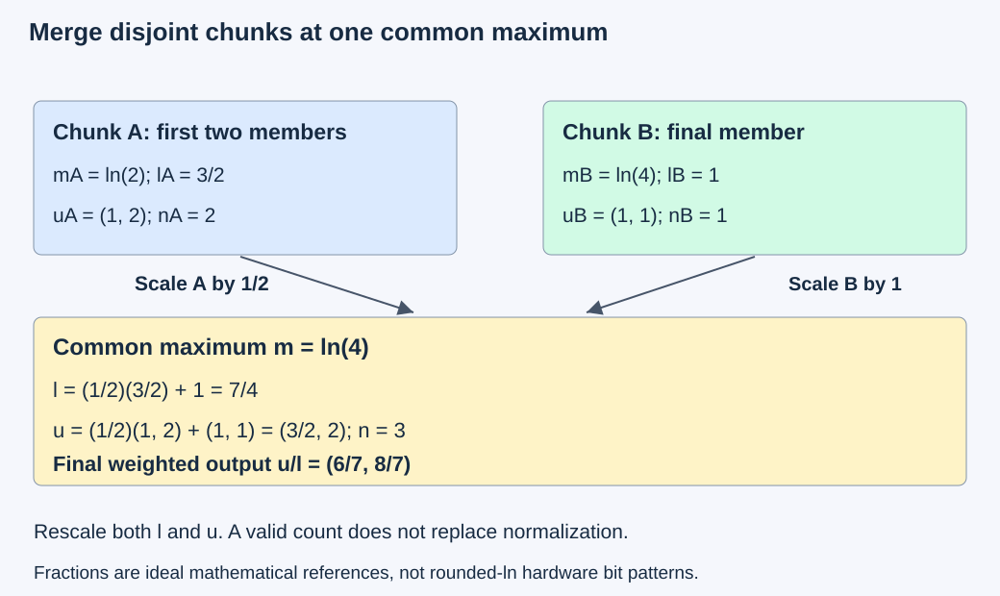
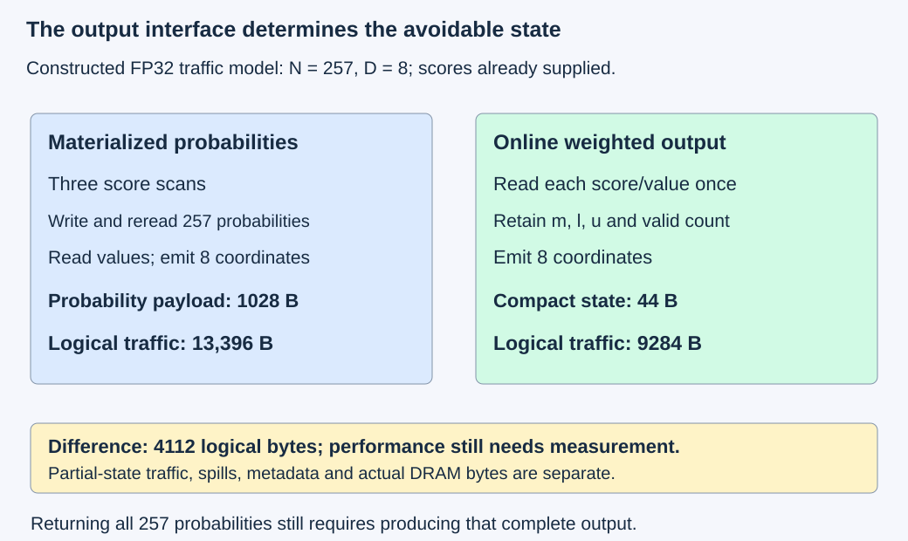

# M4-C07: Online softmax and stable incremental reductions

> **Status: Complete — detailed chapter authored and documentation validated; experimental procedures are proposed unless explicitly labelled observed**

**Module:** Understand kernels and execution overhead

**Category:** [Numerics and correctness](index.md)

[Module 4 reading order](../module-4.md) · [Previous: M4-C06](../kernels-compilers-and-execution/m4-c06-parallel-reductions-and-synchronization.md) · [Next: M4-C08](../kernels-compilers-and-execution/m4-c08-kernel-fusion-and-its-tradeoffs.md)

[Execution plan and progress](../chapter-execution-plan.md)

## Target concepts

Running maximum, rescaled exponential sums, mergeable reduction state, chunked processing, online weighted sums, masking, numerical stability, equivalence within tolerance.

## Concepts

### 1. Keep the softmax operation fixed while changing its evaluation

For one query, let x[i] be a score and v[i,t] a value coordinate associated with key position i. There are N candidate positions and D coordinates per value. An eligibility mask selects the positions belonging to this query's reduction. For a nonempty eligible set A:

**m = max of x[i] over A; l = sum over A of exp(x[i] − m).**

**p[i] = exp(x[i] − m) / l for i in A; p[i] = 0 otherwise.**

**o[t] = sum over A of p[i]v[i,t].**

Exp is the natural exponential; l is a positive **normalizer**, the denominator making eligible probabilities sum to one. The output o is a probability-weighted value vector. [M1-C10](../model-computation-and-semantics/m1-c10-attention-one-dimension-at-a-time.md) explains how attention supplies scores, values and axes. Here scores and values are already supplied: QK multiplication, scaling, positional transformations and complete attention-kernel design are outside this chapter's benchmark boundary.

A stable materialized reference first finds the maximum, then evaluates the shifted exponentials and normalization. **Online** means updating a small summary as chunks are processed; it does not mean serving new requests or automatically reusing a previous query's attention state. The query, head, score scale, positions, eligible-key set and value interpretation must remain fixed. A different query usually produces different scores and needs a new state, even when KV payload is reused.

Rust remains the host context. Input descriptors, state ownership, version identity and completion must be explicit at a reviewed CUDA/Triton boundary. This documentation supplies no kernel, bridge or pseudocode implementation.

### 2. A new maximum changes the units of accumulated state

For a nonempty processed subset S, retain:

**mS = max over S of x[i]; lS = sum over S of exp(x[i] − mS).**

**uS[t] = sum over S of exp(x[i] − mS)v[i,t].**

The vector u is an **unnormalized weighted sum** in the same exponential scale as l. Only after all eligible members have been included is the output **o[t] = u[t]/l**. Also retain an exact valid-member count n for emptiness and membership checks; n is not the softmax denominator.

Suppose a new score x with value v joins a nonempty state. The new maximum is m′ = max(m,x). Define a = exp(m − m′) and b = exp(x − m′). The equations are:

**l′ = a l + b; u′[t] = a u[t] + b v[t]; n′ = n + 1.**

Both old l and old u must be rescaled by a. To see why, each old contribution changes from exp(x[i] − m) to exp(x[i] − m′) = exp(m − m′)exp(x[i] − m). Updating the denominator while leaving the weighted numerator in its previous scale computes a different function.

This running-maximum approach follows the [online normalizer paper, version 2](https://arxiv.org/html/1805.02867v2). The [memory-efficient attention paper, version 3](https://arxiv.org/html/2112.05682v3) develops bounded summaries for attention. These sources motivate the method; their published performance results are not measurements of the fixtures here.

### 3. Merge summaries by bringing them to a common scale

Two nonempty states for disjoint subsets A and B can be combined without revisiting their members. Let:

**m = max(mA,mB); a = exp(mA − m); b = exp(mB − m).**

**l = a lA + b lB; u[t] = a uA[t] + b uB[t]; n = nA + nB.**

The merged state represents the union because both partials now use the same maximum. In real arithmetic this merge is associative and commutative for disjoint correctly identified subsets. Rounded implementations need not give bitwise identical results under different trees, as [M4-C06](../kernels-compilers-and-execution/m4-c06-parallel-reductions-and-synchronization.md) established for reductions.

This is **mergeable reduction state**: a summary that can be reduced across chunks or cooperating owners. It enables both a serial chunk path and a tree of chunk summaries. Parallel construction adds partial-state storage, ordering and communication. It does not remove those costs or authorize arbitrary chunk duplication.

A tagged **empty state** has n = 0, l = 0 and zero u, with no meaningful maximum. Merging empty with nonempty returns the nonempty state; merging two empties remains empty. These are explicit identity cases. They avoid evaluating an expression such as exp(−∞ − (−∞)), whose argument is undefined. A new nonempty singleton starts at its own maximum with l = 1 and u = v. Do not let a placeholder empty maximum of zero distort an all-negative row.

*Both arrows carry a scale correction. The valid-member count remains exact metadata; it never replaces l.*

### 4. Work through one weighted example

Use a mathematical fixture with scores **[0, ln(2), ln(4)]** and paired values **[(2,0), (0,2), (1,1)]**. Ln is the natural logarithm. The unshifted relative weights are 1, 2 and 4, so probabilities are **[1/7,2/7,4/7]** and output is **(6/7,8/7)**.

| Processed members | Running maximum | l | u | Output if this subset were complete |
|---|---|---:|---|---|
| First | 0 | 1 | (2,0) | (2,0) |
| First two | ln(2) | 3/2 | (1,2) | (2/3,4/3) |
| All three | ln(4) | 7/4 | (3/2,2) | (6/7,8/7) |

For chunks A = first two and B = last one, mA = ln(2), lA = 3/2, uA = (1,2); mB = ln(4), lB = 1, uB = (1,1). The common maximum is ln(4), so a = 1/2 and b = 1. The merged denominator is 3/4 + 1 = 7/4, and the numerator is (1/2,1) + (1,1) = (3/2,2).

Omitting numerator rescaling instead gives u = (2,3), producing wrong output (8/7,12/7). Omitting denominator rescaling gives l = 5/2 and output (3/5,4/5). Averaging the two separately normalized chunk outputs equally gives (5/6,7/6), also wrong: chunk averages need their correct probability mass, not equal weight. A complete-state merge is easier to audit than guessing those weights.

These fractions are real-arithmetic teaching references. Ln(2) and ln(4) are not exactly representable FP32 inputs. For a hardware candidate, round the supplied logits first and build the numerical reference from those exact represented values. Do not require the ideal fractions bitwise after changing the inputs.

### 5. Masks govern membership before arithmetic

Masking is not merely making a memory access safe. An ineligible position contributes no probability mass and no value contribution, and must not influence the maximum. A padded score of zero is not neutral for an all-negative eligible row. Replacing excluded scores with a very negative finite number is not a general substitute for exclusion: an all-excluded row can otherwise produce a uniform distribution over nonexistent members.

For this chapter, data values in supplied storage are finite. Eligibility is explicit metadata, not inferred from a sentinel value. Invalid physical addresses are never loaded. Fully excluded chunks produce tagged empty states; later valid chunks can still make the row nonempty. When a final requested row has no eligible keys, reject that row and report the operation unsuccessful rather than inventing a probability distribution. An empty collection of requested rows returns empty output without launching work. These policies are distinct from a library's possible all-masked behavior.

A masked chunk is not allowed to evaluate invalid values and rely on multiplying them by zero afterward: zero times NaN is not a valid exclusion rule. The state identity cases must also bypass undefined empty-maximum differences. In a causal row, eligibility compares the correct absolute query/key positions. Reordering disjoint chunks of one fixed eligible set is a legal evaluation change; adding future positions or resetting positions per chunk is a semantic error.

The state descriptor must identify request/query/head, score/value version, dimensions, position/mask policy and covered intervals. Intervals must be disjoint and collectively complete. Duplicate, stale or mixed-query state is rejected even if n happens to match. Publish m,l,u,n as one coherent completed state; a consumer must not see a new maximum with an old numerator. Retain source and scratch ownership until their last device consumers finish. Client cancellation does not authorize early reuse.

### 6. Stable does not mean exact or free of underflow

For n eligible finite scores, exact shifted arithmetic has **1 ≤ l ≤ n**, because every exponential lies in (0,1] and at least one equals one. If value coordinates satisfy absolute value ≤ Vmax, then **absolute u[t] ≤ Vmax l**, hence **absolute o[t] ≤ Vmax**. The output also lies between the eligible minimum and maximum for each value coordinate. These are useful sanity checks, but wrong pairing or normalization can still satisfy them.

Maximum subtraction prevents large positive exponential arguments in the stated finite domain. It does not prevent tiny terms from underflowing, erase weighted-sum cancellation, or make approximate exponentials and rounded merges exact. For [0,−1000], a binary32 tail can become zero even though the real probability is positive. Check absolute and distribution error without claiming preservation of relative accuracy in such a tail. Near-zero weighted outputs need an absolute-error allowance, not relative error alone.

Natural exponentials and base-two exponentials can express the same function only with consistent conversion: **exp(z) = 2^(z × log₂(e))**. Do not mix maximum/scaling units between states. The [Triton fused-attention tutorial](https://triton-lang.org/main/getting-started/tutorials/06-fused-attention.html) illustrates rescaled normalizers and weighted accumulators in a specific optimized path; its arithmetic formats and layouts must not be assumed equivalent to an arbitrary scalar FP32 candidate.

This chapter predeclares a small bounded FP32 acceptance corpus rather than a universal tolerance. Logits are binary fractions in [−4,4], values in [−2,2], N ≤ 257 and D ≤ 8. Shift differences lie in [−8,0]; this avoids underflow in the core exponential domain and keeps score subtraction exactly representable. For that corpus, require per-row probability L1 error ≤ 2 × 10⁻⁵, probability-mass error ≤ 2 × 10⁻⁶, and per-coordinate weighted-output absolute error ≤ 10⁻⁴ against a stabilized high-precision reference. L1 error means the sum of absolute probability differences.

These are conservative engineering acceptance allocations for a bounded teaching workload, not proven worst-case FP32 bounds or model-quality limits. With Vmax = 2, the distribution allocation contributes at most **2 × 2 × 10⁻⁵ = 4 × 10⁻⁵** to a weighted coordinate when using the same values; the remaining 6 × 10⁻⁵ is reserved for weighted-path arithmetic. Independently verify the actual u/l output against the full 10⁻⁴ allowance. A candidate must pass both gates; the allocation does not guarantee it will. The latter allowance is 0.005% of the maximum permitted value magnitude and remains absolute near zero. Record exponent/accumulation/output modes and reject unexpected nonfinite results. General activations need a newly justified M9-C17 budget before a performance claim.

### 7. Count what online evaluation actually saves

A normalizer summary alone does not retain all probabilities. If the caller requests N probabilities, an online normalizer can still need another score scan to emit them. A weighted output can instead retain only m,l,u,n while consuming each score/value chunk. Its reduction-state size grows with D, not N; input storage, current chunk buffers and model state remain separate.

For a deliberately specified FP32 traffic model, a stable materialized baseline reads logits three times—maximum, denominator, then probability emission—writes N probabilities, and later reads those probabilities and ND values to emit D weighted coordinates. Logical traffic is:

**Qmaterialized = 4(5N + ND + D) bytes.**

A single-owner online weighted path reading each supplied score and value once and emitting D outputs has:

**Qonline = 4(N + ND + D) bytes.**

At N = 257,D = 8 these are 13,396 and 9284 bytes, a difference of 4112 bytes. The materialized probability payload is 1028 bytes. A compact state with FP32 m,l,u and one 32-bit valid count occupies **4(D + 3) = 44 bytes** before alignment and descriptor metadata. A parallel path with J chunk states can add **2J × 44 bytes** for state writes and reads in this example, plus final output and other workspace. A serial local-state path has no such global partial-state traffic.

For probability output alone, a declared three-score-scan stable path plus output write is 16N bytes, while two score scans plus output write is 12N bytes. These counts assume intermediates are not retained across the specified scans; a fused baseline can have a different count. Logical demand is not measured DRAM traffic. Caches, extra launches, exponentials, local dependencies, register pressure, spills and partial-state communication can offset savings.

*Changing what must be returned changes which state can be avoided. Neither diagram counts QK work or certifies a full FlashAttention implementation.*

The [original FlashAttention paper, version 2](https://arxiv.org/html/2205.14135v2) connects online normalization with tiled attention and data movement. Its complete attention design is reserved for M4-C11. Here “equivalent” means the same eligible-set softmax/weighted function in real arithmetic, with an explicit floating-point acceptance gate.

HFT provides a systems analogy: bounded summaries, complete event membership and coherent state publication can reduce data movement on a critical path. Attention's learned scores and probability weights have their own mathematical semantics. No exchange priority, trading outcome or inference deadline follows from this analogy.

## Experiments

All protocols are proposed. CPU arithmetic/reference checks validate the examples, not an implemented GPU or serving system. Hardware studies require reviewed existing candidates and a specified Rust/CUDA or Rust/Triton bridge. No implementation is supplied. Bound raw fixtures/guards to 64 MiB on host and separately device; charge partial states, descriptors, compiler/runtime, profiler and generator/model/KV state independently. Stop performance comparison on a correctness or lifetime failure.

### E1 — Rescale the whole weighted state

**Description:** Compare sequential updates, chunk merges and deliberate rescaling omissions on the three-member mathematical fixture.

**Purpose/objective:** Show why the normalizer and numerator must share one running maximum.

**Target concepts:** Running maximum, rescaled exponential sums, online weighted sums and state invariants.

**Baseline and workload:** Exact fractions for weights 1,2,4 and the paired two-coordinate values. Compare singleton updates, split first-two/last-one, reverse chunk order and a balanced merge. Use ideal logarithmic scores for mathematical checks; keep represented-input hardware checks separate.

**Controls and prediction:** Keep members, score/value pairing and output fixed; vary merge order or omit one scale factor as a counterexample. Correct merges give probabilities (1/7,2/7,4/7) and output (6/7,8/7); the specified wrong updates give the tabulated failures.

**Procedure:** Reconstruct each state from its members independently, compare all intermediate m/l/u/n and final coordinates, then reproduce wrong numerator, denominator and equal-chunk-average outputs. Check l bounds and weighted convex bounds while demonstrating why they alone are insufficient. No unsafe device execution is needed.

**Hardware/software:** Exact rational arithmetic plus high-precision logarithmic reference; an optional GPU candidate uses rounded-input references and recorded arithmetic modes.

**Failure and HFT connection:** Updating one part of a coupled summary can produce plausible but incorrect output. This resembles inconsistent event-state publication, while probability normalization is inference-specific.

**Exit criteria:** Correct merges match exact references, every wrong update is distinguishable and state invariants are explicit. No runtime speed claim applies to document-only arithmetic checks.

### E2 — Compare partitions and merge orders within tolerance

**Description:** Evaluate scalar stable, serial online and tree-merged chunk references on the bounded FP32 corpus.

**Purpose/objective:** Test real-arithmetic equivalence separately from rounded-order differences.

**Target concepts:** Mergeable state, chunked processing, numerical stability and equivalence within tolerance.

**Baseline and workload:** R = 1 with N = 1,3,7,31,32,33,127,128,129,257; plus R = 4,N = 129. Test D = 1 and 8. For fixture e = 0,…,15, logits are x[r,i] = (((17i + 5r + e) mod 65) − 32)/8 and values v[r,i,t] = (((7i + 3t + 2r + e) mod 33) − 16)/8. All members are eligible here. Use chunks of 1,7,32,128; add all contiguous partitions of the small E1 three-member fixture.

**Controls and prediction:** Hold exact represented inputs, member sets, exponent family and accumulation/output modes fixed. Vary partition and left-fold versus balanced merge, then reversed chunk order as a distinct order comparison. Predict agreement within the predeclared budgets, not bitwise identity. A common +1000 shift is a separate metamorphic check: the binary-fraction inputs and shift are exactly representable and their differences stay the same.

**Procedure:** Establish 80- and 120-digit references from exact represented FP32 inputs. Compare every probability and weighted coordinate against the declared gates; retain m/l/u/n at chunk boundaries. Check shifted, ascending-score and descending-score versions with score/value pairs kept together. For eligible GPU candidates, use E4 timing controls and retain failures by row, fixture, partition and merge order.

**Hardware/software:** CPU high-precision and explicit binary32 rounding models initially; GPU extension requires identified exponential instructions, scalar/matrix accumulation formats, compiler/target and bridge versions.

**Failure and HFT connection:** Different chunk arrival/order can expose rounding and dependency costs even for the same set. This transfers to reproducible aggregation evidence, not to identical market and attention semantics.

**Exit criteria:** Reference stability and all exact identity checks pass; every candidate row satisfies the fixed numerical gates or is reported failed. Record errors before timing; no post-hoc tolerance change.

### E3 — Exercise empty chunks, masks and publication

**Description:** Review masking and state-lifetime cases without treating an all-masked row as a distribution.

**Purpose/objective:** Verify that eligible membership and coherent state ownership survive chunk boundaries and failure.

**Target concepts:** Masking, tagged empty identity, merge eligibility and synchronization.

**Baseline and workload:** Nine scenarios: empty/nonempty merge in either order; two empty chunks followed by a valid singleton; final all-excluded row; all-negative eligible row with an excluded zero; causal eligibility using absolute positions; duplicate chunk; wrong query/head/version; partially published state; cancellation during in-flight consumption. Use the E1 values where applicable and a causal row at absolute position 5 with keys at 3,4,5,6.

**Controls and prediction:** Change one membership/identity/ordering fact per case. Empty prefixes preserve the eventual valid result; final empty row is rejected; key 6 is excluded from the causal row; duplicate/mixed/incoherent states fail; cancellation retains live resources.

**Procedure:** Record each state's identity and intervals, valid count, readiness event and last consumer. Compare eligible reference membership before evaluating exponentials. Review invalid-address and undefined empty-maximum expressions as rejected paths rather than execute them. Trace publication of the complete m/l/u/n state and defer reuse until terminal evidence. For valid reviewed implementations only, collect separate sanitizer/lifecycle diagnostics.

**Hardware/software:** Document-only scenario ledger initially; runtime extension needs a reviewed bridge, state schema, ownership/generation checks and supported diagnostics.

**Failure and HFT connection:** An empty input portion and a failed operation have different meanings; stale or duplicate summaries can corrupt a completed aggregate. The event-buffer analogy concerns membership/lifetime, not learned probability semantics.

**Exit criteria:** Nine explicit verdicts with exact eligible sets/counts, finite valid outputs, no invented all-masked distribution and no premature publication/reclamation. Unsupported runtime cases remain unexecuted.

### E4 — Measure the same output interface and full dependency chain

**Description:** Benchmark materialized and online candidates separately for probability output and weighted output.

**Purpose/objective:** Test whether avoided traffic improves completed work after extra arithmetic, launches and state communication.

**Target concepts:** Chunking, state size, bottlenecks, numerical gates and full-operation latency.

**Baseline and workload:** Reviewed stable materialized baseline versus eligible serial-online and chunk-tree candidates, using E2's bounded inputs and shapes. Probability-output comparisons return all N values; weighted-output comparisons return D values. Do not compare these two interfaces as equivalent work.

**Controls and prediction:** Hold output contract, represented inputs, mask, numerical budget, layout and artifact readiness fixed. Vary evaluation path and then chunk width. Predict the declared logical-byte savings for the stipulated mappings; expect no universal timing winner for small rows or communicating partials.

**Procedure:** Pass E1–E3 gates first, precompile admitted variants and complete 100 warm invocations per case. Collect 60 alternating-order paired sessions of 100 completed invocations per candidate, rotating the 16 fixtures identically. Time the complete operation and all partial-state stages, retain per-stage attribution and report allocation policy. Obtain separate profiles on N = 33 and 257,D = 8 for memory traffic, exponent/compute activity, registers/spills, state communication and dependency waits. Reconcile actual stage counts against the stipulated traffic model.

**Hardware/software:** One supported NVIDIA GPU, actual resource/function limits and memory capacities, compiler/exponential/accumulator settings, target/artifact/bridge identity, clocks/power and profiler replay/cache policy.

**Failure and HFT connection:** A smaller summary may still add serial dependence or coordination stalls. HFT motivates measuring useful completion on the full path; it supplies no acceptable softmax error or guaranteed speedup.

**Exit criteria:** Numerical and ownership gates pass for every admitted case; paired completed timings and scoped counters support or leave unresolved the hypothesis. Logical byte counts alone cannot pass a performance claim.

### E5 — Validate the effect on an existing generator

**Description:** Place one already validated weighted-reduction candidate in an existing compatible attention path, if available.

**Purpose/objective:** Establish whether the local evaluation change improves useful service without changing required output behavior.

**Target concepts:** Numerical equivalence, query/mask identity, end-to-end dependencies and failure populations.

**Baseline and workload:** Existing fixed model/tokenizer baseline versus one eligible replacement. General model activations need a separately justified M9-C17 budget and logits/selection/stopping checks; the bounded teaching allowance is not inherited. Use supported prompt/output token-count strata (32,32), (32,128), (128,32), (128,128), reporting excluded strata. If no matching generator path exists, mark this study unavailable.

**Controls and prediction:** Same request trace, mask/cache/position policy, model, numerical/selection contract, queue limits and machine state. Vary only the admitted evaluation policy. Predict that local savings help only where the stage lies on a relevant critical path.

**Procedure:** Complete 100 warmup requests per admitted stratum. Run 60 paired 30-second open-loop windows at 50% and 90% of baseline sustainable arrival rate from a separate pilot. Arrivals follow scheduled times independently of prior completions; retain the same trace for each pair. Bound waiting requests at 64 and in-flight requests at eight; drain for another 30 seconds, disclose unfinished work as censored and protect its resources. Retain startup/new-variant preparation and all rejected, failed or cancelled outcomes.

**Hardware/software:** Full CPU/GPU/NUMA topology, model/tokenizer/bridge/artifact identity, memory and queue budgets, and declared output/error contracts. No generator implementation is assumed in this documentation repository.

**Failure and HFT connection:** Queueing, stale state or cancellation can dominate a locally efficient reducer. The engineering lesson transfers to event-driven services; financial outcomes and exchange deadlines do not transfer.

**Exit criteria:** Model/output and capacity/lifetime gates pass, useful throughput and latency populations reconcile, and any improvement has paired evidence at a named operating point. A faster isolated summary is a local result until this service gate passes.

## Verification

### V1 — Independent state equations and exact fixture (E1)

Use the exact relative weights to verify all three running states, each contiguous partition and both chunk orders. The denominator/numerator scale correction must apply to the same maximum. Confirm the four wrong/reference outputs directly: correct (6/7,8/7), wrong unscaled numerator (8/7,12/7), wrong unscaled denominator (3/5,4/5), and equal chunk averaging (5/6,7/6). A scalar probability-mass check or convex-hull check alone is insufficient to establish the intended pairing and weights.

These are mathematical checks without device timing. Optional hardware checks use the exact represented inputs and E2 budgets, not ideal-logarithm bitwise expectations. Record row/head/member identity, output dimensions and designated result owner before numerical comparison.

### V2 — Numerical reference, fixed gates and invariants (E2)

Evaluate the materialized stable function independently at 80 and 120 decimal digits and require coordinate agreement within 10⁻⁶⁰ before using it as a reference. This is observed reference-stability evidence, not a certified rounding-error bound. Compare FP32 candidates to the retained high-precision values. Require probabilities finite and nonnegative, per-row mass error ≤ 2 × 10⁻⁶, probability L1 error ≤ 2 × 10⁻⁵, and weighted absolute coordinate error ≤ 10⁻⁴. Exact membership, counts, interval coverage and zero probabilities for excluded members are separate gates, never waived by a tolerance.

A weighted-only interface need not materialize probabilities in its timed path. Diagnose its normalization with independently reconstructed probabilities from the retained final m/l and original logits, then check actual u/l output separately; do not substitute diagnostic reconstruction for validating the weighted result. Diagnostic reads and retained states are outside performance intervals and charged separately. State inequalities use the declared numerical budget rather than exact real-arithmetic equality on rounded values.

Retain maxima, l/u errors, final output errors, partition/order and arithmetic modes; classify first divergence. A shifted fixture must keep score/value pairing and mask unchanged. Extreme [0,−1000] is a separate underflow diagnostic outside the bounded corpus: report zero tails, absolute error and loss of relative tail information, without transferring the core-domain guarantee. Reject unexpected nonfinite values or invalid denominators. Broader cases require a new budget declared before results are inspected.

### V3 — Mask and lifecycle evidence (E3)

The nine verdicts are: identity merge preserves nonempty state in either order; empty prefixes plus singleton yield that singleton's value; final empty row is rejected; excluded zero cannot alter a negative-row maximum; causal members are keys 3,4,5; duplicate chunk rejected; wrong query/head/version rejected; incoherent publication rejected; cancellation retains resources until safe completion/recovery. No consumer uses a new m with old l/u or a recycled state generation.

Track requested/eligible intervals, ownership and terminal events, and distinguish an empty chunk from a failed or missing chunk. A final n count alone cannot detect replacing one member with a duplicate of another. Supported [Compute Sanitizer diagnostics](https://docs.nvidia.com/compute-sanitizer/ComputeSanitizer/index.html) can expose some memory/synchronization defects, not prove correct attention membership or numerical equivalence. Run them separately from benchmarks; preserve errors and unsupported modes. Document-only lifecycle review has no performance threshold or GPU-profiler requirement.

### V4 — Traffic, resources, timing and uncertainty (E4)

Independently reconcile N = 257,D = 8: materialized 13,396 logical bytes, online weighted 9284, saving 4112, probability payload 1028 and compact summary 44 before metadata/alignment. A partial-state path adds its own writes/reads and readiness dependencies. Preserve logical requests, measured cache/DRAM bytes and peak allocated storage as distinct reports. A source-level small state may spill; inspect actual compiler resource reports.

GPU event intervals bracket the complete ordered operation, including all required device passes and joins. A monotonic host interval begins at admitted bridge invocation and ends at caller-observed output completion; include required allocations/conversions in the full-operation report. Retain named start/end events, units, resolution, stream/context and placement assumptions. Submission-only or first-chunk time is not complete softmax time. Keep compilation/module preparation and diagnostic reference/guard reads separate from warm performance, while including any such work required by the caller's actual contract.

Sixty sessions of 100 invocations form 60 clustered paired comparisons, not 6000 independent tail samples. Report raw variation, session medians, paired effects and uncertainty; unresolved differences are inconclusive. Collect profiles separately with version/replay/cache controls recorded, using completed M9-C12/C13 methods. Lower DRAM traffic or higher throughput at one stage alone does not establish useful end-to-end improvement.

### V5 — Useful output and service populations (E5)

Use exact request/query/head/position identity alongside model-level numerical gates and selected-token/stopping checks. Report time to first token, inter-token latency, completed-request distributions and contract-valid output tokens per declared wall-clock interval. Keep request/token weighting, counts, failures, rejections, cancellations and drain/censoring explicit. Prewarming cannot hide deployment/readiness cost: report startup and unseen-variant cohorts separately. A short window and fixed session count do not certify rare-tail behavior. Preserve paired traces, admission policy and resource limits at each operating point.

Completed [M9-C01](m9-c01-defining-reference-behavior-and-evidence-before-optimizing.md), [M9-C02](../measurement-experimentation-and-economics/m9-c02-request-events-clocks-and-measurement-boundaries.md), [M9-C07](../measurement-experimentation-and-economics/m9-c07-latency-distributions-and-statistical-uncertainty.md), [M9-C12](../measurement-experimentation-and-economics/m9-c12-reading-cpu-gpu-timelines-and-scheduling-gaps.md), [M9-C13](../measurement-experimentation-and-economics/m9-c13-using-kernel-profilers-to-explain-hardware-bottlenecks.md), [M9-C15](../state-memory-and-caching/m9-c15-accounting-for-weights-kv-state-workspace-and-fragmentation.md), [M9-C16](../hardware-architecture-and-topology/m9-c16-recording-hardware-conditions-that-change-measurements.md) and [M9-C17](m9-c17-comparing-logits-with-justified-numerical-tolerances.md) supply reference, timing, uncertainty, profile, capacity, manifest and numerical methods. M9-C22 remains an outline; elementary state-publication/lifetime gates are specified locally. No Module 8 material is required.

## Engineering dimensions and principles

| Dimension | Application to online softmax |
|---|---|
| Semantics and invariants | Fixed eligible set, score/value pairing, common maximum and complete m/l/u/n state. |
| Workload and variability | Chunk sizes/order, new maxima, empty chunks, causal boundaries and value width. |
| Resources and bottlenecks | Probability payload versus compact/partial state, exponentials, registers, spills and communication. |
| Time and distributions | Sequential rescale dependency, parallel joins, full-operation timing and service tails. |
| Ownership and coordination | Query/head/version identity, disjoint intervals, coherent publication and last-consumer retention. |
| Failure and adaptation | Reject all-excluded rows, duplicate/stale states and incomplete publication; preserve live state after cancellation. |

| Engineering principle | Specific learning step |
|---|---|
| 1. Correctness defines the optimization boundary | Same eligible-set function; rounded equivalence requires fixed gates and model-level acceptance. |
| 2. Performance depends on workload and operating point | N, D, chunk count, mask sparsity and readiness alter costs. |
| 3. Data movement is part of the algorithm | Avoided probability storage can be offset by partial-state traffic and spills. |
| 4. State has ownership, lifetime and recovery cost | Summary identity belongs to one fixed query snapshot and survives in-flight consumers. |
| 5. Dependencies determine latency; bottlenecks determine capacity | Rescaling and merge readiness remain dependencies despite lower storage. |
| 6. Variability and synchronization shape the tail | Empty chunks, new maxima, shared resources and queueing affect completion. |
| 7. Local improvements need end-to-end evaluation | E4 matches output interfaces; E5 checks useful generator results separately. |
| 8. Claims require reproducible evidence | Exact fixtures, stable represented-input references, fixed tolerances and versioned timing/profile records. |

## Specifications, articles, and hardware

Primary sources were checked on 27 October 2026: Milakov/Gimelshein online normalizer v2 (2018), Rabe/Staats memory-efficient attention v3 (2022), and Dao et al. FlashAttention v2 (2022), linked above. They establish the mathematical/data-movement background; this chapter neither reproduces their implementations nor inherits their measured speedups. Triton's online main fused-attention tutorial is a moving example with its own formats and architecture controls. Pin the actual compiler/runtime/math path when executing experiments.

| Required hardware/software specification | Record before runtime studies |
|---|---|
| GPU/target | Exact architecture/partition, SM count, warp size, memory capacity, supported formats and function/resource limits. |
| Numerical path | Input/accumulator/output formats, exp or exp2 conversion, approximation/rounding/denormal/reassociation modes and compiler instructions. |
| State and layout | N/D/row bounds, mask/position policy, chunk/merge tree, partial schema/stride/alignment and peak scratch/descriptor charges. |
| Software/bridge | Driver/runtime/toolkit, compiler/Triton/library revision, artifact/target, Rust ABI, dependency/completion/error mechanism. |
| Operating state | CPU/NUMA/device topology, clocks/power/thermal conditions, co-tenancy, warmup and profiler replay/cache controls. |
| Service extension | Model/tokenizer identity, justified numerical/output policy, arrival traces and model/KV/queue/memory limits. |

No hardware specification, timing, counter or sanitizer result is assumed. Device and generator experiments remain proposed; observed authorship validation covers references, mathematical examples and documentation only.

## What to carry forward

Online softmax preserves the function by keeping the maximum, denominator and weighted numerator in one consistent scale. Merge only compatible disjoint state, handle emptiness explicitly, and validate rounded results before interpreting memory or latency savings.

Next in Module 4 reading order is the completed [M4-C08: Kernel fusion and its tradeoffs](../kernels-compilers-and-execution/m4-c08-kernel-fusion-and-its-tradeoffs.md). The next authoring chapter is [M4-C17](../kernels-compilers-and-execution/m4-c17-designing-a-fused-normalization-kernel.md). Track acceptance in the [execution plan and progress tracker](../chapter-execution-plan.md).
