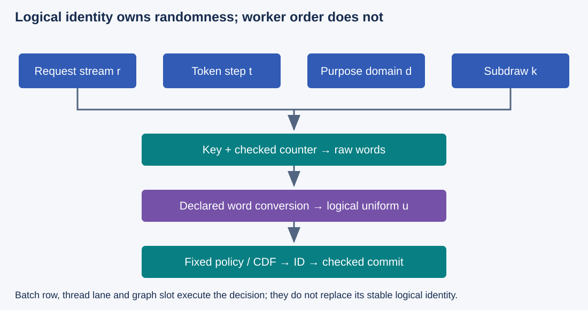
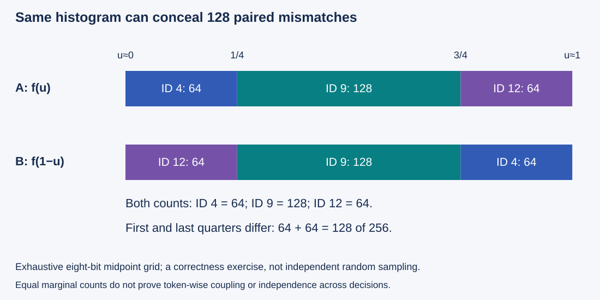

# M4-C19: Randomness, reproducibility, and sampling equivalence

> **Status: Complete — detailed chapter authored and documentation validated; experimental procedures are proposed unless explicitly labelled observed**

**Module:** Understand kernels and execution overhead

**Category:** [Numerics and correctness](index.md)

[Module 4 reading order](../module-4.md) · [Previous: M4-C18](../kernels-compilers-and-execution/m4-c18-designing-a-fused-sampling-kernel.md) · [Next: M4-C20](../numerics-and-correctness/m4-c20-validating-fused-kernels-and-graph-replay.md)

[Execution plan and progress](../chapter-execution-plan.md)

## Target concepts

Seed and random-stream ownership, per-request RNG state, draw ordering, counter mapping, deterministic replay conditions, distributional versus token-wise equivalence, statistical uncertainty.

## Concepts

### 1. Name the equivalence you need

A categorical sampler selects a token ID from probabilities attached to vocabulary IDs. A pseudo-random number generator (PRNG, or RNG for short) produces a reproducible sequence from a defined initial condition; its output is not a proof of unpredictability or cryptographic security. A seed initializes part of that condition. Reproducing a token also requires the same probability computation, random-word conversion, draw assignment and selection boundary.

| Claim | What must agree | Evidence that is insufficient |
|---|---|---|
| Token-wise equivalence | Each logical request/step gets the same selected ID and commit/stopping outcome under the declared draw contract | Similar histograms or the same seed alone |
| Bitwise replay | The declared raw words, relevant numerical intermediates and outputs match exactly in a specified environment | A small numerical tolerance or one identical final string |
| Distributional equivalence | The selection law matches the declared target within a specified statistical/effect-size contract | Matching one seed's token sequence or passing one histogram test |
| Useful-service equivalence | Required model, policy, stopping, state and publication behavior remain valid | Faster sampling with changed lengths or duplicated decisions |

Token-wise equivalence and bitwise replay have different scopes: two samplers may select identical IDs even if intermediate floats differ. A mathematically equivalent probability law can yield different IDs when coupled to the same draw. Finite tests cannot prove universal equality of laws or independence of streams.

[M1-C15](../model-computation-and-semantics/m1-c15-turning-logits-into-the-next-token.md) fixes this curriculum's policy: one logical uniform u in [0,1) per successful sampling selection, including singleton support; no draw for greedy mode or validation failure; ascending token-ID traversal and first cumulative probability strictly greater than u. Top-k/top-p and temperature are part of that policy, not free optimizations. The next chapter M4-C18 applies these rules to fused sampling; this chapter isolates randomness and equivalence first.

### 2. The same seed does not assign the same draws

A stateful generator advances mutable state as words are requested. If workers share it, scheduler order can change which request receives each word. Draw order is observable even when the global sequence itself is fixed. A **random stream** here is a logical sequence owned by a particular request/decision domain; it is not a CUDA execution stream.

Use final probabilities [1/4,1/2,1/4] for token IDs [4,9,12] and the constructed draw tape [1/8,3/8,5/8,7/8]. Two requests A and B each need two selections:

| Schedule using one shared tape | A's draws → IDs | B's draws → IDs |
|---|---|---|
| A,A,B,B | [1/8,3/8] → [4,9] | [5/8,7/8] → [9,12] |
| A,B,A,B | [1/8,5/8] → [4,9] | [3/8,7/8] → [9,12] |
| B,B,A,A | [5/8,7/8] → [9,12] | [1/8,3/8] → [4,9] |

The first two schedules happen to select the same IDs despite different assigned draws; the third changes IDs. This shows why token equality alone cannot certify word/draw assignment, and a shared tape can couple unrelated requests. Cancelling A or changing its batch position can shift B's future draws if consumption follows physical execution order.

The [cuRAND device guide, 13.4](https://docs.nvidia.com/cuda/curand/device-api-overview.html) describes state initialized from seed, sequence and offset, and notes that distribution functions need not consume a fixed number of base-generator values. Do not equate one logical uniform with one API call or one raw word without checking the exact algorithm/version. A Rust host, native library and device kernel may each own distinct RNG state. Record every relevant owner and initialization path.

### 3. Map randomness to logical identity, not worker position

One valid application strategy retains a separate stateful generator per request, with exclusive mutation and a recorded checkpoint/draw count. Another uses a counter-based generator: a deterministic keyed transformation computes words from a logical counter. The key selects a particular transformation within the generator family. The original [Random123 paper](https://www.thesalmons.org/john/random123/papers/random123sc11.pdf) develops counter-based parallel PRNGs, including Philox. It motivates explicit application control of keys/counters; it does not make arbitrary application mappings collision-free or statistically sound.

*Figure 1. Request identity, logical token index, purpose domain and subdraw identify the randomness. A worker lane or graph slot only executes that decision.*

A **domain** separates purposes such as sampling, diagnostics and warmup. A **subdraw** identifies a word/draw within one decision. For a teaching 128-bit counter layout, let r,t,d,k each be unsigned 32-bit fields: stable request-stream identity, logical token index, domain and subdraw. Pack the mathematical identity as:

**C = r × 2^96 + t × 2^64 + d × 2^32 + k.**

For values in 0…2^32−1, this is injective: two different field tuples have different counters. The job seed/key and generator identity remain separate. A namespace is the scope within which those identities must be unique. This is an application layout example, not a specified binary interface (ABI) or a complete Philox implementation. The selected library must support the declared widths and raw-word ordering. Counter uniqueness does not mean output words can never coincide; random values may repeat without a mapping collision.

| Field / rule | Required application meaning |
|---|---|
| Request-stream r | Assigned without reuse within the job/key namespace; not batch row, pool address or worker ID |
| Token t | Logical decision position, preserved across batch compaction and scheduling |
| Domain d | Distinguishes production sampling from warmup and unrelated consumers |
| Subdraw k | Fixed word/lane allocation for the selected algorithm, including bounded rejection attempts if used |
| Bounds | Reject/exhaust namespace before wraparound; truncating IDs or hashing without a collision contract is insufficient |
| Retry | Intentional replay of the same logical decision may reuse its identity; a new independent decision must not accidentally reuse it |

For 100 request IDs, 64 logical steps, four domains and eight subdraws, there are **100×64×4×8 = 204,800** distinct tuples. An implementation must additionally prevent request-ID reuse after slot recycling and track generation/attempt identity in the ownership ledger. It must not silently truncate a 64-bit external ID into r. If a generator returns a vector of words, record vector-block and lane mapping; changing vector width must not change the selected word for an existing logical decision under a token-wise contract.

Keyed counters can remove shared mutable-generator contention but not all state. Request identity, completed-token position, retry/publication status and allocation lifetime still need coordinated ownership. The reference strategy and candidate must agree on this mapping before “same seed” can mean “same draws.”

### 4. Word conversion and CDF boundaries are part of the function

The **cumulative distribution function**, or CDF, is the accumulated probability in traversal order. For final probabilities p_i and C_i=Σ through i of p, select the first ID whose C_i>u. A zero-probability entry gets no interval. For the three-token fixture:

| Draw interval / value | Selected ID |
|---|---|
| 0 ≤ u < 1/4 | 4 |
| u = 1/4, or 1/4 < u < 3/4 | 9 |
| u = 3/4, or 3/4 < u < 1 | 12 |
| u=1, negative u, or nonfinite u | Invalid under this input contract |

A library's uniform endpoint convention may differ. The [cuRAND distribution documentation](https://docs.nvidia.com/cuda/curand/device-api-overview.html#distributions) includes a (0,1] convention for its legacy uniform routine. An adapter must explicitly establish the curriculum's [0,1) contract; neither silent clamping nor replacing one endpoint can be assumed to preserve the desired finite-grid law.

A transparent **teaching conversion** uses an eight-bit word w in 0…255 and **u=(w+1/2)/256**. All 256 midpoints lie strictly between zero and one and are exactly representable in FP32. Exhausting the grid gives [64,128,64] selections for the fixture. This small grid is a correctness probe, not a usable production PRNG or independent random experiment.

For wider words, conversion precision matters. An ideal midpoint formula applied to a 32-bit word can round to 1 in FP32 near the upper endpoint. Specify word width, conversion arithmetic, endpoint behavior and discarded bits. Validate the actual supported conversion rather than importing the eight-bit probe's properties. The [PyTorch multinomial contract](https://docs.pytorch.org/docs/2.14/generated/torch.multinomial.html) accepts finite nonnegative weights with nonzero row sum, but does not promise this chapter's exact word-to-ID coupling.

Even nearly identical probabilities can disagree token-wise at a boundary. Let p=[1/4,1/2,1/4], q=[1/4+2^−20,1/2−2^−20,1/4], and u=1/4+2^−21. Under the same traversal, p selects ID 9 while q selects ID 4. Their **total variation distance**, TV(p,q)=1/2 Σ|p_i−q_i|, is only **2^−20 ≈ 9.54×10^−7**. A small probability error cannot guarantee identical IDs for every u. Preserve exact boundary witnesses alongside numerical-tolerance tests.

### 5. Equal histograms can hide different couplings and dependencies

Compare sampler A=f(u) with sampler B=f(1−u), using the same three-token CDF and the midpoint grid. Reflection permutes this grid, so both histograms are exactly [64,128,64]. Yet they disagree on **128 of 256 IDs**, or 50% of paired inputs: the first and last quarters exchange tokens, while the middle half remains ID 9.

*Figure 2. Matching marginal frequencies does not establish the same token for a supplied draw. Exhaustive finite-grid checks and stochastic distribution tests answer different questions.*

With an ideal uniform u on (0,1), reflection also preserves the marginal law. It changes the coupling, meaning how the two samplers' outputs correspond for the same underlying random input. It therefore fails a token-wise replacement contract while illustrating distributional equivalence. This is not permission to alter the production coupling when reproducible tokens are required.

A repeated deterministic cycle can have a perfect histogram while adjacent outputs are dependent. Test raw-generator quality with established suites and application-specific stream/correlation checks; a small categorical test is not a replacement. NVIDIA's [cuRAND testing guide](https://docs.nvidia.com/cuda/curand/testing.html) describes broader generator testing. These checks provide evidence, not mathematical proof of arbitrary-stream independence or a security guarantee.

For autoregressive generation, one changed ID alters subsequent logits, lengths, cache state and stopping. Distributional correctness of an isolated categorical row does not establish equality of complete request traces. Compare service only under its explicitly chosen model/policy/equivalence contract and account for the actual useful output work.

### 6. Statistical tests need an error budget and an independence model

For n draws from a fixed target p, let N_i be token count and **p_hat_i=N_i/n**. Compare empirical frequencies with p, preserve zero-mass exclusions, and report effect size as well as a test result. A **false alarm** is rejecting a correct target due to random sampling variation. Passing a test is not proof that the candidate equals p.

For independent draws under the target law, a conservative Hoeffding bound plus a union bound gives:

**Pr(max_i |p_hat_i−p_i| ≥ δ) ≤ 2m exp(−2nδ²).**

Here δ is an absolute probability difference and m is the total number of bin comparisons covered by the error budget, including predeclared blocks/rows as applicable. The inequality follows from [Hoeffding's bounded-variable result](https://www.cs.rpi.edu/academics/courses/spring06/random/hoefding.pdf), applied to each token's zero/one indicator. A sufficient sample count for total false-alarm bound α is:

**n ≥ ln(2m/α)/(2δ²).**

For one three-bin distribution, α=0.01 and δ=0.01 require n≥31,985 after rounding upward. These are model-based probability bounds, not guarantees for dependent/correlated generator output. Independent bin indicators within one draw are not required; independence across draws is. A fixed PRNG stream is deterministic, so the probabilistic interpretation needs a justified generator/seed-block model rather than an assumption that a seed proves independent randomness.

The proposed primary test uses five predeclared seed blocks, 50,000 draws per block, δ=0.01 and m=15 total bin comparisons. Under the independent target-draw model the family false-alarm bound is **30 exp(−10) ≈ 0.001362**, below 0.01. Checking more rows, seeds, filters or tolerances spends additional error budget; revise m/design before looking at outcomes. Do not rerun failed blocks until they pass. Keep the declared primary result and label exploratory follow-ups.

[NIST's chi-square goodness-of-fit guide](https://www.itl.nist.gov/div898/handbook/eda/section3/eda35f.htm) supplies an alternative binned-distribution method with its own expected-count and parameter assumptions. Do not choose a favorable test after inspecting the data or interpret failure to reject as a proof of equality. [M9-C07](../measurement-experimentation-and-economics/m9-c07-latency-distributions-and-statistical-uncertainty.md) provides the surrounding uncertainty discipline.

### 7. Replay, cancellation and state commitment must agree

Graph replay can rerun the same captured address while state contents advance, or it can accidentally restore the same RNG state every time. These are different behaviors. Warmup must use a separate domain/state or restore a documented checkpoint; it must not advance production requests. Batch compaction changes physical row positions, not logical request/step identities.

| Lifecycle event | Required policy and evidence |
|---|---|
| Before sampling | Validate support/policy and acquire exclusive state or immutable logical draw identity; greedy/invalid inputs consume no logical uniform |
| Submitted decision | Retain its RNG state, probabilities, counters and output slot through checked completion; record pending attempt identity |
| Successful commit | Publish one selected ID and matching next-state/token position once under the lifecycle authority |
| Cancellation after submit | Close admission/publication as required; retain submitted state until all users retire; no shared-stream rewind |
| Retry/replay | Reuse a decision identity only intentionally with its model/policy snapshot and publication reconciliation; independent resampling needs an explicit new identity |
| Failure / unknown completion | Quarantine uncertain state; recover from an agreed checkpoint or terminate the attempt rather than advancing/rewinding blindly |

A CUDA execution stream is an ordering mechanism, not ownership of the logical RNG stream. Rust tasks may migrate between workers; worker-local state alone cannot preserve request ownership. A request-state slot also needs generation protection before reuse, just like other buffers. [PyTorch's reproducibility notes](https://docs.pytorch.org/docs/2.14/notes/randomness.html) limit cross-release/platform determinism; record actual generator algorithm, implementation/version, word order, numeric transforms and device/compiler configuration.

The HFT systems analogy is deterministic event replay and bounded ownership under cancellations: a reproduced decision requires the same snapshot, event ordering and state transition. Neural sampling is not a trading strategy or exchange protocol. Eliminating shared RNG contention matters only if correct decisions and useful request completions improve under the intended load.

## Experiments

All four studies are **proposed**. Use reviewed existing generators/samplers and supported graph paths; unavailable implementation cells remain pending. No RNG, sampler or CUDA implementation is supplied.

### Shared final-weight fixtures and measurement contract

Isolate selection after the fixed logit-transform/filter policy, rather than reimplementing those transforms here. Token IDs [4,9,12] carry weights [1,2,1], [1,1,2], [0,1,0] or [1,0,3] in separate exact-reference cases. Normalize by their nonzero sums; each sum is four except singleton [0,1,0], whose sum is one. Other logical vocabulary entries have zero final weight. Use logical V={13,31,32,33,129}, padded capacity P≥V, and R={1,8,128} independent rows. Padded coordinates are excluded from support, not assigned new valid IDs. R=0 returns an identified empty batch without a draw or device launch; a nonempty batch requires positive vocabulary extent and valid nonzero mass in each row.

For supplied-draw tests, exhaust all 256 midpoint words and test u=0, 1/4, 3/4, the adjacent representable FP32 values around these boundaries, the small probability-shift witness and singleton support. Reject u=1, negative/nonfinite u, zero-mass or invalid weight rows. Greedy is a separate fixed-logit probe: tied greatest logits for IDs 4/9 choose 4 and consume no random draw. Successful singleton sampling still consumes one logical uniform under M1-C15.

The largest R×V FP32 weight payload is **128×129×4 = 66,048 bytes**; R 32-bit token outputs add 512 bytes. RNG-state bytes depend on the actual generator and are measured rather than invented. Budget 64 MiB each for host/device fixtures, separately accounting for reference tapes, state/checkpoints, graph metadata and profiler buffers. Keep probability inputs read-only, outputs disjoint and state uniquely owned until retirement.

For performance comparisons, first pass the relevant correctness contract. Use five paired sessions, 20 completed scratch/domain-separated warmups and 100 measured completed batches per shape cell, following M9-C11's state/order rules. Count useful logical selections and actual physical words separately. Measure RNG preparation, draw generation, selection, checked completion and full caller/publication boundaries; preserve cold setup and graph state resets. Distribution tests below use their own larger, predeclared sample design instead of these timing counts.

### E1 — Establish supplied-draw token equivalence

- **Name:** CDF, endpoint and coupling reference gate.
- **Description:** Compare a reviewed candidate with the curriculum's exact supplied-uniform selection reference.
- **Purpose / objective:** Detect boundary, support, traversal and word-conversion differences before calling a sampler equivalent.
- **Target concepts:** Token-wise versus distributional equivalence, draw ordering, deterministic replay conditions.
- **Baseline and hypothesis:** Exact CDF policy is baseline. Hypothesis: an equivalent candidate matches every supplied-u result; equal frequencies alone can still conceal paired mismatches.
- **Workload and controls:** Shared four weight cases, vocabulary/row shapes and midpoint/boundary probes. Fixed weights, token identity, traversal and dtype; no production RNG needed for this stage.
- **Procedure:** Independently compute normalized masses and CDF intervals, enumerate expected IDs and compare every candidate output. Reconcile singleton/greedy/invalid logical-draw counts. Compare f(u) versus f(1−u) as a mathematical counterexample, recording equal histograms but paired mismatches. Test actual supported raw-word conversion endpoints separately from selection.
- **Hardware and failure conditions:** Archive installed sampler/API and conversion arithmetic. Wrong padding ID, invalid support, u=1 and nonfinite values must be rejected under the declared contract; no unsafe memory probes.
- **Exit criteria:** Exact token identity for all required supplied-draw cases, correct zero-draw/one-draw rules and no padded/zero-mass selections. A deliberately different coupling is labelled distributional-only, not accepted as token-wise replacement.

### E2 — Preserve request streams through scheduling and replay

- **Name:** Logical identity and RNG-state ownership ledger.
- **Description:** Compare a reviewed per-request stateful or counter-based path across scheduling, batch compaction, graph replay and cancellation scenarios.
- **Purpose / objective:** Verify that physical execution changes do not reassign a logical decision's randomness.
- **Target concepts:** Seed/stream ownership, per-request state, draw ordering, counter mapping and deterministic replay.
- **Baseline and hypothesis:** A serial logical-request/draw ledger is baseline. Hypothesis: explicit request/step ownership preserves the declared draw mapping; shared worker-order consumption may not.
- **Workload and controls:** Stable r=0…99, t=0…63, d=0…3, k=0…7 mapping probe; separately replay fixed request decisions under serial, interleaved, reversed and compacted batches. Keep generator/version/key and probability snapshots fixed. Supply an archived draw tape when no reviewed counter generator is available, labelling that a mapping-only test.
- **Procedure:** Check all 204,800 packed identities for uniqueness and bounds, then reconcile raw word/block/lane, logical uniform and selected ID per decision under each schedule. Model namespace exhaustion and stale slot generations before submission. Warm in a separate domain. Record pending/committed/cancelled decisions; intentionally repeat a checkpointed logical decision only after publication/state reconciliation. Use actual graph replay only where supported and already reviewed.
- **Hardware and failure conditions:** Record key/counter widths, request allocation and ownership authority, graph slot/state addresses and checked completion. Include cancellations before/after submit, slot reuse, bounded subdraw exhaustion and unknown completion; no blind global rewind or duplicate publication.
- **Exit criteria:** No accidental identity reuse, cross-request shift, stale generation or unauthorized double commit; token/raw-word agreement at the declared scope. Mapping uniqueness alone does not certify generator quality or statistical independence.

### E3 — Test a declared distribution with uncertainty

- **Name:** Primary categorical frequency and stream-quality study.
- **Description:** Evaluate the reviewed sampler/word conversion against one fixed target law, with separate application-level correlation diagnostics.
- **Purpose / objective:** Quantify evidence for the distributional contract without confusing it with seeded token replay.
- **Target concepts:** Distributional equivalence, statistical uncertainty, seed blocks, per-request streams.
- **Baseline and hypothesis:** Target probabilities [1/4,1/2,1/4] are the primary reference. Under the correct independent target-draw model, empirical component deviations should obey the predeclared screen; a pass is not proof of exact law equality.
- **Workload and controls:** Five declared generator/key seed blocks, 50,000 selections/block, three positive-mass bins, δ=0.01, family α=0.01 and m=15 comparisons. Freeze generator algorithm/version and exact weights/conversion; archive raw selected IDs and stream/block identities. Other weight cases and lag/stream-pair diagnostics are separately labelled exploratory unless their error budget is predeclared.
- **Procedure:** Verify E1 support/endpoint gates first, then collect all blocks without restarting unfavorable ones. Report counts, component deviations, empirical TV and the model-based bound. Check zero-mass/padded outputs as hard correctness failures. Examine chronology and stream-pair/lag behavior separately; retain failed primary results and label follow-up designs. Use established generator-quality evidence rather than replacing it with this small categorical screen.
- **Hardware and failure conditions:** Record actual generator and conversion, binary/device configuration and state resets. Duplicate counters, fixed cycles, repeated graph-reset state or dependence invalidate the independent-draw interpretation. Interrupted blocks remain recorded; a replacement block needs the predeclared rerun rule.
- **Exit criteria:** All support/state gates must pass. The primary frequency screen passes only if every one of the 15 component deviations is below δ=0.01; otherwise record primary failure. Retain observed counts and assumptions, and keep exploratory evidence separate. Passing frequencies establishes neither a token-wise claim nor universal independence.

### E4 — Verify useful generation, retries and cancellation

- **Name:** Reproducible sampling in the existing generator.
- **Description:** Compare an already available sampling change under its explicitly chosen token-wise or distributional contract, then test request-state recovery.
- **Purpose / objective:** Establish whether local RNG/sampling changes preserve complete generation semantics and useful service.
- **Target concepts:** All randomness concepts in context, especially per-request ownership, deterministic replay and equivalence scope.
- **Baseline and hypothesis:** Current reviewed generator is baseline. Hypothesis: removing RNG contention can help some loads, but differing tokens or state commitment can change work and invalidate a naive speedup claim.
- **Workload and controls:** Prompt lengths {32,128}, output caps {8,32}, fixed input IDs/model/tokenizer/precision/policy, declared request/key mapping and seed list. Five paired sessions/pattern, 20 scratch-domain warmups/class then restore declared state. Offer 400 attempts/session, 100/class, one every 100 ms or bursts of ten each second for 40 seconds; drive arrivals independently of completions and drain 60 seconds after final arrival. Fix cache/admission/batching/stopping/publication and instrumentation within token-wise pairs.
- **Procedure:** Establish raw/draw/token and stopping replay gates for token-wise comparisons. A distributional-only candidate needs a separate whole-sequence/output-quality/workload design; do not present changed token counts as equal-work timing. Record every pending/committed decision, cancellation and permitted retry. Measure queueing, first/inter-token and terminal latency, useful completion rate, CPU/device/state memory and actual generated lengths. Test recovery and overload in separately labelled fault runs.
- **Hardware and failure conditions:** Full manifest and checkpoint/publication rule; unknown completion retains state. Missing reviewed sampler/generator or distributional sequence-level gate leaves that part pending. Never infer safe retry from a timeout alone.
- **Exit criteria:** Chosen correctness contract, one-time commitment, stopping/publication, bounded safe state and all 400 attempt outcomes reconcile. Service claims include actual work and setup/fallback/recovery; faster local draws alone do not pass.

## Verification

| Match | Reference and invariant | Measurement and analysis | Acceptance and limit |
|---|---|---|---|
| V1 ↔ E1 | Exact final masses, traversal, endpoints, token IDs and logical-draw consumption | Exhaustive midpoint/boundary table, zero/padded support and paired mismatch counts | Exact supplied-draw agreement for token-wise claims; histograms cannot replace it |
| V2 ↔ E2 | Request/step/domain/subdraw mapping, exclusive state, generations and commit ledger | Counter uniqueness/bounds, raw word/lane identity, scheduled and graph replay traces | No accidental reuse or cross-request assignment; uniqueness does not prove random quality |
| V3 ↔ E3 | Fixed target law, support, generator/state validity and predeclared family | Raw counts, effect size, frequency screen and separately labelled dependence diagnostics | Report assumptions, pass/fail/inconclusive and limitations; no universal law or independence proof |
| V4 ↔ E4 | Model/policy snapshot, chosen equivalence, retry/publication and stopping | Actual lengths/work, request timing/rates, CPU/device/state memory and fault outcomes | Useful-service conclusion only for validated contracts; changed-work distributions need a separate design |

Use [M9-C01](m9-c01-defining-reference-behavior-and-evidence-before-optimizing.md) for reference behavior, [M9-C11](../measurement-experimentation-and-economics/m9-c11-controlled-comparisons-warmup-and-reproducibility.md) for state/pairing/provenance and [M9-C19](../interfaces-protocols-and-streaming/m9-c19-validating-tokenization-stopping-and-final-output.md) for tokens/stopping. Preserve a reference ledger before measuring speed. A raw-word match, probability match, selected-ID match and committed-request match establish distinct facts.

For latency evidence apply [M9-C02](../measurement-experimentation-and-economics/m9-c02-request-events-clocks-and-measurement-boundaries.md) and M9-C07. Pair independent sessions rather than treating every word as an independent machine observation. Predeclare practical performance/memory budgets and precision goals; the selected five pairs do not guarantee adequate precision. Keep untraced timing separate from diagnostic captures with explicit clock/cache/replay settings and loss counters. Host waits and GPU work may overlap and cannot be added twice.

Report tail estimator, eligible population and count. One hundred requests/class/session gives weak extreme-tail evidence and no production p99 guarantee. Preserve offered arrival times, failed, rejected, cancelled and unfinished attempts and all RNG-state outcomes. An isolated distribution screen says nothing about arrival-driven request latency without E4's service evidence.

**Evidence status:** Draw tapes, grid histograms, counter packing, probability-shift witnesses and statistical bounds are mathematical/constructed examples. They do not establish an actual RNG's quality, a candidate's token coupling, runtime race freedom or faster generation. All generator, device, profiler and service experiments remain proposed until actual binaries, configuration and raw outcomes are archived.

## Engineering dimensions and principles

| Dimension | Application in this chapter |
|---|---|
| Semantics and invariants | Specify raw/draw/token/distribution/commit equivalence and preserve support, endpoints and stopping. |
| Workload and variability | Test batch compaction, scheduling, variable lengths, domain use and arrivals; non-text modalities remain out of scope. |
| Resources and bottlenecks | Measure per-request state, word generation/conversion, shared contention and retained checkpoints. |
| Time and distributions | Separate statistical law from latency distributions; preserve setup, actual useful work and tails. |
| Ownership and coordination | Bind randomness to logical decisions, retain state through completion and commit each permitted result once. |
| Failure and adaptation | Handle cancellation, counter exhaustion, stale slots, retries and unknown completion without accidental reuse or global rewind. |

| Practical principle | Required engineering action |
|---|---|
| 1. Correctness defines the optimization boundary. | A distributional-only replacement cannot claim token-wise equivalence. |
| 2. Performance depends on workload and operating point. | Evaluate state contention, request lengths and arrival patterns with actual generated work. |
| 3. Data movement is part of the algorithm. | Account for probability rows, state/checkpoint traffic and random-word storage/conversion. |
| 4. State has ownership, lifetime and recovery cost. | Preserve request RNG state and publication checkpoints across asynchronous cancellation. |
| 5. Dependencies determine latency; bottlenecks determine capacity. | Remove coordination only where logical draw and commit ordering remain correct. |
| 6. Variability and synchronization shape the tail. | Test compaction, slow requests, rejected draws and recovery rather than only isolated throughput. |
| 7. Local improvements must be evaluated end to end. | Compare validated sequences/workload and useful service, not just words per second. |
| 8. Claims require reproducible evidence. | Archive seeds, generator/version, word conversion, draw mapping, state/commit logs and statistical design. |

## Specifications, articles, and hardware

| Primary source | Scope and reading limit |
|---|---|
| [Salmon et al., Parallel Random Numbers: As Easy as 1, 2, 3, 2011](https://www.thesalmons.org/john/random123/papers/random123sc11.pdf) | Original counter-based parallel PRNG paper; application tuple design and ownership remain our responsibility. |
| [cuRAND device guide, 13.4](https://docs.nvidia.com/cuda/curand/device-api-overview.html) | Seed/sequence/offset and distribution endpoint/consumption contracts; page identifies legacy-device API scope and future deprecation. |
| [cuRAND testing guide, 13.4](https://docs.nvidia.com/cuda/curand/testing.html) | Generator testing context, beyond a single categorical histogram. |
| [PyTorch 2.14 reproducibility](https://docs.pytorch.org/docs/2.14/notes/randomness.html) | Environment/version and deterministic-operation limits; same seed is not a cross-platform token guarantee. |
| [PyTorch 2.14 multinomial](https://docs.pytorch.org/docs/2.14/generated/torch.multinomial.html) | Finite/nonnegative/nonzero-mass input contract; no promise of our exact coupling. |
| [Hoeffding, Probability Inequalities for Sums of Bounded Random Variables, 1963](https://www.cs.rpi.edu/academics/courses/spring06/random/hoefding.pdf) | Independent bounded-indicator probability bound used in the predeclared frequency screen. |
| [NIST chi-square goodness-of-fit guide](https://www.itl.nist.gov/div898/handbook/eda/section3/eda35f.htm) | Alternative statistical design and assumptions; do not select a test post hoc. |

No actual RNG/sampling backend or GPU is claimed to have been used. Mathematical tape/grid/mapping probes need no GPU. Device studies require a supported GPU/runtime/binding with the actual generator, sampling and graph-state capabilities being compared.

| Manifest area | Required specifications and records |
|---|---|
| Host / device | CPU/GPU model and architecture, affinity/NUMA, memory, OS/kernel, clocks/power/thermal state, partitions and co-load |
| Software / generator | Rust, native/framework, compiler, runtime and driver versions, binary identity, generator algorithm/key/word widths, vector lanes and conversion arithmetic |
| Policy / identity | Model/tokenizer/adapter/precision, logit transforms/filter/tie/CDF rules, stable request-stream IDs, token/domain/subdraw and namespace bounds |
| Ownership / replay | State/checkpoint addresses and generations, graph bindings, warmup domains, pending/commit/cancel/retry and recovery ledgers |
| Evidence / service | Exact tapes and boundary tables, primary statistical design, raw count/sequence data, actual lengths/arrivals, timing/profiler settings and all outcomes |

Apply [M9-C15](../state-memory-and-caching/m9-c15-accounting-for-weights-kv-state-workspace-and-fragmentation.md) and [M9-C16](../hardware-architecture-and-topology/m9-c16-recording-hardware-conditions-that-change-measurements.md) to memory scope and comparable conditions. Revalidate after generator, compiler, dtype, conversion, counter mapping or policy changes.

## Continue learning

Next in Module 4 reading order is [M4-C20: Validating fused kernels and graph replay](m4-c20-validating-fused-kernels-and-graph-replay.md). Next in authoring order is [M4-C18: Designing a fused sampling kernel](../kernels-compilers-and-execution/m4-c18-designing-a-fused-sampling-kernel.md), which needs this randomness contract first. Follow the [execution plan and progress tracker](../chapter-execution-plan.md). Only M4-C19 is authored in this step.
