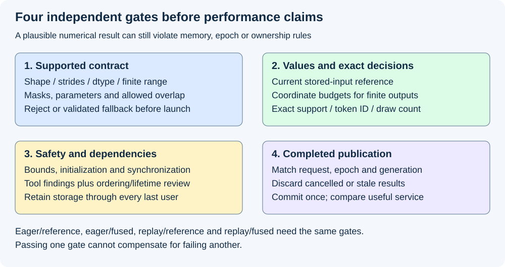
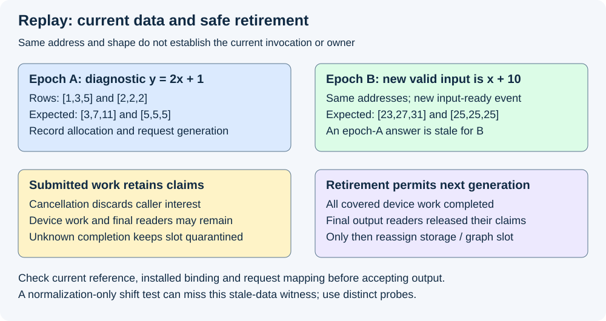

# M4-C20: Validating fused kernels and graph replay

> **Status: Complete — detailed chapter authored and documentation validated; experimental procedures are proposed unless explicitly labelled observed.**

**Module:** Understand kernels and execution overhead

**Category:** [Numerics and correctness](index.md)

[Module 4 reading order](../module-4.md) · [Previous: M4-C19](../numerics-and-correctness/m4-c19-randomness-reproducibility-and-sampling-equivalence.md) · [Next: M4-C21](../measurement-experimentation-and-economics/m4-c21-tuning-kernels-with-controlled-experiments.md)

## Target concepts

Reference comparisons, tolerances, extreme inputs, awkward shapes, strides, masks, aliasing, uninitialized reads, races, stale buffers, graph-versus-eager equivalence, supported input contracts.

[Execution plan and progress](../chapter-execution-plan.md)

## Concepts

### 1. Correctness has several independent gates

A fused operation combines stages that previously ran separately. A graph executable prepares operations and dependencies for repeated submission. Both can reduce overhead, but neither establishes that the right values were read, computed and delivered to the right request. Validation must identify the supported input family, compare values with an appropriate reference, check memory/synchronization behavior and establish output ownership after completion.

This chapter joins the completed [graph-lifetime contract](../runtime-and-concurrency/m4-c16-replay-constraints-graph-variants-and-buffer-lifetimes.md), [normalization contract](../kernels-compilers-and-execution/m4-c17-designing-a-fused-normalization-kernel.md) and [sampling contract](../kernels-compilers-and-execution/m4-c18-designing-a-fused-sampling-kernel.md). It specifies experiments and acceptance criteria without implementation code or pseudocode. Rust remains the host-language context; native CUDA or Triton bindings need explicit device-lifetime claims beyond a host borrow.

Use four distinct questions:

| Gate | What must be shown | What cannot substitute for it |
|---|---|---|
| Contract | Shape, layout, dtype, parameters, aliasing and numerical range belong to the supported family | Matching element count |
| Values | Current invocation agrees with the reference at the required equivalence level | Correct probability sum or average error alone |
| Safety and ordering | Accesses, initialization, synchronization and allocation lifetimes are valid | Correct output from one favorable schedule |
| Publication | Current request/generation receives its completed result exactly once | A successful enqueue or an old plausible output |

A **reference** is an independently specified expected behavior. Maintain both a high-precision mathematical oracle from the actual stored inputs and an approved production reference with its cast, reduction, filter and random-draw rules. Their identities must be fixed before candidate observations. Disagreement between the references requires an explicit numerical/policy decision; the candidate cannot choose whichever reference it happens to match.

### 2. Define the supported family before testing

A contract is a positive statement of accepted inputs plus a defined rejection/fallback response. For this validation study, the normalization candidate starts with nonempty contiguous rows, FP32 stored inputs/affine parameters/output, positive finite epsilon, declared supported magnitude and out-of-place output. LayerNorm versus RMSNorm is explicit. Sampling starts with the contiguous finite-logit FP32 family and exact policy from M4-C18. Empty batches produce empty results and no sampling draws. For the bounded E1/E2 study, normalization accepts |x|≤2²⁰, |γ|≤4, |β|≤4, widths 1…4096 and ε equal to the stored FP32 representation of 1 or 10⁻⁵. Sampling accepts |ℓ|≤32 and T∈{0.5,1,2}, with M4-C18 filter/draw rules. These conservative study ranges are not general model guarantees; subnormal/underflow and production-stage rounding remain recorded numerical behavior. Unsupported dtype, layout, overlap, range or graph binding is rejected or directed to a separately validated ordinary path before submission.

The study also supplies strided fixtures to verify dispatch rejection or a declared gather/staging adapter. That does not silently expand a contiguous kernel's contract. If an adapter is qualified, its copies, masks, ownership and timing join the operation being validated. Negative strides, broadcasting and arbitrary overlapping views are outside the initial family; reject them explicitly. Inherited normalization/sampling numerical restrictions still apply, including finite intermediates or a validated fallback.

| Descriptor area | Required record |
|---|---|
| Mathematical operation | Norm kind/axes/epsilon/affine/residual outputs, or sampling mode/T/k/τ/ties/CDF and draw rules |
| Representation | Valid and padded extents, byte/element strides, alignment, allocation bounds, stored/accumulation/output formats |
| Ownership | Input/output/workspace allocations, owner and generation, allowed overlap, last users and result identity |
| Execution | Kernel binary/compiler flags, device/context, eager/graph mode, executable/slot identity and installed parameters |
| Invocation | Epoch, logical request/token, input-ready dependency, pending uniform, completion and publication status |

An **epoch** is a monotonically distinguished invocation identity within the test run. It changes when new work is admitted even if addresses and shapes remain equal. A **generation** distinguishes successive owners of a recycled storage slot. Neither is inferred from the numerical pointer.

### 3. Tolerances are coordinate checks, not blanket permission

Let r_i be a reference coordinate and c_i the candidate coordinate. A commonly useful declared mixed gate is:

**|c_i−r_i| ≤ a + b|r_i| for every required finite coordinate.**

Here a is absolute tolerance and b relative tolerance. For the proposed small FP32 normalization fixtures use **a=10⁻⁶ and b=10⁻⁵**, provisionally, alongside the approved production contract. At r=0 the allowance is 0.000001; at r=100 it is 0.001001. A candidate value 0.000002 at a zero reference fails even if a large tensor's mean absolute error is tiny. Report maximum absolute error, maximum relative error with a stated denominator convention, failing-coordinate count and the location/input identity of the worst errors.

These are study budgets, not evidence of achieved candidate accuracy or universal norm bounds. At large magnitudes, near zero, or near a policy decision, derive/review operation-specific budgets using [M9-C17](m9-c17-comparing-logits-with-justified-numerical-tolerances.md). NaN and infinity need explicit classification: finite-reference NaN never passes because a comparison returned false; invalid inputs require rejection, not a tolerant numerical match. Treat signed zero or exact bit identity separately if the consumer contract distinguishes them.

For sampling, support, token ID, validation result and logical draw consumption are **exact** gates against the chosen production reference. Small probability error cannot excuse changed top-p support or CDF selection. Near a sampling boundary, use the reference threshold/draw and its representable neighbors in the declared dtype. Preserve greedy zero-draw and successful singleton one-draw rules. The same seed alone is insufficient: supply the same logical uniform or reconcile the generator/key/counter/word-conversion mapping.

Fusion can change rounding by eliminating a materialized cast or changing a reduction tree. NVIDIA's [floating-point white paper](https://docs.nvidia.com/cuda/floating-point/index.html) explains these numerical mechanisms. Reference the operation's actual stage boundaries; “more accurate in real arithmetic” is not automatically token-wise compatibility with an existing runtime.

### 4. A hand-checkable layout and stale-output fixture

Consider a read-only 2×3 FP32 logical input with row stride 8 elements and column stride 2 elements. Its valid coordinates occupy offsets **{0,2,4,8,10,12}** in a 13-element allocation. Seven holes remain. Physical holes are not logical zeros and must not enter a norm's sample count. For nonempty rows and nonnegative strides the final-address calculation is:

**Largest offset = (R−1)s_row + (D−1)s_col; required elements = largest offset + 1.**

For R=2,D=3,s_row=8,s_col=2, the result is 13 elements, **52 bytes**. Valid input payload is only six values, **24 bytes**. Checked arithmetic must reject overflow before using this expression. The formula does not prove nonoverlap for arbitrary views; accepted strides and coordinate uniqueness need their own checks.

Assign logical rows [1,3,5] and [2,2,2]. A diagnostic affine operation **y=2x+1** should produce [3,7,11] and [5,5,5] in a separate contiguous six-element output. It isolates layout/epoch errors; it is not a normalization or a sampling benchmark. Add an 8-byte guard before and after each of the two allocations: 52+24+32=**108 bytes** of declared fixture storage, excluding metadata/allocator overhead. Preserve all guards and read-only holes bit-for-bit. A guard check catches some writes; it cannot establish that no invalid read happened.

For LayerNorm on the first logical row with ε=1, γ=[1,2,0.5], β=[0,−1,1], mean is 3, variance is 8/3, and d=sqrt(11/3). Expected affine output is **[−2/d,−1,1+1/d] ≈ [−1.0444659357,−1,1.5222329679]**. The constant second row produces β=[0,−1,1]. Including holes or padded values changes the statistics. An injected fourth value 1000 would change the first row's mean from 3 to **252.25**; a mask must exclude it before reductions and selection, not merely suppress its final output.

Now reuse the same allocation for epoch B with every valid input increased by 10. The affine diagnostic expects **[23,27,31] and [25,25,25]**. Epoch A's [3,7,11]/[5,5,5] is perfectly valid for A but stale for B. Checking only against the old reference, reading before B completes, or failing to update captured inputs can all produce plausible but wrong results. LayerNorm itself is shift-invariant in real arithmetic, so this affine probe deliberately exposes a stale shift that a normalization-only metamorphic test might miss.

*Independent gates prevent a numerical match from concealing unsupported layout, unsafe access or an output from the wrong epoch.*

### 5. Access safety, initialization, aliasing and races

**Aliasing** means two views refer to some of the same storage. A fused candidate cannot assume independent input and output if they overlap, even when the starting addresses differ. For the initial family, input/output and private workspaces are disjoint; reject exact and partial overlaps before launch. Read-only sharing among inputs may be admitted only when its semantics and lifetimes are declared. A conservative allocation-span rejection is acceptable but can reject harmless disjoint strided coordinates; do not describe it as an exact overlap detector.

An **uninitialized read** observes storage before a valid producer has established its value. Refill inputs, workspace and result expectations for each epoch. Use several distinct finite poison patterns in inactive storage and outputs; accidental agreement with a zero-initialized allocator is weak evidence. Poison perturbation is a diagnostic: inactive data must not change valid output, but passing this test does not prove that inactive data was never read. Sanitation tools and bound proofs provide different evidence.

A **race** is an unordered conflicting access, including a write whose required consumer/producer ordering is absent. Specify the ordering chain explicitly: input production → kernel/replay → result transfer/consumer → reclamation. Cross-stream order needs the appropriate event/dependency, rather than assumptions about host call order. Inside the kernel, verify reduction/barrier participation and visibility, including awkward tail lanes. On the host, serialize graph management under the conservative M4-C16 policy and keep slot claims through all users. An ordinary Rust lifetime does not by itself represent completion of a foreign asynchronous device access.

NVIDIA's [Compute Sanitizer](https://docs.nvidia.com/compute-sanitizer/ComputeSanitizer/index.html) supplies complementary checks. Memcheck diagnoses invalid/misaligned accesses; initcheck checks uninitialized device-global reads; racecheck targets shared-memory access hazards; synccheck checks synchronization misuse. A clean racecheck report is not proof of all global-memory or host/device lifetime ordering. Run memcheck first, then the other relevant tools on a compatible instrumented build; record coverage, options, failures and unsupported cases. Separate instrumented qualification from clean timing because instrumentation can change schedules and cost.

### 6. Compare eager and replay through a four-way matrix

Use **eager** for ordinary per-invocation submission and **replay** for launching a prepared graph executable. Compare the same current input, policy, supplied draws and request mapping in four cells:

| Operation path | Eager submission | Graph replay |
|---|---|---|
| Approved staged reference | R_E | R_G |
| Fused candidate | C_E | C_G |

First compare R_E and C_E to the chosen reference. Then compare R_G with R_E, C_G with C_E, and C_G with R_G under the same declared equivalence gates. Equality between two wrong graph outputs does not certify correctness. This matrix helps separate fusion differences from stale graph bindings, missing dependencies and per-replay state errors.

Before each admitted replay verify descriptor compatibility, installed parameters, input epoch, row/request mapping and allocation generations; acquire claims with eligibility. A host variable change does not automatically update a captured scalar or pointer. Use only documented supported graph updates and inspect their status, or select another validated instance/ordinary path. An unsupported stride/dtype change is not safe just because the new tensor has the same element count. [CUDA Graphs](https://docs.nvidia.com/cuda/cuda-programming-guide/04-special-topics/cuda-graphs.html) defines graph dependencies and update mechanisms; application eligibility remains an additional contract.

Exercise epoch changes, row compaction, policy changes, smaller valid shapes within capacity, slot reuse and cancellation. Each disjoint slot owns its prepared executable; one invocation per slot is in flight in this study. Warmup uses scratch identities and restores production state. A cancellation after submission retains device/output claims until covered completion; discard its result and reconcile pending sampling progress exactly once. Unknown completion keeps the slot quarantined. Blind fallback/retry after an uncertain attempt can duplicate model-state or random-state effects.

*Stable addresses do not establish current contents or ownership. The completion and final-reader boundaries determine when reuse becomes safe.*

## Experiments

The following procedures are proposed. Documentation arithmetic, fixture checks, source review and rendered-page checks are observed authoring work; no device execution, sanitizer or serving experiment is claimed.

### E1 — Independent numerical and policy references

- **Name:** Values and decisions before speed.
- **Description:** Compare norm and sampling diagnostic outputs with independent mathematical and staged production references.
- **Purpose/objective:** Detect changed casts, epsilon placement, reductions, filter order and boundary decisions.
- **Target concepts:** Reference comparisons, tolerances, extreme inputs and supported numerical contracts.
- **Baseline:** M4-C17 normalization and M4-C18 sampling contracts; stored-input oracle at 80 and 120 decimal digits plus the approved production-stage reference.
- **Workload:** Norm rows [1,3,5], [2,2,2], [10000,10001,10002,10003], alternating ±1 and near-constant representable FP32 rows; ε=1 and 10⁻⁵, identity and stated affine parameters. Sampling uses [2,1,1,0,−2], T=0.5/1/2, k disabled/1/2/3/5, τ disabled/0.5/0.55/0.75/1, and all 256 midpoint uniforms (w+1/2)/256. Add largest/smallest accepted finite values, just-outside-range inputs, NaN/infinities and invalid policy. Use the stated study endpoints and their adjacent representable neighbors; compute references from stored FP32 values. For non-three-entry norm rows, repeat γ=[1,2,0.5] and β=[0,−1,1] by feature index, or use identity γ=1, β=0, as separately labelled cases.
- **Controlled variables:** Stored bit patterns, dtype/cast/rounding, reference version, epsilon/policy, supplied uniform and error classification. Do not compare independently advanced random streams.
- **Hardware requirements:** CPU for high-precision arithmetic; compatible GPU/FP32 diagnostic mode only for candidate qualification. Unsupported numerical ranges are rejected rather than assumed covered.
- **Exit criteria:** All finite coordinate budgets and exact support/ID/draw/failure checks pass; mathematical-versus-production reference differences are resolved explicitly. Any unexplained nonfinite or boundary mismatch fails the candidate family.

### E2 — Layout, masks and unsafe-access probes

- **Name:** Awkward shapes and adversarial storage.
- **Description:** Challenge dispatch and any qualified adapter with holes, poisoned padding, guard regions and prohibited overlap.
- **Purpose/objective:** Show that valid extents and allocation lifetimes govern every required access.
- **Target concepts:** Awkward shapes, strides, masks, aliasing, uninitialized reads and races.
- **Baseline:** Logical-coordinate gather reference and explicit reject/fallback outcomes for unsupported layouts, plus the hand-checkable 2×3 fixture.
- **Workload:** R=0/1/3/8, D or V=1/3/31/32/33/127/128/129/4096; contiguous and row-pitched layouts, the stride-(8,2) fixture, zero/negative strides and nonempty zero-width rows (rejection), shifted partial overlap (rejection), valid last-lane maxima and all-negative/tied sampling rows. Use three distinct finite inactive/output poison patterns in separate initialized runs; uninitialized-global-read checking is a separate instrumented run with declared intentionally uninitialized inactive storage.
- **Controlled variables:** Valid versus physical extents, checked allocation bounds, guard values, layout eligibility, adapter copies, no-alias policy and reduction masks. Intentionally uninitialized storage is never treated as valid input.
- **Hardware requirements:** Compatible CUDA device/build and relevant sanitizer support; record actual compiler and tools. Budget 64 MiB each for host/device fixtures plus separately measured tool overhead; process cases sequentially and reject oversized workspace.
- **Exit criteria:** Contiguous accepted cases and any qualified adapter agree with the reference; unsupported cases reject safely before launch; guards/holes remain unchanged, zero invalid outputs and zero unresolved relevant tool findings. Report tool blind spots and coverage; absence of findings alone does not prove arbitrary race freedom.

### E3 — Current epochs across eager and graph paths

- **Name:** Four-way equivalence with changing ownership.
- **Description:** Exercise all four matrix cells under repeated data changes, slot generations and graph-eligibility transitions.
- **Purpose/objective:** Detect stale bindings/results, missing dependencies and duplicate state effects.
- **Target concepts:** Graph-versus-eager equivalence, stale buffers, races and supported replay contracts.
- **Baseline:** R_E current-epoch reference with the same logical policy/uniforms; checked R_G/C_E/C_G results are compared independently.
- **Workload:** The affine epoch A/B probe, E1 norms/sampling and E2 representative widths 3/33/129/4096; 100 alternating epochs per admitted family, two disjoint slots, one in-flight invocation per slot. Script policy change, reversed row/request map, smaller valid extent within capacity, unsupported shape/update rejection, same-address/new-generation reuse and cancellation before launch, after launch and before publication. Simulate unknown completion by withholding completion authorization; never induce an actual unsafe free as a test requirement.
- **Controlled variables:** Current input bits, reference epoch, installed graph parameters, supplied draws, request/slot generations, dependencies and publication ledger. Drain an instance before management changes under the conservative study policy.
- **Hardware requirements:** Device/runtime supporting the chosen graph operations and completion/event diagnostics; host logs of admission, submitted attempts, final readers and one-time commit.
- **Exit criteria:** Every current-epoch matrix comparison passes; stale/generation-incompatible bindings reject, cancellation publishes no discarded token, no duplicate commit or premature reuse, and unknown completion retains claims. A fallback executes only when original-attempt accounting makes it safe.

### E4 — Qualified operation and complete-generator evidence

- **Name:** Correct useful work under clean timing.
- **Description:** Benchmark only qualified families, then evaluate their generator effect with fixed request identities.
- **Purpose/objective:** Determine whether fusion/replay improves completed useful work without masking unsupported cases or failures.
- **Target concepts:** Verification, benchmarking, profiling, distributions and end-to-end acceptance.
- **Baseline:** Validated staged/eager path; distinguish fusion-only, replay-only and combined candidates using the four-way matrix.
- **Workload:** Microstudy uses R=1/3/8 and width 33/129/4096, norm and three sampling policies (greedy, unfiltered and k=8/top-p=0.9). Per cell/case, 50 scratch warmups precede five paired blocks of 200 completed invocations, alternating comparison order. Generator study reuses M4-C18's versioned 32-prompt, concurrency-1/8/32 corpus and five paired blocks; retain actual stopping and every terminal outcome. Fault/instrumentation runs are separate from clean timing.
- **Controlled variables:** Kernel/model/tokenizer identity, input/corpus, supplied draws, arrival schedule, variant/slot warm state, clocks, compiler, allocation/reset and completion boundaries. Record compilation/capture/first-use and validation costs separately from steady state.
- **Hardware requirements:** Compatible device and model capacity/headroom, event and host clocks, profiler access and complete machine manifest; no model or machine is asserted to have been run here.
- **Exit criteria:** E1–E3 stay satisfied before and after timing. Report completed device/host p50/p95/p99 with counts and uncertainty, useful throughput, time to first token (TTFT)/inter-token latency, errors/cancellations and memory/launch evidence. Predeclare the improvement and service budgets before observations; inconclusive or regressed results remain reported. No local timing result alone establishes generator benefit.

## Verification

### Matched acceptance and evidence record

| Experiment | Measurements and diagnostic evidence | Required interpretation |
|---|---|---|
| E1 | Reference coordinates, max error/failing coordinates, finite classification, exact support/token/draw ledger | Coordinate tolerance and exact decisions are separate gates; rejected range is outside the family |
| E2 | Address/extent/overlap checks, guard/poison perturbation, memcheck then initcheck/racecheck/synccheck where supported | Zero unresolved findings for exercised cases; record tool coverage and prove missing cross-stream/host lifetime edges separately |
| E3 | Four-way current-epoch results, graph descriptors/update status, mapping/generation and completion/publication traces | Same current work and correct owner before comparing values; unsafe replay rejected or safely recovered |
| E4 | Clean paired timing blocks, separate diagnostic traces/counters, cold/warm costs, complete request outcomes | Correctness before speed; include validation/fallback costs at their true service boundary |

A validation record includes case ID, stored-input/reference hashes, descriptor, expected accept/reject outcome, candidate binary, numerical gates, completed attempt/epoch, tool configuration and all discrepancies. Keep failing fixtures and provenance so the same failure can be reproduced without a live production request. A rejected unsupported case is a successful contract test; a quietly skipped accepted case is missing coverage.

For numerical QA, exact rational arithmetic checks offsets, affine results, tolerance thresholds and storage counts; 80/120-digit arithmetic checks the normalization fixture. Those authoring checks do not execute a kernel or prove every proposed workload. In actual qualification, retain reference/candidate output snapshots and re-run the accepted corpus after compiler, dtype, shape family, mask, graph binding or operation-policy changes. A safety finding blocks performance promotion even if values happen to match.

Use a completion event that covers the final relevant device consumer, and separately retain host/output-reader claims. A kernel event can precede a result transfer or publication reader. Time host enqueue, device work and full selected-result/service completion separately. Profile representative cases in separate diagnostic runs; record counter replay and sanitizer effects rather than treating their timelines as unperturbed service behavior. Use completed M9-C02 for clocks, M9-C07 for uncertainty, M9-C11 for paired/reset controls, M9-C12/C13 for diagnostic scope and M9-C15 for allocation accounting. M9-C22/C23 remain later extensions; completed [M9-C27](../measurement-experimentation-and-economics/m9-c27-designing-regression-experiments-and-validation-gates.md) develops regression gates, while the local lifetime, fault and acceptance rules here are usable without claiming those chapters are complete.

## Engineering dimensions and principles

### Six dimensions applied to qualification

| Dimension | Chapter-specific application |
|---|---|
| Semantics and invariants | Fix norm/sampling/cast/mask contracts, exact IDs/draws and publication; reject unsupported input explicitly |
| Workload and variability | Near-constant/extreme rows, awkward widths, ties, strided adapters and changed epochs expose different failures |
| Resources and bottlenecks | Track guards/staging/workspace, retained graph slots and diagnostic overhead separately from useful payload |
| Time and distributions | Prove producer/consumer/reclamation dependencies before timing; faults/fallback and hidden synchronization affect tails |
| Ownership and coordination | Current request, allocation generation, graph instance, pending uniform and last reader must agree |
| Failure and adaptation | Invalid rows reject; incompatible replay uses safe pre-submit fallback; uncertain completion quarantines state |

### Eight practical principles

| Principle | Concrete learning path |
|---|---|
| 1. Correctness defines optimization boundary | Four independent gates precede timing; tolerance cannot authorize token mismatch or unsafe aliasing |
| 2. Workload and operating point matter | Qualify each layout/dtype/policy family and measure each width/batch/mode rather than declaring all graphs faster |
| 3. Data movement is part of algorithm | Count adapters, result transfers, poison/guard setup and actual production copies in their correct scopes |
| 4. State has ownership, lifetime and recovery cost | Stable pointers need generations/epochs; cancelled and uncertain attempts retain claims until safe retirement |
| 5. Dependencies determine latency; bottlenecks capacity | A correct dependency graph must include input readiness and final users; missing edges can look faster while being wrong |
| 6. Variability and synchronization shape tail | Exercise awkward tails, update misses, cancellation and contention separately from clean microbenchmarks |
| 7. Local improvements need end-to-end evaluation | Four-way operation timing supports diagnosis; useful generator output and every terminal outcome decide service benefit |
| 8. Claims require reproducible evidence | Preserve stored bits, reference identities, descriptors, failing cases, tools and machine conditions |

The HFT analogy is validation of a fast decision pipeline: a numerically plausible answer from a stale sequence or a reused slot still belongs to the wrong event. Guards, ownership and ordered publication support reliable low-latency systems, while instrumentation must be separated from clean latency measurement. Text sampling has probabilistic policies and model-specific numerical budgets; these do not define acceptable errors for financial decisions. No trading or hard real-time guarantee is claimed.

## Specifications, articles, and hardware

| Primary source | Scope of use |
|---|---|
| [NVIDIA floating-point white paper](https://docs.nvidia.com/cuda/floating-point/index.html) | Rounding/reduction/cast differences; not a universal tolerance value |
| [Compute Sanitizer documentation](https://docs.nvidia.com/compute-sanitizer/ComputeSanitizer/index.html) | Complementary access, initialization, shared-memory hazard and synchronization checks with explicit tool limits |
| [CUDA Graphs guide](https://docs.nvidia.com/cuda/cuda-programming-guide/04-special-topics/cuda-graphs.html) | Dependency/replay/update mechanisms; application ownership and epoch validation remain additional obligations |
| [CUDA asynchronous execution](https://docs.nvidia.com/cuda/cuda-programming-guide/02-basics/asynchronous-execution.html) | Submission versus completion and stream dependencies |
| [Constructing graphs with dynamic parameters](https://developer.nvidia.com/blog/constructing-cuda-graphs-with-dynamic-parameters/) | Primary engineering article on installed parameter updates; a host-variable mutation is insufficient |

Sources checked 2026-10-28; pin installed versions, source revisions and options before qualification. The chapter specifies requirements rather than inventing a device configuration or measured benchmark.

| Hardware/specification area | Required manifest |
|---|---|
| Host | CPU/NUMA/affinity, OS/kernel, Rust and binding/framework versions, allocator and competing load |
| Device | GPU architecture/model/UUID, visible memory and partitioning, SM count, clocks/power/thermal state and co-tenancy |
| Software | Driver/runtime/compiler/Triton, binary and numerical flags, graph/tool support, sanitizer versions and enabled coverage |
| Operation/storage | Valid/padded shapes, strides/alignment, formats, range, epsilon/policy, allowed overlap, allocations/generations and workspace |
| Measurement/state | Graph/slot/epoch and random identities, completion/reader claims, timer/profiler settings, corpus/reset/warmup and outcome/uncertainty records |

## Continue learning

Next in Module 4 reading order is [M4-C21: Tuning kernels with controlled experiments](../measurement-experimentation-and-economics/m4-c21-tuning-kernels-with-controlled-experiments.md). The next authoring chapter is [M5-C18: Choosing chunk sizes and balancing prefill with decode](../scheduling-and-queueing/m5-c18-choosing-chunk-sizes-and-balancing-prefill-with-decode.md), position 125. Follow the [execution plan and progress tracker](../chapter-execution-plan.md). Only M4-C20 is authored in this step.
