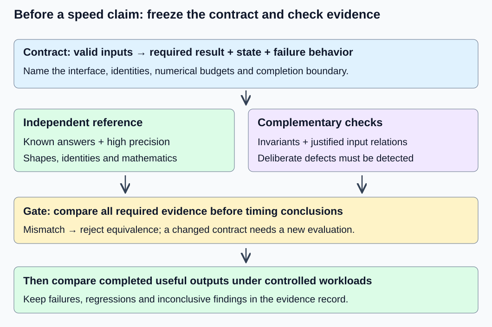
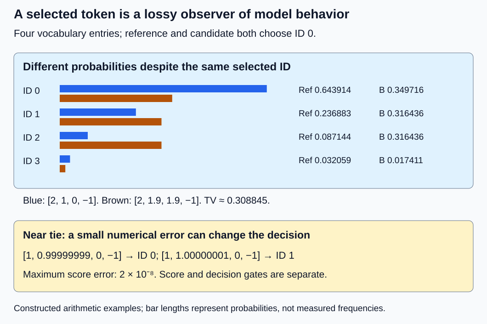

# M9-C01: Defining reference behavior and evidence before optimizing

> **Status: Complete — detailed chapter authored and documentation validated; experimental procedures are proposed unless explicitly labelled observed**

**Module:** Make measurement and correctness part of the foundation

**Category:** [Numerics and correctness](index.md)

[Module 9 reading order](../module-9.md) · [Next: M9-C02](../measurement-experimentation-and-economics/m9-c02-request-events-clocks-and-measurement-boundaries.md)

## Target concepts

Correctness contracts, mathematical and numerical references, invariants, approximations, intentional constraints, falsifiable hypotheses, acceptance criteria, limits of generated-text matching.

## Concepts

### Decide what a correct result means

An optimization is a change intended to improve a useful outcome, such as completed-request latency or memory use. Before evaluating that improvement, define which behavior must survive the change. A **correctness contract** states the valid inputs, required outputs, state transitions, numerical allowances and failure behavior. It gives a reviewer a way to reject a fast but wrong result.

A **reference** is the independently justified behavior used for comparison. A **test oracle** is a rule or source that decides whether a particular observation satisfies the contract. An oracle can be an exact answer, a high-precision calculation, a proven relation between executions, or a combination. A trusted implementation is useful evidence, but agreement with it alone does not prove that both implementations follow the intended mathematics.

This chapter supports Modules 1–7, beginning with the completed [M1-C14 model](../model-computation-and-semantics/m1-c14-assembling-a-small-decoder-only-transformer.md). Its task is a deterministic forward pass from fixed token IDs and positions to logits, which are scores for vocabulary entries. It is not yet a text-generation loop. Rust is the eventual engine's language context: tensor shape, ownership and error outcomes must be explicit at its interfaces. No implementation is provided here, and no Rust inference runtime is assumed to exist in this documentation repository.

*An attractive timing result cannot bypass the reference checks. A contract change needs its own declared evaluation; a mismatch is not made equivalent by renaming it an approximation afterward.*

### Write a contract that another person can execute

For the M1-C14 fixture, the following is a concrete contract, not an instruction to choose arbitrary defaults.

| Contract component | Required behavior |
|---|---|
| Inputs | B independent requests, 1 ≤ S ≤ 4 valid positions each, integer IDs 0–3, position i at row i, no padding |
| Identity | The exact two-block configuration and 20 tensors/90 FP64 values specified in M1-C14; fixed for an entire forward |
| Mathematics | Token plus absolute-position embedding, block 0 then block 1, separate final RMSNorm with scale [2, 1], untied vocabulary head |
| Result | Four finite raw logits per requested position, with columns corresponding to IDs 0, 1, 2, 3; all-position and last-position interfaces are named separately |
| Invariants | Causal dependence only on the same request's prefix; no cross-request dependence; preserved position and weight-version identity |
| Numerical allowance | M1-C14's maximum absolute coordinate errors: H₁ 10⁻⁹, H₂ 10⁻⁸, final Z 10⁻⁷, logits 10⁻⁶ |
| Failure | Reject out-of-range IDs, empty/overlong sequences and incompatible weights; never return a partial or mixed-version result as success |
| Boundary | Inputs and admitted weights ready through completed, caller-readable logits; tokenization, loading and token selection are separate work |

H₁ and H₂ are the outputs of blocks 0 and 1; Z is the final normalized hidden state. “Finite” excludes NaN, meaning not-a-number, and positive/negative infinity. The [Rust f64 specification](https://doc.rust-lang.org/std/primitive.f64.html) documents binary64 values and their finiteness classification. The contract rejects nonfinite model outputs even if a generic comparison tool could be configured to treat two NaNs as equal. The documentation consulted identifies Rust standard library 1.99.1; record the actual toolchain when running an experiment.

A raw-logit interface and a probability interface are different contracts. Likewise, returning only the final position is an intentional interface restriction relative to returning all positions; it can be an equivalent implementation of an already declared **last-position** interface. Always name the interface before classifying a change.

### Mathematical, numerical and behavioral references

A **mathematical reference** defines a function over ideal real numbers. For a finite logit row x, softmax assigns probability

**pᵢ = exp(xᵢ − m) / Σⱼ exp(xⱼ − m), where m = maxⱼ xⱼ.**

The index i identifies a vocabulary entry; the sum runs over the declared vocabulary. In exact arithmetic the probabilities are nonnegative and sum to one. Subtracting m preserves the mathematical distribution. These facts do not establish that a finite-precision implementation handles every input without overflow, underflow or an invalid reduction.

A **numerical reference** evaluates that specified function at an explicit precision, with stated input representation and operation rules. FP64 is a useful baseline, not exact real arithmetic. A higher-precision calculation checked at, for example, 80 and 120 decimal digits helps stabilize the small reference. Repeating the same wrong formula at two precisions does not detect its conceptual error; independent algebra and invariant tests are needed too.

A **behavioral reference** covers more than numbers: result shape, vocabulary identity, valid state changes, error outcomes and completion. A correct logit array attached to the wrong request is a behavioral failure. Model-quality evaluation asks another question—whether the model is useful on representative tasks—and cannot replace implementation correctness.

The [PyTorch 2.14 numerical-accuracy notes](https://docs.pytorch.org/docs/2.14/notes/numerical_accuracy.html) explain why mathematically equivalent operations need not be bitwise identical, including batched versus separate execution. Use that as a warning against unexamined bit equality, not permission for unlimited error. This is a specification reference, not a requirement to replace Rust with Python.

| Reference layer | Example evidence | What it cannot establish alone |
|---|---|---|
| Exact discrete structure | IDs, shapes, mask membership, version identity | Numerical values or model quality |
| Independent mathematics | Small dot products and M1-C14 equations | Large-runtime memory safety or timing |
| High-precision numerical oracle | Every toy-model stage and logit | Correctness outside the tested domain |
| Invariants and relations | Future-token isolation and request isolation | Correct absolute logits if both paths share a defect |
| Task/service evidence | Quality, completed results and failure accounting | Equivalence of an individual arithmetic change |

### Four different kinds of claim

An **equivalent computation** preserves the declared mathematics and behavioral interface, subject to its numerical allowance. The M1-C14 last-row head comparison is an example for its last-logit interface. A **numerical approximation** changes represented values or arithmetic and requires an explicit error/quality budget. A **distributional claim** concerns probabilities across outcomes, not equality of one sample. An **intentional constraint** changes the set of permitted outcomes, such as excluding vocabulary entries. These categories can overlap: a constrained distribution can itself have an approximate implementation. State each change separately.

For two probability vectors p and q on the same finite vocabulary, define **total variation distance TV(p, q) = ½ Σᵢ |pᵢ − qᵢ|**. It ranges from zero to one and measures the largest possible difference in probability assigned to any event. In this chapter, the vectors are known explicitly; no sampling estimate is needed.

Take p = [0.50, 0.30, 0.20]. An approximate vector q = [0.49, 0.31, 0.20] has TV = 0.01. If a toy demonstration predeclares TV ≤ 0.02, q passes that distribution budget; it is not exactly equal to p. This 0.02 allowance is a constructed teaching contract, not an acceptable production quality loss.

Now intentionally allow only IDs 0 and 1. Conditioning on the allowed set gives **pᶜ = [0.50/0.80, 0.30/0.80, 0] = [0.625, 0.375, 0]**. Its TV from p is 0.20. That is an expected effect of changing the contract, not evidence of a faulty constrained implementation. Validate pᶜ against the conditional reference and verify excluded probability is zero. If the allowed set has zero reference probability, conditioning is undefined; require an explicit error or separately specified fallback rather than dividing by zero. Detailed token-selection mechanisms remain for later chapters.

### A worked counterexample: the same token can hide wrong scores

For illustration only, define greedy selection as choosing the greatest logit, resolving exact ties by the lowest ID. This simple deterministic observer is not a claim about a full generation algorithm. Consider three rows with columns in ID order:

| Row | Raw logits | Greedy ID | Softmax probabilities, rounded to six decimals |
|---|---|---|---|
| Reference r | [2, 1, 0, −1] | 0 | [0.643914, 0.236883, 0.087144, 0.032059] |
| A: add 10 to every entry | [12, 11, 10, 9] | 0 | Same mathematical distribution as r |
| B: change two entries | [2, 1.9, 1.9, −1] | 0 | [0.349716, 0.316436, 0.316436, 0.017411] |

A violates an unchanged raw-logit contract, even though softmax is invariant to a common finite shift in real arithmetic. B preserves the selected ID but substantially changes the probability distribution. Neither is validated by a one-token output match. Conversely, a decoder might map different token sequences to the same displayed string, so text can erase token-level differences. For stochastic selection, different correct samples are possible, and the same seed alone does not establish identical random-number consumption across algorithms. M1-C15 now supplies detailed introductory selection/replay guidance; advanced sampling-state validation remains deferred to the M9-C18 outline. Neither documentation page is an implemented sampler.

Even a close logit row can change a decision near a tie. Let r = [1, 0.99999999, 0, −1] and c = [1, 1.00000001, 0, −1]. Their maximum absolute difference is 2 × 10⁻⁸, yet greedy changes from ID 0 to ID 1. If every logit error is at most δ and the reference's largest-minus-second-largest gap is g, **g > 2δ** is sufficient to preserve a unique maximum. Each of the top two entries can move against the other by δ. If the inequality fails, the decision might still agree; the bound simply does not guarantee it. An exact decision requirement therefore needs its own check.

*Output agreement loses information. Conversely, a numerical budget does not automatically imply identical decisions near a tie. Specify which claims are required.*

### Invariants are necessary checks, not a complete oracle

An **invariant** is a property that must remain true throughout the declared operation. For this decoder-only model, a later token must not change an earlier position's result, and another request must not change this request's result. A **metamorphic relation** states how outputs should relate when inputs are transformed, even without knowing every absolute answer. Xie and colleagues' [primary study of metamorphic testing](https://www.cs.columbia.edu/wp-content/uploads/sites/7/2016/08/jss2011.pdf) explains the need to justify such relations for the algorithm being tested. Its classifier experiments are not evidence that an LLM runtime passes these checks.

Valid relations for the fixed, stateless M1-C14 model include permuting request order and undoing that permutation on outputs; extending a prefix with unchanged earlier positions; and changing request 1 while inspecting request 0. Check numerical values within the declared budgets rather than requiring accidental backend bit equality. Permuting tokens within a request is **not** a valid invariance: order, positions and causal dependencies matter.

A model that always returns zero logits can pass future/request isolation while failing the absolute reference. Two implementations can also share a transposed matrix or incorrect mask. Combine known-answer tests, independent formulas, identity checks and justified relations. Deliberate wrong variants—such as block reversal—check whether the verification process can actually detect the faults it claims to cover.

### Make a hypothesis falsifiable before measurement

A **falsifiable hypothesis** predicts a measurable outcome under named controls and states what evidence would contradict it. “The optimized model is faster” is incomplete. A concrete hypothesis is: “For the fixed FP64 M1-C14 last-logit interface, selecting the final hidden row before final normalization/head will preserve all last-logit budgets and lower completed-forward median latency at B = 2, S = 4 under the recorded single-thread CPU setup.” A slower median or any correctness failure contradicts the proposed improvement at that operating point.

Record the hypothesis, fixture, acceptance budgets and comparison boundary before collecting candidate outcomes. Do not tune on a workload and then describe it as untouched validation. Keep a held-out workload, meaning a case reserved until the choice is frozen, and report regressions as well as improvements. A small pedagogical holdout is not evidence of generalization to production workloads.

Useful evidence has identity and ownership. Record who produced a run, which inputs/configuration/weights it used, and which completed result each observation describes. Admit one coherent weight version per request. If a request is rejected, fails, is cancelled or times out, retain that outcome rather than replacing it with a successful retry's latency. A retry is a distinct attempt tied to the same logical request when applicable. Cancellation and replacement are conceptual extensions here: this repository has no running service to exercise them.

## Experiments

All four procedures are proposed. Arithmetic examples are constructed examples, not measured model or trading results. Use an existing numerical/model environment if available; this chapter provides no implementation and does not assume one has been built.

### E1 — Challenge an output-only oracle

**Description:** Compare known score/probability rows using several different acceptance contracts, then use a fixed model probe.

**Purpose/objective:** Demonstrate that selected-token or text agreement is weaker evidence than the declared numerical and behavioral contract.

**Target concepts:** Correctness contracts, mathematical/numerical references, acceptance criteria and limits of generated-text matching.

**Baseline and workload:** The r/A/B table; c = [2, 1.0001, 0, −1] against r; the near-tie pair above; the one-token ID 1, position 0 M1-C14 trace. These are separate fixtures, not interchangeable model outputs.

**Controls and prediction:** Fixed column identities and tie rule. For the standalone r/A/B/c comparison, predeclare raw-logit maximum absolute error ≤ 0.0002 and distribution TV ≤ 0.02 as separate teaching contracts. Predict A fails raw scores but preserves probabilities, B fails both but preserves greedy ID, and c passes both. The near-tie pair passes the score allowance but fails exact greedy agreement. M1-C14 keeps its stricter existing budgets.

**Procedure:** Write each claim and reference before examining the candidate. Calculate every score error, normalized probability and TV; compare exact chosen IDs separately. Trace the M1-C14 probe at embedding, both blocks, final normalization and logits. Replace one stage with a known wrong variant and identify the first mismatch. Do not use a displayed string as the sole oracle.

**Hardware/software:** FP64-capable CPU and a high-precision arithmetic reference; record details below. No GPU or model file is needed for the standalone rows; an actual runtime is required only for exercising a runtime candidate.

**Failure and HFT connection:** A single unchanged decision can hide changed state or probabilities, just as an unchanged event-processing decision need not validate every intermediate invariant. The comparison transfers evidence discipline, not a trading strategy or performance claim.

**Exit criteria:** V1 reproduces all predicted contract classifications and the M1-C14 probe with justified references. A failed contract remains failed even if another observer agrees; document the exact layer where agreement ends.

### E2 — Test invariants against known defects

**Description:** Apply justified input transformations to the fixed two-block model and compare them with absolute reference checks.

**Purpose/objective:** Establish the complementary value and limits of metamorphic relations.

**Target concepts:** Invariants, reference independence, intentional input constraints and falsifiable checks.

**Baseline and workload:** B = 2, S = 4 with ID[b, i] = (1 + b + i) modulo 4 and positions i. Also evaluate each prefix of lengths 1–3 with its original positions. Use the unchanged M1-C14 configuration and all-position output.

**Controls and prediction:** FP64, fixed admitted weights, no cache or random state. Expect causal/request isolation and batch-permutation correspondence within M1-C14 budgets. Expect a constant-zero wrong model to pass the relational checks but fail the known-answer probe; expect reversed blocks to fail absolute values.

**Procedure:** First record absolute reference outputs. Change only the last token of request 0; inspect its earlier positions. Change request 1 alone; inspect request 0. Swap the two requests and restore output order for comparison. Compare every prefix with its matching full-sequence positions. Evaluate the deliberate zero-output and reversed-block variants against the same evidence set. Include IDs −1/4 and lengths 0/5 as invalid-domain cases, not normal workloads.

**Hardware/software:** Same CPU reference environment, with traces retained outside timed measurements. Record numeric backend and library/thread settings for any runtime exercised.

**Failure and HFT connection:** Shared request state, stale weights or wrong causal membership can produce isolated-looking successes. Keep request/version identity with evidence and reject invalid results. Snapshot consistency resembles event-driven systems; token-order permutation is not a permissible substitute for request-order permutation.

**Exit criteria:** V2 checks all baseline and transformed outputs within budget, rejects invalid inputs, and demonstrates the known limitations of relations using the zero-output counterexample. Do not claim that passing these fixtures proves arbitrary-input correctness.

### E3 — Classify approximations and intentional constraints

**Description:** Validate the explicit three-entry probability examples against distinct references.

**Purpose/objective:** Avoid calling a changed distribution equivalent or treating an intended constraint as an accidental implementation error.

**Target concepts:** Approximations, distributional evidence, intentional constraints and acceptance criteria.

**Baseline and workload:** p = [0.50, 0.30, 0.20], q = [0.49, 0.31, 0.20], allowed set {0, 1}, and the exact conditional vector pᶜ = [0.625, 0.375, 0]. Also present an empty allowed set.

**Controls and prediction:** Fixed ID order. Approximation gate TV(p, q) ≤ 0.02; conditional-reference coordinate error ≤ 10⁻¹² for FP64; probability sum error ≤ 10⁻¹²; excluded entries exactly zero. Predict q passes the approximation budget but not exact equality; pᶜ differs from p by TV 0.20 but matches the conditional contract. Empty allowed support must reject under this experiment's policy.

**Procedure:** Record whether each comparison is equality, approximation or changed support. Calculate TV and normalization independently using fractions. Compare the constrained candidate with the conditional reference, then separately report its difference from the original distribution. Exercise empty support and a nonfinite supplied probability as rejection cases. No random sampling is necessary to verify these explicit vectors.

**Hardware/software:** Same CPU setup; the rational calculations require no accelerator, interconnect or serving load generator.

**Failure and HFT connection:** Silently excluding an outcome changes the service's rules. Declare constraints before evaluation and preserve their version, as with an explicitly changed event-admission policy. This analogy does not claim that a market policy is a probability model.

**Exit criteria:** V3 verifies TV 0.01/0.20, conditional probabilities, exact excluded mass and rejection outcomes. Treat real model quality, sample-distribution tests and production constraint design as unmeasured follow-up work.

### E4 — Gate an optimization claim with reproducible evidence

**Description:** Evaluate M1-C14's all-row versus last-row final norm/head paths for the same returned last logits.

**Purpose/objective:** Link correctness evidence to a falsifiable end-to-end performance claim.

**Target concepts:** Falsifiable hypotheses, acceptance criteria, mathematical/numerical references and evidence ownership.

**Baseline and workload:** Both paths compute embeddings and both blocks for all positions. Baseline then normalizes/projects all positions and returns the last row; candidate normalizes/projects only the last hidden row. Development fixtures: (B, S) = (1, 1), (1, 4), (2, 1). Freeze the choice before evaluating held-out (2, 4). IDs follow E2's rule for each shape.

**Controls and prediction:** Same fixed FP64 parameters, one CPU thread, one forward in flight, identical allocations policy and completed-output boundary. Predict equivalent last logits; predict lower median time at the held-out shape as the performance hypothesis, allowing the outcome to contradict it. Do not impose an invented minimum microsecond improvement.

**Procedure:** Freeze an evidence manifest and correctness gate before timing. Use three sessions, five untimed warmups per path/shape, then 30 paired comparisons per shape/session, alternating order. Time inputs/weights ready through caller-readable last logits, including gather and allocation; exclude load, tokenization and selection from both. Keep correctness traces and stage profiles in separate runs. Record all attempted comparisons and failures, not just eligible successes.

**Hardware/software:** CPU environment below, actual clock resolution and empty-bracket overhead. If the runtime is unavailable, leave all timings unperformed rather than substituting arithmetic duration for inference latency.

**Failure and HFT connection:** A locally faster head is insufficient if full-forward work or result handling regresses. Count incompatible-version, invalid-result and incomplete-forward outcomes separately. Single-flight observations provide no overload, queueing or production-tail guarantee.

**Exit criteria:** V4 produces a correctness verdict and a separate supported/refuted/inconclusive performance verdict for each shape, using the frozen boundary. A correct but slower path remains a valid experimental finding; a wrong path earns no equivalent-optimization claim.

## Verification

### Evidence manifest and admission rules

Before each proposed experiment, record its ID/date, hypothesis, contract revision, reference derivation, candidate identity, actual input artifact and fixture formula, weights/configuration, requested result, tolerance and outcome rules, hardware/software, clock and measurement boundary. For real artifacts, include recorded digests and exact versions; do not invent a checkpoint or hash for this mathematical fixture. Adapter, tokenizer and cache settings are **none/not used** here; adding them requires new identity and correctness checks. A hash establishes byte identity relative to a manifest, not semantic validity.

Require compatible shapes, correct IDs/positions and finite model values before an error calculation. Define maximum absolute error **e∞ = maxᵢ |cᵢ − rᵢ|**, for candidate c and reference r. A common mixed comparison is **|cᵢ − rᵢ| ≤ a + t|rᵢ|**, with absolute allowance a and relative allowance t. It is asymmetric because r defines the scale. Near zero, the absolute term matters. [PyTorch 2.14's testing specification](https://docs.pytorch.org/docs/2.14/testing.html#torch.testing.assert_close) documents this convention and configurable structural checks. Its defaults are not a justification for a model's acceptance budget. This chapter deliberately uses explicit absolute limits for its small fixtures; further tolerance design is developed in the completed M9-C17 chapter.

Use a mathematical derivation and a second numerical route where possible. For r's softmax, normalize [1, exp(−1), exp(−2), exp(−3)]; cross-check by normalizing [exp(2), exp(1), 1, exp(−1)], whose bounded entries are safe for this small reference. For the conditional example, use exact fractions 5/8 and 3/8. For the M1-C14 one-token probe, each attention row has one valid key and therefore probability one, providing a simpler independent derivation. Increasing precision alone is insufficient independence.

### V1 — Verify the counterexamples and model probe

For A, e∞ = 10 while TV = 0 in real arithmetic. For B, e∞ = 1.9 and TV approximately 0.308845; the greedy ID still agrees. For c, e∞ = 0.0001 and TV approximately 0.00001808, so both standalone budgets pass. For the near-tie pair, e∞ = 0.00000002 and the chosen IDs differ. Evaluate the exact reference values before rounding; six displayed decimal places are not input data for the verifier.

M1-C14's one-token logits are approximately [1.2311465324, 1.2306324560, 2.4617789884, −0.0005140763]. Check all four and every preceding boundary against its high-precision reference, using that model's budgets rather than E1's looser standalone example budget. Track the first mismatch; do not rely on a later stage to cancel an earlier error. Record an explicit failed verdict for a deliberate wrong stage. No selected-token or text result replaces these checks.

### V2 — Verify relations and fault sensitivity

Compare baseline and transformed outputs by request, position and vocabulary ID. The baseline has 2 × 4 × 4 = 32 logit coordinates. For the last-token perturbation, compare request 0's earlier 3 × 4 = 12 coordinates. For request-1 perturbation, compare request 0's 16. For request permutation, compare all 32 after undoing it. For the three shorter prefixes of both requests, compare 2 × (1 + 2 + 3) × 4 = 48 coordinates. These 108 relational comparisons are additional to the 32 absolute baseline checks; duplicate coordinate use does not make them statistically independent observations.

For a relation comparing two runtime paths with separate absolute errors bounded by ε, their mutual difference can reach 2ε. Require each path against its own exact/high-precision reference using the model's original ε, then allow at most 2ε for the corresponding relational comparison. Do not use the looser path-to-path limit as a replacement for either absolute check. Future/request invariance in the ideal reference is exact.

Keep a table of each deliberate defect and which checks detect it. Zero outputs must fail the known-answer probe despite passing isolation relations; reversed blocks must fail absolute model outputs. An unexpected pass indicates a weak test or faulty comparison, not evidence that the mutation was harmless. Invalid input cases must yield the declared error outcome without producing valid-looking logits.

### V3 — Verify probability and constraint contracts

Check nonnegativity, sum-to-one, ID mapping, finite values and TV against unrounded references. For q, ½(0.01 + 0.01 + 0) = 0.01. For pᶜ, ½(0.125 + 0.075 + 0.20) = 0.20. Verify the normalization denominator is 0.80 and excluded mass is exactly zero. Compare against the intended conditional reference with its 10⁻¹² coordinate/sum limits. Empty support and nonfinite input must be rejected under this specific policy.

These checks evaluate explicit distributions without drawing tokens. If later work samples instead, finite counts introduce uncertainty, repeated testing can create false alarms, and random-state consumption needs its own contract. One matching sample cannot establish the distribution; one different sample cannot refute a correct stochastic implementation.

### V4 — Verify performance claims and evidence populations

Correctness is a separate admission gate, not a latency metric. After it passes, retain 90 paired observations per shape if all planned trials complete; report the three session summaries and order policy. Record total attempts, successful pairs, invalid-result failures, exceptions/timeouts and unfinished observations. Classify each attempt once by a declared terminal outcome; retain diagnostic flags without double counting. If a member fails, the pair is incomplete for the successful paired-latency analysis, but both attempted outcomes remain in the ledger.

Report baseline and candidate completed-forward median/range per session and paired baseline-minus-candidate differences in the clock's units. Positive differences favor the candidate. With only three sessions, show their spread and avoid strong confidence or p99 claims. Predeclare that a consistent lower median across all three held-out sessions supports the narrow performance hypothesis; consistent higher medians refute it; mixed signs or times near measurement overhead are inconclusive. Report all development-shape regressions too. This is a pedagogical decision rule, not a statistical proof or production deployment criterion.

Calibrate the timing source, measure empty-bracket overhead and confirm outputs are actually complete at the endpoint. Record elapsed time separately from CPU time. Use separately instrumented profiles to attribute embedding, attention, MLP, normalization, head, gather and allocation costs. Profiling observes stages but can add overhead and change scheduling; the uninstrumented full-forward measurement determines the comparison. Count memory payload separately from peak resident/allocated storage. At B = 2, S = 4, M1-C14 predicts logit payloads 256 versus 64 bytes; this is not a measured process-memory saving.

The evidence package must let another reviewer reconstruct the inputs, references, all outcomes and verdicts. Record failures as failures; a rerun uses a new run ID with its reason. If a reference is corrected, version it and reevaluate affected candidates. If an intended constraint changes, revise the contract before a new experiment rather than retroactively relabelling a failure.

## Engineering dimensions and principles

| Dimension | Chapter-specific application |
|---|---|
| Semantics and invariants | E1 separates raw scores, distributions and selected IDs; E2 combines absolute reference values with causal/request relations. |
| Workload and variability | E4 names development and held-out B/S shapes; no tiny synthetic fixture represents real arrival patterns or language distributions. |
| Resources and bottlenecks | E4 compares complete forward work and separates payload arithmetic, actual allocation and profile attribution. |
| Time and distributions | E4 defines completed-output boundaries, paired differences and inconclusive outcomes; E3 distinguishes probability distributions from latency distributions. |
| Ownership and coordination | Versioned manifests bind request, inputs, weights and result; evidence and old parameter snapshots remain valid for their readers. |
| Failure and adaptation | Reject invalid inputs/nonfinite values; keep failed attempts, refuted hypotheses and reference corrections visible instead of retaining only successes. |

| Practical principle | How the reader applies it |
|---|---|
| 1. Correctness defines the optimization boundary | Freeze the required interface and reference before interpreting E4 timings. |
| 2. Performance depends on workload and operating point | Preserve per-shape/session verdicts, including S = 1 overhead and the held-out shape. |
| 3. Data movement is part of the algorithm | Include gather/allocation in the useful-output boundary and profile their cost. |
| 4. State has ownership, lifetime and recovery cost | Pin one model identity per request; preserve evidence and known compatible versions across failure. |
| 5. Dependencies determine latency; bottlenecks determine capacity | Last-row output work can shrink while full-prefix block dependencies remain. Single-flight timings do not establish capacity. |
| 6. Variability and synchronization shape the tail | Completion, first-use state and instrumentation affect observations; three sessions do not establish service p99. |
| 7. Local improvements must be evaluated end to end | A faster head matters only if completed valid last logits improve at the declared interface. |
| 8. Claims require reproducible evidence | Keep independent oracles, counterexamples, explicit budgets, manifests and all outcomes. |

HFT means High-Frequency Trading: systems processing market events under tight time constraints. Its useful analogy here is disciplined state identity, critical-path measurement and preserving invariants while reducing latency. No exchange rules, market trace, order-execution strategy or trading outcomes are specified. Inference probability semantics are not market correctness semantics; these experiments establish neither profitability nor production readiness.

## Specifications, articles, and hardware

| Primary source | Relevant contract and limit |
|---|---|
| [Xie et al., Testing and validating machine learning classifiers by metamorphic testing (2011)](https://www.cs.columbia.edu/wp-content/uploads/sites/7/2016/08/jss2011.pdf) | Primary study of testing through justified relations when direct answers are difficult. Its classifier results do not validate this model. |
| [PyTorch 2.14 numerical accuracy](https://docs.pytorch.org/docs/2.14/notes/numerical_accuracy.html) | Backend/reduction differences motivate explicit numerical references; no guarantee of this chapter's budgets. |
| [PyTorch 2.14 testing specification](https://docs.pytorch.org/docs/2.14/testing.html#torch.testing.assert_close) | Mixed absolute/relative comparison and structural checks; library defaults are separate from a model contract. |
| [Rust f64 specification](https://doc.rust-lang.org/std/primitive.f64.html) | Binary64 and finiteness behavior in the primary language context; capture the actual compiler/library version. |
| [M1-C07](m1-c07-floating-point-arithmetic-and-numerical-correctness.md) and [M1-C14](../model-computation-and-semantics/m1-c14-assembling-a-small-decoder-only-transformer.md) | Completed prerequisites: finite-precision reasoning and a fully fixed model reference. |

Proposed hardware is an FP64-capable CPU, one execution thread and at least 1 GiB free RAM for the numerical environment and evidence. This is a requirement for the proposed small exercises, not an observed host specification or production sizing result. No GPU, accelerator interconnect, NIC or storage-throughput claim is involved: inputs and weights are resident at E4's start. For every executed run record CPU model, sockets/cores, memory and cache capacities, NUMA placement (which processor is near which memory), OS, affinity, frequency/power policy, background load, compiler/runtime/library versions, numeric backend, thread count, dtype and timing source. Mark unknown settings as unknown. Compare GPU or distributed variants only in later experiments with their own hardware, completion and communication contracts.

For Modules 1–7, reuse this chapter's contract/reference/evidence method at each model, cache, allocator, kernel, scheduler or distributed boundary. These later mechanisms require their own justified invariants; a toy forward cannot certify them. [M9-C02](../measurement-experimentation-and-economics/m9-c02-request-events-clocks-and-measurement-boundaries.md), [M9-C18](m9-c18-testing-sampling-distributions-and-random-state-behavior.md), [M9-C11](../measurement-experimentation-and-economics/m9-c11-controlled-comparisons-warmup-and-reproducibility.md) remain outlines; elementary requirements needed here are defined locally. [M9-C17](m9-c17-comparing-logits-with-justified-numerical-tolerances.md) is now complete and is this chapter’s successor in the authoring dependency order; consult the execution plan for current progress. M9-C02 remains next in Module 9 reading order.

## Key takeaways

Define correctness before optimizing. Distinguish raw numerical outputs, distributions, exact decisions and intentional changes of support. Combine known answers and independent mathematics with justified relations, and check that the checks detect deliberate errors. Preserve failed and inconclusive outcomes. Arithmetic/documentation validation of this chapter does not execute a loader, Rust model, hardware benchmark, stochastic sampler or production service; those procedures remain proposed.
