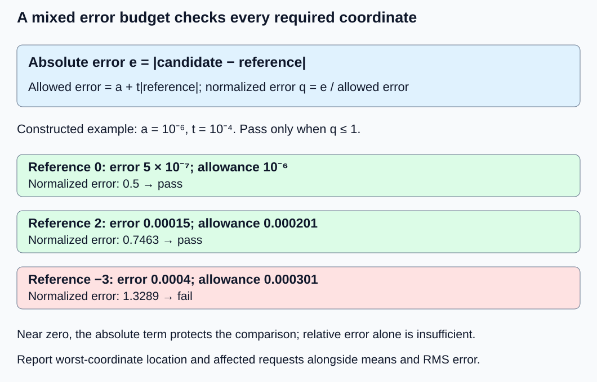
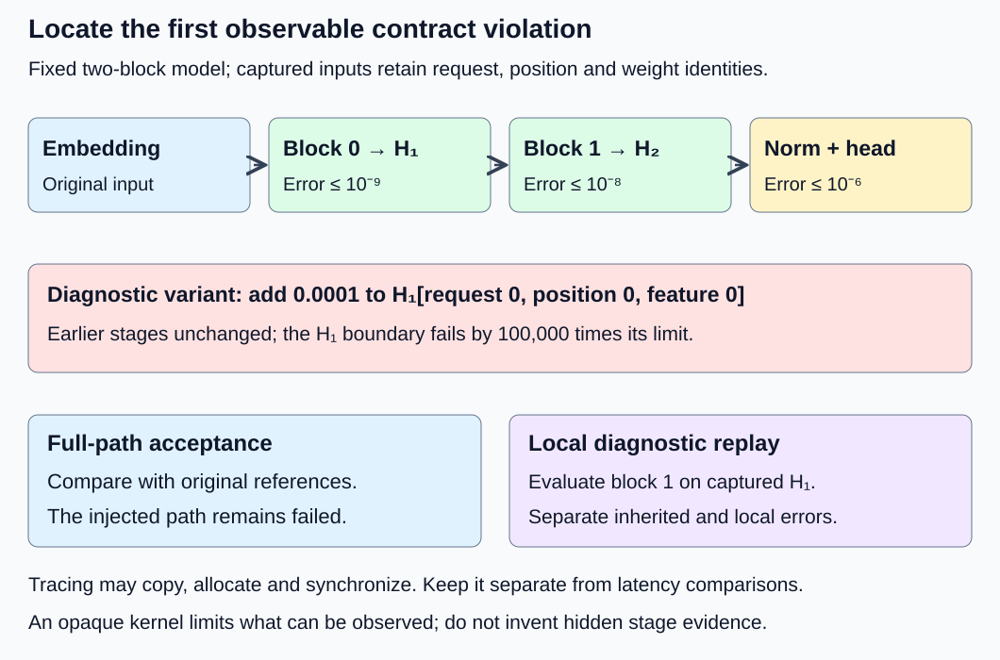

# M9-C17: Comparing logits with justified numerical tolerances

> **Status: Complete — detailed chapter authored and documentation validated; experimental procedures are proposed unless explicitly labelled observed**

**Module:** Make measurement and correctness part of the foundation

**Category:** [Numerics and correctness](index.md)

[Module 9 reading order](../module-9.md) · [Previous: M9-C16](../hardware-architecture-and-topology/m9-c16-recording-hardware-conditions-that-change-measurements.md) · [Next: M9-C18](../numerics-and-correctness/m9-c18-testing-sampling-distributions-and-random-state-behavior.md)

## Target concepts

Reference precision, absolute and relative error, near-zero behavior, per-position and aggregate errors, dtype and reduction effects, extreme values, tolerance justification, locating first divergence.

## Concepts

### Compare the same result before comparing its numbers

A **logit** is a real-valued score attached to a vocabulary ID at a request position. A logit comparison asks whether two computations return the required scores within a declared numerical allowance. It is different from asking whether they choose the same token or produce a plausible sentence. [M9-C01](m9-c01-defining-reference-behavior-and-evidence-before-optimizing.md) establishes that correctness contract; this chapter develops its numerical evidence.

First align request IDs, positions, vocabulary-column IDs, model/weight versions, masks and the requested output interface. A tensor is an array with named axes: here L[b, i, v] means request b, position i, vocabulary ID v. Shape equality alone does not prove that the axes or identities match. A vocabulary permutation or stale model version is a semantic error; a larger floating-point tolerance cannot excuse it.

The running model is the completed [M1-C14 two-block decoder](../model-computation-and-semantics/m1-c14-assembling-a-small-decoder-only-transformer.md): four vocabulary entries, feature width two, two blocks, FP64 reference and fixed weights. It accepts sequence lengths 1–4 and IDs 0–3, with no padding or cache. For its one-token input ID 1 at position 0, the final logits are approximately [1.2311465324, 1.2306324560, 2.4617789884, −0.0005140763]. Those displayed decimals explain the result; retain more precision for verification.

Rust remains the primary language context. Its binary32 and binary64 types correspond to FP32 and FP64. A model's storage type does not fully describe multiplication, accumulation, normalization, exponential evaluation or output rounding. Record each, together with compiler, backend and relevant settings. This chapter supplies specifications and experiments without implementation code.

### Establish a reference and its uncertainty

A **mathematical reference** defines the intended real-number function. A **numerical reference** evaluates it with specified inputs and precision. FP64 is not exact real arithmetic; an FP64 library and a lower-precision library can agree because they share a defect. Build small independent checks before trusting either.

For the fixed toy model, evaluate the defining equations at 80 and 120 decimal digits and compare every retained stage. Confirm simpler cases independently: one valid attention key gives probability one, and the final head maps [z₀, z₁] to [z₀, z₁, z₀ + z₁, −z₀ + z₁]. Agreement across precision settings is evidence of reference stability, not a rigorous proof of a correct formula or a certified error bound. Keep exact table values and original input identities with the reference.

Let r★ be the ideal result, r the stored reference, and c the candidate. If the reference error is bounded by η, then the triangle inequality gives **|c − r★| ≤ |c − r| + η**. A desired total allowance T leaves at most T − η for the observed candidate/reference discrepancy. If η is unknown or consumes the allowance, the evidence is insufficient for a certified claim; increasing the candidate tolerance is not the remedy. For rigorous certification, bound η using validated arithmetic or analysis. For the proposed teaching experiments, retain the two-precision check and independent formulas and label the reference uncertainty as empirically assessed rather than certified.

Also separate input representation from computation. Let x be the specified real input and x̂ its target-format rounded representation. If f is the mathematical function, **|c − f(x)| ≤ |c − f(x̂)| + |f(x̂) − f(x)|**. The first term concerns computation on the actual represented input; the second concerns changing the input. Likewise, rounded model weights change a reference model. Promoting already rounded FP32 values to FP64 does not restore the original values. Compare against both references when evaluating a precision change, and name which error the contract limits.

### Absolute error, relative error and a mixed test

For one finite coordinate, define absolute error **e = |c − r|**. Relative error **e/|r|** describes error compared with the reference scale, but is undefined at r = 0 and unstable as an interpretation near zero. A large relative error on a tiny logit is not automatically a large useful-output error; it still needs an absolute bound.

A common mixed test is **|c − r| ≤ a + t|r|**, with nonnegative absolute allowance a and relative allowance t. The reference sets the scale, so exchanging c and r can change the verdict. The [PyTorch 2.14 testing specification](https://docs.pytorch.org/docs/2.14/testing.html#torch.testing.assert_close) documents this convention and separately configurable structural/nonfinite checks. Its default constants are library choices, not a justification for a model's tolerance.

Define a normalized error **q = e/(a + t|r|)** when the denominator is positive. q ≤ 1 passes that coordinate. If both denominator and error are zero, treat it as an exact pass with q = 0; if the denominator is zero but error is positive, it fails and q is unbounded. Do not let division by zero or NaN determine acceptance accidentally.

The following is a standalone comparator exercise, not the M1-C14 model. Set a = 10⁻⁶ and t = 10⁻⁴ before examining candidates:

| Reference r | Candidate c | Absolute error e | Relative error e/\|r\| | Allowed error | Verdict |
|---|---|---|---|---|---|
| 0 | 0.0000005 | 5 × 10⁻⁷ | Undefined | 10⁻⁶ | Pass |
| 0.00000001 | 0.00000051 | 5 × 10⁻⁷ | 50 | 0.000001000001 | Pass |
| 2 | 2.00015 | 0.00015 | 0.000075 | 0.000201 | Pass |
| −3 | −3.0004 | 0.0004 | Approximately 0.00013333 | 0.000301 | Fail |

The second row has 5,000% relative error yet passes the declared absolute protection near zero. The fourth fails even though its relative error looks small. This teaches the test's meaning; it does not recommend these constants for inference.

*The allowance depends on reference scale. Every required coordinate must pass; a favorable average cannot overrule a local failure.*

### Report errors at coordinates, positions and requests

For N valid aligned coordinates, define **maximum absolute error E∞ = max eⱼ**, **mean absolute error MAE = (Σⱼ eⱼ)/N**, and **root mean square error RMSE = √((Σⱼ eⱼ²)/N)**. RMSE gives larger discrepancies more weight than MAE but can still dilute isolated errors. Report maximum q and the number of coordinates with q > 1 as well. Signed differences can cancel, so the mean signed error is not a sufficient acceptance metric. Compute differences and aggregate norms in sufficient precision: subtraction of opposite large finite values, or squaring errors for RMSE, can overflow a narrow checker. Use a stable norm evaluation or high-precision reference for these stress cases; never round the reference down to the candidate dtype merely to make comparison pass.

Preserve per-position records: request ID, logical position, largest-error vocabulary ID, maximum absolute/normalized error, failure count and finite-value status. Then summarize per request and workload stratum. A stratum is a named subset such as short versus long sequences or warm versus first-use runs. If padding is later introduced, define valid membership before aggregation and report excluded/padded counts. Never average placeholders into the denominator.

Consider an entirely synthetic comparison array of shape (2, 4, 128), with N = 1,024 coordinates. This is a metric exercise, **not** a valid vocabulary configuration for M1-C14. All reference coordinates are zero; every candidate equals its reference except coordinate (1, 3, 127), whose error is 0.01. Then E∞ = 0.01, MAE = 0.000009765625 and RMSE = 0.0003125. A mean-only gate of 0.00002 passes, while a per-coordinate absolute gate of 10⁻⁶ fails. There is one failing coordinate, one failing position out of eight, and one failing request out of two. Preserve all three populations; “almost every coordinate passed” is not the same as every request passed.

### Dtype and reduction order change the numerical path

A **reduction** combines many values into one, such as an attention dot product or normalization sum. Floating-point addition is not associative: grouping can change a rounded answer. For FP32 with round-to-nearest, ties-to-even and each addition rounded to FP32, compare:

**(16,777,216 + 1) − 16,777,216 = 0**, because the first addition rounds back to 16,777,216.

**16,777,216 + (1 − 16,777,216) = 1**, because the intermediate −16,777,215 is representable.

The ideal sum is one and all three inputs are exactly representable in FP32. FP64 evaluates both groupings to one. Thus an input-casting check alone cannot explain the difference. Cancellation means large positive and negative contributions leave a small remainder, making relative error sensitive to rounding.

For a simple sequential sum of n represented inputs, a standard rounding model gives **|computed sum − exact sum| ≤ γₙ₋₁ Σⱼ |xⱼ|**, where **γₖ = ku/(1 − ku)**, ku < 1, and u is unit roundoff. The assumptions include rounded additions and no overflow or harmful underflow. For binary32 round-to-nearest u = 2⁻²⁴; Rust's machine epsilon at one is 2⁻²³, twice u. In the three-input example the bound is approximately four, so it permits an error of one. This is a conservative local bound, not a defensible logit tolerance of four. A ratio Σ|xⱼ|/|Σxⱼ| measures cancellation sensitivity when the denominator is nonzero; here it is 33,554,433.

Fused multiply-add rounds a product-plus-add once rather than rounding the product and sum separately; different reduction trees, vectorization and backend kernels can also change results. The [Rust f32 specification](https://doc.rust-lang.org/std/primitive.f32.html#method.mul_add) defines the fused operation and its rounding. [PyTorch 2.14 numerical-accuracy notes](https://docs.pytorch.org/docs/2.14/notes/numerical_accuracy.html) describe backend and batched/sliced differences. Neither source promises that a specific model satisfies our budgets. Measure actual errors under recorded arithmetic settings rather than assuming a storage dtype determines them.

### Extreme values need a policy, not just a bigger tolerance

Check shape, identity and finite final logits before calculating ordinary errors. NaN is not a large error value; it is an invalid number for this model's output contract. Positive/negative infinity is also rejected at the final-logit boundary. Internal attention masks may intentionally use negative infinity as a sentinel for excluded entries; that is a separately specified stage with its own validity rules, not a reason to admit infinite final logits.

Stable softmax subtracts the row maximum before exponentiation. For [1000, 999], the mathematical result is approximately [0.7310585786, 0.2689414214]; directly exponentiating 1000 overflows FP64. For [−1000, −1001], direct FP64 exponentials underflow to zero and naive normalization divides zero by zero. Shifting yields the same bounded exponents [0, −1] in both cases. Blanchard and the Highams' [primary analysis of softmax accuracy](https://eprints.maths.manchester.ac.uk/2765/3/paper_nomarks.pdf) explains why equivalent formulas require floating-point analysis; shifting does not eliminate every numerical issue.

For [0, −200], the second probability is about 1.3839 × 10⁻⁸⁷. It is nonzero in real arithmetic and representable in FP64, but smaller than the smallest positive FP32 subnormal 2⁻¹⁴⁹, approximately 1.4013 × 10⁻⁴⁵. Rounding it to zero is expected in FP32. Its relative probability error is one, while its absolute error is tiny. Report it as a probability approximation and evaluate the declared probability contract; do not silently rewrite a raw-logit contract or claim exact distribution preservation.

Even finite FP32 values can overflow during an intermediate subtraction: opposite-sign values near the maximum finite magnitude can exceed the format's range when the maximum is subtracted. Widening selected operations or rejecting an unsupported range may be a justified policy; silently clamping inputs changes the computation and needs a new contract. Reject nonfinite external inputs in the proposed standalone tests. M1-C14's bounded IDs and weights do not create these extreme logits; they are separate numerical stress fixtures.

### Justify a budget from the interface back to stages

Start with the required useful output and permitted change: raw logits, decisions, probabilities or model quality. A raw-logit error gate does not automatically prove identical token choices near a tie or acceptable task quality. Preserve separate checks where those are required. Use representative workloads and a reserved validation set, but do not set tolerance to the largest error a favored candidate happened to produce.

For the fixed FP64 M1-C14 teaching model, retain its already declared absolute limits: block-0 output H₁ 10⁻⁹, block-1 output H₂ 10⁻⁸, final normalized Z 10⁻⁷, logits L 10⁻⁶. These are interface acceptance budgets for a small specified model, not universal FP64 limits. Their defensibility includes an independent stable reference, analytical amplification checks, an explicitly bounded domain, all-coordinate validation and detection of known wrong models. They are not a promise that an untested lower-precision backend passes, or a proof that the same tolerance is suitable for a large pretrained model.

The last two stages provide a concrete amplification check. The infinity norm of a vector is its largest absolute coordinate. M1-C14's final RMSNorm, with ε = 1 and scale [2, 1], has a conservative infinity-norm sensitivity bound of four for D = 2. Its head's largest absolute column sum is two. A final-hidden-state perturbation δ can therefore contribute at most 8δ to a final logit before additional rounding. At δ = 10⁻⁸, that contribution is at most 8 × 10⁻⁸, below the 10⁻⁶ final cap. Additional final-norm/head rounding and reference uncertainty must fit the remaining allowance; the propagation calculation alone does not admit them automatically.

To inspect the norm bound, put ρ = √((x₀² + x₁²)/2 + 1). Its derivative entry is **Jᵢⱼ = γᵢ(δᵢⱼ/ρ − xᵢxⱼ/(2ρ³))**, where δᵢⱼ is one when i = j and zero otherwise. Bounding the absolute row sums gives at most two for unit scale in this two-feature case and at most four after the largest scale factor two. This is a sensitivity bound, not a runtime measurement. It does not bound error propagation through both attention blocks; those need their own evidence and stage comparisons.

If different stages have absolute perturbations εₖ and subsequent amplification bounds Aₖ, a useful bookkeeping expression is **total output error ≤ Σₖ Aₖ εₖ + reference uncertainty**, provided each bound applies on the actual input domain. If the necessary bounds are unavailable, label the budget empirical, retain independent full-model checks and limit the claim to tested workloads. Changing input domain, dtype, kernel, weights or quality target can invalidate the justification and requires reevaluation.

### Find the first divergence without changing the question

Record matching stage boundaries: embedding/position addition, each norm, Q/K/V projections, masked attention scores/probabilities, attention output, residuals, MLP and block outputs, final norm, vocabulary projection. A **first divergence** is the earliest observed boundary that violates its contract. It is not necessarily the first floating-point bit difference, and it need not identify the root cause by itself. A wrong input identity can explain many later numerical mismatches.

*Compare complete-path stages against original references. Then, for diagnosis, compare a candidate stage on the same captured input as a high-precision local evaluation. Replacing its input for diagnosis does not repair the full path.*

For each stage, compare its actual candidate output against the original full-path reference. To distinguish inherited error from local arithmetic error, evaluate the mathematical stage independently on the candidate stage's captured input. If that conditional reference agrees but the original full-path reference does not, the error may be inherited. If it also fails the conditional reference, investigate local layout, arithmetic, weights or operation rules. Capture enough precision to preserve the actual input; text rounding can manufacture a diagnostic discrepancy.

Trace runs can copy arrays, synchronize and allocate memory. They are correctness/diagnostic runs, not uninstrumented latency evidence. If a fused kernel exposes fewer boundaries, record the visibility limit rather than inventing internal observations. Keep trace ownership valid until every comparison has finished; reading reclaimed scratch memory produces unreliable evidence.

## Experiments

All runtime procedures are proposed. The explicit arithmetic examples are constructed references, not measured inference or trading outcomes. Use an existing numerical or inference environment if available; this chapter provides no code implementation.

### E1 — Test the comparator and expose aggregation dilution

**Description:** Apply the mixed gate to the four standalone scalar pairs and the all-coordinate gate to the synthetic (2, 4, 128) array.

**Purpose/objective:** Verify the comparison rule itself before using it to judge an optimized model.

**Target concepts:** Absolute/relative error, near-zero behavior, per-position/aggregate error and tolerance justification.

**Baseline and workload:** Exact decimal values from the two worked examples. The scalar comparison uses a = 10⁻⁶, t = 10⁻⁴; the array uses absolute 10⁻⁶ per coordinate, with a separate illustrative mean-only threshold 0.00002.

**Controls and prediction:** Fixed reference orientation, identities and valid membership. Predict three scalar passes and one failure, and mean-only acceptance but coordinate/position/request rejection of the isolated array error. A shape mismatch, vocabulary permutation and any NaN/infinity must be handled before ordinary metric summaries.

**Procedure:** Calculate each numerator, allowance and normalized error; retain the undefined relative-error labels. Check exact-equality behavior when both allowances are zero. Form per-position and per-request summaries for the synthetic array. Separately present shape mismatch, swapped vocabulary identities, NaN and both signs of infinity; verify structural/domain rejection rather than accidental numerical acceptance.

**Hardware/software:** FP64-capable CPU plus exact decimal/fraction calculations for the reference; one thread suffices. Record comparison-tool settings and actual dtype.

**Failure and HFT connection:** A small average can conceal one invalid request, as a healthy average latency can conceal a slow event. These are different metrics; the transferable discipline is preserving the population and local exceptions.

**Exit criteria:** V1 reproduces the stated verdicts and aggregate values, identifies the exact failing coordinate and counts invalid inputs separately. No library default or aggregate average overrides a coordinate failure.

### E2 — Separate representation, reductions and extreme-range behavior

**Description:** Compare the two FP32/FP64 reduction groupings and stable/naive softmax stress cases against independent high-precision references.

**Purpose/objective:** Attribute discrepancies to represented inputs, operation order and range limits rather than choosing a tolerance after the fact.

**Target concepts:** Reference precision, dtype/reduction effects, cancellation and extreme values.

**Baseline and workload:** Three-input sum [16,777,216, 1, −16,777,216]; softmax rows [1000, 999], [−1000, −1001], [0, −200]; a finite FP32 opposite-extreme subtraction case; nonfinite external-input rejection cases. These are operator tests outside the toy model's input domain.

**Controls and prediction:** Explicit rounding after each FP32 addition, round-to-nearest ties-to-even, no reassociation of the designated groupings; FP64 control. Record storage, accumulation and output types separately. Predict sums 0/1 in FP32 and 1/1 in FP64; stable softmax avoids the two naive overflow/zero-denominator cases. Predict FP32 loss of the tiny tail probability without claiming it is exactly preserved.

**Procedure:** Preserve actual represented inputs and evaluate each high-precision reference at 80/120 digits. Compare results with both original and rounded-input mathematical references where they differ. Record intermediate overflow, underflow-to-zero and nonfinite output counts. Calculate absolute/relative probability errors and row-sum defects. Admit stable finite two-entry outputs only with maximum coordinate and sum error ≤ 10⁻⁶ for this operator exercise; report the tiny-tail loss explicitly. Rejection is the declared outcome for nonfinite external inputs and unsupported intermediate range, not a successful forward.

**Hardware/software:** CPU with documented FP32/FP64 arithmetic and reference capability. Record subnormal handling, compiler contraction/reassociation settings and backend transcendental behavior. Do not assume unsupported control of these settings; mark such paths untested.

**Failure and HFT connection:** A rare range failure or cancellation case can be more consequential than average accuracy. Preserve it as a failed/unsupported case; no silent clamping or stale-result fallback. This is numerical failure handling, not market-risk advice.

**Exit criteria:** V2 explains each expected finite, rounded or rejected outcome; local error-bound assumptions are stated and extreme failures cannot disappear into a mean. No inference latency result is inferred from operator arithmetic.

### E3 — Locate the first divergence in the complete model

**Description:** Trace the fixed M1-C14 model and deliberately introduce diagnostic mismatches at known boundaries.

**Purpose/objective:** Exercise stage budgets and distinguish inherited input error from a local operator/identity error.

**Target concepts:** Reference precision, per-position errors, tolerance justification and locating first divergence.

**Baseline and workload:** M1-C14 ID 1 at position 0, then B ∈ {1, 2}, S ∈ {1, 4}, ID[b, i] = (1 + b + i) modulo 4, positions i. Use the original 20-tensor configuration, no cache and all-position logits.

**Controls and prediction:** FP64, frozen weights and existing stage budgets. Prediction: a diagnostic perturbation of +0.0001 to H₁ feature 0 at request 0/position 0 first fails the H₁ output boundary when earlier outputs are unchanged. A final-head column-identity swap fails semantic alignment irrespective of small numerical differences. These are separate deliberately wrong variants.

**Procedure:** Establish a high-precision complete-path trace. Check shapes/identities and all required stage/output values. Introduce each diagnostic variant separately and record the first observable violation. For the perturbed-input variant, evaluate block 1 independently on the captured perturbed H₁ and compare with the candidate block-1 output, separating inherited perturbation from local error. Do not replace the reference input in the full-path acceptance check. Retain final logits even if later operations partially cancel the earlier discrepancy.

**Hardware/software:** One CPU thread, FP64 and sufficient memory for traces; record serialization precision and trace lifetime. No runtime is assumed to exist; perform the trace procedure only in an available environment.

**Failure and HFT connection:** A wrong stage input can propagate through a coherent-looking pipeline, just as a stale event snapshot can contaminate later decisions. Track request/version identity and never reclaim captured buffers before diagnosis completes.

**Exit criteria:** V3 checks every full-model final coordinate, identifies the injected H₁ discrepancy and the head-identity violation, and distinguishes conditional diagnostic agreement from a failed original-path contract. A deliberate wrong variant is never admitted as an equivalent optimization.

### E4 — Gate a last-logit optimization without timing the verifier

**Description:** Compare the M1-C14 all-row and last-row final normalization/head paths using a frozen numerical gate and separate timing/profile runs.

**Purpose/objective:** Determine whether less head work improves completed useful output without loosening the reference or including diagnostic overhead in one path only.

**Target concepts:** Dtype/reduction effects, aggregate errors, tolerance justification and first-divergence evidence.

**Baseline and workload:** The four B/S workloads in E3; baseline returns the last row after computing all final norms/heads, candidate computes those stages only on last hidden rows. Both retain complete prefix computation in both blocks.

**Controls and prediction:** FP64 with identical weights, one thread and one forward in flight. Freeze M1-C14 budgets before running. Predict accepted last logits and possibly lower latency at S = 4; S = 1 may expose gather/dispatch overhead. No speedup is guaranteed.

**Procedure:** Validate both paths against original references first; keep per-position errors and worst-coordinate records. In three sessions, warm each path five times per shape, then collect 30 paired completed-forward timings per shape/session, alternating path order. Boundary: resident inputs/weights ready through caller-readable last logits, including gathers and required allocation; exclude reference computation, traces, comparisons, loading, tokenization and selection equally. Use separate profiled and trace runs, and record their overhead rather than subtracting it blindly from timing samples.

**Hardware/software:** CPU setup below, actual clock resolution and timing-bracket overhead; record allocation/backend policies and output representation. Accelerator/distributed extensions need their own completion and communication evidence.

**Failure and HFT connection:** A faster invalid output or incomparable measurement is not a low-latency improvement. Count failed/nonfinite/incomplete attempts and preserve regressions. Single-flight CPU timings do not establish queueing, capacity or p99 service behavior.

**Exit criteria:** V4 reports correctness separately from per-shape performance, with 90 successful pairs per shape if all planned trials complete, all other outcomes retained, and trace/profile overhead disclosed. A slower candidate is a valid result; a failed numerical gate stops an equivalence claim.

## Verification

### V1 — Verify the verifier with exact arithmetic

Confirm the four scalar absolute errors [5 × 10⁻⁷, 5 × 10⁻⁷, 0.00015, 0.0004], the scale-dependent allowances and three-pass/one-fail result. Reversing operands is a distinct test because relative scale changes. Verify the zero-denominator cases explicitly. For invalid NaN/infinity, confirm rejection occurs before sorting maxima, divisions or aggregation can hide them; report invalid count and locations without presenting finite-only averages as complete-population success.

For the synthetic array, check N = 1,024, MAE = 0.01/1,024 = 0.000009765625 and RMSE = 0.01/√1,024 = 0.0003125. Verify one failed coordinate, one of eight positions and one of two requests. A later padded extension must use only declared valid positions and report the excluded count. Test that a vocabulary-identity mismatch fails even when numerical arrays happen to match.

### V2 — Verify arithmetic policy and reference stability

Verify the designated addition groupings with exact represented operands, not a compiler-reassociated expression. Inspect supported arithmetic settings; if the runtime cannot enforce them, label the grouping experiment unavailable. Check u = 2⁻²⁴, γ₂ = 2u/(1 − 2u), sum of magnitudes 33,554,433 and the bound slightly above four. The bound assumes no overflow/underflow and does not excuse a model-level failure.

For the two large common-shift softmax rows, compare against normalizing [1, exp(−1)] at high precision. For [0, −200], preserve the nonzero reference tail and report both its FP32 rounded value and error. Test nonnegative probabilities and sum-to-one separately from raw-logit invariants. Record intermediate and final nonfinite statuses by stage; a masked negative-infinity sentinel, if present in a model trace, is checked against mask membership, not the final-output finiteness rule. Repeated agreement does not establish all-platform reproducibility.

### V3 — Verify budgets and first divergence per position

The four full-model workloads contain 4 × (1 + 4 + 2 + 8) = 60 final-logit coordinates; compare all of them. Per-stage output populations H₁/H₂/Z contain 2 × (1 + 4 + 2 + 8) = 30 coordinates each. Preserve maxima and locations per boundary rather than pooling stages with different meanings or scales. Require each original-path stage budget and final budget independently; do not grant a larger final allowance merely because one intermediate is small on average.

Record the precise earliest changed boundary for the H₁ injection. Its 0.0001 change exceeds the H₁ limit of 10⁻⁹ by a factor of 100,000. Conditional block-1 replay on the candidate's captured input can agree while the original-path comparison remains failed. The head-column swap is an identity failure before numerical acceptance. In an opaque/fused backend, identify the earliest **observable** mismatch and state any missing internal evidence.

Reconcile the final norm/head propagation: a 10⁻⁸ H₂ perturbation contributes at most 8 × 10⁻⁸ before additional arithmetic; 10⁻⁶ − 8 × 10⁻⁸ = 9.2 × 10⁻⁷ remains for the other contributions. This leftover is an accounting limit, not a measured error or permission to spend it indiscriminately. Assess reference uncertainty and actual stage discrepancies, and document which bounds are analytic versus empirical.

### V4 — Verify useful-output evidence and timing populations

There are 4 × (1 + 1 + 2 + 2) = 24 returned last-logit coordinates over the four workloads. Validate every coordinate against the mathematical reference, not just agreement between the two paths. Pairwise differences can reach twice a per-path absolute limit, so path-to-path comparison alone is insufficient. Keep weights/version/shape/valid-position identity with every result.

For each shape report three session medians/ranges, paired baseline-minus-candidate differences and the number of pairs favoring each path. Use the 90-pair total only if all trials complete; count attempts and classify successful pairs, failed members, timeouts and unfinished work without silently replacing failures. Report equal or mixed/noisy outcomes as inconclusive where appropriate, especially if timing approaches clock/bracket overhead. These small runs do not justify tail-percentile or production-capacity claims.

Profile block attention/MLP, final normalization/head, gather, allocation and any required completion wait in separate runs. A profile attributes cost but can perturb execution; uninstrumented completed forwards decide the comparison. Report trace bytes and instrumented elapsed time separately. Parameter payload is 720 FP64 bytes in this fixture; its all-position and last-position logit payloads at B = 2, S = 4 are 256 and 64 bytes. These are calculated payloads, not measured allocator or resident-memory savings.

Store a manifest containing contract revision, candidate/reference identities, reference precision/stability evidence, dtype at each stage, arithmetic settings, workload formula and actual inputs, all-coordinate error summaries, invalid counts, first-divergence traces and timing/profile boundaries. Preserve failed and inconclusive findings. Changing a tolerance after examining failures creates a new experiment with a stated reason and held-out reevaluation; it does not erase the original verdict.

## Engineering dimensions and principles

| Dimension | Chapter-specific application |
|---|---|
| Semantics and invariants | Exact identity/shape/mask checks precede finite logit errors; E3 separates head identity from arithmetic tolerance. |
| Workload and variability | E1's isolated outlier and E2's cancellation/extreme cases complement E3/E4's explicit B/S grid; aggregate errors never replace per-position evidence. |
| Resources and bottlenecks | Precision changes storage and arithmetic paths; E4 separates trace copies, payload accounting, allocation and measured forward cost. |
| Time and distributions | Trace synchronization changes execution; E4 keeps diagnostics outside paired latency runs and makes no unsupported p99 claim. |
| Ownership and coordination | References, weight versions and captured stage buffers retain identity and lifetime until comparison finishes. |
| Failure and adaptation | Reject invalid final values, record unsupported ranges, locate first divergence and version any corrected reference or revised tolerance. |

| Practical principle | How to apply it |
|---|---|
| 1. Correctness defines the optimization boundary | Freeze the required raw-logit/decision/distribution contract and its budget before timing. |
| 2. Performance depends on workload and operating point | Report numerical and timing outcomes by shape, precision and range/cancellation case. |
| 3. Data movement is part of the algorithm | Count captured buffers and gathers; do not compare traced baseline with untraced candidate. |
| 4. State has ownership, lifetime and recovery cost | Pin request/weight/reference identity and retain captured inputs for reproducible diagnosis. |
| 5. Dependencies determine latency; bottlenecks determine capacity | A local head change preserves full-prefix block dependencies; operator error bounds do not characterize service capacity. |
| 6. Variability and synchronization shape the tail | Separately measure diagnostic overhead and completion; a small mean numerical error says nothing about tail latency. |
| 7. Local improvements must be evaluated end to end | Check every returned logit and complete-forward cost after any local arithmetic change. |
| 8. Claims require reproducible evidence | Use stable independent references, stated uncertainty, per-position metrics, deliberate defects and all outcome counts. |

HFT means High-Frequency Trading, whose systems process market events under tight timing constraints. The useful analogy is that a rare invalid result cannot be excused by a favorable average, and diagnostic instrumentation must not distort a claimed critical-path improvement. Market price/tick rules and trading risk are different contracts from logit error. No exchange behavior, profitability or production trading benchmark is asserted.

## Specifications, articles, and hardware

| Primary source | What it contributes and does not establish |
|---|---|
| [Blanchard, Higham and Higham, Accurately Computing the Log-Sum-Exp and Softmax Functions](https://eprints.maths.manchester.ac.uk/2765/3/paper_nomarks.pdf) | Rounding/range analysis of mathematically equivalent formulas; not a universal model-logit tolerance. |
| [Rust f32 specification](https://doc.rust-lang.org/std/primitive.f32.html) | FP32 representation, machine epsilon, range and fused multiply-add semantics; record the actual toolchain. The consulted documentation identifies std 1.99.1. |
| [PyTorch 2.14 numerical accuracy](https://docs.pytorch.org/docs/2.14/notes/numerical_accuracy.html) | Reduction/backend differences and extreme-value caveats; no guarantee that a candidate passes these budgets. |
| [PyTorch 2.14 testing specification](https://docs.pytorch.org/docs/2.14/testing.html#torch.testing.assert_close) | Mixed absolute/relative convention and structural/nonfinite policies; model acceptance remains separately justified. |
| [M9-C01](m9-c01-defining-reference-behavior-and-evidence-before-optimizing.md), [M1-C07](m1-c07-floating-point-arithmetic-and-numerical-correctness.md), [M1-C14](../model-computation-and-semantics/m1-c14-assembling-a-small-decoder-only-transformer.md) | Completed local contract, format foundations and fixed-model references. |

Proposed requirements are a CPU supporting FP32/FP64, one execution thread and at least 1 GiB free RAM for the numerical environment and evidence. This is not a measured host specification or production memory requirement. Record CPU model, cores/sockets, cache/RAM capacities, NUMA placement (memory proximity to processors), affinity, frequency/power policy, OS, compiler/runtime/backend versions, vectorization/contraction/reassociation settings, subnormal behavior, operand/accumulator/output dtypes and timing source. Label unknown settings as unknown. No accelerator, NIC or interconnect is required; later GPU/distributed comparisons need their own hardware and completion contracts. Model/tokenizer/adapter/cache identities are the exact M1-C14 mathematical fixture, synthetic IDs, no adapter and no cache; no serialized checkpoint is supplied.

[M9-C02](../measurement-experimentation-and-economics/m9-c02-request-events-clocks-and-measurement-boundaries.md), [M9-C11](../measurement-experimentation-and-economics/m9-c11-controlled-comparisons-warmup-and-reproducibility.md), [M9-C16](../hardware-architecture-and-topology/m9-c16-recording-hardware-conditions-that-change-measurements.md) and [M9-C18](m9-c18-testing-sampling-distributions-and-random-state-behavior.md) remain outlines; [M9-C07](../measurement-experimentation-and-economics/m9-c07-latency-distributions-and-statistical-uncertainty.md) is now complete; the elementary boundary, repetition, hardware and probability checks needed here are stated locally. This chapter supplies numerical validation support for Modules 1–7 as their model, memory, kernel and distributed mechanisms are developed. This chapter’s authoring successor is M1-C15, now complete (consult the execution plan for current progress); the next Module 9 reading chapter remains M9-C18.

## Key takeaways

Align identities, stabilize an independent reference, separate represented-input and arithmetic error, and justify numerical allowances before measuring candidates. Report the worst coordinates and affected positions/requests alongside means. Preserve invalid outcomes and first-divergence evidence. Documentation/arithmetic QA does not execute a model runtime, Rust engine, hardware benchmark or production service; E1–E4 remain proposed procedures.
