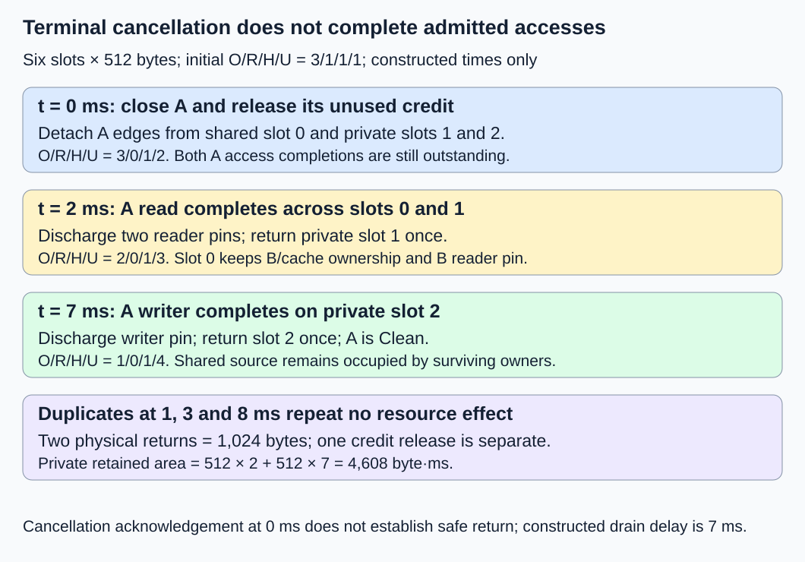
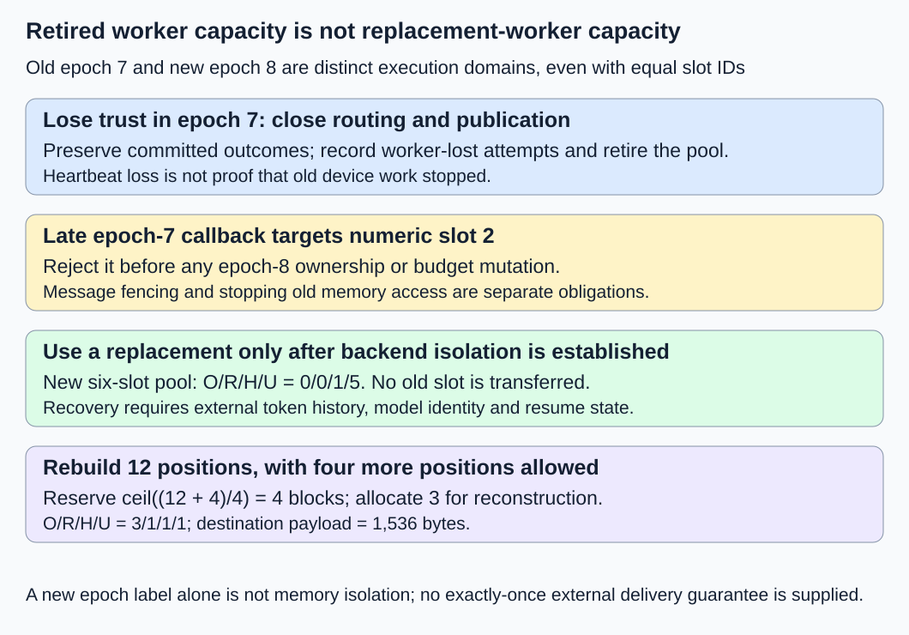

# M2-C16: Completion, cancellation, and allocation failure

> **Status: Complete — detailed chapter authored and documentation validated; experimental procedures are proposed unless explicitly labelled observed**

**Module:** Treat the KV cache as a first-class systems problem

**Category:** [Reliability and capacity control](index.md)

[Module 2 reading order](../module-2.md) · [Execution plan and progress](../chapter-execution-plan.md) · [Previous: M2-C15](../scheduling-and-queueing/m2-c15-admission-and-growth-under-a-finite-kv-budget.md) · [Next: M2-C17](../model-computation-and-semantics/m2-c17-sliding-window-attention-and-bounded-cache-state.md)

## Target concepts

Terminal request states, idempotent cleanup, cancellation during growth or sharing, partial-allocation rollback, draining in-flight work, worker loss and volatile-state recovery.

## Concepts

### 1. A terminal outcome and reclaimed storage are different facts

A **terminal request outcome** says that an attempt will produce no further authorized generation work. A **cleanup state** says whether all resources belonging to that attempt have been safely reconciled. A cancelled request can be terminal while its device writer is still running. [M2-C10](../runtime-and-concurrency/m2-c10-request-state-transitions-and-safe-block-reuse.md) established that submission is not completion; [M2-C15](../scheduling-and-queueing/m2-c15-admission-and-growth-under-a-finite-kv-budget.md) separated unused growth credits from occupied blocks. Keep both distinctions during failure.

Use one serial lifecycle authority for the teaching contract. Every message identifies request, attempt, worker incarnation, pool and relevant slot generation or ownership token. An **attempt** is one execution of a request; a retry receives a new attempt identity. A **worker incarnation**, called its epoch here, distinguishes a replacement worker from its predecessor even if a slot number is reused. Slot generations distinguish successive assignments inside a live pool. Neither identity alone proves memory is alive.

| Terminal outcome | Required meaning | What it does not prove |
|---|---|---|
| Succeeded | Required generation/output has reached this service's declared success-commit boundary | A client received every byte, or all temporary storage is free |
| Cancelled | Cancellation won the authority's terminal decision; new work/publication is closed | Already submitted work stopped |
| Failed | A known validation/allocation/execution fault prevents normal completion | Submitted writes completed safely |
| Worker lost | The attempt cannot continue because its execution domain is unavailable/untrusted | The old worker stopped accessing memory, or a client saw no output |

The authority accepts at most one terminal outcome for an attempt. For a success/cancellation race, success is eligible only after its own result-completion gates. If cancellation commits first, a late success candidate cannot publish new output; if valid success commits first, a later cancellation cannot rewrite that outcome. Record later faults and cleanup problems as additional evidence. A terminal result already committed is not silently changed to conceal a cleanup error. A disconnect or timeout without decisive evidence remains an uncertain observation until the declared policy decides its outcome.

**Terminal decisions accepted per attempt ≤ 1; new generation admissions after terminal closure = 0.**

This is a local authority contract, not an exactly-once network-delivery guarantee. A streamed prefix may already have reached the client before cancellation or worker loss. Retries require explicit output/replay semantics and cannot promise to erase those bytes.

### 2. Cleanup is idempotent only when effects have identities

**Idempotent cleanup** means replaying the same cleanup notification produces the same final state, without repeating its resource effects. A boolean named “done” is insufficient if cleanup can stop halfway through multiple releases. Track the identities of released credits, detached request/cache edges, admitted access pins and completed pool returns. A duplicate token changes nothing; an unknown or wrong-epoch token is rejected or recorded for diagnosis, never applied to a new owner.

The cleanup record progresses through closing future use, detaching/releasing the attempt's own claims, draining admitted work and final reconciliation. Those are ordered obligations, not a claim that all operations happen atomically. The authority must retain or reconstruct enough progress to resume a partial cleanup; do not report “clean” before every required effect is accounted for. If the authority itself loses its ledger, retire the affected domain rather than infer owners from raw pointers.

For request-owned claims, **outstanding effects = created claims − successfully discharged claims ≥ 0**. Count each named claim once. Cleanup is complete when the attempt has no remaining owned credits/edges and all of its admitted accesses are resolved or transferred to an explicitly retired domain. Record **Clean** when live-domain claims are resolved, and **Retired** when obligations have been accounted for in an unavailable retired domain. Retired does not mean its memory is reusable. A shared block can remain occupied by another request or cache owner after this attempt is clean.

For a block, distinguish strong ownership n from unresolved access pins p. A safe return requires **n = 0 AND p = 0 AND admission closed AND mappings detached AND no pending publication/mutation**. Every condition must refer to the current identity. Dropping one request edge never authorizes releasing another request's edge or a cache-retention edge. As [M2-C11](../state-memory-and-caching/m2-c11-reference-counting-and-shared-block-ownership.md) explains, published shared payload stays immutable; do not erase it during cancellation. A failed copy-on-write destination from [M2-C12](../state-memory-and-caching/m2-c12-copy-on-write-for-branching-requests.md) is private and unpublished until its commit succeeds.

The [Tokio JoinHandle documentation](https://docs.rs/tokio/latest/tokio/task/struct.JoinHandle.html) distinguishes abort requests, observed task termination and dropping a handle that detaches a task. Host task cancellation is not evidence that an external device stopped. Rust ownership can organize host responsibilities, but a destructor or an aborted async task does not by itself prove GPU completion. A separate drain owner must preserve the completion record after the request task exits.

### 3. Cancel a growing request without damaging its shared prefix

Keep the synthetic all-layer FP64 fixture: two K/V tensors, two layers, two KV heads, two features/head and eight bytes/scalar. **k = 2 × 2 × 2 × 2 × 8 = 128 bytes/position**; **B = 4 positions/block** gives **Q = 512 bytes/block**. Choose a six-slot pool with 3,072 backing payload bytes. As in M2-C15, **C = O + R + H + U**, where O is occupied slots, R unused growth credits, H withheld free headroom and U uncommitted free slots. Initially **6 = 3 + 1 + 1 + 1**. All credits belong to compatible free capacity; no promise is counted twice.

Request A is cancelled during growth. Request B and the prefix cache remain active owners of the shared source:

| Slot | Strong ownership before cancellation | Outstanding access before cancellation | Effect of closing A |
|---|---|---|---|
| 0 | A request edge, B request edge, cache edge | A reader pin and B reader pin | Detach A's edge; preserve B/cache edges and both pins until their own completion |
| 1 | A private-block edge | A reader pin | Detach edge and retire; cannot return until that reader completes |
| 2 | A private growth-destination edge | A writer pin; unpublished payload | Cancel publication and detach edge; drain writer before return |
| 3–5 | None; physically free | None | One credit for A, one headroom slot and one uncommitted slot initially |

A's captured read completion covers its pins on slots 0 and 1. Its write completion covers slot 2. B's read completion is independent and remains outstanding throughout this trace. There are four access pins initially, not four payload copies. A's terminal decision closes new scheduling, prevents destination publication and releases its one unused growth credit. A's mappings/edges detach under the authority; the existing readers keep their recorded access protection. This gives O = 3, R = 0, H = 1, U = 2 immediately, without returning a payload block.

Use the following **constructed event times** solely to calculate retention; they are not observations of a runtime. A's terminal closure/acknowledgement is at t = 0 ms:

| Time | Event | O / R / H / U after processing |
|---|---|---|
| 0 ms | Cancel A, detach its three edges, release its one unused credit | 3 / 0 / 1 / 2 |
| 1 ms | Duplicate cancellation | Unchanged |
| 2 ms | A's read completion; discharge two reader pins, return slot 1 once | 2 / 0 / 1 / 3 |
| 3 ms | Duplicate read completion | Unchanged |
| 7 ms | A's writer completion; discharge writer pin, return slot 2 once | 1 / 0 / 1 / 4 |
| 8 ms | Duplicate writer completion | Unchanged |

Slot 0 still has B and cache ownership and B's reader pin. A is clean after its writer completes at 7 ms even though the pool is not empty. Cancellation frees one capacity credit immediately and two physical blocks later. **Physical returned payload = 2 × 512 = 1,024 bytes**; the initial unoccupied credit accounts for another 512 bytes of renewed admission capacity, without any payload return. The invariant ends at **6 = 1 + 0 + 1 + 4**.

Define **drain delay = t_attempt_clean − t_terminal_commit**. Here it is 7 ms; cancellation acknowledgement delay is zero by construction. Outstanding private retired payload occupies **512 × 2 + 512 × 7 = 4,608 byte·ms** after cancellation. Exclude the shared block from recovered-byte claims because its other owners still require it. These accounting values predict neither real cancellation latency nor device throughput.

*Duplicate notices do not repeat a release. Reader and writer completions discharge different obligations; surviving owners preserve the shared prefix.*

### 4. Roll back partial allocation according to what actually started

**Rollback** restores the valid pre-attempt state when a candidate group cannot commit. It cannot undo already executed device writes or pretend submitted work never existed. Keep the old published request table intact until the whole replacement group is ready. Tentative source retains, destination claims and budget credits need their own identities so failure can reverse only the candidate's effects.

In an independent six-slot fixture, one completed shared source belongs to another request and the cache. Candidate attempt A holds two provisional capacity credits; H = 1 and U = 2. Thus initially **O = 1, R = 2, H = 1, U = 2**. A needs two private destination blocks. Allocating a destination converts one credit into occupancy; it does not create new capacity. The following cases each start from that initial fixture:

| Failure point | State before failure, O / R / H / U | Cleanup obligation |
|---|---|---|
| F0: Before first destination allocation | 1 / 2 / 1 / 2 | Release two unused credits after closing the attempt |
| F1: First allocated; second allocation fails; no submission | 2 / 1 / 1 / 2 | Return the first unpublished destination, restore its credit, then release both credits on terminal failure |
| F2: Both allocated; metadata commit preparation fails; no submission | 3 / 0 / 1 / 2 | Return both destinations, restore two credits, then release them on terminal failure |
| F3: Both allocated; first writer submitted; failure before second submission | 3 / 0 / 1 / 2 | Return the untouched second destination; keep first pinned until completion |

For F0–F2 the final state is **O = 1, R = 0, H = 1, U = 4**. Restoring a credit on rollback allows a still-live transaction to retry without having its promise stolen; terminal closure then relinquishes it. Do not both return that credit directly to U and release it again from R. F3 first reaches **O = 2, R = 0, H = 1, U = 3**; after the submitted writer's covered completion it reaches the same final state as the other cases. If submission status is uncertain, treat it as potentially submitted and quarantine/drain rather than taking the unsubmitted shortcut. A completion error requires the backend's documented recovery/isolation contract; it is not a successful-write observation.

Any tentative A source edge is released once, preserving the original source's other owners. No incomplete destination becomes a prefix-cache hit. No reused slot is cleared through an old generation. These rules cover cancellation during sharing/growth as well as allocation failure; a model operation failing after partial submission needs the F3-style lifetime reasoning.

### 5. Drain real work using completion evidence with the right scope

**Draining** closes new use and waits for previously admitted accesses to become safe. A completion must identify the attempt/worker/pool, access set and ordering boundary it covers. A notification about one stream or one reader is not universal completion for the pool. A captured event must follow every relevant operation, or depend on separate events for other streams, with host-reader obligations resolved independently.

The [CUDA Runtime 13.4 event specification](https://docs.nvidia.com/cuda/cuda-runtime-api/cuda_runtime_api/group__CUDART__EVENT.html) describes queries over captured work and notes that an event not yet recorded represents empty work. Therefore a successful query without proof of the correct recording does not discharge a writer pin. Work submitted later is not automatically covered. Event destruction can be asynchronous, and calls can report earlier asynchronous errors. Validate event generation, stream/context and successful covered completion; “not ready” keeps the obligation outstanding, and an error takes the documented failure path. These are specification requirements, not CUDA tests performed here.

Measure host terminal decision, notification, last covered device/host completion and final return separately. The last required completion is a dependency on the cleanup critical path. A 120-second supervisory watchdog may escalate an unresolved drain; it must not convert elapsed time into proof that memory is safe. Keep such cases unresolved/quarantined in the outcome ledger, rather than reporting a fast cleanup sample.

### 6. Worker loss invalidates volatile state; retries need a recovery contract

**Volatile state** is not preserved by a durable checkpoint outside the failed domain. KV, mappings, counters and pending completion records can all be lost together. Heartbeat loss means the supervisor cannot trust reachability; it does not prove the old worker or GPU stopped accessing storage. **Fencing** rejects further commands/publications from an old epoch under an authority that the old worker cannot bypass. Fencing message acceptance and proving old memory access has stopped are separate obligations.

On loss of epoch 7, stop routing new work to it, mark affected attempts worker-lost or preserve an already committed outcome, and retire its entire uncertain pool/domain. Do not add its six slots to a surviving worker's U. Late epoch-7 callbacks must not release epoch-8 slots with the same numeric IDs. A replacement domain can be used only after its actual backend isolation/teardown guarantees prevent stale access; fresh counters alone do not establish that guarantee. Cleanup evidence records the retirement, rather than pretending every old pin completed successfully.

A recovery record outside the failed domain must preserve exact represented token IDs (including generated history), model/adapter revisions, position/mask/namespace contract and any decoding/stopping/random state needed to resume. [M2-C14](../state-memory-and-caching/m2-c14-eviction-retention-and-reconstruction.md) explains replaying recorded history rather than resampling it. The [PagedAttention v1 recovery discussion](https://arxiv.org/html/2309.06180v1#S4.SS5) motivates recomputation; it does not establish durable worker-loss recovery or client delivery semantics for this design.

For a separately initialized replacement six-slot domain, use O = 0, R = 0, H = 1, U = 5. A valid recovery record contains 12 represented positions and allows at most four further positions. Full-cap admission reserves **ceil((12 + 4)/4) = 4 blocks**. Rebuilding its 12 positions allocates three, leaving **O = 3, R = 1, H = 1, U = 1**. Destination payload is **12 × 128 = 1,536 bytes**, excluding workspace, logits and model memory. Its request/attempt and pool identities are new. If the record or model revision is missing, report unrecoverable state rather than claiming transparent resumption. Even with a complete record, partial client delivery may require explicit replay/sequence semantics; exactly-once external delivery is not supplied here.

*Retiring an uncertain domain is different from returning its slots. Reconstruction requires an external history record and a separately safe replacement domain.*

## Experiments

These are proposed procedures without code. No request runtime, allocator, task-abort test, CUDA completion test or worker-recovery service has been executed for this chapter.

### E1 — Terminal decisions, duplicate notices and shared-state drain

- **Description:** Audit A's six-row cancellation trace and two valid success/cancellation orderings.
- **Purpose/objective:** Separate terminal outcome, acknowledgement, idempotent effects and final reclamation.
- **Target concepts:** Terminal states, idempotent cleanup, cancellation during sharing/growth and draining.
- **Baseline and workload:** Six slots, shared source plus two A-private blocks, one A credit and four initial pins. Success/cancellation orderings are separate decision cases in which success prerequisites are already met.
- **Controls and prediction:** Hold ownership and captured-completion scope fixed. Predict one cancelled outcome in the main trace, one credit release, three A-edge removals, three A-pin discharges and two physical returns. B/cache edges and B's pin remain.
- **Procedure:** Process each duplicate as a no-op on resource effects. Audit both terminal orderings: first eligible commit wins; the later notice cannot reopen publication. Check wrong attempt/generation and a read completion that covers only one of A's two read pins; incomplete scope must leave the other obligation outstanding.
- **Hardware/software:** Exact identity/time ledger first; later harness needs actual host/device work and completion tokens.
- **Failure and HFT connection:** Cancelling future event processing cannot revoke an already admitted consumer's access. Terminal notification is not physical quiescence or exchange-order cancellation.
- **Exit criteria:** Main table and 7 ms/4,608 byte·ms accounting match; no duplicate releases, shared-prefix corruption or post-terminal publication. Constructed times are labelled as such; real drain evidence remains separate.

### E2 — Partial destinations and failed group rollback

- **Description:** Audit independent failure cases F0–F3.
- **Purpose/objective:** Restore provisional promises without recycling a submitted writer's storage early.
- **Target concepts:** Partial-allocation rollback, idempotent cleanup and growth/sharing failure.
- **Baseline and workload:** One protected source, two provisional A credits and two intended private destinations in a six-slot pool.
- **Controls and prediction:** Change only failure point/submission status. F0–F2 end O = 1, R = 0, H = 1, U = 4; F3 remains O = 2 until its writer safely completes.
- **Procedure:** Track every allocated destination, restored/released credit and tentative source retain by identity. Keep the old table published. Inject duplicate terminal/return messages; never restore and release one credit twice. An uncertain submission follows the submitted path. Do not publish incomplete cache entries or erase the source's other owners.
- **Hardware/software:** Transaction ledger now; any allocator/device test records failure hooks, publication scope and completion backend.
- **Failure and HFT connection:** Aborting preparation may undo metadata, but submitted external work requires completion/isolation evidence before its buffers can be reused.
- **Exit criteria:** All four cases reconcile; original source owners survive; rollback is complete and repeatable; unresolved work remains visibly occupied/quarantined.

### E3 — Lost epoch and recoverable history

- **Description:** Retire epoch 7, reject its late callbacks and reconstruct under a safe epoch 8.
- **Purpose/objective:** Distinguish volatile state loss from reusable capacity and durable recovery evidence.
- **Target concepts:** Worker loss, draining limits and volatile-state recovery.
- **Baseline and workload:** Independent six-slot old/new domains; external record with 12 positions and cap four; no surviving KV checkpoint is assumed.
- **Controls and prediction:** Numeric slot IDs may repeat but epochs/pool identities differ. Old callbacks change no new counters. Replacement reconstruction uses three occupied blocks and one reserved block, not old physical payload.
- **Procedure:** Lose reachability while work is outstanding. Close routing and fence old publication; require backend isolation before replacement use. Inject an old completion for a new slot ID and reject it. Negative cases remove token history, model revision or resume state; classify recovery limitations rather than resample silently. A partially delivered output needs a separately declared retry protocol.
- **Hardware/software:** Supervisor/epoch/history ledger; real recovery requires actual backend reset/isolation and externally preserved records, not a simulated heartbeat alone.
- **Failure and HFT connection:** A lost event consumer's in-memory snapshot is not a durable checkpoint, and a late acknowledgement must not mutate a replacement consumer's state.
- **Exit criteria:** No old-domain capacity appears in the new budget; exact identity/history gates and the 3/1/1/1 budget pass. Missing records or absent isolation remain explicit recovery failures/unresolved cases; no exactly-once delivery claim.

### E4 — Conditional cleanup-bookkeeping benchmark

- **Description:** Compare an ordered linear claim ledger with a token-indexed claim ledger, if both correct representations become available.
- **Purpose/objective:** Measure host cleanup bookkeeping without confusing injected completions with device drain latency.
- **Target concepts:** Idempotent cleanup, partial rollback and reproducible verification.
- **Baseline and workload:** Two replay cases: E1's six cancellation rows, and F1 as three rows (allocate first destination; second allocation fails and terminal cleanup finishes; duplicate failure notification). Reset each fixture outside timing; no real device work or KV payload writes.
- **Controls and prediction:** Same named claims, outcomes and authority rules; vary lookup representation only. Three sessions, two cases, 30 randomized balanced representation pairs per case/session; exclude five warmups per representation/case/session. Predict exact resource effects, not a timing ranking.
- **Procedure:** Time first row through last row, including duplicate validation, claim lookup and budget updates. Audit final identities/owners outside timing; preserve surviving source/background owners. Profile lookup, detachment and release separately. Preserve failed/unresolved outcomes; a watchdog records unresolved status rather than granting safe return.
- **Hardware/software:** Single-worker CPU metadata harness and manifest below; a separate actual-runtime experiment is required for cancellation/drain measurements.
- **Failure and HFT connection:** Faster duplicate processing does not establish faster recovery or safe GPU reclamation. These tiny serial ledgers cannot establish production tail latency.
- **Exit criteria:** If supported, 180 pairs yield 360 timed trials and 60 excluded warmups; each representation/case has 90 trials. Both agree on all exact verdicts. Publish raw durations, resource effects and every fault; unavailable implementations produce no timing result.

## Verification

| Pair | Exact reference and correctness gate | Measurement, benchmarking and profiling |
|---|---|---|
| V1 / E1 | First eligible terminal commit, named edges/credits/pins and independent surviving owners | Terminal/acknowledgement/drain/return endpoints; duplicate verdicts, returned bytes and retained-byte area |
| V2 / E2 | Failure-point ledger, original published table and current slot generations | Allocated/returned destinations, restored versus released credits, submitted/unknown work and publication faults |
| V3 / E3 | Epoch/pool fencing, backend isolation and externally preserved history | Old callbacks rejected, retired-domain capacity, actual reconstruction bytes/work and unresolved recovery outcomes |
| V4 / E4 | Both representations reproduce the same E1/F1 effects without changing survivors | Duration by case/representation/session, median/spread, failed/timeout counts; separate profiling and real drain measurements |

E4 has **180 × (6 + 3) = 1,620 replay rows** across the paired cases and both representations. There are 180 E1 trials and 180 F1 trials. Predicted terminal outcomes are **180 cancelled + 180 failed = 360**. Physical returns total **180 × 2 + 180 × 1 = 540 blocks**, where F1's single block was provisionally allocated and then returned; it is not a net loss of the original protected source. Released unused/restored capacity credits total **180 × 1 + 180 × 2 = 540**. The E1 rows contain three duplicates each, F1 one: **180 × (3 + 1) = 720 duplicate notices**. Returned blocks and released credits are different event categories; do not add them as simultaneously occupied payload. Surviving source ownership remains after every replay.

Use completed [M9-C01](../numerics-and-correctness/m9-c01-defining-reference-behavior-and-evidence-before-optimizing.md) for reference/identity gates, [M9-C02](../measurement-experimentation-and-economics/m9-c02-request-events-clocks-and-measurement-boundaries.md) for completion and clocks, [M9-C07](../measurement-experimentation-and-economics/m9-c07-latency-distributions-and-statistical-uncertainty.md) for unresolved populations, and [M9-C19](../interfaces-protocols-and-streaming/m9-c19-validating-tokenization-stopping-and-final-output.md) for output identity. A real reconstructed model additionally needs M9-C17's justified numerical-comparison gates; exact ownership/epoch checks never admit tolerances. Advanced M9-C22 safety material remains outlined, with elementary obligations supplied here. Ninety trials per representation/case do not establish reliable p99.

Actual cancellation testing needs matched workloads and cancellation points before allocation, during growth/copying, after submission and after publication. Record host/device event scopes, stream dependencies, terminal winner, outstanding claims, final safe return and all timeout/error cases. Compare latency distributions and capacity retained during drain, including worker loss and reconstruction cost; do not average only successful cancellations. A “request cancelled” log is insufficient evidence of safe reuse. Preserve raw IDs, generations/epochs, ordering, fault points, replay inputs, seeds/trial order, clocks/units/resolution and every unresolved attempt. Separately validate surviving requests' KV/logits/output when a real generator exists.

## Engineering dimensions and principles

| Dimension | Chapter-specific application |
|---|---|
| Semantics and invariants | One terminal outcome per attempt; duplicate cleanup never repeats a resource effect or permits late publication. |
| Workload and variability | Cancellation point, shared ownership and outstanding stream work change drain behavior and retained capacity. |
| Resources and bottlenecks | Unused credits release differently from occupied/pinned blocks; uncertain worker domains are unavailable capacity. |
| Time and distributions | Terminal acknowledgement can precede final return; unresolved drains remain outside successful-latency summaries. |
| Ownership and coordination | Named edges/pins, one lifecycle authority and epoch/generation checks protect surviving owners and replacements. |
| Failure and adaptation | Partial allocation, uncertain submission, duplicate notifications and missing recovery records have explicit paths. |

1. **Correctness defines the optimization boundary:** Cleanup cannot overwrite another owner's prefix or treat an unknown writer as finished.
2. **Performance depends on workload and operating point:** Cancelling before submission differs from cancelling a long in-flight write or shared-context read.
3. **Data movement is part of the algorithm:** Rolling back metadata does not undo device traffic; reconstruction writes new KV and reads preserved history.
4. **State has ownership, lifetime, and recovery cost:** Attempt claims, device pins and volatile domains have separate release/recovery obligations.
5. **Dependencies determine latency; bottlenecks determine capacity:** Last required completion gates safe return; a fast terminal decision cannot bypass it.
6. **Variability and synchronization shape the tail:** Different completion scopes and shared readers produce different drains; uncertain cases must not disappear from evidence.
7. **Local improvements must be evaluated end to end:** Faster cleanup lookups matter through safe restored capacity, surviving-request correctness and useful service recovery.
8. **Claims require reproducible evidence:** Preserve outcome winners, identities, fault order and actual completion scope; distinguish constructed timing from measured drain latency.

## Specifications, articles, and hardware

- [Tokio JoinHandle documentation](https://docs.rs/tokio/latest/tokio/task/struct.JoinHandle.html), checked 26 October 2026: abort, observed termination and handle detachment are distinct host-task behaviors. Pin the actual runtime version for testing; none proves device completion.
- [CUDA Runtime 13.4 Event Management specification](https://docs.nvidia.com/cuda/cuda-runtime-api/cuda_runtime_api/group__CUDART__EVENT.html), checked 26 October 2026: recorded work scope, completion queries, empty events and asynchronous destruction/errors. It is not an isolation/reset specification.
- [PagedAttention paper, version 1, 12 September 2023](https://arxiv.org/html/2309.06180v1), section 4.5: recomputation/swapping motivation, distinct from the durable worker-loss protocol required here.

Paper ledgers need no device. A proposed CPU replay harness uses one worker and at least 1 GiB available RAM for tiny claim records and harness overhead. Record CPU model, core/cache sizes, affinity, frequency/power policy, RAM capacity/speed, OS/kernel/page size, Rust/compiler/optimization settings, allocator and ledger representation/version. The synthetic pool is 3,072 payload bytes with 64-byte-aligned base and 512-byte slot spacing; these are fixture choices, not a real machine's memory requirement. Device tests additionally record GPU/count/VRAM, driver/runtime, model/tokenizer/backend/numerical versions, stream/event recording and re-recording rules, transfers, allocator/quarantine capacity and actual backend isolation guarantees. No runtime task cancellation, allocator fault injection, CUDA completion, numerical reconstruction or worker-loss experiment was executed for this chapter.

## Key takeaways

Terminal closure stops future work; named cleanup effects and covered completions permit safe reclamation. Partial allocation can roll back immediately only where work never started. Worker loss retires uncertain state and requires a separately safe recovery domain with preserved history. Progress is tracked in the [execution plan](../chapter-execution-plan.md). [M2-C17: Sliding-window attention and bounded cache state](../model-computation-and-semantics/m2-c17-sliding-window-attention-and-bounded-cache-state.md) is now a completed detailed chapter. M2-C18 is next for authoring.
