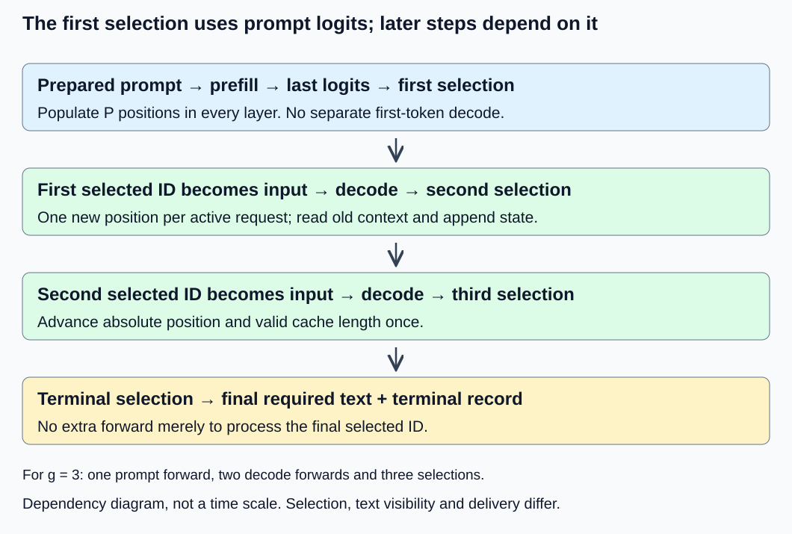
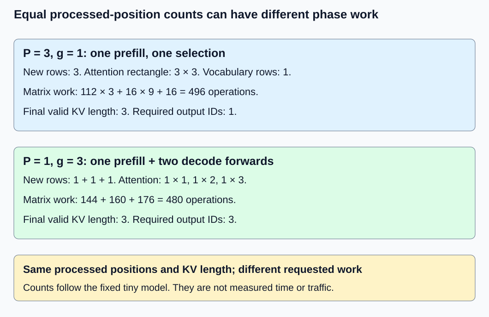

# M1-C18: Understanding prefill and decode

> **Status: Complete — detailed chapter authored and documentation validated; experimental procedures are proposed unless explicitly labelled observed**

**Module:** Understand exactly what happens when an LLM generates a token

**Category:** [Runtime and concurrency](index.md)

[Module 1 reading order](../module-1.md) · [Previous: M1-C17](../state-memory-and-caching/m1-c17-reusing-attention-state-with-a-kv-cache.md) · [Next: M1-C19](../numerics-and-correctness/m1-c19-validating-cached-and-uncached-generation.md)

## Target concepts

Prompt processing, first-token selection, subsequent decode steps, phase-specific tensor shapes, cache reads and writes, context-length and batch-size effects.

## Concepts

### One request has two different forward shapes

**Prefill** is the forward computation over a prepared prompt that initializes its attention key/value state. **Decode**, in this chapter, is a subsequent cached forward over one newly supplied input ID per active request. Both execute the same model layers. They differ in how many new positions they process and how much context they reuse. Neither word means text detokenization: decoding model state and converting IDs into visible text are different operations.

Assume a nonempty prepared prompt, no padding, deterministic causal inference, fixed weights, full attention and one private cache per request. [M1-C17](../state-memory-and-caching/m1-c17-reusing-attention-state-with-a-kv-cache.md) establishes why earlier per-layer keys/values remain reusable. Rust is the eventual language context; this chapter contains specifications and proposed experiments without implementation code. Prompt templates, selected IDs and text stopping retain [M9-C19's identity contract](../interfaces-protocols-and-streaming/m9-c19-validating-tokenization-stopping-and-final-output.md).

Prefill produces a last-position logit row. A **logit** is a vocabulary score before token selection. Applying the configured selection rule to that row chooses the first output ID; it does not require a separate one-token decode forward. If more output is needed, that selected ID becomes the next input, at the next absolute position. Its decode forward yields the next logit row and next selection. A token cannot be processed as a model input before it has been selected, although independent requests may execute together.

Let P be prepared prompt length and g the number of IDs actually selected, counting terminal IDs under the declared policy. For g ≥ 1, **forward calls = 1 prefill + (g − 1) decode calls** and **processed positions = P + g − 1** per request. A selected terminal ID need not be processed afterward. Under M1-C16's policy, valid generated cap G = 0 skips both phases and returns an empty length result. A cap of one may perform prefill and one selection but zero decode forwards. Early EOS or a text stop shortens actual g; the configured cap alone does not establish executed work.

The [Transformers v4.57.1 cache specification](https://huggingface.co/docs/transformers/v4.57.1/en/cache_explanation) describes old and new KV state. The [SARATHI paper](https://arxiv.org/abs/2308.16369) studies different prefill/decode operating points and mixed scheduling; its hardware results are not measurements of this chapter's tiny CPU exercise. Chunked prompts and mixed-phase scheduling are later extensions, not requirements for the elementary two-phase contract here.

*The arrows are dependencies, not a latency scale. Visible output can lag selection because the decoder or stop matcher retains incomplete text.*

### Shape every phase before assigning a performance label

Let B be the number of independent active requests of equal lengths, D hidden width, F feed-forward intermediate width, Hq query heads, Hkv key/value heads, d head width and V vocabulary size. B is a request count; it does not count how many output steps of one request can execute independently. This chapter uses equal-length batches to avoid introducing padding or a scheduler.

| Quantity | Prefill over P new prompt positions | One decode forward with N old positions |
| --- | --- | --- |
| Input IDs | (B, P) | (B, 1) |
| New hidden rows | (B, P, D) | (B, 1, D) |
| Q | (B, Hq, P, d) | (B, Hq, 1, d) |
| New K and V, each | (B, Hkv, P, d) | (B, Hkv, 1, d) |
| Valid combined K and V, each | (B, Hkv, P, d) | (B, Hkv, N + 1, d) |
| Logical attention scores | (B, Hq, P, P) | (B, Hq, 1, N + 1) |
| MLP intermediate | (B, P, F) | (B, 1, F) |
| Required last logits | (B, V) | (B, V) |

Only the last prompt position's vocabulary scores are needed for this ordinary generation path. Computing all prompt logits, shape (B, P, V), is a different output-head strategy; match it across compared paths or report it explicitly. Both transformer blocks still process every prompt row. An optimized attention backend may never materialize the full score tensor; its logical shape is not an allocation observation.

A dense projection has matrix geometry **(B × P, D) × (D, output width)** during prefill and **(B, D) × (D, output width)** during one decode forward, after flattening equal-length rows. Larger row counts can reuse weights across more useful outputs. Attention remains request-local: increasing B must not let one request read another's keys. For grouped-query attention, the Hq-to-Hkv mapping remains part of the model identity; it changes neither the active request count nor causal eligibility.

During prefill, query position i may read prompt keys j ≤ i. During single-position decode, its absolute position is N and it may read keys 0 through N, including its new self-key. Both the absolute position and mask must advance. Unused reserved capacity is never valid context. If requests have unequal lengths, their cache positions and masks differ; handling that correctly needs an explicit padded or variable-length policy outside this chapter's batch fixture.

### A complete phase trace on the fixed small model

Use [M1-C14's two-block model](../model-computation-and-semantics/m1-c14-assembling-a-small-decoder-only-transformer.md): width D = 2, F = 3, Hq = Hkv = 1, d = 2, V = 4, FP64, absolute position table and maximum total context C = 4. Weights and equations remain unchanged; this is a synthetic mathematical model, not a pretrained text model. Prepared prompt [1], cap G = 3, greedy lowest-ID ties, EOS ID 3 and no text stop produce the following reference.

| Phase | New input and position | Valid KV length afterward, each layer | Last logits, six-decimal display | Selected output ID |
| --- | --- | --- | --- | --- |
| Prefill | [1], position 0 | 1 | [1.231147, 1.230632, 2.461779, −0.000514] | 2, first selection |
| Decode 1 | [2], position 1 | 2 | [2.451513, 0.642534, 3.094047, −1.808979] | 2, second selection |
| Decode 2 | [2], position 2 | 3 | [2.127601, 0.877838, 3.005439, −1.249764] | 2, third selection |

The selected history ends [1, 2, 2, 2] and the cache represents [1, 2, 2]. With the previous constructed display table, output is “ccc”, reason length. Calling the initial prompt forward “decode 0” is harmless only if the reporting definition remains explicit; claiming three *subsequent* decode forwards would count one too many. No fourth forward is performed merely to populate the terminal selected ID.

Compare prepared [1, 2, 2], G = 1: it uses a single three-position prefill, selects ID 2 from the same third-position logit row and has no subsequent decode. Both examples process three positions and end with cache length three, but they perform different work and produce different numbers of output IDs. They are distinct workloads, not equivalent request outputs.

### Separate completed work from selection, visibility and delivery

A **critical path** is the chain of dependencies that limits completion. For this isolated request, prompt forward → first selection → next forward → next selection is such a chain. Text rendering, stop matching and output publication add dependencies. Network delivery can add further delay; it is not measured by this chapter's model-only timestamps.

Define t₀ as prepared IDs and weights ready with an empty cache; tₚ as prompt forward completed and last logits available; t₁ as first ID selection committed; tᵥ as first nonempty stable visible text, if any; t𝒇 as final required text and terminal record available after required model work completes. Then **Tprefill = tₚ − t₀**, **Tfirst-selected = t₁ − t₀**, and **Tprepared-completion = t𝒇 − t₀**. Preparation, arrival, queueing and network are outside this declared boundary. Do not call Tprefill client time-to-first-token. If cache allocation occurs after t₀, it belongs inside this boundary.

For a hand-constructed event ledger in microseconds, suppose t₀ = 0, tₚ = 40, selections occur at 42, 55 and 70, first visible text at 57, and terminal publication at 74. Suppose the two decode forwards occupy [44, 52] and [58, 67]. Then prefill is 40 μs, first selection 42 μs, decode forwards 8 and 9 μs, selection gaps 13 and 15 μs, and completion 74 μs. The 74 is **40 + 8 + 9 + 17**: 17 μs lies outside the three forward intervals, including selection/rendering/other overhead in this constructed nonoverlapping ledger. These are arithmetic examples, not measured times or targets. First visible output does not equal the first selection at 42.

If hidden stopping or strict Unicode finalization yields no visible text, tᵥ is undefined rather than zero. For G = 0, t₁ is also undefined. Failed forwards and cancelled/unresolved requests remain separately classified. A later API may record first byte, first token event and client delivery; each needs its own boundary and cannot be inferred from a coalesced text chunk. On asynchronous devices, submission returning does not mean tₚ or a decode completion occurred; an actual completion mechanism and clock correlation are required.

### Context, batching and bottlenecks change together

A **bottleneck** is the resource limiting progress under a stated workload. Prefill exposes many new rows per request; decode exposes one while re-reading older context. This often changes arithmetic relative to memory movement, but “prefill is compute-bound” and “decode is bandwidth-bound” are hypotheses to test, not universal labels. Small shapes can be dominated by dispatch or allocation. Long prompts increase attention work. Larger decode batches increase weight reuse while also increasing KV traffic, state and possible batch completion delay.

Using M1-C14's dense matrix counting convention, a last-row-head prefill costs **B(112P + 16P² + 16)** operations, counting a multiply-add as two. A one-position decode with N old positions costs **B(112 + 16(N + 1) + 16)**. The two-block projection/MLP term is 112 per new row; attention rectangles contribute 16 times their area; the required head costs 16 per request. Softmax, normalization, position addition, activations, residuals, allocation, copying and text work are outside these matrix counts and inside appropriate timing boundaries.

For P = 1 and g = 3, costs are **144 + 160 + 176 = 480**. For P = 3 and g = 1, prefill costs **496**. Equal processed-position counts do not imply equal attention geometry or head work. For P = 2 and g = 2, prefill costs 304, then one decode with N = 2 costs 176, total 480. B = 2 doubles the counted matrix work to 960; elapsed time need not double, halve or remain constant.

Logical valid KV payload is **2LBHkvNdw**, with L layers and w bytes per element. This model retains 64BN bytes. Each one-position decode appends **64B bytes** and needs all N old positions as eligible context: **64BN bytes of old KV payload** across layers. That number describes logical context accessed, not measured DRAM traffic or a guarantee of one physical read per byte. The new self-key/value participates too. Repeated head use, processor caches, layout and fusion can alter traffic. Dynamic append copying adds cost; reserved capacity trades unused space for fewer reallocations.

An illustrative L = 32, Hkv = 8, d = 128, w = 2 configuration has 128 KiB per request per retained position. With N = 4,096, B = 1 has 512 MiB old KV payload and adds 128 KiB for one new input; B = 4 has 2 GiB and adds 512 KiB. This is a sizing example, not an allocated model or a measured bandwidth demand. The [Fast Transformer Decoding paper](https://arxiv.org/abs/1911.02150) motivates KV bandwidth concerns; changing an architecture's KV sharing still requires a separate quality contract.

*Three prompt rows in one forward and three dependent one-row forwards can process the same number of positions while producing different output counts. Count completed useful work under the declared request contract.*

A simple performance bound is **T ≥ max(F/Π, Q/β)** under a model with peak arithmetic rate Π operations/second and available memory bandwidth β bytes/second, where F is counted work and Q is traffic through that memory boundary. This omits dispatch, dependencies and other work, so it is only a lower bound under its assumptions. Logical KV payload is not automatically Q, and nameplate peaks need not be attained. Record actual hardware and profile evidence before attributing a phase's time to compute or memory. HFT-style concern for the critical path does not justify inventing a hardware speedup.

## Experiments

These are proposed procedures for a separately supplied reference/runtime environment. No model implementation, scheduler or benchmarking code is provided.

### E1 — Trace the first selection and later decode calls

**Description:** Follow one cached request from prepared prompt through terminal output. **Purpose/objective:** Identify which forward produces each selection and where cache state advances. **Target concepts:** Prompt processing, first-token selection and subsequent decode steps.

**Baseline and workload:** Exact small-model [1], G = 3 trace above, compared with its full-prefix reference. Add G = 1, G = 0 and the previous hidden stop “cc” case with cap three. Same greedy/EOS/display policy as M1-C16.

**Controls and prediction:** Fix weights, positions, FP64, prepared IDs and terminal contract; change only cap/stop setting across named cases. Expect one prefill plus two/zero subsequent decode calls for G = 3/1. G = 0 skips both. Hidden “cc” stops after two selections and one decode with no visible text.

**Procedure:** Record forward inputs, absolute positions, layer valid lengths, last logits, selected IDs and terminal reason. Link every selection to the forward that produced its logits. Construct the event ledger for the supplied microsecond example separately from any actual timings. Test a report that counts a fictitious extra decode after terminal as a negative control.

**Hardware/software:** CPU FP64 reference; runtime/clock configuration only if execution is supplied. **Failure and HFT connection:** Internal computation, decision commitment and publication are distinct events, just as event processing may complete before a result is published. Model selections are not trade acknowledgements. **Exit criteria:** V1 exact call/state/terminal counts and logit gates pass; undefined first-visible events remain undefined; a false extra-decode report is rejected. Use V1.

### E2 — Audit tensor shapes across prompt and batch sizes

**Description:** Compare independent request references with equal-length batched phase shapes. **Purpose/objective:** Separate request parallelism from sequential token dependence. **Target concepts:** Phase-specific tensor shapes, prompt length and batch size.

**Baseline and workload:** Eight settings: B ∈ {1, 2}, P ∈ {1, 2}, G ∈ {1, 2}. Every request has prompt [1] or [1, 2] according to P, C = 4, no stop and greedy EOS 3. B = 2 uses identical independent prompts for clean count comparison. Add one separate request-isolation probe by changing only the second request's prompt and comparing both against their individual references.

**Controls and prediction:** No padding, variable-length scheduling or cross-request sharing. Freeze model and last-row head strategy. B scales leading axes; prefill new-row count is BP and decode new-row count is B. B must not alter one request's mathematical output.

**Procedure:** Record all logical axes in the Concepts table for every phase, and compare per-request logits with separate full-prefix evaluations. Inspect masks/positions and verify the unchanged request survives the isolation perturbation. Deliberately flatten B and sequence into one shared attention sequence as a specified defect; reference comparison must reject cross-request mixing. Materialized buffers are measured separately from logical tensors.

**Hardware/software:** CPU reference or an existing backend supporting the specified batch semantics; no accelerator required. **Failure and HFT connection:** Independent event streams may share compute but not state identity. Equal-length batching is not an exchange's ordering model. **Exit criteria:** V2 per-setting shape, ID/logit and isolation checks pass; erroneous shared attention is detected; no larger-model or service scaling claim is inferred. Use V2.

### E3 — Account for phase work and growing KV access

**Description:** Compare counted arithmetic, valid state and KV growth under named phase workloads. **Purpose/objective:** Test resource explanations before assigning a bottleneck label. **Target concepts:** Cache reads/writes, context length, prompt geometry and batch effects.

**Baseline and workload:** P = 1, g = 3 versus P = 3, g = 1 at B = 1; then P = 2, g = 2 at B = 1 and 2. Also evaluate the illustrative 32-layer KV sizing example on paper. Different prompt/output cases are distinct workloads, not equivalent output substitutions.

**Controls and prediction:** Same dense attention counting, last-row head, FP64 state width and fixed model. Predict 480/496 operations for the two three-processed-position cases, 480/960 for the P = 2 comparison, and 64B bytes appended per toy decode.

**Procedure:** Reconcile phase rectangles and new rows with counts. Record valid old state, new state, reserved capacity, allocation/copy work and actual memory counters separately if available. Compare dynamic copying with reserved capacity only under the same logical state. Use a profile to test competing explanations—matrix work, memory traffic, allocation or dispatch—rather than selecting one from the phase name. Do not allocate the large illustrative example as part of this paper exercise.

**Hardware/software:** CPU arithmetic/reference environment; profiling requires separately recorded backend and relevant counter support. **Failure and HFT connection:** Growing retained state can consume capacity and slow critical-path work; oversizing a batch can delay useful completion. These are engineering parallels, not measured market latency. **Exit criteria:** V3 equations and accounting balance; any observed traffic is labelled by its hardware boundary and separated from payload predictions. A bottleneck claim requires evidence. Use V3.

### E4 — Measure the phase tradeoff at request completion

**Description:** Benchmark the eight E2 settings in an existing environment with explicit phase and request boundaries. **Purpose/objective:** Discover whether prompt length and batch size help or hurt useful completion at this operating point. **Target concepts:** Phase latency, context/batch effects and complete-request performance.

**Baseline and workload:** For each fixed P/G setting, compare B = 1 and B = 2 equal independent requests. Use unchanged model/precision/selection/text policy and start each trial with empty request caches. Compare these as capacity/latency operating points, not as equal total work. All members must reach a classified terminal result.

**Controls and prediction:** Fix thread count/affinity, allocator capacity policy, sink, clock, head strategy and warm state of weights. No prefilled cache outside timing. Batched operation counts double; actual batch time and per-request completion may change differently. Tiny model timings may be dominated by instrumentation.

**Procedure:** Across three sessions, warm each of eight settings with five untimed trials, then measure 30 trials per setting per session, alternating B order within matched P/G pairs. Time prepared IDs/weights ready to required final text and terminal records for every batch member. Record prefill, each decode completion, selection and first-visible events separately; diagnostic tracing must not distort the headline comparison. Account for failed/incomplete members. Profile separately and record teardown outside the boundary if excluded. Later service experiments need arrivals, queues and sustained load; none are inferred here.

**Hardware/software:** Existing CPU FP64 backend, monotonic clock and fixed execution conditions; any GPU extension must use completed device work and its own hardware records. **Failure and HFT connection:** Higher aggregate useful rate can coexist with worse individual latency. This is not a production HFT benchmark. **Exit criteria:** V1–V3 correctness gates pass; V4 timing/population/overhead checks pass; per-session phase and completion evidence support only the observed operating point. No universal speed target is imposed. Use V4.

## Verification

### V1 — Validate the dependency and event ledger

For E1, use M1-C14 full-prefix equations as the independent mathematical reference and [M9-C01](../numerics-and-correctness/m9-c01-defining-reference-behavior-and-evidence-before-optimizing.md) evidence rules. All 12 displayed trace logits are rounded references; six decimals allow up to 0.5 × 10⁻⁶ display error. Actual small-model FP64 comparisons use **|candidate − reference| ≤ 10⁻¹⁰ + 10⁻¹⁰|reference|**, with 80-digit reference cross-checked at 120 digits and stage/error review under [M9-C17](../numerics-and-correctness/m9-c17-comparing-logits-with-justified-numerical-tolerances.md). This conservative exercise screen is not a universal backend guarantee. IDs, inputs, offsets, call counts and terminal reasons require exact equality.

Check G = 3 gives one prefill/two decode calls/three selections/cache length three; G = 1 gives one/zero/one/length one; G = 0 gives zero calls/selections/populated state; hidden “cc” gives one prefill/one decode/two selections/empty text/stop/cache length two. Reconcile the constructed timeline: 40 μs prefill, 8/9 μs decode forwards, 13/15 μs selection gaps, 57 μs first-visible and 74 μs completion, including 17 μs outside forward intervals. Do not sum overlapping host/device spans in a real trace as though they were these nonoverlapping intervals. Any actual failure needs its own terminal ledger under [M9-C19](../interfaces-protocols-and-streaming/m9-c19-validating-tokenization-stopping-and-final-output.md).

### V2 — Compare shapes and independent request results

For E2's eight settings, sum per-setting member selections only after verifying actual g = G for these prompts. Expected total is **18 member selections**, comprising **12 first selections** and **6 later selections**. There are **8 batch prefill calls** and **4 batch decode calls**; a batch call is not one call per member. Sum of member positions processed is **24**. Every last logit row has V = 4, so compare **72 logit coordinates** with independent full-prefix references. None of these totals is a measured throughput.

Record shapes for new rows, layer KV and attention rectangles at each call. Prefill (B, Hq, P, P) and decode (B, Hq, 1, N + 1) must use separate request domains. Inspect the deliberate shared-sequence fault against individual references rather than assuming identical prompts guarantee isolation. The separate perturbed-second-request probe must leave the first request's outputs unchanged. No tolerance permits a request ID, mask or absolute position mismatch. Correct shapes alone do not establish correct values.

### V3 — Separate work, payload and observed traffic

For E3, verify P = 1, g = 3 has phase counts 144/160/176 and P = 3, g = 1 has 496. Both have 192 valid KV bytes at completion and three processed positions, despite different output counts. P = 2, g = 2 has 304 + 176 = 480 operations per request and 192 bytes final valid payload; B = 2 has 960 operations and 384 bytes. Per-decode old payload is 64BN, new writes are 64B, with the new self-state included in attention separately from old context.

Check larger illustrative old payload: 128 KiB × 4,096 × B gives 512 MiB at B = 1 or 2 GiB at B = 4; new writes are 128 KiB or 512 KiB. Do not label those payloads measured memory traffic. A profile may reveal repeated reads, copies, cache hits or allocator overhead; retain all of them and identify whether counters refer to processor cache, main memory or device memory. Capacity failure must be a classified outcome, not a missing slow sample. Reclamation waits for the last reader and all required work, not just submission; partial cache extension is invalid until coherent under M1-C17's policy.

### V4 — Report phases and completed useful work together

For E4, three sessions × eight settings × five warmups = **120 untimed batch trials**; three × eight × 30 = **720 timed batch trials**. With four B = 1 settings and four B = 2 settings, this schedules **1,080 member-request attempts** in timed trials. If every member completes correctly with expected g, it yields **1,620 selected IDs**, including any terminal IDs under the fixed contract. Verify actual outcomes before labelling totals successful. Retain errors, incomplete attempts and missing events separately; use [M9-C07](../measurement-experimentation-and-economics/m9-c07-latency-distributions-and-statistical-uncertainty.md) for population and uncertainty distinctions.

For each setting, report session medians/ranges of batch completion and individual member completion; do not replace each member's actual event with the final batch time if it becomes available earlier. State phase completion boundaries and units, and distinguish selection gaps from forward duration and from text delivery gaps. Aggregate model selection rate in an isolated trial is selected IDs divided by its declared completion interval; useful visible text may have different counts. It is not sustained serving capacity or an SLO-qualified goodput result. An SLO is an explicit service-level target; none is supplied here.

Use a monotonic clock, calibrate granularity/empty brackets, and compare reduced versus full event tracing in separate overhead runs. The [PyTorch 2.14 benchmark guidance](https://docs.pytorch.org/docs/2.14/benchmark_utils.html) illustrates why warmup, thread settings and asynchronous completion matter; Rust measurements need equivalent boundary discipline, not a dependency on that library. For GPU work, record synchronized completion and clock domains; host submission duration is a different metric. M9-C02's advanced timing treatment remains outlined, so these elementary boundaries are stated locally.

A profiler attributes time and resources to stages; it does not prove equivalence or expose service queueing in an isolated request. Do not infer p99 reliability from 90 trials per setting or three sessions, and do not extrapolate the tiny model to real GPU saturation. Archive all manifests, prepared prompts, shapes, IDs/logits, valid cache lengths, terminal outcomes, timing attempts, instrumentation mode, profiler conditions and hardware. No actual inference phase, latency or bandwidth benchmark was executed to produce this chapter.

## Engineering dimensions and principles

| Dimension | Chapter-specific application |
| --- | --- |
| Semantics and invariants | First selection uses prompt logits; subsequent selections depend on prior IDs; caches represent processed inputs. |
| Workload and variability | P, actual g, context N and B change phase geometry independently; unequal-length scheduling and non-text modalities are outside this fixture. |
| Resources and bottlenecks | Count matrix work, valid KV, new writes and copies separately; phase labels do not establish hardware saturation. |
| Time and distributions | Prefill, decode forward, selection gap, stable visibility and delivery are different boundaries with undefined events for empty outputs. |
| Ownership and coordination | Batched requests share execution while retaining separate state; cache publication/reclamation follows completed readers and writers. |
| Failure and adaptation | Bounds/allocation/partial extension failures require classification; larger batches need explicit capacity and later overload evidence. |

| Practical principle | Chapter-specific use |
| --- | --- |
| 1. Correctness defines the optimization boundary | Per-member references and exact terminal contracts precede E4 comparisons. |
| 2. Performance depends on workload and operating point | Prompt geometry and decode batch size can change reuse, cost and completion differently. |
| 3. Data movement is part of the algorithm | Old KV access, new writes, weight reuse and append copies accompany arithmetic counts. |
| 4. State has ownership, lifetime and recovery cost | Per-request layer state cannot be mixed or reused after incomplete publication; failure retains evidence. |
| 5. Dependencies determine latency; bottlenecks determine capacity | One request's selections remain dependent even when independent requests execute together. |
| 6. Variability and synchronization shape the tail | Batch completion, allocation and visibility can vary; isolated examples cannot establish queueing tails. |
| 7. Local improvements must be evaluated end to end | Report phase time together with prepared-request completion and required sink work. |
| 8. Claims require reproducible evidence | Freeze artifacts, phase definitions, workloads, shapes, outcomes and clock/profile conditions. |

HFT means High-Frequency Trading: processing market events under tight timing constraints. Distinguishing initialization from incremental updates, internal commitment from publication, and aggregate rate from individual delay are useful parallels. Prefill is not market-session startup, and token selection is not an exchange event or order decision. No trading strategy, production latency, serving scheduler or overload handling is implemented here.

## Specifications, articles, and hardware

| Primary source | Relevant scope and limit |
| --- | --- |
| [Transformers v4.57.1 caching](https://huggingface.co/docs/transformers/v4.57.1/en/cache_explanation) | New versus retained state and growing context; actual phase/API conventions must still be recorded. |
| [Agrawal et al., SARATHI (2023)](https://arxiv.org/abs/2308.16369) | Primary phase/batching study; its hardware results do not establish this exercise's performance or implement later scheduling. |
| [Shazeer, Fast Transformer Decoding (2019)](https://arxiv.org/abs/1911.02150) | Primary incremental KV bandwidth motivation; architectural sharing is not an equivalent change to arbitrary weights. |
| [PyTorch 2.14 benchmark utilities](https://docs.pytorch.org/docs/2.14/benchmark_utils.html) | Warmup, execution/thread conditions and completion-aware timing; principles apply independently of language. |

Proposed small-model exercises require a CPU supporting FP64, one worker thread and at least 1 GiB free RAM for reference/evidence; this is an exercise requirement, not observed hardware or sizing for the illustrative larger cache. Record CPU model, core/socket/cache/RAM, NUMA placement (memory proximity), thread affinity, OS, clocks/power/thermal conditions, co-tenancy, compiler/runtime/allocator, precision/backend, model/template/decoder identities, cache policy, timing granularity and sink. No GPU or network adapter is required. GPU extensions require model weights, device memory capacity/bandwidth, driver/runtime and completion/profiling details supplied independently; none are inferred from paper examples.

Completed M9-C01/M9-C17/M9-C19/M9-C07 support reference behavior, numerical/terminal contracts and populations. M9-C02/M9-C11/M9-C15 remain outlines; elementary timing, controls and byte accounting are local. This Module 1 chapter provides phase foundations for later GPU, scheduling and distributed chapters in Modules 2–7 with Module 9 support. The next authoring and Module 1 reading chapter is M1-C19.

## Key takeaways

Prompt processing supplies the logits for the first selection; subsequent cached forwards process one new input per active request. Prefill and decode share model semantics but expose different shapes, retained-state access and dependency chains. Context and batch effects require measured evidence at explicit completion boundaries. All experiments remain proposed; mathematical and documentation checks do not execute a generation runtime or establish phase performance.
