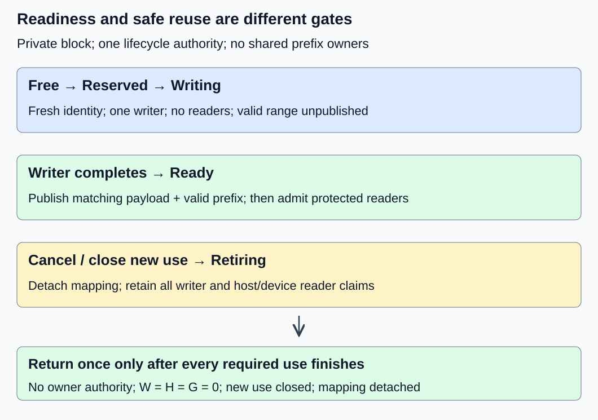
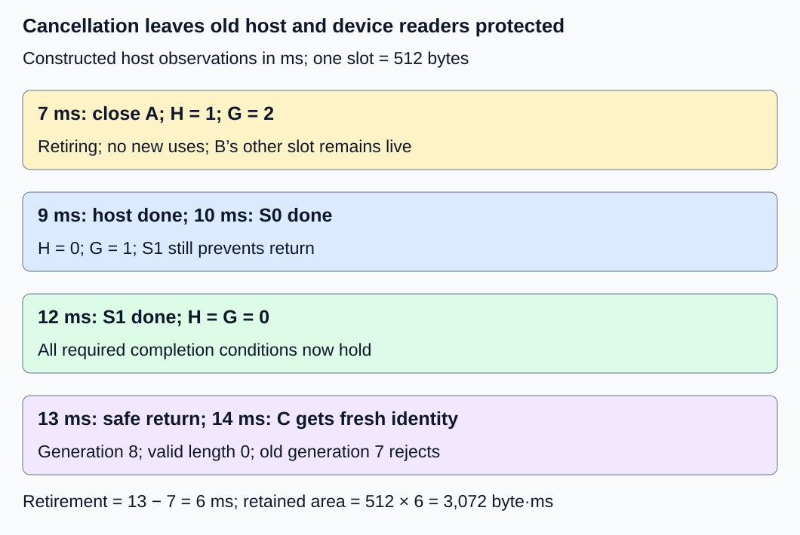

# M2-C10: Request state transitions and safe block reuse

> **Status: Complete — detailed chapter authored and documentation validated; experimental procedures are proposed unless explicitly labelled observed**

**Module:** Treat the KV cache as a first-class systems problem

**Category:** [Runtime and concurrency](index.md)

[Module 2 reading order](../module-2.md) · [Previous: M2-C09](../state-memory-and-caching/m2-c09-choosing-block-size-and-measuring-fragmentation.md) · [Next: M2-C11](../state-memory-and-caching/m2-c11-reference-counting-and-shared-block-ownership.md)

## Target concepts

Allocate-write-read-release lifecycle, exclusive mutation, host and device readers, in-flight work, completion versus submission, pinning, deferred reclamation.

## Concepts

### 1. A request can finish before its storage is reusable

A request's state describes whether it may generate more work. A block's state describes who may access its storage and when that storage can be reassigned. Cancellation can terminate a request while submitted device work or a host reader still holds its KV data. Treating those two lifecycles as identical creates premature reuse.

[M2-C08](../state-memory-and-caching/m2-c08-designing-a-fixed-size-kv-block-allocator.md) established Free, Reserved, Live and Retiring pool categories. Refine **Live** here into Writing or Ready. **Writing** means one authorized writer may change payload and the new valid range is unpublished. **Ready** means a declared prefix is complete and available to permitted readers; it does not mean nobody is reading. **Retiring** closes new use and retains storage while old obligations finish.

Use one serial lifecycle authority to order bookkeeping decisions. Host/device execution can overlap, but new access claims, cancellation and final return must have a consistent order under that authority. This is a teaching contract, not an implemented concurrency primitive.

| Transition | Required condition | State that must not be inferred |
|---|---|---|
| Free → Reserved | Eligible slot and fresh owner/attempt/generation assigned | Valid KV exists |
| Reserved → Writing | Group allocation committed; exclusive writer claim acquired | Submitted writes are complete |
| Writing → Ready | Required writes complete and visible; valid prefix published consistently | All future reads are already complete |
| Ready → Writing | No reader can still access the block; exclusive write authority obtained | Appending to a different row is automatically race-free |
| Writing/Ready → Retiring | New uses closed; request mapping detached; owner relinquishes future use | Outstanding accesses vanished |
| Retiring → Free | Every writer/reader obligation resolved; no owner/access claim remains | A cancellation signal or timeout proves completion |

The conservative baseline excludes **all** readers during mutation of a block, including append to its tail. More permissive disjoint-range access needs a separately proved range/layout/publication contract and is outside this chapter. A valid prefix length remains distinct from allocated capacity and reader count.

### 2. Exclusion, visibility and lifetime are separate obligations

**Exclusive mutation** means one writer can change the protected state while no conflicting reader or writer can use it. **Publication** makes completed payload and its matching metadata available as one consistent version. **Lifetime protection** keeps that version's storage valid for the entire access. Satisfying one does not automatically satisfy the other two.

For host readers, the [Rust book's borrowing rules](https://doc.rust-lang.org/book/ch04-02-references-and-borrowing.html) explain exclusive mutable access versus multiple immutable references. A raw device pointer passed through a foreign runtime is not a Rust borrow that automatically lasts until a GPU finishes. An ownership wrapper or scheduler must connect the external work's completion to retained storage. This chapter supplies acceptance conditions, not unsafe examples or implementation code.

A **lifecycle pin** here is an access claim that prevents pool reclamation or reassignment until its covered use finishes. It does not by itself grant mutation or prove that payload is ready. This term differs from [Rust 1.99.1 Pin](https://doc.rust-lang.org/std/pin/index.html), which concerns address-sensitive values and movement guarantees; neither meaning automatically supplies the other. It also does not mean page-locked host memory for transfers.

Acquire identity validation and a lifetime claim as one protected admission decision **before** allowing a pointer or view to escape to a reader or queue. A later increment cannot repair a window in which cancellation already returned and reassigned the slot. Closing new access and testing for final return likewise need a coordinated decision. An exact counter with a race around its update is not sufficient protection.

For a block, define W as a 0/1 active writer claim, H as the number of host-reader claims and G as the number of device-reader claims whose safe completion has not been established. Device writes retain W through their required completion; do not silently clear W when host submission returns. A claim can cover a declared group of operations; document its scope and release it once.

During Writing, require **W = 1, H = 0, G = 0**. Reader admission requires Ready, matching identity, an eligible valid range and no writer. During retirement, a useful safety predicate is:

**Reusable = new use closed AND mapping detached AND owner relinquished AND W = 0 AND H = 0 AND G = 0.**

“Owner relinquished” means the sole request owner no longer has authority to create work; this baseline has no shared prefix owners. Later reference counting adds owners without removing completion obligations. Final return must be performed once under the lifecycle authority. Unknown completion keeps the relevant claim outstanding.

### 3. Submission, ordering and completion have different scopes

**Submission** places work in a queue. **Ordering** constrains which operations may begin relative to others. **Completion** establishes that a specified operation set has finished, with the visibility required by its consumer. Returning from an asynchronous launch is not that completion.

A reader must wait for the producer's writes through the actual host/device ordering and visibility contract before consuming the published range. Being able to name an address is insufficient. The [CUDA Runtime 13.4 event specification](https://docs.nvidia.com/cuda/cuda-runtime-api/cuda_runtime_api/group__CUDART__EVENT.html) says recording captures work in that stream at that point, and querying distinguishes completed captured work from work not yet ready. A newly created, never-recorded event represents an empty set of work and can query as complete. An event recorded before a reader, or on an unrelated stream, therefore cannot establish that reader's completion. Record identity, stream and covered operation version; later reuse of the event must not confuse old and new evidence. An error is not successful completion.

When readers use two independent device streams, one completion is not enough unless it explicitly covers a dependency join of both. The [PyTorch 2.14 record_stream documentation](https://docs.pytorch.org/docs/2.14/generated/torch.Tensor.record_stream.html) illustrates how stream use affects allocator reuse. That mechanism is framework-specific; it is not automatic protection for arbitrary Rust-managed pool slots, nor a replacement for producer-to-reader ordering.

If submission definitely fails before any use can escape, its tentative access claim can be undone under the authority. If failure leaves submitted work uncertain, retain the claim and report the unresolved state. Cancellation closes new uses; it does not revoke pointers already used by a device. Shutdown must drain or otherwise establish safe completion before freeing backing storage. A watchdog reports missing progress without granting reclamation permission.

### 4. Work a multi-reader retirement timeline

Use a constructed two-slot pool with **Q = 512 bytes/slot**, hence 1,024 backing payload bytes. Q comes from four positions/block and the all-layer fixture's 128 bytes/position. A owns slot 0 at generation 7; B owns slot 1 throughout. These initial identities are independent of earlier chapter traces. All times below are host observations in milliseconds on one monotonic clock, not measured device execution times.

| Time | Observation for A's slot | W | H | G | Eligibility |
|---|---|---|---|---|---|
| 0 | Reserved to A; valid length 0 | 0 | 0 | 0 | Not free |
| 1 | Device writer submitted under exclusive claim | 1 | 0 | 0 | Writing |
| 2 | Host submission call has returned | 1 | 0 | 0 | Still Writing |
| 4 | Required writer completion observed; publish 3 valid rows | 0 | 0 | 0 | Ready |
| 5 | Host reader admitted | 0 | 1 | 0 | Ready, reader protected |
| 6 | Readers on streams S0 and S1 admitted with ordering satisfied | 0 | 1 | 2 | Ready, three reader claims |
| 7 | A cancelled; mapping detached and future use closed | 0 | 1 | 2 | Retiring |
| 9 | Host reader releases its claim | 0 | 0 | 2 | Retiring |
| 10 | S0's covered reader completion observed | 0 | 0 | 1 | Retiring |
| 12 | S1's covered reader completion observed | 0 | 0 | 0 | Safe-return conditions now satisfied |
| 13 | Authority returns slot exactly once | 0 | 0 | 0 | Free |
| 14 | C receives slot 0 at generation 8, valid length 0 | 0 | 0 | 0 | Old A handles reject |

At publication, three rows contain 384 valid bytes and the assigned block has 128 tail bytes. At cancellation, A's whole 512-byte slot remains unavailable, not just its valid payload. B's 512 bytes remain live. At time 13 the pool has 512 live and 512 free bytes; backing storage stays 1,024 bytes. At time 14 C owns the returned slot, but allocation alone exposes none of A's old rows.

*Writer completion permits publication. Closing new use and finishing all readers permit eventual reuse. These are separate gates.*

Let t_close denote the retirement start, t_H the last required host-reader release, t_G the last required device-reader completion observation, and t_W the writer's required completion observation. Under the other stated conditions:

**Earliest safe-return observation = max(t_close, t_H, t_G, t_W).**

Here that is max(7,9,12,4) = 12 ms. Actual return at 13 adds one millisecond of reclamation scheduling delay. Retirement residence is **13 − 7 = 6 ms**, consuming **512 × 6 = 3,072 byte·ms** of unavailable-capacity area. Overlapping reader intervals must not be added as if they were serial. The final required completion determines the lower bound; reclaim scheduling determines additional retention.

*At time 10 one device reader is still unresolved. At time 12 all required readers are done, and actual eligibility changes at time 13.*

### 5. Scope synchronization without weakening the safety predicate

A global wait may conservatively include unrelated work. Suppose an independent stream U has no access to A's slot and completes at constructed time 20. Waiting for all device work and applying the same one-millisecond reclaim delay returns A's slot at 21 rather than 13. Retirement becomes 14 ms and retained area 7,168 byte·ms, 4,096 more than the scoped trace. These are input-timeline calculations, not observed speedups.

A scoped policy may ignore U **only if** the complete relevant-use set is known and protected from late admission. If U actually read A's slot, it belongs in G or a covering completion join. Missing a dependency is a correctness failure, not a faster variant. Conversely, if S1 finishes at 20 and U at 12, both policies' last required/all-work device observation is 20 and both return at 21. Scope refinement has no predicted retention benefit in that second timeline.

This is the systems and HFT connection: a cancelled event-buffer operation can leave consumers active; unrelated work should not needlessly delay reuse, but every relevant consumer must remain protected. This analogy concerns state ownership and latency dependencies, not exchange protocols or trading results.

## Experiments

These procedures are proposed without implementation code. The execution plan records reference arithmetic and rendered-document checks separately. No device runtime, race test or production safety claim is supplied.

### E1 — Lifecycle admission and publication gates

- **Description:** Audit the transition table with valid and forbidden accesses.
- **Purpose/objective:** Separate exclusive mutation, payload publication and storage lifetime.
- **Target concepts:** Allocate-write-read-release lifecycle, exclusive mutation and host/device readers.
- **Baseline and workload:** Two-slot fixture, A generation 7, four positions/block. Write three exactly labelled rows under one writer claim; publish only after required completion.
- **Controls and prediction:** Fixed owner/layout and valid labels. Change only admission timing/state. Predict no readable rows at allocation, no publication at submission return, and exactly three valid rows after completion.
- **Procedure:** Record W/H/G and valid length at each transition. Reject reads during Writing, reads of reserved row 3, a second writer, and a mutation request while any host/device reader remains. Permit multiple admitted readers of the immutable Ready prefix. Attempt a late claim after cancellation and require rejection before pointer exposure.
- **Hardware/software:** Paper state ledger; any future host/device harness must record its authority, publication and ordering mechanisms plus the manifest below.
- **Failure and HFT connection:** A buffer may be allocated yet contain no published event. Readiness and ownership checks must precede consumption; this is not a market-data protocol implementation.
- **Exit criteria:** Every permitted reader sees the exact intended labels; each forbidden case rejects without exposing state or changing valid length. Writer admission always satisfies W = 1, H = G = 0.

### E2 — Completion evidence must cover every use

- **Description:** Audit evidence for S0/S1 device readers and a host reader.
- **Purpose/objective:** Detect false completion caused by wrong event scope or premature claim release.
- **Target concepts:** In-flight work, completion versus submission, pinning and external readers.
- **Baseline and workload:** Timeline through time 12, with one claim per host reader and device-reader operation. Include a separate producer completion before reader eligibility.
- **Controls and prediction:** Hold logical uses fixed; vary only proposed completion evidence. A submission return, unrecorded event, event preceding a reader, S0-only event and unrelated U event cannot discharge S1.
- **Procedure:** Match each reader identity to its lifetime claim and covering completion. Reject stale event versions, duplicate claim release and wrong slot generation. Keep a claim outstanding after an ambiguous submission failure or event error. Separately demonstrate definite failure before escaped use, where tentative admission can unwind safely.
- **Hardware/software:** Paper evidence ledger first; conditional CUDA testing needs actual context/stream identity, record scope and driver/runtime. A CPU simulation cannot establish GPU visibility.
- **Failure and HFT connection:** A completion notification for one consumer does not finish another consumer of a pooled event segment. The analogy is dependency coverage, not a guarantee about a live system.
- **Exit criteria:** Every released claim has matching, sufficient evidence exactly once. G remains 1 after S0 completes and reaches zero only after S1's covered completion. Errors and unresolved work remain explicit and unavailable.

### E3 — Cancellation and deferred capacity recovery

- **Description:** Replay the full cancellation-to-reassignment trace.
- **Purpose/objective:** Quantify retained capacity while preserving old-reader safety.
- **Target concepts:** Pinning, deferred reclamation, safe reuse and completion-defined capacity.
- **Baseline and workload:** Q = 512, pool payload 1,024 bytes, B's slot unchanged; A closes at 7, host release 9, device completions 10/12, actual return 13 and C admission 14.
- **Controls and prediction:** Fixed use set and one-millisecond reclaim delay. Predict a 12 ms safety lower bound, 6 ms retirement residence and 3,072 byte·ms area.
- **Procedure:** Check new admission closes before the final zero-use check. Reconcile live/retiring/free bytes at 7,12,13 and14. Attempt duplicate return, stale A access and old valid-length reuse by C. Cancel separately during Writing and require completion before return, with no post-cancellation publication to new readers. Inject a timeout with unresolved use and keep the slot unavailable.
- **Hardware/software:** Constructed host-monotonic ledger; later runtime observations need actual completion and reclamation events, not inferred device timestamps.
- **Failure and HFT connection:** Cancellation can leave a pooled segment unavailable while consumers drain. This is useful capacity accounting, not proof of concurrent memory safety.
- **Exit criteria:** Every gate holds, B remains unchanged and C receives fresh identity with valid length zero. Byte conservation and area arithmetic match; unresolved completion never counts as free.

### E4 — Conditional policy replay and timing boundaries

- **Description:** Compare global-wait and relevant-use reclamation on two declared event timelines if a replay harness becomes available.
- **Purpose/objective:** Distinguish logical retention benefits from the runtime cost of bookkeeping.
- **Target concepts:** Completion scope, in-flight pins, deferred return and critical-path reasoning.
- **Baseline and workload:** Two independent timeline cases: S1/U completion at 12/20 ms or 20/12 ms. Both keep host release at 9, S0 at 10, close at 7 and reclaim delay at 1 ms. U never accesses A's slot. All events are replay inputs; no GPU work is submitted.
- **Controls and prediction:** Same complete use set and trace per comparison; vary only policy. Predict return at 13 versus 21 in the first case and 21 for both in the second. Both policies must pass identical safety gates.
- **Procedure:** Run three sessions. Per timeline/session, exclude five warmups per policy, then 30 randomized balanced pairs. Each timed trial processes one complete trace, including final safe-return decision. Measure host entry through replay completion with a local monotonic clock; validate output decisions outside timing. Record logical return times/area separately from wall-clock replay duration. Profile event matching, claim transitions and reclaim scheduling separately. Retain rejected/missing/duplicate-event outcomes in separate fault populations and drain admitted replay state.
- **Hardware/software:** Single-worker CPU metadata harness and manifest below; any actual GPU comparison is a separate experiment with recorded stream/event scope and completion. A 120-second watchdog flags unresolved trials without authorizing reuse.
- **Failure and HFT connection:** Avoiding unrelated waits may improve buffer availability, but incomplete dependency tracking is unsafe. Replay timing does not establish serving throughput, GPU latency or HFT tail bounds.
- **Exit criteria:** 180 balanced pairs yield 360 timed trials and 60 excluded warmups if both policies are supported. Each policy/timeline has 90 trials. Publish exact decisions, logical areas, raw host durations and all outcomes; no implementation means no measured timings.

## Verification

| Pair | Reference and correctness gate | Measurement, benchmarking and profiling |
|---|---|---|
| V1 / E1 | Exact state/identity/label checks; writer exclusion and valid-prefix boundaries | Audit each admission/publication decision. Paper state validity requires no latency profile and does not prove an actual synchronization mechanism. |
| V2 / E2 | Complete use-to-evidence mapping; no duplicate decrement or late admitted use | Record event version, stream, operation and slot generation. Submission returns and incomplete/error evidence cannot reduce unresolved obligations. |
| V3 / E3 | Reuse predicate plus once-only return and new generation; exact byte conservation | Record close, each required completion, final eligibility and reassignment. Calculate retirement area from actual observations only when a runtime exists. |
| V4 / E4 | Both policies satisfy the same exact event/reference contract | Report logical retention separately from host replay duration, median/spread and session effects by case/policy. Profile outside unprofiled timings; 90 trials do not establish reliable p99. |

E4's supported design contains 360 attempted trace replays, each with one intended return decision. Count successful, invalid, failed and unresolved replays separately. In the first input case, relevant-use/global retirement areas are **512 × (13 − 7) = 3,072** and **512 × (21 − 7) = 7,168 byte·ms**. The second gives 7,168 for both. These calculations are predictions over constructed time inputs, not stopwatch samples or measured GPU performance.

Use [M9-C01](../numerics-and-correctness/m9-c01-defining-reference-behavior-and-evidence-before-optimizing.md) for exact state/reference gates, [M9-C02](../measurement-experimentation-and-economics/m9-c02-request-events-clocks-and-measurement-boundaries.md) for event identity and compatible-clock observations, and [M9-C07](../measurement-experimentation-and-economics/m9-c07-latency-distributions-and-statistical-uncertainty.md) for populations/uncertainty. Advanced M9-C22 safety remains an outline; the local contract defines required checks without claiming its later implementation methodology.

Preserve trace inputs, claim identities, valid lengths, generation/owner transitions, event coverage, failure/cancellation points, clock units/resolution/overhead, randomized order and raw outcomes. Integer IDs/counts and labels compare exactly. Timing uncertainty must not relax the ordering gate: unknown completion stays unknown. An eventual runtime comparison needs repeated relevant host/device schedules, exact cache/generator correctness and complete-request latency under matched arrivals/cancellation patterns. No finite trace corpus alone proves all concurrent executions safe.

## Engineering dimensions and principles

| Dimension | Chapter-specific application |
|---|---|
| Semantics and invariants | Published valid prefix, exclusive writer and exact use identity gate every state transition. |
| Workload and variability | Host duration, stream count and cancellation point change which obligation is last; two timelines reverse the relevant bottleneck. |
| Resources and bottlenecks | Retiring slots consume whole assigned capacity; do not count them as eligible free memory. |
| Time and distributions | Final relevant completion is a lower bound; reclaim scheduling adds retention. Replay input time differs from execution time. |
| Ownership and coordination | Admission claims precede pointer exposure; closure and final return share a consistent lifecycle authority. |
| Failure and adaptation | Ambiguous submission, missing evidence and timeouts preserve unavailable state; cancellation cannot erase old readers. |

1. **Correctness defines the optimization boundary:** Reclaim scope may narrow only with complete relevant-use evidence; omitting a reader is incorrect.
2. **Performance depends on workload and operating point:** Scope refinement helps when unrelated work ends later; the second timeline predicts no retention improvement.
3. **Data movement is part of the algorithm:** Writing KV, reading it and publishing matching metadata have placement/visibility requirements beyond host bookkeeping.
4. **State has ownership, lifetime, and recovery cost:** Claims survive submission and cancellation; unresolved work can retain capacity and require recovery.
5. **Dependencies determine latency; bottlenecks determine capacity:** Required completion gates reuse; retained bytes constrain admission even after a request terminates.
6. **Variability and synchronization shape the tail:** Slow consumers and broad barriers change retention; average replay efficiency cannot establish service p99.
7. **Local improvements must be evaluated end to end:** Faster return matters through correct useful admission/completion and full-request outcomes, not a counter alone.
8. **Claims require reproducible evidence:** Publish the complete use set, event scope, trace, manifests and unknown outcomes; distinguish mathematical timelines from observed execution.

## Specifications, articles, and hardware

- [Rust book: references and borrowing](https://doc.rust-lang.org/book/ch04-02-references-and-borrowing.html), checked 26 October 2026: host reference/exclusive-mutation foundation.
- [Rust standard library 1.99.1 Pin](https://doc.rust-lang.org/std/pin/index.html): address-sensitive movement contract, distinct from this chapter's reclamation claims.
- [CUDA Runtime 13.4 event management](https://docs.nvidia.com/cuda/cuda-runtime-api/cuda_runtime_api/group__CUDART__EVENT.html): captured-work completion, empty/unrecorded events and event-version scope.
- [PyTorch 2.14 record_stream](https://docs.pytorch.org/docs/2.14/generated/torch.Tensor.record_stream.html): framework-specific stream use and allocator lifetime; not a generic pool safety mechanism.

Paper timelines need no hardware. A proposed CPU replay harness uses one worker, a monotonic clock and at least 1 GiB available RAM for these small traces and harness overhead. Record CPU model, cores/cache sizes, frequency/power policy, affinity, RAM capacity/speed, OS/kernel, Rust/compiler/optimization settings, allocator, event schema and metadata sizes. Keep trace construction and allocation outside timing. No machine is claimed to have run the replay protocol.

A separate host/device experiment records device/count, VRAM, driver/runtime, backend build, slot/table placement, stream/context ownership, producer-consumer ordering, event capture/reuse versions, transfers and completion/error handling. Define reader/writer guard scope explicitly; a simulation cannot validate those device mechanisms. No host/device race test, GPU benchmark or allocator implementation has been executed for this chapter.

## Key takeaways

Allocate, write, publish, read, retire and return are separate lifecycle gates. Protect both identity and lifetime before access escapes; wait for every required host/device use before reuse. Cancellation closes new work while old claims can persist. [M2-C11: Reference counting and shared block ownership](../state-memory-and-caching/m2-c11-reference-counting-and-shared-block-ownership.md) is now a completed detailed chapter. M2-C12 is next for authoring.
