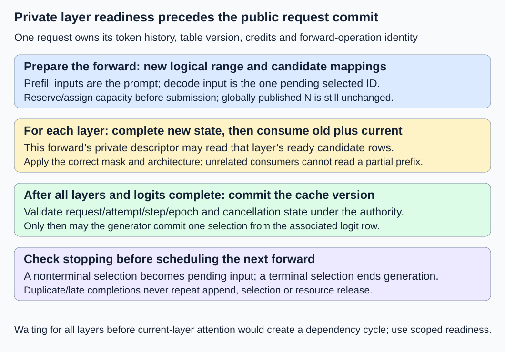
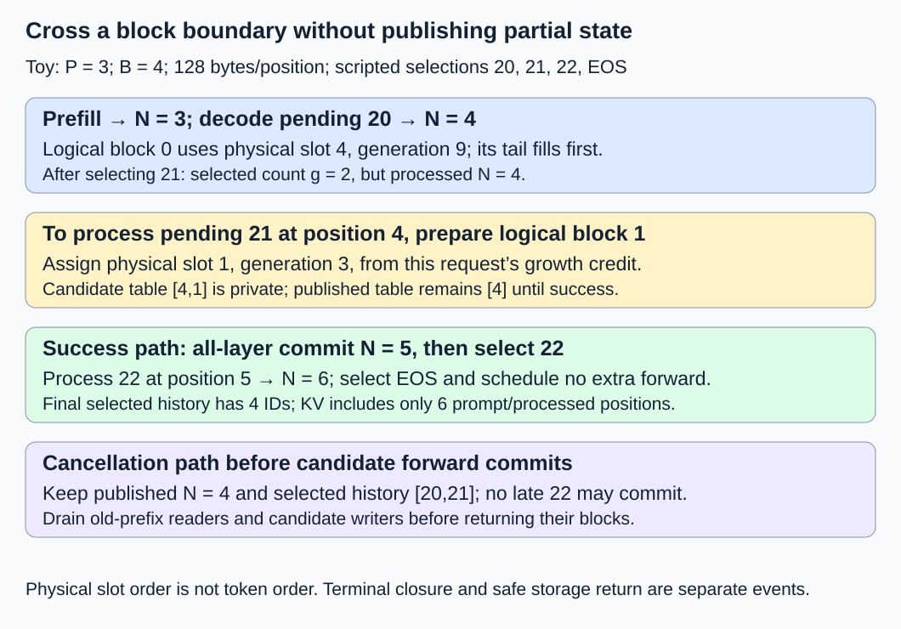

# M2-C19: Connecting block allocation to the request generator

> **Status: Complete — detailed chapter authored and documentation validated; experimental procedures are proposed unless explicitly labelled observed**

**Module:** Treat the KV cache as a first-class systems problem

**Category:** [Runtime and concurrency](index.md)

[Module 2 reading order](../module-2.md) · [Execution plan and progress](../chapter-execution-plan.md) · [Previous: M2-C18](../model-computation-and-semantics/m2-c18-architecture-specific-state-multi-head-latent-attention.md) · [Next: M2-C20](../numerics-and-correctness/m2-c20-validating-allocator-and-cache-safety.md)

## Target concepts

Request-owned block tables, prefill writes, decode appends, block-boundary growth, full attention versus retained windows, cache-reader interface, completion and cancellation integration.

## Concepts

### 1. Give the request ownership of its history and cache contract

A **request generator** coordinates prepared input IDs, model forwards, token selection, stopping and resource cleanup. Its allocator supplies storage; its attention consumer reads the appropriate state. Connecting them means preserving one request/attempt identity across all those operations. A block table that maps to valid addresses is insufficient if those addresses belong to another prefix or layer.

Use [M1-C16's generation contract](../interfaces-protocols-and-streaming/m1-c16-building-the-single-request-generation-loop.md): prepare IDs once, commit each selected ID once, apply stopping before scheduling another forward, and distinguish token history from visible text. The request owns its block-table version and growth credits. A serial lifecycle authority orders budget decisions, forward publication, selection and terminal closure. Host/device execution may overlap only when their data and lifetime dependencies permit it. Rust ownership is the eventual systems context; this chapter provides contracts and experiments without implementation code.

The [PagedAttention paper, version 1, sections 4.2–4.3](https://arxiv.org/html/2309.06180v1) describes per-request logical-to-physical block tables and incremental decode growth. Its allocation policy is not our full-cap credit policy. The [Transformers v4.57.1 caching guide](https://huggingface.co/docs/transformers/v4.57.1/en/cache_explanation) emphasizes per-layer updates, past-plus-current attention and logical insertion positions. Translate actual backend conventions rather than assuming one library interface specifies our pool.

At minimum, retain these separate pieces of request state:

| State | Meaning and owner |
|---|---|
| Prepared prompt and selected-ID history | Exact model/tokenizer/template input and committed selections; owned by the attempt |
| Processed logical length N | Number of token positions successfully committed through all model layers |
| Pending input | Selected nonterminal ID not yet committed into KV; absent before prefill and after terminal closure |
| Block-table/representation version | Current mappings, valid ranges and architecture fields; request-owned, with protected descriptors for readers |
| Growth credits and occupied claims | Separate promises and actual assignments under the budget authority |
| Forward transaction | Candidate ranges/mappings, per-layer readiness, operation identity and covered read/write obligations |
| Output/terminal state | Selection policy, decoder/stop state, delivered-output evidence and one terminal outcome |

A **transaction** here is a group of changes with explicit prepare, publication and failure rules; it is not an assumed database transaction or atomic GPU operation. A unique step identity prevents a duplicate completion from committing another selection or append. Cleanup ownership survives if the request's host task exits.

### 2. Separate selected history from processed KV positions

Let P be prepared prompt length, g the number of committed selected IDs, and N the processed length. After a successful forward and its following selection, for ordinary single-token decode with g ≥ 1:

**N = P + g − 1.**

The last selected ID is not automatically present in KV. If it is nonterminal, it becomes the pending input for the next forward at logical position N. If it terminates generation, no further forward is needed to ingest it. Before the first selection, prefill has committed N = P and g = 0; the formula above does not describe that intermediate state. G = 0 follows the earlier policy of no forward or selection after valid preparation/admission checks.

For a forward receiving t new input positions, its candidate processed length is **N′ = N + t**. Prefill has N = 0 and t = P; ordinary decode has t = 1. This baseline admits at most one forward per attempt at a time. Before appending into an existing block, acquire exclusive write authority after its earlier admitted readers finish; targeting an invalid tail row alone does not establish race freedom. Only new IDs are processed. Reprocessing the full prompt into the same append interface, appending a pending ID twice, or advancing positions when a forward merely submits breaks the contract.

At each layer ℓ, new state can become ready before later layers finish. The attention operation at that layer must see its completed **old plus current** keys, including the current self-key, with the correct causal mask. It cannot wait for all layers to commit before consuming the current layer's new state: that would introduce a circular dependency. Instead, the forward transaction grants a private, readiness-checked view of completed candidate rows to its own layer consumer. External prefix reuse and the next generator step still see only the published request version.

**Per-layer candidate readiness permits this forward's reads; all-layer success permits request-level N′ publication.**

Layer order remains causal through the transformer computation. Once all required model work and logits complete, the authority validates the step identity/epoch, commits the consistent cache version/length, then permits one selection from the associated final logit row. Cancellation can win before selection commit even if device work has completed. A stale or duplicate completion cannot reopen the attempt. Physical writes need not be atomic: failed partially written state is unpublished and must be invalidated/drained according to its actual lifetime.

*Current-layer attention can consume completed candidate rows before the whole forward commits. The generator cannot use a half-finished all-layer prefix.*

### 3. Trace prefill, decode and one block-boundary growth

Use a **scripted control-flow fixture**, not model predictions: prompt IDs [10,11,12], output cap G = 4, EOS ID 0, and scripted selections [20,21,22,0]. There is no tokenizer or numerical model for these IDs. The script checks request progression, exact storage-coordinate labels and cleanup. EOS wins over the cap when both occur on the fourth selection. No text-stop or byte decoder is exercised here.

Use the earlier all-layer storage dimensions: two layers, two KV heads, two features/head, K and V, FP64 elements. **k = 2 × 2 × 2 × 2 × 8 = 128 bytes/position**, **B = 4 positions/block**, **Q = B × k = 512 bytes/block**. Storage axes within each block are (row, K-or-V, layer, KV head, feature), feature fastest. These dimensions are independent of the small mathematical model used later for numerical verification.

The request has a six-slot, 3,072-byte pool; H = 1 slot is withheld headroom. Initially **O/R/H/U = 0/0/1/5**, using M2-C15's occupied/reserved/headroom/uncommitted partition. Full-cap admission reserves **ceil((P + G)/B) = ceil(7/4) = 2 credits**, yielding 0/2/1/3. Assign physical slot 4, generation 9, to logical block 0 at prefill; assign slot 1, generation 3, to logical block 1 when growth occurs. These are declared fixture identities, not observed allocator choices. Both slot generations are validated under the current pool/attempt.

| Forward | New inputs and logical positions | Committed N; valid rows by logical block | Committed selection and following action | O / R / H / U |
|---|---|---|---|---|
| Prefill | [10,11,12] at 0–2 | 3; [3] | 20, g = 1; pending 20 | 1 / 1 / 1 / 3 |
| Decode 1 | 20 at 3 | 4; [4] | 21, g = 2; pending 21 | 1 / 1 / 1 / 3 |
| Decode 2 | 21 at 4 | 5; [4,1] | 22, g = 3; pending 22 | 2 / 0 / 1 / 3 |
| Decode 3 | 22 at 5 | 6; [4,2] | 0, g = 4; terminal EOS, no next forward | 2 / 0 / 1 / 3 |

The first table version maps logical block 0 to slot 4. Decode 1 fills its existing tail; it does not need another slot. Decode 2 converts the remaining request credit into slot 1 and publishes the extended table only after the forward succeeds. Thus **logical blocks [0,1] map to physical slots [4,1]**, not a contiguous request-wide address range.

For a logical position p, **block = floor(p/B), row = p mod B, slot = table[block]**. The base offset of that row in the packed pool is **slot × Q + row × k**. Position 3 has offset **4 × 512 + 3 × 128 = 2,432 bytes**; position 4 starts at **1 × 512 = 512 bytes**. Add the layer/component/head/feature offset under the declared strides. A lower physical address does not imply an earlier logical token.

For one appended position, **Δblocks = ceil((N + 1)/B) − ceil(N/B)**. It is zero at N = 3 and one at N = 4. Each committed state has assigned payload **ceil(N/B) × Q** and valid payload **N × k**. At N = 3,4,5,6 these are respectively **512/512/1,024/1,024 assigned bytes** and **384/512/640/768 valid bytes**. Final tail slack is 256 bytes. Reserved free credits are not extra occupied blocks or valid rows.

This request executes **one prefill + three decode forwards**, processes **3 + 3 = 6 positions**, and selects four IDs including EOS. Its selected history plus prompt has seven IDs, while KV covers six. An unnecessary EOS forward would alter the operation count and consume state that the contract never required. After terminal closure and all covered accesses finish, return the two request blocks exactly once. With no retained-cache owners in this fixture, the pool returns to **0/0/1/5**. Success does not imply that a client received bytes; no delivery protocol is modeled here.

### 4. Specify what a cache reader is allowed to consume

A **cache-reader descriptor** is a checked description of the state an attention consumer may read during a particular operation. It is not just a pointer or a tensor length. It binds request/attempt/step, pool/worker epoch, layer, architecture/model revision, table version, logical positions, masks, valid rows, dtype/strides, head mapping and access-completion obligations. A descriptor cannot outlive its pins and silently keep reading reassigned slots.

At decode position 4, full-causal attention needs positions 0–4. Old positions 0–3 are committed, and position 4 is private candidate state at the current layer until the global forward commits. Restricting the consumer to the old N = 4 omits its self-key. Exposing candidate N′ = 5 to unrelated consumers before readiness risks uninitialized or wrong-layer state. Correctness requires both identity and readiness, not either counter in isolation.

| Architecture/retention contract | Consumer view at processed N = 6, final query at 5 | What the generator must preserve |
|---|---|---|
| Full conventional K/V | Logical positions 0–5 with the actual K/V head mapping | Every required earlier row; unused tail rows excluded |
| Local W = 4, including self | Logical positions 2–5 for this layer | Logical N stays 6 even though four rows are retained; wrap needs completed old readers |
| Hybrid local/full | Layer-specific range: e.g. 2–5 in one layer and 0–5 in another | A local expiry cannot authorize removal of global-layer rows |
| MLA, full causal in this example | Latent c plus positional r for 0–5, or an explicitly compatible expanded view | Required components, normalization/projection/position identity and field-specific layout |

[M2-C17](../model-computation-and-semantics/m2-c17-sliding-window-attention-and-bounded-cache-state.md) supplies window/chunk rules; [M2-C18](../model-computation-and-semantics/m2-c18-architecture-specific-state-multi-head-latent-attention.md) supplies MLA representation rules. There is no universal “return two equal-width KV arrays” contract for every architecture. A consumer must support its representation or reject before submission. Stored-row count cannot replace logical insertion position. Full versus local scalar references at query 5 can differ (3.5 versus 4.5 in M2-C17), so those two models are not numerical-equivalence baselines for each other.

This chapter's concrete growth trace uses private conventional blocks. A sealed shared tail requires copy-on-write before mutation, and prefix reuse requires the exact identity/retain gates from M2-C11–C13. Unsupported sharing is rejected, not silently treated as private. Chunked prefill also needs its earlier-query retention and temporary-space contract rather than bulk overwriting a final-window ring.

### 5. Integrate failure without publishing a partial generator step

[M2-C16](../reliability-and-capacity-control/m2-c16-completion-cancellation-and-allocation-failure.md) distinguishes a terminal outcome from Clean or Retired resource reconciliation. Apply that contract to both the request state and its forward transaction:

| Failure/cancellation point | Publication/output rule | Storage rule |
|---|---|---|
| Validation or admission fails | No forward or selection | No occupied claim; release any provisional budget once |
| Table/descriptor preparation fails before submission | No candidate N′ or new selection; this baseline terminates Failed | Roll back tentative table/slot claims and reconcile their credits once |
| Some layer writes/reads submitted | No global N′ or selection from incomplete work | Drain/quarantine every submitted claim; unused capacity credits can release after closure |
| Forward complete, cancellation before selection commit | Cancellation wins; no new selected ID | Cache version may have committed, but terminal cleanup still owns its safe release |
| Selection already committed, then cancellation | Preserve that selected-ID history; prohibit another forward/selection | Cancel future use and drain current obligations; previously delivered output cannot be undone |
| Worker epoch lost/uncertain | Fence old publication; no late result may mutate a replacement attempt | Retire uncertain domain; do not count its slots as replacement free capacity |

Full-cap credits promise compatible pool slots, not that every metadata allocation or model operation succeeds. At N = 4 in the main trace, pending ID 21 is selected but not processed. Decode 2 allocates its new slot and submits a current-layer write for position 4. If cancellation wins then, the globally committed N stays 4, selected IDs stay [20,21], and no 22 may be selected from the late result. The original block can still have old-prefix reader pins; the candidate block has writer/read obligations. Both return only after their own completion gates, even though neither is needed by a surviving request in this fixture.

If a partly written append fits an existing private tail, invalid rows remain unpublished on failure. This does not make the whole block immediately reusable while admitted operations still access it. A partially overwritten ring or old shared payload cannot be called intact; follow the relevant architecture's invalidation/reconstruction rule. Replaying the same terminal or completion message must not append the pending ID again, choose another token, return a slot twice or release another owner's reference. This baseline does not transparently retry failed forwards; any retry needs explicit new operation/attempt identity and preserved input/output semantics.

The [CUDA Runtime 13.4 event specification](https://docs.nvidia.com/cuda/cuda-runtime-api/cuda_runtime_api/group__CUDART__EVENT.html) defines completion for captured work. Recording an event at the wrong boundary, querying an unrecorded event, or observing only one stream does not establish all relevant accesses have finished. Host task exit is not a device completion signal. Preserve descriptor/table storage as well as payload until their admitted users finish. A 120-second watchdog can classify an unresolved drain and escalate; it cannot prove safe reuse.

*Allocate and prepare before publishing. Cancellation closes future work while previously admitted reads/writes retain their own lifetime protection.*

## Experiments

These are proposed procedures without implementation code. The main scripted fixture and exact label accounting do not implement a numerical model or certify a real generator.

### E1 — One request crosses a block boundary

- **Description:** Replay the four-forward scripted trace with request-owned table versions and coordinate labels.
- **Purpose/objective:** Connect prefill, tail append, growth, selection and terminal cleanup without off-by-one state changes.
- **Target concepts:** Request-owned tables, prefill writes, decode appends and block-boundary growth.
- **Baseline and workload:** P = 3, G = 4, scripted selections 20/21/22/EOS; six-slot pool, B = 4, k = 128; full conventional attention. Each coordinate label contains request/attempt/layer/position/K-or-V/head/feature.
- **Controls and prediction:** Same prepared IDs and generations; predict N = 3,4,5,6, table slots [4] then [4,1], four selections, six processed positions, two block assignments/returns and final 0/0/1/5 budget.
- **Procedure:** Check each layer's candidate labels before its attention reads; advance global N only after all-layer completion. Record pending versus processed IDs, table versions, valid rows, offsets and credits. Include self-key, exclude tail slack and reject duplicate step completion. Do not ingest EOS after termination.
- **Hardware/software:** Exact control/coordinate ledger now; any runtime harness records the actual descriptor, allocator and completion contract.
- **Failure and HFT connection:** Appending an event twice or associating it with a stale snapshot changes state even when every address is valid. The analogy does not imply exchange-event semantics.
- **Exit criteria:** Every trace row and byte/offset count matches; no cross-request/layer read, early global publication, repeated selection or extra EOS forward. Surviving/retiring claims are distinguished from free capacity.

### E2 — Preserve the existing numerical generator reference

- **Description:** Connect paged storage to the fixed mathematical model and R0–R7 cases in completed M1-C19.
- **Purpose/objective:** Validate actual logits/decisions separately from a scripted control trace.
- **Target concepts:** Cache-reader integration, prefill/decode equivalence and terminal progression.
- **Baseline and workload:** Use unchanged [M1-C19](../numerics-and-correctness/m1-c19-validating-cached-and-uncached-generation.md) and its M1-C14 equations/weights: two layers, one KV head, width two, vocabulary 0–3 and four logical positions maximum. Here k = 64 bytes/position and choose B = 2, Q = 128 bytes/block, deliberately distinct from E1. Use a four-slot pool, H = 1, one attempt at a time and no prefix retention.
- **Controls and prediction:** Same represented prefixes, masks, positions, greedy/EOS/stop rules and numerical budgets as the reference. Across R0–R7 predict ten selected IDs/forwards, six prefill calls, four decode calls, eleven processed positions and eight block assignments/returns. R7 rejects its model context reservation before work; R0 performs no forward.
- **Procedure:** First compare matching externally supplied prefixes and full logit arrays, then free-running histories/terminal results. Preserve old KV and compare new per-layer rows; detect wrong table slot, layer, position, self-key or valid count. Stop conditional-logit comparison at the first history divergence. R2/R3 cross the B = 2 boundary without extending the model beyond four positions.
- **Hardware/software:** Existing high-precision model/reference methodology; any new paged numerical runtime must declare actual backend/allocator and completed outputs. No tokenizer/checkpoint or implementation is supplied here.
- **Failure and HFT connection:** A scripted ID or matching final text cannot stand in for validation of the underlying state transitions and numerical outputs.
- **Exit criteria:** Every coordinate passes M1-C19's predeclared mixed FP64 screen, exact identities/greedy trajectory and terminal results pass, and rejected/zero-work cases allocate no payload. No broader numerical-engine result is claimed without an actual candidate.

### E3 — Reader contracts and cancellation boundaries

- **Description:** Audit full/local/hybrid/MLA descriptors and interrupt growth at named integration points.
- **Purpose/objective:** Prevent architecture mismatches, incomplete reads and late result publication.
- **Target concepts:** Full attention versus windows, cache-reader interface, completion and cancellation.
- **Baseline and workload:** E1's N = 4/pending-21 boundary, plus independent N = 6 architecture views in the reader table. Alternate architecture cases keep their own mathematical contract; they are not equivalent models.
- **Controls and prediction:** Correct full-range reader sees old plus current ready rows. Cancellation after candidate submission leaves globally committed N = 4 and selected [20,21]; no 22 or candidate cache hit is published. Local N = 6 still inserts at position 6 next, not position 4.
- **Procedure:** Inject preparation failure before submission; current-layer readiness missing; later-layer failure; cancellation before selection versus after selection; duplicate completion; stale worker epoch. Track original and candidate table storage/payload pins independently. Reject a conventional-K/V consumer for an unsupported latent descriptor and a local range substituted for a full layer. If sharing is requested without copy-on-write support, reject before mutation.
- **Hardware/software:** Exact authority/descriptor ledger first; device tests need actual stream events, memory visibility and worker-isolation evidence.
- **Failure and HFT connection:** Closing future processing does not revoke an admitted reader's access, and a late result must not mutate a replacement consumer.
- **Exit criteria:** No incomplete/current-wrong-layer read, late selection, reused live descriptor or premature return. Missing completion remains occupied/unresolved or retired; invalid architecture/identity never attaches payload.

### E4 — Conditional full scripted-request replay benchmark

- **Description:** Compare a direct mapped label reader with gathering labels into chronological scratch before reading, if both correct integrations become available.
- **Purpose/objective:** Measure host orchestration across admission, forwards and safe cleanup without inventing model latency.
- **Target concepts:** Request-generator integration, reader layout, growth and completed-request boundaries.
- **Baseline and workload:** One full E1 request per trial. Both write exact coordinate labels for new state, enumerate all eligible K/V coordinates for each layer/query and apply the same scripted selections. For gather, collect the complete candidate K/V view once per layer/forward, then apply query masks. No numerical attention, sampling, detokenization, KV-value computation or device work is performed.
- **Controls and prediction:** Same prepared IDs, slots, capacities, table versions and output buffers; vary reader representation only. Three sessions, 30 randomized balanced reader pairs per session; exclude five warmups per reader/session. Predict counts below, not which reader is faster.
- **Procedure:** Prepare/reset inputs, backing label storage and scratch outside timing. Time admission through final safe block return, including credit commits, new-label writes, per-layer readiness/descriptor transitions, reader enumeration, scripted selection and cleanup. Check emitted labels/verdicts afterward; profile separately. Keep faults/unsupported paths and unresolved outcomes visible. The watchdog never permits unsafe cleanup.
- **Hardware/software:** Single-worker CPU metadata/label harness and manifest below; actual generator benchmarks require a separate implemented model and device protocol.
- **Failure and HFT connection:** Faster orchestration or fewer scratch copies does not establish lower inference tails, model correctness or HFT performance.
- **Exit criteria:** If supported, 90 pairs yield 180 timed requests and 30 excluded warmups; each reader has 90 trials. Exact emissions, budgets, terminal outcomes and final frees agree. Publish raw durations and every outcome; unavailable implementations yield no timing result.

## Verification

| Pair | Reference and correctness gate | Measurement, benchmarking and profiling |
|---|---|---|
| V1 / E1 | Independent token/coordinate/table/budget trace with per-layer readiness | Forward/selection/processed counts, growth offsets, valid/slack bytes, table versions and completed returns |
| V2 / E2 | Unchanged full-prefix model, prefix-controlled logits and exact free-running output contract | First numerical/identity divergence, per-layer old/new state, greedy results, model limits and zero-work/rejection cases |
| V3 / E3 | Architecture-aware logical views and one terminal winner with named access claims | Component readiness, fault/cancel ordering, late/duplicate result verdicts, descriptor/payload drain and epoch isolation |
| V4 / E4 | Both readers emit identical ordered coordinate labels and restore the pool | Admission-to-cleanup replay duration by reader/session, median/spread, scratch copies and profiles; model latency separate |

In E1, the prefill's query rows see 1,2,3 key positions; decode rows see 4,5,6. Thus there are **1 + 2 + 3 + 4 + 5 + 6 = 21 query-key position pairs per layer**, or 42 layer-key pairs over two layers. Each pair supplies K/V × two heads × two features = eight coordinate labels, for **42 × 8 = 336 consumed labels/request**. New KV writes are **6 positions × 16 all-layer coordinates = 96 labels/request**. Labels are exact tuples; their physical record size is not assumed to equal FP64 KV size.

Gathering once per layer/forward collects views of 3,4,5,6 rows, or **2 × (3 + 4 + 5 + 6) × 8 = 288 copied label entries/request** before the same 336 masked consumer reads. The direct reader avoids this materialization, but still performs mapped reads/validation. Scratch can be reused sequentially across layers after covered consumption; maximum gathered view is six rows × eight labels = 48 entries, not a whole-service memory bound.

E4's 180 predicted fault-free requests entail **720 forwards/selections** (180 prefill and 540 decode), **1,080 processed positions**, **17,280 new-coordinate writes**, **60,480 consumed labels** and **360 block assignments/returns**. Gather's 90 trials add **90 × 288 = 25,920 copied entries**. These are accounting projections, not measured cache traffic, bandwidth or generation throughput. Failed and unresolved requests have their actual counts reported separately; do not substitute the successful totals for them.

E2's unchanged R0–R7 corpus has processed lengths **0,1,3,3,1,1,2,0**, summing to eleven. At B = 2 its assigned-block counts are **0,1,2,2,1,1,1,0**, summing to eight across sequential attempts. Valid payload written is **11 × 64 = 704 bytes**; aggregate assigned-block payload is **8 × 128 = 1,024 bytes**, which is not a simultaneous peak. Seven admitted attempts reserve eleven credits in total under their declared caps: eight convert into blocks and three release unused (R0, R4 and R6). R7 receives no credits. Keep these model-limited counts separate from E1's six-position synthetic storage trace.

Use completed [M9-C01](../numerics-and-correctness/m9-c01-defining-reference-behavior-and-evidence-before-optimizing.md) for exact references, [M9-C02](../measurement-experimentation-and-economics/m9-c02-request-events-clocks-and-measurement-boundaries.md) for completion/timing, [M9-C07](../measurement-experimentation-and-economics/m9-c07-latency-distributions-and-statistical-uncertainty.md) for populations, [M9-C17](../numerics-and-correctness/m9-c17-comparing-logits-with-justified-numerical-tolerances.md) for numerical gates and [M9-C19](../interfaces-protocols-and-streaming/m9-c19-validating-tokenization-stopping-and-final-output.md) for output identity. E2 retains M1-C19's absolute-plus-relative screen **|candidate − reference| ≤ 1e−10 + 1e−10 × |reference|**, finite outputs and exact greedy decisions. Exact labels/masks/ownership never admit numerical tolerance. Ninety trials per reader do not establish reliable p99.

A real serving comparison must keep the same model/architecture, input/stopping rules, arrivals, length/concurrency distribution, admission policy, precision and failure schedule. Measure arrival-to-final declared output, first/inter-token latency, useful completion/rejection rates, growth/retiring/headroom capacity and whole-service peak memory. Replay-loop timing and scripted token counts cannot replace those measurements. Preserve raw request/attempt/step IDs, token histories, logical ranges, representation/table versions, generations, fault points, completion scope, trial order/seeds, clocks/units/resolution and all outcomes. M2-C20 develops broader allocator/cache validation; this chapter's integration invariants remain acceptance gates now.

## Engineering dimensions and principles

| Dimension | Chapter-specific application |
|---|---|
| Semantics and invariants | Selected IDs, processed positions, layer-ready candidates and published cache versions remain distinct; stopping precedes another forward. |
| Workload and variability | Prompt length, block alignment, architecture, output limits and cancellation point change growth and reader work. |
| Resources and bottlenecks | Credit promises, occupied blocks, tail slack, descriptor storage and gather scratch require separate budgets. |
| Time and distributions | Layer readiness precedes attention; all-layer result completion precedes selection; safe return follows admitted accesses. |
| Ownership and coordination | Request-owned mappings and step identities bind readers/writers to current generations and one authority. |
| Failure and adaptation | Preparation failure, partial layer writes, cancellation races, duplicates and epoch loss prohibit partial/late publication. |

1. **Correctness defines the optimization boundary:** Changing storage cannot change logical tokens, masks, architecture or terminal behavior; a selected terminal ID need not enter KV.
2. **Performance depends on workload and operating point:** Tail append and boundary growth differ; prompt/decode shapes and local/global/latent readers have different costs.
3. **Data movement is part of the algorithm:** Gather adds materialization, while direct reads still follow table/stride metadata and context traffic.
4. **State has ownership, lifetime, and recovery cost:** Request tables, candidate rows and pending IDs have distinct lifetimes; cancellation must preserve admitted access protection.
5. **Dependencies determine latency; bottlenecks determine capacity:** Current-layer readiness enables attention before global commit; completed results gate selection and completed readers gate reclamation.
6. **Variability and synchronization shape the tail:** Growth metadata, mixed architectures and delayed device work change slow-path latency; serial replay medians cannot establish p99.
7. **Local improvements must be evaluated end to end:** Faster mapping or fewer copies matter through correct complete-request service with overload and cleanup visible.
8. **Claims require reproducible evidence:** Preserve numerical references, exact control histories, descriptors, completion and fault records; distinguish scripted integration from actual generation.

## Specifications, articles, and hardware

- [PagedAttention paper, version 1, 12 September 2023](https://arxiv.org/html/2309.06180v1), sections 4.2–4.3: request block tables and decode growth. Its runtime policy/performance is not reproduced by this teaching trace.
- [Transformers v4.57.1 caching guide](https://huggingface.co/docs/transformers/v4.57.1/en/cache_explanation), checked 26 October 2026: per-layer past/current state, cache positions and generation integration. Translate its interface into the actual consumer's mask/layout contract.
- [CUDA Runtime 13.4 Event Management](https://docs.nvidia.com/cuda/cuda-runtime-api/cuda_runtime_api/group__CUDART__EVENT.html), checked 26 October 2026: captured-work completion scope. It does not certify our allocator or worker isolation.

Paper/label ledgers need no device. A proposed single-worker CPU replay harness needs at least 1 GiB available RAM for tiny records and harness overhead. Record CPU model, cores/cache sizes, affinity, frequency/power policy, RAM capacity/speed, OS/kernel/page size, Rust/compiler/optimization settings, allocator, descriptor/label layout and representation versions. If materializing E1 payload, choose a 64-byte-aligned base with 512-byte slots; E2 instead has 128-byte slots and 64 payload bytes/position. Device/model tests additionally record actual model/tokenizer/config, architecture/retention groups, numerical/backend settings, GPU/count/VRAM, driver/runtime, projection/position conventions, workspace and streams/events. No generator/allocator implementation, paged numerical model, runtime cancellation, device test or CPU/GPU benchmark was executed for this chapter.

## Key takeaways

Connect allocation to a request through owned mappings, per-layer candidate readiness and a completed all-layer commit. Selected history is not processed KV length; architectural retention is not logical position; cancellation is not completion. Progress is tracked in the [execution plan](../chapter-execution-plan.md). [M2-C20: Validating allocator and cache safety](../numerics-and-correctness/m2-c20-validating-allocator-and-cache-safety.md) is now a completed detailed chapter. M9-C15 is next for authoring; M2-C21 remains the next Module 2 reading chapter.
