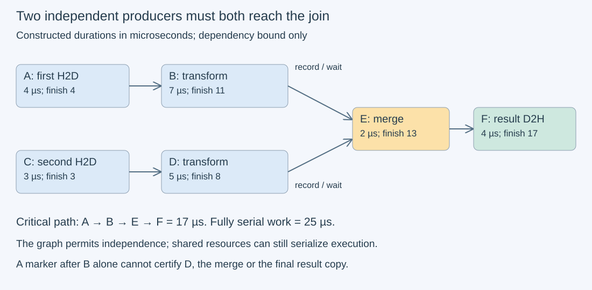
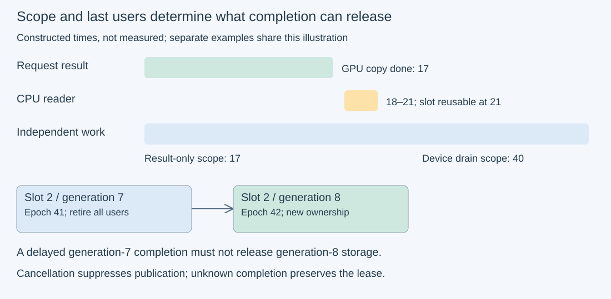

# M3-C11: Streams, events, and dependency ordering

> **Status: Complete — detailed chapter authored and documentation validated; experimental procedures are proposed unless explicitly labelled observed**

**Module:** Learn GPU architecture through data movement

**Category:** [Runtime and concurrency](index.md)

[Module 3 reading order](../module-3.md) · [Previous: M3-C10](../state-memory-and-caching/m3-c10-host-and-device-buffer-placement-and-lifetime.md) · [Next: M3-C12](m3-c12-asynchronous-copies-and-useful-overlap.md) · [Execution plan and progress](../chapter-execution-plan.md)

## Target concepts

Asynchronous submission versus completion, stream ordering, cross-stream events, default-stream semantics, synchronization scope, producer-consumer dependencies, safe buffer reuse.

## Concepts

### 1. A submission is a request for future work

A CPU thread can ask a GPU to copy data or perform a calculation, then continue before that work finishes. **Submission** means issuing that request; **completion** means the operation has finished under its documented contract. A **stream** is an ordered sequence of GPU operations. It is neither a CPU thread nor a reserved GPU core. Two streams can share the same compute and memory resources.

This chapter uses ordinary launches and copies, one device and one CUDA context: the runtime environment owning the device work. Specialized dependent-launch mechanisms and graph capture are outside the experiment contract. For this ordinary sequence, earlier operations in a stream establish ordering for later dependent operations. Across streams, CPU submission order alone does not establish the required device dependency. Separate streams permit independence; they do not promise simultaneous execution. See the [CUDA asynchronous execution guide](https://docs.nvidia.com/cuda/cuda-programming-guide/02-basics/asynchronous-execution.html).

A host call that returns quickly tells us little about the destination buffer. An “Async” operation can also block internally depending on arguments and resources. Read the [API synchronization specification](https://docs.nvidia.com/cuda/cuda-runtime-api/api-sync-behavior.html), rather than using an observed fast return as a lifetime contract.

In the Rust context, an ordinary scope ending or a CPU future becoming ready proves GPU completion only if the selected binding explicitly provides that guarantee. A future is an object representing an eventual result. Its cancellation is not automatically cancellation of previously submitted device work. Keep the [M3-C10 buffer leases](../state-memory-and-caching/m3-c10-host-and-device-buffer-placement-and-lifetime.md) until their actual last users finish.

### 2. Draw the producer-consumer graph before selecting streams

A **producer** writes data; a **consumer** reads it. A dependency edge A → B means B needs A to finish before accessing the affected data. A **directed acyclic graph**, or DAG, is a set of directed edges with no path back to its starting point. It describes the ordering obligations without prescribing a particular schedule.

Consider a constructed request with two independent input branches. H2D means host-to-device copy; D2H means device-to-host copy. All times below are invented microseconds, not measurements. The final merge reads both branch results. Each branch and the output have their own backing allocations.

| Operation | Duration d | Required predecessors | Earliest finish F |
| --- | --- | --- | --- |
| A: first H2D | 4 | None | 4 |
| B: first transform | 7 | A | 11 |
| C: second H2D | 3 | None | 3 |
| D: second transform | 5 | C | 8 |
| E: merge branches | 2 | B, D | 13 |
| F: result D2H | 4 | E | 17 |

For operation v, with predecessor set pred(v), use:

**F(v) = d(v) + max(F(u) for u in pred(v))**, with the maximum of an empty predecessor set defined as zero.

The **critical path** is the longest chain of required work. Here A → B → E → F takes 17 µs; serializing all six operations takes 25 µs. The ideal ratio is 25/17 ≈ 1.47. This is a dependency-only lower bound under immediate submission and unlimited compatible resources, not a prediction that one GPU will achieve it. Copy-engine contention, compute occupancy, bandwidth, launch overhead and host delays can extend the actual schedule. Even genuinely independent work can queue behind a shared resource.

*The join must cover both branches. The 17 µs label is a constructed dependency bound; no concurrency or measured speedup is asserted.*

The graph also exposes correctness mistakes. A merge waiting for B but not D lacks a dependency even if repeated tests happen to produce the expected answer. In a trace where E begins at 11 but D finishes at 14, E can read unfinished data. A successful fast schedule cannot repair a missing edge.

### 3. An event identifies a completed prefix, not every future use

An **event** is a runtime marker associated with work already submitted to a stream. Recording it captures that stream's current prefix. A prefix is the operations up to that point. A consumer stream can wait for that captured work before running its subsequent operations; the CPU need not wait there. A host event wait instead delays the calling CPU thread. These are different coordination choices.

The [event specification](https://docs.nvidia.com/cuda/cuda-runtime-api/cuda_runtime_api/group__CUDART__EVENT.html) has two easy-to-miss rules: an unrecorded event represents no work, and recording it again replaces its captured state. A stream wait uses the recording current when the wait is issued; later recordings do not retroactively extend that wait. Therefore, “wait now, record the intended producer later” is not a forward promise. Nor does an event before a producer cover that producer.

Adopt a deliberately simple application rule: one event identity per in-flight slot generation, recorded after its producer and before issuing the matching consumer wait. Reuse it only after all old observers and users have retired. A **generation** is a monotonically assigned identity distinguishing successive uses of the same slot; it is application metadata, not a CUDA event feature. This conservative rule avoids reasoning about simultaneous re-records. Different CPU submitter threads also need a host coordination rule publishing the correct recording before the consumer issues its wait.

For the two-branch graph, the merge stream needs evidence covering both B and D. An event after E can establish that both producers and E finished because the join is already in its dependency chain. An event after B alone says nothing about a later merge, copy or CPU consumer. The [stream API specification](https://docs.nvidia.com/cuda/cuda-runtime-api/cuda_runtime_api/group__CUDART__STREAM.html) defines device waits and stream completion operations.

### 4. Choose the smallest scope that covers the result

A **synchronization scope** is the set of work whose completion a wait establishes. A narrow wait is useful only when that set includes every required producer and last user.

| Coordination action | Who waits? | Evidence established in this chapter's single-device setting | What remains unproven? |
| --- | --- | --- | --- |
| Consumer stream waits for a recorded producer event | Subsequent consumer work | Captured producer prefix precedes subsequent consumer operations | Host-readable final output; later producer work |
| Host waits for the final event | Calling CPU thread | Work captured by that event completed | Independent unrelated streams; CPU consumers after the event |
| Host synchronizes the result stream | Calling CPU thread | Previously submitted work in that stream completed, including its dependencies | Unrelated streams |
| Host synchronizes the current device | Calling CPU thread | Preceding work across its streams completed | Future submissions; other devices; subsequent CPU use |
| Host queries an event | Nobody is forced to wait | A status observation about its captured prefix | Correct recording identity, unchecked errors or unrelated users |

A query returning “not ready” is not failure and not permission to read. A failed query or wait is not successful completion. Reject ambiguous status and preserve the affected resources until a documented drain or recovery establishes safety. Avoid concurrent submission during these scope experiments so the boundary “previously submitted” is reproducible.

A constructed scope example makes the difference concrete: request R completes at 17 µs; an independent diagnostic ends at 40 µs. With those fixed completion times, a result-only wait can observe R at 17 while a device drain waits until 40. The extra 23 µs is scope coupling in this example, not GPU compute added to R. On real hardware, removing the broad wait may also change scheduling and contention, so measure both policies rather than subtracting assumed constants.

*Request completion, unrelated work and safe reuse have separate boundaries. A later CPU consumer can retain the result after the GPU is finished.*

### 5. The default stream is a configuration contract

The [CUDA default-stream specification](https://docs.nvidia.com/cuda/cuda-runtime-api/stream-sync-behavior.html) distinguishes a legacy default stream from a per-thread default stream. The legacy stream implicitly coordinates with ordinary blocking streams in the same context, but explicitly non-blocking streams are exempt. “Non-blocking” here describes this legacy interaction, not a guarantee that every host API call returns immediately. A per-thread default stream belongs to a host thread and context; it behaves independently of ordinary streams, while still interacting with an explicitly used legacy stream.

Use three independent, preinitialized buffers for this teaching submission sequence: A in an explicit stream S, then diagnostic D in the configured default stream, then B in S. S itself orders A → B.

| Default mode and S kind | Additional ordering required by these semantics |
| --- | --- |
| Legacy default; ordinary blocking S | A → D → B |
| Legacy default; explicitly non-blocking S | No D edge with A or B |
| Per-thread default; ordinary blocking S; no explicit legacy operations | No D edge with A or B |
| Per-thread default; explicitly non-blocking S; no explicit legacy operations | No D edge with A or B |

The three “no D edge” rows allow either serialized or overlapping execution. A serialized trace does not prove an implicit dependency. Record the actual mode of each compiled component and stream flags, including the Rust binding and any native libraries; an application-wide label alone may conceal mixed settings. Avoid relying on an accidental legacy barrier for a producer-consumer relation. Declare the relation explicitly so a later stream-mode change cannot silently remove correctness.

### 6. Completion, publication and reclamation form different obligations

For a request slot, define its identity as (slot, generation, request epoch). An epoch labels the input instance. Safe whole-slot reuse requires all submitted device users finished, the final host output is valid, and every CPU consumer has released its lease:

**safe_reuse = device_users_finished AND host_consumers_finished AND identity_matches AND no_unknown_completion**.

A result can be completed yet too stale to publish. A cancelled request can suppress publication while still retaining pending GPU leases. A deadline decides usefulness, not physical completion. Under overload, reject or defer new admissions when no safe slot is available; reusing a busy slot converts a capacity problem into corrupted state. Stream destruction and a watchdog expiring are not application-level proof that all buffers can be reclaimed.

HFT systems similarly distinguish submitting work, observing a completion and deciding whether an answer is still timely. This lens encourages explicit message identity, bounded queues and measured tails. A CUDA event is not an exchange acknowledgement, a trading risk check or a hard real-time guarantee. These experiments study tensor and buffer correctness, with no market or financial outcome claimed.

## Experiments

All experiments below are **proposed**, without implementation code. E1 and E4 are paper/reference exercises. E2 and E3 describe future single-GPU work; none has been executed here. Use [M9-C01 references](../numerics-and-correctness/m9-c01-defining-reference-behavior-and-evidence-before-optimizing.md), [M9-C02 timing boundaries](../measurement-experimentation-and-economics/m9-c02-request-events-clocks-and-measurement-boundaries.md), [M9-C07 uncertainty](../measurement-experimentation-and-economics/m9-c07-latency-distributions-and-statistical-uncertainty.md), [M9-C15 storage accounting](../state-memory-and-caching/m9-c15-accounting-for-weights-kv-state-workspace-and-fragmentation.md) and [M9-C17 numerical gates](../numerics-and-correctness/m9-c17-comparing-logits-with-justified-numerical-tolerances.md). The needed local contracts follow.

### E1 — Reconstruct the join and its critical path

- **Description:** Build and inspect the six-operation graph in the worked example, then add one serializing edge and remove one required join edge on paper.
- **Purpose/objective:** Separate correctness dependencies from scheduling choices and resource-limited execution.
- **Target concepts:** Stream ordering, producer-consumer dependencies, cross-stream events and critical paths.
- **Baseline and workload:** Baseline durations A=4, B=7, C=3, D=5, E=2, F=4 µs. Compare the correct two-branch graph, a correct serialized graph adding B → C, and the incorrect graph omitting D → E.
- **Controls and prediction:** Keep durations fixed, assume zero submission/event overhead and unlimited resources for the bound only. Predict finishes (4,11,3,8,13,17); adding B → C gives (4,11,14,19,21,25). The missing edge fails structural validation even when its earliest schedule returns correct data.
- **Procedure:** Enumerate producers for every read, assign streams and record/wait positions, then calculate finishes in dependency order. Supply a permissible missing-edge witness with D delayed until 14 and E starting at 11. Show why delaying D is legal but reading its unfinished output is not. Add F → A to the baseline graph as the cycle witness: A → B → E → F → A. Reject it before submission rather than trying to hang a GPU.
- **Hardware/software:** Paper or a spreadsheet suffices; no GPU, runtime or benchmark timing is needed.
- **Failure and HFT connection:** Treat the missing second producer like processing an event before all required state updates arrive. An early partial answer is not a low-latency success.
- **Exit criteria:** Both finish vectors and 25/17 ratio agree; every required read has an incoming dependency; the missing-edge and cycle examples are rejected. Do not convert the bound into a measured speedup claim.

### E2 — Compare result completion against a device-wide drain

- **Description:** Execute one exact vector request across producer and consumer streams, using three host completion scopes with and without unrelated device work.
- **Purpose/objective:** Test whether a broad completion scope couples request latency to diagnostic work while preserving identical results.
- **Target concepts:** Submission/completion, event joins, synchronization scope and safe buffer reuse.
- **Baseline and workload:** N ∈ {4,096; 262,144} binary32 elements. Epoch e ∈ {0,…,59}; Xᵢ(e)=256e+(i mod 256). Producer stream: input H2D then Aᵢ=2Xᵢ+1 then producer event. Consumer stream: wait for that recording, Bᵢ=Aᵢ+3, output D2H, final event. Compare host final-event wait, consumer-stream synchronization and current-device synchronization. Cross each with diagnostic absent/present: 12 cells. Diagnostic Zᵢ starts at i mod 64 and undergoes 16 ordered additions of one in a separate stream and allocation; expected Zᵢ=(i mod 64)+16.
- **Controls and prediction:** Use explicit non-blocking streams, a single host submitter and one in-flight request. Allocate, pin, initialize, create streams/events and finish diagnostic initialization outside timing. Start the same host monotonic clock immediately before submissions; when present submit all 16 diagnostic operations first, then the request chain. Stop after the selected host wait succeeds. All policies record the same final event and retain identical request edges. Predict identical outputs; the device drain covers more work, but no minimum latency gap or overlap is promised.
- **Procedure:** Run three independent sessions, each with 10 excluded warmups and 20 measured trials per cell; rotate cell order between sessions. Assign unique epochs 0–59 within each cell's measured trials. After the timed wait, validate the request. Drain any diagnostic outside the primary interval and copy/validate its output before the next trial. Retire CPU readers before slot reuse. Keep profile captures separate from timing runs.
- **Hardware/software:** One CUDA-capable GPU, binary32 arithmetic, pinned host input/output and a recorded driver/toolkit/binding configuration. Request payload is 2 host buffers + 3 device buffers, each 4N bytes. Diagnostic adds one device buffer and two host buffers for initialization/readback. At maximum N, total raw payload is 4 MiB host + 4 MiB device; allocator/runtime overhead is additional. Hardware concurrency is not required for correctness.
- **Failure and HFT connection:** An unrelated reporting task can extend a broad drain, similar to coupling a latency-sensitive path to a maintenance queue. Missing event edges, stale epochs or unsafe reuse are failures regardless of elapsed time. A 120-second watchdog terminates a trial as unknown/error, never as successful reclamation.
- **Exit criteria:** Reconcile 720 measured trials and 360 warmups; every admitted measured trial has an outcome. For each successful request every element equals 2Xᵢ+4; every present diagnostic equals its reference. Preserve scope-labelled raw timings and status counts. Pass the dependency/lifetime audit even if no performance difference is resolvable; claim a scope-related improvement only with repeated evidence.

### E3 — Audit legacy and per-thread default ordering

- **Description:** Compare the four rows of the default-mode table using independent buffers; check documented edges separately from observed scheduling.
- **Purpose/objective:** Expose hidden legacy ordering without deliberately racing shared data.
- **Target concepts:** Default-stream semantics, stream flags, synchronization scope and submission order.
- **Baseline and workload:** N=4,096. Three distinct binary32 device vectors A, D and B, each initially i mod 256. Submit one addition of one to A in S, then D in the configured default stream, then B in S. All final values must equal (i mod 256)+1. Four mode/stream-kind cells; one host thread and context; no explicit legacy operations in per-thread cells. Separate processes or builds isolate modes.
- **Controls and prediction:** Hold operations, allocation, input and submission order fixed; record the actual mode of the component issuing each operation. Complete initialization and drain the device before the timed submissions. Measure host time through a device drain after each trial's three submissions; copy all results afterward. Predict A → B in every cell, plus A → D → B only in the legacy/blocking cell. Do not predict simultaneous execution in any cell.
- **Procedure:** First check all four graphs on paper. For future device runs, use three sessions per cell, 10 warmups plus 20 measured trials/session, with dedicated short profile trials. Capture stream identities and operation intervals. If a mode cannot be configured through the binding, classify it unsupported instead of relabelling an explicit stream as the default stream.
- **Hardware/software:** One supported GPU; three device vectors use 48 KiB and one reusable host initialization/readback vector uses 16 KiB. Include additional overhead in the manifest. Two reproducibly identified default-mode configurations and explicit stream flags are required for a full four-cell comparison.
- **Failure and HFT connection:** Treat an undocumented default barrier like an implicit queue dependency that disappears after a library upgrade. Independent allocations make this a safe scheduling study, not an unsafe race demonstration.
- **Exit criteria:** Correctly classify all four graph rows and reconcile up to 240 measured trials and 120 warmups. Validate all three output vectors after each successful trial. In a legacy/blocking trace, required ordering must hold; absent observed overlap in the other rows is inconclusive about additional dependencies. Unsupported cells remain explicit and do not count as executed.

### E4 — Reject stale events and premature reuse on paper

- **Description:** Apply an identity-aware completion ledger to a slot with two producer branches, a final result event and a CPU consumer.
- **Purpose/objective:** Prove that a convenient event status cannot substitute for correct recording, scope and ownership.
- **Target concepts:** Cross-stream event capture, synchronization scope, safe reuse, cancellation and completion errors.
- **Baseline and workload:** Slot 2, generation 7, epoch 41 uses the correct E1 graph. Both branch records precede their consumer waits. Result copy completes at constructed time 17; CPU reads from 18 to 21. Whole-slot reuse is allowed at 21, then generation 8/epoch 42 may begin. Use the fixed 17/40 scope example only as a separate timeline.
- **Controls and prediction:** Keep identities and captured prefixes explicit. Compare eight fault cases: unrecorded producer event; event recorded before its producer; wait issued before intended recording; wait captured generation 6 before re-recording generation 7; final marker missing D2H; old generation-7 completion arriving after generation 8 begins; unknown completion/error; cancellation at time 10. None grants premature reuse or publication.
- **Procedure:** Mark each event with the exact operations it covers. A wait captured against generation 6 remains about generation 6 after a later record. Check identity before any release; duplicate old completions are idempotent, meaning repeating them changes no ownership state. For cancellation, suppress publication, retain submitted users until drain, and release only after any CPU reader retires. Never submit these faulty graphs to real hardware.
- **Hardware/software:** Paper/ledger only. Use separate proposed runtime diagnostics, if later needed, without invalid buffer accesses or relying on a deadlock timeout.
- **Failure and HFT connection:** Stale notifications resemble old message acknowledgements applied to a recycled object. They must not release a current request's storage. A deadline can make a result useless without making its memory free.
- **Exit criteria:** The valid trace releases at 21, never at 17 while the CPU reader is active. All eight fault cases reject early release/publication; unknown completion quarantines the slot. The cancelled trace records whether all work had already been submitted and retains every actual pending user until completion/recovery; cancellation itself clears no lease.

## Verification

### References and numerical gates

These are exact integer-valued binary32 fixtures. In E2 at epoch 59, X ≤ 15,359, A ≤ 30,719 and B ≤ 30,722: each value and operation result is exactly representable. Element checks, rather than checksums alone, detect permutations, stale epochs and missing stages. For N divisible by 256:

**mean(B) = 512e + 259; sum(B) = N(512e + 259).**

At e=0, sums are 1,060,864 for N=4,096 and 67,895,296 for N=262,144. At e=59 they are 124,792,832 and 7,986,741,248. Compute reference sums as wide integers; do not expect a binary32 reduction to preserve an exact large integer checksum. E2 diagnostic mean is 47.5 for these sizes. E3 mean is 128.5 and each vector's integer sum is 526,336. Distinguish correct arithmetic from correct dependency structure: both gates must pass.

| Experiment | Correctness/reference gate | Measurement or profiling evidence | Claim boundary |
| --- | --- | --- | --- |
| E1 | All producer reads ordered; two finish vectors; missing-edge/cycle rejection | Dependency-only bound and explicit delayed-D witness | No observed GPU timing |
| E2 | Exact epoch-labelled request and diagnostic outputs; final event includes D2H; leases retained | Host submit duration, chosen host completion interval, wait duration, per-stream timeline and outcome counts | Broad scope may include unrelated work; host return time alone is insufficient |
| E3 | Three independent vectors and four documented graph rows | Actual component mode, stream flags and intervals from separate profile trials | Serialized independent work does not prove a semantic edge |
| E4 | Captured prefix + slot/generation/epoch + last-reader ledger | Eight rejected paper faults, duplicate completion and cancellation record | No invalid GPU experiment or recovery implementation claimed |

### Benchmark and profile boundaries

For E2 define primary **L = host time after successful selected wait − host time before first timed submission**. This includes CPU submission, queueing, dependencies, request H2D/transforms/D2H and the selected completion mechanism. It excludes allocation, initialization, correctness checking and post-interval diagnostic drain/readback. Keep an additional full-cycle interval through validation and safe reuse; narrowing a primary wait may move work into that later interval. With diagnostic present, report both useful request work and diagnostic work rather than combining their rates.

For each successful E2 request, logical request H2D+D2H payload is **8N bytes**, useful arithmetic is **N multiplies + 2N additions**, and the two transforms' logical global read/write traffic is **16N bytes** before cache effects. These are three different ledgers, not measured link/DRAM traffic. Across all 720 successful E2 measured requests, expected output count is 95,846,400 and request transfer payload is 766,771,200 bytes. Present diagnostics add their own initialization, 16 passes and readback; never attribute those bytes to useful request transfers. Do not divide GPU theoretical FLOPs or link rates by mixed-scope counters.

Record every attempted trial as successful, numerical failure, dependency/identity failure, runtime error, timeout/unknown or unsupported before admission. Keep total admissions separate from unsupported configuration attempts. For each cell retain all three sessions' 20 raw successful timings, failures and warmup counts. Report medians, ranges and session variation; define a percentile as the nearest-rank sorted observation at rank ceil(pn). Twenty observations do not establish a stable p99. Never average session percentiles or discard slow successful trials because a diagnostic was inconvenient. Fix input sizes and epoch schedule, rotate policy order and record clock/power/thermal state, other processes and host scheduling conditions.

Profile a small separate cohort with [Nsight Systems](https://docs.nvidia.com/nsight-systems/UserGuide/index.html): correlate host API intervals, stream IDs, copies, kernels and synchronization. Check that producer markers follow their writers, consumer waits precede reads, and the final marker follows D2H. Some dependencies require the submission ledger as well as timeline evidence. Profiling changes overhead; traced durations are not interchangeable with unprofiled benchmark results. No overlap observed can mean resource saturation or coarse tracing, not an absent API feature.

Use dependency events with timing disabled when only ordering is required. Optional timing-enabled events must be separate and placed around a defined chain; do not subtract unrelated event timestamps and call it request latency. The runtime [event timing contract](https://docs.nvidia.com/cuda/cuda-runtime-api/cuda_runtime_api/group__CUDART__EVENT.html) requires suitable completed recordings; event intervals can include intervening work and scheduling effects. Host completion and event time answer different questions.

End-to-end inference acceptance is a later experiment: preserve a fixed cohort's input/output identity, generation completion, cancellation outcomes and admitted/dropped counts while measuring request latency and useful tokens per second. A narrower tensor wait is valuable only if it improves that service without stale outputs, extra retained state or hidden draining cost. This chapter makes no serving throughput claim.

## Engineering dimensions and principles

| Dimension | Application within this chapter |
| --- | --- |
| Semantics and invariants | Every consumer has completed producers; final output matches the exact epoch; an event covers a specific prefix. |
| Workload and variability | Compare vector sizes, diagnostic presence, host modes and session variation; independence alone does not guarantee overlap. |
| Resources and bottlenecks | Streams compete for compute, copy engines, memory bandwidth and CPU submission time; account separately for retained buffers. |
| Time and distributions | Distinguish API return, critical path, chosen completion scope and full-cycle time; preserve slow trials and avoid unsupported p99 claims. |
| Ownership and coordination | Track slot/generation/epoch, producer events, cross-stream waits and the final CPU reader before reclamation. |
| Failure and adaptation | Reject bad graphs before submission, quarantine unknown completion, suppress cancelled publication and bound admissions by safe slots. |

1. **Correctness defines the optimization boundary.** Removing a required edge changes the valid program even if observed outputs occasionally match. All timing comparisons retain exact references and lifetime gates.
2. **Performance depends on workload and operating point.** A broad drain's cost depends on unrelated work; vector length and GPU resource pressure can erase a concurrency opportunity.
3. **Data movement is part of the algorithm.** Include H2D and D2H in host-readable completion. Separate logical request bytes from diagnostic and hardware traffic.
4. **State has ownership, lifetime and recovery cost.** Event objects, buffers and host readers have separate lifetimes. An unknown completion retains capacity until safety is established.
5. **Dependencies determine latency; bottlenecks determine capacity.** The DAG gives a 17 µs teaching bound; shared resources may serialize its branches. Extra streams do not create capacity.
6. **Variability and synchronization shape the tail.** A broad drain can attach unrelated variability to a request. Narrow waits can still suffer shared-resource contention.
7. **Local improvements must be evaluated end to end.** Report full-cycle reuse time beside primary completion; moving diagnostic draining out of an interval is not automatically greater useful throughput.
8. **Claims require reproducible evidence.** Keep actual default modes, flags, exact output checks, all status counts and separate traced/untraced cohorts with the environment manifest.

## Specifications, articles, and hardware

Sources below were checked for this chapter. API names identify contracts, not implementation instructions. Pin the actual toolkit/driver and Rust binding versions in a future experiment rather than assuming the web manual matches an installed runtime.

| Source | Use and limits |
| --- | --- |
| [CUDA asynchronous execution guide](https://docs.nvidia.com/cuda/cuda-programming-guide/02-basics/asynchronous-execution.html) | Ordinary stream ordering and distinct host/device coordination; special advanced launch mechanisms excluded here. |
| [CUDA Runtime 13.4 stream management](https://docs.nvidia.com/cuda/cuda-runtime-api/cuda_runtime_api/group__CUDART__STREAM.html) | Stream waits, query and synchronization scope; follow the exact operation contract. |
| [CUDA Runtime 13.4 event management](https://docs.nvidia.com/cuda/cuda-runtime-api/cuda_runtime_api/group__CUDART__EVENT.html) | Captured prefixes, re-recording, empty events, completion and timing restrictions. |
| [CUDA default-stream semantics](https://docs.nvidia.com/cuda/cuda-runtime-api/stream-sync-behavior.html) | Legacy, per-thread and non-blocking interactions; mode can differ across compiled components. |
| [CUDA API synchronization behavior](https://docs.nvidia.com/cuda/cuda-runtime-api/api-sync-behavior.html) | Argument-dependent host blocking; an asynchronous name does not prove immediate return. |
| [How to Overlap Data Transfers in CUDA C/C++](https://developer.nvidia.com/blog/how-overlap-data-transfers-cuda-cc/) | Historical 2012 article illustrating transfer/stream scheduling. Its examples predate per-thread defaults; use current specifications for semantics and do not borrow historical GPU timings as predictions. No article code is reproduced. |
| [Nsight Systems user guide](https://docs.nvidia.com/nsight-systems/UserGuide/index.html) | Separate timeline profiling and focused capture; trace collection is evidence with overhead. |

A future hardware manifest must state GPU model and compute capability, device count/context, memory capacity, concurrent-kernel and asynchronous-copy capabilities, host CPU/core and NUMA placement, physical RAM and pinned allocation budget, transfer link generation/width, driver/toolkit/binding/compiler versions, stream flags, default modes, event flags, clocks/power state and profiler version. NUMA means memory associated more closely with a particular CPU socket; it can affect transfers without changing dependency semantics. Record actual configuration rather than inventing a test machine.

The baseline needs one supported GPU and enough host/device memory for E2's 8 MiB maximum raw payload plus runtime overhead; E3 is smaller. Pinned host allocation capability and normal event/stream support are required for these device experiments. Multiple devices, network hardware and concurrent execution capability are unnecessary for correctness. Arithmetic, graph and fault references need no GPU. No device benchmark, trace or real hardware measurement is supplied.

## Completion and next chapter

Track acceptance in the clickable [execution plan](../chapter-execution-plan.md). [M3-C12: Asynchronous copies and useful overlap](m3-c12-asynchronous-copies-and-useful-overlap.md) is now complete and remains the next Module 3 reading chapter. The next authoring chapter is [M3-C13](../hardware-architecture-and-topology/m3-c13-pcie-nvlink-numa-and-device-topology.md). Module 9 supports Modules 1–7; Module 8 is excluded.
