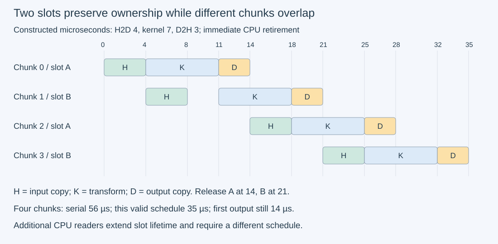
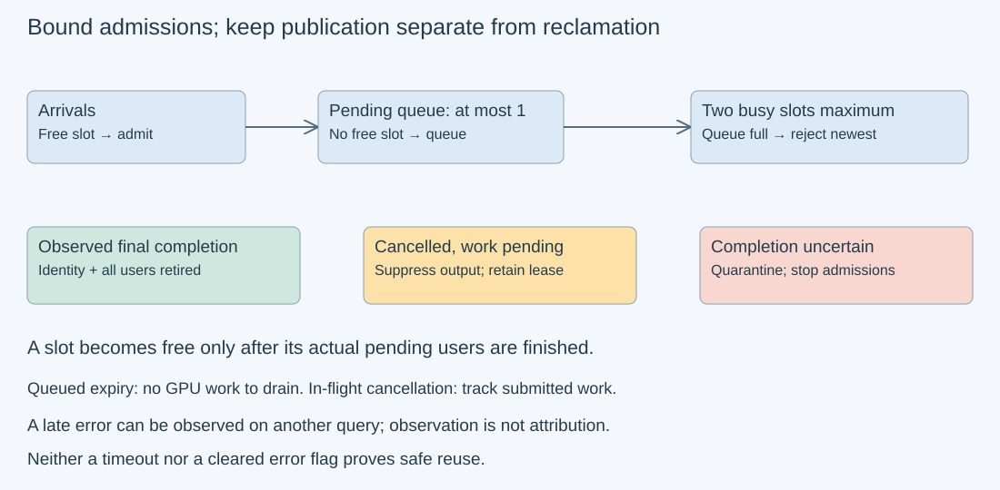

# M3-C12: Asynchronous copies and useful overlap

> **Status: Complete — detailed chapter authored and documentation validated; experimental procedures are proposed unless explicitly labelled observed**

**Module:** Learn GPU architecture through data movement

**Category:** [Runtime and concurrency](index.md)

[Module 3 reading order](../module-3.md) · [Previous: M3-C11](m3-c11-streams-events-and-dependency-ordering.md) · [Next: M3-C13](../hardware-architecture-and-topology/m3-c13-pcie-nvlink-numa-and-device-topology.md) · [Execution plan and progress](../chapter-execution-plan.md)

## Target concepts

Copy engines, pinned-memory requirements, double buffering, copy-compute overlap, independence and resource constraints, backpressure, cancellation with in-flight work, asynchronous error observation.

## Concepts

### 1. Overlap requires independent work and available resources

A **copy engine** is device hardware that can move data without using the same execution units as an ordinary GPU calculation. A host-to-device copy, abbreviated H2D, supplies an input; a device-to-host copy, D2H, returns a result. Separate hardware can permit a copy for one chunk while the GPU calculates another. A **chunk** is a bounded portion of a larger tensor.

The same chunk's calculation still needs its input copy to finish. Its result copy still needs the calculation to finish. Splitting those three operations across streams cannot remove those dependencies. Useful overlap comes from different chunks whose data and storage are independent. Review [M3-C11](m3-c11-streams-events-and-dependency-ordering.md) for streams, event recordings and completion scope.

Device copy capabilities describe opportunities, not reserved bandwidth or a complete execution schedule. Link traffic, device memory traffic, compute resources and CPU submission can contend. A memory-intensive kernel may slow down when it shares memory bandwidth with a transfer. The [CUDA transfer guidance](https://docs.nvidia.com/cuda/cuda-c-best-practices-guide/index.html#asynchronous-and-overlapping-transfers-with-computation) describes pinned buffers, streams and capability inspection. Measure the actual device; an engine count alone does not guarantee simultaneous bidirectional transfers or useful overlap for a particular workload.

### 2. Pinned memory removes one obstacle, not every wait

**Pinned**, or page-locked, host memory has backing pages held in place for the transfer contract. This differs from pageable host storage, whose backing may move. For the explicit host-copy overlap experiment here, use documented CUDA pinned allocations or registration. Rust's similarly named Pin abstraction controls movement of a Rust value; it does not pin physical host pages for a GPU.

Prepare a bounded pinned pool outside steady-state timing and account for its retained capacity. Pinning every incoming request under load can itself consume time and scarce memory. Pinned pages do not guarantee that the CPU call never blocks. Pageable routes may stage data or synchronize; the [runtime synchronization specification](https://docs.nvidia.com/cuda/cuda-runtime-api/api-sync-behavior.html) is the authority for exact call behavior. Do not infer a portable contract from an “Async” suffix or one observed quick return.

### 3. Double buffering gives storage to the next independent chunk

A **slot** is a reusable set of buffers plus ownership metadata. In this chapter each slot has pinned host input/output and device input/output. One stream owns that slot's ordinary H2D → transform → D2H sequence. A completion event follows D2H. Different slots use distinct allocations and explicit non-blocking streams. This creates inter-chunk independence while preserving same-chunk order.

**Double buffering** means retaining two such slots: the GPU can use one while the host prepares or retires the other. It does not mean two operations may write the same buffer simultaneously. Retain a slot until device completion has been observed and its CPU consumer has finished. A slot's generation identifies a particular reuse, so an old completion cannot release new work.

For chunk length C binary32 elements, one buffer's payload B=4C bytes. For P slots:

**pinned host payload = 2PB; device payload = 2PB; combined slot payload = 4PB.**

These are logical allocation payloads. Registration coverage, allocator overhead, runtime state and a retained output archive are additional. With C=262,144, B=1 MiB; P=2 needs 4 MiB pinned host plus 4 MiB device payload. Retaining a 4 MiB CPU output archive raises total raw storage to 12 MiB. Increasing P trades memory and outstanding work for a possible scheduling opportunity.

### 4. Separate pipeline throughput from individual latency

A **pipeline** places different chunks at different stages. Consider an invented model with H2D duration h=4 µs, kernel duration k=7 µs and D2H duration d=3 µs. Assume one resource for each stage, independence between those resources, no CPU overhead and immediate CPU retirement. A slot is held through D2H. One slot serializes each chunk for 14 µs. Two slots permit the following valid four-chunk schedule:

| Chunk / slot | H2D interval | Kernel interval | D2H interval | Slot released |
| --- | --- | --- | --- | --- |
| 0 / A | 0–4 | 4–11 | 11–14 | 14 |
| 1 / B | 4–8 | 11–18 | 18–21 | 21 |
| 2 / A | 14–18 | 18–25 | 25–28 | 28 |
| 3 / B | 21–25 | 25–32 | 32–35 | 35 |

All times are constructed microseconds, not measured GPU values. Four serialized chunks take 56 µs; this schedule takes 35 µs, an ideal ratio of 1.6. The first chunk still finishes at 14. Chunk 1 spends 17 µs between its H2D start and output completion because it waits for compute; throughput improved without making every chunk faster.

For J chunks, with enough storage and the stated independent stage resources, a useful ideal bound is:

**T_ideal(J) = h + k + d + (J−1) max(h,k,d).**

It includes pipeline fill and drain. With one shared resource for both copy directions, its per-chunk demand is h+d, so the steady-state interval cannot be below **max(h+d,k)**; finite slot availability and scheduling may increase it further. For h=6, k=2, d=6, three independent stage resources give a 6 µs interval bound, but a shared copy resource gives 12 µs. Never use the independent-resource formula without its assumptions.

A slot is occupied for a duration W, including any CPU retention. To sustain completion rate λ, average occupied slots are λW under steady-state flow accounting. Thus **λ ≤ P/W** is a slot-capacity constraint when W is the corresponding average residence time. This is not a deterministic latency guarantee: burst arrivals and variable retention can still fill the pool. If a CPU reader adds 2 µs to the original 14 µs isolated residence, sustaining one completion every 7 µs would require at least ceil(16/7)=3 slots under that simplified residence model. Recalculate the actual schedule; do not claim that a third slot automatically produces a speedup.

*Constructed schedule only. Slot A cannot accept chunk 2 until chunk 0's copy and consumer have retired.*

### 5. Backpressure protects correctness under overload

**Backpressure** means slowing or refusing admissions when downstream capacity is exhausted. Keep separate counts for free slots, admitted in-flight chunks and a bounded pending queue. A queue contains work waiting for a slot; it does not create more transfer or compute capacity. Unbounded queues hide overload as growing latency and retained memory.

For a two-slot pool and a one-entry pending queue, choose an explicit policy: take a free slot, otherwise queue one item, otherwise reject the newest arrival. Process completions before arrivals at equal timestamps. Pending items have metadata only in the paper model; real queued inputs need a separately bounded byte budget. Poll all busy slots for completion, retire available outputs, then admit queued work. Do not block only on a slow slot if another completed slot can be safely retired.

HFT systems provide a useful lens: a response can be correct yet too old to use, so queue age and drop counts matter alongside throughput. Inference chunks may also have dependencies: this chapter's elementwise transform has independent chunks, while an autoregressive token cannot generally run before its preceding token. Copy engines are not exchange links, and these experiments establish no trading or hard real-time guarantee.

### 6. Cancellation changes usefulness; completion controls ownership

A request can be cancelled while its H2D, kernel or D2H is pending. Stop new submissions for it where possible and suppress publication, but retain every already submitted operation's buffers. Dropping a Rust future or reaching a deadline does not prove GPU work stopped. If the full chain was already submitted, it may need to drain; if later stages were never submitted, record exactly which operations remain. Cancellation can temporarily reduce available capacity even though no useful answer will be published.

An **asynchronous error** becomes visible after the submission that caused it, perhaps during a later query or wait. Check immediate submission status and subsequent completion status. The [runtime error API](https://docs.nvidia.com/cuda/cuda-runtime-api/cuda_runtime_api/group__CUDART__ERROR.html) distinguishes observing the current error state from clearing it; neither action certifies all outstanding work completed. The [stream API](https://docs.nvidia.com/cuda/cuda-runtime-api/cuda_runtime_api/group__CUDART__STREAM.html) also notes that calls can report earlier asynchronous failures. An error observed while querying slot B need not identify B as its originating cause.

Use an identity ledger containing device/context, stream, operation sequence, slot/generation and request/chunk identity. A successful observed final recording with the correct identity plus retired CPU readers allows reuse. “Not ready” retains ownership. Errors or unknown completion quarantine affected resources and stop admissions within the uncertain recovery scope. A watchdog is a liveness alarm, not permission to free memory. Stream destruction is not an application-level completion proof. Recovery must follow the actual runtime/context error contract; this chapter does not invent a universal safe retry after device failure.

*Publication and reclamation are separate decisions. Cancelled work can keep a slot occupied; uncertain completion keeps it quarantined.*

## Experiments

All procedures below are **proposed**, with no implementation code. E1, E3 and E4 have paper reference exercises; E2 describes future hardware benchmarking. No GPU run or trace is claimed. Apply completed [M9-C01 references](../numerics-and-correctness/m9-c01-defining-reference-behavior-and-evidence-before-optimizing.md), [M9-C02 completed timing](../measurement-experimentation-and-economics/m9-c02-request-events-clocks-and-measurement-boundaries.md), [M9-C07 distributions](../measurement-experimentation-and-economics/m9-c07-latency-distributions-and-statistical-uncertainty.md), [M9-C15 bytes](../state-memory-and-caching/m9-c15-accounting-for-weights-kv-state-workspace-and-fragmentation.md) and [M9-C17 exact output gates](../numerics-and-correctness/m9-c17-comparing-logits-with-justified-numerical-tolerances.md).

### E1 — Check finite-slot pipeline schedules

- **Description:** Compare one-slot serialization and the two-slot four-chunk schedule, then change the resource and CPU-retention assumptions.
- **Purpose/objective:** Establish when overlap is legal and why throughput, first-result latency and slot residence differ.
- **Target concepts:** Copy engines, double buffering, independence, resource constraints and copy-compute overlap.
- **Baseline and workload:** J=4; h=4, k=7, d=3 µs; separate single-capacity stage resources; P=1 versus P=2. Keep the table's immediate retirement assumption initially.
- **Controls and prediction:** Predict serial makespan 56, two-slot makespan 35 and first completion 14 µs. Chunk 1's H2D-start-to-D2H-completion time is 17 µs. In a separate h=6,k=2,d=6 model compare copy-resource interval bounds 6 versus 12 µs, without claiming finite-buffer attainment.
- **Procedure:** Check every same-chunk edge, same-stage non-overlap and same-slot release-before-reuse. Add a 2 µs CPU reader after each D2H; reject the original H2D starts 14 and 21 for reused slots because releases become 16 and 23. A legal revised schedule has slot releases 16,23,32,39: chunks 2/3 use H2D 16–20/23–27, kernels 20–27/27–34, D2H 27–30/34–37 and CPU reads 30–32/37–39. Preserve the readers rather than deleting them. Apply the simplified ceil(16/7)=3 slot calculation only to its stated residence assumption.
- **Hardware/software:** Paper or spreadsheet only; no GPU or timing software.
- **Failure and HFT connection:** An attractive overlapping timeline is invalid if it overwrites a still-owned buffer. Similar queue diagrams must include acknowledgement/consumer lifetime, not only compute time.
- **Exit criteria:** Both base makespans and all constraints reconcile; the retained-reader schedule is rescheduled legally; resource-bound and slot-bound claims carry their assumptions and no hardware speedup is asserted.

### E2 — Benchmark useful work across chunk and slot counts

- **Description:** Transform a fixed vector using a bounded pinned pool, varying chunk length and retained slot count.
- **Purpose/objective:** Test whether extra storage and smaller chunks improve completed output after accounting for host preparation, retirement and fill/drain.
- **Target concepts:** Pinned memory, double buffering, copy-compute overlap, resource limits and safe reuse.
- **Baseline and workload:** Total M=1,048,576 binary32 elements. Chunk length C ∈ {65,536; 262,144; 1,048,576}, giving J ∈ {16; 4; 1}. P ∈ {1; 2; 3}, nine cells; P=1 is the same-chunk baseline. For trial epoch e ∈ {0,…,59}, global index i ∈ {0,…,M−1}, Xᵢ(e)=i+1024e and Yᵢ=2Xᵢ+1. Chunk j covers global indices jC through (j+1)C−1. Metadata retains epoch, chunk, global offset, slot and generation.
- **Controls and prediction:** Allocate the P four-buffer slots, output archive, events and explicit non-blocking streams outside timing. Do not allocate/register memory in the primary interval. Each slot stream orders H2D → transform → D2H → final recording. Predict exact identical outputs; P>1 permits overlap only when J>1 and resources allow it. P=3,J=1 retains unused capacity and cannot create independent work.
- **Procedure:** Use three sessions, 10 excluded warmups and 20 measured trials/cell/session, rotating cell order. Assign epochs 0–59 per cell. Start a monotonic host clock before filling the first slot's host input. Fill each chunk from its global-index reference inside the interval, submit its chain, and when a final recording succeeds copy its host output into the correct region of a preallocated CPU archive before reusing that slot. Retire any completed slot rather than enforcing a global per-chunk barrier. Stop only after all J outputs are archived and every slot's users retired; check every archived element afterward. Keep fixed work, arithmetic and pool policy across cells.
- **Hardware/software:** One supported CUDA GPU, pinned allocation support and recorded device/host/compiler/runtime/binding settings. B=4C; peak pool payload with P=3,C=M is 24 MiB pinned host + 24 MiB device. A separate 4 MiB CPU archive makes 52 MiB total raw storage; runtime and allocator overhead are additional. No multi-GPU or network hardware required.
- **Failure and HFT connection:** More outstanding work can consume capacity without lowering useful latency. A stale chunk or lost completion invalidates a trial even if its stream timeline looks busy. Use a 120-second watchdog to classify unresolved trials as unknown/error, retain safety, and stop the affected run.
- **Exit criteria:** Reconcile 540 measured trials and 270 warmups; every admitted trial has an outcome. Every successful trial contains all M exact outputs once, with correct offsets/epoch and no early reuse. Report useful elements/second, full-vector completion time, first-chunk completion, slot occupancy and retained bytes per cell. Claim benefit only from repeated completed-work measurements; no overlap or speedup is required for correctness acceptance.

### E3 — Replay overload against a bounded pending queue

- **Description:** Apply the two-slot schedule to external arrivals using a one-entry queue and reject-newest policy.
- **Purpose/objective:** Show that finite storage requires an admission policy and that drops must remain visible.
- **Target concepts:** Backpressure, resource constraints, queueing and useful completion.
- **Baseline and workload:** Requests r0…r4 arrive at constructed times 0,1,2,3,15 µs. Each is one independent h=4,k=7,d=3 chunk. P=2; one pending entry; immediate CPU retirement. Stage scheduling follows E1, submitting the queued oldest item as soon as a slot frees. At tied timestamps retire completions before handling arrivals.
- **Controls and prediction:** r0 and r1 take slots; r2 queues at 2; r3 is rejected at 3; r2 starts H2D at 14; r4 queues at 15 and starts H2D at 21. Predict completions r0=14,r1=21,r2=28,r4=35. Maximum busy slots is two and pending depth one. Arrival-to-completion durations are 14,20,26,20 µs respectively.
- **Procedure:** Reconcile arrivals, admissions, queue entries, completions and rejections at each transition. Then give queued r4 a deadline of 20: expire it at 20 without submitting it, and keep the rejection of r3 visible. There is no in-flight work to drain for that expired queued item. Do not compare a drop-heavy run's successful-only latency with the baseline without its different completion count.
- **Hardware/software:** Paper or spreadsheet; payload storage for real pending requests would require a separately specified byte budget. No actual arrival generator or service is implemented.
- **Failure and HFT connection:** A stale pending result can be useless; dropping it must not conceal overload. This policy exercise concerns queue mechanics, not trading decisions.
- **Exit criteria:** Baseline: five arrivals, four completed and one rejected; deadline variant: three completed, one rejected and one expired-before-submission. Slot/queue limits and all four baseline latency references agree; no busy slot is overwritten to accept a new request.

### E4 — Audit cancellation and delayed error observation

- **Description:** Follow one slot's identity through six controlled paper fault scenarios without issuing unsafe GPU work.
- **Purpose/objective:** Separate publication, error observation and safe reclamation under asynchronous execution.
- **Target concepts:** Cancellation with in-flight work, asynchronous errors, completion identity and backpressure.
- **Baseline and workload:** Slot A, generation 7, epoch 9/chunk 0: H2D 0–4, kernel 4–11, D2H 11–14; CPU archives output 14–16; reuse at 16. A completion recording follows D2H. Treat these times as invented references.
- **Controls and prediction:** Compare cancellation at 2 after the full chain was queued; cancellation at 2 with only H2D queued; final query “not ready”; error observed while querying another slot; delayed generation-7 notification after generation 8 starts; and failed/unknown final wait. No scenario independently licenses release of pending storage.
- **Procedure:** For full-chain cancellation, suppress publication and wait through final device completion at 14; no archive consumer is required for a discarded output, so release may occur at 14 if every user is retired. For H2D-only cancellation, submit no later stages and release only after that copy's completion at 4. “Not ready” retains the lease. Attribute a late error by ledger rather than the queried slot alone; quarantine all work whose completion safety is uncertain and stop admissions in that scope. An old notification cannot release generation 8. Duplicate completed-generation notifications do not change ownership twice.
- **Hardware/software:** Paper/ledger only. Do not induce device faults, invalid pointers, races or deadlocks. A future fault-injection design must use an explicit recoverable test environment and its documented error contract.
- **Failure and HFT connection:** Cancellation of an unwanted answer resembles withdrawing interest in an outstanding message; it does not erase resource usage already in progress. Error-observation location is not necessarily error origin.
- **Exit criteria:** Baseline release at 16 and the two cancelled releases at 14/4 follow actual users. All six cases preserve identity, pending leases and publication rules; unknown completion stays quarantined. Count cancelled work and its drain time separately from useful output.

## Verification

### Exact references, byte scopes and trial counts

For E2, the largest input is 1,108,991 and largest output 2,217,983. Integer-valued binary32 represents these inputs and intermediate results exactly. Compare every output to its global index and epoch; this detects misplaced chunks as well as stale reuse. With M=1,048,576:

**mean(Y) = M + 2048e; sum(Y) = M(M+2048e).**

At e=0, the integer sum is 1,099,511,627,776; at e=59 it is 1,226,213,163,008. Accumulate references as wide integers rather than an inexact floating-point checksum. A sum alone cannot detect every permutation, so retain elementwise checks and the identity ledger.

Each successful full-vector trial performs M multiplies and M additions. Its logical H2D+D2H payload is **8M=8,388,608 bytes**, and its kernel's logical input-read/output-write payload is also 8M bytes before caching. These are distinct traffic ledgers. Host input filling writes 4M bytes; copying host slot outputs into the archive logically reads 4M and writes 4M. Hardware DRAM/link counters need their own scope; do not add these and call the result measured PCIe traffic.

Across 540 successful measured E2 trials, expect 566,231,040 output elements and 4,529,848,320 request-transfer payload bytes. With C=M, only one slot can be busy even when three are allocated; report allocated capacity and actual peak occupancy separately. Check non-divisible/empty chunking on paper as an extension: for M′=C+3 there are two chunks of C and 3, whose last input/output copy is 12 bytes, not 4C; M′=0 submits no chunks and has no throughput denominator. These extension cases are not additional E2 benchmark cells.

| Experiment | Reference / invariants | Measurement and profiling | Interpretation limit |
| --- | --- | --- | --- |
| E1 | Stage edges, no shared-resource conflict, release-before-reuse | Constructed fill/drain and residence schedules | A model bound is not an observed speedup |
| E2 | Exact full-vector output, identity/coverage, no live-slot overwrite | Completed host interval, useful rate, per-stage trace, occupancy and bytes | Visually overlapping bars alone do not establish benefit |
| E3 | Five-arrival conservation and bounded queue/slot counts | Queue age, arrival-to-completion latency and rejected/expired counts | Successful-only latency hides lost work |
| E4 | Recorded users, generations, publication and quarantine rules | Cancelled drain time and origin-versus-observation ledger | No universal recovery or safe reuse inferred from an error code |

### Benchmarking and profiling acceptance

Define **T_useful** as host time from before first input fill until the last correct-position output archive copy and all slot retirements. Arithmetic checking follows outside that primary interval. A trial is useful only after all output checks pass; invalid trials are outcomes, not fast successes. Also report **T_checked**, extending through validation, because verification has an end-to-end cost. Report first-chunk archive time and individual chunk residence separately from full-vector latency; chunk lengths differ across cells, so first-chunk times represent different amounts of completed output.

Use **useful rate=M/T_useful** for successful trials and the same fixed M. Keep setup-inclusive timing separately, including pinned allocation, stream/event creation and teardown/drain. Do not infer infinite-stream throughput from four chunks or hide the final copies by stopping after submission. Keep host polling/notification policy identical across slot counts, including any sleep interval, and record CPU time; aggressive polling can shift cost onto CPU resources.

Per cell retain three sessions' 20 measured timings, warmup outcomes, all errors and run environment. Report session medians, spreads and raw samples; percentile rank is ceil(pn) in n sorted observations. Twenty samples cannot establish a stable p99. Do not average percentiles, silently rerun failures into successes or discard slow valid observations. Reconcile attempted configurations, admissions and terminal outcomes separately; unsupported hardware or binding capabilities are explicit, not zero-time measurements.

Use separate short captures with [Nsight Systems](https://docs.nvidia.com/nsight-systems/UserGuide/index.html) to inspect CPU API spans, copies, kernels, stream IDs and final completions. Compare copy/compute overlap between independent chunks, idle gaps, host input preparation and retirement stalls. If union durations are available, an illustrative overlap amount is **sum of GPU operation durations − duration of their time union**, scoped to the same captured operations. This counts concurrency, including contention-slowed operations; it is not saved end-to-end time. Compare unprofiled T_useful before claiming benefit. Profile overhead and tracing restrictions must accompany results.

Observe immediate submission status and later recorded completion status for every admitted chain. Follow the [event contract](https://docs.nvidia.com/cuda/cuda-runtime-api/cuda_runtime_api/group__CUDART__EVENT.html): a never-recorded event is not a future completion promise; a reused event's recording identity matters. Use timing-disabled events for dependencies and distinct valid timing recordings only for optional device intervals. Never treat a cleared error state, successful unrelated query or expired watchdog as proof that every slot is safe.

A later serving experiment must preserve request outputs and admitted/cancelled/dropped counts while measuring useful tokens/second, end-to-end generation latency and retained memory under representative arrivals. This independent vector exercise does not demonstrate prefill/decode gains, network overlap or production readiness by itself.

## Engineering dimensions and principles

| Dimension | Chapter application |
| --- | --- |
| Semantics and invariants | Preserve per-chunk H2D → compute → D2H and global output coverage; no slot reuse before all users retire. |
| Workload and variability | Fixed total work with 1/4/16 chunks, 1/2/3 slots, burst arrivals and CPU retention; distinguish valid chunk independence from token dependencies. |
| Resources and bottlenecks | Bound pinned and device pools; account for copy direction resources, link/device bandwidth, CPU filling and archival work. |
| Time and distributions | Include pipeline fill/drain, first output, full-vector completion, queue age and cancellation drain; preserve tail observations. |
| Ownership and coordination | Assign stream/slot/generation/epoch/chunk identity, observe the correct final event and retire CPU consumers before reuse. |
| Failure and adaptation | Apply bounded admission, expiry before submission, publication suppression, pending-work draining and uncertainty quarantine. |

1. **Correctness defines the optimization boundary.** Overlap is valid only for independent chunks with exact results and intact buffer leases. Cancelling publication does not cancel physical ownership.
2. **Performance depends on workload and operating point.** Three slots cannot parallelize one chunk. Smaller chunks increase submission/retirement frequency and change first-output granularity.
3. **Data movement is part of the algorithm.** Include host filling, H2D, D2H and archival copies in their appropriate ledgers and timing boundaries.
4. **State has ownership, lifetime and recovery cost.** Pinned pools, output archives and cancelled chains retain bytes and reduce admissions until safely retired.
5. **Dependencies determine latency; bottlenecks determine capacity.** Independent stages give a model opportunity; shared copy bandwidth, compute and finite slots constrain attainable completion rates.
6. **Variability and synchronization shape the tail.** Slow consumers, polling delay and broad drains can extend residence and queue age; a busy GPU does not establish predictable latency.
7. **Local improvements must be evaluated end to end.** More timeline overlap can coexist with slower useful output. Compare T_useful, T_checked, outcome counts and retained capacity.
8. **Claims require reproducible evidence.** Keep exact references, slot ledgers, fixed work, raw trials, fault witnesses and actual capability/configuration records. Distinguish constructed examples from observed results.

## Specifications, articles, and hardware

| Primary source | Use and limit |
| --- | --- |
| [CUDA Best Practices: asynchronous transfers](https://docs.nvidia.com/cuda/cuda-c-best-practices-guide/index.html#asynchronous-and-overlapping-transfers-with-computation) | Pinned pool and copy/compute capability context; verify actual resources rather than importing example bandwidths. |
| [CUDA Runtime 13.4 synchronization behavior](https://docs.nvidia.com/cuda/cuda-runtime-api/api-sync-behavior.html) | Argument-dependent host blocking and staging. General advice does not replace an exact operation contract. |
| [CUDA Runtime stream management](https://docs.nvidia.com/cuda/cuda-runtime-api/cuda_runtime_api/group__CUDART__STREAM.html) | Completion observations and later asynchronous errors; stream lifecycle is distinct from buffer safety. |
| [CUDA Runtime event management](https://docs.nvidia.com/cuda/cuda-runtime-api/cuda_runtime_api/group__CUDART__EVENT.html) | Correct recording, completion and timing restrictions. |
| [CUDA Runtime error handling](https://docs.nvidia.com/cuda/cuda-runtime-api/cuda_runtime_api/group__CUDART__ERROR.html) | Error observation/clearing; no invented context recovery guarantee. |
| [How to Overlap Data Transfers in CUDA C/C++](https://developer.nvidia.com/blog/how-overlap-data-transfers-cuda-cc/) | Historical 2012 article illustrating architecture-dependent schedules. Its default-stream examples and timings are historical, not this chapter's experimental results; no code reproduced. |
| [Nsight Systems user guide](https://docs.nvidia.com/nsight-systems/UserGuide/index.html) | Separate, scoped timeline profiling; captured execution includes instrumentation effects. |

For future runs record GPU model/compute capability, device memory, copy/concurrent-execution attributes, host CPU and memory, NUMA placement, physical link generation/width, pinned pool budget, driver/toolkit/compiler/Rust binding versions, stream/default-mode and event flags, clock/power/thermal state and profiler version. NUMA means different memory regions can be closer to different CPU sockets; host placement can affect transfers. Identify actual configuration rather than assuming a given GPU or bandwidth. Rust is the intended eventual engine context; native CUDA specifications describe the device contract, not a provided implementation.

One supported GPU and 28 MiB host raw storage (24 MiB pinned pool plus 4 MiB archive), 24 MiB device raw storage and additional runtime overhead suffice for the stated maximum E2 payload. Arithmetic/queue/fault references require no GPU. Concurrent hardware execution is required to observe certain overlap opportunities, not to produce correct serialized results. No hardware, benchmark, trace, cancellation recovery implementation or production result is supplied.

## Completion and next chapter

Track acceptance in the clickable [execution plan](../chapter-execution-plan.md). [M3-C13: PCIe, NVLink, NUMA, and device topology](../hardware-architecture-and-topology/m3-c13-pcie-nvlink-numa-and-device-topology.md) is now complete and remains the next Module 3 reading chapter. The next authoring chapter is [M3-C14](../networking-and-communication/m3-c14-moving-tensors-between-devices-and-hosts.md). Module 9 supports Modules 1–7; Module 8 is excluded.
