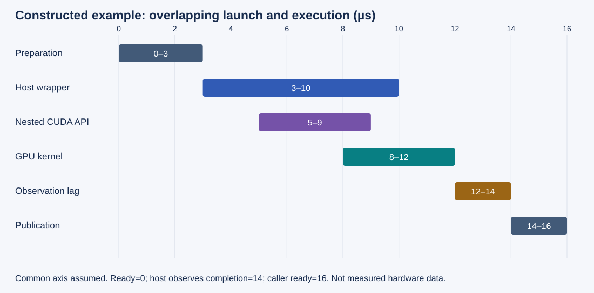
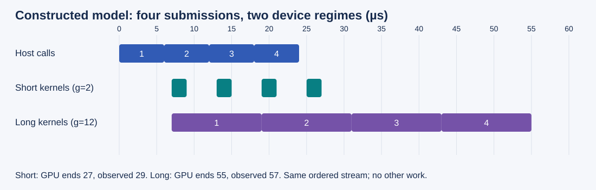

# M4-C13: Tracing CPU-to-GPU launch overhead

> **Status: Complete — detailed chapter authored and documentation validated; experimental procedures are proposed unless explicitly labelled observed**

**Module:** Understand kernels and execution overhead

**Category:** [Runtime and concurrency](index.md)

[Module 4 reading order](../module-4.md) · [Previous: M4-C12](../kernels-compilers-and-execution/m4-c12-distinguishing-flashattention-pagedattention-and-prefix-caching.md) · [Next: M4-C14](../runtime-and-concurrency/m4-c14-cpu-gpu-synchronization-and-hidden-serialization.md)

[Execution plan and progress](../chapter-execution-plan.md)

## Target concepts

Host dispatch, language and runtime boundaries, driver submission, launch latency, device scheduling, small-kernel overhead, kernel execution versus request time.

## Concepts

### 1. Follow one operation across the boundary

A kernel is device work. A launch is the host action that asks the runtime to arrange that work. **Host dispatch** includes choosing the operation, validating shapes and ownership, finding the compiled specialization, preparing arguments and selecting a stream. A stream orders submitted device operations; it does not reserve an immediately available GPU.

In a Rust host, dispatch may cross a foreign-function interface (FFI), meaning a boundary between calling conventions or libraries. The runtime then reaches a driver that submits work for the device. A Triton/Python path may add interpreter and framework boundaries; a CUDA/C++ path has its own wrapper and runtime costs. Do not attribute an observed interval to a language merely because that language appears in the stack. Rust ownership checks do not eliminate allocation, thread scheduling, driver contention or device dependencies.

| Layer | Question the trace must answer | Evidence and limit |
|---|---|---|
| Request scheduler | When was this operation ready and when did its worker run? | Request/attempt/iteration identity and host scheduling events; an annotation alone does not explain descheduling. |
| Host wrapper / binding | Where are validation, lookup, argument preparation and FFI? | Named nested ranges; preserve equivalent validation when comparing paths. |
| CUDA runtime / driver | Which API interval submitted the operation? | API records and correlation; nested runtime and driver records are not two useful kernel launches. |
| Device scheduling | When could the operation run, and when did it begin? | Dependencies, stream ordering and device activity; missing records leave attribution uncertain. |
| Kernel / publication | When did device work finish, and when could the caller use it? | Device end, observed completion and result publication are distinct endpoints. |

The [CUDA asynchronous execution guide](https://docs.nvidia.com/cuda/cuda-programming-guide/02-basics/asynchronous-execution.html) explains why a host call can return before device work completes. Conversely, the [runtime synchronization specification](https://docs.nvidia.com/cuda/cuda-runtime-api/api-sync-behavior.html) cautions that calls can block for reasons such as resource contention. “Asynchronous” is not a fixed upper bound on host-call duration.

### 2. Define launch latency before measuring it

Let **h_a,h_b** be host API entry/return, **d_s,d_e** device start/end, and **h_c** host-observed completion. All differences require compatible units and, for cross-domain subtraction, an explicitly established clock mapping.

**T_API = h_b − h_a; T_kernel = d_e − d_s; T_entry→start = d_s − h_a; G_return→start = d_s − h_b.**

The last quantity is signed: device execution can begin before the API returns. It is not inherently queueing time. Entry-to-start can include host submission, ordering constraints, contention and device scheduling; the timeline alone does not uniquely separate them. A correlation identifier associates records; it does not calibrate clocks. Report the chosen endpoint in every use of “launch latency.”

Consider this **constructed** timeline in microseconds. Its common axis and ±0.5 µs device-to-host mapping uncertainty are stipulated teaching assumptions, not measured properties or CUDA-event guarantees.

*Figure 1. Device work starts at 8 µs, before the API returns at 9 µs. Nested host intervals must not be added as separate work.*

| Interval | Endpoints (µs) | Duration or result |
|---|---|---|
| Host preparation | 0–3 | 3 µs |
| Full wrapper | 3–10 | 7 µs |
| API, inside wrapper | 5–9 | 4 µs |
| GPU kernel | 8–12 | 4 µs |
| Host observes completion | 14 | Completion observation trails device end by 2 µs |
| Publication | 14–16 | Caller-ready time is 16 µs from ready=0 |
| API entry → device start | 5→8 | 3 ± 0.5 µs under the stipulated mapping |
| API return → device start | 9→8 | −1 ± 0.5 µs under that mapping |

Wrapper and kernel durations add to 11 µs, but their interval union spans only 9 µs: overlap is 2 µs. API and kernel add to 8 µs but their union spans 7 µs. Neither sum is request time. One disjoint partition of the caller's 16 µs is preparation 3 + exposed wrapper-before-kernel 5 + kernel 4 + completion observation 2 + publication 2. This is interval accounting, not proof that the exposed 5 µs is entirely driver cost. A trace without driver detail must leave that internal attribution unresolved.

### 3. Small kernels can expose the host's submission cadence

A short kernel can finish before the host submits the next one. A longer kernel can keep the device occupied while later launches wait. Distinguish **capacity**, completed useful operations per second, from **latency**, time experienced by a particular operation or request.

For a second constructed model, submit four operations to one ordered stream. Each host call takes **h=6** µs; an operation becomes eligible 1 µs after its call returns. There are no other dependencies or workloads. With device duration **g**, define eligibility **a_k=6k+1**, start **s_k=max(a_k,e_(k−1))**, and end **e_k=s_k+g**, where **k=1,2,3,4** and **e_0=0**. The host observes the final completion 2 µs after the final device end.

*Figure 2. Identical submission cadence produces exposed gaps for 2 µs kernels and an accumulating queue for 12 µs kernels. These are model predictions.*

| Quantity | Short kernels: g=2 µs | Longer kernels: g=12 µs |
|---|---|---|
| Host calls | 0–6, 6–12, 12–18, 18–24 | Same |
| Device intervals | 7–9, 13–15, 19–21, 25–27 | 7–19, 19–31, 31–43, 43–55 |
| Wait after eligibility | 0, 0, 0, 0 µs | 0, 6, 12, 18 µs |
| Useful device duration | 8 µs | 48 µs |
| First device start to final end | 20 µs, including 12 µs gaps | 48 µs, continuously occupied in this model |
| Batch ready to final observation | 29 µs | 57 µs |
| Four fully serialized invocations | 4 × (6+1+2+2) = 44 µs | 4 × (6+1+12+2) = 84 µs |

The 29/4 = 7.25 µs amortized batch time is not any operation's measured latency or p99. Faster submission may deepen a device queue without shortening device execution. Batching changes the number of operations in flight, memory ownership and time-to-first-result; it must be evaluated at the intended workload.

A device-timed chain can include idle gaps caused by host feeding. Its duration depends on event placement; do not automatically equate an event interval with either useful kernel time or the table's first-start-to-last-end span. An empty kernel is a calibration workload with different resource and dependency behavior; it does not establish the launch cost of every production kernel.

### 4. Observe without confusing observation with execution

Start with the endpoint contract from [M9-C12](../measurement-experimentation-and-economics/m9-c12-reading-cpu-gpu-timelines-and-scheduling-gaps.md). Attach request, attempt, iteration, operation, worker, device, context, stream and allocation-generation identities. Inspect the actual path before selecting detailed metrics. Use coarse request/operation ranges first, then capture a short representative window with API and GPU activity.

[NVTX](https://nvidia.github.io/NVTX/) annotations describe semantic regions; they do not create device dependencies. Thread-local push/pop ranges must remain on the appropriate thread. When a Rust async task migrates, use supported handle-based ranges or separate worker ranges with explicit identity. Do not stretch a worker-thread range across unrelated tasks.

Host monotonic timers such as [Rust Instant](https://doc.rust-lang.org/std/time/struct.Instant.html) measure host intervals; record operating system and timer behavior. [CUDA events](https://docs.nvidia.com/cuda/cuda-runtime-api/cuda_runtime_api/group__CUDART__EVENT.html) measure suitable stream intervals; the documented approximately 0.5 µs elapsed-time resolution is not an accuracy guarantee and cannot substitute for clock-mapping uncertainty. Events are asynchronous records, and their scope can include intervening work. Check completion and asynchronous errors separately.

The [Nsight Systems guide](https://docs.nvidia.com/nsight-systems/UserGuide/index.html) provides API/activity correlation and capture controls. A blank lane does not prove device-wide idleness: other streams, contexts, processes or lost events may be absent. Compare the same workload with no tracing, coarse annotations and a narrow timeline capture. Preserve dropped-event counts, capture boundaries and collection settings. Instrumentation can increase apparent API cost, alter scheduling and fill trace buffers; a trace with missing events is incomplete evidence, not a sequence of zero-duration operations.

Separate process cold start, module loading, compilation, allocation and first use from a warmed, already prepared path. Record every preparation step and whether it is inside or outside the request boundary. Warm data and warm dispatch are different conditions.

### 5. Connect dispatch to useful service

For a fixed request, the critical path follows dependencies from arrival to usable result; overlapping durations cannot simply be summed. If an independently reducible dispatch fraction **f** of a serial request is accelerated by factor **s**, the conditional speedup is

**S = 1 / ((1 − f) + f/s).**

With **f=0.25**, **s=2**, the prediction is **8/7 ≈ 1.143**, not 2×. This model assumes unchanged useful work and other costs. Queueing, batching, contention, error handling or changed outputs invalidate a casual extrapolation. Measure full generation separately from a kernel or launch microbenchmark.

The HFT connection is a shared engineering problem: a short computation can wait behind scheduling, coordination and publication. An event-loop optimization matters only if correct decisions become available within the intended deadline. GPU stream behavior and exchange/network behavior have different contracts; these examples establish no trading result or hardware-equivalence claim. Under cancellation, keep submitted operands and outputs alive until the documented completion/recovery boundary. A cancelled caller is not proof that device work stopped.

## Experiments

All studies below are **proposed**, with no implementation or observed hardware results. Use an existing reviewed operation and generator; if they are unavailable, retain the study as unexecuted. Do not invent a benchmark result to fill the gap.

### Shared operation contract and workload

For an integer epoch **e**, use contiguous FP32 arrays with

**X_i = ((17i + e) mod 257) − 128; Z_i = ((11i + 3e) mod 257) − 128; Y_i = 2X_i + Z_i.**

Here **i** is a zero-based index and modulo returns a nonnegative remainder. Valid elements satisfy **0 ≤  i<N**. Inputs lie in [−128,128], and outputs in [−384,384]; all these integer calculations are exactly representable in FP32, with or without multiply-add fusion. Inputs are immutable, outputs disjoint, allocations retained through completion, and producer dependencies satisfied. An empty extent N=0 produces an empty result with no kernel launch. This exact fixture validates the measured operation, not arbitrary inference numerics.

E1 uses N in {1,31,32,33,127,128,129,4096,65537,1048576}, epochs 0–3, plus N=0. E2 uses N in {32,4096}, batch sizes {1,4,16,64}, and distinct epochs 0 through batch-size−1 with separate output storage. Verify every invocation, not only the final output. Largest E1 raw array payload is 12 MiB; largest E2 raw batch payload is 3 MiB. Budget 64 MiB each for host and device fixture storage, accounting separately for metadata, trace buffers and the actual model's memory.

### E1 — Locate a complete invocation

- **Name:** Ready-to-publication launch ledger.
- **Description:** Correlate one prepared operation through host, API, device and caller boundaries; separately archive process-cold and first-use runs.
- **Purpose / objective:** Explain which part of elapsed time is observed and which remains unattributed.
- **Target concepts:** Host dispatch, driver submission, launch latency, kernel execution versus request time.
- **Baseline and hypothesis:** The same validated operation without tracing is the baseline. Hypothesis: API, kernel and caller intervals differ; do not predeclare their ordering beyond actual dependencies.
- **Workload and controls:** Shared E1 matrix; 20 completed warm-up invocations and 100 measured invocations per cell in each of five sessions. Keep binary, specialization, stream policy, allocation reuse and input residency fixed; report cold observations separately.
- **Procedure:** Establish exact outputs and ownership first. Assign invocation identities, capture a short window, correlate endpoints, record mapping uncertainty, and build interval unions. Reconcile expected and observed operation counts and isolate preparation from the warm path.
- **Hardware and failure conditions:** Use the manifest below. Include N=0, invalid extents rejected before submission, incomplete capture and a separately labelled cancelled-caller trial. Never reuse in-flight buffers; report unavailable or ambiguous driver attribution.
- **Exit criteria:** Every completed output is exact, all expected operations accounted for, caller completion checked, and every reported time has a boundary/unit/clock contract. Missing records or unresolved errors prevent a complete timing claim.

### E2 — Distinguish feeding gaps from device queues

- **Name:** Bounded submission-cadence comparison.
- **Description:** Compare completing each invocation before submitting the next with submitting a bounded batch before a final completion join.
- **Purpose / objective:** Separate batch capacity, individual latency and device occupancy.
- **Target concepts:** Small-kernel overhead, device scheduling, launch latency, kernel execution versus request time.
- **Baseline and hypothesis:** Fully serialized invocations are the baseline. Hypothesis: bounded submission can hide host/device overlap, but may increase individual queue waits; benefit depends on N and operating point.
- **Workload and controls:** Shared E2 matrix, 20 warm-up batches and 100 measured batches per cell in five paired sessions. Same operation, binary, useful element count, stream and input residency in each pair; allocate distinct per-invocation storage before timing.
- **Procedure:** Record ready/submit/device/completion endpoints per invocation, final batch completion, useful outputs per second, first-result time and in-flight peak. Alternate comparison order across sessions. Read and validate every epoch after completion; use the constructed recurrence as a reasoning exercise, not a fitted hardware prediction.
- **Hardware and failure conditions:** Enforce batch maximum 64 and the storage budget. Inject one cancelled caller in separate diagnostic runs; drain submitted work before reclaiming its storage. Archive saturation, allocation failure and timeout outcomes.
- **Exit criteria:** Equal useful work and exact outputs, bounded outstanding state, no dropped invocation, and separately labelled batch throughput and per-invocation distributions. Explain gaps/queues only to the extent trace coverage and dependencies support them.

### E3 — Test attribution and observer effects

- **Name:** Boundary and capture ablation.
- **Description:** Measure the same full wrapper with tracing off, coarse ranges and a narrow API/GPU timeline capture.
- **Purpose / objective:** Quantify collection perturbation and locate language/runtime boundaries without assuming their costs.
- **Target concepts:** Language and runtime boundaries, host dispatch, driver submission.
- **Baseline and hypothesis:** Tracing off is the baseline. Hypothesis: richer capture can change host time and cadence; nested layer durations cannot be interpreted as additive work.
- **Workload and controls:** N={32,4096}, epochs 0–3; 20 warm-ups, 100 completed invocations per cell and five paired sessions. Keep validated wrapper and binary unchanged across capture modes. An optional existing thin bridge comparison is admissible only after documenting identical validation, allocation, residency, ownership and completion work; otherwise omit it.
- **Procedure:** Annotate preparation, binding and publication separately. Archive call-stack/layer evidence, correlate runtime/driver nesting, compare host and caller distributions across modes, and audit capture coverage and dropped records. Report unresolved boundary attribution rather than subtracting unrelated runs as “pure FFI cost.”
- **Hardware and failure conditions:** Record profiler version, permissions, buffering and clock mapping. Include capture start/end truncation and buffer-pressure diagnostics separately from accepted measurement windows.
- **Exit criteria:** Exact results in all modes; capture identity/counts reconciled; perturbation reported with uncertainty. A lost-record or partial-window trace cannot support an unqualified decomposition.

### E4 — Verify request-level relevance

- **Name:** Dispatch change in the existing generator.
- **Description:** Evaluate an already available, reviewed dispatch-policy change in a fixed generator/backend, or report this study pending if no equivalent candidate exists.
- **Purpose / objective:** Determine whether launch-path evidence predicts improved useful service under arrivals.
- **Target concepts:** Kernel execution versus request time, host dispatch, device scheduling, workload-dependent overhead.
- **Baseline and hypothesis:** Current generator policy is the baseline. Hypothesis: reducing exposed dispatch can help short operations, but request tails or device capacity may remain unchanged.
- **Workload and controls:** Prompt lengths {32,128} and output caps {8,32}; 20 warm-ups per combination. Each measured session offers 400 attempts, 100 per combination, either one every 100 ms or bursts of ten each second for 40 seconds. Use five paired sessions per arrival pattern, identical token IDs, model/tokenizer, precision, cache policy, backend, stopping rules and request order. Drive offered arrivals independently of completions; allow a 60-second drain after the final arrival and classify remaining attempts.
- **Procedure:** Establish baseline/candidate token and stopping equivalence before timing. Measure offered/admitted/completed rates, failures, cancellation, queue wait, time to first token, inter-token intervals, end-to-end latency and retained memory; correlate representative operation windows. Keep instrumentation policy equal within each performance pair.
- **Hardware and failure conditions:** Record full model and machine manifest. Exercise overload and cancellation in separately labelled fault runs. Trace only representative windows; do not silently discard rejected, failed or unfinished attempts.
- **Exit criteria:** Exact deterministic token/stopping equivalence or a separately justified predeclared numerical contract; reconciled 400-attempt outcomes; bounded state and safe drain/recovery; no unexplained tail regression. Report metrics by prompt/cap/arrival class with sample counts and uncertainty. A launch improvement alone does not pass the service gate.

## Verification

### Matched evidence and acceptance

| Study | Reference / invariant | Measurement, benchmarking and profiling | Acceptance and limit |
|---|---|---|---|
| V1 ↔ E1 | Independently calculate every fixture coordinate; reject invalid input; keep state until completion. N=0 has zero launch count. | Endpoint ledger, API/device correlation, nested interval union, cold versus warm, clock mapping/error and capture completeness. | Exact output/counts and checked completion; no double counting. Driver sub-cost stays unknown without evidence. |
| V2 ↔ E2 | Validate all distinct epochs and batch cardinality; same useful work and storage lifetime. | Batch duration/rate, individual ready-to-completion distributions, queue wait where eligibility is established, device gaps and peak in-flight storage. | Equal completed work, bounded resources and explicit population. Per-batch amortization never substitutes for individual p99. |
| V3 ↔ E3 | Same binary and operation contract across capture modes; full validation retained. | Compare five paired run-level summaries; capture settings, dropped records and truncation; nested runtime/driver mapping. | Quantify observer effects; reject incomplete decomposition. A language attribution requires direct boundary evidence. |
| V4 ↔ E4 | Model/token/stopping references, request/attempt identity, terminal-outcome reconciliation and safe cancellation. | End-to-end and token timing, queue/rate/memory, class-specific tails and uncertainty; representative timeline corroboration. | Useful-service benefit under the intended operating point with no correctness/lifetime failure. If evidence is inconclusive, retain baseline and report that result. |

For microbenchmarks, keep the five sessions as independent comparison units; 100 invocations within a session are not 100 independent machines. Report paired effects and uncertainty using [M9-C07](../measurement-experimentation-and-economics/m9-c07-latency-distributions-and-statistical-uncertainty.md). Use a 2% run-median change as an initial investigation threshold, not a universal performance promise; effects smaller than collection noise remain unresolved. Predeclare practical latency/memory budgets for the actual machine before collecting candidate results.

For request percentiles, state the estimator, eligible population and sample count. The 100 attempts per workload combination in a session give weak evidence about extreme tails; five sessions do not justify a production p99 guarantee. Preserve rejected and censored/unfinished outcomes rather than treating them as fast completions. Separate completion latency from arrival-to-admission delay and keep the original arrival schedule when the service slows.

Before accepting any performance claim, verify the reference without timing, then measure the equivalent workload, then collect focused attribution evidence. Counter/profile runs can alter scheduling; [M9-C13](../measurement-experimentation-and-economics/m9-c13-using-kernel-profilers-to-explain-hardware-bottlenecks.md) supports diagnostic interpretation. Apply [M9-C01](../numerics-and-correctness/m9-c01-defining-reference-behavior-and-evidence-before-optimizing.md), [M9-C15](../state-memory-and-caching/m9-c15-accounting-for-weights-kv-state-workspace-and-fragmentation.md) and [M9-C16](../hardware-architecture-and-topology/m9-c16-recording-hardware-conditions-that-change-measurements.md) for reference, memory and configuration scope. Record exact installed tool versions in the study archive.

### Documentation checks versus device evidence

The arithmetic timelines and exact fixture references are reproducible mathematical checks. They are not measured launch times. A successful documentation build checks presentation and links, not runtime correctness, profiler coverage or generator performance. Hardware experiments remain proposed until their binary/configuration, raw outcomes, trace windows, reference checks and uncertainty are archived.

## Engineering dimensions and principles

| Dimension | Application in this chapter |
|---|---|
| Semantics and invariants | Preserve the operation, every invocation, completion, token identity and publication contract. |
| Workload and variability | Sweep small/large extents, cold/warm state, bounded batches and spaced/bursty arrivals. |
| Resources and bottlenecks | Attribute CPU preparation, driver activity, trace buffers, device execution and retained arrays separately. |
| Time and distributions | Declare endpoints, nested overlaps, mapping uncertainty and request-class tail populations. |
| Ownership and coordination | Inputs/outputs and async task ranges retain valid owners across submission, migration and completion. |
| Failure and adaptation | Cancellation, overload, incomplete capture and asynchronous errors have explicit outcomes and recovery boundaries. |

| Practical engineering principle | Required action |
|---|---|
| 1. Correctness defines the optimization boundary. | A thinner wrapper may not silently remove validation or lifetime protection. |
| 2. Performance depends on workload and operating point. | Compare submission policies at declared N, batch, residency and arrival patterns. |
| 3. Data movement is part of the algorithm. | Separate resident-device launch studies from transfers and result publication. |
| 4. State has ownership, lifetime and recovery cost. | Account for all batch storage and drain submitted operations before reuse. |
| 5. Dependencies determine latency; bottlenecks determine capacity. | Inspect stream predecessors and host feeding before assigning the critical path. |
| 6. Variability and synchronization shape the tail. | Preserve arrival schedules, scheduling variation and class-specific distributions. |
| 7. Local improvements must be evaluated end to end. | Require E4 evidence before claiming faster useful generation. |
| 8. Claims require reproducible evidence. | Archive exact reference checks, endpoint definitions, tool settings, outcomes and uncertainty. |

## Specifications, articles, and hardware

### Primary reading and specifications

| Source | Use and reading limit |
|---|---|
| [CUDA asynchronous execution](https://docs.nvidia.com/cuda/cuda-programming-guide/02-basics/asynchronous-execution.html) | Understand ordering and host/device completion; verify installed runtime behavior. |
| [CUDA runtime API synchronization behavior](https://docs.nvidia.com/cuda/cuda-runtime-api/api-sync-behavior.html) | Avoid promises that asynchronous APIs never block; documentation inspected at 13.4. |
| [CUDA event API](https://docs.nvidia.com/cuda/cuda-runtime-api/cuda_runtime_api/group__CUDART__EVENT.html) | Recording, completion and elapsed-time scope/resolution; documentation inspected at 13.4. |
| [Nsight Systems User Guide](https://docs.nvidia.com/nsight-systems/UserGuide/index.html) | Primary tool guide/article for capture windows, API/activity correlation and timeline interpretation; record the installed version. |
| [NVTX specification and guide](https://nvidia.github.io/NVTX/) | Semantic annotations and range ownership; annotations do not synchronize execution. |
| [Rust Instant](https://doc.rust-lang.org/std/time/struct.Instant.html) | Host monotonic timing contract; documentation inspected at Rust 1.99.1, with OS-dependent behavior. |

### Required hardware and software manifest

No particular machine is claimed to have been used. The proposed CUDA studies require a supported NVIDIA GPU, compatible driver/runtime and a profiler configuration that can collect the relevant API and device activity. The toy fixture requires FP32 arithmetic and the stated memory budget; it does not require tensor cores or a particular GPU model.

| Manifest area | Specifications to archive |
|---|---|
| CPU / operating system | CPU model, cores, affinity, NUMA placement, OS/kernel, scheduling policy, power mode and other CPU load. |
| GPU | Model, architecture, device ordinal/UUID, available memory, clocks, power/thermal state, partitioning and co-tenancy. |
| Software / binary | Rust compiler, binding/framework, CUDA runtime/driver, kernel compiler/options, specialization and loaded binary identity. |
| Execution contract | Streams/contexts, dependency policy, allocation reuse, input residency, cold preparation and completion/error checks. |
| Instrumentation | Profiler/NVTX version, permissions, trace categories, capture windows, buffers/loss counters, clock mapping and timer resolution. |
| Generator | Model/tokenizer revisions, exact token IDs, precision, cache/batching/admission/stopping policy, offered arrival log and terminal outcomes. |

Record actual specifications rather than borrowing peak marketing numbers as expected performance. Re-run reference and ownership checks when changing devices, drivers, bindings or submission policies.

## Continue learning

Next in Module 4 reading order is the completed [M4-C14: CPU-GPU synchronization and hidden serialization](m4-c14-cpu-gpu-synchronization-and-hidden-serialization.md). The next authoring chapter is [M5-C18: Choosing chunk sizes and balancing prefill with decode](../scheduling-and-queueing/m5-c18-choosing-chunk-sizes-and-balancing-prefill-with-decode.md), position 125. Follow the [execution plan and progress tracker](../chapter-execution-plan.md) for acceptance evidence and the next authorized chapter. No second chapter has been started here.
