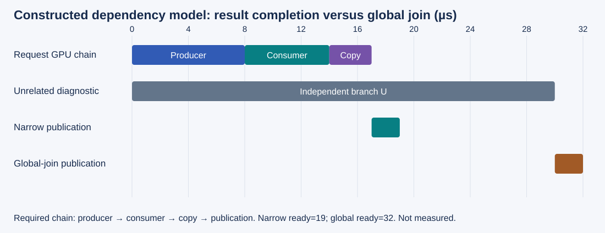
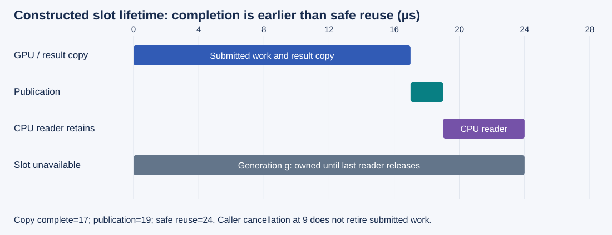

# M4-C14: CPU-GPU synchronization and hidden serialization

> **Status: Complete — detailed chapter authored and documentation validated; experimental procedures are proposed unless explicitly labelled observed**

**Module:** Understand kernels and execution overhead

**Category:** [Runtime and concurrency](index.md)

[Module 4 reading order](../module-4.md) · [Previous: M4-C13](../runtime-and-concurrency/m4-c13-tracing-cpu-to-gpu-launch-overhead.md) · [Next: M4-C15](../kernels-compilers-and-execution/m4-c15-cuda-graph-capture-instantiation-and-replay.md)

[Execution plan and progress](../chapter-execution-plan.md)

## Target concepts

Host waits, stream and event dependencies, device-to-host results, implicit synchronization, critical paths, unnecessary barriers, safe asynchronous buffer ownership.

## Concepts

### 1. A wait establishes a particular fact

Submission asks the device to do work. Completion establishes that the relevant work has finished. Publication makes its result available to the next consumer. Reclamation makes storage available for reuse. These are separate obligations. A fast submission return proves none of the later three.

A **host wait** delays a CPU thread until a completion condition holds. A **device dependency** delays subsequent device work until its producer finishes. A stream is an ordered sequence of submitted operations. An event records a prefix of that sequence: the work submitted up to its recording. A consumer stream waiting on a producer event can preserve correctness while the CPU continues useful independent work. This does not guarantee simultaneous device execution.

| Action | Fact it can establish | Important limit |
|---|---|---|
| Producer event → consumer-stream wait | Captured producer work precedes subsequent consumer work | Does not make the final result readable by the CPU |
| Host wait on final copy event | Captured device-to-host copy and its ordered predecessors finished | Does not retire later CPU readers |
| Host synchronization of a result stream | Previously submitted result-stream work, including its dependencies, finished | Does not necessarily cover unrelated streams |
| Device-wide host wait | Previously submitted work across the current device completed | Can couple a request to unrelated work; future submissions remain outside the boundary |
| Completion query | A status observation about captured work | “Not ready” grants no permission to read or reuse; errors require recovery |

Use [M3-C11](m3-c11-streams-events-and-dependency-ordering.md) for the foundational event contract and [M4-C13](m4-c13-tracing-cpu-to-gpu-launch-overhead.md) for timing endpoints. The [CUDA stream specification](https://docs.nvidia.com/cuda/cuda-runtime-api/cuda_runtime_api/group__CUDART__STREAM.html) defines these operations. This chapter asks when a correct but broad wait creates avoidable service delay.

### 2. Draw the dependency graph before removing a barrier

A **barrier** prevents progress until a group of prerequisites is satisfied. Removing one is safe only when every necessary producer-to-consumer relation remains. In a directed dependency graph, an arrow means that the destination requires the source's completion. With fixed node durations t(v), a dependency-only earliest finish obeys:

**E(v) = t(v) + max(E(u) for required predecessors u); an initial node starts at time zero.**

This is a lower-bound model when resource contention, submission delays and scheduling are excluded. An unnecessary edge can lengthen the critical path, the longest chain of dependent work from ready input to usable output. Independent nodes can still compete for bandwidth or execution resources.

Consider a **constructed** request R. Its GPU producer takes 8 µs, its GPU consumer 6 µs, result copy 3 µs, and CPU publication 2 µs. An independent diagnostic U takes 30 µs on a separate resource. Assume zero submission overhead, compatible clocks, sufficient resources, and that U starts at time zero under both policies.

*Figure 1. The diagnostic does not produce request data. A broad host join delays publication even though the result copy is already complete.*

| Boundary / result | Final-result event wait | Global join after both branches |
|---|---|---|
| Producer → consumer → copy | 0–8 → 8–14 → 14–17 µs | Same |
| Unrelated diagnostic | 0–30 µs | Same |
| CPU publication | 17–19 µs | 30–32 µs |
| Request ready → usable result | 19 µs | 32 µs |
| Added request delay | None | 13 µs |

The narrow policy's constructed speedup is **32/19 ≈ 1.684**. It does not reduce the 17 µs device branch. If U competes for the same resources, both schedules can change; the table does not predict a real machine. A host wait interval often overlaps device execution, so do not add it again to request time. A barrier is “unnecessary” relative to a declared consumer and ownership contract, not merely because its trace rectangle looks long.

### 3. A scalar on the host can be a large dependency

A **device-to-host result** is a value copied from GPU storage into CPU-accessible storage. Even a four-byte stop flag may sit after a long chain. Its cost includes reaching its producer, any ordered copy, observing completion and making the CPU decision. Payload size alone cannot explain its latency.

For a second constructed model, each of four token steps has a 10 µs GPU chain producing a token and stop flag, a 2 µs result copy, and a 3 µs host observation/decision before the next submission. Tokens are autoregressive: later steps require the earlier decision under the declared policy.

**T_four = 4 × (10 + 2 + 3) = 60 µs.**

A device-resident decision policy with the same per-step 10 µs chain and a single final 2+3 µs host observation would predict **4 × 10 + 2 + 3 = 45 µs** only if it already implements equivalent token selection, stopping, publication, cancellation and bounded state. Such a path is a conditional comparison, not an implemented optimization in this chapter. It may delay token delivery or perform extra work after a stop; both affect equivalence. Host-mediated sampling, external constraints or streaming obligations can make the per-step observation necessary.

Avoid reading a device scalar just to log it inside a timed loop. A framework's formatting, scalar extraction or validation utility may perform an implicit completion wait. Measure result visibility and user-visible token timing, not only kernels. Do not move required verification out of a production path and still claim identical work.

### 4. Hidden serialization depends on the actual API path

An **implicit synchronization** is a completion or ordering effect introduced by an operation whose main purpose appears to be something else, such as copying, allocation or logging. Separate documented ordering from an observed implementation stall.

| Suspected source | What to inspect | Controlled comparison |
|---|---|---|
| Device scalar extraction or formatting | Host call stack, preceding GPU work, copy and result consumer | Keep required output checks; move optional logging outside the measurement window and disclose it |
| Pageable host transfer | Host-memory kind, staging, API variant and direction | Compare prepared pageable/pinned paths with equal useful payload and correctness |
| Allocation / destruction | Allocator policy, initialization, stream ownership and last user | Compare prepared reuse with setup-inclusive runs; never reuse prematurely |
| Default-stream operation | Mode of every compiled component and explicit stream flags | Use independent buffers; preserve all real dependencies explicitly |
| Error checking / library helper | Exact documented scope and host/device boundaries | Retain required checks; distinguish submission errors from asynchronous completion errors |

The [runtime synchronization specification](https://docs.nvidia.com/cuda/cuda-runtime-api/api-sync-behavior.html) describes argument-dependent copy behavior and warns against depending on undocumented blocking. An Async suffix alone cannot establish overlap. Pinned memory is page-locked host storage suitable for supported asynchronous transfer paths; it is a limited system resource, not free storage. Do not infer copy-engine concurrency from a successful asynchronous API return.

The [default-stream specification](https://docs.nvidia.com/cuda/cuda-runtime-api/stream-sync-behavior.html) distinguishes legacy and per-thread behavior. In the same context, the legacy default stream coordinates with ordinary blocking streams; explicitly non-blocking streams are exempt from that interaction. Per-thread defaults have their own semantics, and explicit legacy operations can still introduce coordination. Inspect native libraries as well as Rust configuration. “Non-blocking stream” does not mean every host call is guaranteed to return without blocking.

For independent A, diagnostic D and B, with A then B in explicit stream S, legacy-default D between submissions can add A → D → B when S has ordinary blocking flags. Changing mode may remove these extra edges, but must not remove a real producer-consumer requirement. A serialized trace alone cannot distinguish a required edge from resource contention.

### 5. Ownership must survive asynchronous execution

Rust references and destructors govern host-visible lifetimes. A foreign runtime holding a raw pointer does not automatically make that lifetime safe. The [Rust FFI guide](https://doc.rust-lang.org/nomicon/ffi.html) describes why external interfaces require explicit safety obligations. The Rust-to-CUDA or Rust-to-native-library boundary must preserve the storage contract until the actual last user retires.

Use a conservative application policy: one completion-event identity per in-flight slot generation. A generation distinguishes successive uses of the same storage. Record the event after its required producers/copies, publish its identity to other submitters, and reuse it only when all observers and users of the old generation retire. The [event specification](https://docs.nvidia.com/cuda/cuda-runtime-api/cuda_runtime_api/group__CUDART__EVENT.html) defines recording and query behavior; an unrecorded event does not promise future work, and later recordings do not retroactively extend an already issued stream wait.

*Figure 2. A constructed slot remains unavailable after its copy completes because a CPU consumer still owns the result. Cancellation changes caller interest, not device completion.*

In this constructed lifetime ledger, producer/consumer/copy finish at 17 µs, publication ends at 19, a CPU reader releases at 24, and the slot becomes reusable at 24. Reclaiming at 17 would race that reader. If the caller cancels at 9, submitted work and later cleanup still need valid storage; do not reclaim at 9. A failed completion observation is not success: quarantine affected state until documented drain/recovery establishes safety. Avoid deliberately executing use-after-free as a timing test; detect invalid reuse attempts in a model or reviewed safety harness before submission.

For K slots, each retaining B bytes, payload is **M = K × B**. With three N-element FP32 arrays per slot, **B = 12N bytes**. At N=4096 and K=64, M=3 MiB, before metadata and transfer staging. Required pool size depends on the full ownership interval, not merely kernel duration. For a stable flow with average rate λ and average retention W, **average live slots = λW** by steady-state flow accounting. This is an average relation, not a safe capacity bound under bursts. Bound admission and classify exhaustion rather than silently exceeding the pool.

### 6. Choose waits through the HFT systems lens

A low-latency event loop can lose useful time waiting for unrelated work, just as this request can wait on a device-wide drain. A narrow completion signal helps only when it proves every condition needed for a correct decision. Polling too aggressively can consume CPU time and interfere with other requests; blocking can add scheduling delay. Neither is universally best.

Benchmark polling versus blocking only under equal completion/error/ownership contracts, and measure CPU occupancy, scheduling effects, and request tails together. HFT motivates bounded queues, stale-result policy and predictable publication. GPU streams do not model exchange acknowledgements or network ordering; no trading result follows from these examples.

## Experiments

All four studies are proposed. Use existing reviewed operations and a generator, or retain the relevant study as pending. No implementation is provided and no hardware measurements are claimed.

### Shared reference and measurement contract

For zero-based i and integer epoch e, use contiguous FP32 input **X_i = ((i + 3e) mod 257) − 128**, intermediate **A_i = 2X_i**, and output **Y_i = A_i + 7**. Modulo returns a nonnegative remainder. Inputs are immutable and the three arrays disjoint. Every integer intermediate/output is exactly representable in FP32: A lies in [−256,256], Y in [−249,263]. The CPU checks every returned coordinate independently. N=0 is an empty result with no kernels or payload copy.

Use N={1,31,32,33,4096,65537}, epochs 0–7, plus empty extents. Prepare inputs and storage outside warm timing, satisfy host-to-device input completion before the producer, and report cold/setup cost separately. The largest three-array payload per slot is 786,444 bytes. For N=4096, 64 slots contain 3 MiB of raw device array payload. Budget 64 MiB for host fixture storage and 64 MiB for device fixture storage; account separately for pinned staging, metadata, trace buffers and model state.

Measure five paired sessions per microbenchmark cell, with 20 completed warm-ups and 100 measured invocations or bounded batches per policy. Alternate policy order. Keep binary, GPU work, numerical contract, residency, stream configuration and instrumentation fixed unless the named factor is the subject of the comparison. Archive untraced host/caller timings and short correlated diagnostic traces separately.

### E1 — Narrow the completion scope

- **Name:** Result event versus device-wide join.
- **Description:** Compare a final-copy completion event with a broad device wait while an independent diagnostic uses separate buffers.
- **Purpose / objective:** Determine whether unrelated work delays request publication.
- **Target concepts:** Host waits, stream/event dependencies, critical paths, unnecessary barriers.
- **Baseline and hypothesis:** Broad wait is the baseline. A narrow final-result event can reduce scope coupling without changing required request work; actual contention may offset that benefit.
- **Workload and controls:** Shared extent/epoch matrix; diagnostic off/on, fixed diagnostic useful work and submission order. No concurrent host submitters during boundary attribution. Use the shared paired-session protocol.
- **Procedure:** Verify producer → consumer → copy → publication dependencies. Record diagnostic and request identities, final-copy event, host wait and caller-ready boundaries. Compare request distributions and diagnostic completion, preserving equal work in both policies.
- **Hardware and failure conditions:** Manifest below; record resource competition and stream flags. Include missing/wrong-generation event rejection in the safety model, incomplete capture and separately labelled completion-error recovery.
- **Exit criteria:** Exact outputs, all required edges present, every submitted operation accounted for and safe lifetime. A claimed scope benefit requires caller-ready evidence, not just a shorter API interval.

### E2 — Audit small results and hidden waits

- **Name:** Stop-flag and transfer-boundary audit.
- **Description:** Trace an existing per-step scalar-result path and compare optional diagnostic extraction enabled/disabled; separately compare prepared pageable/pinned result storage.
- **Purpose / objective:** Locate completion forced by result consumption or staging without removing required decisions.
- **Target concepts:** Device-to-host results, implicit synchronization, host waits, critical paths.
- **Baseline and hypothesis:** Existing required result path with optional diagnostics enabled is baseline. Optional extraction may introduce avoidable waits; required stopping or publication waits remain part of useful service.
- **Workload and controls:** Shared array fixture plus its existing scalar result if available; otherwise array-copy audit only, explicitly labelled. For nonempty arrays, the 4-byte case copies Y_0; a teaching decision is Y_0 > 0, independently calculated from the fixture. The 16 KiB case copies the first 4096 output elements only for N ≥ 4096. Empty arrays have no scalar read. These are transfer/decision probes, not model stopping rules. Shared paired protocol; isolate logging factor from host-memory-kind factor.
- **Procedure:** Validate output/decision references first. Inventory each extraction/copy/helper and its documented behavior, correlate host call with predecessor GPU work, and measure result-ready, decision and publication time. Record preparation and pinned allocation separately. Use the 60/45 µs model only as a conditional reasoning exercise.
- **Hardware and failure conditions:** Record copy capability, pinned budget, NUMA placement and actual API path. Include pinned-allocation failure, not-ready observation and asynchronous error outcomes; do not treat fallback as the original policy.
- **Exit criteria:** Identical required decisions and publication semantics; every observation covered by completion evidence. Report staged/blocked behavior only where measured or specified. No device-resident stopping claim without an equivalent existing implementation.

### E3 — Verify reuse and cancellation boundaries

- **Name:** Slot-generation ownership ledger.
- **Description:** Compare a conservative drain-before-reuse pool with a reviewed event-driven retirement policy, using bounded slots and explicit CPU-reader release.
- **Purpose / objective:** Demonstrate that removing broad waits preserves storage safety under overlapping work and cancellation.
- **Target concepts:** Safe asynchronous buffer ownership, stream/event dependencies, host waits, unnecessary barriers.
- **Baseline and hypothesis:** Conservative full drain is baseline. Narrow retirement can improve availability, but only after every relevant GPU and CPU user retires.
- **Workload and controls:** N={32,4096}, K={1,4,16,64}, epoch advances per submission; batches never exceed K live slots. Values repeat after 257 epochs, so retain explicit generation IDs rather than using output equality as proof of identity. Use shared paired protocol. Keep required GPU work and CPU consumption equal; compare reader-hold lengths as separate workload classes.
- **Procedure:** Establish exact outputs for all generations, then archive acquire/submit/copy-complete/publication/reader-release/reuse transitions. Check every reuse against all old users. Model cancellation before submission, after submission and after copy separately; reject premature-reuse and stale-event transitions before they reach hardware.
- **Hardware and failure conditions:** Full host/device manifest and allocator policy; test pool exhaustion, CPU reader delay, completion error and cancellation in separate fault runs. Quarantine uncertain generations until documented recovery.
- **Exit criteria:** Zero invalid transitions, stale-generation matches, output mismatches or unaccounted live slots; bounded memory and reconciled cancellations. Performance cannot compensate for an ownership violation.

### E4 — Test useful generation under arrivals

- **Name:** Synchronization policy in the request critical path.
- **Description:** Evaluate an already available narrow-wait policy in the existing generator with unchanged required decisions and token publication.
- **Purpose / objective:** Establish whether a local wait reduction improves user-visible service and preserves tails.
- **Target concepts:** Critical paths, implicit synchronization, device-to-host results, safe ownership.
- **Baseline and hypothesis:** Current generator policy is baseline. Narrow waits may improve latency, but shared-resource contention, polling and output obligations can dominate.
- **Workload and controls:** Prompt lengths {32,128}, output caps {8,32}; 20 warm-ups per combination. In each of five paired sessions per pattern, offer 400 attempts, 100 per combination: one every 100 ms or bursts of ten each second for 40 seconds. Keep exact token IDs, model/tokenizer, precision, cache/admission/batching/stopping policy and instrumentation fixed. Arrival schedule is independent of completions; drain for 60 seconds after the last arrival and classify remaining attempts.
- **Procedure:** Gate on deterministic token/stopping and publication equivalence. Measure queue wait, first-token and inter-token timing, end-to-end latency, useful completion rate, CPU time, memory and outcome counts. Correlate representative waits with required/unrelated dependencies; include separate overload/cancellation runs.
- **Hardware and failure conditions:** Full model/machine configuration; label rejected, failed, cancelled and unfinished attempts. If no equivalent candidate generator exists, report this study pending rather than constructing results.
- **Exit criteria:** Reconciled 400-attempt populations, correct tokens/stopping, safe state retirement, bounded resources and no unexplained service regression. A shorter host wait alone does not pass.

## Verification

| Match | Reference and invariant | Measurement / profiling | Acceptance and limitation |
|---|---|---|---|
| V1 ↔ E1 | Every array coordinate; explicit producer/consumer/copy edges; event identity and generation | Request-ready to caller-ready, wait scope, independent diagnostic, correlated API/device intervals | Exact outputs and complete edge coverage. Scope benefit requires service evidence; blank lanes do not prove idleness. |
| V2 ↔ E2 | Scalar/array reference, unchanged required decisions, correct host visibility | Extraction/copy/helper intervals, memory kind, staging, CPU decision and token publication | No result read before completion; no hidden removal of useful checks or stopping work. |
| V3 ↔ E3 | Every slot generation, last GPU/CPU user, cancellation ledger | Peak live/retained bytes, blocked acquisitions, lifetime timeline, drain/recovery outcome | No premature reuse, stale identity or lost outcome; exact outputs for every generation. |
| V4 ↔ E4 | Token IDs, stopping, publication, attempt outcomes and ownership | Class-specific latency/tails, rate, CPU usage, memory, representative critical-path trace | Benefit under intended arrivals without correctness or resource regression; incomplete evidence leaves baseline in place. |

Apply [M9-C01](../numerics-and-correctness/m9-c01-defining-reference-behavior-and-evidence-before-optimizing.md) to references, [M9-C02](../measurement-experimentation-and-economics/m9-c02-request-events-clocks-and-measurement-boundaries.md) to completion boundaries and [M9-C12](../measurement-experimentation-and-economics/m9-c12-reading-cpu-gpu-timelines-and-scheduling-gaps.md) to correlation. Where broad methodology chapters remain outlines, the local pairing, fault and identity rules above are the required procedure.

Treat five sessions as the comparison units; repeated operations in a session share machine state. Report paired effects and uncertainty using [M9-C07](../measurement-experimentation-and-economics/m9-c07-latency-distributions-and-statistical-uncertainty.md). A 2% run-median change is an initial investigation threshold, not an acceptance guarantee. Predeclare practical budgets and treat effects smaller than collection variability as inconclusive. Tail estimates need an estimator, eligible population and sample count; 100 attempts per workload class per session provide weak evidence about extreme percentiles.

Do not erase rejected or unfinished attempts from the denominator. Preserve the original offered arrivals during slowdown. Separate untraced performance runs from focused diagnostic captures, and audit capture loss, clock mapping and instrumentation effects. Host wait and device execution can overlap; use interval unions and the actual dependency path rather than summed rectangles. Fault tests, exact references and safety-model transitions establish different evidence from device timing; archive each separately.

**Evidence status:** All numerical times and slot examples are constructed. Documentation arithmetic/reference checks do not establish runtime correctness, sanitizer success, measured overlap or faster generation. Device, profiling and service experiments remain proposed until actual artifacts and outcomes are archived.

## Engineering dimensions and principles

| Dimension | Chapter-specific question and action |
|---|---|
| Semantics and invariants | Which completion fact authorizes this read, publication or reuse? Preserve every required edge. |
| Workload and variability | Sweep extents, result payload, diagnostic activity, reader delays, slot count and arrival bursts. |
| Resources and bottlenecks | Account for CPU waiting/polling, GPU/copy contention, pinned memory and retained slots. |
| Time and distributions | Distinguish submission, device completion, host observation, publication and full ownership interval. |
| Ownership and coordination | Tie each event to the right generation and retire both device and CPU readers. |
| Failure and adaptation | Classify not-ready, cancellation, exhaustion and completion errors; quarantine uncertain storage. |

| Practical principle | Required engineering behavior |
|---|---|
| 1. Correctness defines the optimization boundary. | Remove only edges proven unnecessary for all consumers. |
| 2. Performance depends on workload and operating point. | Re-evaluate waits under competing work, batch size and actual arrivals. |
| 3. Data movement is part of the algorithm. | Include result copies, staging and publication in service comparisons. |
| 4. State has ownership, lifetime and recovery cost. | Budget the full retention interval and drain/recover safely after cancellation. |
| 5. Dependencies determine latency; bottlenecks determine capacity. | Separate artificial global joins from resource-driven queueing. |
| 6. Variability and synchronization shape the tail. | Measure CPU wakeup/poll interference and request-class tails, not only means. |
| 7. Local improvements must be evaluated end to end. | Require useful generation and publication evidence for a service claim. |
| 8. Claims require reproducible evidence. | Archive references, dependency/ownership ledgers, versions, raw timings and fault outcomes. |

## Specifications, articles, and hardware

### Primary reading

| Specification / primary guide | Why it matters |
|---|---|
| [CUDA asynchronous execution guide](https://docs.nvidia.com/cuda/cuda-programming-guide/02-basics/asynchronous-execution.html) | Ordering, overlap and host/device execution; guide article for the basic model. |
| [Runtime synchronization behavior, 13.4](https://docs.nvidia.com/cuda/cuda-runtime-api/api-sync-behavior.html) | Argument-dependent copy behavior and limits on blocking assumptions. |
| [Default-stream synchronization, 13.4](https://docs.nvidia.com/cuda/cuda-runtime-api/stream-sync-behavior.html) | Legacy/per-thread behavior and non-blocking-stream exception. |
| [Stream management, 13.4](https://docs.nvidia.com/cuda/cuda-runtime-api/cuda_runtime_api/group__CUDART__STREAM.html) | Stream waits and completion scope. |
| [Event management, 13.4](https://docs.nvidia.com/cuda/cuda-runtime-api/cuda_runtime_api/group__CUDART__EVENT.html) | Captured work, re-recording, query/error and observation contract. |
| [Rustonomicon FFI guide](https://doc.rust-lang.org/nomicon/ffi.html) | Foreign-pointer safety and lifetime obligations; this chapter supplies no binding implementation. |

### Required machine and study manifest

No particular hardware is claimed to have been used. CUDA experiments require a supported NVIDIA GPU, compatible driver/runtime, FP32 support and profiling access for the chosen trace. Actual overlap depends on resources and workload; nominal concurrent-copy capability is insufficient evidence.

| Area | Specifications to record |
|---|---|
| Host | CPU model/cores, affinity, NUMA placement, RAM/pinned budget, OS/kernel, scheduler, power state and competing load |
| GPU | Model/architecture/UUID, available memory, copy/concurrency capabilities, partitioning, clocks/power/temperature and co-tenancy |
| Runtime / bindings | Driver/runtime versions, Rust/native/framework compiler versions, binary identity, allocator behavior, per-component default-stream mode and stream flags |
| Transfers / ownership | Memory kind, residency, byte count, producer/copy/event identities, slot generation, last readers and recovery policy |
| Measurement | Host clock, device-clock mapping, profiler version, trace categories/window, buffer loss and instrumentation policy |
| Generator | Model/tokenizer revisions, token inputs, precision, cache/admission/batching/stopping/publication policy and arrival/outcome archive |

Read [M9-C15](../state-memory-and-caching/m9-c15-accounting-for-weights-kv-state-workspace-and-fragmentation.md) for memory scope and [M9-C16](../hardware-architecture-and-topology/m9-c16-recording-hardware-conditions-that-change-measurements.md) for comparable conditions. Recheck correctness and lifetime when changing runtimes, allocators or synchronization policies.

## Continue learning

Next in Module 4 reading order is the completed [M4-C15: CUDA Graph capture, instantiation, and replay](../kernels-compilers-and-execution/m4-c15-cuda-graph-capture-instantiation-and-replay.md). The next authoring chapter is [M5-C18: Choosing chunk sizes and balancing prefill with decode](../scheduling-and-queueing/m5-c18-choosing-chunk-sizes-and-balancing-prefill-with-decode.md), position 125. Track acceptance in the [execution plan and progress tracker](../chapter-execution-plan.md). Only M4-C14 has been authored in this step.
