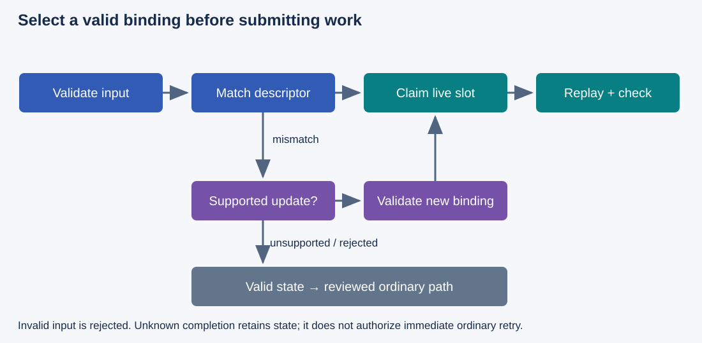
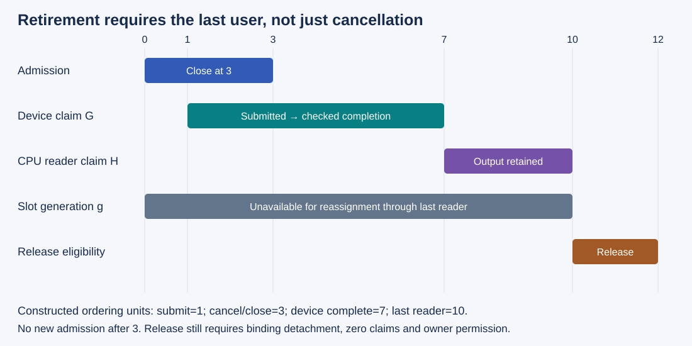

# M4-C16: Replay constraints, graph variants, and buffer lifetimes

> **Status: Complete — detailed chapter authored and documentation validated; experimental procedures are proposed unless explicitly labelled observed**

**Module:** Understand kernels and execution overhead

**Category:** [Runtime and concurrency](index.md)

[Module 4 reading order](../module-4.md) · [Previous: M4-C15](../kernels-compilers-and-execution/m4-c15-cuda-graph-capture-instantiation-and-replay.md) · [Next: M4-C17](../kernels-compilers-and-execution/m4-c17-designing-a-fused-normalization-kernel.md)

[Execution plan and progress](../chapter-execution-plan.md)

## Target concepts

Captured parameters and addresses, buffer stability, supported graph updates, changing shapes and batch sizes, graph variants, warmup, memory-pool ownership, invalidation, cancellation and safe fallback.

## Concepts

### 1. Replay uses a prepared contract

A graph executable is prepared work with particular operations, parameters and dependencies. Replaying it does not rerun the host's original argument-selection logic. A captured pointer is a device address used by the prepared operation; a captured scalar is a parameter value. Changing a Rust variable that once supplied either value does not by itself change the executable. NVIDIA's [dynamic-parameter article](https://developer.nvidia.com/blog/constructing-cuda-graphs-with-dynamic-parameters/) distinguishes changing node parameters from replaying a static capture.

**Buffer stability** means the prepared access still refers to valid storage with the expected extent, layout, contents and ownership. Address equality is only one part. A freed allocation can be replaced at the same numerical address with a different owner. This is why [M2-C10](m2-c10-request-state-transitions-and-safe-block-reuse.md) tracks storage generations: a generation distinguishes successive uses of the same slot.

Use a declared replay descriptor containing device/context, loaded kernel binary, numerical format, graph topology, capacity shape, strides, parameters and allocation identities. An allocation identity includes owner and generation as well as address. This is an application contract, not a required CUDA structure. Check eligibility and acquire a lifetime claim together before submission. Checking an address and retaining it later leaves a reclamation race.

| Change since preparation | Safe interpretation in this study | Evidence before launch |
|---|---|---|
| New input contents at the same allocation | Permitted after prior users retire and new producers complete | Current epoch, ownership and input-ready dependency |
| New host variable containing a pointer/scalar | Executable is not implicitly rebound | Explicit supported update or selection of a prepared matching instance |
| Same address, new allocation generation | Old binding is stale | New allocation claim and correctly prepared binding; never rely on address equality |
| New shape or stride | Can change access bounds, launch geometry and semantics | Matching variant, fully checked supported update, or ordinary fallback |
| New binary, device or numerical contract | Treat existing application variant as ineligible | New reference/preparation evidence under the new contract |

The introductory graph from [M4-C15](../kernels-compilers-and-execution/m4-c15-cuda-graph-capture-instantiation-and-replay.md) held these conditions fixed. This chapter explains how to preserve them while requests vary. Rust is the host-language context; foreign CUDA/framework pointers require an explicit lifetime policy beyond ordinary host references. No binding implementation is provided.

### 2. Updates require both API support and semantic validation

There are three useful application choices: replay an eligible instance unchanged, update it through a documented supported operation, or choose/build a different instance. A fourth path, ordinary execution, supplies a validated fallback for valid work outside graph eligibility. Invalid input must be rejected rather than passed to a fallback that shares the same invalid assumptions.

The [CUDA Graph update guide](https://docs.nvidia.com/cuda/cuda-programming-guide/04-special-topics/cuda-graphs.html#updating-instantiated-graphs) distinguishes whole-graph and individual-node updates. Whole-graph updates require compatible topology and node matching; individual-node updates target selected prepared nodes. Specific restrictions remain in the installed API, including function/device and copy-node constraints. “Same number of nodes” is not proof of update compatibility.

The [CUDA 13.4 graph API](https://docs.nvidia.com/cuda/cuda-runtime-api/cuda_runtime_api/group__CUDART__GRAPH.html) defines update status and diagnostics. Kernel-parameter updates affect future launches, not already enqueued executions. Check API status and detailed update outcome; never publish requested parameters as installed merely because the host attempted an update. The fixture here conservatively drains an instance before updating and gives graph-object manipulation one serial host owner. These are study rules, not claims that all CUDA updates require a global device drain.

*Figure 1. The compatibility decision happens before launch. Fallback requires valid inputs and safe state, while uncertain completion keeps resources retained. Descriptor matching and slot acquisition form one protected admission decision.*

For a proposed parameter change, first establish valid new operands and retain their storage. Close new admission to the old instance and retire its users under this conservative policy. Apply the supported update, inspect its result and verify the new operation contract before reopening admission. On failure, mark the requested binding unavailable; do not launch it with a mixture of old and requested arguments. This application policy does not assume that a failed API update destroys or repairs the previous executable. Reuse the prior binding only after its documented state and original contract are established separately.

A topology change, unsupported update, exhausted pool or incompatible library path can select ordinary execution before submission. An error discovered after submission needs completion/recovery accounting, not an immediate duplicate execution. If an attempt may already have published output or mutated model state, blindly rerunning it can duplicate effects. Track attempt identity and publication before authorizing any retry.

### 3. Variants trade padding against setup and retention

A **graph variant** is a prepared instance for a defined family of invocations. A **bucket** groups shapes into a capacity large enough to contain them. Capacity differs from valid extent: unused rows or positions are padding. [M4-C10](../kernels-compilers-and-execution/m4-c10-shape-specialization-padding-and-dispatch.md) supplies the shape/layout eligibility foundation.

For a teaching batch with B valid rows and L valid columns, choose capacities Bc in {1,2,4,8} and T in {32,64,128}, each the smallest listed capacity covering the valid extent. Reject unsupported metadata or select a validated ordinary path when B>8 or L>128. Empty B=0 returns an empty result without a graph launch; B>0 and L=0 is outside this fixture's contract.

**Valid positions = B × L; executed capacity positions = Bc × T.**

**Valid-position fraction = BL/(BcT); extra positions = BcT − BL.**

For B=3 and L=65, choose Bc=4 and T=128: 195 valid positions, 512 capacity positions, 317 extra, and a valid-position fraction of **195/512 ≈ 38.09%**. This is a position count, not measured GPU utilization. A narrow exact-shape graph avoids padding but may require more variants and preparation misses.

The fixture below is elementwise: padded positions cannot influence valid ones. Every capacity input is initialized, and only valid output coordinates are published. In attention, reductions or sampling, padding can change normalization, masks and stopping. Zero padding is not automatically neutral. A batch graph must also preserve row-to-request identity: reordering or dropping rows without matching state and output mappings is incorrect.

Define the variant key with operation/topology, binary/device/context, dtype, capacity and strides, plus whatever immutable semantic metadata the real operation requires. Attach slot-specific addresses and generations as bindings. In this fixture, logical B/L govern staging and output selection; the graph executes the full capacity. If another kernel actually takes B/L as parameters, those values need their own binding/update check. Equal capacity alone cannot certify that kernel.

Warmup means preparatory executions used to establish the intended steady state. Warm each admitted slot-specific executable on owned scratch data with checked completion, separately record compilation, capture, instantiation and first launch, and restore required contents/state before serving. A warm-up token decode must not accidentally advance a live request's KV or random state. Twenty warm-ups in the proposed microstudy are a sampling choice, not proof that every variant is warm under all loads.

A **constructed** hit/miss model illustrates the risk. A warm hit costs 12 µs; a miss including preparation and completion costs 200 µs; ordinary execution costs 20 µs. With hit fraction h:

**Mean variant-path time = 12h + 200(1−h) µs.**

At h=0.95 the mean is **21.4 µs**, slower than 20. At h=0.99 it is **13.88 µs**. Mean benefit requires **h > 180/188 = 45/47 ≈ 95.745%**. These stipulated serial costs exclude queueing; they establish neither a real hit threshold nor a p99. A rare preparation miss can dominate the tail even while the mean improves.

### 4. A memory pool has several owners and lifetimes

An application slot pool, a framework capture allocator and CUDA graph allocation nodes are different mechanisms. Do not infer one mechanism's release behavior from another's name.

In the proposed application policy, each variant owns K disjoint fixed-address slots. Each slot binds its own prepared executable; only one invocation per slot is in flight, and graph management remains serialized. The application owns external input/output arrays and retains them while the executable may use them. Closing variant admission prevents new users but does not retire existing ones.

For four FP32 arrays per capacity, raw slot payload is **16BcT bytes**. Across the twelve capacity variants, sum(Bc)=15 and sum(T)=224, so one slot per variant retains **16 × 15 × 224 = 53,760 bytes = 52.5 KiB**. Three slots per variant retain **161,280 bytes = 157.5 KiB**, before graph metadata, allocator reservation and model state. KiB is 1,024 bytes. Count shared backing allocations once, and report live payload separately from reserved memory.

[PyTorch 2.14 graph memory documentation](https://docs.pytorch.org/docs/2.14/notes/cuda.html#graph-memory-management) describes graph-private capture pools and their retention by graph/tensor objects. Pool sharing has execution-order and concurrency requirements and can overwrite another graph's retained output. It is not a generic permission to overlap graphs or preserve outputs indefinitely. This fixture uses disjoint application slots and no shared framework capture pool.

The [CUDA graph memory-node guide](https://docs.nvidia.com/cuda/cuda-programming-guide/04-special-topics/cuda-graphs.html#graph-memory-nodes) separately defines allocation/free nodes with GPU-ordered lifetimes. A stable virtual address does not imply persistent contents after a free. Destroying a graph is not a universal substitute for releasing live allocations; cached physical memory can also remain reserved. Measure the actual allocator and release/trim policy rather than equating graph eviction with immediately available device memory.

*Figure 2. Selection, execution, output retention and pool release have separate boundaries. A cancelled attempt retains its submitted storage until safe retirement; the shown output reader belongs to an already authorized downstream use, not a newly admitted request.*

Use a generation ledger for executable, slot, allocation and attempt identities. Let G denote unresolved device-use claims, H CPU/output-reader claims and A new admission authority. A conservative release predicate is:

**Reusable = admission closed AND binding detached AND G=0 AND H=0 AND owner permits reassignment.**

If completion is unknown, G remains outstanding. Output copies and CPU consumers can outlive kernel completion. A cancelled caller relinquishes interest; it does not prove that GPU work or readers disappeared. Address reuse and event reuse must follow the last covered user, not the time cancellation was signalled.

### 5. Invalidation, cancellation and fallback need explicit outcomes

Here **application invalidation** means closing eligibility because the prepared contract is stale. It differs from CUDA capture invalidation caused by a prohibited capture operation. A request-length change can invalidate application selection without damaging the graph object. Runtime errors can instead leave state uncertain and require documented recovery.

| Condition | Allowed response under the study policy | Forbidden inference |
|---|---|---|
| Valid input, no eligible variant | Ordinary path or bounded preparation with its cost recorded | Shape resemblance establishes compatibility |
| Unsupported update | Keep requested binding unavailable; rebuild or ordinary path after safe recovery | Attempted update installed all new parameters |
| Variant eviction | Close admission, retire users, detach bindings and release according to the allocator | Removing a lookup entry frees in-flight storage |
| Cancellation before submission | Close attempt, release only claims with no remaining users | Every reserved object was unused by other work |
| Cancellation after submission | Suppress unauthorized publication, drain/retire or recover safely | Cancellation stopped the graph |
| Completion/device failure | Quarantine uncertain state and use documented recovery | Timeout means success, or ordinary retry is automatically safe |

Bound pending preparation, retained slots and admissions; classify overload instead of allowing unbounded variants. Stale identity checks and resource claims must form one protected selection decision. For a Rust async host, dropping a future must not drop storage still referenced by a foreign runtime. A raw pointer and a host reference count alone do not establish completion.

The HFT lens is stateful preparation under deadlines: cached plans help only when the current event matches their assumptions, and cancellation or a stale plan cannot authorize unsafe reuse. Market data, exchanges and networks have different contracts from GPU graph execution. These experiments establish no trading outcome.

## Experiments

All four studies are **proposed**. Use existing reviewed kernels, bindings and generator paths, or leave the corresponding study pending. No implementation, device timing or runtime correctness result is provided.

### Shared reference and workload

For row j, column k and integer epoch e, define contiguous FP32 **X[j,k] = ((17k + 11j + 5e) mod 257) − 128**, **P=2X**, **Q=X+7**, **Y=P+Q=3X+7**. Modulo returns a nonnegative remainder. Valid X lies in [−128,128] and Y in [−377,391]; intermediate integer values are exactly representable in FP32. All four arrays are disjoint. For padded coordinates set X=0 before every invocation, so the expected capacity output there is 7; publish only the valid B×L rectangle. This deliberately tests stale padding without claiming that seven or zero is neutral for model attention.

Use B={1,2,3,4,7,8}, L={1,31,32,33,63,64,65,127,128}, epochs 0–7, plus B=0 and rejected L=0 cases. Capacity choices are defined above. B=9 or L=129 tests valid input outside this graph family's range only when the ordinary path supports it. Use boundary/malformed stride and wrong-generation cases in a metadata safety model; never execute a stale pointer to demonstrate rejection. Epoch values repeat, so output equality does not replace explicit identity checks.

Budget 64 MiB each for host and device fixture storage. Report executable/framework overhead and reserved bytes separately. Keep P→Q→Y serial ordering for comparison with M4-C15, even though P and Q are data-independent. Each slot has fixed allocations and an attached instance, no graph memory nodes, and one in-flight invocation. Stage new input only after previous GPU and host readers retire; satisfy transfer completion before replay.

For warm microbenchmarks, use five paired sessions, 20 completed warm-ups per admitted slot-specific executable and 100 measured invocations per cell. Alternate policy order. Fix kernel binary, numerical contract, operation counts per selected capacity, ownership and instrumentation except for the named factor. Archive cold misses, first use, updates and warm replay separately. Core timing begins after input readiness and ends at checked final GPU completion; a second caller interval includes selection, staging, preparation/update, readback, validation and publication.

### E1 — Verify replay eligibility and fresh contents

- **Name:** Descriptor and generation compatibility matrix.
- **Description:** Compare fixed-address capacity replay with a reviewed ordinary reference over changing logical extents and input epochs.
- **Purpose / objective:** Establish that selection preserves access bounds, row identity and current contents.
- **Target concepts:** Captured parameters/addresses, buffer stability, changing shapes/batches, graph variants.
- **Baseline and hypothesis:** Ordinary execution is baseline. Hypothesis: capacity reuse is correct only with validated metadata, safe slot claims and full padding initialization; equal address/shape alone is insufficient.
- **Workload and controls:** Shared B/L/epoch matrix, including alternating longest and shortest extents within a bucket. Use the shared paired protocol and unchanged serial kernel chain.
- **Procedure:** Independently calculate all valid and padded outputs, enumerate selected capacities and bindings, then compare full capacity output and published rectangle. Reconcile row-to-request mapping, fresh epoch and no-launch empty cases. Model wrong device/binary/stride/generation descriptors and confirm rejection before pointer escape or submission.
- **Hardware and failure conditions:** Record manifest below. Include no-free-slot, out-of-family, stale generation and pending input producer cases. Invalid input is rejected; valid out-of-family work uses only a reviewed supported ordinary path.
- **Exit criteria:** Exact outputs for every epoch, padding value 7, correct row publication, complete descriptor/claim coverage and no unsafe submission. Timing is secondary to eligibility evidence.

### E2 — Check supported updates and safe rejection

- **Name:** Parameter update versus new instance.
- **Description:** Compare a documented update to an equivalent newly prepared instance, using a preallocated replacement buffer and a reviewed scalar-parameter kernel only if available.
- **Purpose / objective:** Distinguish requested parameters from successfully installed executable state.
- **Target concepts:** Supported graph updates, captured parameters/addresses, buffer stability, invalidation and fallback.
- **Baseline and hypothesis:** Newly instantiated matching graph is baseline. Hypothesis: supported updates can avoid preparation cost, but failed/unsupported changes must never publish the requested binding as ready.
- **Workload and controls:** B={1,3}, L={32,65}, epochs 0–7. Address replacement uses separate retained storage with identical shape/layout. Optional scalar probe changes Q=X+c with c={−7,0,7}, reference Y=3X+c. Separate address and scalar factors; do not assume a constant-specialized kernel exposes an updateable scalar. Shared paired protocol; drain each instance before mutation.
- **Procedure:** Establish baseline reference, close admission, retire users, apply the exact supported API operation and archive return/result diagnostics. On success, validate the new binding and all outputs before reopening. Test topology/node-type mismatch and unsupported parameter changes in a state model or isolated supported diagnostic harness. On rejection, prove the requested binding cannot launch; independently establish any preserved old binding before reuse.
- **Hardware and failure conditions:** Record installed API, node handles/types, binary/context and stream. Never infer support from documentation for another version; no unsafe cross-device pointer probes. Archive partial preparation, allocation failure and uncertain completion.
- **Exit criteria:** Exact reference agreement for each accepted update; no mixed/stale parameters; all failure outcomes classified. Update API timing, drain time, reference gate and full caller time are reported separately.

### E3 — Bound variants, warmup and retained storage

- **Name:** Shape reuse under a fixed pool budget.
- **Description:** Compare exact-shape and capacity-family policies with bounded prepared instances and explicit eviction/retirement.
- **Purpose / objective:** Measure padding/setup tradeoffs and verify memory-pool ownership.
- **Target concepts:** Graph variants, warmup, changing shapes/batches, memory-pool ownership, invalidation.
- **Baseline and hypothesis:** Reviewed ordinary execution and a separate exact-shape policy are baselines. Hypothesis: bucketing can reduce misses while increasing capacity work and retained bytes; mean and tails need separate evidence.
- **Workload and controls:** Define 100-attempt shape logs: repeated (B=3,L=65), alternating (3,31)/(3,65), and a cyclic traversal of the shared shape matrix truncated to 100. Apply epochs in order. Compare K={1,3} slots/variant, at most 12 resident variant entries and a 64 MiB fixture budget; exact-shape policy also has a 12-entry cap. Use five paired sessions/log with identical inputs and arrivals; archive both empty-pool and prepared-pool starts.
- **Procedure:** Validate all outputs, then count hits, preparations, updates, evictions, ordinary fallbacks, slot waits and peak live/reserved bytes. Close admission before eviction and drain readers before release. Warm on scratch state and verify no live-request state advanced. Record first-use and setup-inclusive caller distributions; compare measured hit/miss costs without forcing the constructed 95.745% threshold.
- **Hardware and failure conditions:** Record allocator and graph metadata scope. Include allocation failure, all entries pinned by users and delayed CPU output readers. In this core study pools remain disjoint; optional framework sharing requires its own documented order/concurrency/output-retention proof.
- **Exit criteria:** Bounded instances/slots/bytes, reconciled 100-attempt outcomes, no eviction of live state, exact outputs and clearly scoped hit/miss and tail evidence. Graph destruction is not counted as freed physical memory without allocator evidence.

### E4 — Verify cancellation, invalidation and useful generation

- **Name:** Replay lifecycle and fallback service gate.
- **Description:** Exercise lifecycle transitions in a safety model and reviewed isolated harness, then test an available equivalent graph-enabled generator.
- **Purpose / objective:** Ensure variable request shapes and cancellation cannot create stale replay, duplicate effects or unsafe reuse.
- **Target concepts:** Cancellation and safe fallback, invalidation, buffer stability, memory-pool ownership, variants.
- **Baseline and hypothesis:** Ordinary generator policy is baseline. Hypothesis: prepared replay helps only while current contracts, reuse and recovery preserve useful service.
- **Workload and controls:** Fault boundaries: before submit, after submit, after GPU completion but before reader release, update rejection, eviction while busy and completion timeout. Model all; execute only supported safe diagnostic cases. If a reviewed generator is available, use prompt lengths {32,128}, caps {8,32}, 20 warm-ups/class and five paired sessions/arrival pattern. Offer 400 attempts/session, 100/class, one every 100 ms or bursts of ten each second for 40 seconds; drain 60 seconds after final arrival and classify remaining attempts. Hold token IDs, model/tokenizer, precision, cache/admission/batching/stopping/publication and instrumentation fixed.
- **Procedure:** Verify close/admit/submit/publish/retire transitions with attempt and generation identities. Check that cancelled work keeps claims until last use and that pre-submit ordinary fallback occurs only after valid recovery. Do not retry possibly published/mutated attempts without an explicit reconciliation rule. Gate generator timing on token/stopping/publication equivalence; measure setup/miss/update/fallback counts, queueing, first/inter-token and request latency, CPU cost and retained memory. Preserve offered arrivals independently of completion.
- **Hardware and failure conditions:** Manifest and exact recovery policy below; uncertain device state is quarantined. No available equivalent generator leaves service testing pending, with no fabricated token or timing results.
- **Exit criteria:** Zero stale-generation or unauthorized duplicate publication, no premature release, reconciled attempt outcomes and bounded recovery state. Useful-service acceptance includes exposed preparation/fallback and no unexplained correctness, tail or memory regression.

## Verification

| Match | Reference and invariant | Measurement and profiling | Acceptance and limit |
|---|---|---|---|
| V1 ↔ E1 | Exact valid/padded coordinates, descriptor, slot generation and row mapping | Capacity selection, preparation/replay counts, checked completion and caller interval | Correct current data and no invalid launch; equal addresses do not establish equal ownership |
| V2 ↔ E2 | New-instance reference, supported update result and installed binding identity | Update API, diagnostics, drain, validation and completed caller time | No mixed parameters or failed-update publication; support is version/node specific |
| V3 ↔ E3 | Fixed budget, entry/slot claims, exact outputs, warmup isolation | Hits/misses, padding positions, setup/eviction, peak live/reserved bytes and class tails | Bounded resources, safe eviction and separate allocator evidence for physical release |
| V4 ↔ E4 | Attempt lifecycle, last readers, stopping/publication and recovery | Fault transitions, fallback/setup outcomes, service rates, latency, CPU and memory | No stale/duplicate effects or unsafe reuse; unavailable device/service studies remain pending |

Use [M9-C01](../numerics-and-correctness/m9-c01-defining-reference-behavior-and-evidence-before-optimizing.md), [M9-C02](../measurement-experimentation-and-economics/m9-c02-request-events-clocks-and-measurement-boundaries.md) and [M9-C12](../measurement-experimentation-and-economics/m9-c12-reading-cpu-gpu-timelines-and-scheduling-gaps.md) for references, endpoint scope and trace correlation. Inspect allocation and attempt identities alongside API/device records. Missing events or unchecked completion errors cannot certify safe retirement.

Five paired sessions are comparison units; repeated invocations share machine state. Use [M9-C07](../measurement-experimentation-and-economics/m9-c07-latency-distributions-and-statistical-uncertainty.md) to report uncertainty. A 2% run-median change is an initial investigation threshold, not a universal acceptance promise. Predeclare practical service/memory budgets and treat effects below collection variability as unresolved. Separate untraced performance runs from focused profiler captures, recording clock mapping, settings and lost records.

Report percentile estimator, eligible population and count. A hundred attempts per log or workload class/session provide weak evidence about extreme tails; no production p99 guarantee follows. Keep preparation misses, ordinary fallbacks, rejected, cancelled, failed and unfinished attempts visible. Setup-conditioned warm replay and all-attempt caller distributions answer different questions. Do not sum overlapping host waits and GPU intervals as request time.

**Evidence status:** Position counts, storage totals, exact references and hit/miss costs are mathematical or constructed checks. They do not establish supported runtime updates, measured device behavior, sanitizer success or generator performance. All device, profiling and service studies remain proposed until actual binaries, configurations, raw outcomes and recovery evidence are archived.

## Engineering dimensions and principles

| Dimension | Chapter-specific application |
|---|---|
| Semantics and invariants | Match prepared operations and installed parameters to current row/attempt/allocation identities before replay. |
| Workload and variability | Sweep logical/capacity shapes, shape skew, reuse, slot pressure and burst arrivals; non-text modalities remain out of scope. |
| Resources and bottlenecks | Account for padding, preparation CPU work, executable retention, slot waits and allocator reservation. |
| Time and distributions | Separate warmup, misses, updates, first use, replay, publication and full-reader retention; inspect tails. |
| Ownership and coordination | Acquire compatibility and lifetime claims atomically under a lifecycle authority; retire every GPU/CPU user. |
| Failure and adaptation | Close stale variants, reject unsupported updates, quarantine unknown completion and reconcile cancellation/fallback effects. |

| Practical principle | Required engineering behavior |
|---|---|
| 1. Correctness defines the optimization boundary. | Prove current output/state identity and installed parameters before measuring speed. |
| 2. Performance depends on workload and operating point. | Compare shape logs and reuse horizons instead of assuming warm hits represent service. |
| 3. Data movement is part of the algorithm. | Include padding initialization, staging/readback and layout conversion where required. |
| 4. State has ownership, lifetime and recovery cost. | Budget variants and pools through last-user retirement, including cancelled work. |
| 5. Dependencies determine latency; bottlenecks determine capacity. | Separate update/drain dependencies from slot pressure and preparation capacity. |
| 6. Variability and synchronization shape the tail. | Retain rare misses, eviction stalls and CPU-reader delays in the service population. |
| 7. Local improvements must be evaluated end to end. | Require setup/fallback-inclusive useful generation with unchanged publication semantics. |
| 8. Claims require reproducible evidence. | Archive descriptors, update diagnostics, generation ledgers, shape logs and all outcomes. |

## Specifications, articles, and hardware

| Primary source | Use and scope |
|---|---|
| [CUDA Graph updates and memory nodes](https://docs.nvidia.com/cuda/cuda-programming-guide/04-special-topics/cuda-graphs.html) | Update compatibility and GPU-ordered allocation lifetime; installed capabilities must be checked. |
| [Graph management API, CUDA 13.4](https://docs.nvidia.com/cuda/cuda-runtime-api/cuda_runtime_api/group__CUDART__GRAPH.html) | Exact node/update restrictions, status and diagnostics; this chapter defines a conservative application policy. |
| [Constructing CUDA Graphs with Dynamic Parameters, Jiqun Tu, 2022](https://developer.nvidia.com/blog/constructing-cuda-graphs-with-dynamic-parameters/) | Vendor article on preparing static work and updating dynamic parameters; historical results are not this study's measurements. |
| [PyTorch 2.14 CUDA graph memory management](https://docs.pytorch.org/docs/2.14/notes/cuda.html#graph-memory-management) | Framework-specific capture-pool retention and sharing constraints; not a universal CUDA allocator contract. |

No particular GPU, graph-enabled generator or update-capable binding is claimed to have been used. The proposed studies require a supported NVIDIA GPU, compatible runtime/driver, FP32 support, the stated memory budget and the actual graph-update capabilities under test.

| Manifest area | Specifications to archive |
|---|---|
| Host | CPU model/cores, affinity, NUMA placement, OS/kernel, scheduler/power state and competing load |
| Device | GPU architecture/model/UUID, available memory, clocks, thermal/power state, partitioning and co-tenancy |
| Software | Driver/runtime, Rust/native/framework/kernel compiler versions, actual binary and allocator policy |
| Graph / update | Node/edge inventory, capture mode, device/context, shape/strides, installed parameters, executable/node identity, exact API outcomes and diagnostics |
| Ownership / pools | Allocation addresses and generations, slot bindings, retained readers, live/reserved bytes, pool-sharing policy, eviction and recovery boundaries |
| Measurement / service | Host/device clock scope, profiler settings/loss, shape and arrival logs, warm/cold policy, model/tokenizer/precision, request state and all terminal outcomes |

Apply [M9-C15](../state-memory-and-caching/m9-c15-accounting-for-weights-kv-state-workspace-and-fragmentation.md) and [M9-C16](../hardware-architecture-and-topology/m9-c16-recording-hardware-conditions-that-change-measurements.md) to storage scope and comparable conditions. Revalidate after binary, allocator, device or update-policy changes.

## Continue learning

Next in Module 4 reading order is [M4-C17: Designing a fused normalization kernel](../kernels-compilers-and-execution/m4-c17-designing-a-fused-normalization-kernel.md). The next authoring chapter is [M5-C18: Choosing chunk sizes and balancing prefill with decode](../scheduling-and-queueing/m5-c18-choosing-chunk-sizes-and-balancing-prefill-with-decode.md), position 125. Follow the [execution plan and progress tracker](../chapter-execution-plan.md) for acceptance and dependency order. Only M4-C16 is authored in this step.
