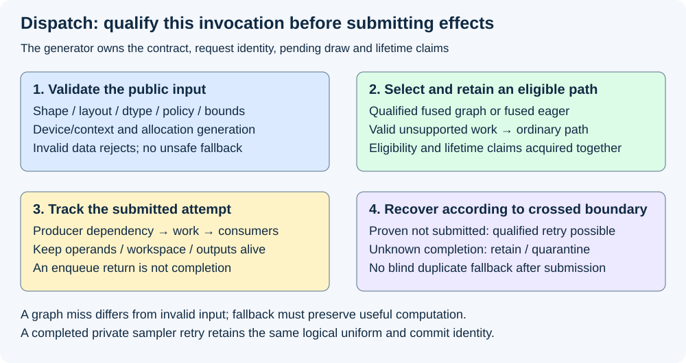
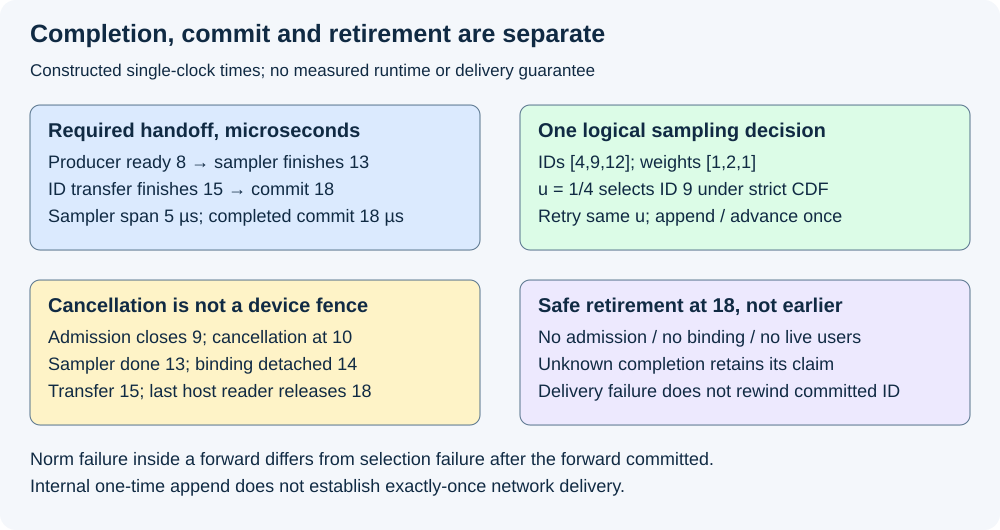

# M4-C23: Integrating a fused kernel into the generator

> **Status: Complete — detailed chapter authored and documentation validated; experimental procedures are proposed unless explicitly labelled observed.**

**Module:** Understand kernels and execution overhead

**Category:** [Runtime and concurrency](index.md)

[Module 4 reading order](../module-4.md) · [Previous: M4-C22](../measurement-experimentation-and-economics/m4-c22-benchmarking-realistic-shapes-and-execution-modes.md) · [Next: M4-C24](../measurement-experimentation-and-economics/m4-c24-verifying-end-to-end-generator-improvements.md)

## Target concepts

Rust host boundary, backend capability checks, kernel dispatch contracts, stream compatibility, buffer lifetimes, RNG ownership, graph integration, correct fallback and failure propagation.

[Execution plan and progress](../chapter-execution-plan.md)

## Concepts

### 1. The generator owns the operation's meaning

A fast device kernel becomes useful only when its inputs, outputs and effects fit the generator's contract. The generator prepares model inputs, orders forwards, commits selected IDs, applies stopping and retains resources until their last user completes. A fused kernel replaces a qualified operation inside that sequence; it does not acquire permission to change model semantics, random ownership or publication.

Begin with the completed [single-request loop](../interfaces-protocols-and-streaming/m1-c16-building-the-single-request-generation-loop.md), [allocator/generator connection](m2-c19-connecting-block-allocation-to-the-request-generator.md), [kernel validation](../numerics-and-correctness/m4-c20-validating-fused-kernels-and-graph-replay.md) and [benchmark families](../measurement-experimentation-and-economics/m4-c22-benchmarking-realistic-shapes-and-execution-modes.md). This chapter supplies integration contracts and proposed experiments without Rust, CUDA, Triton or other implementation code.

Keep three effects separate. A **normalization result** is a tensor consumed inside a forward. A **forward commit** publishes the successfully processed all-layer prefix and its KV state. A **selection commit** appends one generated ID and advances its logical sampling state once. A selected ID can remain pending for the next forward; it does not already occupy a processed KV position. Publication of stable text and terminal status has its own rules.

For prompt length P, committed selected count g and processed KV length N, ordinary single-token generation after a completed forward and selection has **N=P+g−1** for g≥1, until another forward consumes the pending nonterminal ID. An EOS selection ends generation without an EOS forward. If P=3 and selections are [20,21,22,0] with EOS=0, successful processed lengths are **[3,4,5,6]**, selected counts [1,2,3,4], and there are one prefill plus three decode forwards. Appending EOS twice or consuming it in an extra forward changes the work and state.

The integration family here uses out-of-place norm and sampling outputs with private workspace; these kernels do not themselves mutate public KV, request history or client output. A kernel with in-place KV updates or other public side effects needs a stronger transaction/recovery contract before it can use these retry rules. **Transaction** means a group of changes with explicit readiness, commit and failure rules, not assumed GPU atomicity.

### 2. Specify the Rust host boundary in terms of obligations

A **foreign-function interface (FFI)** crosses from Rust into a native runtime/library with its own representation and lifetime rules. The [Rustonomicon FFI chapter](https://doc.rust-lang.org/nomicon/ffi.html) explains why raw pointers and foreign calls require explicit validity guarantees. A host borrow ending or a wrapper object being dropped does not establish that asynchronous device access ended. No wrapper or trait implementation is specified here.

The boundary needs a checked operation descriptor and a returned attempt/completion record. It must carry enough information to prove the following obligations:

| Descriptor area | Required meaning |
|---|---|
| Identity | Request, attempt, logical step, current input epoch, model/operation/policy version and row-to-request mapping |
| Backend | Loaded binary, device/context, runtime/compiler compatibility, dtype/accumulation/output and available capability |
| Tensor/storage | Valid and capacity shapes, strides/alignment, allocation bounds, owner/generation, allowed overlap and required outputs |
| Scheduling | Producer-ready dependency, selected stream/graph instance, completion covering all submitted work and consumer handoff |
| State | Pending request-owned uniform, exact tie/filter/CDF contract, scratch/workspace claims and commit authority |
| Outcome | Accepted/rejected/not submitted/submitted/completion unknown, validation status and any installed update result |

A **capability check** determines whether a backend supports the required operation family. A **dispatch check** determines whether this invocation fits that family. Supporting BF16 generally does not certify this norm's accumulation/cast order; matching element count does not certify strides; a graph hit does not certify current bindings. Check the actual loaded artifact and installed parameters, not only a device model string or host cache key.

A return value reporting successful enqueue is evidence of submission, not output correctness. Preserve synchronous launch/update errors and later completion/device errors with their operation identity and stage. The [CUDA API synchronization reference](https://docs.nvidia.com/cuda/cuda-runtime-api/api-sync-behavior.html) also warns that “Async” copy behavior depends on arguments and calls can block. Measure dispatch and completed work separately instead of inferring either from an API name.

### 3. Choose an eligible path before submitting effects

The generator first validates the public input, then selects a qualified fused eager path, eligible fused graph, or validated ordinary fallback. Acquire the needed allocation/slot claims together with eligibility so another owner cannot recycle storage between checking and retaining it. Invalid input is rejected; fallback is for valid work outside a fast path's supported family.

| Condition before submission | Correct decision |
|---|---|
| Valid FP32 contiguous row; qualified artifact/device/stream; adequate workspace | Admit matching fused path and retain operands/output/workspace |
| Valid pitched layout; fused artifact supports only contiguous input | Choose an independently qualified adapter or ordinary path; charge its movement |
| Valid shape but no prepared graph instance | Use qualified eager/ordinary path or prepare outside the admitted fast path; record a graph miss |
| Wrong allocation generation, insufficient extent, forbidden overlap or invalid sampling parameter | Reject invalid binding/input; do not send it to an equally unsafe fallback |
| Binary/policy/dtype/device changed | Revalidate/select compatible artifact; an old graph key is not sufficient |
| Submission status uncertain | Keep attempt/resources pending; do not immediately run a duplicate fallback |

A key can include operation, architecture/context, binary, dtype, layout, valid/capacity shape, policy and graph topology as applicable; slot-specific addresses and generations remain checked bindings. A cached decision is an optimization of validation only within its declared invalidation rules. Shape equality cannot certify a stale allocation owner.

For a proposed decision-table fixture, combine two layouts (contiguous/pitched), two dtype families (qualified FP32/unqualified BF16), two binding generations (current/stale) and two graph states (ready/missing): **16 cases**. The fixture has one qualified contiguous FP32 fused operation and an ordinary backend that supports valid FP32/BF16 in both layouts. Stale generations reject in all eight affected cases. Of the eight valid cases, two contiguous-FP32 cases use fused graph/eager respectively; the remaining six use ordinary fallback. These are declared capabilities for testing the selector, not claims that a particular backend already supports them.

*Invalid data rejects. Valid unsupported work may fall back before submission. Uncertain submitted work requires completion/recovery accounting before any retry.*

### 4. Stream compatibility is an ordering contract

A **stream** orders its submitted operations; different streams need explicit dependencies where one operation consumes another's data. It is insufficient that producer and consumer are on the same GPU, or that the host called their APIs in the expected order. Same-device/context, valid event compatibility, installed stream bindings and actual dependency edges must all agree. Default-stream conventions can create implicit waits, but a reusable integration contract must not depend on an unspecified convention.

The required chain is **producer ready → fused work → output consumer → final access complete → retirement**. For normalization, the consumer may be another device kernel, so there need not be a host readback. For CPU-owned sampling commit, the selected ID must become safely host-readable before validation/commit; its transfer and completion belong to that boundary. [CUDA asynchronous execution](https://docs.nvidia.com/cuda/cuda-programming-guide/02-basics/asynchronous-execution.html) defines the stream/event mechanisms, while the generator supplies request/ownership meaning.

A constructed single-clock trace has input production finish at 8 µs, sampler start at 8, finish at 13, ID transfer finish at 15 and CPU validation/commit at 18. Required dependency ordering gives **18 µs** from an origin at 0; the sampler span is only 5 µs. Starting the sampler at 5 without an input-ready edge could read stale logits even if it finishes sooner. Host/device absolute clocks cannot be mixed in a real trace; the example deliberately uses one teaching clock. Record actual clock domains and compare completed durations.

An event covering the sampler does not cover a later transfer or downstream norm consumer. The lifecycle owner needs a completion claim for every last device access and every remaining host/output reader. Let G be unresolved device-use claims, H unresolved host/reader claims and A admission authority. Under this study's conservative retirement policy:

**Reusable = admission closed AND binding detached AND G=0 AND H=0 AND owner permits reassignment.**

For a teaching record, close admission at time 9, observe sampler completion at 13 (its output-transfer claim remains outstanding until 15), detach its binding at 14, finish the output transfer at 15 and release the last host reader at 18. Reuse is allowed only at **18**, not 9,13 or14. Cancellation at 10 does not move that boundary earlier. Completion uncertainty leaves the associated claim outstanding; retaining/quarantining storage is safer than guessing completion.

### 5. Request-owned randomness and one-time commit

For sampling preserve [M4-C19](../numerics-and-correctness/m4-c19-randomness-reproducibility-and-sampling-equivalence.md): generator algorithm/key/word conversion and logical request/token/domain identities, not batch row or worker order, determine each uniform. Validate parameters before allocating the pending logical decision. A successful sampling selection, including a singleton, consumes one logical uniform; greedy and validation failure consume none. A precomputed physical word is not a second committed logical draw.

A pending uniform belongs to the logical selection until its outcome is reconciled. An ordinary fallback for that same decision must use the same uniform under the token-wise contract. A different sampling algorithm requiring a different word/counter mapping needs prior equivalence qualification. Batch compaction moves row mappings, not request ownership.

Use a small **injected final-distribution fixture**, not a logit/model prediction: IDs [4,9,12], weights [1,2,1], probabilities [1/4,1/2,1/4] and pending u=1/4. Ascending-ID CDF selection uses strict “cumulative > u,” so it selects **9**. If a completed private candidate result is deliberately discarded before commit and safe ordinary fallback repeats the same decision with u=1/4, it again selects 9 and commits one draw/ID. Substituting a new u=3/4 selects 12 and violates token-wise replay. Repeating a completion notification must not append 9 twice.

The commit authority checks current request/attempt/step, output epoch, slot generation, successful completion, validity and absence of an existing commit. It then serializes the selection and logical RNG advancement with stopping/cancellation. If cancellation wins before commit, discard the result and record cancellation; if commit wins first, retain the committed history and apply the declared later cancellation/output policy without rewinding it. Do not promise network exactly-once delivery merely because internal append is one-time.

A sampler failure after a successful forward need not roll back already committed all-layer KV length N. Keep the processed prefix and failed selection outcome explicit; any retry must refer to the same completed logits/prefix and a reconciled pending decision. Conversely, a norm failure inside a private forward means that forward cannot publish its candidate all-layer prefix. These are different recovery boundaries.

### 6. Graph integration and failure propagation

A graph executable retains prepared operations, parameters, dependencies and bindings. Updating a Rust variable does not update captured arguments. Admit replay only when the current operation, valid extent/masks, row mapping, pending uniform, graph slot and allocation generations match its qualified contract. Inspect supported update outcomes; use an eligible eager/ordinary path if the desired instance cannot be prepared before submission. The [CUDA Graphs guide](https://docs.nvidia.com/cuda/cuda-programming-guide/04-special-topics/cuda-graphs.html) describes API update constraints; semantic eligibility is still the application's responsibility.

Use disjoint prepared slots and one invocation per slot under the conservative M4-C16 policy. Warmup uses scratch request/random identities and does not advance production KV or output counters. Close admission and retire existing users before management changes in this study. Changed device, binary, numerical policy or unsupported update requires requalification rather than assuming an old executable is repaired.

| Failure stage | Required observable outcome and recovery boundary |
|---|---|
| Public validation / known fast-path miss, before any submission | Reject invalid input, or select qualified fallback for valid work; no partial public output |
| Proven not-submitted launch failure | Record error; retry/fallback only if backend guarantees no work/effects and current state remains valid |
| Submitted work, result validation fails | Retire covered users; preserve diagnostic evidence; discard private result and reconcile pending state before a permitted retry |
| Completion unknown or device/context failure | Quarantine affected claims, fail/mark unresolved attempts and escalate to backend recovery; do not publish or blindly replay |
| Forward norm failure | Invalidate that private forward's candidate KV/publication; do not expose a partially computed prefix |
| Selection failure after forward commit | Preserve the committed processed prefix, mark no new ID committed, reconcile pending draw/attempt before retry |
| Publication/transport failure after ID commit | Preserve committed ID/random history; report delivery failure separately rather than rerunning sampling |

*Device completion, internal ID commit, client delivery and final resource retirement are distinct. Failure handling depends on which boundary has been crossed.*

A safe retry of completed private, side-effect-free sampler work may reuse its pending uniform after the old attempt is fully accounted for. That permission does not extend to an arbitrary failed graph containing KV writes or publication. A fatal backend/context condition may require abandoning the attempt or worker rather than continuing on an ordinary path in the same corrupted context. Keep errors attributable to their operation, scope and last known completion point.

## Experiments

All four experiments are proposed. Observed chapter-authoring evidence is exact state/ordering/arithmetic reference QA, document checks and rendered review. No Rust binding, kernel, graph or generator is implemented or executed here.

### E1 — Boundary and dispatch qualification

- **Name:** Match capability to this invocation.
- **Description:** Review the checked host descriptor and exercise the 16-case capability/binding selector fixture.
- **Purpose/objective:** Predict that stale storage rejects while valid unsupported format/layout work selects an explicitly qualified fallback.
- **Target concepts:** Rust host boundary, capability checks and dispatch contracts.
- **Baseline:** M4-C20 operation/reference gates and the declared fixture capability table; no assumed native implementation.
- **Workload:** Two layouts × two dtype families × current/stale generations × ready/missing graph. Add invalid extents/alignment/overlap, wrong device/context, stale binary/policy and missing workspace as separately labelled rejections. Valid graph miss chooses fused eager only where that artifact is qualified.
- **Controlled variables:** Operation/dtype/layout/range, descriptor and allocation identities, installed capabilities, reference/policy and explicit acceptance/rejection outcome. Capability changes create a new fixture revision.
- **Hardware requirements:** CPU for decision-table QA; actual backend/device/compiler and diagnostic support for later integration qualification. Declared capabilities are test inputs, not measured device facts.
- **Exit criteria:** Eight stale cases reject, one valid case selects fused graph, one fused eager and six ordinary fallback; all added invalid cases reject safely before submission. Exact outputs and numerical/state gates precede timing for actual accepted paths.

### E2 — Streams, last users and safe retirement

- **Name:** Prove the handoff edges.
- **Description:** Trace producer, fused work, downstream consumers/transfers and final host readers across compatible streams.
- **Purpose/objective:** Predict that missing input-ready edges or early reclamation can invalidate output despite a short kernel span.
- **Target concepts:** Stream compatibility, buffer lifetimes, completion and cancellation.
- **Baseline:** Explicit ordered dependency chain and the constructed 8/13/15/18-µs completion/reader fixture.
- **Workload:** Same-stream path, cross-stream path with an explicit ready event, proposed missing-edge diagnostic on isolated scratch data, cancellation before submit/after submit/after completion, delayed transfer/reader and withheld completion authorization. Use four reusable slots with distinct generations; no actual unsafe free is required to test a rejected reclamation decision.
- **Controlled variables:** Current inputs/epochs, device/context, stream/event ownership, last-access claims, output-reader identity and serial admission/retirement authority. Instrumented/fault runs stay separate from clean timing.
- **Hardware requirements:** Compatible device/event/stream access plus sanitizer/trace support for actual studies; record tool coverage. Cap fixture storage at 64 MiB each for host/device, separately from model/tool storage.
- **Exit criteria:** All required edges and actual covered consumers are visible; no invalid read/output or unresolved safety finding in accepted paths. Reuse only when the full predicate holds; cancellation or unknown completion cannot clear outstanding claims. The isolated missing-edge case must be classified invalid even if one schedule happens to return correct values.

### E3 — Pending draws, replay and one-time state commit

- **Name:** Preserve the logical decision through retries.
- **Description:** Compare fused/ordinary and eager/replay paths using the same request-owned uniforms and commit ledger.
- **Purpose/objective:** Predict token-wise replay with one ID/draw commit and correct prefix accounting under cancellation or repeated notifications.
- **Target concepts:** RNG ownership, graph integration, state boundaries and correct fallback.
- **Baseline:** M4-C18/19 sampling contract, the injected [4,9,12] probability fixture and M2-C19's scripted [20,21,22,0] progression.
- **Workload:** u∈{0,1/4,3/4} and all 256 midpoints for the injected distribution; four arms (ordinary/fused × eager/replay), row compaction, duplicate completion notification, private-result discard then permitted fallback, graph miss/update rejection and cancellation on either side of commit. Reject u=1 and invalid parameters before logical consumption. Check greedy zero-draw and successful-singleton one-draw cases separately.
- **Controlled variables:** Reference policy/draw conversion, request/token/domain identity, current logits/prefix/epoch, graph bindings and slot generations. Graph warmup has scratch identities; a failed norm and a failed post-forward sampler retain different prefix outcomes.
- **Hardware requirements:** CPU exact reference and state-ledger QA; qualified device/backend only for proposed runtime/replay tests. No statistical RNG-quality claim follows from the fixed midpoint grid.
- **Exit criteria:** Exactly matching support/ID/draw/prefix outcomes for equivalent paths; no duplicate append, lost ownership, EOS forward or replay with a new uniform. Current-generation checks reject stale results, and cancellation/commit order is explicit and reproducible.

### E4 — Fallback/failure accounting and integrated cost

- **Name:** Charge the boundary, retain the outcome.
- **Description:** Compare ordinary-only and integrated dispatch paths, including eligibility checks, handoffs, graph misses and safe fallback.
- **Purpose/objective:** Predict that local kernel savings can be reduced or reversed by integration/transfer/wait costs, while no recovery may violate state or lifetime invariants.
- **Target concepts:** Correct fallback, failure propagation, host/device boundaries and useful generation.
- **Baseline:** Same model/tokenizer/policy generator with the validated ordinary operation; current descriptors and outcome logs retained.
- **Workload:** M4-C22's four-arm qualified FP32 cases, five paired blocks with 50 scratch warmups/200 completed invocations per arm/case; separately classify cold preparation/miss and invalid inputs. Proposed generator study reuses M4-C18's 32-prompt corpus at concurrency 1/8/32 and five paired corpus blocks, plus separate launch-not-submitted, validation-failure, unknown-completion, context-loss and delivery-failure scripts.
- **Controlled variables:** Inputs/reference/model identity, request-owned draws, offered arrivals/caps/stopping, eligibility and timing boundaries, reset/hardware conditions. No error cohort is silently dropped from request accounting or relabelled a successful fast path.
- **Hardware requirements:** Actual model capacity/headroom and qualified backend, completed timing, device/host trace joins and lifecycle logs; no model or hardware performance is asserted here.
- **Exit criteria:** Contract/value/safety/publication gates hold on admitted paths and every fault reaches its defined terminal/unresolved outcome. Report completed kernel, dispatch-to-readable-result and arrival-based service latency separately, with useful throughput, tails, failures/cancellations/fallback counts and retained memory. Service promotion needs frozen service budgets/uncertainty; a local timing gain alone is insufficient.

## Verification

### Match the evidence to the integration boundary

| Experiment | Evidence | Acceptance and limit |
|---|---|---|
| E1 | Descriptor/capability/binary identity, exact selector cases and reject/fallback reasons | Valid unsupported work differs from invalid input; a capability label is not operation qualification |
| E2 | Producer/consumer event chain, G/H claims, reader/slot generations and safety reports | Actual last users determine reuse; tool-clean output alone does not prove all host/global ordering |
| E3 | Current-step outputs, pending uniforms, prefix/selection/terminal ledger and installed graph parameters | Exact one-time commit and request ownership, without claiming network exactly-once delivery |
| E4 | Clean timing plus separate fault/trace runs, attempt/stage errors and all terminal outcomes | Costs and recovery attributed to the boundary crossed; unknown completion is not proven non-submission |

Authoring QA checks all 16 selector combinations, exact categorical CDF boundaries/midpoints, duplicate-notification/commit-order fixtures, [3,4,5,6] processed-length progression and the retirement/timing predicate. These are reference/state checks, not execution of a Rust FFI wrapper or proof of runtime safety. Record local links, diagram XML and rendered readability separately from proposed device evidence.

For actual integration preserve immutable model/operation/binary identities, reference outputs, numerical budgets, stream/context and allocation/request/step generations. Trace completion and final-reader events by attempt rather than matching only pointer values. Use completed M9-C02 for clocks, M9-C11 controls, M9-C12/C13 diagnostic effects, M9-C15 resource accounting, M9-C17 numerical gates, M9-C19 output identity and M9-C27 fixed acceptance scope. M9-C22/C23 remain later extensions; the local fault/ownership rules do not assume those chapters are complete.

## Engineering dimensions and principles

### Six dimensions applied at the boundary

| Dimension | Concrete integration evidence |
|---|---|
| Semantics and invariants | Norm/forward/selection/publication contracts, current prefix, exact token/draw and one-time commit |
| Workload and variability | Dispatch by qualified dtype/layout/shape/policy, active row mapping and graph eligibility; retain miss populations |
| Resources and bottlenecks | Operand/output/workspace and graph-slot claims, adapters/transfers, retained state and actual last users |
| Time and distributions | Producer-ready to useful commit differs from kernel duration; misses, joins and recovery can shape tails |
| Ownership and coordination | Rust/native boundary, request-owned uniform, slot generation, serial lifecycle/commit authority and cross-stream dependencies |
| Failure and adaptation | Known pre-submit fallback versus unknown submitted work; private norm/selection and delivery failures have different recovery boundaries |

### Eight practical principles

| Principle | Integration consequence |
|---|---|
| 1. Correctness defines the boundary | Capability/dispatch does not relax masks, dtype arithmetic, exact draws or prefix semantics |
| 2. Performance depends on operating point | Qualified fused graph, fused eager and ordinary fallback are distinct populations and costs |
| 3. Data movement is part of algorithm | Include required staging, ID readback and consumer handoffs rather than timing only the kernel |
| 4. State has ownership/lifetime/recovery cost | A host return/drop/cancellation cannot release storage with unresolved device or reader claims |
| 5. Dependencies determine latency; bottlenecks capacity | Same GPU is insufficient: explicit stream edges and final access coverage establish useful completion |
| 6. Variability and synchronization shape tails | Graph misses, readback joins, slow consumers and recovery remain visible in tail populations |
| 7. Local gains need end-to-end evaluation | Five-microsecond sampling can be an 18-microsecond completed selection; measure useful generator outcomes |
| 8. Claims require reproducible evidence | Preserve descriptor, binary, generations, pending draw, error stage, commit and final-reader ledger |

The HFT analogy is inserting a fast event-processing stage into a sequence-owned decision pipeline. Stale pointers, duplicate completion and unsafe retries can invalidate decisions even when the stage is fast. Bounded fallback and ordered publication transfer as systems lessons; text-generation distributions and fixtures do not establish financial decision correctness, trading results or hard real-time guarantees.

## Specifications, articles, and hardware

| Primary source | Scope |
|---|---|
| [Rustonomicon FFI](https://doc.rust-lang.org/nomicon/ffi.html) | Foreign pointer/representation/safety obligations; device-completion lifetime remains an application contract |
| [CUDA asynchronous execution](https://docs.nvidia.com/cuda/cuda-programming-guide/02-basics/asynchronous-execution.html) | Stream/event dependencies and submission versus completion |
| [CUDA Runtime API synchronization behavior](https://docs.nvidia.com/cuda/cuda-runtime-api/api-sync-behavior.html) | Argument-dependent copy behavior and asynchronous kernel launches; names alone do not define timing |
| [CUDA Graphs guide](https://docs.nvidia.com/cuda/cuda-programming-guide/04-special-topics/cuda-graphs.html) | Prepared dependencies, updates and replay; semantic binding/ownership validation remains additional |
| [NVIDIA dynamic-graph-parameter article](https://developer.nvidia.com/blog/constructing-cuda-graphs-with-dynamic-parameters/) | Engineering context for explicit installed-parameter updates, not automatic host-variable rebinding |

Sources checked 2026-10-28. No native binding, device, model or benchmark result has been supplied. Pin actual library/toolchain/API versions before qualification, including FFI representation and error/unwind policy; foreign exceptions or panics must not cross an unsupported boundary.

| Hardware/specification area | Required manifest |
|---|---|
| Host/FFI | CPU/NUMA/affinity, OS/kernel, Rust and native ABI/binding/runtime versions, pointer/size/status representations and threading/unwind policy |
| Device | GPU model/architecture/UUID, context, dtype/resource capabilities, effective memory/partition, clocks/power/thermal state and competing load |
| Operation/graph | Binary/compiler flags, numerical/policy/reference, shapes/strides/alignment, streams/events, graph topology/update/slot identity |
| State/lifetimes | Model/tokenizer, request/attempt/step/epoch, allocation generations, pending uniform, private/public effects and completion/reader claims |
| Evidence | Corpus/arrivals, resets/scratch warmup, clocks/endpoints, safety/trace settings, failure stages and all terminal/unresolved outcomes |

## Key takeaways

Integration is a checked handoff of meaning, ownership and completion. Select valid paths before effects, preserve request-owned decisions and commit once, and retain submitted resources through every last user. Fallback after an uncertain attempt requires recovery evidence, not another launch.

## Continue learning

Next in Module 4 reading order is [M4-C24: Verifying end-to-end generator improvements](../measurement-experimentation-and-economics/m4-c24-verifying-end-to-end-generator-improvements.md). The next authoring chapter is [M5-C18: Choosing chunk sizes and balancing prefill with decode](../scheduling-and-queueing/m5-c18-choosing-chunk-sizes-and-balancing-prefill-with-decode.md), position 125. Follow the [execution plan and progress tracker](../chapter-execution-plan.md). Only M4-C23 is authored in this step.
