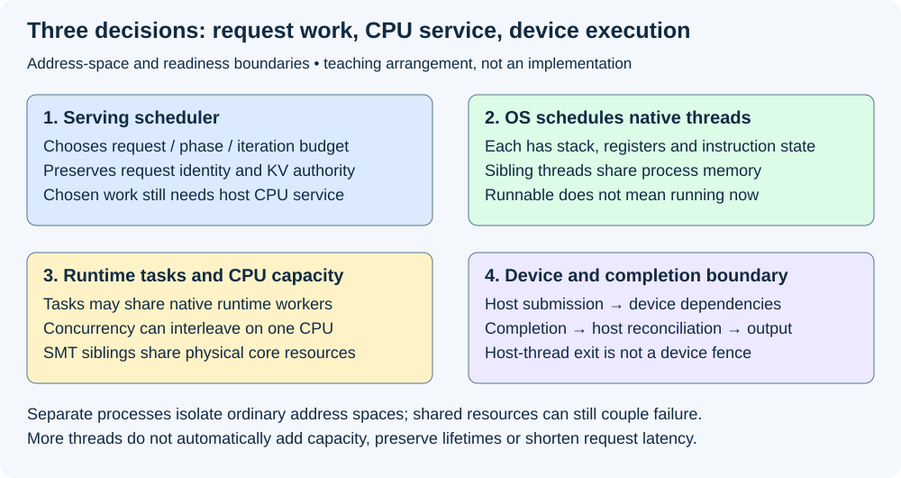
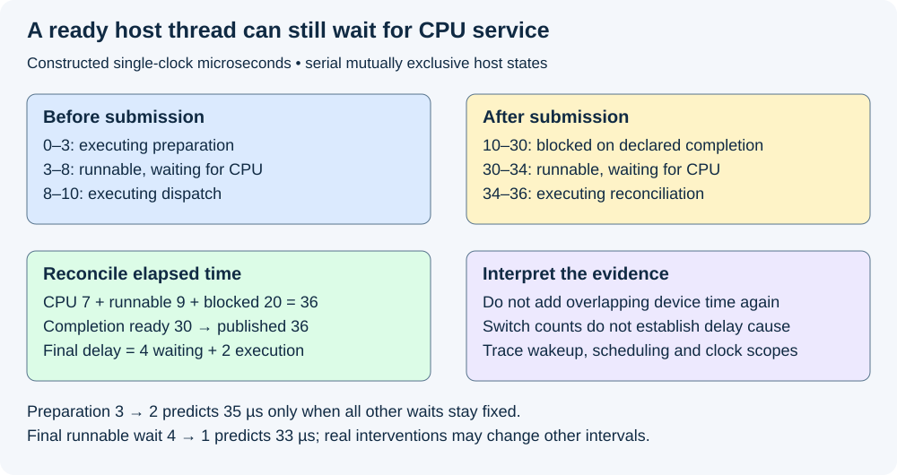

# M5-C02: Processes, threads, and operating-system scheduling

> **Status: Complete — detailed chapter authored and documentation validated; experimental procedures are proposed unless explicitly labelled observed.**

**Module:** Learn scheduling, operating systems, and queueing theory

**Category:** [Runtime and concurrency](index.md)

[Module 5 reading order](../module-5.md) · [Previous: M5-C01](../scheduling-and-queueing/m5-c01-separating-the-model-executor-from-the-serving-scheduler.md) · [Next: M5-C03](../runtime-and-concurrency/m5-c03-ipc-and-shared-memory-communication.md)

## Target concepts

Address spaces, stacks and heaps, process isolation, threads, context switches, concurrency versus parallelism, CPU scheduling versus request scheduling, Rust execution contexts.

[Execution plan and progress](../chapter-execution-plan.md)

## Concepts

### 1. A process owns an address-space context; threads execute inside it

A **process** is an operating-system execution environment with a virtual address space and resources such as open files. A virtual address names a location in that environment; translation maps accessible pages to physical storage. Two processes can use the same numeric address for different data. An address copied into another process is not automatically a usable reference. Explicit shared mappings and device allocations have additional contracts.

A **thread** is a sequence of execution with its own registers, instruction position and stack, sharing its process's address space with sibling threads. Registers are small pieces of CPU execution state; the instruction position identifies where execution resumes. The [Linux threads specification](https://man7.org/linux/man-pages/man7/pthreads.7.html) describes shared process memory and per-thread stacks. This chapter uses Linux terminology and Rust as the host context; other operating systems require their own details.

A **stack** holds active call frames and local execution state. A **heap** supplies dynamically managed storage whose lifetime need not end with the current function call. A local variable can contain a small owner/handle while the large buffer it refers to resides in a heap or device allocation. A thread's stack is logically associated with that thread, but it remains mapped in the process address space: “own stack” does not mean inaccessible to every sibling thread. Escaping pointers still need valid lifetime and synchronization.

Use [M2-C04's ownership and handle contract](../state-memory-and-caching/m2-c04-memory-ownership-handles-and-lifetimes-from-first-principles.md): address, request identity, ownership and completed access are different facts. A device pointer also depends on the runtime/context and allocation contract. The CPU's process boundary does not by itself describe GPU context isolation or device-fault containment.

| Resource/state | Threads in one process | Separate processes |
|---|---|---|
| Ordinary global/heap memory | Shared mapping; access still needs ownership/synchronization | Separate by default; explicit sharing needs a separate protocol |
| Call stack and registers | Distinct execution state per thread | Distinct execution state per thread in each process |
| Model/host buffers | May share one qualified backing allocation | May duplicate unless explicitly shareable; do not assume GPU weights share automatically |
| Failure boundary | Process-fatal faults can affect all sibling threads | Better address-space separation; shared devices/services can still couple failures |
| Request state | Must preserve request/attempt/step identity | Same obligation plus transport/worker-epoch identity |

**Process isolation** limits ordinary accidental access across address spaces; it is not a complete security or availability guarantee. Processes may share files, memory, credentials, kernel resources and devices. Extra workers may duplicate model state or require communication. This chapter explains the choices; [later IPC material](m5-c03-ipc-and-shared-memory-communication.md) develops inter-process communication without treating raw pointers as a protocol.

### 2. Concurrency is overlapping progress; parallelism is simultaneous execution

Two requests are **concurrent** when their lifetimes/progress overlap. They run **in parallel** when their computation executes at the same time on separate available execution resources. A single CPU can interleave two runnable threads without executing both at once. A host thread can submit GPU work and then handle another request while the device works; overlap still depends on readiness and resource availability.

A **logical CPU** is an operating-system scheduling target. Simultaneous multithreading (SMT) can expose multiple logical CPUs on one physical core; those siblings share core resources. Two logical CPUs therefore do not promise twice the throughput. CPU quotas, affinity, competing processes and blocking reduce usable service further.

Consider four independent host jobs, each needing 2 ms of CPU execution, all ready at time 0. Ignore overhead, memory contention and other work. One available CPU requires at least **8 ms** to finish all four; two independent equal-capacity cores require at least **4 ms**; four require at least **2 ms**. These are ideal lower bounds, not measured thread-pool speedups. Dependencies, shared bandwidth and scheduling can make elapsed time longer.

For a fixed observation duration T seconds, sum attributable thread CPU times C seconds. **Average CPU demand = C/T CPU-equivalents.** If six worker threads together consume C=1.2 CPU-seconds during T=0.5 seconds, demand is **2.4 CPU-equivalents**. Under four fully available logical CPUs, nominal utilization against that allocation is **1.2/(4×0.5)=60%**. This neither establishes 60% device utilization nor proves that every request received timely CPU service. Account for actual affinity/quota and SMT topology before choosing the denominator.

For CPU-bound work alone, **T ≥ C/m** is an ideal capacity lower bound with m equal independent fully available CPU resources. Blocking and device time are not included in C. A high thread count cannot create extra CPU capacity, and elapsed latency cannot be recovered simply by dividing CPU time by the number of threads.

### 3. The operating system schedules runnable threads, not inference requests

[The serving scheduler](../scheduling-and-queueing/m5-c01-separating-the-model-executor-from-the-serving-scheduler.md) chooses request membership, phases and budgets. The OS CPU scheduler chooses which **runnable** thread can execute on a CPU. Runnable means able to make CPU progress but not necessarily currently running. A **blocked** thread waits for an event/resource; it is not ready to execute useful instructions until that condition changes. A thread can also be running or terminated.

The two schedulers have different information. Linux need not know that a thread is about to submit a latency-sensitive decode, and the serving scheduler cannot assume its chosen thread immediately receives CPU time. GPU dispatch scheduling is another layer; making host work runnable does not guarantee immediate device execution.

A **context switch** saves execution state for one task/thread and resumes another. It can follow blocking, a scheduler decision or an interrupt-related event. A **migration** changes the CPU on which a thread runs; not every switch is a migration. Switching has direct bookkeeping cost and can be accompanied by lost cache/translation locality. Neither the count nor one “context-switch nanoseconds” constant predicts a service's latency. Cache disturbance, runnable contention and lock waits must be attributed separately.

[Linux scheduling documentation](https://man7.org/linux/man-pages/man7/sched.7.html) describes policy, priority and affinity interfaces. Do not infer the installed algorithm from a generic label or historical tutorial. The [kernel's CFS design article](https://docs.kernel.org/scheduler/sched-design-CFS.html) describes historical fair sharing and notes its evolution toward [EEVDF](https://docs.kernel.org/scheduler/sched-eevdf.html), which considers eligibility and virtual deadlines. These are CPU fairness mechanisms, not guarantees that an inference request meets its wall-clock deadline. Record the installed kernel/configuration and actual policy; no policy or priority is changed in authoring this chapter.

*Request eligibility, host CPU service and device readiness are different decisions. One Rust process can contain several native threads without requiring one thread per request.*

### 4. Separate CPU execution, runnable delay and blocking

For a single host-thread episode with serial, mutually exclusive states, define **elapsed = executing on CPU + runnable but not executing + blocked**. This is a deliberately bounded episode, not a universal sum across overlapping threads or devices.

| Constructed single-clock interval (µs) | State | Meaning |
|---|---|---|
| 0–3 | Executing | Prepare a descriptor |
| 3–8 | Runnable, not executing | Waiting to regain CPU service |
| 8–10 | Executing | Dispatch and record submitted identity |
| 10–30 | Blocked | Await a declared completion event |
| 30–34 | Runnable, not executing | Completion made work ready, but CPU service has not resumed |
| 34–36 | Executing | Reconcile and publish the host result |

The episode takes **36 µs = 7 CPU + 9 runnable-delay + 20 blocked**. Completion readiness at 30 does not imply publication at 30. In this fixture publication is at 36, so **completion-to-publication delay = 6 µs**, of which 4 is runnable delay and 2 actual reconciliation. If device work occurs during 10–30, adding its 20-µs span again would double-count that elapsed interval.

Reducing preparation from 3 to 2 µs with every other wait held fixed predicts 35 µs, not a large end-to-end gain. Reducing the final runnable delay from 4 to 1 predicts publication at 33 µs. Those are counterfactual teaching calculations: changed scheduling can also change earlier readiness, contention and device timing.

A profiler needs thread-state and wakeup/scheduling evidence to distinguish these cases. A long absence from CPU is not automatically CPU starvation: it may be a deliberate wait. “Off-CPU” means not executing; it can include both blocking and runnable delay. Host and device absolute timestamps require a documented correlation; otherwise compare completed durations within each domain.

*The intervals partition one constructed host episode. Device work during the blocked interval cannot be added again as independent elapsed time.*

### 5. Rust execution contexts need explicit lifetime and failure rules

[Standard Rust threads](https://doc.rust-lang.org/std/thread/index.html) are native OS threads. A long-lived control thread can own scheduler state while a bounded worker pool handles defined CPU work. That design needs clear handoffs and backpressure; it is not a concurrency proof. Synchronization is the coordination of access and ordering, developed next in authoring order.

A **future/task** is a unit of suspended computation managed by an asynchronous runtime; it need not own a dedicated native thread. The [Rust Future specification](https://doc.rust-lang.org/std/future/trait.Future.html) defines polling and readiness, and warns against blocking during polling. The runtime schedules tasks on its native workers; the OS schedules those workers on CPUs. Blocking an executor worker can delay unrelated tasks. Detailed async operation belongs to a later chapter; record the actual runtime and its worker/blocking-pool policy before measuring it.

| Host arrangement | Potential benefit | Obligation or cost to investigate |
|---|---|---|
| One control thread, serial CPU preparation | Simple scheduler-state authority | A long CPU job or blocking call delays other host decisions |
| Bounded native worker pool | Parallel independent host work | Queue bounds, ownership transfer, coordination and oversubscription |
| Multiple worker processes | Separate ordinary address spaces and restart identities | State duplication, IPC, startup and shared-device failure limits |
| Async tasks on runtime workers | Multiplex waiting work | Polling must yield appropriately; CPU-heavy/blocking work needs an explicit policy |

A **panic** is Rust's failure mechanism for certain unrecoverable execution conditions. Under an unwinding build, a thread panic may unwind its stack and be observable through joining; an abort configuration or process-fatal fault can terminate the process. A panic is not guaranteed worker isolation. Joining a host thread establishes that thread's termination, not automatic completion of every GPU operation it submitted. A host task disappearing must not reclaim buffers still accessed by a device or output reader. Keep the M5-C01 completion, commit and retirement authority intact.

As a separate memory-accounting fixture, four worker stacks reserved at 2 MiB each give **8 MiB of stack virtual reservation**. This is a chosen configuration, not a portable Rust default or measured resident memory. Three processes each privately owning a 100-MiB host buffer imply **300 MiB of those private buffers**, whereas one shared-process backing buffer can remain 100 MiB before stacks and other overhead. Shared pages and copy-on-write can complicate measured residency; report private/shared/resident/virtual categories separately. Do not add duplicated mapping sizes and call them unique physical memory.

### 6. Placement and overload are experiments, not automatic fixes

**CPU affinity** restricts allowed CPUs; it does not reserve them exclusively, remove interrupts or override every quota. NUMA means nonuniform memory access: placement can make a CPU access memory attached to another node. Pinning a control thread may reduce migration while worsening contention or remote-memory access. Compare placement on matched workloads and record all relevant worker pools, including library/driver helpers. No affinity or real-time configuration change is required to read this chapter.

Oversubscription means more runnable work competes for a resource than it can execute simultaneously. Waiting I/O threads alone do not establish CPU oversubscription; inspect runnable demand. A process with 16 threads can have one runnable thread, while a process with four CPU-heavy threads may saturate a two-CPU allocation. Preserve intended arrivals: a stalled client that sends fewer requests can hide an overloaded host.

Keep offered requests partitioned into rejected, waiting, admitted nonterminal and terminal outcomes. For example, **12 offered = 2 rejected + 3 waiting + 4 admitted nonterminal + 2 successful + 1 cancelled + 0 failed**. Log ready versus in-flight subsets of the four nonterminal requests, and retain physical claims independently for any logically terminal request still draining. Report selected-ID TTFT, gaps, server/client terminal boundaries and missing outcomes. Lower context-switch counts, CPU usage or migrations matter only through correct useful service; a busy-wait loop can lower some switch counts while consuming a core.

## Experiments

All four experiments are proposed. Authoring observes arithmetic/reference/document checks and rendered review only. No process/thread/runtime implementation, OS tuning or hardware serving benchmark is supplied or executed.

### E1 — Map the execution contexts and ownership boundary

- **Name:** Locate state before choosing workers.
- **Description:** Draw one-process/multiple-thread and separate-process arrangements, identifying buffers, stacks, mappings, request identities and final users.
- **Purpose/objective:** Distinguish isolation, sharing and ownership without confusing addresses with portable handles.
- **Target concepts:** Address spaces, stacks/heaps, process isolation and Rust contexts.
- **Baseline:** M2-C04 ownership rules and M5-C01 single lifecycle authority; no cross-process raw-pointer protocol.
- **Workload:** Four chosen 2-MiB stack reservations; one versus three private 100-MiB host buffers; equal numeric addresses in two separate address spaces; delayed device/output readers after host-thread exit.
- **Controlled variables:** Mapping/owner identity, allocator generation, process/worker epoch, reservation versus residency category and supported device context. Do not deliberately dereference invalid addresses.
- **Hardware requirements:** CPU arithmetic for reference QA; later OS mapping/residency tools and the actual backend for device lifetime qualification.
- **Exit criteria:** 8-MiB stack reservation and 100/300-MiB private-buffer arithmetic reproduce; address equality never establishes shared contents or authority; host-thread termination cannot authorize early device-buffer retirement. Real measurements distinguish shared/private/virtual/resident storage.

### E2 — Separate concurrency from CPU parallelism

- **Name:** Count capacity and runnable work.
- **Description:** Compare the ideal four-job bounds with later controlled host-only worker measurements.
- **Purpose/objective:** Test whether more workers exploit capacity or add contention.
- **Target concepts:** Threads, concurrency/parallelism, CPU demand and scheduling.
- **Baseline:** Four independent jobs with 2-ms CPU demand each; no blocking, overhead or contention in the teaching bound.
- **Workload:** One/two/four available independent-core configurations, then fixed runnable worker counts 1/2/4/8 in a reserved test allocation. Separate SMT-sibling cases and waiting-I/O cases rather than mixing them with independent cores.
- **Controlled variables:** Total useful CPU work, actual allowed CPUs/quota, topology, memory locality, background activity, startup/warmup and exact output validity. Thread count is not the CPU-allocation denominator.
- **Hardware requirements:** Recorded host/core/SMT/NUMA topology, CPU-time and elapsed-time measurements; no GPU required for host-only evidence.
- **Exit criteria:** Ideal lower bounds 8/4/2 ms and 2.4 CPU-equivalents/60% example reproduce. Actual results retain overhead and output checks; a bound violation triggers clock/population review. No linear speedup or serving-capacity claim is inferred from thread count.

### E3 — Attribute host latency to state transitions

- **Name:** Ready does not mean running.
- **Description:** Reconcile the six-interval teaching trace, then collect separate diagnostic scheduling/wakeup traces in a future test service.
- **Purpose/objective:** Distinguish CPU execution, runnable delay, blocking and downstream publication.
- **Target concepts:** Context switches, CPU versus request scheduling, critical-path delays.
- **Baseline:** Exact 36-µs serial host episode; unchanged generator/executor contract for future comparisons.
- **Workload:** Runnable contention, intentional completion wait, delayed post-completion CPU service, migration and a no-contention control. Counterfactual preparation and final-delay reductions are arithmetic predictions only.
- **Controlled variables:** Clock domains, thread identity/state transition definitions, completed endpoint and trace coverage. Trace-enabled runs are diagnostic; clean timing uses separate matched runs.
- **Hardware requirements:** OS scheduling profiler with permitted per-thread/wakeup visibility, monotonic host clock and explicit device-event correlation if used. Missing access/trace coverage must be reported.
- **Exit criteria:** 7+9+20=36 µs, completion-to-publication 6 µs and counterfactual totals 35/33 µs reproduce. Actual traces identify blocked versus runnable intervals without double-counting device overlap; unexplained intervals remain unattributed rather than guessed.

### E4 — Evaluate a host arrangement through useful service

- **Name:** Preserve the request while changing its CPU context.
- **Description:** Compare a qualified baseline host arrangement with one preselected alternative on an unchanged model executor and serving policy.
- **Purpose/objective:** Determine whether placement/worker organization improves service rather than only a local CPU counter.
- **Target concepts:** Isolation, Rust contexts, scheduling, variability and end-to-end effects.
- **Baseline:** M5-C01 one lifecycle authority and frozen request policy; record the exact native/runtime-worker arrangement and failure configuration.
- **Workload:** Frozen prompts/caps/arrivals and request-owned random identities in CPU-preparation-heavy, decode-heavy and mixed-burst descriptive cells. Use 20 preassigned paired reset sessions per cell, balanced arm order and one complete scratch trace warmup per arm/session. Cancellation, worker-thread panic/error and lost-completion diagnostics use isolated supported fault fixtures outside nominal timing.
- **Controlled variables:** Model/backend, useful outputs, request admission/queues/KV commitments, runtime/library worker pools, CPU allocation/placement, OS configuration, warmup, output/client behavior and clock endpoints. Do not introduce real-time priority changes as an unmeasured extra variable.
- **Hardware requirements:** Recorded CPU/core/SMT/NUMA and memory specs, OS/kernel/configuration, actual policy/affinity/quota, Rust panic strategy/runtime versions, accelerator/context stack when applicable and separate scheduling/device profiler setup.
- **Exit criteria:** All identity/commit/resource gates pass and offered outcomes reconcile. Report all paired samples, medians/ranges, TTFT/gaps/terminal latency, useful completed output, CPU time, runnable/blocking evidence, migrations and voluntary/involuntary context switches. Descriptive observations do not establish a confirmatory tail/capacity claim; freeze an M9-C27 design before making one. Device uncertainty retains claims and cannot trigger blind retry/reuse.

## Verification

| Experiment | Reference/invariants | Measurement / benchmarking | Profiling and acceptance boundary |
|---|---|---|---|
| E1 | Address-space/owner/epoch identity; final-user lifetime | Virtual reservation, private/shared/resident categories | Mapping observations do not prove semantic identity or completed device access |
| E2 | Same completed CPU work and outputs | CPU-equivalents, actual allocation, elapsed lower bounds, worker-count sweep | Separate SMT/topology/quota and runnable demand; no thread-count capacity inference |
| E3 | Mutually exclusive states for one serial episode | 36-µs ledger, 6-µs completion-publication gap, counterfactuals | Scheduling/wakeup evidence distinguishes runnable from blocked; no summed overlapping spans |
| E4 | Same model/request policy and no lost/duplicate commit; outcome/resource conservation | All paired descriptive service and CPU responses, invalid sessions retained | Separate clean timings and diagnostic captures; confirmatory claims require a frozen design |

The [getrusage specification](https://man7.org/linux/man-pages/man2/getrusage.2.html) defines CPU-time and voluntary/involuntary switch counters, including Linux thread-specific scope. Record process versus thread scope; summing process CPU time and its threads double-counts. A voluntary switch can follow waiting; an involuntary switch can follow preemption. Counts do not prove the wait's cause or quantify all secondary cache effects. Use scheduling traces to investigate, and keep incomplete traces explicit. Compare requests on their own arrival/terminal clock; do not assign a process's aggregate CPU time to every request.

## Engineering dimensions and principles

| Dimension | Application in this chapter |
|---|---|
| Semantics and invariants | Worker changes preserve request/prefix/random/commit identity and all outstanding readers |
| Workload and variability | Runnable bursts, blocking, prompt preparation and decode dispatch create different host demands |
| Resources and bottlenecks | Physical cores, SMT, quotas, stacks, private buffers and memory locality constrain useful parallelism |
| Time and distributions | CPU-ready delay after device completion can extend latency; averages hide wakeup outliers |
| Ownership and coordination | Address-space isolation does not replace request ownership; thread exit is not a device fence |
| Failure and adaptation | Panic/abort/process restart need distinct cleanup and epoch rules; unknown device access remains retained |

| Engineering principle | Consequence |
|---|---|
| 1. Correctness defines the optimization boundary | A quicker host path cannot commit a stale result or reclaim a live buffer |
| 2. Performance depends on workload and operating point | A worker count useful for independent CPU jobs may hurt a waiting-heavy service |
| 3. Data movement is part of the algorithm | Process duplication, communication and remote memory can offset CPU parallelism |
| 4. State has ownership, lifetime and recovery cost | Restarting a process can lose prepared state; shared devices remain a separate recovery boundary |
| 5. Dependencies determine latency; bottlenecks determine capacity | CPU service is required to dispatch and reconcile even when GPU work is fast |
| 6. Variability and synchronization shape the tail | Runnable competition, migration and blocking must be distinguished in slow requests |
| 7. Local improvements require end-to-end evaluation | Fewer switches or less CPU consumption alone does not establish earlier useful output |
| 8. Claims require reproducible evidence | Preserve topology, quotas, runtime policy, clock/state scopes and every request outcome |

The HFT analogy is a host thread that must receive an event, decide and publish promptly. CPU-ready delay, cache locality, isolation and bounded background work matter on that path. Inference also has GPU dependencies, large model/KV state and repeated token steps; copying an HFT pinning or priority recipe cannot establish suitable inference latency. No exchange deadline, trading strategy or production performance is inferred from these teaching examples.

## Specifications, articles, and hardware

Primary specifications are linked at the relevant claims: Linux threads and scheduling, Rust native threads and Future polling, and Linux resource accounting. The kernel CFS/EEVDF design articles explain CPU policy evolution; inspect the installed kernel rather than assuming a historical implementation. [CPU affinity documentation](https://man7.org/linux/man-pages/man2/sched_setaffinity.2.html) describes the allowed-CPU mask and its constraints, not exclusive CPU reservation.

Before experiments record CPU model/architecture, sockets/cores/logical CPUs/SMT, NUMA topology, RAM, frequency/power/thermal policy, OS/kernel/configuration, permitted CPU mask/quota, competing services, thread pools, stack configuration and Rust compiler/runtime/panic strategy. For inference add GPU architecture/count/VRAM, interconnect, driver/runtime/compiler, model/tokenizer/corpus hashes, dtype, KV/workspace capacity, graph configuration, clients/output buffering and profiling tools. State timestamp resolution and process/thread counter scopes. No actual machine specification or measured serving result is supplied here; all numeric fixtures are constructed.

## Key takeaways

Processes define ordinary address-space boundaries; threads execute inside them with shared memory and separate execution state. Concurrency does not establish parallel capacity. Separate request choice, host CPU service and device work, then explain elapsed latency through correctly scoped execution, runnable delay and blocking. Rust ownership helps express host lifetimes but cannot replace asynchronous completion evidence.

## Continue learning

Next in Module 5 reading order is [M5-C03: IPC and shared-memory communication](m5-c03-ipc-and-shared-memory-communication.md). The next authoring chapter is [M5-C18: Choosing chunk sizes and balancing prefill with decode](../scheduling-and-queueing/m5-c18-choosing-chunk-sizes-and-balancing-prefill-with-decode.md), position 125. Follow the [execution plan and progress tracker](../chapter-execution-plan.md) for dependencies; Module 8 is excluded and Module 9 supports Modules 1–7.
