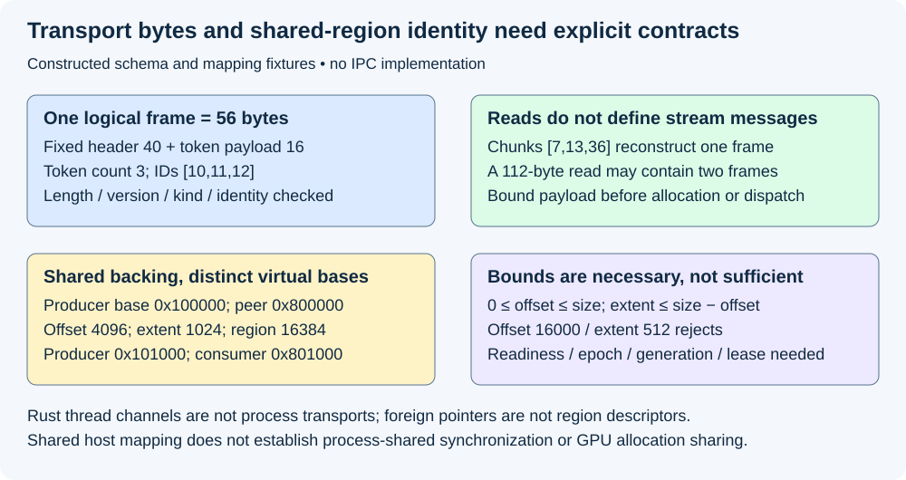
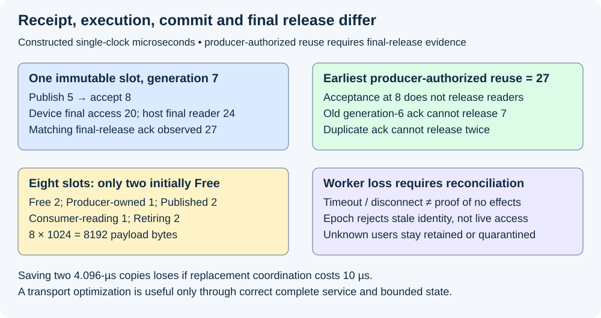

# M5-C03: IPC and shared-memory communication

> **Status: Complete — detailed chapter authored and documentation validated; experimental procedures are proposed unless explicitly labelled observed.**

**Module:** Learn scheduling, operating systems, and queueing theory

**Category:** [Runtime and concurrency](index.md)

[Module 5 reading order](../module-5.md) · [Previous: M5-C02](../runtime-and-concurrency/m5-c02-processes-threads-and-operating-system-scheduling.md) · [Next: M5-C04](../runtime-and-concurrency/m5-c04-producer-consumer-queues-and-bounded-work.md)

## Target concepts

Inter-process communication, pipes, sockets and channels, serialization and copying, shared-memory regions, visibility, synchronization, ownership across process boundaries, worker failure.

[Execution plan and progress](../chapter-execution-plan.md)

## Concepts

### 1. Processes need a communication contract

**Inter-process communication (IPC)** transfers information between separate process address spaces. A serving coordinator may send a worker a prepared execution descriptor and receive a completion. The transport carries information; it does not define request identity, ownership, readiness or whether execution committed. Preserve the [scheduler/executor boundary](../scheduling-and-queueing/m5-c01-separating-the-model-executor-from-the-serving-scheduler.md), [process model](m5-c02-processes-threads-and-operating-system-scheduling.md) and [synchronization/lifetime rules](m5-c05-synchronization-ownership-and-resource-lifetimes.md).

A **control plane** carries commands, identities and status. A **data plane** carries payloads such as token arrays or tensors. These are responsibilities, not necessarily different physical transports. A local socket may carry both; a socket plus shared region may separate them. Start with one coordinator, one worker, bounded outstanding attempts and one lifecycle authority. No code, protocol implementation or distributed inference system is supplied here.

A **channel** is a message-passing abstraction whose actual scope must be checked. [Rust's standard mpsc channels](https://doc.rust-lang.org/std/sync/mpsc/index.html) support communication among threads with single-consumer semantics and bounded/unbounded variants. They do not turn a sender or a Rust heap pointer into a cross-process endpoint. A process-capable channel needs its own transport, serialization and lifecycle specification. An unbounded queue can hide overload rather than remove it.

| Mechanism | Basic contract | Serving obligation |
|---|---|---|
| Pipe | Unidirectional byte stream | Framing, writer coordination, finite-buffer and endpoint closure behavior |
| Local stream socket | Bidirectional byte stream | Framing, partial progress, outstanding-message bounds and peer lifecycle |
| Local datagram/sequence-packet socket | Preserves message boundaries according to its socket type | Maximum size, truncation/error policy and application identity checks |
| Shared mapped region | Processes access common backing storage | Offset validation, synchronized publication, leases, generations and reclamation |
| In-process Rust channel | Typed values between permitted thread contexts | Bounded ownership transfer; not a process transport |

[Linux pipes](https://man7.org/linux/man-pages/man7/pipe.7.html) have no message boundaries and finite capacity. A small atomic write can protect against writer interleaving under specified limits, but does not make each read one message. [UNIX-domain sockets](https://man7.org/linux/man-pages/man7/unix.7.html) offer stream and message-preserving types and support ancillary descriptor passing. A passed file descriptor refers to a kernel resource; copying its integer value is not descriptor transfer. This chapter uses Linux local IPC; remote networking requires a different failure and transport model.

### 2. Serialization makes a value explicit

**Serialization** represents structured information as bytes under a defined schema. A **schema** fixes field meanings, widths, byte order, version and bounds. A **frame** delimits one message in a byte stream. In-memory Rust structures are not automatically a stable wire format: padding, native widths, pointers and private library layout must not cross the boundary by accident.

A teaching fixed header has eight fields: magic 4 bytes, version 2, kind 2, payload length 4, worker epoch 4, request ID 8, attempt ID 8 and step ID 8. Thus **header bytes=4+2+2+4+4+8+8+8=40**. This fixture uses little-endian integer fields (least significant byte first). Magic identifies this protocol family; epoch identifies the worker incarnation. Finite identity fields must never silently wrap into a still-live identity.

A token payload contains a 4-byte token count and N unsigned 4-byte token IDs: **payload bytes=4+4N; frame bytes=44+4N**. With N=3 and token IDs [10,11,12], payload is 16 bytes and frame is **56 bytes**. This is a schema/arithmetic fixture, not model output or an installed protocol. A real descriptor also needs model/policy revision, positions, KV/binding identity and representation limits; fields omitted here are not unnecessary in production.

Suppose the same 56-byte frame arrives in chunks [7,13,36] bytes. The first two reads provide 20 header bytes, so neither authorizes a payload interpretation. The third completes the header and 16-byte payload. Conversely one 112-byte read can contain two frames. Transport chunking changes neither logical message count nor ID history.

Declare a maximum payload of 4,096 bytes for this teaching parser. Then **N≤floor((4096−4)/4)=1,023** for this payload family. Validate length/count agreement and bounds before allocation or dispatch. Reject unknown version/kind, truncated final frame, oversized length and invalid token values for the selected vocabulary. A valid zero-token payload is structurally possible but may be rejected by the model operation's separate semantic contract. Protocol-valid does not mean executor-eligible.

### 3. Shared storage shares backing bytes, not virtual addresses

A **mapping** places a region of a backing object in one process's virtual address space. [POSIX shared memory](https://man7.org/linux/man-pages/man7/shm_overview.7.html) supplies named objects that processes can size and map. [Mapping specifications](https://man7.org/linux/man-pages/man2/mmap.2.html) distinguish shared and private mappings. A shared mapping permits common backing changes to be visible; a private mapping is not a publication channel for ordinary writes to peers.

Use region size 16,384 bytes. Its producer base is 0x100000 and consumer base 0x800000. A descriptor with offset 4,096 and extent 1,024 identifies producer range **[0x101000,0x101400)** and consumer range **[0x801000,0x801400)**. Half-open ranges include the beginning and exclude the end. The addresses differ while the region-relative bytes agree. Transferring producer address 0x101000 as a consumer pointer is wrong.

A checked descriptor carries region identity/epoch, offset, extent, representation, valid length, slot generation, request/attempt/step and permission/lifetime claims. With offset o, extent l and region size M, a safe range check is **0≤o≤M and 0≤l≤M−o**, with validated integer representation. Subtraction after validating o avoids overflowing o+l. Here 4,096+1,024=5,120≤16,384. Offset 16,000 with extent 512 rejects because only 384 bytes remain. Alignment and tensor strides require additional checks; being in range does not certify dtype or request ownership.

Shared mapping existence is not synchronized readiness. It also does not make CPU memory into GPU VRAM or give another process permission to use a device allocation. Host staging, pinning, copies and backend-supported device sharing need separate contracts and accounting. Do not infer GPU sharing from a POSIX mapping name.

*Stream fragments reconstruct a logical frame. Shared-region descriptors name offsets and generations rather than another process's pointers.*

### 4. Publication and ownership must survive the boundary

The producer may hold a private writable lease, finish the payload, and publish a checked immutable descriptor through a qualified synchronization mechanism. The consumer obtains a read lease only for that published generation, validates it, and retains access until its final use completes. A **lease** here is an explicit access/lifetime claim, not a wall-clock expiration that magically stops readers. Acknowledgement must identify exactly which claim it releases.

Inter-process synchronization is not guaranteed merely by placing a Rust Mutex or an atomic flag in shared bytes. The chosen primitive, object initialization, representation, alignment, platform guarantees and owner-death behavior must explicitly support process sharing. [POSIX process-shared mutex attributes](https://man7.org/linux/man-pages/man3/pthread_mutexattr_getpshared.3.html) illustrate that sharing is an explicit capability. Process-shared does not itself imply robust recovery after owner death. No custom cross-process lock-free structure is specified here.

For the conservative single-slot fixture, lifecycle states are Free, Producer-owned, Published, Consumer-reading and Retiring. Initialization precedes publication; publication precedes authorized reading; reading completion precedes reuse. Producer and consumer must not mutate/read the same payload concurrently outside the declared access contract. A message announcing “ready” without the required memory/readiness guarantee is insufficient. A condition-variable notification remains a prompt to check protected state, not the state itself.

For generation 7, publish at 5 µs, accept the descriptor at 8, finish device access at 20, release the last host/output reader at 24 and observe a matching final-release acknowledgement at 27. Under the producer-authority policy, **earliest reassignment=27 µs**, even though actual readers ended at 24. Consumer acceptance at 8 is not its final-release acknowledgement. Reusing generation 7 at 9 corrupts a valid ongoing read. A delayed acknowledgement for generation 6 cannot release generation 7; duplicates cannot release one claim twice. Generation 8 must not become visible until prior-generation access is reconciled and new publication is ready.

With eight slots of 1,024 payload bytes each, **slot payload capacity=8,192 bytes**, excluding metadata and other buffers. If two are Free, one Producer-owned, two Published, one Consumer-reading and two Retiring, **8=2+1+2+1+2**; only two are immediately available. Logical cancellation does not turn the two Retiring slots into Free. Bounded message counts also need byte bounds because payload lengths vary.

### 5. Avoiding a copy does not remove movement or coordination

A stream-copy path might serialize input into a message, copy through transport buffers and reconstruct worker-owned storage. A shared-region path may construct in place, publish a descriptor and let the worker read the same host backing bytes. “Zero copy” needs an explicit boundary: copying into that region, cache coherence, NUMA traffic, metadata, device staging and output delivery still cost resources.

For a constructed 65,536-byte payload copied at a hypothetical effective rate of 16×10⁹ bytes/s, one copy costs **65,536/(16×10⁹)=4.096 µs**. Two serialized copies cost 8.192 µs. If a shared-region path adds 10 µs of coordination and saves exactly those two copies, it loses 1.808 µs in this simplified model. With fixed coordination a=10 µs and two avoided copies at rate b, break-even is **2L/b>a**, hence **L>ab/2=80,000 bytes** for a strict gain. These are conditional teaching predictions, not measurements or a claim that Linux always makes exactly two copies.

A loaded pipeline can overlap stages and saturate a different resource. Measure enqueue-to-accept, publish-to-final-release, and arrival-to-useful-output separately. More buffering may improve overlap but retain more state and worsen queueing. Later chapters develop bounded queues and backpressure; this chapter requires finite descriptor/payload storage and an explicit full policy rather than silently allocating without limit.

### 6. Worker failure creates ambiguous outcomes

Transport success means the selected transport accepted bytes under its API contract. It does not prove worker acceptance, model execution, selection commit or client delivery. Distinguish those milestones. EOF or disconnect reports an endpoint condition; a timeout reports lack of observed progress, not proof that no effects occurred. A worker can complete a selection and die before its acknowledgement reaches the coordinator.

| Failure boundary | Required decision |
|---|---|
| Invalid frame/descriptor before acceptance | Reject with identity/reason; no execution or ownership transfer |
| Proven no submission/effects | A new permitted attempt may be considered under the frozen request policy |
| Accepted or submitted; completion unknown | Keep effects/claims unresolved; reconcile or fail the attempt without blind duplicate execution |
| Selection committed; delivery/ack lost | Preserve committed ID/random history; do not resample as if it never happened |
| Process exits with shared/device users uncertain | Close admission, quarantine affected regions/claims and follow verified backend recovery |
| Old worker reconnects or stale response arrives | Reject wrong epoch/attempt/step/generation before current state changes |

An **epoch** changes when the worker incarnation changes. It prevents old records from being mistaken for new ones but does not revoke a live mapping or stop an old worker. Reassignment requires proof that old accesses cannot continue, plus device recovery where applicable. Removing a shared-memory object's name is distinct from closing descriptors, unmapping existing users and proving final access. Do not truncate or repurpose storage still mapped by live readers.

At cutoff, a constructed outcome ledger is **10 offered=1 rejected+2 waiting+2 admitted nonterminal+3 successful+1 failed+1 cancelled**. Transport attempts and outstanding leases belong in separate ledgers. Preserve unresolved requests and partial frames through drain; dropping them from successful-latency percentiles does not remove their service cost.

*Receipt, execution, commit and final release are different observations. An epoch rejects stale identity but cannot stop outstanding memory access.*

## Experiments

All experiments are proposed. Observed authoring evidence consists of bounded schema/range/arithmetic references and documentation review, not an IPC implementation, process benchmark or device experiment. Text generation is the workload; non-text modalities remain out of scope.

### E1 — Verify frames independently of stream chunking

- **Name:** Bytes are not message boundaries.
- **Description:** Reconstruct the 56-byte teaching frame across fragments and coalesced reads; review semantic validation separately from framing.
- **Purpose/objective:** Hypothesis: changing transport chunks preserves logical frames and request IDs when framing is explicit. HFT concern: do not lose or duplicate an event when reads split or combine it.
- **Target concepts:** Pipes, sockets, channels, serialization and copying.
- **Baseline:** The fixed 40-byte header and 4+4N payload schema; same declared byte order and identities.
- **Workload:** [7,13,36] fragments; all 55 two-fragment splits; a 112-byte two-frame read; truncated header/payload, mismatched count, unknown version/kind, 4,096-byte maximum and oversized advertisements. Vary only fragmentation or one labelled invalid field.
- **Controlled variables:** Exact frame bytes, request/attempt/step/epoch, token interpretation, maximum payload and validation-before-dispatch policy.
- **Hardware requirements:** CPU/reference reasoning; later a specified Rust process transport and kernel/runtime versions for actual partial-I/O qualification.
- **Exit criteria:** First verify sizes; then reconstruct fragmented/coalesced messages; finally reject invalid fields before dispatch/allocation beyond bounds. Every valid split yields one 56-byte frame, two coalesced frames remain two, N≤1,023 and count/length agree. Pipe write atomicity is never treated as read framing.

### E2 — Qualify mapped addressing and publication

- **Name:** Share a region, not a foreign pointer.
- **Description:** Resolve region-relative descriptors in two mappings, then review platform-qualified publication/access leases.
- **Purpose/objective:** Hypothesis: distinct virtual bases can reference the same valid region extent, but bounds alone cannot establish readiness or ownership.
- **Target concepts:** Shared regions, visibility, synchronization and ownership across processes.
- **Baseline:** 16,384-byte region, current identity/generation, immutable published payload and one lifecycle authority.
- **Workload:** The 4,096/1,024 valid descriptor, 16,000/512 invalid descriptor, wrong region/epoch/generation, invalid alignment/stride, unpublished extent and private rather than shared mapping. Vary mapping base and descriptor validity separately.
- **Controlled variables:** Backing object identity, size/permissions, representation, request step, publication mechanism, process-sharing capability and final-user leases.
- **Hardware requirements:** CPU arithmetic for range QA; later OS shared mapping plus an explicitly process-capable synchronization primitive. Device staging/sharing is separately qualified.
- **Exit criteria:** First resolve both half-open ranges; then check subtraction-based bounds and representation; finally audit publication/read/reuse edges. The valid extent names the same backing bytes; the invalid extent rejects. No native pointer, ordinary in-process channel or unqualified mutex is accepted as a cross-process contract.

### E3 — Measure movement and coordination at a named boundary

- **Name:** Copy savings versus handoff cost.
- **Description:** Compare one fixed stream transport with one qualified shared-region alternative on identical logical messages.
- **Purpose/objective:** Hypothesis: coordination can outweigh saved copying for small messages; the teaching crossover exceeds 80,000 bytes. HFT concern: a local copy reduction must shorten the complete useful path.
- **Target concepts:** Serialization, copying, visibility, resource bottlenecks and latency.
- **Baseline:** Explicit payload/copy ledger; hypothetical 16-GB/s effective copy rate is a constructed input, not machine specification.
- **Workload:** Exact 65,536-byte arithmetic case; later 64/1,024/65,536/262,144-byte payload cells with declared descriptor/output lengths, fixed arrivals and outstanding-slot bounds. The larger payload cells use a separately declared byte-payload benchmark family with its own qualified maximum; they must not bypass E1’s 4,096-byte token-family limit. Use 20 preassigned paired reset sessions per cell, balanced order and one complete scratch trace warmup per arm/session.
- **Controlled variables:** Useful payload, schema, request policy, CPU/NUMA placement, process topology, maximum messages/bytes, backend, reset/warmup and timing endpoints. Independent variable is the qualified transport path.
- **Hardware requirements:** Recorded host/memory/NUMA, OS/kernel, Rust/runtime/transport versions and timing/profiling tools; actual accelerator stack only for separately labelled device-stage comparisons.
- **Exit criteria:** First reproduce 4.096/8.192 µs copy costs, 1.808-µs modeled loss and strict crossover; then account for actual copies/coordination; finally report all paired descriptive samples, median/range, enqueue/accept/final-release and useful-service endpoints. Separate clean timing from profiling. No tail/capacity claim follows from the toy rate or fixed session count; confirmatory claims require M9-C27 design.

### E4 — Reconcile failure without unsafe reuse or duplicate commit

- **Name:** Acknowledgement is stage-specific.
- **Description:** Audit slot states, acknowledgements and worker restarts through bounded lifecycle histories.
- **Purpose/objective:** Hypothesis: final-release identity and completed-access evidence are necessary for reuse; predict producer-authorized reuse at 27 µs.
- **Target concepts:** Worker failure, cross-process ownership, synchronization and recovery cost.
- **Baseline:** Eight 1,024-byte slots, finite generations/epochs, one return authority and M5-C05 final-user contract.
- **Workload:** Receipt versus final-release ack, lost/duplicate/stale ack, accepted-but-unknown work, commit-before-disconnect, queued/in-flight cancellation, old-worker response and process exit with outstanding device use. Vary failure stage independently from payload validity.
- **Controlled variables:** Attempt/step/epoch/generation, retained leases, event order, commit identity, closing admission and backend recovery evidence; no unsafe unmap/reuse is required to reject an early decision.
- **Hardware requirements:** CPU state/identity fixture QA; later isolated process worker and supported fault/completion diagnostics, with device/context recovery contract if used.
- **Exit criteria:** First reconcile 8=2+1+2+1+2 and payload capacity; then check each milestone in the 5/8/20/24/27 trace; finally reconcile every logical outcome and lease at drain. Only two initial slots are Free; earliest fixture reuse is 27, duplicate/stale acks have no effect, unknown effects remain unresolved/quarantined and post-commit loss never resamples. An epoch alone never authorizes reclamation.

## Verification

| Experiment | Reference/invariants | Measurement / benchmarking | Profiling and acceptance boundary |
|---|---|---|---|
| E1 | Explicit schema, bounded framing, exact message identity | Header/payload counts, 55 splits, coalescing and invalid input outcomes | Transport reads/writes do not define application frames; malformed input never dispatches |
| E2 | Same backing region, valid bounds, current generation and authorized access | Both virtual ranges; valid/invalid descriptor table | Mapping existence is not publication; process-sharing capability and device scope are explicit |
| E3 | Same useful bytes and request semantics under bounded buffering | Copy/coordination ledger and paired descriptive endpoint responses | Separate clean timing from tracing; cache/NUMA/device movement charged, overlap not summed |
| E4 | One-time commit/return, final-user and epoch checks | Slot-state conservation, stage-specific ack and complete drain | Disconnect/timeout is not no-effects evidence; retained claims survive logical cancellation |

Record intended and actual arrival, serialization start/end, enqueue, peer acceptance, payload publication, completed device access, selection commit, final-release acknowledgement and terminal/delivery events. Use [M9-C02 clock boundaries](../measurement-experimentation-and-economics/m9-c02-request-events-clocks-and-measurement-boundaries.md): correlate clocks explicitly across processes or compare locally scoped durations; do not assume arbitrary clock sources share an epoch. Define useful bytes/output and successful, failed, rejected, cancelled, waiting and unresolved populations. Retain invalid sessions, retries and missing acknowledgements. Report raw paired samples and scope; any confirmatory speed/tail claim needs a frozen [M9-C27 acceptance design](../measurement-experimentation-and-economics/m9-c27-designing-regression-experiments-and-validation-gates.md). Sanitizer cleanliness alone cannot prove a distributed ownership protocol correct; later M9-C22/C23 remain future detailed support.

## Engineering dimensions and principles

| Dimension | Application |
|---|---|
| Semantics and invariants | Frame identity, model step, publication and final-release generation must agree |
| Workload and variability | Payload lengths, arrival bursts, reuse and slow readers change storage/coordination demand; text only |
| Resources and bottlenecks | Copies, serialization CPU, NUMA traffic, finite slots and device staging consume distinct resources |
| Time and distributions | Queue wait and acknowledgement delay can outweigh a removed copy; endpoint definitions matter |
| Ownership and coordination | Producer writes and consumer reads have explicit leases across different address spaces |
| Failure and adaptation | Epoch checks reject stale results; ambiguous execution requires reconciliation and retained claims |

| Engineering principle | Consequence |
|---|---|
| 1. Correctness defines the optimization boundary | Shared bytes cannot be reused before the reader's final access is accounted for |
| 2. Performance depends on workload and operating point | Small messages can lose to coordination despite avoided copies |
| 3. Data movement is part of the algorithm | “Zero copy” must name its boundary and include staging/cache/NUMA costs |
| 4. State has ownership, lifetime and recovery cost | A vanished worker can leave mapped regions, unresolved attempts and device users |
| 5. Dependencies determine latency; bottlenecks determine capacity | Acceptance, completed execution and final release are different dependencies |
| 6. Variability and synchronization shape the tail | Slow readers and delayed acks retain slots and propagate waiting |
| 7. Local improvements require end-to-end evaluation | Faster transport matters through useful validated generation and delivery |
| 8. Claims require reproducible evidence | Preserve exact schemas, bounds, event identity, raw paired responses and fault outcomes |

The HFT lens is transporting event/decision records without confusing byte delivery with committed business effects. Framing, explicit ownership, bounded buffering and stale-generation rejection transfer well. Inference adds model/KV state, repeated token steps and device completion; no exchange ordering, trading result or universal low-latency transport follows from the analogy.

## Specifications, articles, and hardware

Primary Linux pipe, UNIX socket, shared-memory and mapping specifications are linked at their claims; Rust mpsc documents the in-process comparison and POSIX mutex attributes illustrate explicit process-sharing support. The Linux kernel engineering article [Circular Buffers](https://docs.kernel.org/core-api/circular-buffers.html) explains producer/consumer ordering and barrier obligations in a kernel setting; its primitives and assumptions are not a ready-made user-space cross-process protocol. These are interface specifications and engineering references, not a complete custom protocol or implementation recommendation. Pin actual OS/kernel, Rust/library and transport revisions before runtime work.

Record CPU/core/SMT/NUMA topology, RAM, shared-region size/permissions, process placement and memory residency, OS/kernel, affinity/quota, compiler/runtime/library versions, message/byte/slot bounds, serialization schema and synchronization capability. For device stages add GPU architecture/count/VRAM, interconnect, driver/runtime/compiler, model/tokenizer/corpus hashes, dtype/layout, KV/workspace limits and graph/stream sharing policy. Record clients/output bounds, clock resolution/correlation, reset/warmup/drain and diagnostic overhead. No supplied machine was benchmarked; hypothetical rates and addresses are teaching inputs.

## Key takeaways

IPC needs both a transport and a semantic contract. Streams need framing; shared regions need valid offsets, synchronized publication and retained lifetimes. Avoided copies can move cost into coordination. Receipt and epoch changes cannot replace evidence of committed effects or completed access.

## Continue learning

Next in Module 5 reading order is [M5-C04: Producer-consumer queues and bounded work](m5-c04-producer-consumer-queues-and-bounded-work.md). The next authoring chapter is [M5-C18: Choosing chunk sizes and balancing prefill with decode](../scheduling-and-queueing/m5-c18-choosing-chunk-sizes-and-balancing-prefill-with-decode.md), position 125. Follow the [execution plan and progress tracker](../chapter-execution-plan.md); Module 8 is excluded and Module 9 supports Modules 1–7.
