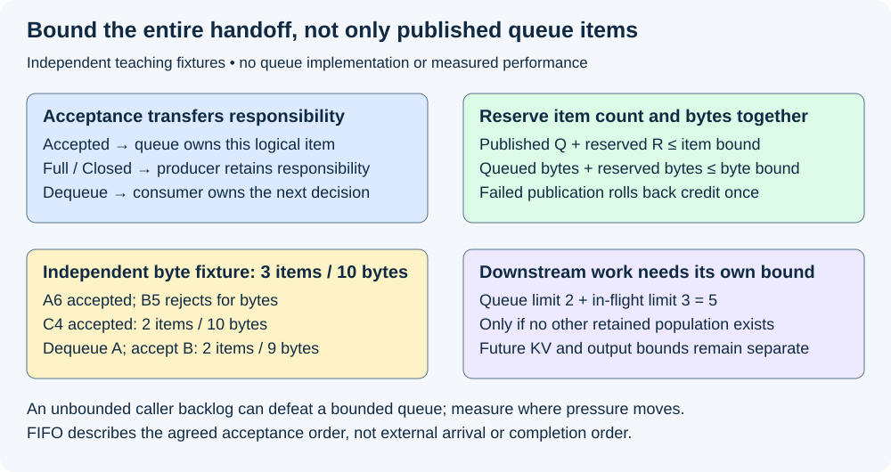
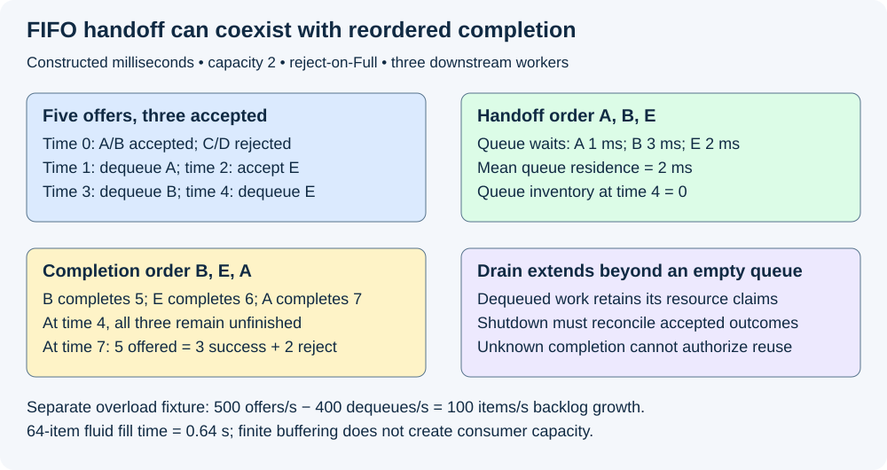

# M5-C04: Producer-consumer queues and bounded work

> **Status: Complete — detailed chapter authored and documentation validated; experimental procedures are proposed unless explicitly labelled observed.**

**Module:** Learn scheduling, operating systems, and queueing theory

**Category:** [Runtime and concurrency](index.md)

[Module 5 reading order](../module-5.md) · [Previous: M5-C03](../runtime-and-concurrency/m5-c03-ipc-and-shared-memory-communication.md) · [Next: M5-C05](../runtime-and-concurrency/m5-c05-synchronization-ownership-and-resource-lifetimes.md)

## Target concepts

Producers and consumers, bounded versus unbounded queues, enqueue and dequeue contracts, FIFO ordering, ownership transfer, blocking and nonblocking behavior, queue capacity.

[Execution plan and progress](../chapter-execution-plan.md)

## Concepts

### 1. A queue transfers work between producers and consumers

A **producer** offers an item; a **consumer** takes an accepted item for further work. A **queue** holds accepted items between these events. In a text-generation service, producers may submit prepared requests while a scheduler consumes descriptors and chooses executor work. Submission, admission, dispatch, execution and output delivery are distinct milestones. A queue's acceptance does not promise available future KV memory or a completed request.

Use [execution contexts](m5-c02-processes-threads-and-operating-system-scheduling.md) and [synchronization and lifetimes](m5-c05-synchronization-ownership-and-resource-lifetimes.md). [IPC](m5-c03-ipc-and-shared-memory-communication.md) supplies cross-process transport contracts, but the simplest baseline here is a bounded in-process queue with one logical consumer and a single lifecycle authority. Rust is the host-language context; no queue or engine implementation is provided.

An **enqueue** accepts an item into the queue's ownership domain. A **dequeue** removes an accepted item and transfers its responsibility to a consumer. The **linearization point** is the conceptual instant when a concurrent operation takes effect in the agreed sequential history. Define it before interpreting ordering, capacity or a cancellation race. An item privately reserved by a producer is not necessarily published and available to dequeue.

| Operation result | Meaning | Ownership consequence in this chapter's contract |
|---|---|---|
| Enqueue accepted | Queue took responsibility at its defined acceptance point | Producer must not submit the same logical work again as new work |
| Full, not accepted | Required capacity was unavailable | Producer retains responsibility; apply a declared retry/wait/reject policy |
| Closed/disconnected, not accepted | Endpoint cannot accept this item | Preserve returned item/error and reconcile its request outcome |
| Dequeue item | Consumer acquired this accepted item | Consumer retains it through dispatch or an explicit terminal/release decision |
| Empty but open | No item presently available | Does not mean producers are finished |
| Closed and drained | No further accepted items will become available, and accepted inventory is exhausted | Still not proof that dequeued/device/output work has completed |

These are abstract lifecycle obligations. The chosen library's actual cancellation, disconnection and error-value semantics must be checked. A timeout with ambiguous acceptance cannot be treated as a definitely failed enqueue. Use request/attempt identity to reconcile the outcome before retrying.

### 2. Bounded buffering makes overload visible

A **bounded queue** has a finite declared capacity; an **unbounded queue** has no configured item-count limit, although memory remains finite. If accepted items arrive faster than the consumer removes them, backlog grows. A queue absorbs a burst or exposes pressure; it cannot manufacture service capacity.

Let Q be queued published items, E successful enqueues and D successful dequeues in an interval. With initially Q₀ items and no separate removal path:

**Qend=Q₀+E−D; 0≤Q≤C**, where C is the item capacity.

Rejection attempts do not increment E. If cancellation physically removes an item, add an explicitly counted removal term. In this baseline, a cancelled queued item remains charged until the consumer removes it and reconciles its outcome; it cannot silently disappear from capacity or identity accounting.

A fluid teaching model has offered rate λ=500 requests/s and dequeue rate μ=400 requests/s, both constant, with zero initial backlog and no rejection. Before finite limits intervene, **Q(t)=(λ−μ)t=100t**. After 2 s, Q=200. At 8,192 payload bytes/request, that is **1,638,400 payload bytes**, before metadata and downstream state. A 64-item queue reaches its limit after **64/100=0.64 s** in this continuous approximation. Real integer arrivals, bursts and scheduling produce different event times; this is not a measured saturation threshold.

After a finite queue fills, the excess must wait upstream, be rejected under policy, or be otherwise explicitly accounted for. Blocking producers still retain tasks and payloads. Moving backlog into an unbounded caller list merely moves the problem. Dropping the oldest item without an authorized cancellation policy changes service semantics and loses accepted work.

### 3. Item count, byte capacity and in-flight work need separate bounds

A capacity of three items does not bound payload bytes if each item can own an arbitrarily large prompt or output buffer. Let Bq be published queued bytes, Br reserved unpublished bytes, R unpublished item reservations, Cn the item bound and Cb the byte bound. A conservative reservation contract requires:

**Q+R≤Cn and Bq+Br≤Cb.**

Acquire/release those credits under one coherent authority. A count checked separately from a byte reservation can overcommit under concurrent producers. Rollback a failed publication exactly once. Reserving capacity must not expose uninitialized data, and an abandoned reservation must have a recovery owner. Reservation order is not automatically the queue's acceptance/FIFO order.

For an independent teaching byte fixture, Cn=3 and Cb=10 bytes. Offer A of 6 bytes: accept it, leaving one item/6 bytes charged. B of 5 bytes rejects for bytes even though item slots remain. C of 4 bytes fits exactly: two items/10 bytes. D of 3 rejects. After dequeuing A, C remains with 4 bytes, and B can now be accepted: two items/9 bytes. These tiny sizes are accounting labels, not realistic request representations.

If a dequeued item enters executor work, queue capacity is released but its payload may remain live. Bound consumer-held/in-flight items and output buffering separately. For example, queue capacity 2 plus at most 3 dispatched unfinished requests permits up to **5 accepted nonterminal requests** across those two disjoint populations, not two. This assumes no additional staging, retry or reserved items; each extra population needs a bound. The future KV promises from Module 2 remain a separate admission invariant.

A **ring buffer** uses a fixed array cyclically. In a conceptual ticket model with enqueue counter P, dequeue counter D and array size C, occupancy is **P−D**, and ticket j occupies **j mod C**. With C=4,P=6,D=3, tickets [3,4,5] occupy slots [3,0,1]; ticket 6 would use slot 2 and fill the fourth slot. This is geometry only, not a concurrent publication algorithm or finite-counter overflow policy.

The kernel engineering article [Circular Buffers](https://docs.kernel.org/core-api/circular-buffers.html) discusses ordering and a convention that leaves one slot empty to distinguish full from empty. That convention gives C−1 usable slots; our separate ticket-count fixture uses all C slots. Do not mix the two capacity conventions, or copy kernel primitives into a user-space/process-sharing contract without qualification.

*Accepted items, unpublished reservations, consumer-held work and bytes have distinct inventories. A finite queue does not by itself bound the entire service.*

### 4. FIFO ordering is an acceptance-order contract

**FIFO** means first in, first out according to the queue's specified acceptance order. It does not guarantee application completion order, scheduling fairness or external-arrival order among concurrent producers. If producer calls overlap, define which operation took effect first through the actual queue contract. Request and random identities must not be derived from a mutable queue position.

Use a deterministic teaching queue with capacity 2 and a declared total event order. At time 0, offer A,B,C,D in that order before the consumer runs. Accept A and B; C and D receive Full and are rejected under this fixture's policy. At time 1, dequeue A. At time 2, offer E and accept it behind B. At time 3 dequeue B, and at time 4 dequeue E.

| Time (ms) | Event | Queue after event | Accepted / dequeued totals |
|---|---|---|---|
| 0 | A then B accepted; C/D rejected | [A,B] | 2 / 0 |
| 1 | A dequeued and dispatched | [B] | 2 / 1 |
| 2 | E accepted | [B,E] | 3 / 1 |
| 3 | B dequeued and dispatched | [E] | 3 / 2 |
| 4 | E dequeued and dispatched | [] | 3 / 3 |

Let three downstream workers complete B at 5 ms, E at 6 and A at 7. Then accepted/dequeued order is **A,B,E**, while completion order is **B,E,A**. No FIFO violation occurred. Queue waits are **A:1−0=1 ms, B:3−0=3 ms, E:4−2=2 ms**, with mean 2 ms. These are queue residence times, not time to first token. The 7-ms cutoff ledger is **5 offered=3 successful+2 rejected**, and Q=0+3−3=0. No real execution cost or hardware speed is implied.

An empty queue at time 4 still has three unfinished downstream requests in this fixture. Closing the producer side then cannot authorize reclaiming their buffers. A slow output consumer can also retain results after model work finishes; queue dequeue is not the final-user boundary.

### 5. Blocking, asynchronous waiting and nonblocking attempts differ

A **blocking send** may suspend the calling native thread until capacity becomes available or closure is detected. A **nonblocking attempt** reports whether it can accept now without waiting for capacity. This is an API behavior, not a proof of lock-free/wait-free progress or bounded instruction count. Repeatedly retrying Full in a tight loop can waste CPU and delay the consumer that would release capacity.

An asynchronous wait can suspend a runtime task rather than a native thread, but the runtime still needs worker CPU service, a correct wakeup/predicate contract and cancellation semantics. It does not remove the queued bytes or outstanding request. Async execution is developed in the next authoring chapter.

[Rust sync_channel](https://doc.rust-lang.org/std/sync/mpsc/fn.sync_channel.html) is a concrete bounded, multi-producer/single-consumer comparison. A zero bound creates a rendezvous: send pairs with receive instead of storing an item in a positive-capacity buffer. Rendezvous success is handoff, not completed inference. The [SyncSender specification](https://doc.rust-lang.org/std/sync/mpsc/struct.SyncSender.html) distinguishes send from try_send; [TrySendError](https://doc.rust-lang.org/std/sync/mpsc/enum.TrySendError.html) distinguishes Full and Disconnected and carries the unaccepted value. A successful buffered send still does not prove the receiver has processed it.

Do not block while holding a lock that the consumer needs to dequeue. Otherwise a full queue plus that held lock can create a cycle: producer waits for space, consumer waits for producer's lock. Apply M5-C05's lock-order/predicate rules and retain resource claims while waiting outside protection. Fairness among waiting producers and cancellation while a send is pending require explicit library/protocol guarantees, not assumptions.

### 6. Shutdown and failure preserve accepted ownership

Define closure: stop accepting new work, wake participants that cannot make progress, and reconcile every accepted item. In a drain policy, already accepted valid items remain available for authorized dequeue; in an abort policy, they receive explicit terminal outcomes and resources are released only after final users. State which policy applies. Do not equate a disconnected consumer with successful cancellation of every item it previously dispatched.

| Boundary | Required accounting |
|---|---|
| Full/closed before acceptance | Producer retains the item or returned value; no phantom accepted count |
| Reserved but unpublished producer exits | Reservation recovery owns rollback/reconciliation; no uninitialized dequeue or permanent unexplained credit |
| Accepted then cancelled while queued | Retain identity/capacity until the declared removal/reconciliation point; one terminal outcome |
| Dequeued, dispatch not yet submitted | Consumer owns it and must report dispatch, safe rejection or cancellation |
| Submitted device work, completion unknown | Retain/quarantine final-user claims; no blind duplicate submission/reuse |
| Selection committed, output path fails | Preserve committed ID/random history; delivery failure does not authorize resampling |

At any cutoff, partition accepted logical work into nonterminal queued, nonterminal consumer-held/in-flight and terminal outcomes. A logically cancelled entry can still occupy physical queue capacity until removed; count it once logically and preserve that separate storage charge. Unpublished reservations have their own ledger and must not be counted as accepted under this baseline’s publication-time acceptance contract. Keep transport attempts and physical claims separately. A duplicated notification cannot dequeue or complete one logical item twice. Late results require current attempt/worker epoch and slot generation. Terminating a host task, dropping a sender or observing an empty queue does not prove device completion.

*FIFO constrains accepted handoff order. Downstream completion can reorder, and drain extends beyond the queue's own inventory.*

## Experiments

All four experiments are proposed. Authoring observes bounded event/arithmetic reference checks, document checks and rendered review; no queue, scheduler, Rust runtime, IPC or device benchmark is implemented or executed. Experiments concern text generation, not Module 8 modalities.

### E1 — Qualify acceptance, FIFO and ownership

- **Name:** Accepted once, handed off once.
- **Description:** Review abstract enqueue/dequeue outcomes and reconcile the five-offer capacity-two trace against named request identities.
- **Purpose/objective:** Hypothesis: FIFO handoff preserves accepted order without promising completion order. HFT lens: accepted event identity must survive reordering of downstream work.
- **Target concepts:** Producers/consumers, enqueue/dequeue contracts, FIFO and ownership transfer.
- **Baseline:** One logical consumer, total offer order A/B/C/D then E, reject-on-Full and three explicitly bounded downstream workers.
- **Workload:** The 0/1/2/3/4-ms trace, completion at 5/6/7, concurrent overlapping producer offers as a separate ordering case, duplicate ID/notification and stale attempt. Vary event order only when labelled.
- **Controlled variables:** Item identities, acceptance point, capacity 2, full policy, dispatch ownership and request/attempt/random identities. Completion labels are not model outputs.
- **Hardware requirements:** CPU paper/reference QA; later a version-pinned Rust channel/queue contract and independently qualified executor for runtime evidence.
- **Exit criteria:** First enumerate every offer outcome; then reconcile Q=Q₀+E−D after each event; finally route downstream completions by identity. Acceptance/dequeue A,B,E, completion B,E,A, waits 1/3/2 and mean 2 ms reproduce. Concurrent offers are judged by the queue's specified order, not guessed wall-clock arrival precedence; no duplicate accepted work or release is permitted.

### E2 — Bound items, bytes and retained work

- **Name:** Queue size is only one inventory.
- **Description:** Audit count/byte reservations and conceptual ring geometry, then inspect downstream populations.
- **Purpose/objective:** Hypothesis: item capacity alone cannot bound retained payload or future KV. Predict B rejects for bytes despite available item slots.
- **Target concepts:** Queue capacity, bounded/unbounded queues, reservations and resource ownership.
- **Baseline:** Independent Cn=3,Cb=10-byte fixture and explicit published/reserved credit authority; ring example is geometry only.
- **Workload:** A6/B5/C4/D3 offers, A dequeue and B retry; failed publication/abandoned reservation; C=4,P=6,D=3 ticket geometry; queue-2 plus in-flight-3 population. Vary payload size, reservation status and downstream occupancy separately.
- **Controlled variables:** Credit units, acceptance/rollback points, backing payload versus descriptor bytes, capacity convention, finite-counter policy and final-user retention. Future KV admission stays separate.
- **Hardware requirements:** CPU arithmetic/state reference; later allocation/byte telemetry, exact queue/runtime representation and actual model/backend memory manifest.
- **Exit criteria:** First check both reservation inequalities; then reconcile 6→10→4→9-byte inventory and rejected offers; finally verify tickets [3,4,5] map to [3,0,1] and next ticket 6 maps to 2. No double credit, overflow, premature reuse or hidden staging population; queue plus downstream bound is 5 only under its stated assumptions.

### E3 — Expose overload and choose a full policy

- **Name:** A bounded queue moves or rejects excess demand explicitly.
- **Description:** Reproduce the fluid backlog prediction, then plan matched overload traces comparing fixed capacity/full-policy choices.
- **Purpose/objective:** Hypothesis: finite buffering cannot raise dequeue capacity; unbounded backlog retains memory while blocking can move backlog upstream. HFT concern: burst absorption must not conceal stale/late work.
- **Target concepts:** Bounded/unbounded queues, blocking behavior, variability and capacity.
- **Baseline:** Constructed λ=500/s, μ=400/s, 8,192 bytes/item, zero initial backlog; later one fixed qualified executor and request policy.
- **Workload:** 2-s fluid reference and 64-item threshold; later frozen steady/burst/slow-consumer text traces with declared item/byte/in-flight bounds. Use 20 preassigned paired reset sessions per descriptive workload cell, balanced arm order and one complete scratch trace warmup per arm/session. Independent variable is one capacity or full-policy choice, not several changes together.
- **Controlled variables:** Intended arrivals, exact prompts/caps/random identities, backend, admission/KV promises, client behavior, CPU allocation, output limits and drain endpoint. Retain actual arrivals to detect caller throttling.
- **Hardware requirements:** Recorded CPU/NUMA/SMT/RAM/OS/runtime/queue implementation, telemetry and separate scheduling/device profiles; GPU stack when the executor uses one.
- **Exit criteria:** First reproduce Q(2)=200, payload 1,638,400 bytes and fluid fill at 0.64 s; then reconcile accepted/rejected/upstream-waiting work; finally report raw paired descriptive responses, median/range, queue age/depth/bytes, throughput and useful-service latencies. No unbounded real exhaustion run is required. No production p99/capacity claim follows from the fluid model or 20-session count; freeze M9-C27 acceptance before confirmation.

### E4 — Verify wait, cancellation and drain

- **Name:** Empty is not finished.
- **Description:** Audit pending sends, rendezvous, closure and downstream failure with explicit request and final-user ownership.
- **Purpose/objective:** Hypothesis: queue-local progress can end before device/output work; predict Q=0 at 4 ms while three requests remain unfinished.
- **Target concepts:** Blocking/nonblocking behavior, ownership transfer, endpoint closure and bounded work.
- **Baseline:** M5-C05 predicate/lock/lifetime gates; M5-C03 receipt-versus-final-release distinctions; one lifecycle authority.
- **Workload:** Empty/open, full/open, closed/nonempty, closed/drained, zero-capacity rendezvous, Full/Disconnected errors, cancellation before/after acceptance, abandoned reservation and lost completion. Vary failure/closure stage separately; no actual deadlock or unsafe free is required to reject a decision.
- **Controlled variables:** Library outcome contract, returned item identity, admission closure, producer/consumer locks, slot generation, request step and publication/retirement authority.
- **Hardware requirements:** CPU event/reference review; later isolated test worker and supported wakeup/thread/backend diagnostics with their coverage recorded.
- **Exit criteria:** First classify ownership at each outcome; then test progress against the protected predicate and declared closure policy; finally reconcile all accepted and physical-user claims through drain. A wait cannot hold a lock required by its consumer, closure wakes affected waiters, failed sends retain responsibility and uncertain submitted work is never blindly retried/reclaimed. Q=0 does not imply the 7-ms fixture is already complete at 4.

## Verification

| Experiment | Correctness reference | Measurement / benchmarking | Profiling and acceptance boundary |
|---|---|---|---|
| E1 | Named identity, accepted order, one handoff/terminal decision | Per-event enqueue/dequeue counts and queue waits | FIFO does not constrain downstream completion; overlapping offers need an actual ordering contract |
| E2 | Count/byte/reservation conservation, bounded staging and final users | Byte inventory, ticket geometry, downstream population | Geometry is not a concurrent algorithm; queue slots do not establish KV admission |
| E3 | Same useful work and explicit full policy; all offered attempts retained | Depth/age/bytes, actual arrivals, useful completions, rejected/cancelled/failed/unresolved counts | Separate clean timing from tracing; retain invalid sessions and upstream waits |
| E4 | Returned ownership, predicate progress, safe closure and retirement | Pending-sender/accepted/dequeued/terminal and claim ledgers, complete drain | Diagnose lock/wakeup dependencies; unknown completion is not permission to reuse |

Define enqueue wait from offer to acceptance or explicit failure, queue residence from acceptance to dequeue, and downstream latency from dequeue to the chosen terminal event. Record exact populations: rejected offers have no accepted queue-residence observation; zero-generation or cancelled-before-output requests may have no TTFT. Measure on [M9-C02 clock boundaries](../measurement-experimentation-and-economics/m9-c02-request-events-clocks-and-measurement-boundaries.md), label missing outcomes, and never add overlapping thread/device spans as elapsed latency. Offered logical requests partition into rejected, not-yet-accepted waiting, accepted nonterminal and terminal outcomes; retries retain attempt IDs. Physical buffer claims remain separate from logical status.

For future E3 comparisons, preserve warmup/reset, sample units and every paired session. Report descriptive samples and uncertainty limits; a confirmatory service or tail claim needs a frozen [M9-C27 design](../measurement-experimentation-and-economics/m9-c27-designing-regression-experiments-and-validation-gates.md). Profiles should distinguish producer blocking/spinning, consumer CPU-ready delay, lock scope, allocator work and device/output drain; instrumentation runs are separate from clean timing. No runtime stress result alone proves every concurrency history safe. Later M9-C22/C23 provide fuller concurrency/fault methodology and are not assumed authored here.

## Engineering dimensions and principles

| Dimension | Chapter-specific application |
|---|---|
| Semantics and invariants | Accepted work has one identity and owner; Full does not create a phantom accepted item |
| Workload and variability | Burst arrivals, skewed prompt sizes, reuse and slow output readers change queue age/bytes; text only |
| Resources and bottlenecks | Count, bytes, reservations, CPU waiting, in-flight work and KV promises need distinct bounds |
| Time and distributions | FIFO queue wait differs from TTFT and completion order; upstream blocking can hide offered load |
| Ownership and coordination | Acceptance, publication, dequeue and final-user retirement are separate handoffs |
| Failure and adaptation | Close/wake/reconcile under explicit drain or abort policy; unknown effects retain claims |

| Engineering principle | Consequence |
|---|---|
| 1. Correctness defines the optimization boundary | Dropping an accepted item silently is not a legitimate latency improvement |
| 2. Performance depends on workload and operating point | A buffer adequate for a steady trace may fill during a burst or long consumer stall |
| 3. Data movement is part of the algorithm | Descriptor movement, payload retention and cache contention belong to queue cost |
| 4. State has ownership, lifetime and recovery cost | A dequeued item leaves the queue but still owns resources and outcome obligations |
| 5. Dependencies determine latency; bottlenecks determine capacity | More buffering cannot increase a fixed consumer's useful capacity |
| 6. Variability and synchronization shape the tail | Slow consumers, producer locks and delayed wakeups can amplify waiting |
| 7. Local improvements require end-to-end evaluation | Faster enqueue or a smaller queue matters only through correct useful service |
| 8. Claims require reproducible evidence | Preserve event order, full/closure policy, byte inventories and every offered outcome |

The HFT lens is preserving event identity and freshness under bursty producer/consumer demand. Bounded buffering, explicit overload policy and ownership transfer apply well. Inference adds repeated dependent tokens, future KV growth and GPU/output readers; a queue microbenchmark does not establish exchange deadlines, trading results or sustainable inference capacity.

## Specifications, articles, and hardware

Rust sync_channel, SyncSender and TrySendError specifications are linked beside their contracts. The Linux kernel Circular Buffers engineering article explains geometry and publication constraints under kernel-specific assumptions; it is not a user-space queue implementation or process-sharing guarantee. Record exact library/toolchain revisions before runtime study, including error/cancellation/fairness guarantees rather than inferring them from “FIFO” or “nonblocking.”

Record CPU model/core/SMT/NUMA topology, RAM, OS/kernel, affinity/quota, background activity, Rust/runtime/queue versions, worker counts, item representation and all byte/count/reservation limits. For serving add GPU architecture/count/VRAM, interconnect, driver/runtime/compiler, model/tokenizer/corpus hashes, dtype, KV/workspace/graph limits, output buffering and client behavior. Record clock resolution, profiler scope/overhead and reset/warmup/drain. No supplied hardware was benchmarked; tiny byte and timing fixtures are declared teaching inputs.

## Key takeaways

A queue needs precise acceptance, ordering, full and closure contracts. Bound every retained population, not only published queue entries. FIFO handoff does not promise FIFO completion, and an empty queue does not establish final-user drain. Evaluate overload through accounted useful service, preserving ownership through every outcome.

## Continue learning

Next in Module 5 reading order is completed [M5-C05: Synchronization, ownership, and resource lifetimes](m5-c05-synchronization-ownership-and-resource-lifetimes.md). The next authoring chapter is [M5-C18: Choosing chunk sizes and balancing prefill with decode](../scheduling-and-queueing/m5-c18-choosing-chunk-sizes-and-balancing-prefill-with-decode.md), position 125. Follow the [execution plan and progress tracker](../chapter-execution-plan.md); Module 8 is excluded and Module 9 supports Modules 1–7.
