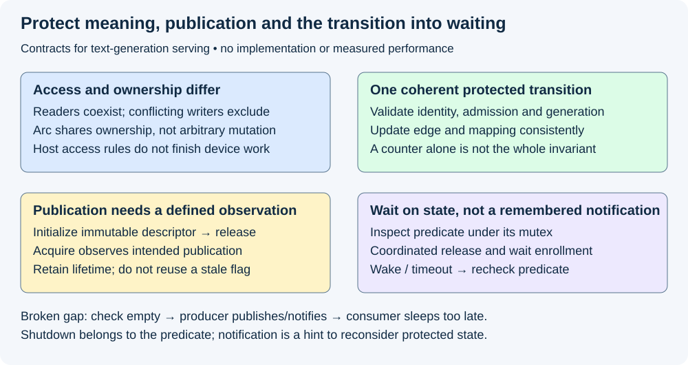
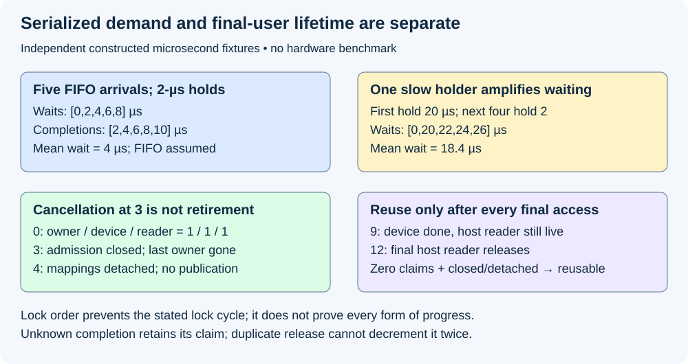

# M5-C05: Synchronization, ownership, and resource lifetimes

> **Status: Complete — detailed chapter authored and documentation validated; experimental procedures are proposed unless explicitly labelled observed.**

**Module:** Learn scheduling, operating systems, and queueing theory

**Category:** [Runtime and concurrency](index.md)

[Module 5 reading order](../module-5.md) · [Previous: M5-C04](../runtime-and-concurrency/m5-c04-producer-consumer-queues-and-bounded-work.md) · [Next: M5-C06](../runtime-and-concurrency/m5-c06-asynchronous-execution-and-completion-driven-progress.md)

## Target concepts

Exclusive and shared access, mutexes, atomics and condition variables, Rust ownership and borrowing, contention, deadlock, lost wakeups, request and buffer lifetimes.

[Execution plan and progress](../chapter-execution-plan.md)

## Concepts

### 1. Access, ownership and completion answer different questions

**Synchronization** coordinates access to state and the order in which effects become visible. An **invariant** is a condition that must remain true through every permitted transition. For a serving engine, examples include one selection commit per request step, no simultaneous conflicting writes to a block table, and no reuse while an admitted reader still accesses a buffer.

Start from [native execution contexts](m5-c02-processes-threads-and-operating-system-scheduling.md) and [shared-block ownership](../state-memory-and-caching/m2-c11-reference-counting-and-shared-block-ownership.md). A host thread can stop running while another thread or device continues using its state. Scheduling work, publishing results and reclaiming storage therefore need explicit authority. This chapter describes contracts and proposed experiments, without implementation or pseudocode.

An **owner** keeps a resource alive and arranges its eventual release. A **borrow** grants temporary access without transferring that responsibility. **Shared access** permits multiple compatible readers; **exclusive access** permits a writer without conflicting readers or another writer. In the simple ordinary-reference model, let R count readers and W be zero or one writer:

**Allowed access = (W=0 and R≥0) or (W=1 and R=0).**

[Rust borrowing](https://doc.rust-lang.org/book/ch04-02-references-and-borrowing.html) expresses these host access rules through references. Synchronized interior mutability permits mutation through a shared owner under a stronger mechanism; it does not abolish conflict rules. A raw pointer, foreign runtime or device allocation introduces additional obligations outside ordinary host-reference checking.

[Rust Arc](https://doc.rust-lang.org/std/sync/struct.Arc.html) provides shared ownership with atomic reference counting. It does not make arbitrary contents safe for concurrent mutation. A count observed as one is not independently a permission to mutate a sealed shared KV block, nor evidence that a GPU reader has finished. Retain the request/cache ownership edges and admitted-use pins from Module 2.

### 2. A mutex protects a transition, not merely a field

A **mutex**, or mutual-exclusion lock, permits one holder to access protected state at a time. The **critical section** is the work performed while holding it. A Rust lock guard ties protected access to a scoped permission; leaving that scope releases the guard. The [Mutex specification](https://doc.rust-lang.org/std/sync/struct.Mutex.html) describes guard-based access and poisoning after some panics. Poisoning is advisory evidence of possible interrupted invariants, not automatic recovery or a complete failure detector.

Suppose two threads each add one ownership edge to a ledger initially at zero. In a deliberately invalid read/modify/write model, both can read zero and both publish one: an update is lost. There are six interleavings of two ordered read-then-write pairs. Two fully serial interleavings finish at two; four overlapping interleavings finish at one. This is a mathematical counterexample, not permission to execute a data race: unsynchronized conflicting ordinary-memory accesses can have undefined behavior in Rust's underlying model.

Protect the entire logical transition: validate the live source and generation, check admission, add one named edge, and publish the associated mapping consistently. Separately locking only the counter does not make a stale lookup safe. A **linearization point** is the conceptual instant at which a concurrent operation takes effect in the agreed sequential history. Name that point for retain, release, cancellation and commit, so duplicate notifications cannot apply the same transition twice.

One lifecycle authority with a small protected ledger is a useful baseline. Keep expensive computation, callbacks, transport and device waits outside that critical section where the contract permits. Before releasing protection, retain the required storage/attempt claims; after external work, revalidate the current identity/version before committing. Shorter locks must not create a check-then-use gap.

### 3. Atomics need a publication and lifetime contract

An **atomic operation** has an indivisible effect on its atomic object. That property does not make a group of separate fields transactional. Two atomic fields can be observed at different logical stages unless a protocol prevents it. Atomic increments also do not define which request owns an edge, how duplicate release is rejected, or whether admission is closed.

[Atomic ordering](https://doc.rust-lang.org/std/sync/atomic/enum.Ordering.html) controls synchronization between memory operations. Relaxed operations preserve atomicity of their object without establishing general publication of other data. Release/acquire can establish a **happens-before** relationship: an ordering under which earlier writes are visible to a later authorized reader. The [Rustonomicon atomics article](https://doc.rust-lang.org/nomicon/atomics.html) explains why compiler and hardware ordering matter.

For a single-publication teaching contract, a producer completely initializes immutable descriptor D, then publishes its ready state with release semantics. A consumer's acquire observation of that publication permits reading the preceding initialization. This requires that the observation actually corresponds to the relevant publication, that D stays alive, and that nobody mutates it concurrently. Reusing one ready flag for multiple generations needs additional identity/reclamation rules; this example does not specify that algorithm. Sequential consistency gives stronger ordering among relevant atomic operations, but still does not make two independent counters one transaction.

Host atomic ordering is not a GPU completion event. [CUDA synchronization behavior](https://docs.nvidia.com/cuda/cuda-runtime-api/api-sync-behavior.html) distinguishes host API return from asynchronous device work. A host-ready flag must refer to genuine backend completion/readiness evidence before it can authorize consuming device results. Nor does replacing a lock with atomics automatically give bounded latency: contention, cache-line movement and retries can still dominate. Lock-free progress, where the system continues completing some operations, is distinct from a per-request completion bound.

### 4. A condition variable waits for a predicate

A **condition variable** lets a thread sleep until it should reconsider shared state. A **predicate** is the condition that permits progress, such as “a completion is available or shutdown has closed this queue.” The [Condvar specification](https://doc.rust-lang.org/std/sync/struct.Condvar.html) associates waiting with a mutex and predicate. Waiting atomically releases the mutex and enrolls the waiter relative to the notification protocol, then reacquires protection before returning. Wakeups can be spurious, and a different consumer may take the available item first. Returning from a wait is permission to recheck, not proof that the predicate holds.

A **lost wakeup** occurs when a notification is missed across an incorrectly coordinated check/sleep gap. Consider a broken teaching sequence: consumer sees empty, releases protection without enrolling to wait; producer publishes an item and notifies; consumer then sleeps. Notifications are not a stored inventory of items, so the consumer can sleep despite available work.

In the qualified contract, predicate inspection and the transition into waiting use the same mutex/condition-variable relationship, while the producer changes the predicate under that mutex. If publication precedes inspection, the consumer observes the item and need not sleep. If publication follows enrolled waiting, notification prompts a recheck. Notification may occur after releasing the mutex under a correct protocol; what matters is coordinated state and waiter enrollment, not keeping the lock during every notification.

Shutdown and cancellation must be part of the protected predicate and wakeup policy. A timeout does not prove the predicate false, and a notification does not prove true: reconcile the actual state under protection. Do not hold unrelated locks while sleeping if the producer needs them to make progress.

*The protected predicate carries meaning. Notifications prompt reconsideration; host publication and device completion remain separate obligations.*

### 5. Deadlock and contention need different evidence

**Deadlock** is a cycle of participants waiting for progress that the cycle prevents. If thread A holds request lock Q and needs pool lock P, while B holds P and needs Q, neither can proceed. A **wait-for graph** represents who waits for whom; A→B→A exposes this two-party cycle. Merely adding more threads does not remove it.

A consistent global lock order can prevent cycles among those locks. For example, assign pool rank 1 and request rank 2, and permit nested acquisition only in increasing rank order. No path may hold rank 2 while acquiring rank 1. Where an operation cannot obey the order, redesign the transition or release and revalidate; do not simply move checks outside protection. This prevents the stated lock-order cycle, not every possible deadlock involving channels, callbacks, device waits or shutdown. Rust's ownership system does not itself prove deadlock freedom.

**Contention** means participants compete for a resource and may wait even though progress continues. In a constructed FIFO burst, five threads arrive together at an uncontended initial lock, each requiring 2 µs in the critical section. Ignore scheduling and lock overhead. Their waits are **[0,2,4,6,8] µs**, completions **[2,4,6,8,10] µs**, and mean wait **4 µs**. FIFO is a fixture assumption, not a fairness guarantee for Rust's standard mutex.

If the first holder instead takes 20 µs and the next four still take 2, waits become **[0,20,22,24,26] µs**. Mean wait rises to **18.4 µs**, although only one section changed. This illustrates convoying: one slow holder delays a group behind it. It is not a stochastic p99 prediction.

For one serial protected operation with mean hold demand h seconds, **ideal protected-operation capacity ≤1/h**, excluding all overhead and other bottlenecks. At h=2 µs this is 500,000 protected operations/s; at h=22 µs it is about 45,455/s. Those are upper bounds on that resource, not generator requests/s. Holding a lock through a 20-µs device wait can consume protected elapsed capacity even when CPU usage is low. Move the wait outside only with retained claims and subsequent validation.

### 6. Request closure is not buffer retirement

A **lifetime claim** retains a resource for an admitted user until that user's final access completes. A resource can have no request owners while device or output readers remain. For this conservative teaching policy, define n as strong ownership edges, d as unresolved device-use claims, and r as unresolved host/output-reader claims:

**Reusable = n=0 and d=0 and r=0 and admission closed and mappings detached and no pending publication.**

Checking these conditions and authorizing reassignment must be serialized against acquiring new claims. Observing three separate zero counters at unrelated times is insufficient. A slot generation identifies its particular use; a delayed completion for the previous generation cannot release the new owner's claims.

| Constructed time (µs) | Event | n / d / r | Reusable? |
|---|---|---|---|
| 0 | One request owns a buffer with device and host readers | 1 / 1 / 1 | No |
| 3 | Cancellation closes admission and releases the last owner | 0 / 1 / 1 | No |
| 4 | Mappings detached; no pending publication | 0 / 1 / 1 | No |
| 9 | Final device access completes | 0 / 0 / 1 | No |
| 12 | Final host/output reader releases | 0 / 0 / 0 | Yes, under the authority |

The earliest reuse in this fixture is **12 µs**, not cancellation at 3 or device completion at 9. Unknown completion leaves d outstanding. A duplicate notification cannot decrement it twice; a failed backend may require quarantine/recovery rather than reuse. A lock that protected metadata at time 3 cannot force an earlier device access to finish. Conversely, successful device completion does not make an old request/step identity current again.

*Lock scope determines serialized demand; final-user evidence determines resource lifetime. Neither substitutes for the other.*

## Experiments

All four experiments are proposed. Chapter-authoring observations are bounded reference/arithmetic checks and documentation review. No Rust synchronization primitive, scheduler, device workload or sanitizer study is implemented or executed. Each procedure uses text-generation serving and the HFT concern of preserving correct event/state transitions under latency pressure; non-text modalities are outside this curriculum.

### E1 — Qualify the protected transition and publication

- **Name:** One ownership transition, one coherent publication.
- **Description:** Enumerate two read/modify/write pairs as a mathematical counterexample, then review mutex-protected and single-publication atomic contracts against the same invariants.
- **Purpose/objective:** Hypothesis: atomicity of one field cannot substitute for a coherent ownership/mapping transition. Predict four lost-update histories in the six invalid-model interleavings.
- **Target concepts:** Shared/exclusive access, borrowing, mutexes, atomics and request identity.
- **Baseline:** Single lifecycle authority; named edge tokens, live generation and admission checks from M2-C11.
- **Workload:** Six bounded interleavings, duplicate edge release, stale generation, overflow rejection, incomplete descriptor initialization and publication-generation reuse. The independent variable is the synchronization contract; no real data race is run.
- **Controlled variables:** Same two logical increments, initial zero count, identity/edge inventory, descriptor contents and immutable lifetime. Mutex and atomic alternatives must satisfy the same semantic contract.
- **Hardware requirements:** CPU paper/reference QA; later a supported Rust toolchain and separately specified memory-model/concurrency tooling for any implementation qualification. Record architecture and tool scope.
- **Exit criteria:** First list all six histories and expected totals; then identify the protected transition/linearization point and publication edge; finally reject stale/duplicate/unsupported transitions. Two invalid-model serial histories end at two and four at one. Correct alternatives preserve both count and mapping; acquire observes the intended release publication, and lifetime remains protected. A stress pass alone is not a memory-order proof.

### E2 — Verify waiting and progress rules

- **Name:** Wakeups prompt a predicate recheck.
- **Description:** Compare the broken check/notify/sleep trace with the coordinated mutex/predicate waiting contract and a lock-order graph.
- **Purpose/objective:** Hypothesis: coordinated enrollment avoids the demonstrated lost wakeup, while a global order removes the stated two-lock cycle. HFT analogy: do not lose a ready event while trying to sleep efficiently.
- **Target concepts:** Condition variables, lost wakeups, deadlock and coordination.
- **Baseline:** One protected predicate including work-available or closed; pool rank 1 before request rank 2.
- **Workload:** Publication before inspection, publication after enrolled waiting, spurious wake, competing consumer, timeout concurrent with publication, shutdown and A→B→A lock cycle. Vary event order and lock acquisition order independently.
- **Controlled variables:** Same predicate state, one associated mutex, completion identity, queue closure semantics and fair-progress assumptions. Queue implementation belongs to later chapters.
- **Hardware requirements:** CPU trace/graph QA; later runtime/OS diagnostics with bounded observation time, without intentionally hanging a production worker.
- **Exit criteria:** First draw the broken gap; then classify before/after-enrollment cases; next recheck predicate after every wake/timeout; finally audit every nested acquisition. Available state is never ignored due solely to a lost notification, closure wakes required waiters, and no decreasing-rank acquisition is permitted. Report liveness assumptions and unknown cases; absence of a hang does not prove all schedules safe.

### E3 — Explain contention before claiming faster service

- **Name:** Bound the serialized hold demand.
- **Description:** Reconcile both FIFO burst fixtures, then plan a matched comparison of two qualified critical-section scopes.
- **Purpose/objective:** Hypothesis: a slow holder creates waiting amplification; moving external work outside protection may reduce contention only if claims and revalidation remain correct.
- **Target concepts:** Mutex contention, critical paths, variability and service objectives.
- **Baseline:** Five simultaneous arrivals, deterministic FIFO and 2-µs hold demand; separate 20-µs-first-holder fixture.
- **Workload:** Exact teaching bursts; later frozen short/long-prompt and decode-heavy traces with worker counts 1/2/4/8. Independent variable is qualified lock scope, not model computation or request policy.
- **Controlled variables:** Useful work, arrivals, CPU allocation/topology, admission/KV limits, backend, warmup, lock identities and completed service endpoints. Do not assume the actual mutex is FIFO.
- **Hardware requirements:** Recorded CPU/NUMA/SMT, OS/kernel/Rust/runtime versions; permitted lock/wakeup profiling and actual device stack for serving measurements.
- **Exit criteria:** First reproduce waits/completions and means 4/18.4 µs; then separate hold from acquisition wait and runnable delay; finally compare clean service timings with separate diagnostic captures. Report 1/h bounds with correct units, not requests/s. All state/retirement gates must pass; no p99 or capacity claim follows from five constructed observations.

### E4 — Retire only after final users finish

- **Name:** Cancellation closes work, not outstanding accesses.
- **Description:** Reconcile the n/d/r lifecycle table and later exercise isolated completion/cancellation/failure traces.
- **Purpose/objective:** Hypothesis: logical request closure and physical reuse have different boundaries; predict earliest fixture reuse at 12 µs.
- **Target concepts:** Ownership, request/buffer lifetimes, atomic counters, failure and recovery.
- **Baseline:** M2-C11 ownership/pins and M5-C01 one-time commit; one serialized claim/admission authority.
- **Workload:** Owner/device/reader releases in all six orders, mapping detach, cancellation before/after selection commit, duplicate/stale completion, unknown completion and worker error. Vary final-user event order while keeping identities fixed.
- **Controlled variables:** Admission closure, slot generation, edge tokens, covered final accesses, pending publication and retained ownership during external waits. No unsafe free is necessary to test a rejected reuse decision.
- **Hardware requirements:** CPU reference ledger; later isolated test worker, backend completion/error observations and supported memory-safety tooling with its limitations documented.
- **Exit criteria:** First enumerate the six release orders; then check the reuse predicate after every event; finally reconcile all logical outcomes and outstanding claims at drain. Reuse requires every gate, happens once and rejects stale/duplicate release. Unknown device completion remains retained/quarantined; delivery failure after commit never resamples. Observed tool cleanliness alone does not establish a complete concurrency proof.

## Verification

| Experiment | Correctness reference | Measurement / benchmarking | Profiling and evidence limits |
|---|---|---|---|
| E1 | Named edges, consistent mapping, no conflicting access, intended publication | Six bounded interleavings; counts and rejected transitions | Distinguish memory-model reasoning from runtime stress; no real undefined behavior fixture |
| E2 | Protected predicate, coordinated wait, closure and global lock order | Event histories, timeouts and progress under stated assumptions | Wait-for graph and blocked-thread evidence; spurious wake is not work authorization |
| E3 | Same useful requests and valid claims despite changed lock scope | Hold/wait distributions, per-thread runnable delay, TTFT/gaps/terminal times and useful output | Separate clean timing from lock/OS/device diagnostic captures; no percentile inference from toy burst |
| E4 | Admission/identity/final-user gates, one-time return and commit | Release-order histories, live/retiring/free inventory and complete drain | Safety checks can reject early reuse without freeing live memory; unknown completion stays explicit |

For future E3 service comparisons, freeze exact prompts/caps/arrivals, request-owned randomness, backend and one candidate before measurement. Use 20 preassigned paired reset sessions per descriptive workload cell, balanced arm order and one complete scratch trace warmup per arm/session; retain invalid sessions rather than replacing them. This fixed count supports a descriptive comparison, not a universal tail-confidence claim. Report raw paired responses, medians/ranges, request counts and missing/undefined latency observations. A confirmatory improvement claim requires a separately frozen [M9-C27 acceptance design](../measurement-experimentation-and-economics/m9-c27-designing-regression-experiments-and-validation-gates.md).

Timestamp arrival, lock request/acquisition/release, dispatch, actual completed device access, commit and terminal/delivery events using [M9-C02 clock boundaries](../measurement-experimentation-and-economics/m9-c02-request-events-clocks-and-measurement-boundaries.md). Define lock wait from request to acquisition and hold from acquisition to release on one monotonic host clock. Do not equate all wait with spinning or blocked time, and do not add overlapping device spans. Preserve offered/admitted/rejected/waiting/success/failed/cancelled/unresolved outcomes, distinct logical request and physical claim ledgers, and all retries by attempt identity. Drain requires final-user accounting, not just an empty queue. Future M9-C22/C23 expand concurrency/fault verification; this chapter does not assume them complete.

## Engineering dimensions and principles

| Dimension | Application |
|---|---|
| Semantics and invariants | One coherent transition preserves request/step/edge identities and reference counts |
| Workload and variability | Bursts, long prompts, output readers and reuse skew change lock demand; non-text modalities are out of scope |
| Resources and bottlenecks | Serialized hold time, cache-line traffic, CPU waiting and retained buffers consume different resources |
| Time and distributions | A single slow holder amplifies group wait; completion does not imply immediate commit or reuse |
| Ownership and coordination | Borrowing, strong ownership, protected state and final-user claims have separate meanings |
| Failure and adaptation | Poison, cancellation, stale callbacks and unknown completion require invariant-aware recovery |

| Engineering principle | Consequence |
|---|---|
| 1. Correctness defines the optimization boundary | Removing a lock is invalid if publication or reclamation loses its proof |
| 2. Performance depends on workload and operating point | Low-contention success does not establish burst or multi-core behavior |
| 3. Data movement is part of the algorithm | Shared atomic metadata can move cache lines even when payload is unchanged |
| 4. State has ownership, lifetime and recovery cost | Last owner release leaves outstanding users and recovery obligations |
| 5. Dependencies determine latency; bottlenecks determine capacity | External waiting under a lock can serialize otherwise independent work |
| 6. Variability and synchronization shape the tail | One 20-µs holder changes mean burst wait from 4 to 18.4 µs |
| 7. Local improvements require end-to-end evaluation | Shorter hold time matters through correct useful output and service latency |
| 8. Claims require reproducible evidence | Preserve bounded histories, publication assumptions, clock scopes and every outcome |

The HFT lens is coordinating shared state without losing or duplicating an event while controlling critical-path waiting. Ownership, bounded protected work and explicit publication transfer well. GPU completion, variable generation length and KV reuse add inference-specific dependencies; no lock-free recipe or trading deadline follows from the analogy.

## Specifications, articles, and hardware

Primary Rust specifications for borrowing, Arc, Mutex, Condvar and atomic ordering are linked beside their claims. The Rustonomicon article supplies memory-ordering context; it is not a complete protocol proof. Record the exact Rust compiler/standard-library revision and backend versions for an actual study. Source references were reviewed for documentation authorship; no library was installed or engine implemented.

Before experiments record CPU model/architecture, physical/logical cores, SMT/NUMA topology, RAM, OS/kernel, affinity/quota, competing workers, compiler/runtime/panic policy and synchronization primitive versions. For device work add GPU architecture/count/VRAM, interconnect, driver/runtime/compiler, model/tokenizer/corpus hashes, dtype/layout, graph/stream policy, KV/workspace limits and output-buffer bounds. Record profiling-tool access, instrumentation overhead, timestamp resolution, reset/warmup/drain and fault controls. Hardware specifications are requirements to supply, not invented measurements of this workspace.

## Key takeaways

A synchronization primitive must protect a stated invariant. Mutex scope, atomic publication, predicate waiting and lock order solve different parts of that contract. Shared ownership does not imply safe mutation; cancellation does not imply completed access. Preserve identity and final-user claims while evaluating contention through useful service.

## Continue learning

Next in Module 5 reading order is [M5-C06: Asynchronous execution and completion-driven progress](m5-c06-asynchronous-execution-and-completion-driven-progress.md). The next authoring chapter is [M5-C18: Choosing chunk sizes and balancing prefill with decode](../scheduling-and-queueing/m5-c18-choosing-chunk-sizes-and-balancing-prefill-with-decode.md), position 125. Follow the [execution plan and progress tracker](../chapter-execution-plan.md) for dependencies. Module 8 is excluded; Module 9 supports Modules 1–7.
