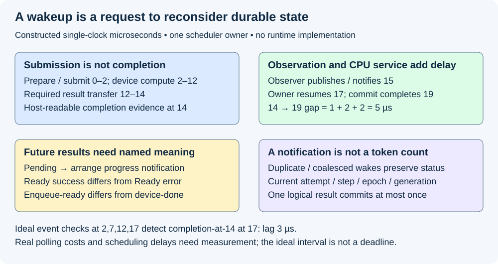
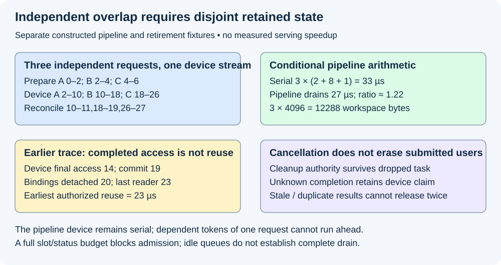

# M5-C06: Asynchronous execution and completion-driven progress

> **Status: Complete — detailed chapter authored and documentation validated; experimental procedures are proposed unless explicitly labelled observed.**

**Module:** Learn scheduling, operating systems, and queueing theory

**Category:** [Runtime and concurrency](index.md)

[Module 5 reading order](../module-5.md) · [Previous: M5-C05](../runtime-and-concurrency/m5-c05-synchronization-ownership-and-resource-lifetimes.md) · [Next: M5-C07](../measurement-experimentation-and-economics/m5-c07-describing-mixed-serving-workloads-and-arrival-traces.md)

## Target concepts

Tasks and futures, event loops, blocking versus asynchronous work, completion notifications, host-device dependencies, in-flight batches, single-owner scheduler state, safe reclamation.

[Execution plan and progress](../chapter-execution-plan.md)

## Concepts

### 1. Asynchronous progress separates waiting from execution

**Asynchronous execution** lets a caller arrange work and resume other eligible activity before the arranged work finishes. It changes how waiting is represented; it does not remove dependencies, create compute capacity or establish that a result is ready. A **blocking wait** occupies the calling native thread until a condition changes. An asynchronous wait can suspend a runtime task while that thread serves other work.

Use [IPC milestone distinctions](m5-c03-ipc-and-shared-memory-communication.md), [bounded queue contracts](m5-c04-producer-consumer-queues-and-bounded-work.md) and [stream/event dependencies](m3-c11-streams-events-and-dependency-ordering.md). Begin conservatively with one scheduler-state owner, one model executor and at most one batch in flight. Multiple requests may wait or be prepared privately, but cannot mutate an active descriptor. Later in this chapter, a separate three-slot extension illustrates the additional resource contract needed for overlap.

A **future** represents an eventual result together with suspended computation state. A **task** is a runtime-managed unit that is polled to make progress. Neither necessarily owns a dedicated OS thread. [Rust Future](https://doc.rust-lang.org/std/future/trait.Future.html) distinguishes Pending from Ready and requires wakeup coordination when work may become able to progress. A future becoming Ready says only what that future's output contract promises. A future for successful device enqueue is not necessarily a future for completed device access.

A **waker** notifies a runtime that a task should be considered for polling. [Rust Waker](https://doc.rust-lang.org/std/task/struct.Waker.html) describes this scheduling handle; wakeups can be coalesced. A wakeup is neither one committed token nor a count of completed operations. Check durable readiness/status state when resumed; do not count notifications as the authoritative event ledger. Clients must not keep polling a completed future as if it were a reusable operation.

### 2. An event loop schedules bounded host progress

An **event loop** coordinates ready tasks, external readiness notifications, timers and queued commands. Its role is deciding which host action can progress now. It does not execute all GPU work itself. **Cooperative scheduling** means tasks must return control often enough for other eligible work to run; a long CPU calculation or blocking foreign call inside a task can delay unrelated arrivals and completions.

The maintainer article [Tokio: Async in depth](https://tokio.rs/tokio/tutorial/async) explains futures, runtime tasks and wakeups. It is an educational reference, not a requirement to choose Tokio or build a runtime. Specify the actual runtime's workers, blocking-work policy, fairness and cancellation guarantees before drawing conclusions from a benchmark.

For a constructed single-host-worker example, batch submission returns at 2 µs and final device access completes at 14. A blocking wait from 2–14 prevents that worker from handling a newly arrived command at 3. Under an asynchronous arrangement, the worker can handle that independent command from 3–4 while the submitted batch progresses. The command must not mutate the active batch, steal its KV credits or assume its unfinished output. Device completion remains 14 in both versions of this teaching fixture; the benefit is available host service during the wait.

Async is therefore useful for multiplexing waits, while independent CPU work needs bounded workers or a suitable separate execution context. Moving CPU work into a task does not make it parallel. Adding a blocking pool without bounding queued tasks and payloads simply relocates the unbounded-work problem from M5-C04.

### 3. Completion requires the right dependency scope

A **completion observer** bridges backend status into host progress. It may use a documented wait, an event query or another supported notification mechanism. It records attempt identity and checked status, then prompts the scheduler owner. A Rust runtime does not automatically monitor arbitrary GPU events; the integration must provide that bridge. No callback, polling loop or device binding is implemented here.

The [CUDA asynchronous execution guide](https://docs.nvidia.com/cuda/cuda-programming-guide/02-basics/asynchronous-execution.html) describes stream/event ordering. A result needing host readback has the dependency chain **input ready → forward → selection/readback as qualified → host-readable result → validated host commit**. A device-only consumer can use a narrower device dependency, but that does not establish host-readable completion. Submission returning successfully establishes neither numerical correctness nor final-user retirement.

An event covers its recorded stream prefix, including correctly installed dependencies; it does not cover later unrelated operations. Preserve M3-C11's conservative event-generation identity and do not reuse/re-record an event while old observers still depend on it. **Not ready** is a pending status, not a successful result or a fatal error. An error or unknown completion requires explicit recovery and retained claims.

| Constructed time (µs) | Milestone | What is established |
|---|---|---|
| 0–2 | Prepare and submit batch J, slot generation 7 | Descriptor and resources retained; no completed output yet |
| 2–12 | Required device computation | Inputs/outputs remain protected |
| 12–14 | Required result transfer | Compute completion at 12 is insufficient for host readback |
| 14 | Final device access completes | Checked completion can support the associated host consumption |
| 15 | Observer publishes durable success status and notifies | Notification is attributable to J/generation 7 |
| 17–19 | Scheduler owner resumes, validates and commits | One current logical step commits at 19 |
| 20 | Bindings detached after logical closure | No new use can enter through those bindings |
| 23 | Last host/output reader releases | Reuse can be authorized if every remaining gate is satisfied |

All timestamps use one constructed teaching clock. The **completion-to-commit gap=19−14=5 µs**, comprising observer delay 1, owner-ready delay 2 and reconciliation 2. Device span 12 µs from 2–14 must not be added again to a host interval already covering it. Host/device clocks in a real system need documented correlation.

As a separate ideal observation model, an event recorded for the final prefix is checked at nominal times [2,7,12,17] µs and becomes complete at 14. It is first detected at 17: **detection lag=3 µs**. With instantaneous checks exactly Δ=5 µs apart and no host delays, detection lag lies in **[0,Δ)** under a declared same-time completion-before-check convention. This is a sampling model, not an OS latency bound. Query execution time, scheduling and API behavior can extend real observation delay. Report query count and CPU demand; avoid busy-spinning without charging its interference.

*Wake, submission, device completion, host commit and final resource release are separate events. The numbers are constructed, not measured.*

### 4. One owner orders scheduler state and commit

A **single-owner scheduler** gives one authority permission to mutate request states, admission credits, row mappings and commit records. Observers and workers submit bounded messages/status rather than independently mutating those structures. This is an ownership architecture, not necessarily one permanent CPU core or a guarantee that the runtime never migrates the owning task.

Each completion needs batch, request/attempt/step, worker epoch, slot generation, backend status, covered accesses and output readiness. The owner checks it against current state before committing. If batch rows reorder, request identity follows the descriptor mapping rather than an old row index. A duplicate current success is a no-op after its one-time reconciliation; a stale-generation success cannot release or update a new occupant.

For a bounded teaching identity table, current attempt J/generation 7 has statuses: Pending, Observed-success, Committed and Retired. Pending plus a checked successful completion may advance toward validation/commit. Repeated success after Committed cannot append another ID. Wrong attempt, old generation 6, wrong worker epoch and missing transfer coverage cannot authorize commit. Failure status cannot be converted into success merely because a future returned Ready with an error value. Readiness of an operation's error result is not successful model execution.

Cancellation must serialize with the same authority. If it wins before selection commit, no new selected ID publishes; previously submitted accesses still drain. If commit wins, preserve the committed ID/random history and apply the declared later cancellation/output policy. Do not rewind and resample after delivery failure. State ownership remains required even when a task disappears.

A completion queue must not silently discard the only evidence needed to release a resource. Under this baseline, reserve one durable terminal-status record per admitted attempt; notifications are hints and can be coalesced. If the notification inbox is full, status remains discoverable under a documented retry/scan contract. An observer may not block holding a lock that the owner needs to consume status. Other designs are possible, but every accepted attempt still needs bounded storage and a progress/recovery path.

### 5. More in-flight work needs more independent state

An **in-flight batch** has submitted work whose required completion/reconciliation is not finished. Logical terminal status and outstanding resource use can overlap. A cancellation does not immediately free an in-flight slot. Every slot needs separate descriptor/output/workspace claims, current generation and properly scoped completion evidence. At most one forward per request is allowed in this chapter's ordinary generation contract; its next dependent input cannot execute before the prior selection is available.

For an explicitly separate extension, three independent requests are ready at time 0. Each has 2 µs host preparation/submission, 8 µs device work and 1 µs host reconciliation. There is one host worker, one serial device stream, three disjoint slots, and no other delay or contention. This fixture is separate from the earlier 23-µs trace: its 8-µs device stage includes all required transfer/readiness work, its 1-µs reconciliation ends host access, and extra output delivery is excluded. A fully serial strategy takes **3×(2+8+1)=33 µs**.

| Stage | Request A | Request B | Request C |
|---|---|---|---|
| Host preparation/submission | 0–2 | 2–4 | 4–6 |
| Device work, one serial stream | 2–10 | 10–18 | 18–26 |
| Host reconciliation | 10–11 | 18–19 | 26–27 |

The pipeline drains at **27 µs**, an ideal ratio **33/27≈1.22**. Device work still totals 24 µs and never overlaps another device batch. The improvement comes from overlapping independent host preparation with earlier device work and avoiding unnecessary serial gaps. It does not establish a real speedup, saturating capacity or an optimization for dependent decode steps of one request.

With three slots each retaining 4,096 workspace bytes, **workspace capacity=12,288 bytes**, excluding KV, weights, outputs, metadata and queued work. When all three slots are unresolved, additional work must wait or reject under a declared bound. Backend graph/buffer compatibility must be independently qualified before using this extension; async syntax alone cannot make overlapping bindings safe. The one-in-flight baseline remains the starting contract, not a requirement to pipeline immediately.

### 6. Safe reclamation survives task cancellation and failure

For slot s, let D be unresolved device-use claims and H unresolved host/output-reader claims. This conservative reuse predicate is:

**Reusable(s)=admission closed and bindings detached and D=0 and H=0 and owner authorizes reassignment.**

The check and reassignment must be serialized against new claims, and all publication/commit work must have been reconciled or explicitly abandoned safely. In the 0–23-µs trace, a successful request closes at commit 19, detaches at 20 and releases its final reader at 23: earliest reuse is **23**, not event completion at 14. Counterfactually cancelling at 10 suppresses later selection commit if cancellation wins, but does not move any final device or reader access earlier. It still cannot authorize reuse before those users finish. Unknown completion keeps D outstanding; a failed device/context may require quarantine and recovery.

Dropping a future ordinarily stops polling that future, not every external operation it previously submitted. A safe adapter must transfer outstanding cleanup responsibility to a supervisor/owner that survives the task, or establish completed cancellation/drain under a documented contract. A timeout is not a device fence. A host thread join likewise proves thread termination, not every submitted device access. These local gates stand independently of later M9-C22/C23, which remain future detailed verification chapters.

At shutdown, close admission, retain cleanup authority, process/reconcile durable statuses and track every final user. An empty ready queue or an idle event loop does not prove complete drain. For a constructed cutoff, **8 offered=1 rejected+2 waiting+1 admitted nonterminal+2 successful+1 failed+1 cancelled**. The cancelled request can still retain device claims, so logical outcomes and physical resource inventories need separate ledgers. Preserve retries by attempt ID and undefined/missing latency observations.

*Independent requests can overlap host preparation with device work under qualified disjoint slots. The device remains serial, and logical cancellation does not release unfinished users.*

## Experiments

All four experiments are proposed. Chapter authoring observes bounded arithmetic/event/identity references and document review only; no runtime adapter, event loop, device workload or serving benchmark is implemented or executed. The workload is text generation; non-text modalities are out of scope.

### E1 — Qualify future readiness and scheduler authority

- **Name:** Wake once or many times, commit at most once.
- **Description:** Review Pending/Ready/error outcomes, durable status and duplicate/stale completion histories against a single-owner reference.
- **Purpose/objective:** Hypothesis: wakeups can coalesce or repeat without changing logical work when status and identity carry meaning. HFT concern: notifications must not duplicate a committed event.
- **Target concepts:** Tasks/futures, event loops, notifications and single-owner state.
- **Baseline:** One in-flight batch J/generation 7, one durable status record, checked step/epoch and one commit authority.
- **Workload:** Pending wake/re-poll, repeated wake, Ready success, Ready error, duplicate success after commit, wrong attempt/epoch/generation, and completion inbox full. Vary notification count and status validity separately.
- **Controlled variables:** Same logical step, output/readiness scope, policy/random identity, durable publication and ownership. Do not poll a completed future again to manufacture a second operation.
- **Hardware requirements:** CPU event/identity reference QA; later a version-pinned Rust runtime and qualified backend adapter with explicit wake/error/cleanup contract.
- **Exit criteria:** First name each future's promised result; then reconcile status histories; finally verify one-time commit and full-inbox recovery. Repeated/coalesced notifications preserve one result, stale/error outcomes cannot commit, and every admitted attempt retains discoverable terminal/cleanup status. Stress alone is not a complete concurrency proof.

### E2 — Trace readiness through final host commit

- **Name:** Observe the right completed prefix.
- **Description:** Audit producer/forward/transfer/event/observer/owner edges using the 0–23-µs timeline and separate ideal polling model.
- **Purpose/objective:** Hypothesis: fast submission or compute completion alone cannot authorize host readback; notification and CPU-ready delay extend the endpoint.
- **Target concepts:** Host/device dependencies, blocking versus async work and completion notifications.
- **Baseline:** Qualified M3-C11 stream/event scope, explicit transfer readiness and single constructed host clock.
- **Workload:** Event after computation but before transfer, event after final access, Not-ready/error status, stale event generation, independent command at 3–4 and nominal queries [2,7,12,17]. Vary observation scope separately from observation interval.
- **Controlled variables:** Required work, event recording identity, result location, clock domains, cancellation policy and host reconciliation cost. Query timing is idealized arithmetic, not a scheduling guarantee.
- **Hardware requirements:** CPU reference QA; later recorded GPU/runtime/driver, host monotonic clocks, device events and focused correlation/scheduling traces, separate from clean timing.
- **Exit criteria:** First draw every dependency; then reproduce 14→19 gap 5=1+2+2 and polling lag 3; finally require checked completion to cover actual host access. Submission-at-2 and compute-at-12 cannot substitute for transfer-at-14. Independent command handling cannot mutate active state or imply faster device execution.

### E3 — Bound and evaluate independent overlap

- **Name:** Pipeline distinct requests, retain distinct slots.
- **Description:** Compare the one-in-flight baseline with the explicitly qualified three-slot extension under identical work and resource accounting.
- **Purpose/objective:** Hypothesis: independent host preparation can overlap serial device execution, while dependent steps and shared buffers still constrain progress.
- **Target concepts:** In-flight batches, event loops, workload dependence and capacity limits.
- **Baseline:** Three independent requests; 2/8/1-µs stage costs; fully serial 33-µs reference. The three-slot extension changes allowed overlap, not model semantics.
- **Workload:** Exact 27-µs pipeline reference; later frozen prompt/cap/arrival/random-identity traces for preparation-heavy, decode-heavy and burst cells. Use 20 preassigned paired reset sessions per descriptive cell, balanced arm order and one complete scratch trace warmup per arm/session. Include full-slot backpressure and dependent next-token requests as separately labelled cases.
- **Controlled variables:** Useful computation, backend/graph family, request policy, CPU/device resources, per-slot 4,096-byte workspace and separate KV/output bounds. Change overlap allowance only after correctness qualification.
- **Hardware requirements:** Recorded CPU/NUMA/SMT/OS/runtime and GPU/driver/compiler stack, disjoint qualified buffers and separate scheduling/device diagnostics.
- **Exit criteria:** First reproduce host/device intervals, 33/27 ratio and 12,288 workspace bytes; then check every active slot/step lifetime; finally report raw paired descriptive service responses, medians/ranges, in-flight counts/bytes and useful output. No fourth unresolved slot, same-request dependency violation or unqualified graph reuse. No real speed/tail/capacity claim follows from constructed timing or 20 sessions; freeze M9-C27 acceptance before confirmation.

### E4 — Preserve cleanup through cancellation and failure

- **Name:** Losing a task must not lose its final users.
- **Description:** Audit logical closure and physical resource drain across cancellation, dropped future, worker error and uncertain completion.
- **Purpose/objective:** Hypothesis: cleanup authority must survive the waiter; predict earliest successful-trace reuse at 23 µs. HFT concern: abandoned work cannot corrupt later events through recycled storage.
- **Target concepts:** Safe reclamation, single-owner state, failure and completion-driven progress.
- **Baseline:** Closed admission, detached binding, D/H final-user claims and one reassignment authority under the stated reuse policy.
- **Workload:** Cancel before submission/at 10/before commit/after commit, delayed reader to 23, dropped waiting task, duplicate/stale completion, full notification queue and lost backend completion. Vary cancellation order against commit explicitly.
- **Controlled variables:** Attempt/step/epoch/generation, covered accesses, durable status, pending random decision and final-reader identity. No unsafe free or production fault injection is needed to reject an invalid decision.
- **Hardware requirements:** CPU lifecycle/reference QA; later isolated worker and supported backend completion/error and host-reader diagnostics with tool coverage stated.
- **Exit criteria:** First reconcile logical outcomes; then verify surviving cleanup ownership; finally test each reuse gate and complete drain. Successful fixture reuse waits until 23, unknown D remains outstanding, duplicate release has no effect and post-commit loss never resamples. All offered work and resource claims remain accounted for at shutdown; absence of a runtime crash alone is insufficient.

## Verification

| Experiment | Reference/invariants | Measurement / benchmarking | Profiling and acceptance boundary |
|---|---|---|---|
| E1 | Current identity, durable status, one owner and one commit | Notification/status histories and bounded storage inventory | A wake is not a success/result count; Ready error is not successful execution |
| E2 | Correct recorded prefix and transfer/readiness scope | Completion/observation/owner/commit gaps; ideal polling samples | Separate scheduling delay from device span; no uncorrelated absolute-clock arithmetic |
| E3 | Disjoint slots, at most one forward per request, same useful work | Serial/pipeline ledgers, in-flight bytes and paired descriptive endpoints | Overlap must be present in a qualified trace; independent streams/tasks alone do not prove it |
| E4 | Closure/bindings/final users and one-time retirement | Logical outcome and D/H claim conservation through drain | Dropped future/timeout/task exit cannot replace device completion evidence |

Use [M9-C02 clock boundaries](../measurement-experimentation-and-economics/m9-c02-request-events-clocks-and-measurement-boundaries.md) for intended/actual arrival, submission, recorded-prefix completion, observer publication, owner-ready/resume, commit and final-reader release. Measure TTFT, eligible token gaps and server/client terminal endpoints with their populations; failed, cancelled, rejected and unresolved requests stay visible even when they lack a successful latency observation. Record actual observer queries/wakeups, polling CPU time, runnable delay, blocking work and durable-status occupancy.

Keep diagnostic profiling separate from clean acceptance timing. Preserve all paired sessions, invalid/missing records, reset/warmup/drain and exact output/reference gates. Descriptive session counts do not establish production p99 uncertainty or capacity. Confirmatory claims require a frozen [M9-C27 design](../measurement-experimentation-and-economics/m9-c27-designing-regression-experiments-and-validation-gates.md), including a declared response population and regression guards. End-to-end benefit cannot be inferred from faster enqueue or lower observer CPU time alone.

## Engineering dimensions and principles

| Dimension | Application |
|---|---|
| Semantics and invariants | Wakes and completion statuses preserve current request/step identity and one commit |
| Workload and variability | Prompt preparation, decode dependencies, arrivals and slow readers change available overlap; text only |
| Resources and bottlenecks | Native worker CPU, poll cost, completion storage, slots/workspace and KV promises remain bounded |
| Time and distributions | Device completion precedes observation and owner service; those delays can shape the tail |
| Ownership and coordination | One authority mutates scheduler state; cleanup survives the original waiting task |
| Failure and adaptation | Cancellation, Ready error, stale callbacks and unknown completion retain explicit outcomes/claims |

| Engineering principle | Consequence |
|---|---|
| 1. Correctness defines the optimization boundary | A wrong event scope or duplicate commit invalidates any apparent latency gain |
| 2. Performance depends on workload and operating point | Independent preparation overlaps differently from dependent decode |
| 3. Data movement is part of the algorithm | Readback and host-readable completion belong to the endpoint |
| 4. State has ownership, lifetime and recovery cost | Dropped tasks leave supervised final-user obligations rather than reusable buffers |
| 5. Dependencies determine latency; bottlenecks determine capacity | The 27-µs pipeline still has 24 µs serial device work |
| 6. Variability and synchronization shape the tail | Polling intervals, ready-queue delay and blocking callbacks can defer commit |
| 7. Local improvements require end-to-end evaluation | Available host service during waiting does not automatically shorten device work or output delivery |
| 8. Claims require reproducible evidence | Freeze slot, event, runtime and clock contracts and retain every attempt/outcome |

The HFT lens is an event loop reacting to readiness while preserving event identity and bounded critical work. Wakeup latency, supervision and avoiding long blocking handlers transfer well. Inference adds GPU readback, repeated dependent tokens and retained KV state; async execution alone cannot establish exchange deadlines, trading results or useful inference capacity.

## Specifications, articles, and hardware

Rust Future and Waker specifications, Tokio's maintainer engineering article and CUDA asynchronous execution guidance are linked at their claims. They define different layers: task progress, runtime scheduling and device dependencies. Pin actual Rust/runtime/backend versions; no library or custom event adapter is installed here.

Record CPU/core/SMT/NUMA/RAM, OS/kernel, affinity/quota, competing pools, runtime worker/blocking policy and compiler/panic configuration. For device work record GPU architecture/count/VRAM, interconnect, driver/runtime/compiler, stream/event/graph policy, model/tokenizer/corpus hashes, dtype/layout and per-slot/KV/workspace/output bounds. Record completion integration, durable-status capacity, clock resolution/correlation, profiling overhead, reset/warmup/drain and fault controls. Constructed stage times and workspace bytes are teaching inputs; no supplied machine was benchmarked.

## Key takeaways

Async makes waiting composable, not free. Wakeups request reconsideration; only checked backend scope establishes readiness for the intended consumer. Bound in-flight state, let one authority reconcile scheduler progress, and retain cleanup responsibility through cancellation, errors and task loss. Overlap is useful only when dependencies, resources and correct final-user lifetimes permit it.

## Continue learning

Next in Module 5 reading order is [M5-C07: Describing mixed serving workloads and arrival traces](../measurement-experimentation-and-economics/m5-c07-describing-mixed-serving-workloads-and-arrival-traces.md). The next authoring chapter is [M5-C18: Choosing chunk sizes and balancing prefill with decode](../scheduling-and-queueing/m5-c18-choosing-chunk-sizes-and-balancing-prefill-with-decode.md), position 125. Follow the [execution plan and progress tracker](../chapter-execution-plan.md); Module 8 is excluded and Module 9 supports Modules 1–7.
