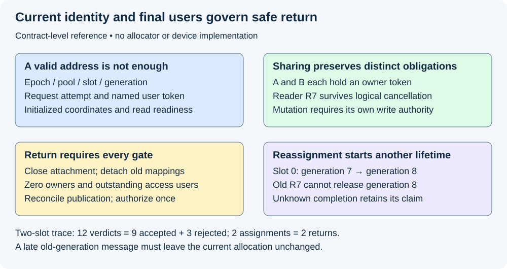
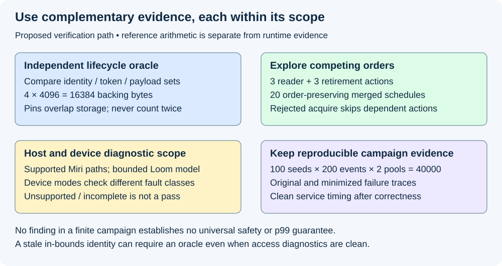

# M9-C22: Verifying ownership and memory safety under concurrency

> **Status: Complete — detailed chapter authored and documentation validated; experimental procedures are proposed unless explicitly labelled observed.**

**Module:** Make measurement and correctness part of the foundation

**Category:** [Runtime and concurrency](index.md)

[Module 9 reading order](../module-9.md) · [Previous: M9-C21](../reliability-and-capacity-control/m9-c21-testing-cancellation-deadlines-and-terminal-states.md) · [Next: M9-C23](../numerics-and-correctness/m9-c23-testing-batch-schedule-and-graph-invariance.md)

## Target concepts

Ownership transfer, shared references, stale handles, use-after-free, double release, races, uninitialized accesses, asynchronous buffer lifetimes, sanitizer scope, allocation conservation, randomized lifecycle traces.

[Execution plan and progress](../chapter-execution-plan.md)

## Concepts

### 1. A valid address is only the first check

**Memory safety** means that accesses obey the storage, initialization, lifetime and reference rules of the language and backend. **Ownership** is authority to keep a resource alive and eventually release it; it is different from permission to write. An immutable shared reference permits reading under its contract, not arbitrary concurrent mutation. A **borrow** is temporary access whose validity depends on the underlying owner and permitted aliases. Safe Rust checks many such obligations, but foreign interfaces and submitted device work require an explicit boundary contract. A reference-counted owner can keep host metadata alive without keeping a separately managed device allocation valid.

The [Rust Reference on undefined behavior](https://doc.rust-lang.org/reference/behavior-considered-undefined.html) identifies data races, dangling/misaligned accesses, invalid values and reference-rule violations as correctness failures. An unsafe block does not relax these requirements. Its rules are not an exhaustive, permanently fixed formal memory model; pin the compiler and review the actual abstraction's contract. This chapter develops test reasoning, not unsafe code.

A **use-after-free** is accessing storage after its allocation lifetime ends. A **double release** consumes the same ownership/access token twice. It can corrupt a count even if another owner still keeps the allocation alive. A **stale handle** names an earlier lifetime of a reused slot; its address may be aligned and in bounds while its identity is wrong. An **uninitialized access** reads data before the required write is established. A **data race** involves conflicting unsynchronized memory accesses, including a write; a broader **logical race** can violate the serving contract even when individual accesses are synchronized. For example, two valid callbacks can each append the same token unless commit authority is serialized.

Use [M2-C20's allocator reference](../numerics-and-correctness/m2-c20-validating-allocator-and-cache-safety.md), [M3-C18's device validation](../numerics-and-correctness/m3-c18-validating-gpu-computation-and-memory-movement.md), and [M5-C06's completion contract](m5-c06-asynchronous-execution-and-completion-driven-progress.md). An access must have current identity, appropriate permission, initialized coordinates, correct logical mapping and the readiness promised to that reader. A numerical match on one prompt cannot establish those properties for other histories.

### 2. Transfer authority, preserve named users

Represent an allocation by **worker epoch, pool, slot and generation**. An epoch changes when a worker domain restarts; a generation changes on each new assignment of that slot. Add request/attempt identity and a unique token for each owner or submitted access. Token uniqueness makes a duplicate release rejectable without subtracting another user's claim. Guard count/generation exhaustion before publication; silent wraparound can make old identities appear current. Checking a generation and then using a pointer is insufficient if reassignment can occur between those actions. Validation and acquisition of a protecting claim must be serialized against reclamation.

Ownership transfer needs a named boundary. Before acceptance, a sender retains cleanup responsibility; after acceptance, the receiver has the declared obligation. A lost acknowledgment cannot authorize both sides to free the same allocation. Sharing adds distinct lifetime edges rather than transferring away the original one. A sealed KV prefix can have request and cache owners at once. Mutation needs exclusive authority, or a private copy before divergence; a count observed as one does not itself prevent a new reader attaching. A **pin** here is a named outstanding access claim. It is not automatically Rust's Pin type, page-locked host memory, or proof that a GPU operation has finished.

For a conservative retirement policy, storage can return only after attachment is closed, mappings detached, all strong owners released, all submitted users completed, and pending publication/commit reconciled. The same authority must prevent new users and authorize reassignment. Device events cover their recorded dependency scope, not every future use of the address. Task cancellation, timeout and thread exit are not device fences. Unknown completion retains a claim or quarantines the allocation; reclamation requires a documented recovery contract.

*An address can be reused; authority from its old generation cannot. Final-user completion and logical cancellation remain separate facts.*

### 3. Count storage once and claims separately

Use the four disjoint physical states from M2-C20: Free F, Reserved R, Live L and Retiring T. Reserved storage has a provisional owner; Live has an owner with writing or ready data; Retiring has no strong owner but still has unfinished access or cleanup. At every serialized observation:

**C = F + R + L + T**, with all quantities measured in slots.

For a fixed pool of C slots, each Q bytes, **backing bytes = C × Q** and **occupied bytes = (R + L + T) × Q**. These exclude metadata, unused external growth credits, model weights and other pools. Pins overlap these states; do not add their bytes again. With four 4,096-byte slots, backing is **16,384 bytes**. If F=2, R=0, L=1 and T=1, occupied storage is **8,192 bytes** even if both occupied slots carry three access claims each.

For named strong-owner tokens, **owners created − owners released = outstanding owners**. For named access tokens, **access claims created − access claims completed = outstanding claims**. Each token can be consumed once. Counts alone are necessary but insufficient: an erroneous decrement of the wrong identity can leave a plausible total. Compare the actual token sets, payload coordinates and allocation identities after every event. At complete drain of this fixed isolated pool, F=C, other states and claims are zero, and assignments equal returns. A production cache intentionally retaining owners has a different declared endpoint; it must not be falsely reported as drained.

Consider this constructed two-slot trace. Slot 1 stays Free; slot 0 starts with last generation 6. The sequence below is serialized by the reference owner. A reader claim remains valid through logical cancellation because it was acquired before attachment closed. Ready payload has four valid scalar coordinates [11,12,13,14]; its capacity may be larger, but unwritten coordinates are not readable as that payload.

| Event | Expected action/verdict | Slot 0 | Owners | Access claims | Free slots |
|---|---|---|---|---|---|
| 1 | Assign generation 7 to A: accept | Reserved | A | none | 1 |
| 2 | Submit writer W7: accept | Live, writing | A | W7 | 1 |
| 3 | Complete W7, establish four ready coordinates: accept | Live, ready | A | none | 1 |
| 4 | Share with B and acquire its reader R7: accept | Live, ready | A,B | R7 | 1 |
| 5 | Close attachment/detach mappings; release A: accept | Live, ready | B | R7 | 1 |
| 6 | Cancel B and release B owner: accept | Retiring | none | R7 | 1 |
| 7 | Try reassigning slot 0 before R7 completes: reject | Retiring | none | R7 | 1 |
| 8 | Complete R7, reconcile and return once: accept | Free | none | none | 2 |
| 9 | Assign generation 8 to C: accept | Reserved | C | none | 1 |
| 10 | Try reading with generation-7 handle: reject | Reserved | C | none | 1 |
| 11 | Duplicate R7 completion: reject | Reserved | C | none | 1 |
| 12 | Abandon C before submission; close/detach/release/return: accept | Free | none | none | 2 |

There are **12 verdicts: nine accepted and three rejected**; grouped reference events specify atomic observation boundaries, not implementation atomic instructions. Two assignments match two returns; three owner creations match three releases; two access creations match two completions. Events 7, 10 and 11 leave the entire state unchanged. Generation 8 has no initialized payload from C merely because the same address once held generation 7's values. A read before W7 completes, beyond the four valid coordinates, or under C before initialization is a separate negative case. Reject it at the model boundary rather than deliberately executing an invalid access.

### 4. Explore order, not only input values

An **interleaving** is an order in which concurrent actions take effect. Begin with small histories whose valid orders can be enumerated, then add randomized lifecycle traces. For a bounded example, three reader-side actions acquire→read→release and three retirement-side actions close→detach→attempt-return each keep their internal order. There are **6!/(3!×3!) = 20** merged orders. If close precedes acquire, acquisition must reject and dependent read/release are skipped; if acquisition succeeds first, attempted return must wait for that named reader. This is a contract-level enumeration, not a weak-memory or device execution proof. Record rejected/skipped operations explicitly so 20 schedules are not confused with 20 successful reads.

A **reference model** independently stores legal identities, owner/access sets, initialization and publication state. A candidate later reports actual decisions and visible state. Compare both at each event, allowing different legal free-slot choices where the contract permits them. Freeze the slot-choice policy for the exact trace above. Generating only valid actions misses stale and duplicate requests; generate both legal histories and intentionally invalid proposals, which the candidate must reject without state mutation.

For a proposed descriptive campaign, use 100 explicitly recorded seeds, 200 proposed events each, and pools of two and four slots: **40,000 proposed events** in 200 histories. This is an exploration budget, not a statistical safety probability. Vary worker-loss/cancellation timing, sharing fan-out, prompt/output length, skewed hot-prefix reuse and delayed readers in named cells. Keep invalid proposals and skipped dependent events in the logs. A seed alone is insufficient when thread scheduling or external device completion changes: retain the actual event order, identities, tool versions and outcomes. **Shrinking** means reducing a failing history to fewer actions while preserving the same violated invariant and required preconditions. Keep the original and minimized trace, not only the final error message.

The [Loom maintainer documentation](https://docs.rs/loom/0.7.2/loom/) describes exploring instrumented Rust concurrency models. Version 0.7.2 requires participating operations to use its replacement types; unmodeled synchronization and external device actions remain outside that exploration. Record thread/action/preemption bounds, termination and unsupported operations. A passing bounded model supports that model's explored executions, not all production schedules. A data-race-free counter is not proof of a correct ownership protocol.

### 5. Tools supply scoped evidence

A **sanitizer** instruments or observes execution to detect selected invalid behavior. The [Miri project documentation and engineering discussion](https://github.com/rust-lang/miri) describes interpreting Rust and detecting several classes of undefined behavior in tested executions. Passing tests do not establish soundness for every safe caller. Foreign/device operations can be unsupported or outside its checked execution; document exclusions rather than treating a skipped case as a pass. Pin the nightly/compiler, Miri revision, flags, seeds and target.

[NVIDIA Compute Sanitizer](https://docs.nvidia.com/compute-sanitizer/ComputeSanitizer/index.html) provides distinct checks: memcheck for device access faults including out-of-bounds/misaligned accesses; racecheck for shared-memory hazards; initcheck for uninitialized device global-memory accesses; and synccheck for synchronization misuse. Choose the supported mode for the tested memory space and architecture. In particular, shared-memory racecheck is not a general proof of all host/device races or generation correctness. A stale but in-bounds allocation can require the independent identity oracle even when no access fault is reported. Record tool errors, unsupported features and incomplete runs separately from findings and clean completed runs.

| Evidence layer | Can help establish | Does not establish alone |
|---|---|---|
| Reference token/payload ledger | Correct identities, one-time release, conservation and initialization permissions for a trace | Actual pointer accesses or all schedules |
| Rust compiler / reviewed boundary contracts | Enforced safe-language access rules and specified adapter obligations | Correctness of unchecked foreign/device lifetime assumptions |
| Miri on supported host paths | Selected undefined behavior detected in tested executions | Whole-service soundness or unobserved backend behavior |
| Bounded Loom exploration | Outcomes of participating modeled synchronization under recorded bounds | Uninstrumented operations or arbitrary production executions |
| Device sanitizer modes | Selected executed access/hazard/initialization/synchronization faults | Full serving semantics, all allocation identities or latency benefit |
| Clean end-to-end comparison | Useful service and resource effects after correctness qualification | Safety of every untested history |

Do not use sanitized timings as production latency. Instrumentation can change scheduling and memory pressure; even a different failure rate under diagnostics does not identify a production frequency. Later clean runs require the same semantic fixtures and complete outcome accounting, with diagnostic passes performed separately.

*No single evidence layer substitutes for the others. Constructed event counts are reference expectations, not sanitizer or production observations.*

## Experiments

All experiments below are proposed; this chapter includes no implementation. Observed chapter QA checks only arithmetic, document structure and rendering. No Rust concurrency test, sanitizer, allocator or GPU workload is run during authorship.

### E1 — Reconcile identity, initialization and allocation conservation

- **Name:** One allocation lifetime, one accountable return.
- **Description:** Compare the 12-event reference with independently recorded candidate identities, token sets and payload validity.
- **Purpose/objective:** Hypothesis: identity-aware checks reject premature reuse, stale handles and duplicate completion even when addresses and aggregate counts look plausible. HFT concern: old work must not corrupt a later event using recycled storage.
- **Target concepts:** Ownership transfer, shared references, stale handles, double release, uninitialized access and allocation conservation.
- **Baseline:** Two slots, slot 0 chosen explicitly, generations 7/8 and the exact reference table; other free-slot policies tested separately.
- **Workload:** The 12 events, plus separate invalid pre-completion/out-of-valid-range reads, premature writes to shared sealed payload, duplicate owner release and generation exhaustion. Independent variable: the violated permission/identity condition, one at a time.
- **Controlled variables:** Payload coordinates, accepted initialization/readiness scope, epoch/pool, slot-choice rule, capacity and token identity.
- **Hardware requirements:** CPU reference review; later version-pinned Rust candidate with allocation/payload diagnostics, no GPU required for the basic contract.
- **Exit criteria:** First reproduce all verdicts and states; then compare after each accepted/rejected event; finally drain. Expect nine accepts/three rejects, two assignments/returns, three owner creations/releases and two access creations/completions. Every negative case rejects before unsafe access, leaves state unchanged and identifies its violated gate. Complete payload equality accompanies token accounting; count equality alone fails acceptance.

### E2 — Enumerate competing attachment and retirement

- **Name:** A reader cannot appear after return eligibility.
- **Description:** Explore the 20 merged orders and a later bounded synchronization model around attachment, closure and reclamation.
- **Purpose/objective:** Hypothesis: serialized claim acquisition and closure prevent a check-then-use lifetime gap. HFT concern: coordination must preserve event storage while another consumer still acts on it.
- **Target concepts:** Shared references, races, ownership transfer, use-after-free prevention and asynchronous lifetime obligations.
- **Baseline:** Independent sets of reader tokens and retirement gates; no raw invalid read is performed by the reference.
- **Workload:** Reader acquire/read/release versus owner close/detach/attempt-return; change only relative ordering. Include duplicate return proposal and owner loss as separately labelled extensions, not part of the 20-order count.
- **Controlled variables:** Same generation, initialization, one reader, no device claim for this host-only base, and explicit skipped-event semantics after rejected acquire.
- **Hardware requirements:** CPU enumeration; later Loom-supported synchronization model with all participating operations visible and bounds/version reported.
- **Exit criteria:** First list all 20 distinct order-preserving merges; then adjudicate each acquisition and retirement attempt; finally verify no successful read lacks its own live claim and no return overlaps it. Rejected/skipped actions are visible. For later exploration report explored schedules and completion/bounds; timeout or unsupported behavior is incomplete evidence, not a pass.

### E3 — Validate asynchronous final users and tool coverage

- **Name:** Cancellation leaves a supervised access obligation.
- **Description:** Follow host owners, submitted device users, result readers and generations through cancellation, delayed completion and component loss.
- **Purpose/objective:** Hypothesis: logical closure can precede physical return without leaking accountability; independently scoped diagnostics find different error classes. HFT concern: a cancelled request cannot hand unfinished storage to another event.
- **Target concepts:** Asynchronous buffer lifetimes, use-after-free, stale handles, sanitizer scope, races and initialization.
- **Baseline:** M5-C06 constructed trace: final device access 14 µs, commit 19, detach 20, final host reader 23; earliest authorized successful-trace reuse 23 under all remaining gates.
- **Workload:** Cancel at 10; drop waiter; late generation-7 completion after a later valid generation-8 assignment; delayed host reader; lost completion/worker epoch change. Vary one lifecycle disturbance at a time. Unknown completion never forces a return.
- **Controlled variables:** Event-prefix coverage, attempt/step/epoch/generation, owner and access token sets, safe readback scope and recovery policy. The 23-µs success trace is separate from the cancelled outcome.
- **Hardware requirements:** CPU history oracle; later isolated supported GPU/backend adapter, recorded stream/event and host-readback contracts, host checking and applicable device sanitizer modes. No deliberately unsafe production access.
- **Exit criteria:** First draw required completion edges; then audit retained claims through each fault; finally compare independently observed tokens and all relevant diagnostics. Early reuse proposals reject; duplicate/stale callbacks cannot release current users; unknown completion stays quarantined with a recorded recovery obligation. Report each diagnostic as clean completed, findings, unsupported or incomplete. A clean report without the lifecycle oracle is insufficient.

### E4 — Generate, shrink and compare lifecycle campaigns

- **Name:** Reproduce the smallest ownership failure before measuring service.
- **Description:** Compare randomized histories with an independent state oracle, preserve failures and later benchmark only qualified candidates.
- **Purpose/objective:** Hypothesis: varied histories reveal combinations missed by fixed examples; a repair must preserve useful output and bounded retention. HFT concern: rare tail events and overload must retain correct cleanup.
- **Target concepts:** Randomized lifecycle traces, races, shared state, conservation, recovery and reproducible evidence.
- **Baseline:** Fixed contract, frozen seed list and reference payload/identity ledger; same workload across candidate versions.
- **Workload:** 100 seeds × 200 proposals × two pool sizes = 40,000 proposals. Independent variables are policy/version and one named sharing/cancellation/arrival cell at a time. Record proposed, accepted, rejected and skipped actions. Later service cells freeze text prompts/caps/arrivals/reuse and random identities.
- **Controlled variables:** Generator version, seed/event trace, model/tokenizer where used, precision, machine resources, bounds and drain policy. Minimized traces preserve necessary ordering and the original failure class.
- **Hardware requirements:** CPU oracle and host diagnostics; qualified GPU only for device/end-to-end cells. Pin hardware/software/tool manifest and segregate fault tests from clean timing.
- **Exit criteria:** First run fixed histories; then compare every generated event and retain/minimize failures; finally require semantic qualification before clean paired benchmarking. Preserve all 200 histories and 40,000 proposals, even aborted/missing runs with reasons. A budget exhausted with no finding means only no finding in that campaign. Unknown claims remain visible, not cleared to achieve a zero balance.

## Verification

| Experiment | Correctness/reference | Measurements and profiling | Acceptance limit |
|---|---|---|---|
| E1 | Full identity/token/state sets and all valid payload coordinates | Per-event verdicts, initialization coverage, assignment/return and owner/access balances; bytes per physical state | Exact trace and unchanged rejected state; zero imbalance does not excuse wrong ownership |
| E2 | Legal acquisition relative to closure; claim covers read | All 20 orders, accepted/rejected/skipped actions, pending return and model bounds | No unauthorized read or premature return in explored cases; no global proof claim |
| E3 | Backend prefix, final host reader and retained recovery authority | Completion/observation/commit/release clocks; outstanding claims and diagnostic coverage matrix | Cancel/drop/timeout never substitutes for completion; unsupported/incomplete tools are not clean runs |
| E4 | Independent event oracle and minimized reproducible failures | Coverage by event pair/state/fault class; raw campaigns, retained bytes and later useful service | All outcomes preserved; no probabilistic safety or p99 claim from a fixed seed budget |

For later real timing, use [M9-C02](../measurement-experimentation-and-economics/m9-c02-request-events-clocks-and-measurement-boundaries.md). A retention interval runs from allocation assignment to authorized return on a host monotonic clock; unresolved intervals are censored (not yet ended), not recorded as zero. Device timestamps need documented host correlation before subtraction. Count retained bytes by distinct allocation and peak/time series, not by references. Report request arrival-to-terminal endpoints, TTFT and eligible token gaps with explicit populations; failures, rejections, cancellations and still-open attempts stay in the offered-work ledger.

Use [M9-C11](../measurement-experimentation-and-economics/m9-c11-controlled-comparisons-warmup-and-reproducibility.md) for paired comparisons. As a proposed descriptive starting budget, preassign 20 reset session pairs per named workload cell, balanced arm order and one full scratch-trace warmup per arm. Drain or declare the retained/quarantined endpoint before reset. Report every pair, missing/invalid observations, session medians/ranges, useful outputs, allocation/retirement CPU time and retained-byte peaks. This budget does not establish production p99 or a rare-event failure probability. A confirmatory claim needs a frozen [M9-C27 design](../measurement-experimentation-and-economics/m9-c27-designing-regression-experiments-and-validation-gates.md) with justified sample size, uncertainty and service regression gates. Separate instrumented correctness runs and short diagnostic scheduling/memory traces from clean timing; estimate instrumentation overhead on matched supported fixtures rather than subtracting an assumed constant. A faster free operation is no benefit if retention, output correctness or useful service worsens.

## Engineering dimensions and principles

| Dimension | Application in this chapter |
|---|---|
| Semantics and invariants | E1 checks every identity, initialized coordinate and one-time token consumption |
| Workload and variability | E4 varies text lengths, bursts, reuse skew and sharing/cancel correlations; non-text modalities are out of scope |
| Resources and bottlenecks | Pool states count physical bytes once; pin and owner sets explain retention, CPU bookkeeping and recovery capacity |
| Time and distributions | E3 distinguishes device completion from final-reader release; unresolved retention remains censored |
| Ownership and coordination | E2 serializes acquisition against closure, with a surviving cleanup authority |
| Failure and adaptation | Stale handles, duplicate releases, task/worker loss and overload preserve named unresolved obligations |

| Engineering principle | Practical consequence |
|---|---|
| 1. Correctness defines the optimization boundary | A faster return that loses a live reader is invalid, regardless of matching one output |
| 2. Performance depends on workload and operating point | Hot shared prefixes, long readers and bursts alter retention and contention |
| 3. Data movement is part of the algorithm | Transfer/readback and copied private state extend lifetimes and byte demand |
| 4. State has ownership, lifetime and recovery cost | Unknown completion needs retained or quarantined capacity and a recovery path |
| 5. Dependencies determine latency; bottlenecks determine capacity | Return waits for the last relevant user; exhausted retained slots block admission |
| 6. Variability and synchronization shape the tail | Delayed readers, ready queues and coordination can dominate retirement tails |
| 7. Local improvements require end-to-end evaluation | Compare useful output and resource pressure, not only allocator operations per second |
| 8. Claims require reproducible evidence | Preserve event orders, identities, tool scope, original/minimized failures and all outcomes |

The HFT analogy is a feed/event buffer whose consumer must finish before storage is recycled. Identity, bounded resource claims and late consumers transfer well. Inference adds repeated token dependencies, KV sharing and device accesses; this chapter establishes no trading result or exchange deadline.

## Specifications, articles, and hardware

The linked Rust language reference, Miri maintainer engineering discussion, Loom 0.7.2 documentation and NVIDIA Compute Sanitizer manual supply primary specifications and tool-scope guidance. Record access date and actual installed revisions when executing; this chapter's source review was on 2026-10-29. No tool installation is prescribed as an accomplished result.

The exact trace and schedule enumeration need only CPU reference arithmetic. Real host experiments record CPU model/core count/SMT/NUMA, RAM, OS/kernel, compiler/target, synchronization implementation, allocator, affinity/quotas and competing work. Device experiments additionally record GPU architecture/count/VRAM, driver/CUDA/backend/tool versions, interconnect, stream/event/graph policy and supported sanitizer modes. Record model/tokenizer/corpus hashes, dtype/layout, KV/workspace sizes, pool capacity, byte limits, generator seeds, full event traces, random decision identity, clock resolution, reset/warmup/drain and recovery policy. No particular machine specification or measured safety/performance result is supplied; the 4,096-byte slots and microseconds above are teaching inputs.

## Key takeaways

Verify who may access each lifetime, not just whether an address lies in a pool. Keep physical storage, owner tokens and submitted users in separate but consistent ledgers. Explore competing orders with an independent oracle, retain failure histories, and use diagnostics within their declared scope. Correct output, clean instrumentation and bounded retention are complementary evidence.

## Continue learning

Next in Module 9 reading order is [M9-C23: Testing batch, schedule, and graph invariance](../numerics-and-correctness/m9-c23-testing-batch-schedule-and-graph-invariance.md). The next authoring chapter is [M5-C18: Choosing chunk sizes and balancing prefill with decode](../scheduling-and-queueing/m5-c18-choosing-chunk-sizes-and-balancing-prefill-with-decode.md), position 125. Follow the [execution plan and progress tracker](../chapter-execution-plan.md); Module 9 supports Modules 1–7 and Module 8 is excluded.
