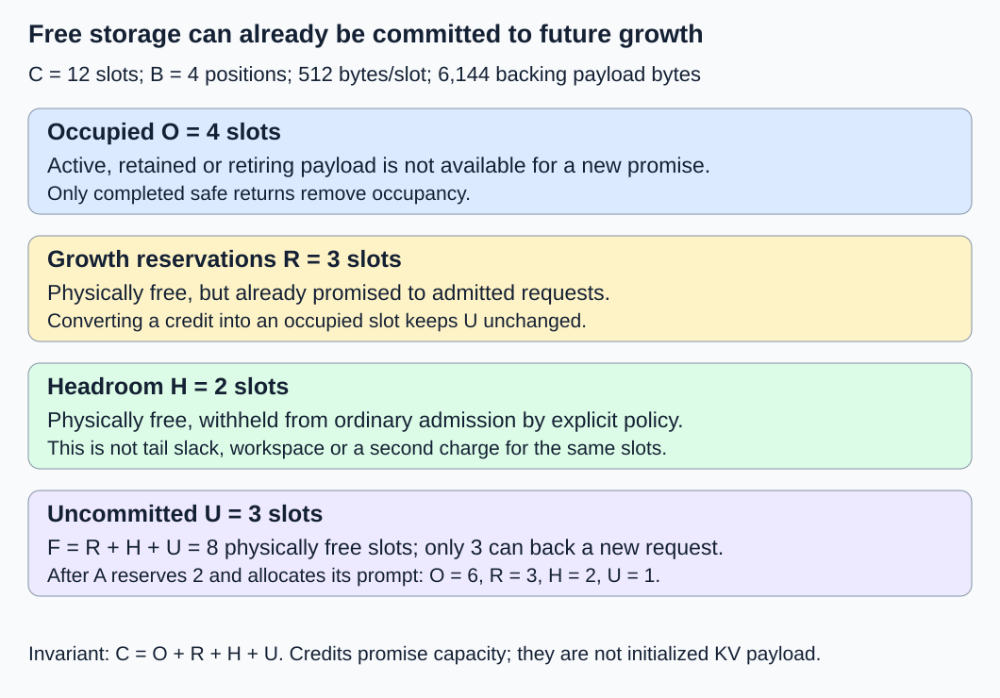
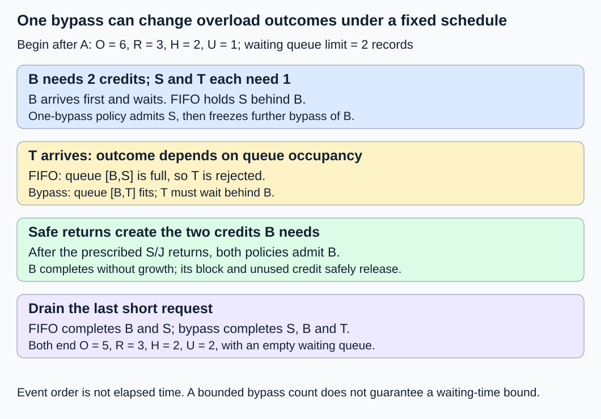

# M2-C15: Admission and growth under a finite KV budget

> **Status: Complete — detailed chapter authored and documentation validated; experimental procedures are proposed unless explicitly labelled observed**

**Module:** Treat the KV cache as a first-class systems problem

**Category:** [Scheduling and queueing](index.md)

[Module 2 reading order](../module-2.md) · [Previous: M2-C14](../state-memory-and-caching/m2-c14-eviction-retention-and-reconstruction.md) · [Next: M2-C16](../reliability-and-capacity-control/m2-c16-completion-cancellation-and-allocation-failure.md)

## Target concepts

Free-block budgets, growth reservations, headroom, admit-wait-reject decisions, backpressure, mixed request lengths, fairness, capacity versus latency.

## Concepts

### 1. Admission promises resources; allocation assigns storage

**Admission** accepts a request into the active set with a declared resource contract. **Allocation** assigns actual storage slots. **Waiting** keeps a request outside that active set until its contract can be honored. **Rejection** ends the attempt with a stated reason. Receiving a request or placing it in a queue is not admission and does not imply its future KV will fit.

A request's prompt is known after tokenization, but generated length is variable. The [PagedAttention paper, version 1, section 4.5](https://arxiv.org/html/2309.06180v1#S4.SS5) identifies varying prompt/output lengths and finite physical blocks as scheduling constraints. Its preemption/recovery design is background, not the policy specified by this chapter. Here we specify a conservative **full-cap reservation**: before admitting a request, reserve its maximum declared KV demand. This sacrifices some concurrency to avoid promising the same growth capacity twice. It guarantees only the stated pool budget, not compute availability, deadlines, fault recovery or successful model execution.

Use private, nonsharing, full-causal text requests with no prefix hits, branching or speculative destinations in the numerical examples. Shared prefixes and copy-on-write require an extended unique-physical-block budget; summing logical lengths would be wrong. [M2-C09](../state-memory-and-caching/m2-c09-choosing-block-size-and-measuring-fragmentation.md) supplies block rounding; [M2-C14](../state-memory-and-caching/m2-c14-eviction-retention-and-reconstruction.md) explains when eviction actually returns capacity. A cache entry disappearing or a request being cancelled does not immediately make its storage available.

Keep the packed all-layer FP64 storage fixture: two K/V tensors, two layers, two KV heads, two features/head and eight bytes/scalar. **k = 2 × 2 × 2 × 2 × 8 = 128 bytes/position**; choose **B = 4 positions/block**, so **Q = B × k = 512 bytes/block**. These are synthetic storage dimensions, not a real model's context limit or a recommendation to use FP64 in production.

### 2. Separate free storage from uncommitted capacity

Let C be the configured number of equal pool slots. Partition its capacity as follows:

| Symbol | Unit and meaning | Available to a new request? |
|---|---|---|
| O | Slots physically occupied: active, retained or retiring | No; only completed safe returns remove occupancy |
| R | Currently unoccupied slots committed to admitted requests' future growth | No; those requests already own the budget promise |
| H | Unoccupied headroom withheld by policy for a separately controlled need | No; ordinary admissions cannot spend it |
| U | Unoccupied and uncommitted slots | Yes, through a protected reservation decision |

**C = O + R + H + U; physical free slots F = R + H + U.**

R and H describe exclusive **capacity credits** against free slots, not initialized KV payload or extra occupied blocks. Credits need not name specific free slot IDs, but the authority must ensure that this compatible pool can fulfill them. No slot's capacity backs two promises. H is explicit policy headroom, not allocator slack, unused positions in a partial block, CUDA workspace or an undocumented reserve. If a recovery operation consumes headroom, transfer that credit into occupied capacity under its own contract; do not keep counting it as free headroom. Kernel workspace and model weights have separate budgets and can still cause failure.

For C = 12, choose O = 4, R = 3, H = 2 and U = 3. Backing payload is **12 × 512 = 6,144 bytes**. Physically free payload is **8 × 512 = 4,096 bytes**, but only **3 × 512 = 1,536 bytes** is uncommitted. A new request needing four slots must wait despite eight physically free slots. Counting R as occupied and also subtracting it from F would double-charge the reservation.

One serial budget authority protects reservation, allocation, safe-return reporting and queue decisions. The initial O and R correspond to valid existing request budgets; one existing request J holds one occupied block, has no remaining reservation and will later complete. Other existing state is held fixed in the replay below. In Rust terms, an admission credit has one owner and one release responsibility; copying its ID cannot create another credit. No Rust implementation is provided.

*Physically free is a storage fact; uncommitted is a promise the admission authority may still make.*

### 3. Reserve the cap, then convert credits during growth

For a new nonempty prompt with P token IDs and a nonnegative generated-token cap G, conservatively define **N_max = P + G** as the maximum number of represented KV positions. Some generation interfaces never materialize KV for the final sampled token; reserving P + G remains a conservative upper bound under the declared interface. Validate the actual model context limit separately. Never silently truncate a prompt or lower an output cap to make a request fit; that changes the accepted contract.

**Maximum blocks b_max = ceil((P + G)/B); prompt blocks b_prompt = ceil(P/B).**

After admission, if a_i blocks are occupied for request i, its unused reservation is **r_i = b_max,i − a_i ≥ 0**. This assumes no extra destinations or sharing. Validate P, G, B and checked addition/rounding; overflow, negative counts, missing required caps or unsupported lengths reject before any mutation. A request with b_max > C − H cannot fit even in an otherwise empty ordinary pool under this baseline, so it is rejected as permanently too large. A request within that ceiling but above current U can wait; evictable retained state counts only after completed safe returns have increased U.

The authority first reserves b_max credits atomically: R increases and U decreases by b_max, leaving O unchanged. Prompt allocation then converts b_prompt of that request's credits into occupied slots: O increases and R decreases by b_prompt. This two-stage view makes rollback explicit; no payload work starts before required allocation/publication succeeds. Other admissions cannot spend tentative credits. On pre-submission failure, release each tentative claim once; submitted work follows the completion gates below.

| Request | P | G | b_prompt | b_max | Decision from the stated snapshot |
|---|---:|---:|---:|---:|---|
| A | 5 | 3 | 2 | 2 | Fits initial U = 3; after prompt allocation O = 6, R = 3, H = 2, U = 1 |
| B | 1 | 7 | 1 | 2 | After A, U = 1: wait, though F = 6 slots |
| S | 1 | 3 | 1 | 1 | Fits after A if queue fairness permits bypassing B |
| X | 37 | 4 | 10 | 11 | Reject: b_max = 11 exceeds C − H = 10, even ignoring model limits |

Each row uses the described decision point; X is a pool-capacity negative case, not a claim that a model accepts its prompt. A's five prompt positions occupy two blocks with three invalid tail positions. Its three further positions fit in that tail, so its own unused reservation is zero after prompt allocation. The existing R = 3 belongs to other requests. B allocates one block and retains one growth credit. Do not treat all free credits as interchangeable request ownership.

For n valid positions and an append of g ≥ 0 positions, under this private-state baseline:

**Additional blocks Δb = ceil((n + g)/B) − ceil(n/B).**

For a one-position append, n = 3, 4, 7 and 8 give Δb = 0, 1, 0 and 1 respectively. A tail slot being available is not evidence that its invalid coordinates may be read. Before writing a new block, convert that request's reserved credit to occupied capacity under the authority; a scalar count check alone is not publication or device completion.

At early completion, unused growth credits may return immediately once future growth admission is closed. Occupied blocks return only after owners, pins, mappings and submitted writes satisfy the lifetime contract. For B with one occupied block and one unused credit, terminal notification can first release its credit, increasing U by one; a later safe block return increases U by another. Duplicate notification must not release either twice. A failure with unknown completion leaves affected occupied capacity quarantined. Later M2-C16 develops terminal cases; these introductory gates are required here.

A **current-only policy** admits based solely on present prompt storage. In a separate two-slot pool, two requests each with four prompt positions and four further required positions can consume one slot each, leaving no growth capacity. If neither can finish without appending, and preemption/recovery is unavailable, both wait forever for a block held by the other. Full-cap reservation admits one two-block budget and leaves its second block reserved. Incremental reservation can use memory more aggressively but needs a declared growth-failure/preemption strategy; statistical length estimates are not hard guarantees. Full-cap reservation also does not guarantee progress if compute stops or completion is lost.

### 4. Bound waiting and state the fairness rule

**Backpressure** makes upstream producers slow or stop when downstream capacity is unavailable. A bounded queue limits waiting records; it does not by itself bound all memory or end-to-end delay. The [Tokio bounded-channel documentation](https://docs.rs/tokio/latest/tokio/sync/mpsc/index.html) provides a Rust example of bounded messages and producer waiting. It is an analogy for flow control, not a KV admission policy. Bound request bytes, producer tasks, connections and preprocessing too; moving an unbounded backlog to waiting senders does not solve overload.

**FIFO**, first in first out, considers the oldest queued request first. **Head-of-line blocking** occurs when an older request needing two credits prevents a younger one-credit request from using the one credit currently available. A bypass policy can use that capacity, but unlimited arrivals of small work can starve the larger request. **Starvation** means indefinite denial of service despite continued opportunities for other work. Request fairness, token fairness, tenant fairness and latency fairness are different objectives.

Compare two explicit admission policies, leaving active execution unchanged:

- **Strict FIFO:** No younger request may pass a waiting head.
- **One bypass per blocked head:** While the oldest request cannot fit, admit at most one fitting younger request, choosing queue order. Then freeze further bypasses until that head is admitted, expires, is cancelled or is rejected. Head changes reset the allowance. This bounds bypass count, not waiting time; without eventual resource return and active-service progress it cannot guarantee admission.

Use a maximum of **two waiting records**, excluding active requests. Arrivals are processed in order; apply admission opportunities before deciding whether another waiting record fits. Rejected attempts are not retried automatically. Apply a finite, explicitly configured waiting deadline in real service, remove expired/cancelled waiting records once and preserve outcome reasons. The fixture has no deadline expiration; its row numbers are event order, not milliseconds. Every request still needs a valid context and full-cap budget.

Begin after A's prompt allocation: O = 6, R = 3, H = 2, U = 1. B, S and a new short request T arrive in that order, where T has P = 1, G = 3. The following external completion schedule is prescribed for the experiment; it is not a prediction of either policy's execution speed:

| Event | Strict FIFO | One-bypass policy |
|---|---|---|
| 1. B arrives | Waits for two credits; queue [B] | Same |
| 2. S arrives | Queue [B,S], U = 1 | S admitted; O = 7, U = 0; queue [B], bypass spent |
| 3. T arrives | Reject: waiting queue full | Queue [B,T]; no second bypass |
| 4. If S is active, it safely completes; J safely returns one block; rescan | U becomes 2; admit B, yielding O = 6, R = 4, U = 0; queue [S] | Same B budget/occupancy; queue [T] |
| 5. B completes without growth; its one block and unused credit both safely release; rescan | U becomes 2; admit S, yielding O = 6, R = 3, U = 1 | U becomes 2; admit T, same totals |
| 6. Last admitted short request safely completes | O = 5, R = 3, H = 2, U = 2; empty queue | Same final budget; empty queue |

FIFO admits/completes B and S and rejects T. Bypass admits/completes S, B and T with no rejection. Both have at most two waiting records and never spend headroom. T has no FIFO completion timestamp; assigning it a finite “slow latency” would hide rejection. This constructed outcome demonstrates policy consequences under a fixed schedule, not a throughput improvement. An alternative workload can make bypass add interference and delay everyone. Large-request progress also depends on the service policy for already active requests, which this admission-only chapter does not define.

*One younger admission is permitted while B blocks; later arrivals cannot consume its eventual growth opportunity indefinitely through repeated bypass.*

### 5. Capacity and latency are different claims

Fitting all reserved KV does not establish acceptable time to first token, inter-token latency or request completion time. Long contexts increase attention reads; larger active sets compete for compute/bandwidth and can add synchronization. A memory-safe queue can still accumulate work faster than the executor completes it. More headroom lowers ordinary admission capacity but may help a named recovery need; unused headroom is not automatically an error.

Define waiting delay as **t_admit − t_arrive**, using matching monotonic host-clock events. Complete-request latency uses arrival to the declared terminal delivery boundary, including waiting and execution; token metrics use their own endpoints. Rejected, expired, cancelled and unresolved attempts remain separate populations. A count of free blocks cannot determine these durations. The HFT analogy is an event-processing service that must preserve growth/completion capacity and bound stale queued work. It transfers resource promises, overload accounting and tail-latency reasoning, not trading or exchange semantics.

## Experiments

These are proposed procedures without implementation code. No allocator, admission service, queue runtime or model benchmark has been executed for this chapter.

### E1 — Account for growth credits before admission

- **Description:** Audit the twelve-slot snapshot, A/B/S/X decisions and append boundaries.
- **Purpose/objective:** Separate physically free storage from capacity available for new promises.
- **Target concepts:** Free-block budgets, full-cap reservations, headroom and admit/wait/reject decisions.
- **Baseline and workload:** C = 12, O = 4, R = 3, H = 2, U = 3; private FP64 storage fixture; requests in the table.
- **Controls and prediction:** Fix B = 4 and the declared caps. A fits and leaves U = 1; B waits; S fits only if policy permits; X exceeds the ordinary ceiling. Predict Δb = 0,1,0,1 at n = 3,4,7,8 for g = 1.
- **Procedure:** Check every reservation and conversion against C = O + R + H + U. Attribute credits to request identities. Reject malformed/overflowing lengths before mutation. Consider two admissions contending for the last credit: the authority permits only one commit; a stale snapshot cannot authorize both.
- **Hardware/software:** Exact budget ledger first; later harness records integer widths, validation rules, metadata and authority version.
- **Failure and HFT connection:** A credit is a promise with one owner, like bounded capacity for completing admitted event work; a copied handle is not a second promise.
- **Exit criteria:** Every decision and byte count matches its boundary; no negative credit, double promise or implicit headroom spending; ineligible requests fail with distinct validation/permanent-capacity reasons.

### E2 — Growth safety and terminal release

- **Description:** Contrast current-only admission with full-cap reservation and audit B's release.
- **Purpose/objective:** Expose a conditional growth deadlock and distinguish unused credits from live storage.
- **Target concepts:** Growth reservations, headroom limits and failure-safe capacity return.
- **Baseline and workload:** Independent C = 2, H = 0 case with two P = 4, G = 4 requests; separately B with one occupied block and one unused credit.
- **Controls and prediction:** Current-only can admit two prompts but leaves no growth slot; full-cap admits one request with one reserved growth block. B's unused credit and safe block return each add exactly one to U.
- **Procedure:** Require one further position before either two-slot-case request can complete; prohibit preemption in this negative case. Demonstrate the blocked dependency. In the B ledger, order terminal closure, unused-credit release and reader/write completion separately. Inject duplicate release, failed prompt allocation before submission and cancellation after submitted work; preserve unresolved occupied capacity.
- **Hardware/software:** Deterministic ownership/budget ledger; real host/device tests need actual completion scope and fault identities.
- **Failure and HFT connection:** Filling a system with work that cannot finish without more capacity is an admission error. Cancellation acknowledgement alone does not prove a consumer has stopped using memory.
- **Exit criteria:** No reserved credit serves another request; rollback occurs once; no occupied slot returns before its lifetime gates. State explicitly that reserved KV does not guarantee progress through unrelated compute or device failures.

### E3 — Bounded queue and one-bypass fairness

- **Description:** Replay the six-event B/S/T schedule under strict FIFO and one bypass.
- **Purpose/objective:** Make queue capacity, fairness and overload outcomes observable.
- **Target concepts:** Backpressure, mixed lengths, fairness and capacity versus latency.
- **Baseline and workload:** Start after A; two waiting records maximum; prescribed J and admitted-request completions; no deadlines/retries in this fixture.
- **Controls and prediction:** Change admission order only. FIFO completes two and rejects T; bypass completes three. Both finish at O = 5, R = 3, H = 2, U = 2 with empty queues.
- **Procedure:** Log each arrival, queue membership, bypass allowance, budget and outcome. Confirm T cannot bypass B after S used the allowance. Add independent negative cases: an oversized head rejects before blocking the queue; an expired/cancelled waiter is removed once; no eventual return leaves a wait unresolved rather than fabricating progress. Real service bounds queued bytes and producer-side backlog as well as record count.
- **Hardware/software:** Event ledger now; any queue test records request-size limits, queue/deadline configuration, ordering and timestamp semantics.
- **Failure and HFT connection:** Bounded stale work and explicit rejection are more informative than a small latency average computed after dropping overload attempts. No trading performance is inferred.
- **Exit criteria:** All six rows match; maximum queue count is two, bypass count for blocked B is one, and all three offered attempts have exactly one terminal outcome. Event order is never reported as measured time.

### E4 — Conditional admission-policy replay benchmark

- **Description:** Compare host bookkeeping duration if both admission policies become available.
- **Purpose/objective:** Measure decision overhead separately from queue waiting, model execution and synthetic replay outcomes.
- **Target concepts:** Budget checks, bounded queue metadata, fairness and reproducible evidence.
- **Baseline and workload:** One complete six-row E3 replay per trial, initialized after A. Completions are injected events, not model calls. Both policies use full-cap reservation and identical ledger representations except their bypass rule.
- **Controls and prediction:** Three sessions, 30 randomized balanced FIFO/bypass pairs per session; exclude five warmups per policy/session. Predict outcome counts and invariant checks, not which policy is faster.
- **Procedure:** Prepare inputs/reset outside timing. Time first B arrival processing through the final short-request safe return, including queue and reservation transitions. Audit decisions afterward; background O/R remains and is reset outside timing. Profile budget checks, scans and metadata updates separately from unprofiled timing. Retain errors/timeouts; a 120-second watchdog cannot authorize reclaiming unresolved state.
- **Hardware/software:** Single-worker CPU metadata harness and manifest below; no device, model or KV payload writes in this comparison.
- **Failure and HFT connection:** Fast decisions do not prove fair service or low request tails. A deterministic injected completion schedule is not measured executor capacity.
- **Exit criteria:** If supported, 90 pairs yield 180 timed trials and 30 excluded warmups; each policy has 90 trials. Publish raw times, outcomes, maximum queue counts and every failed/unresolved replay. Unavailable implementations yield no timing result.

## Verification

| Pair | Reference and correctness gate | Measurement, benchmarking and profiling |
|---|---|---|
| V1 / E1 | Exact request-owned credits, checked rounding and invariant after each commit | O/R/H/U, free versus uncommitted bytes, admission verdict/reason and contention outcome |
| V2 / E2 | Growth demand and completion-scoped return ledger | Blocked-growth dependencies, unused-credit release versus actual safe return, duplicate/fault observations |
| V3 / E3 | Independent queue/budget replay and one terminal outcome per offered attempt | Per-event queue membership, bypasses, rejected/expired/cancelled/unresolved counts; no inferred timings |
| V4 / E4 | Both policies reproduce their own E3 outcomes and final state | Raw replay duration by policy/session, median/spread and profiling breakdown; service latency measured separately |

E4 offers **180 × 3 = 540 request attempts** over **180 × 6 = 1,080 replay rows**. FIFO's 90 trials produce **180 admitted/completed and 90 rejected attempts**; bypass's produce **270 admitted/completed and zero rejected attempts**. Total completed plus rejected is **450 + 90 = 540** under fault-free predicted outcomes. These are metadata replay projections, not measured throughput. Warmups and failed/unresolved trials have separate counts. Final background occupancy remains five slots, R = 3 and H = 2, so **5 + 3 + 2 + 2 = 12**; do not “clean up” valid background promises inside the measured operation.

Use completed [M9-C01](../numerics-and-correctness/m9-c01-defining-reference-behavior-and-evidence-before-optimizing.md) for exact reference/identity gates, [M9-C02](../measurement-experimentation-and-economics/m9-c02-request-events-clocks-and-measurement-boundaries.md) for event/clock scope, and [M9-C07](../measurement-experimentation-and-economics/m9-c07-latency-distributions-and-statistical-uncertainty.md) for populations/uncertainty. Completed [M9-C03](../measurement-experimentation-and-economics/m9-c03-measuring-time-to-first-token-including-queueing.md) and [M9-C04](../interfaces-protocols-and-streaming/m9-c04-measuring-inter-token-latency-in-a-streamed-protocol.md) supply first-token/inter-token endpoint distinctions. Advanced M9-C15/M9-C22 remain outlines; elementary accounting and completion obligations are specified locally. Admission arithmetic and queue identity checks are exact, with no numerical tolerance. Ninety trials per policy do not establish reliable p99.

Actual end-to-end testing needs a separate open arrival schedule independent of completions, declared prompt/output caps and realized lengths, prefix/tenant mix, burstiness, queue/deadline limits, cancellations and device faults. Compare full-cap and incremental policies only after specifying the latter's growth/preemption contract. Measure arrival-to-admission waiting, complete-request latency, first/inter-token latency, useful completion rate, rejection/expiry and unresolved work together. Separate by length/tenant and policy; a low average among admitted short requests can hide rejected long ones. Preserve raw arrivals, decision/completion IDs, credit owners, request caps, seeds/order, timer units/resolution/overhead and all outcomes. Report headroom utilization, stranded reservations, actual payload/metadata/workspace and reconstruction traffic with explicit denominators.

## Engineering dimensions and principles

| Dimension | Chapter-specific application |
|---|---|
| Semantics and invariants | Every admitted growth promise has exclusive credits; caps cannot be silently reduced to fit. |
| Workload and variability | Prompt/cap/realized-length mix changes stranded reservation, queue blocking and active-set cost. |
| Resources and bottlenecks | Occupied slots, growth credits, headroom and uncommitted capacity have disjoint accounting. |
| Time and distributions | Admission waiting precedes execution; pool safety and fast decision loops do not establish tails. |
| Ownership and coordination | One authority commits reservations, converts growth credits and accepts completion-scoped returns. |
| Failure and adaptation | Queue overflow, permanent oversize, expiry, duplicate cleanup and unresolved writes retain distinct outcomes. |

1. **Correctness defines the optimization boundary:** Never oversell credits or overwrite live KV; reducing context or caps changes the request contract.
2. **Performance depends on workload and operating point:** Conservative caps trade unused growth capacity for fewer growth surprises; mixed lengths change fairness costs.
3. **Data movement is part of the algorithm:** A credit moves no KV; allocation, growth, reconstruction and context reads consume real bandwidth and workspace later.
4. **State has ownership, lifetime, and recovery cost:** Credits and payload have different lifetimes; cancellation can release an unused promise before a submitted writer finishes.
5. **Dependencies determine latency; bottlenecks determine capacity:** Admission precedes execution and safe return precedes renewed capacity; a memory-fit active set can still saturate compute.
6. **Variability and synchronization shape the tail:** Long heads, bursts and a shared budget authority change waiting and contention; serial medians do not establish p99.
7. **Local improvements must be evaluated end to end:** Faster decisions and more admissions matter through useful completions with rejections and fairness visible.
8. **Claims require reproducible evidence:** Preserve caps, credit identities, event ordering, faults and distributions; never convert injected event order into elapsed time.

## Specifications, articles, and hardware

- [PagedAttention paper, version 1, 12 September 2023](https://arxiv.org/html/2309.06180v1), section 4.5: finite block capacity, heterogeneous lengths and recovery/scheduling motivation. The full-cap and bounded-bypass contracts here are separate teaching choices.
- [Tokio mpsc documentation](https://docs.rs/tokio/latest/tokio/sync/mpsc/index.html), checked 26 October 2026: bounded messages and backpressure as a Rust systems-context example. Channel capacity is neither a KV budget nor a complete bound on producer memory.

Paper ledgers need no device. A proposed CPU replay harness uses one worker and at least 1 GiB available RAM for tiny records and harness overhead. Record CPU model, cores/cache sizes, affinity, frequency/power policy, RAM capacity/speed, OS/kernel/page size, Rust/compiler/optimization settings, allocator, queue and metadata versions/bytes. The main synthetic pool has 6,144 backing payload bytes; its 1,024-byte headroom is a policy partition, not measured hardware reserve. Use a 64-byte-aligned base and 512-byte slot spacing if materializing this fixture. Real device service additionally records model/tokenizer revisions, context limit, numerical/backend settings, GPU/count/VRAM, driver/runtime, KV layout, workspace, streams/events and transfer scope. No queue/admission runtime, allocator safety test, device experiment or CPU/GPU benchmark has been executed for this chapter.

## Key takeaways

Reserve future growth before promising it; physically free slots may already belong to existing promises. Admit, wait and reject are explicit outcomes, and bounded bypass trades queue utilization against a stated fairness rule. Pool capacity safety does not establish low latency. [M2-C16: Completion, cancellation, and allocation failure](../reliability-and-capacity-control/m2-c16-completion-cancellation-and-allocation-failure.md) is next for authoring and remains an outline.
