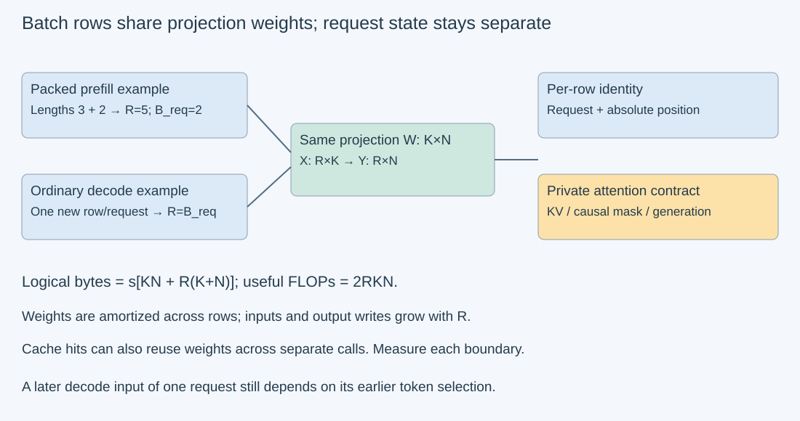
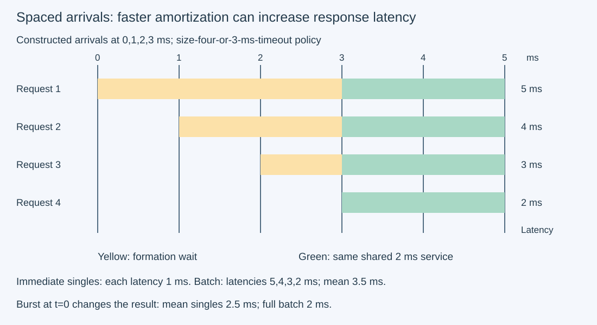

# M3-C17: Batching, weight reuse, and shifting bottlenecks

> **Status: Complete — detailed chapter authored and documentation validated; experimental procedures are proposed unless explicitly labelled observed**

**Module:** Learn GPU architecture through data movement

**Category:** [Scheduling and queueing](index.md)

[Module 3 reading order](../module-3.md) · [Previous: M3-C16](../measurement-experimentation-and-economics/m3-c16-using-the-roofline-model-to-predict-bottlenecks.md) · [Next: M3-C18](../numerics-and-correctness/m3-c18-validating-gpu-computation-and-memory-movement.md) · [Execution plan and progress](../chapter-execution-plan.md)

## Target concepts

Batch size and matrix shapes, weight reuse, arithmetic intensity changes, prefill versus decode tendencies, working-set limits, saturation, batching delay versus service time.

## Concepts

### 1. Count requests and token rows separately

**Batching** groups independent work into a shared execution step. Let **B_req** be the number of requests in that step and **R** the number of newly processed token positions. These counts answer different questions. In ordinary cached decode with one new input per active request, R=B_req. In a packed prefill with prompt lengths P_i, R=ΣP_i. A padded prefill may execute B_req×P_max row positions even though only ΣP_i are useful. **Packing** places useful positions together while retaining their request, position and mask identity; **padding** inserts positions needed by a chosen layout.

For a linear projection write **Y=XW**, with X of shape R×K, weights W of shape K×N and result Y of shape R×N. Each row can use the same W. R=1 resembles matrix-vector work; increasing R makes more rows available for a matrix-matrix operation. A Rust engine must preserve row-to-request identity through packing and completion, not merely produce an array of the right size. This chapter supplies reasoning and experimental specifications without implementation code.

Two successive output positions of one autoregressive request are not interchangeable independent rows: the later input depends on the earlier selection. As established in [M1-C18](../runtime-and-concurrency/m1-c18-understanding-prefill-and-decode.md), prefill can produce the first selection; g selected output IDs normally require one prefill and g−1 subsequent decode forwards. Increasing a request's output cap does not create an independent decode batch. Independent requests can share a step while retaining separate KV state, absolute positions, stopping rules and cancellation outcomes.

### 2. Reuse the weights, then account for growing activations

Use a positive-dimension dense projection, α=1, β=0, nonaliased contiguous operands and uniform element size **s** bytes. With the conventional multiply/add count and a read-once logical byte model:

**F(R)=2RKN FLOPs.**

**Q(R)=s[KN + R(K+N)] bytes.**

**I(R)=2RKN / {s[KN + R(K+N)]} FLOP/byte.**

The KN weights appear once in this model, while inputs and output writes grow with R. If weights dominate, R(K+N)≪KN, then **I(R)≈2R/s**. This explains the opportunity: more useful arithmetic per logically transferred weight byte. It does not prove weights crossed DRAM only once. Tiles can reload weights; caches can serve multiple separate calls; output writes can leave the selected measurement window. Count physical interfaces separately, following [M3-C15](../measurement-experimentation-and-economics/m3-c15-counting-flops-and-bytes-at-a-defined-boundary.md).

For K=N=D, **I(R)=2RD/[s(D+2R)]**. As R grows, intensity approaches **D/s**, not infinity. Input/output traffic eventually matters even in this simple model. A real projection may add bias, conversions, quantization metadata, workspace or padding; those require their own work and byte ledgers. The [NVIDIA matrix-multiplication guide](https://docs.nvidia.com/deeplearning/performance/dl-performance-matrix-multiplication/index.html) supplies the GEMM counting and tile-efficiency context. Its historical device examples do not establish this chapter's hardware performance.

Here is a **constructed** D=4096, s=2 example. MiB=2²⁰ bytes. Weights occupy 32 MiB. Values are mathematical predictions, not counter observations.

| R useful rows | Useful FLOPs | Logical bytes | Intensity, rounded | Weight bytes per useful row |
| --- | --- | --- | --- | --- |
| 1 | 33,554,432 | 33,570,816 | 0.9995 FLOP/byte | 32 MiB |
| 8 | 268,435,456 | 33,685,504 | 7.9689 FLOP/byte | 4 MiB |
| 32 | 1,073,741,824 | 34,078,720 | 31.5077 FLOP/byte | 1 MiB |
| 128 | 4,294,967,296 | 35,651,584 | 120.4706 FLOP/byte | 0.25 MiB |

*This is a logical reuse model. Same-weight separate calls may also hit cache; sharing an address is not proof of either DRAM traffic or residency.*

### 3. The tighter modeled ceiling can change

Use [M3-C16's compatible roofline](../measurement-experimentation-and-economics/m3-c16-using-the-roofline-model-to-predict-bottlenecks.md): P_roof=min(P_compute, B_memory I). P_compute is a compatible arithmetic capacity and B_memory a capacity at the declared byte boundary. The symbol B_memory is bandwidth, not request count. Their ridge intensity is **I_ridge=P_compute/B_memory**.

Under teaching capacities of 8 TFLOP/s and 400 GB/s, I_ridge=20 FLOP/byte. These capacities are hypothetical and must match the s=2 arithmetic convention before use as a physical roof. Solving the square-projection model for the row count at that ridge gives:

**R_ridge = I_ridge sD / [2(D−I_ridge s)]**, provided **D>I_ridge s**.

For D=4096 and s=2 this is about 20.1972 rows, so the first integer R reaching the ridge is 21. If D≤I_ridge s, no finite positive R reaches that ridge under this model; increasing rows cannot defeat the activation-traffic asymptote. Do not extrapolate the approximation I≈2R/s beyond its weight-dominated range.

**Saturation** means additional offered work or concurrency stops yielding a corresponding increase in useful completed throughput at a stated operating point. It is an observation, not a synonym for crossing a roofline ridge. A larger GEMM can use more execution tiles and amortize launch costs, or trigger a different library algorithm, increase register/workspace pressure, or encounter a cache limit. Once compute becomes a tighter model term, additional reuse alone cannot lift that ceiling. Inner-cache traffic, instruction readiness and synchronization may still be the real limiter. Establish a candidate bottleneck through counters and a controlled intervention, not from R alone.

If a batch takes completed time T(R), its projection row throughput is **R/T(R)**; its reciprocal **T(R)/R** is amortized time per row. Every row may nevertheless wait nearly T(R) for the shared result. Amortized time is not that row's response latency. Whole-service saturation needs arrivals, outcomes, queue stability and memory evidence; an offline projection sweep cannot establish sustainable serving capacity.

### 4. Prefill and decode have tendencies, not fixed labels

Prefill exposes many new positions, so its projections often supply a larger R and more weight-reuse opportunity. Cached decode supplies few new positions per request, but many active requests can also create a large projection. Long-context decode additionally reads retained attention state; its behavior can shift as contexts grow. A small prefill may be overhead-limited, while a large decode batch may place substantial pressure on compute. Avoid the unconditional labels “prefill is compute-bound” and “decode is bandwidth-bound.”

Attention is not simply one shared projection across all packed rows. Different requests retain different keys/values and causal masks. Combining projections must not permit a query from one request to read another request's context. With **L** layers, **H_kv** retained key/value heads, **d** values per head, **s_kv** bytes per retained value and context lengths S_i, an unshared dense KV payload is:

**M_KV = 2L H_kv d s_kv ΣS_i bytes.**

The two counts keys and values. A read-once model for a decode attention pass can involve this existing payload, but actual traffic depends on attention implementation, grouping, tiling, caching and windowing. Capacity and traffic are different quantities. Projection reuse alone does not remove per-request attention demand.

**Iteration-level batching** can change active membership between generation steps as requests finish or arrive. The [ORCA paper](https://www.usenix.org/conference/osdi22/presentation/yu) introduces this scheduling approach. **Chunked prefill** limits new prompt positions per scheduling step; a step may contain both prefill and decode work. The [vLLM optimization documentation](https://docs.vllm.ai/en/latest/configuration/optimization/) illustrates a token-budget policy and its latency tradeoffs. These are examples of policy choices, not required defaults or portable performance promises. A mixed step needs separate useful prefill rows, decode rows and per-request progress; total token rows do not by themselves describe attention cost.

### 5. A batch must fit today and leave room for growth

A **working set** is state needed over the chosen execution interval. It includes more than W: inputs, outputs, live KV, temporary workspace, queues and retained results. A simplified device feasibility check is:

**M_weights + M_KV + M_activations(R) + M_workspace(R) + M_runtime + M_reserve ≤ M_available.**

Use simultaneously live, nonduplicated storage, including allocator/block overhead and fragmentation. Cache capacity is another resource: fitting in device DRAM does not imply the live data fits in L2. A larger batch can increase reuse while evicting useful state. Follow completed [M9-C15](../state-memory-and-caching/m9-c15-accounting-for-weights-kv-state-workspace-and-fragmentation.md) for the distinction between payload, allocation and headroom.

Consider a separate **constructed KV-only budget**, after all other reservations, of 4 GiB. With L=32, H_kv=8, d=128 and s_kv=2, one retained token costs 131,072 bytes (128 KiB). At S=2048, one request costs 256 MiB. Sixteen requests consume all 4 GiB; their next one-token growth needs another 2 MiB and cannot be admitted under that budget. Fifteen requests need 3.75 GiB; reserving another 64 retained positions each adds 120 MiB, leaving 136 MiB of that KV-only budget. Real block rounding and shared state alter the allocation ledger and must be included before admission.

For heterogeneous lengths 512, 2048 and 8192, ΣS_i=10,752, giving 1.3125 GiB payload in this example. B_req=3 is insufficient information to predict the memory demand. Treat generated-length limits, cancellations and missing completion as part of ownership and growth accounting, not reasons to optimistically free live device state.

### 6. Batching delay is part of response time

An online batch may wait to gather enough work. For request i define arrival a_i, batch closure c_i, actual service start s_i and usable completion f_i on compatible clocks. In a deliberately serial decomposition:

**Latency_i = (c_i−a_i) + (s_i−c_i) + (f_i−s_i).**

The terms are formation delay, ready-batch queue delay and service-to-result time. If formation overlaps other queueing, define these events so intervals partition time without double-counting. Transfers, validation and publication belong in the service-to-result interval unless separately decomposed. A maximum formation timeout bounds only the first term under its stated policy, not full response latency.

A hand-trace makes the tradeoff visible. Four independent one-step requests arrive at 0,1,2,3 ms. A single nonpreemptive server has **constructed** service times T(1)=1 ms and T(4)=2 ms. At equal timestamps, completed work retires, arrivals enter, then an idle server may dispatch. Compare immediate singles against batches of up to four, closed when full or when the oldest request has waited 3 ms. No later arrivals occur; launch a nonempty partial batch on timeout using a separately specified T(b) if needed. Only batch sizes one and four occur in this trace.

| Policy | Starts → finishes | Formation delays | Response latencies | Mean latency |
| --- | --- | --- | --- | --- |
| Immediate singles | 0→1, 1→2, 2→3, 3→4 ms | 0,0,0,0 ms | 1,1,1,1 ms | 1 ms |
| Up to four, 3 ms timeout | 3→5 ms | 3,2,1,0 ms | 5,4,3,2 ms | 3.5 ms |

The batched service rate is 4/2=2 requests/ms versus 1/1=1 request/ms while active. Yet the fixed arrival-to-last-completion cohort rate is 4/5=0.8 requests/ms versus 4/4=1 request/ms. Neither finite cohort rate proves sustainable capacity. With a burst of all four at t=0, singles finish at 1,2,3,4 ms (mean 2.5 ms), while the full batch finishes at 2 ms (mean 2 ms). Arrival variability changes the conclusion even with identical service times.

*Times are constructed. The horizontal spans show formation, then shared service; each row retains its own arrival and completion. No real model or HFT latency is asserted.*

The HFT lens is useful here: waiting to group events may save work per event while delaying an urgent or soon-stale event. In inference, deadlines, queue bounds and cancellation must likewise be explicit. A market event's semantics differ from token generation, and batching is not automatically appropriate for every deadline-sensitive path.

## Experiments

All experiments are **proposed**. Paper references below can be verified without GPU hardware. No GPU, model-serving, profiler or arrival-load measurements have been performed. Rust remains the eventual engine context; no implementation is supplied.

### E1 — Predict the reuse curve and its ceiling

- **Description:** Reconstruct the square-projection intensity table and its ridge condition.
- **Purpose/objective:** Explain why logical weight cost per row falls while activation costs grow.
- **Target concepts:** Batch rows and shapes, weight reuse, intensity, ridge and asymptote.
- **Baseline and workload:** D=4096, s=2 and R∈{1,8,32,128}, with the constructed 8 TFLOP/s and 400 GB/s capacities. No timed trials.
- **Controls and prediction:** Keep arithmetic convention, W and logical boundary fixed. Predict I values 0.9995/7.9689/31.5077/120.4706 to four decimals, asymptote 2048 and first ridge-reaching integer R=21.
- **Procedure:** Derive each F, Q and weight byte/row value independently. Compare the exact intensity against 2R/s and explain the discrepancy. Solve the ridge inequality; repeat with D=32, s=2 and ridge 20 to show no finite crossing. Name the evidence needed before calling this a DRAM bottleneck change.
- **Hardware/software:** Paper or calculator suffices; no GPU or vendor-specific dispatch required.
- **Failure and HFT connection:** Reject infinite reuse extrapolation and calling amortized time a response time. HFT event aggregation also needs separate cost and deadline ledgers.
- **Exit criteria:** Table, finite/asymptotic bounds and ridge inequality reconcile; hypothetical roofs remain labelled and no hardware saturation is claimed.

### E2 — Compare grouped and separate projections with identical useful rows

- **Description:** Design a controlled single-device projection study for 64 independent rows sharing one W.
- **Purpose/objective:** Measure a grouping opportunity without conflating more useful work with faster execution.
- **Target concepts:** Shapes, reuse, saturation evidence, working sets and completed service time.
- **Baseline and workload:** Binary32 K=N=64, α=1, β=0, fixed W[k,j]=((k+2j) mod 4)−1. Trial epoch e has X[r,k]=((r+k+e) mod 4)−1 for global r=0…63. The baseline executes all 64 rows separately; a grouped variant processes them in chunks R∈{1,4,16,64}, issuing 64/R projections. Both preserve the same global row order and output reference Y[r,j]=Σ_k X[r,k]W[k,j]. There are eight cells: four R values times two modes; R=1 is a duplicate-path control.
- **Controls and prediction:** Preserve all 64 useful rows, exact arithmetic policy, layout, stream, weights, allocation and fixed workspace budget. Inputs/results occupy full 64×64 backing buffers; chunks are declared views. Exact equality is required for these bounded integer fixtures. Predict lower logical repeated weight bytes under grouping, not guaranteed lower DRAM traffic or monotonic time. Single-call cache reuse can erase part of the expected traffic benefit.
- **Procedure:** Use three independent sessions, ten excluded warmup trials per cell/session and twenty measured trials per cell/session in a recorded balanced order. Set measured e=0…59 per cell across sessions; warmups use e=0. Prepare and complete X transfer before timing, with no claim of a cold cache. Time device completion of the entire 64-row bundle and separately host preparation-to-validated-result. Validate every row after completion outside device timing. In a separate cohort profile one first measured epoch per cell/session, restoring preparation history: 24 planned invocations, potentially many kernels/replays. Retain actual dispatch coverage and matched counter/time scopes. No cross-cohort counter/time division.
- **Hardware/software:** One supported GPU, dense binary32 GEMM/library path, independent CPU references, documented host/device clocks and completion events. Counter access is optional; absent metrics leave traffic attribution unavailable. Retain the manifest below and installed binding/layout specifications.
- **Failure and HFT connection:** Tag rows with session/cell/epoch/global-row/generation; no cross-request publication or aliasing. Cancellation stops useful publication, not device ownership. A 120-second watchdog stops new admission and records unknown completion; reclaim only after actual completion and validation retirement. Incorrect or missing rows fail the bundle gate rather than inflating useful throughput.
- **Exit criteria:** Account for 480 planned measured trials, 240 excluded warmups and 24 profiling invocations separately, without silently replacing failures. Successful bundles match every reference coordinate. Report per-session distributions, duplicate-control differences and any plateau/reversal with uncertainty; no forced positive speedup or bottleneck label.

### E3 — Test the KV growth gate before enlarging the batch

- **Description:** Reconcile equal-length and heterogeneous KV payloads with a finite reserved budget.
- **Purpose/objective:** Show why fitting the current batch is insufficient for safe decode growth.
- **Target concepts:** Working-set limits, per-request context variability, state ownership and shifting resource pressure.
- **Baseline and workload:** The constructed L=32/H_kv=8/d=128/two-byte KV layout and 4 GiB KV-only budget; equal S=2048 for B_req∈{15,16}; heterogeneous lengths 512/2048/8192; 64-position growth reservation for each of fifteen requests. No allocation or GPU execution.
- **Controls and prediction:** Keep all other memory reservations outside the KV-only budget, with no sharing, paging or block-rounding benefit assumed. Predict 256 MiB/request, sixteen-request next-step growth rejected, fifteen-request reserved-growth remainder 136 MiB and heterogeneous payload 1.3125 GiB.
- **Procedure:** Count both keys and values at every layer; derive current and reserved growth bytes. Add a hypothetical allocator overhead and explain that it must reduce headroom. Trace a cancelled request with pending device work: suppress publication while keeping its state charged until safe retirement. Preserve other requests' identities and masks; never treat concatenated contexts as mutually visible.
- **Hardware/software:** Paper ledger suffices. An actual admission study additionally needs allocator/block and runtime high-water measurements as in M9-C15, not just these payload numbers.
- **Failure and HFT connection:** Reject the sixteen-request batch’s additional step before writing beyond capacity. Cancellation and stale state require explicit retirement, as delayed HFT work does; they are not immediate resource credits.
- **Exit criteria:** All payload/growth/remainder values reconcile; unsafe growth is refused; unknown completion cannot free charged state. Do not claim cache residency, attention traffic or measured allocation from the paper capacity ledger.

### E4 — Replay arrivals before choosing a batching delay

- **Description:** Hand-replay both policies on the spaced and simultaneous four-request traces.
- **Purpose/objective:** Distinguish active service rate from cohort throughput and individual latency.
- **Target concepts:** Batching delay, queue/service boundaries, workload variability and end-to-end benefit.
- **Baseline and workload:** Arrivals 0/1/2/3 ms and arrivals 0/0/0/0 ms, T(1)=1 ms, T(4)=2 ms, one server and the defined tie rule. Compare immediate singles against size-four-or-3-ms-timeout policy. All outcomes are constructed.
- **Controls and prediction:** Preserve request IDs, arrivals and service table. Predict spaced mean latencies 1 versus 3.5 ms, burst means 2.5 versus 2 ms, and spaced cohort rates 1 versus 0.8 request/ms. No partial batches occur, so no undefined T(2)/T(3) is used.
- **Procedure:** Trace arrival, closure, start and completion for every request; calculate formation, queue and service terms without overlap. Then design a future fixed-arrival inference comparison with model/token identity, prompt/output lengths, context distribution, concurrency, bounded queues, deadline and cancellation policy recorded before execution. Preserve intended and actual arrivals rather than delaying arrivals until the previous request completes. Measure first useful response and full completion separately; record every terminal outcome and any unfinished work. A real workload-specific service curve must replace the teaching T values before deploying a policy.
- **Hardware/software:** Paper replay requires none. A future serving study requires actual model/device specifications, token reference gates, calibrated event domains and repeated identical arrival traces; none are executed here.
- **Failure and HFT connection:** Define stale, rejected, cancelled, failed and timed-out work separately from useful completion. Test overload and queue bounds in the future design. A formation timeout cannot guarantee an end-to-end deadline in inference or HFT.
- **Exit criteria:** Both trace ledgers reproduce the table and burst results. Any future improvement claim must pass correctness/freshness gates and include per-request distributions, useful completion rates, failure counts and queue-growth evidence; an offline speedup alone does not pass.

## Verification

### Match each experiment to its evidence

| Experiment | Reference and invariant | Measurement or profiling | Acceptance and limitation |
| --- | --- | --- | --- |
| E1 | Same logical F/Q convention and independent rows | Exact counts and ridge inequality | Rounded table, R=21 crossing, asymptote and no-crossing case; no physical bottleneck inferred |
| E2 | Same 64 rows/W, independent dot references, exact fixture outputs | Whole-bundle device interval; separate host interval; separate profiles | Outcome ledger and exact gates; supported interface metrics; plateau evidence remains workload-specific |
| E3 | Full KV layers/heads/positions; no premature memory credit | Paper budget now; allocation high-water only in future work | Reject unsafe growth, retain pending state and show reserved headroom |
| E4 | Same arrivals, tie rule, service table and IDs | Formation/queue/service/full-latency paper traces | Reproduce spaced/burst conclusions; no sustainable-serving or trading claim |

E2's logical whole-bundle counts follow from 64/R groups:

**F_bundle=2×64³=524,288 FLOPs**, identical in every cell.

**Q_grouped(R)=(64/R)×4(4096+128R)=1,048,576/R+32,768 bytes.**

| Chunk rows R | Grouped calls per bundle | Grouped logical bytes | Separate-row logical bytes | Raw device backing for W/X/Y |
| --- | --- | --- | --- | --- |
| 1 | 64 | 1,081,344 | 1,081,344 | 49,152 bytes |
| 4 | 16 | 294,912 | 1,081,344 | 49,152 bytes |
| 16 | 4 | 98,304 | 1,081,344 | 49,152 bytes |
| 64 | 1 | 49,152 | 1,081,344 | 49,152 bytes |

The separate-row column is a logical per-call ledger; caching may prevent those repeated logical reads from crossing DRAM. A whole-bundle counter must cover all constituent kernels with the same completed scope. If only one kernel is captured, label its evidence and do not scale it blindly across the bundle. Profiling replay/cache controls can change the experiment: retain their configuration and separate durations, following the [Nsight Compute guide](https://docs.nvidia.com/nsight-compute/ProfilingGuide/index.html).

Each E2 input value is an integer in {−1,0,1,2}; products have magnitude≤4 and 64-term partial sums magnitude≤256. All are exactly representable in binary32. Check every successful output against an independently accumulated integer reference; this exact fixture gate is not a zero-tolerance rule for arbitrary model data. See [M9-C17](../numerics-and-correctness/m9-c17-comparing-logits-with-justified-numerical-tolerances.md) for general precision budgets and decision sensitivity.

The 480 planned measured bundles contain **1,966,080 output coordinates** and **251,658,240 useful core FLOPs**. These are planned work counts, not achieved rates. Host W/X/Y/reference backing is 65,536 bytes (64 KiB) with a binary32 stored reference; raw device backing is 48 KiB. Workspace, packing, profiler and runtime storage are additional, explicitly bounded before a hardware run. A large real model's memory requirement cannot be inferred from the tiny fixture.

For each cell/session retain all twenty timing outcomes, median, nearest-rank p95 and maximum, plus every failure. For n successful values sorted ascending, nearest-rank p95 is rank ceil(0.95n), with one-based ranks; at n=20 it is rank 19. Do not average session percentiles. Compare paired grouped/separate bundle times and the R=1 control across three sessions, preserving order and drift. A pooled 60-sample distribution must retain session labels and does not replace the separate results. These counts do not support a stable p99 claim. Apply [M9-C07](../measurement-experimentation-and-economics/m9-c07-latency-distributions-and-statistical-uncertainty.md) before claiming an improvement beyond noise.

For future E4 serving evidence, use [M9-C02](../measurement-experimentation-and-economics/m9-c02-request-events-clocks-and-measurement-boundaries.md) to define clocks, [M9-C03](../measurement-experimentation-and-economics/m9-c03-measuring-time-to-first-token-including-queueing.md) for first response and [M9-C05](../measurement-experimentation-and-economics/m9-c05-measuring-end-to-end-latency-and-throughput.md) for useful completed throughput. Reconcile offered=completed+rejected+cancelled+failed+timed-out+unfinished using mutually exclusive terminal categories at a stated cutoff. Count deadline misses/freshness separately as outcome attributes, without double-counting requests. Finite drain time and fixed-cohort rate do not establish queue stability at a sustained offered rate.

### Six dimensions applied

| Dimension | Chapter-specific check |
| --- | --- |
| Semantics and invariants | Preserve independent rows, request masks, positions and exact projection reference before comparing time. |
| Workload and variability | Record rows, request count, lengths, contexts, arrival trace and reuse history; burst and spaced traces can reverse the latency conclusion. |
| Resources and bottlenecks | Track weights, activation traffic, KV, workspace, cache interfaces and dispatch changes as R grows. |
| Time and distributions | Separate amortized cost, formation, queue, device completion and first/full useful response; preserve distributions. |
| Ownership and coordination | Retain per-row generation identity and charged KV until device and readers retire; batch membership does not merge ownership. |
| Failure and adaptation | Reject unsafe growth, bound queues, suppress stale/cancelled publication and report unknown completion without freeing live state. |

### Eight engineering principles applied

| Principle | Application |
| --- | --- |
| 1. Correctness defines the optimization boundary | Grouping must preserve each output; approximate arithmetic needs its own gate. |
| 2. Performance depends on workload and operating point | A batch size useful under bursts can hurt sparse arrivals; shape and cache history change results. |
| 3. Data movement is part of the algorithm | Shared weight bytes per row fall, while activation and KV demands remain explicit. |
| 4. State has ownership, lifetime, and recovery cost | Admission reserves growth and cancellation retains pending storage until safe retirement. |
| 5. Dependencies determine latency; bottlenecks determine capacity | Autoregressive positions remain serial; independent rows can share execution but formation still delays them. |
| 6. Variability and synchronization shape the tail | Slow shared steps affect every member, and average amortization does not prove tail improvement. |
| 7. Local improvements must be evaluated end to end | Higher projection row throughput must be checked against usable response times and useful completion. |
| 8. Claims require reproducible evidence | Archive exact references, identities, arrivals, outcomes, timing windows, counter scopes and hardware state. |

## Specifications, articles, and hardware

| Primary source | Role and limits |
| --- | --- |
| [NVIDIA matrix-multiplication background guide](https://docs.nvidia.com/deeplearning/performance/dl-performance-matrix-multiplication/index.html) | GEMM arithmetic/traffic and tiling context; historical benchmark hardware and alignment claims must not be generalized into new measurements. |
| [cuBLAS 13.4 operation reference](https://docs.nvidia.com/cuda/cublas/index.html) | Layout, leading dimensions, coefficients and arithmetic controls; verify the actual installed binding/API. |
| [ORCA, OSDI 2022](https://www.usenix.org/conference/osdi22/presentation/yu) | Primary iteration-level scheduling research; reported system results are not measurements for this chapter. |
| [vLLM optimization and tuning](https://docs.vllm.ai/en/latest/configuration/optimization/) | A concrete chunked-prefill/token-budget policy; version-specific choices are examples, not portable tuning instructions. |
| [Nsight Compute profiling guide](https://docs.nvidia.com/nsight-compute/ProfilingGuide/index.html) | Counter scopes, collection/replay and cache controls; unavailable metrics remain unavailable evidence. |

E1/E3/E4 require only paper analysis. E2 requires one supported GPU, a documented dense binary32 path, sufficient backing/workspace/runtime capacity and optional profiler permission. No second GPU, network adapter or model weights are needed for that fixture. Record exact GPU SKU/architecture/partition and active resources, memory capacity/type and cache topology, CPU/RAM/NUMA and host connection, driver/runtime/library/binding/profiler versions, workspace limits, arithmetic modes, clocks/power/thermal state and competing activity as in completed [M9-C16](../hardware-architecture-and-topology/m9-c16-recording-hardware-conditions-that-change-measurements.md). Attach the actual device specification before running; no machine was supplied, so no real hardware capability or benchmark result is asserted. The 4096-width two-byte example and KV-only budget are teaching configurations, separate from E2's binary32 fixture and any future full-model service study.

## Completion and next chapter

Track acceptance in the clickable [execution plan](../chapter-execution-plan.md). Next in Module 3 reading order is the completed [M3-C18: Validating GPU computation and memory movement](../numerics-and-correctness/m3-c18-validating-gpu-computation-and-memory-movement.md). The next authoring chapter is [M9-C12](../measurement-experimentation-and-economics/m9-c12-reading-cpu-gpu-timelines-and-scheduling-gaps.md). Module 9 supports Modules 1–7; Module 8 is excluded.
