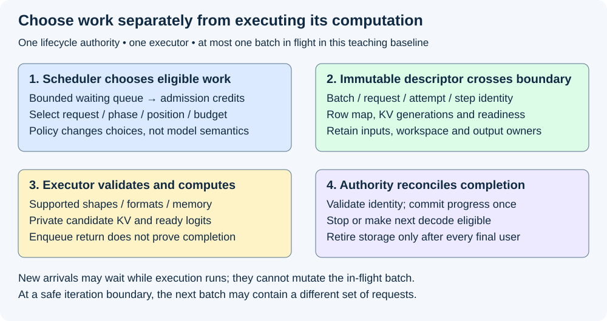
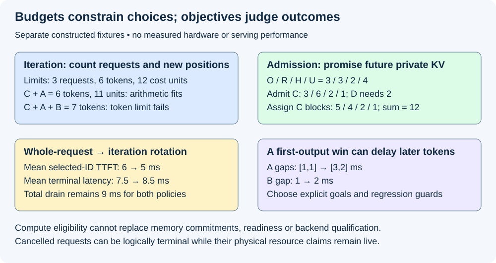

# M5-C01: Separating the model executor from the serving scheduler

> **Status: Complete — detailed chapter authored and documentation validated; experimental procedures are proposed unless explicitly labelled observed.**

**Module:** Learn scheduling, operating systems, and queueing theory

**Category:** [Scheduling and queueing](index.md)

[Module 5 reading order](../module-5.md) · [Next: M5-C02](../runtime-and-concurrency/m5-c02-processes-threads-and-operating-system-scheduling.md)

## Target concepts

Execution versus scheduling, request queues, iteration boundaries, batch membership, compute and memory budgets, policy versus mechanism, service objectives.

[Execution plan and progress](../chapter-execution-plan.md)

## Concepts

### 1. Computation and choice of work answer different questions

An **executor** performs a specified piece of model computation on supplied inputs and state. A **serving scheduler** chooses which eligible requests receive that computation next, within resource limits and a declared service objective. A request may need many model forwards before it finishes. Treating the whole generation loop as an indivisible executor call prevents the scheduler from reconsidering work between those forwards.

Use [prefill and decode](../runtime-and-concurrency/m1-c18-understanding-prefill-and-decode.md), [allocator integration](../runtime-and-concurrency/m2-c19-connecting-block-allocation-to-the-request-generator.md) and [end-to-end improvement evidence](../measurement-experimentation-and-economics/m4-c24-verifying-end-to-end-generator-improvements.md) as foundations. **Prefill** processes prepared prompt IDs; ordinary **decode** processes one pending selected ID per participating request. Prefill supplies the logits for the first output selection. For g≥1 selected IDs, one request needs one prefill and g−1 decode forwards; a terminal selection needs no additional forward. Zero-generation requests retain the earlier no-forward policy.

**Policy** is the choice among permitted actions, such as oldest eligible request first. **Mechanism** is the capability and enforcement that make an action possible and safe: preparing a batch, checking its shape, protecting KV storage and reporting completed work. Separating them lets a reader change selection order while keeping model computation and resource contracts fixed. It does not make policy independent of hardware or backend capabilities.

| Concern | Scheduler/lifecycle authority | Executor/backend mechanism |
|---|---|---|
| Next work | Choose eligible request IDs, phase, positions and budgets | Validate supplied work and execute the qualified operation family |
| Model state | Authorize current request/version and allocator claims | Read the required prefix and produce private candidate KV/logits |
| Progress | Reconcile completion, commit valid forward/selection once, apply stopping | Report attempt identity, completed extent, output readiness and errors |
| Memory | Admit against current and future commitments; authorize retirement | Retain operands/workspace until final accesses complete |
| Objective | Balance specified latency, useful output and fairness goals | Supply observable costs/capabilities; do not silently reorder or drop work |

This is a teaching responsibility split, not a universal API requirement. One Rust component may contain both roles; separation need not introduce another process, thread or copying layer. A GPU backend may also perform qualified sampling, but commit authority must remain explicit. Later chapters introduce operating-system scheduling and communication. They must not be confused with this request-level scheduling decision.

[ORCA (OSDI 2022)](https://www.usenix.org/conference/osdi22/presentation/yu) establishes iteration-level scheduling as a serving design: the scheduler can invoke one model iteration and reconsider membership afterward. Its distributed implementation and selective batching are specific research designs, not evidence that any arbitrary mixed batch is supported here. The [vLLM architecture overview](https://docs.vllm.ai/en/latest/design/arch_overview/) offers a practical comparison: its engine core coordinates scheduling/KV management, while workers and model runners carry out model execution. Pin an actual version before relying on its changing interfaces.

### 2. A queue holds eligible work; an iteration grants bounded execution

A **queue** retains waiting requests with their identity and ordering metadata. A **batch** is the chosen set of work for one executor invocation. Waiting, admitted and currently executing are different states. An **iteration boundary** is a point where the previous invocation's required completion has been reconciled and the next descriptor can be formed. It is not an arbitrary host-loop turn or a promise that a submitted GPU kernel has finished.

Start conservatively with one executor, one lifecycle authority and at most one batch in flight. “In flight” means submitted work whose required completion has not yet been reconciled. New arrivals may enter a bounded waiting queue during execution, but must not mutate the descriptor, mappings or inputs already in use. Multiple concurrent batches are a later extension requiring additional ordering and lifetime proof.

For this chapter's baseline, an admitted request with a valid prepared prompt is ready for prefill. After a successful forward and nonterminal selection commit, it is ready for its next decode. Queued work has not yet acquired full-cap growth credits. Admission does not guarantee immediate execution. A request with pending inputs, unresolved errors or missing storage/readiness is not eligible merely because its ID is present in a list.

| Logical stage | Meaning | Permitted next decision |
|---|---|---|
| Waiting | Valid request retained in bounded admission queue | Admit if credits/capabilities permit, keep waiting, reject/expire/cancel under policy |
| Ready | Admitted, not in flight, next phase's dependencies and credits valid | Select for one iteration or defer within the declared fairness policy |
| In flight | Immutable descriptor submitted with protected storage | Track completion/cancellation; no competing forward for that request |
| Ready again | Completed nonterminal forward/selection reconciled | Form a later decode descriptor using the new committed version |
| Logically terminal | One success/failure/cancellation outcome chosen | No new model work; retain physical claims until their final users finish |

A terminal outcome and resource reclamation are distinct. A cancellation can close a request while the device still reads its buffers. The cleanup owner must outlive the request task. The [Rust ownership chapter](https://doc.rust-lang.org/book/ch04-01-what-is-ownership.html) explains host memory ownership; asynchronous foreign-device access needs additional completion-aware retention beyond a host borrow's lexical scope. [CUDA synchronization behavior](https://docs.nvidia.com/cuda/cuda-runtime-api/api-sync-behavior.html) states that kernel launch is asynchronous with respect to the host; enqueue return is not the iteration boundary used here.

*The descriptor and completion are contracts, not implementation code. Arrivals can wait while a batch executes; membership changes only at a safe boundary.*

### 3. Specify the handoff before experimenting with a policy

An **execution descriptor** records exactly which work is authorized. An epoch is a generation identifier that changes when a worker or resource is replaced, so old results cannot masquerade as current ones. It needs a worker/epoch and batch identity; ordered rows mapped to request/attempt/step identities; model/backend version; phase and input positions; valid token counts and masks; current block-table/allocation generations; random-decision identity where applicable; readiness dependencies; output locations; and retained owners/claims. The executor validates supported shapes, formats, graphs and memory extents before accepting work. A valid unsupported shape may use a separately qualified fallback; an invalid binding must reject.

A **completion record** identifies that same batch and per-request step, actual completed work, candidate-state/logit readiness, errors and remaining final-user obligations. The lifecycle authority validates identity, order and current epoch before publishing progress. The executor cannot silently replace a request, shorten its prompt, invent a stop, or decide that an old completion belongs to a newer row occupying the same slot.

For a scripted identity fixture, requests A and B have prompt IDs [10,11,12,13] and [14,15], fixed output caps 3 and 2, and scripted selected sequences [20,21,22] and [30,31]. These IDs are control-flow labels, not model outputs. After first selections, A has processed N=4 and B N=2; selected IDs 20 and 30 are their pending next inputs. A descriptor with row order **[B,A]** therefore carries pending inputs **[30,20]** at logical positions **[2,4]**. Its scripted next selections **[31,21]** must route to **B,A**, respectively. B then reaches its cap and terminates; A continues with pending 21 and N=5.

The invariant after a forward followed by selection is **N=P+g−1**, for g≥1. On this decode, B has N=3,g=2 and A N=5,g=2. A row permutation changes placement, not request ownership, random identity or the mathematical causal prefix. Repeated notification must not append another ID. Batch-dependent floating-point differences are possible in a real backend: qualify numerical tolerance and the required token-wise/distributional contract rather than assuming bitwise equality for all shapes. The fixture itself requires exact labels and histories.

Cancellation before the selection commit can suppress publication according to the chosen policy. Delivery failure after selection commit does not authorize resampling. Unknown device completion keeps claims outstanding; it is not permission to submit duplicate work or recycle storage. These local rules introduce the boundary without claiming that the later concurrency and fault-verification chapters have already been authored.

### 4. Compute budgets and memory budgets constrain different things

Let S be one iteration's selected work, tᵢ its new input-position count, and cᵢ an estimated service-cost score for request i. A simple teaching eligibility rule requires:

**|S| ≤ Bmax;  Σtᵢ ≤ Tmax;  estimated batch cost ≤ Cmax.**

Bmax counts requests, Tmax counts new input positions, and Cmax is an operating budget in explicitly labelled cost units. For the toy additive model below, estimated batch cost is Σcᵢ. A real batch's execution cost is generally not the sum of isolated request times: weight reuse, attention lengths, layout, padding and contention affect it. A cost estimate supports a decision; it cannot guarantee a deadline without a separately justified bound and enforcement policy.

A prefill of five positions consumes five token-budget units; one ordinary decode consumes one. Those counts do not imply equal cost per position. Decode with a long prefix may read much more KV than decode with a short prefix. Unsupported mixed-phase execution must be split into valid homogeneous invocations, whose extra launches and waits must be charged. This chapter does not assume chunked prefill: a five-token prefill must fit as a whole. A permanently oversized prompt needs an explicit rejection or later qualified chunking path, not indefinite waiting.

KV means the attention keys and values retained for already processed positions. Use a separate private-block KV pool with F=12 blocks, four positions/block and 512 bytes/block. The pool is a **constructed 6,144-byte example**, not a model's measured memory requirement. Let O be occupied blocks, R unconverted full-cap growth credits, H withheld headroom and U uncommitted credits:

**F = O + R + H + U = 12.**

Reserve conservatively **rᵢ = ceil((Pᵢ+Gᵢ)/4)** total credits for an admitted request, where Pᵢ is prompt length and Gᵢ the declared output cap. Actual required cached positions for completed ordinary generation can be one lower; this full-cap convention intentionally remains conservative. Assigned blocks consume those credits, rather than being counted a second time as a new reservation. This private, no-sharing pool inherits the budget reasoning from Module 2; shared blocks need physical-union/reference accounting.

Suppose admitted A/B together own O=3 and R=3, with H=2 and U=4. This is a separate memory fixture, not the earlier two-request timing fixture. Candidate C has P=5,G=5 and requires three credits. Candidate D has P=3,G=2 and needs two. Admit C first: **3/3/2/4 → 3/6/2/1** in O/R/H/U order. D cannot now be admitted, even if its three-token prefill fits a compute budget. Assign two blocks for C's five-token prefill: **3/6/2/1 → 5/4/2/1**. The partition still totals 12; reserved free credits are not additional occupied payload.

For a distinct compute snapshot with A/B each ready for one decode and C ready for its five-token prefill, choose Bmax=3, Tmax=6 and Cmax=12 toy cost units. Charge two cost units per prefill position and one per decode position. Then **C+A = 6 positions, 11 units** fits the arithmetic limits, while **C+A+B = 7 positions, 12 units** violates Tmax. Backend capability/readiness and temporary memory must still pass; the numbers do not certify a mixed-phase kernel.

KV credits cover only this pool. Model weights, activation/workspace peaks, graph buffers, allocator metadata, queued prompt payloads and output buffering need separate bounds. A waiting-queue request limit does not bound bytes when request sizes are unbounded. An executor must reject before submission if valid memory/capability obligations cannot be met; it must not turn an underestimated cost into silent corruption.

### 5. Scheduling changes who waits, even when total work is unchanged

A **service objective** states what outcomes matter under a defined workload, such as useful completed output with bounded first-token delay and no starvation. A **guardrail** prevents improving one response by unacceptable regression in another. Fairness concerns how service is shared; selecting only short-looking work may leave large requests waiting indefinitely. Realized output lengths are not known to a live scheduler, so a policy must not use future benchmark outcomes as if observable at admission.

Use the earlier scripted A/B requests, both arriving at time 0. Assume a serial, one-row executor: prefill costs 1 ms per prompt position, each decode forward costs 1 ms, selection/commit is included, delivery costs zero and there are no other delays. Both requests are already admitted. This is a deterministic teaching cost model, not a GPU prediction. Both policies perform two prefills and three decode forwards, processing **4+2+2+1=9 positions** in **9 ms**.

| Policy | Execution order and completion times (ms) | Selected-ID TTFT A/B | Terminal A/B |
|---|---|---|---|
| Finish request A, then B | A prefill 0–4; A decodes 4–5,5–6; B prefill 6–8; B decode 8–9 | 4 / 8 | 6 / 9 |
| FIFO ready-queue rotation after each forward | A prefill 0–4; B prefill 4–6; A decode 6–7; B decode 7–8; A decode 8–9 | 4 / 6 | 9 / 8 |

FIFO means first in, first out. In the second policy B was already waiting when A rejoined the ready queue, so B runs next. Mean TTFT improves from **(4+8)/2=6 ms** to **(4+6)/2=5 ms**, but mean terminal latency worsens from **7.5 to 8.5 ms**. A's selected-ID gaps change from [1,1] to [3,2] ms; B's gap changes from 1 to 2 ms. The total drain remains 9 ms. Earlier first output alone does not establish better inter-token latency, total latency or sustainable capacity.

For a newly queued request arriving at 4.1 ms during a nonpreemptible 4–6 ms invocation, the earliest boundary consideration in this simplified trace is 6 ms: **at least 1.9 ms residual wait**, before any policy/admission/dispatch delay. “Nonpreemptible” here means this scheduler does not interrupt a submitted invocation. It is not a claim that operating systems or GPU hardware lack other preemption facilities. Smaller scheduling quanta may reduce interference but can increase host/launch overhead or reduce batching efficiency; future chapters measure that tradeoff.

*Independent toy fixtures expose different constraints: iteration work, future KV commitments and which user-visible latency benefits. They do not predict real device speed.*

### 6. Keep outcome accounting outside the policy's discretion

At a defined cutoff, partition every offered logical request exactly once. For example, 10 offered = 1 rejected + 2 waiting + 2 ready + 1 nonterminal in flight + 3 successful + 1 cancelled + 0 failed. The admitted population is 7: ready + in flight + all terminal admitted outcomes. The two waiting requests remain unadmitted under this convention. An admission/cancellation decision serialized at the cutoff determines the category; do not count one request in both flight and cancelled.

If the cancelled request still has outstanding device users, its physical claims remain in a separate resource ledger. Logical request counts and occupied blocks are different conserved quantities. A timeout is an observation/event, not necessarily proof of device completion or server terminal state. Retain attempt identity for retries and distinguish selected output from client-visible content. Record offered arrival, admission, dispatch, completed forward, selected-ID commit and terminal/delivery events using [Module 9 clock boundaries](../measurement-experimentation-and-economics/m9-c02-request-events-clocks-and-measurement-boundaries.md).

For request i, define **TTFTᵢ = first selected-ID commit − server arrival** and **terminal latencyᵢ = server terminal publication − server arrival** on the same monotonic clock. Requests with no selected ID have undefined TTFT and explicit outcome counts. Report queue waits, eligible gap distributions and useful completed output with their populations. The sum of selected requests' isolated costs cannot stand in for loaded service capacity. Preserve intended arrival traces in comparisons: a slowing closed-loop client can silently reduce offered load.

## Experiments

The following four experiments are proposed. Chapter authoring observes only independent arithmetic/identity/reference checks, document checks and rendered review. No scheduler, executor or simulator implementation is supplied; no serving or device benchmark is executed.

### E1 — Qualify the execution handoff

- **Name:** Same requests through a different row order.
- **Description:** Review the responsibility table and reconcile scripted A/B descriptors/completions against a per-request serial reference.
- **Purpose/objective:** Show that policy can choose placement without changing the request's causal computation or commit identity.
- **Target concepts:** Execution versus scheduling, policy/mechanism, batch membership and safe boundaries.
- **Baseline:** M1-C18 forward progression and M2-C19 all-layer commit/lifetime contract; exact scripted histories above.
- **Workload:** Row orders [A,B] and [B,A], one-row invocations, caps 0/1/2/3, early EOS, stale batch/step/worker epoch, duplicate notification and valid unsupported backend shape. Test invalid bindings as rejections rather than fallback candidates.
- **Controlled variables:** Prompt/selection labels, phase/positions, model/policy/random identity, allocation generations, supported shape family and completion/commit authority. Scripts are labels, not a numerical model.
- **Hardware requirements:** CPU/reference reasoning for fixture QA; a later qualified CPU or GPU model executor for numerical/policy equivalence, with exact backend/device manifest.
- **Exit criteria:** Both permutations route outputs by request identity ([21,31] for [A,B]; [31,21] for [B,A]); N=P+g−1 and forward counts match, no terminal extra forward/duplicate commit occurs, invalid/stale outputs cannot publish and unsupported valid work uses only a qualified path. Real batching passes its stated numerical and token-equivalence gates before timing.

### E2 — Separate iteration feasibility from admission feasibility

- **Name:** Small compute work can lack memory credit.
- **Description:** Exercise the private 12-block partition and independent token/cost-budget decisions, then audit all other memory categories.
- **Purpose/objective:** Prevent a compute-only selector from promising unavailable future KV or overflowing temporary buffers.
- **Target concepts:** Compute/memory budgets, queues, policy versus mechanism and service eligibility.
- **Baseline:** Full-cap admission with H=2 and the declared private-block ownership model; no unbounded overcommit.
- **Workload:** Admit C then consider D; convert C's two prefill blocks; compare C+A versus C+A+B. Include zero available credits, oversized prefill, workspace failure and a terminal request with a live reader. Repeat all candidate subset arithmetic, treating the compute and memory snapshots as distinct fixtures.
- **Controlled variables:** Block/position/byte units, caps, occupied versus reserved credits, resource limits, admitted identities, backend capabilities and no-sharing assumption. Headroom cannot silently become ordinary free credits.
- **Hardware requirements:** CPU for exact ledgers; later recorded device pool and separate weight/activation/workspace/graph/output limits. Device total VRAM alone is insufficient.
- **Exit criteria:** All three displayed partitions sum to 12, D is deferred/rejected under the declared policy, C+A passes arithmetic limits and C+A+B fails Tmax, and unsafe early release/unsupported descriptors reject before submission. No credit is counted as both occupied and reserved.

### E3 — Compare policies on the same arrivals and computation

- **Name:** First-output gain versus decode interference.
- **Description:** Compare whole-request service and FIFO iteration rotation in the two-request deterministic timing fixture.
- **Purpose/objective:** Establish which response changes before selecting a service objective or claiming a scheduler improvement.
- **Target concepts:** Request queues, iteration boundaries, membership, policy and service objectives.
- **Baseline:** Finish A before B on the same one-row executor, with both admitted at time 0.
- **Workload:** A prompt/cap 4/3 and B 2/2 with the fixed 9-ms service ledger; separately inspect arrival at 4.1 during the 4–6 invocation. Optional later simulations must preserve these fixtures and label their cost assumptions.
- **Controlled variables:** Arrivals, exact work/outputs, per-phase cost, queue insertion/tie rules, admission and zero delivery cost. Change only the scheduling decision granularity.
- **Hardware requirements:** CPU arithmetic/reference QA; no GPU required to validate this constructed schedule. Hardware service claims require E4.
- **Exit criteria:** Mean TTFT 6→5 ms, mean terminal 7.5→8.5 ms, A gaps [1,1]→[3,2], B gap 1→2 and unchanged 9-ms drain all reproduce. The 1.9-ms residual wait is a lower bound only. No overall-performance or production-tail claim follows from the toy comparison.

### E4 — Measure the boundary and preserve failures

- **Name:** Policy evidence with one fixed executor.
- **Description:** Later compare two qualified policies on one unchanged executor, retaining event/outcome/resource ledgers and separate fault diagnostics.
- **Purpose/objective:** Determine whether practical policy benefits survive selection overhead, resource contention and failure handling.
- **Target concepts:** Service objectives, bounded queues, iteration budgets, ownership and end-to-end verification.
- **Baseline:** Qualified whole-request/one-row policy and model executor under the same admitted/offered workload; hold backend/kernel tuning fixed.
- **Workload:** Freeze exact prompts, output caps, request-owned random identities and intended arrivals for four descriptive cells: short inputs/outputs, long inputs, long outputs and a mixed burst trace. Record actual outputs separately; never schedule using future realized lengths. Use 20 preassigned paired reset sessions per cell, fixed balanced arm order and one complete scratch trace warmup per arm/session. Include no-load handoff measurements separately. Run queued/in-flight cancellation, duplicate completion, withheld completion and worker-error diagnostics on isolated scratch traces, not nominal timing sessions.
- **Controlled variables:** Model/backend/corpus hashes, arrival replay, queue request and byte bounds, credits/headroom, capability family, warmup/reset, deadlines/output buffering, client behavior and policy tie rules. Preserve invalid sessions and all offered attempts; do not replace inconvenient runs.
- **Hardware requirements:** Recorded host CPU/topology/RAM/OS, one supported accelerator if used, driver/runtime/compiler, model/KV/workspace capacity, clock domains, client and profiler setup. Focused tracing is separate from clean timing.
- **Exit criteria:** E1/E2 correctness passes; counts and resource ledgers reconcile at every boundary; no hidden drops/retries or unsafe reuse occurs. Report all 20 paired responses per cell, medians/ranges, selected/content/terminal endpoints, queue waits, gap distributions, useful output and scheduler/dispatch overhead. These are descriptive results; a confirmatory speed/capacity claim requires a separately frozen M9-C27 uncertainty/guardrail design. Missing completion remains pending/quarantined and cannot authorize duplicate execution or retirement.

## Verification

| Experiment | Reference/invariants | Measurements and benchmarking | Profiling / acceptance boundary |
|---|---|---|---|
| E1 | Exact request/step/row mapping, causal positions, all-layer state and one selection commit | Forward/selected-ID counts; reference logits and trajectories for a later real backend | Diagnose readiness and commit edges; stale/duplicate results cannot mutate current state |
| E2 | O+R+H+U=12, separate assigned blocks/credits, future-cap reservation, final-user retention | All candidate subsets, queue bytes, temporary peak and pool occupancy | Check capability/shape and memory before submission; arithmetic feasibility is necessary, not sufficient |
| E3 | Same arrivals, same nine processed positions and output histories | TTFT, each selected-ID gap, terminal times, 9-ms drain and residual wait | Exact cost-model reference only; no hardware capacity or tail inference |
| E4 | Offered/admitted/status conservation, no cross-request state, safe terminal/reclamation split | Per-cell paired descriptive responses; all outcomes and requests retained | Separate traces attribute policy CPU time, packing, transfers, launch gaps and waits; confirmatory claims remain gated |

In a future benchmark, bound scheduler work itself: number of candidates examined, sorting/selection cost, descriptor preparation and allocator checks all consume host time. A full scan of Q waiting entries has at least Q entry inspections; the time per inspection and overall complexity depend on the actual mechanism. Measure it rather than declaring scheduling free. Trace arrival → admission → decision → dispatch → completed forward → commit → output, retaining each domain's clocks. Do not add overlapping spans as elapsed time.

Use fault tests to validate a decision can be rejected safely without actually freeing a live buffer. At shutdown, reconcile all logical outcomes and every final-user claim; an empty ready queue does not prove that device work or output readers have drained. Later M9-C22/C23 will develop concurrency and fault methodology in detail; the current chapter's explicit safety gates stand on their own.

## Engineering dimensions and principles

| Dimension | Chapter-specific reasoning |
|---|---|
| Semantics and invariants | A row permutation preserves request/step/prefix/draw identity; the executor cannot invent a shorter output |
| Workload and variability | Prompt length, realized stopping, arrivals and reuse change eligibility and cost; declared caps are observable, future output lengths are not |
| Resources and bottlenecks | Token counts, estimated cost, KV credits, temporary space and host decision time are distinct limits |
| Time and distributions | A smaller decision quantum can improve first output while increasing later gaps; record queue and endpoint populations |
| Ownership and coordination | One lifecycle authority grants immutable descriptors and reconciles completion; request task exit cannot free live storage |
| Failure and adaptation | Reject/defer unavailable work, retain uncertain claims and distinguish cancellation outcome from physical drain |

| Engineering principle | Practical consequence |
|---|---|
| 1. Correctness defines the optimization boundary | Scheduling order changes cannot violate causal positions, terminal rules or one-time commit |
| 2. Performance depends on workload and operating point | Two tiny requests do not establish behavior for long prefills, bursts or loaded hardware |
| 3. Data movement is part of the algorithm | Packing, metadata, KV reads and output buffering belong to the cost of choosing a batch |
| 4. State has ownership, lifetime and recovery cost | Admission promises future blocks; cancellation retains in-flight claims until real completion |
| 5. Dependencies determine latency; bottlenecks determine capacity | Ready work can still wait for a nonpreempted invocation; compute counts do not establish capacity |
| 6. Variability and synchronization shape the tail | Long prompt iterations and shared waits can stall unrelated decodes despite low average work |
| 7. Local improvements require end-to-end evaluation | TTFT 6→5 ms is accompanied by worse terminal latency and token gaps in the fixture |
| 8. Claims require reproducible evidence | Keep immutable arrivals/caps/backend, identity and outcome ledgers; distinguish cost-model arithmetic from measurements |

The HFT lens is an event-processing system choosing which pending message or decision receives a constrained execution slot. Bounded queues, immutable identity, explicit ownership and residual waiting transfer well. A policy cannot wish away an already running critical operation, and queue overload must remain visible. Inference adds repeated dependent token steps, variable stopping, large KV state and GPU batching; an exchange deadline, market-data ordering rule or trading strategy does not follow from this analogy. Fairness and latency objectives must be specified for the actual inference service.

## Specifications, articles, and hardware

| Primary source | Role and limit |
|---|---|
| [ORCA, OSDI 2022](https://www.usenix.org/conference/osdi22/presentation/yu) | Research article motivating iteration-level scheduling and selective batching; its reported system speedups are not this chapter's results |
| [vLLM architecture overview](https://docs.vllm.ai/en/latest/design/arch_overview/) | Maintainer documentation illustrating engine-core, worker and model-runner responsibilities; record the version/revision when designing an actual integration |
| [Rust ownership](https://doc.rust-lang.org/book/ch04-01-what-is-ownership.html) | Host ownership foundations; does not supply a foreign asynchronous-device completion proof |
| [CUDA API synchronization behavior](https://docs.nvidia.com/cuda/cuda-runtime-api/api-sync-behavior.html) | Host return versus device completion, including argument-dependent copy behavior |

Record hardware specifications before E4: CPU model/core/NUMA topology, affinity and scheduler competition, RAM, OS/kernel, accelerator model/architecture/count/VRAM, interconnect, driver/runtime/compiler, Rust/native/backend versions and profiler version. Record model/tokenizer/corpus hashes, dtype, supported shapes/layouts/graphs, KV block geometry, occupied/reserved/headroom limits, temporary workspace, queue bytes, output buffering, clocks/power/thermal policy and timestamp resolution. The fixture's 512-byte blocks and ms costs are declared teaching constants; no supplied hardware has been benchmarked. A CPU model or simulation can check policy/identity arithmetic without establishing real serving performance.

## Key takeaways

The scheduler chooses permitted work; the executor performs and reports that work under an explicit contract. Iteration membership can change only when readiness, identity and resource lifetimes permit it. Judge a policy with several declared service responses: the same total computation can improve first output while worsening token gaps or completion latency, and compute slack cannot replace promised future memory.

## Continue learning

Next in Module 5 reading order is [M5-C02: Processes, threads, and operating-system scheduling](../runtime-and-concurrency/m5-c02-processes-threads-and-operating-system-scheduling.md). The next authoring chapter is [M5-C18: Choosing chunk sizes and balancing prefill with decode](../scheduling-and-queueing/m5-c18-choosing-chunk-sizes-and-balancing-prefill-with-decode.md), position 125. Follow the [execution plan and progress tracker](../chapter-execution-plan.md) for the dependency sequence, which differs from module reading order. Module 8 is excluded and Module 9 supports Modules 1–7.
