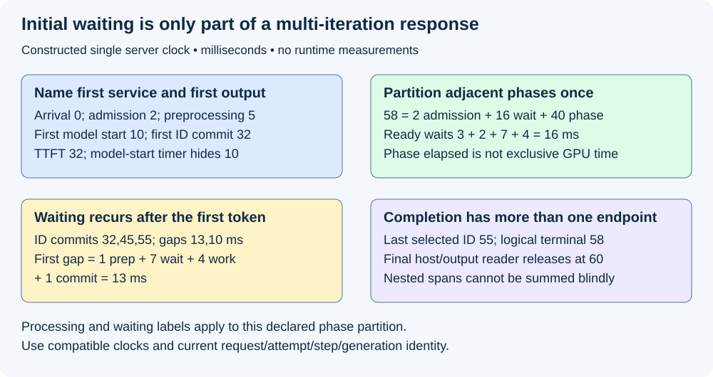
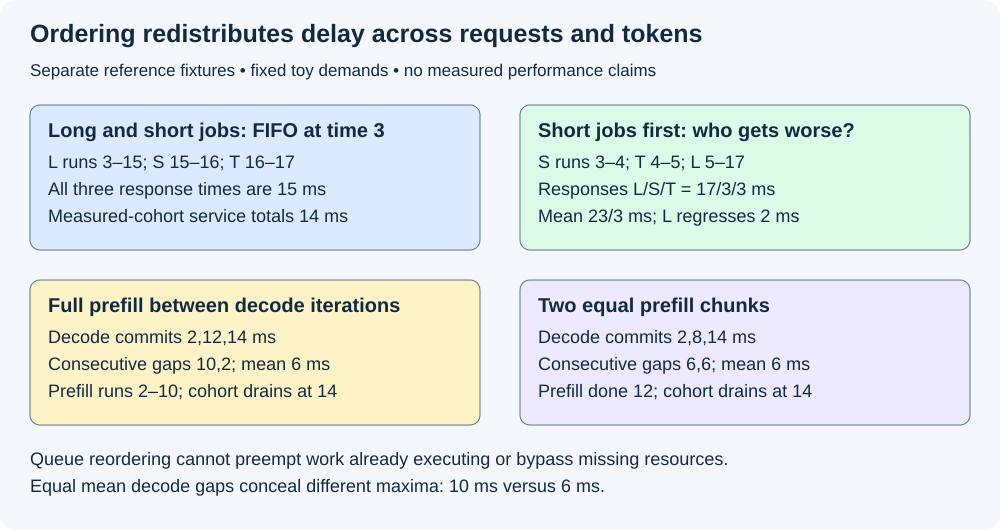

# M5-C08: Queueing delay, service time, and request latency

> **Status: Complete — detailed chapter authored and documentation validated; experimental procedures are proposed unless explicitly labelled observed.**

**Module:** Learn scheduling, operating systems, and queueing theory

**Category:** [Scheduling and queueing](index.md)

[Module 5 reading order](../module-5.md) · [Previous: M5-C07](../measurement-experimentation-and-economics/m5-c07-describing-mixed-serving-workloads-and-arrival-traces.md) · [Next: M5-C09](../scheduling-and-queueing/m5-c09-applying-little-s-law-with-consistent-boundaries.md)

## Target concepts

Arrival, admission, first service, first token and completion timestamps, queue versus system boundaries, waiting versus service time, head-of-line blocking, iteration-level interference.

[Execution plan and progress](../chapter-execution-plan.md)

## Concepts

### 1. Define the system before naming its latency

A **queue** retains work waiting for a declared service opportunity. A **system boundary** includes some combination of admission, queues, preparation, execution and output delivery. **Residence time** is how long a request stays inside that boundary. **Service demand** is the processing required from a specified resource; it is not automatically the request's whole residence time. In a multi-stage service, waiting can recur between processing stages. Define the resource, eligible population and timestamps before calling an interval queueing or service time.

Use [M5-C07's arrival trace](../measurement-experimentation-and-economics/m5-c07-describing-mixed-serving-workloads-and-arrival-traces.md) and [M5-C04's bounded queues](../runtime-and-concurrency/m5-c04-producer-consumer-queues-and-bounded-work.md). An enqueue acknowledgment is not an output. A queue becoming empty does not establish completed requests or released device buffers. Admission means accepting the declared resource obligation; it does not imply first execution. A request waiting for input readiness is different from a ready request deferred by the scheduler.

Choose **server arrival a** as the complete parsed request record ready for admission. Earlier network receive/parsing lies outside this chapter's primary server boundary. Let **u** be admission, **s** first service at a specifically named stage, **f** first selected output-ID commit, **l** last selected ID, and **z** logical server terminal. The corresponding intervals are:

**Admission-path elapsed = u−a; initial post-admission delay = s−u; TTFT_selected = f−a; server terminal latency = z−a.**

All differences require compatible clock domains and valid event order. Admission-path elapsed can include validation or policy work, not just queueing. “First service” must say whether it means preprocessing start, first model execution or first device instruction. Subtracting first model start from first selection hides earlier waiting and preparation. A host submission timestamp is not device start, and a launch returning is not device completion.

At the client, use its own submission, parsed content and parsed terminal observations. The [NVIDIA metric definitions](https://docs.nvidia.com/nim/benchmarking/llm/metrics) illustrate submission-to-received-token and final-token endpoints; these differ from a selected-ID commit or parsed application terminal. A network text fragment need not equal one model token. Follow [M9-C03](../measurement-experimentation-and-economics/m9-c03-measuring-time-to-first-token-including-queueing.md), [M9-C04](../interfaces-protocols-and-streaming/m9-c04-measuring-inter-token-latency-in-a-streamed-protocol.md) and [M9-C05](../measurement-experimentation-and-economics/m9-c05-measuring-end-to-end-latency-and-throughput.md) for first-selected, visible-content, token-gap and terminal conventions. A zero-generation success or early rejection need not have a first token; do not invent one at time zero.

### 2. Partition a milestone chain without double-counting

The following constructed successful-request ledger uses milliseconds on one server clock. It extends the foundational 0–32-ms TTFT reference. Preprocessing starts at 5; first model service starts at 10. Three output IDs commit at 32, 45 and 55; the third is terminal under the stipulated stopping contract. Next-input preparation includes the necessary logical readiness work; all required backend transfer/completion is included in the stated model/commit spans. These are teaching inputs, not measured stage costs.

| Interval (ms) | Named phase | Classification in this reference |
|---|---|---|
| 0–2 | Arrival to admission | Admission-path elapsed; internal work/wait split unspecified |
| 2–5 | Admitted, ready for preprocessing | Waiting 3 ms |
| 5–8 | Preprocessing | Processing phase 3 ms |
| 8–10 | Ready for prefill, not selected | Waiting 2 ms |
| 10–30 | Prefill through required completion | Processing phase 20 ms |
| 30–32 | First selection/commit | Processing phase 2 ms |
| 32–33 | Prepare next eligible input | Processing phase 1 ms |
| 33–40 | Ready decode deferred | Waiting 7 ms |
| 40–44 | Required decode work/completion | Processing phase 4 ms |
| 44–45 | Second selection/commit | Processing phase 1 ms |
| 45–46 | Prepare next eligible input | Processing phase 1 ms |
| 46–50 | Ready decode deferred | Waiting 4 ms |
| 50–54 | Required decode work/completion | Processing phase 4 ms |
| 54–55 | Third selection/commit | Processing phase 1 ms |
| 55–58 | Finalize logical terminal outcome | Processing phase 3 ms |

The adjacent spans give **58 ms = 2 admission-path + 16 waiting + 40 processing-phase elapsed**. Waiting is **3+2+7+4=16 ms**. First-selected TTFT is **2+3+3+2+20+2=32 ms**. Timing from preprocessing start gives 27 ms; timing from model start gives 22 ms; neither equals arrival-based TTFT. First selection is not a separate extra decode after prefill.

The selected-ID gaps are **45−32=13 ms** and **55−45=10 ms**. Their mean is 11.5 ms, but that mean does not show which gap was longer. In this reference, the first gap partitions as **1 preparation + 7 waiting + 4 decode + 1 commit = 13 ms**. Initial queue delay is only one contributor to a multi-iteration request: its later ready work can be deferred again. A final host/output reader releases at 60, so assignment-to-final-user retirement may extend past terminal-at-58; retirement and logical response endpoints need separate records.

This is a partition of wall-clock phase intervals, not 40 ms of exclusive CPU or GPU busy time. Real phase spans can contain nested waits, device work and host observation delay. If a device interval 10–30 is already inside a server phase 10–32, adding both durations double-counts 20 ms. For overlapping intervals [10,30) and [15,25), summed spans equal 30 ms but their union covers only **20 ms**. A **critical path** is a dependency chain determining the endpoint; unrelated concurrent work must not be added to its length. Derive total latency from its endpoint difference and use qualified host/device profiles to explain it.

*Constructed single-clock milliseconds. Processing-phase elapsed is neither exclusive resource demand nor a sum of overlapping profiler spans.*

### 3. Start with a single non-preemptive server

A **non-preemptive** server finishes an assigned job before starting another. For a simple first-in, first-out (FIFO) queue, let aᵢ be arrival, bᵢ service start, dᵢ fixed service demand and cᵢ completion. With jobs in FIFO order, no extra overhead, all required work ready at arrival and initially idle service:

**bᵢ = max(aᵢ, cᵢ₋₁); cᵢ = bᵢ+dᵢ; Wᵢ = bᵢ−aᵢ; Rᵢ = cᵢ−aᵢ = Wᵢ+dᵢ.**

W is waiting and R response/residence, in milliseconds here. For the first job use the declared initial service-availability time instead of a preceding completion. These scalar recurrences specify reference arithmetic, not scheduler implementation. They assume one visit and fixed service demand. Dynamic LLM batches share work and revisit the executor, so do not apply a single fixed dᵢ to a whole request without validating that model.

For arrivals [0,1,2,3] ms and four 5-ms jobs, starts are [0,5,10,15], completions [5,10,15,20], waits [0,4,8,12] and responses [5,9,13,17]. Mean wait is **6 ms**; mean response **11 ms**, even though every job's service demand is exactly 5 ms. These reproduce M5-C07's open-loop reference with the same boundary. The response spread is caused by waiting, not variable processing demand. Four jobs establish no production percentile or stable capacity estimate.

### 4. Head-of-line blocking names a specific ordering constraint

**Head-of-line blocking** occurs when an earlier queued item prevents later otherwise eligible work from taking available service under the queue's rules. Distinguish it from work already running non-preemptively: changing queue order does not interrupt an active kernel. Also distinguish waiting for a missing dependency or resource from a policy choice among eligible jobs. Bypassing the head is useful only if the later work is actually compatible with resources, ordering and fairness requirements.

Consider a separate constructed server unavailable until 3 ms because of pre-existing work outside the measured cohort. L arrives at 0 with 12 ms of known toy service demand; S arrives at 1 with 1 ms; T arrives at 2 with 1 ms. All three are eligible by 3, with independent state and no rejection. At time 3 the choice of order is a policy decision; these fixed demands are simulator inputs, not future output lengths supplied to an online LLM scheduler.

| Policy / request | Service interval (ms) | Waiting from arrival (ms) | Response to completion (ms) |
|---|---|---:|---:|
| FIFO: L | 3–15 | 3 | 15 |
| FIFO: S | 15–16 | 14 | 15 |
| FIFO: T | 16–17 | 14 | 15 |
| Short jobs first: S | 3–4 | 2 | 3 |
| Short jobs first: T | 4–5 | 2 | 3 |
| Short jobs first: L | 5–17 | 5 | 17 |

Both orders finish the cohort at 17 and perform 14 ms of measured-cohort service. FIFO mean response is **15 ms**; the changed order gives **(17+3+3)/3 = 23/3 ≈7.67 ms**. L is worse by 2 ms while S and T each improve by 12. Reporting only the improved mean hides that tradeoff. Under recurring short arrivals, unbounded bypass can cause **starvation**, indefinite deferral of a request. Record maximum defer time/age and a declared fairness rule; do not claim fairness from three jobs. Cap-aware admission must still preserve future KV commitments, and queue policy cannot release another request's unfinished buffers.

### 5. Iteration-level interference can delay work after its first token

An **iteration** grants one qualified unit of executor progress and then allows the scheduler to reconsider eligible membership. [ORCA (OSDI 2022)](https://www.usenix.org/conference/osdi22/presentation/yu) develops iteration-level rather than whole-request scheduling. That creates opportunities to admit new work but does not guarantee short iterations or independent performance for all batch members. [DeepSpeed-FastGen (2024)](https://arxiv.org/abs/2401.08671) studies composing prompt and generation work with Dynamic SplitFuse; its design motivates inspecting prefill/decode interference. Neither paper's measured gain is a prediction for this repository.

A prefill-heavy batch can delay an already decoding request's next opportunity, or increase its iteration execution span through shared resource use. The former is ready waiting; the latter is execution-phase interference. Report both. Batch size alone cannot separate them: prompt chunks, context length, memory traffic and backend kernels also matter.

For a deliberately additive single-executor toy model, a decoding request needs three further iterations of 2 ms each. It is ready at 0, and each next step becomes ready at the preceding selection. Selection/commit and rescheduling overhead are stipulated zero; no speculative or concurrent forwards occur. Without a new prefill, intervals are 0–2, 2–4 and 4–6, with selected outputs at **[2,4,6]**. A new independent prefill becomes eligible at 2 and requires 8 ms of executor work.

| Variant | Ordered executor intervals (ms) | Decode output commits | Consecutive gaps |
|---|---|---|---|
| No new prefill | Decode 0–2; 2–4; 4–6 | [2,4,6] | [2,2] ms |
| Full prefill inserted | Decode 0–2; prefill 2–10; decode 10–12; 12–14 | [2,12,14] | [10,2] ms |
| Two equal prefill chunks | Decode 0–2; chunk 2–6; decode 6–8; chunk 8–12; decode 12–14 | [2,8,14] | [6,6] ms |

The two variants doing prefill both consume **6+8=14 ms** and finish at 14 under these strong assumptions. Full prefill finishes at 10, chunked prefill at 12, before any additional first-selection work for that prefill request. Both affected decode-gap means are 6 ms, yet maxima are **10 versus 6 ms**. Thus an average gap can conceal a different worst gap in a finite trace. The no-prefill variant does less total work and is an interference reference, not a matched throughput competitor.

Real chunking can add launches, memory movement, state retention and nonlinear kernel costs. Chunk boundaries must preserve prefix positions, randomness, numerical tolerance and the same final output; exact bitwise equality is required only where the qualified contract promises it. Later chapters develop chunked-prefill policy. Here it is a counterfactual dependency example, not a claim that a chunked backend is implemented or universally faster. Delaying a decode never authorizes simultaneous forwards for that request or premature KV reuse.

*Both schedules need per-request outcomes. A shorter mean can hide an older request's delay; equal mean token gaps can hide different maximum gaps.*

### 6. Missing endpoints and failures stay in the population

Record each request/attempt, stage eligibility, queue enter/leave, selection and required completion with current generation identity. A single-owner scheduler may append a coherent state transition log while device observations retain their own clock domain. Use the [Rust Instant specification](https://doc.rust-lang.org/std/time/struct.Instant.html) for host elapsed-time semantics and platform caveats: opaque monotonic instants do not supply a shared client/server epoch. Check ordering errors explicitly rather than turning invalid negative differences into zero. Nanosecond representation is not a claim of nanosecond resolution or overhead.

Cancellation before first service has no successful service interval; a timeout after submission does not prove device work ended. A logically failed/cancelled request may still have retained users. Apply [M9-C22](../runtime-and-concurrency/m9-c22-verifying-ownership-and-memory-safety-under-concurrency.md). A request open at the observation cutoff has an unfinished, censored residence time; omitting it makes successful-completion latencies look better under overload. A censored observation has elapsed time so far, but no observed endpoint yet. Rejected requests have a decision-latency population, not a successful TTFT. Preserve empty-output, error, cancellation and missing-instrumentation cases separately.

For a separate six-received-attempt cutoff fixture, **6 = 2 successful + 1 rejected + 1 waiting + 1 admitted nonterminal + 1 cancelled after admission**. Cumulative admitted is four; complete admission is not guaranteed for waiting work. Preserve all six even if only two contribute to a successful-response summary. Record offered but unsent/lost-before-receipt attempts at the generator/transport boundary as well. End-to-end improvement needs correct useful output and accountable outcomes, not simply shorter timers on the surviving requests.

## Experiments

All four experiments are proposed. Authorship observes only bounded reference arithmetic, document checks and rendering. No queue, runtime, model, profiler or serving study is implemented or executed.

### E1 — Audit queue and system timing boundaries

- **Name:** One request, several valid latency endpoints.
- **Description:** Reconcile the 0–60-ms milestone reference without conflating arrival, admission, preparation, first model service, token commits, terminal or retirement.
- **Purpose/objective:** Hypothesis: initial-service timing omits genuine residence, and repeated ready waits remain after first output. HFT concern: a timestamp taken after queued work starts hides the delay users experienced.
- **Target concepts:** Arrival/admission/first service/first token/completion, queue versus system, waiting versus processing.
- **Baseline:** Constructed single-clock chain and declared selected-ID contract; no client clock subtraction.
- **Workload:** Exact reference, missing first token, early rejection, reversed timestamps, overlapping profiler intervals and a delayed final reader. Independent variable: endpoint choice or one invalid observation at a time.
- **Controlled variables:** Request/attempt identity, same token output/stopping policy, readiness milestones, clock domain and meaning of model completion.
- **Hardware requirements:** CPU reference review; later qualified host clocks and backend event observations with documented correlation and readback scope.
- **Exit criteria:** First validate event order and units; then reproduce 32-ms selected TTFT, 58-ms terminal, 60-ms final-user endpoint, 16-ms explicit waiting and 40-ms phase elapsed; finally reconcile [13,10]-ms selected gaps. Invalid/missing endpoints stay visible. Nested spans cannot inflate the total or stand in for exclusive CPU/GPU demand.

### E2 — Reproduce waiting and head-of-line tradeoffs

- **Name:** The same processing demand can have different response times.
- **Description:** Audit the four-job FIFO recurrence and the separate L/S/T ordering experiment.
- **Purpose/objective:** Hypothesis: arrival/order creates delay independently of service duration, and bypass benefits some requests while harming another. HFT concern: a long earlier event can delay otherwise eligible urgent work.
- **Target concepts:** Waiting versus service, head-of-line blocking, queue/system boundaries and fairness.
- **Baseline:** One non-preemptive server, exact fixed-demand toy jobs, explicit initial availability and eligibility.
- **Workload:** Four 5-ms arrivals and separate 12/1/1-ms cohort; independent variable for the latter is eligible queue order at 3. Include a long job already executing and a later job lacking resources as counterexamples to legal bypass.
- **Controlled variables:** Arrival trace, demands, capacity, initial 0–3-ms unavailability, no overhead/rejection, per-request identities and admission obligations.
- **Hardware requirements:** CPU exact timeline QA; later actual request traces and resource-ready logs, without supplying realized lengths to an online scheduler.
- **Exit criteria:** First reproduce [0,4,8,12] waits and 11-ms mean response; then compare per-request L/S/T times and 15 versus 23/3-ms mean; finally show unchanged 17-ms cohort finish and L's 2-ms regression. Record fairness/defer limits for real workloads. An improved mean alone is not acceptance of an unconstrained bypass policy.

### E3 — Separate scheduling interference from execution cost

- **Name:** Equal average gaps, different longest gaps.
- **Description:** Compare full prefill and two chunks around dependent decode steps, then define a real measurement decomposition.
- **Purpose/objective:** Hypothesis: bounded scheduling opportunities can redistribute stalls while total work and mean gaps stay equal in the toy model. HFT concern: a long non-preemptible unit can delay already active work.
- **Target concepts:** Iteration-level interference, recurring queue delay, service spans and token latency.
- **Baseline:** Three dependent 2-ms decode steps; new independent 8-ms prefill eligible at 2; zero reschedule overhead is a toy assumption.
- **Workload:** Full versus two four-ms prefill chunks as the matched-work variants; no-prefill is separately labelled less-work reference. Independent variable: prefill scheduling granularity. Later include actual chunk sizes/context lengths and arrivals in frozen cells.
- **Controlled variables:** Useful prompts/output/IDs, request random identity, KV and shape constraints, hardware/backend, completion scope and numeric contract. Do not assume real chunks have additive equal costs.
- **Hardware requirements:** CPU interval reference; later backend qualified for resumable prefill with host scheduling, device event and memory diagnostics separated from clean timing.
- **Exit criteria:** First reproduce [2,12,14] versus [2,8,14] outputs, equal 6-ms mean gaps, 10/6-ms maxima and 14-ms drain; then distinguish ready-to-selection delay from actual invocation span; finally verify outputs, positions, claims and future growth bounds. Report added chunk overhead and prefill-request delay, not only the decode improvement. No measured speed or p99 claim follows from three outputs.

### E4 — Preserve outcome populations when timing changes

- **Name:** A shorter survivor latency cannot erase unfinished work.
- **Description:** Audit cutoff, cancellation, late output and physical release while specifying a matched end-to-end comparison.
- **Purpose/objective:** Hypothesis: removing long/cancelled/open attempts can create a false latency benefit. HFT concern: overload and abandoned work must remain in the service ledger.
- **Target concepts:** Completion boundaries, waiting populations, system residence and failure/coordination.
- **Baseline:** Six-received cutoff fixture, separately recorded offered demand and named final-user obligations.
- **Workload:** Two successes, one rejection, one waiting, one admitted nonterminal and one post-admission cancellation. Independent variable: cutoff/endpoint convention in the audit; a later policy comparison changes only the declared policy under the same intended open-loop workload.
- **Controlled variables:** Attempt identity/retries, terminal meanings, arrival window, drain rule, admitted capacities, stopping policy and cache state.
- **Hardware requirements:** CPU event/population audit; later generator/server clocks, bounded lifecycle logs and qualified cleanup observations for actual device work.
- **Exit criteria:** First reconcile six outcomes and four admissions; then retain undefined/censored timings and late resource claims; finally compare successful response distributions alongside all outcomes and useful output. Silent time-zero substitution, dropped open requests or premature release fails acceptance even if a mean improves.

## Verification

| Experiment | Correctness reference | Measurement / benchmarking | Profiling and acceptance boundary |
|---|---|---|---|
| E1 | Current identity, milestone order and nonoverlapping phase chain | Arrival, admission, start, output, terminal and retirement intervals; explicit ready waits | Cross-clock subtraction or added nested spans invalidates attribution |
| E2 | FIFO recurrence and legal eligibility/order choices | Per-job demand, wait, response, cohort finish and defer age | Queue head, executing work and resource-blocked work are distinct causes |
| E3 | Same prefill/decode work and valid dependent positions | Ready-to-dispatch, dispatch-to-required-completion, commit delay and selected/client gaps | Diagnose host scheduling versus invocation elongation; do not add overlapping spans |
| E4 | Complete offered/received/admitted/outcome and final-user ledgers | Success, rejection, cancellation and open populations; censored intervals and retained bytes | Success-only latency cannot establish useful service under overload |

For real experiments, freeze the [M5-C07 workload manifest](../measurement-experimentation-and-economics/m5-c07-describing-mixed-serving-workloads-and-arrival-traces.md), hardware/resources, cache state and qualified semantic/numerical reference. Use [M9-C11](../measurement-experimentation-and-economics/m9-c11-controlled-comparisons-warmup-and-reproducibility.md) for a proposed descriptive starting budget of 20 paired reset sessions per named cell, balanced arm order and one full scratch-trace warmup per arm. Restore the declared measured cache state afterward. Keep session pairs as replication units, requests as labelled observations, and all invalid/missing sessions with reasons. This budget and small reference fixtures establish no production p99 or sustainable capacity; confirmatory claims require [M9-C27](../measurement-experimentation-and-economics/m9-c27-designing-regression-experiments-and-validation-gates.md), justified sample size/uncertainty and per-class regression gates.

Record intended arrivals and dispatch lag so the generator does not reduce demand as latency grows. Define a fixed half-open offered window, then report whether completion/output rates use that window or a longer drain denominator. Drain admitted work and final users or declare unresolved/quarantined claims; preserve carried-in and unfinished attempts. Report both per-request first-output and terminal endpoints, eligible consecutive token gaps, useful selected/delivered output, all terminal reasons and peak waiting/payload/KV bytes. A rejection has no successful TTFT; no-output or one-output requests have no consecutive token gap. Keep request-weighted summaries distinct from token-gap-weighted summaries.

Use short separate diagnostics for scheduler ready/selected events, CPU runnable delays, descriptor submission, device start/completion, transfer/readback and host commit. Invocation elapsed may contain resource contention and synchronization; only evidence can attribute it. Measure instrumentation overhead on matched fixtures and keep profiling/sanitized runs out of clean service timing. Where clock correlation is unavailable, report compatible host and device interval measures separately. A local shorter processing phase is useful only through end-to-end service without semantic, memory or fairness regressions.

## Engineering dimensions and principles

| Dimension | Application |
|---|---|
| Semantics and invariants | E1 fixes first-selected versus visible/terminal meanings; E3 preserves dependent token/position identity |
| Workload and variability | E2/E3 vary long/short jobs, prefill/decode mix, context lengths, arrivals and reuse; text only |
| Resources and bottlenecks | Queue order cannot bypass missing capacity; extra chunks consume launches, bandwidth and retained KV |
| Time and distributions | Initial and recurring waiting affect TTFT, token gaps and terminal latency differently |
| Ownership and coordination | Immutable in-flight descriptors and current-generation completion retain final users past cancellation |
| Failure and adaptation | E4 preserves rejection, cancelled, unfinished and missing-instrumentation cases instead of improving survivors alone |

| Engineering principle | Consequence |
|---|---|
| 1. Correctness defines the optimization boundary | Shorter waits cannot justify wrong positions, duplicate selections or early reuse |
| 2. Performance depends on workload and operating point | Long prefill and short decode contend differently across batch/context regimes |
| 3. Data movement is part of the algorithm | Required transfer/readback belongs in completion scope and can elongate a phase |
| 4. State has ownership, lifetime and recovery cost | Logical terminal at 58 does not release the final reader before 60 |
| 5. Dependencies determine latency; bottlenecks determine capacity | Repeated ready waits lie on the response path; a queue policy cannot interrupt an active kernel |
| 6. Variability and synchronization shape the tail | Equal mean gaps of 6 ms conceal maxima of 10 versus 6 in the toy histories |
| 7. Local improvements require end-to-end evaluation | Bypass improves the mean while worsening L; report both and useful service |
| 8. Claims require reproducible evidence | Freeze clocks, boundaries, eligibility, workload, outcomes and paired evidence |

The HFT lens is an event waiting behind a long earlier handler and an active stream whose next update is delayed by shared work. Queue age, non-preemptible units and complete demand accounting transfer well. Inference adds dependent token generation, numerical contracts and retained KV; these examples establish no trading results or exchange deadlines.

## Specifications, articles, and hardware

The Rust Instant specification, NVIDIA metric documentation, ORCA research article and DeepSpeed-FastGen paper are linked at their relevant claims; primary sources were reviewed on 2026-10-29. ORCA motivates iteration-level service opportunities; FastGen motivates studying composition of prompt/generation work. Neither supplies a universal fixed-duration cost model. Pin actual compiler, metric tool and backend revisions before execution.

Reference arithmetic needs only CPU timeline review. Real runs record generator/server CPU/core/SMT/NUMA/RAM, OS/kernel, affinity/quotas, runtime workers, compiler and competing work; GPU architecture/count/VRAM, interconnect, driver/backend/runtime, stream/event/graph policies; and model/adapter/tokenizer/template/corpus identities, dtype/layout, output caps/stopping/random streams, queue/KV/workspace limits and cache state. Record clock resolution/correlation, trace loss, profiling overhead, warmup/reset/drain and fault policies. No hardware was benchmarked; every stated millisecond cost is a constructed teaching assumption.

## Key takeaways

Choose the queue and system boundary before naming a latency. Separate initial waiting, recurrent ready waiting, processing phases and final-user retirement. Queue order and iteration granularity redistribute delay across requests and tokens; judge them with complete per-class outcomes and correct end-to-end behavior.

## Continue learning

Next in Module 5 reading order is completed [M5-C09: Applying Little’s law with consistent boundaries](m5-c09-applying-little-s-law-with-consistent-boundaries.md). The next authoring chapter is [M5-C18: Choosing chunk sizes and balancing prefill with decode](../scheduling-and-queueing/m5-c18-choosing-chunk-sizes-and-balancing-prefill-with-decode.md), position 125. Follow the [execution plan and progress tracker](../chapter-execution-plan.md); Module 9 supports Modules 1–7 and Module 8 is excluded.
